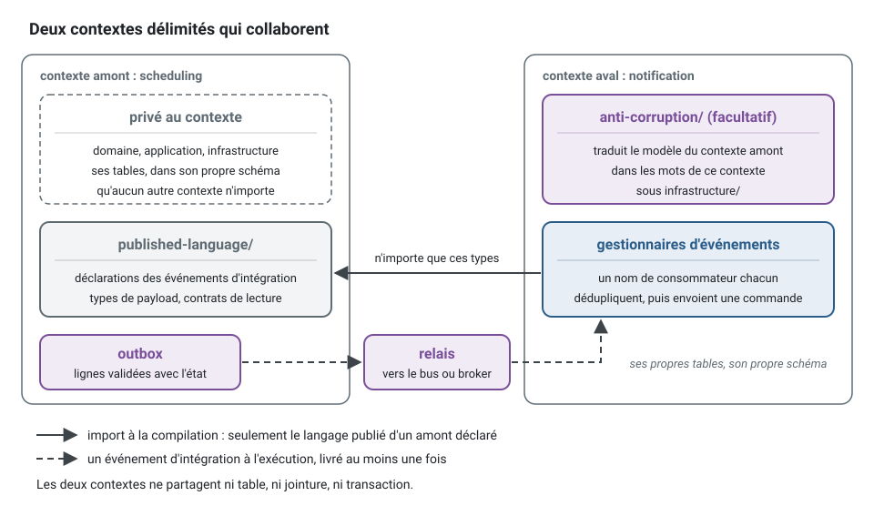
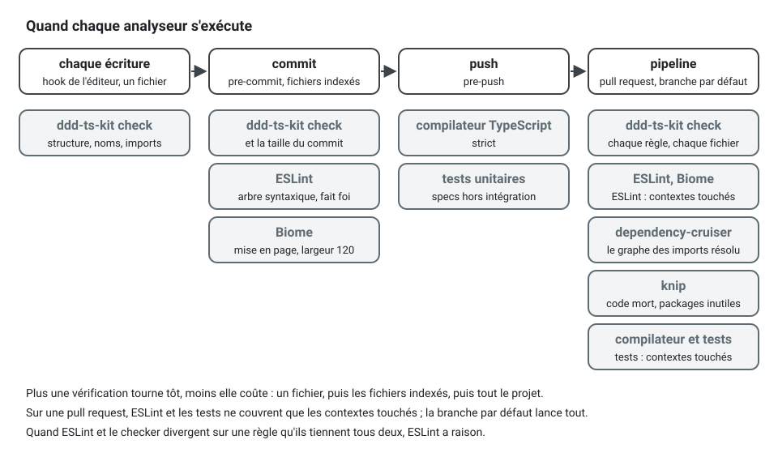

[English](ARCHITECTURE.md) · **Français**
<!-- translation-of: ARCHITECTURE.md sha256:58c92d8a9e5d492e -->

# Référence de l'architecture

Le seul document normatif. La CLI (`ddd-ts-kit check`), les *templates*, les *skills* et le
*hook* mettent tous en œuvre ce qui est écrit ici. Quand ils divergent, c'est ce fichier qui a
raison, et c'est l'outil qu'il faut corriger.

## 1. Conception stratégique

Un système est un ensemble de **contextes délimités** (bounded contexts). Chacun possède un
modèle, un vocabulaire et ses données.

- Chaque contexte a un `CONTEXT.md` : raison d'être, classification, langage omniprésent
  (ubiquitous language, le glossaire), agrégats, événements publiés, relations.
  Il se termine par une section générée `## Reference` : les cas d'usage avec leur permission,
  les routes, les événements consommés et publiés, les ports avec leurs adaptateurs, les
  politiques, les *gateways* et une ligne de dépendances. `ddd-ts-kit docs` l'écrit,
  `docs --check` détecte sa dérive, et `ddd-ts-kit describe <context> --json` donne les mêmes
  faits sous forme de données.
- Chaque contexte est classé : `core` (différenciant, il reçoit le meilleur effort de
  conception), `supporting` (nécessaire, non différenciant) ou `generic` (à acheter ou à garder
  trivial).
- Les relations se déclarent dans `ddd-ts-kit.config.json`, jamais par le simple fait d'un
  import. Un contexte aval nomme son amont et le patron de relation : `published-language` (par
  défaut), `customer-supplier`, `conformist`, `anti-corruption-layer`, `open-host-service`,
  `shared-kernel`.
- Le seul code qu'un autre contexte peut importer est le dossier `published-language/` de
  l'amont : types d'événements, types de *payload*, contrats de lecture. Tout le reste passe par
  des événements d'intégration.
- Un contexte aval qui ne veut pas du modèle de son amont le traduit dans
  `infrastructure/anti-corruption/`.
- Aucune table de base de données partagée. Un contexte lit les données d'un autre contexte par
  un contrat publié, ou par sa propre projection alimentée par des événements d'intégration.
- Le noyau partagé ne contient que ce qu'au moins deux contextes utilisent. Un fichier lu par un
  seul contexte appartient à ce contexte.



La relation s'écrit avant le premier import. Dans l'application d'exemple, `notification` réagit
à ce que publient `scheduling` et `identity`, et son entrée dans `ddd-ts-kit.config.json` le dit :

```json
"notification": {
  "classification": "supporting",
  "upstreams": [
    { "context": "scheduling", "relationship": "published-language" },
    { "context": "identity", "relationship": "published-language" }
  ]
}
```

Un fichier de `notification` atteint alors `scheduling` par son langage publié, et par nulle part
ailleurs :

```ts
// Au lieu de : le modèle d'un autre contexte (context/published-language-only)
import { Appointment } from '@/contexts/scheduling/domain/aggregates/appointment.aggregate';

// Écrire : le contrat que l'amont a conçu pour les autres, et réagir à ses événements
import { appointmentCancelledV1, type AppointmentCancelledV1 } from '@/contexts/scheduling/published-language/index';
```

## 2. Arborescence canonique

```
src/
  main.ts                        racine de composition : le traçage d'abord, puis le câblage
  shared-kernel/                 facultatif : objets-valeurs utilisés par deux contextes ou plus
    presentation/                schémas du contrat HTTP par lesquels plusieurs contextes répondent (*.schema.ts)
  platform/                      capacités techniques : config, base de données, événements, auth, traçage, serveur HTTP
  apps/<context>/main.ts         facultatif : un contexte lancé seul, comme un service
  apps/worker/main.ts            facultatif : les jobs planifiés dans un processus à eux
  contexts/<context>/
    CONTEXT.md
    <context>.declarations.ts    généré : le barrel des classes déclarées du contexte, et ce que reçoit chaque constructeur
    <context>.dependencies.ts    généré, sous découverte seulement : ce que reçoit chaque constructeur
    <context>.module.ts          style explicite seulement : lie à la main les ports aux adaptateurs
    published-language/          contrats conçus pour les autres contextes
    domain/
      aggregates/                *.aggregate.ts
      entities/                  *.entity.ts
      value-objects/             *.vo.ts
      vocabularies/              *.vocabulary.ts   (vocabulaires fermés : un objet `as const` et son type union)
      events/                    *.event.ts
      errors/                    *.error.ts        (une classe par concept ; chaque refus est une fabrique statique)
      repositories/              *.repository.ts   (ports : classes abstraites)
      services/                  *.service.ts      (logique du domaine sans état, sur plusieurs agrégats)
      state-machines/            *.state-machine.ts (le cycle de vie d'un agrégat : états, transitions, refus)
    application/
      commands/<use-case>/       *.command.ts, *.handler.ts
      queries/<use-case>/        *.query.ts, *.result.ts, *.handler.ts
      ports/                     *.port.ts         (ports vers le monde extérieur : classes abstraites)
      authorization/             <context>.permissions.ts, *.policy.ts (qui peut faire quoi, ici)
      event-handlers/            *.event-handler.ts (réactions aux événements du domaine de ce contexte)
      scheduling/                *.job.ts          (jobs lancés par le temps : du calendrier à la commande)
      background/                *.background-job.ts (travail mis en file par un cas d'usage, exécuté par un worker)
      processes/                 *.process.ts      (gestionnaires de processus : état, décisions, délais)
      projections/               *.projection.ts   (projecteurs : des événements vers un modèle de lecture)
      integration/
        publishers/              *.publisher.ts    (de l'événement du domaine à l'événement d'intégration)
        handlers/                *.integration-handler.ts (de l'événement d'intégration à la commande)
    infrastructure/
      persistence/               adaptateurs *.repository.ts, *.mapper.ts, *.reader.ts, *.schema.ts
      external/                  adaptateurs des systèmes extérieurs
      anti-corruption/           traducteurs du modèle d'un autre contexte ou système
    presentation/
      http/                      <name>.routes.ts  (un groupe de routes : préfixe, tags, gardes)
        <resource>/<use-case>/   *.controller.ts, ses schémas (*.params.ts, *.query.ts, *.headers.ts, *.body.ts,
                                 *.accepted.ts, *.answer.ts, *.line.ts), *.mapper.ts, *.serializer.ts
        guards/                  *.guard.ts        (gardes du projet : classes déclarées)
        shared/                  schémas (*.schema.ts, `generate schema`) et serializers utilisés par plusieurs routes
                                 les routes fonctions restent à plat : *.route.ts, *.dto.ts, <context>.routes.ts (leur liste)
      cli/
    test/
      unit/  integration/
      fakes/                     implémentations en mémoire des ports et des repositories
      builders/                  *.builder.ts      (builders de données de test, un par agrégat)
      worlds/                    *.world.ts        (la mise en place que partagent plusieurs specs du contexte :
                                 l'application de test ou les bus avec les fakes du contexte)
```

Sous `presentation/http/`, une route est un dossier. `"stack.routes": "controllers"` (la forme
d'un nouveau projet) écrit chaque route comme une classe portant `@Controller` de
`@ddd-ts-kit/http`, dans `<resource>/<use-case>/`, avec les schémas de sa requête HTTP et de sa
réponse ; la ressource est le premier segment de son chemin, et le groupe de cette ressource,
`<resource>.routes.ts`, donne le préfixe, le tag et les gardes. Un fichier de schéma porte le nom
de sa classe, qui est le nom du schéma dans le contrat publié : `book-appointment.accepted.ts`
contient `BookAppointmentAccepted`. `"stack.routes": "functions"` garde une fonction
`defineRoute` par route, à plat, listée dans `<context>.routes.ts`. Les deux formes tournent dans
un même projet.

**Une forme se déclare une fois.** Sous `"stack.schemas": "shared"` (la forme d'un nouveau
projet), une forme que plusieurs routes utilisent, en tout ou en partie, se déclare une fois dans
`presentation/http/shared/` de son contexte (`generate schema <context> <Name>`), ou dans
`presentation/` du noyau partagé quand plusieurs contextes répondent avec elle
(`generate schema shared-kernel <Name>`), puis se partage : le contrat OpenAPI la contient une
fois dans `components.schemas` et chaque route y renvoie. Une route en dérive la partie dont elle
a besoin (pick, omit, partial, extend) au lieu de la copier, et une commande répond par un
identifiant avec `acceptedSchema` de `@ddd-ts-kit/http`, le composant `Accepted` de la
plateforme. `schema/no-duplicate-shape` signale une forme déclarée deux fois à la main dans un
même contexte, et `schema/presentation-only` garde chaque schéma dans une couche de
présentation : un schéma est un type du contrat, le domaine et les cas d'usage n'en lisent
jamais.

**Gardes et permissions sont deux choses, et chacune a une seule place.** Une garde est un
contrôle à l'entrée, sur un ensemble de routes : l'appelant est-il authentifié, a-t-il un rôle,
le *tenant* de son jeton est-il celui du chemin, la clé de la requête HTTP est-elle connue. Elle
lit l'appelant et la requête HTTP, s'exécute avant le contrôleur, et répond 401 ou 403 ; un
groupe de routes ou un contrôleur la nomme dans `guards`. Une permission est un droit métier :
elle peut dépendre de l'élément (à qui appartient ce rendez-vous, cette facture est-elle encore
un brouillon) et elle se déclare sur le cas d'usage, avec `@Requires` sur la commande ou la
requête, tranchée par le bus à travers le port `Authorizer`. Un *job*, un gestionnaire
d'événements et un autre transport envoient la même commande et sont tenus par la même
permission ; aucun d'eux ne passe de garde. Une garde ne remplace donc jamais une permission, ne
charge jamais un agrégat (`presentation/guard-at-the-edge`), et chaque cas d'usage dit toujours
qui peut l'envoyer (`authz/declared`).


Chacune s'écrit là où elle a sa place : la garde sur le groupe de routes, la permission sur la
commande.

<!-- checked sample -->
```ts
import { definePermissions } from '@ddd-ts-kit/auth';
import { Authenticated, RouteGroup } from '@ddd-ts-kit/http';
import { AuthorizedCommand, type Actor } from '@ddd-ts-kit/kernel';
import { Requires } from '@ddd-ts-kit/kernel/declarations';

// presentation/http/invoices.routes.ts : s'exécute avant chaque contrôleur du groupe, répond 401
@RouteGroup({ prefix: '/invoices', tags: ['billing'], guards: [Authenticated], errors: ['FORBIDDEN'] })
export class InvoicesRoutes {}

// application/authorization/billing.permissions.ts : les droits du contexte, sous forme de données
export const billingPermissions = definePermissions('billing', {
  'invoice.pay': { description: 'Record the payment of an invoice' },
});

// application/commands/pay-invoice/pay-invoice.command.ts : qui l'envoie a besoin de la permission
@Requires(billingPermissions['invoice.pay'])
export class PayInvoiceCommand extends AuthorizedCommand<void> {
  constructor(
    actor: Actor,
    readonly invoiceId: string,
  ) {
    super(actor);
  }
}
```

L'arborescence est **fermée** : un répertoire qui n'est pas listé ici est une décision de
conception, ajoutée à `extraDirectories` dans la config avec une raison, pas créée au cas par
cas. Les niveaux nommés `<use-case>` sont ouverts, de même que tout ce qui se trouve sous
`test/unit/`, `test/integration/`, `test/fakes/`, `test/builders/` et `test/worlds/`.
`test/unit/` et `test/integration/` ne contiennent que des *specs* : une aide que partagent
plusieurs *specs* a la place de son genre, un *fake*, un *builder* ou un monde
(`test/helper-placed`). Les *specs* de bout en bout
(`test/e2e/`), les *specs* d'acceptation des *stories* (`test/acceptance/`, chacune avec son
verrou), le test d'architecture (`test/architecture/`) et la mise en place globale des
exécutions de test (`test/support/`) vivent à la racine du projet, hors des contextes.

**Un concept sans rôle à lui a quand même sa place.** Le domaine n'a pas de répertoire
`types/`, `functions/` ni `utils/` : chacun accueillerait des concepts que personne n'a nommés.
Un type seul ou une fonction seule signale qu'un concept du modèle manque, et il va là où vit
ce concept :

| Ce que c'est | Où ça va | Pourquoi |
|---|---|---|
| une fonction sans effet de bord qui lit une valeur (un total, une conversion, une comparaison) | une méthode de cet objet-valeur | la valeur répond sur elle-même (fonctions sans effet de bord) ; une fonction à côté la laisserait anémique |
| une décision sur plusieurs agrégats ou valeurs qui n'appartient à aucun | un service du domaine, `domain/services/*.service.ts`, avec sa *spec* | le nom est alors juste : une décision métier sans état, sans entrée-sortie |
| une forme de données que le modèle partage (des seuils, un réglage métier) | un objet-valeur, `domain/value-objects/*.vo.ts` ; les types de ses *props* s'exportent du même fichier | une valeur nommée vérifie ses invariants une fois, là où un type nu ne vérifie rien |
| une règle interchangeable (une stratégie : la façon de décider un seuil, un prix ou un délai) | une classe abstraite dans `domain/services/` et un service concret par variante, chacun dans son fichier avec sa *spec* ; la base abstraite n'a pas besoin de *spec* à elle | le modèle choisit la variante et l'appelle à travers la base ; rien hors du domaine ne connaît les variantes |
| une mise en forme d'une valeur pour la lecture ou l'affichage | pas le domaine : le résultat d'une requête (`*.result.ts`) ou un *mapper* de `presentation/` | le domaine décide, il ne formate pas |

Une stratégie n'est pas un port : le modèle choisit l'implémentation à partir de ses propres
données, et rien n'est câblé. Une règle dont la variante vient de l'extérieur (un réglage, un
fournisseur) est un port de `application/ports/`. `*.policy.ts` reste le suffixe des politiques
d'autorisation de `application/authorization/`.

<!-- checked sample -->
```ts
// domain/services/approval-threshold.service.ts : la règle, avec un nom du métier
export abstract class ApprovalThresholdService {
  abstract requiresApproval(amountInCents: number): boolean;
}

// domain/services/fixed-approval-threshold.service.ts : une variante, avec sa spec
export class FixedApprovalThresholdService extends ApprovalThresholdService {
  constructor(private readonly ceilingInCents: number) {
    super();
  }

  requiresApproval(amountInCents: number): boolean {
    return amountInCents > this.ceilingInCents;
  }
}
```

## 3. Règles de dépendance


Chaque dépendance de code source pointe vers le domaine. La seule flèche qui va dans l'autre sens
n'est pas un import : l'infrastructure implémente un port que l'application ou le domaine déclare,
et la plateforme le lie au démarrage. Pourquoi, et ce que contient chaque couche :
[Les couches et la règle de dépendance](concepts/layers-and-dependency-rule.fr.md).

| Id | Règle |
|---|---|
| `layer/domain-purity` | `domain/` n'importe que son propre `domain/`, le noyau partagé et `@ddd-ts-kit/kernel`. Aucun framework, aucun ORM, aucune bibliothèque de validation, aucun module intégré de Node qui fait des entrées-sorties. |
| `layer/application-inward` | `application/` importe `domain/`, `application/`, les langages publiés, le noyau et `@ddd-ts-kit/auth` (permissions et politiques). Jamais `infrastructure/` ni `presentation/`, jamais un framework ni un pilote. |
| `layer/presentation-no-infrastructure` | `presentation/` importe `application/` (et les types du domaine pour la traduction), jamais `infrastructure/`. |
| `layer/infrastructure-no-presentation` | `infrastructure/` implémente des ports de `application/` et de `domain/`, et n'importe jamais `presentation/`. |
| `context/published-language-only` | Un fichier n'importe d'un autre contexte que par le `published-language/` de ce contexte. |
| `context/declared-relationship` | Un tel import exige que la relation soit déclarée dans la config. |
| `context/published-language-is-a-contract` | `published-language/` n'importe que le noyau, `@ddd-ts-kit/events`, `@ddd-ts-kit/validation`, la bibliothèque de schémas du projet et d'autres langages publiés (`publishedLanguageAllowedPackages`). |
| `context/no-cycle` | Les relations déclarées ne forment aucun cycle. |
| `tree/closed` | Un contexte ne contient que les répertoires canoniques, plus ses `extraDirectories` déclarés, et aucun fichier source hors d'un répertoire de rôle. |
| `tree/context-doc` | Chaque contexte a un `CONTEXT.md` avec les sections requises (`Purpose`, `Classification`, `Ubiquitous language`, `Aggregates`, `Published events`, `Relationships`) et la classification déclarée dans la config. |
| `tree/documented-paths` | Un chemin d'un contexte borné écrit comme du code dans un fichier Markdown de `docs/architecture/` (un plan, une note de conception, une revue) est un emplacement que l'arborescence canonique accepte, jugé comme `tree/closed` juge un fichier : ses répertoires et le fichier lui-même. Un chemin écrit relativement à son contexte (il commence par `domain/`, `application/`, `infrastructure/`, `presentation/` ou `published-language/`) ne nomme aucun contexte : il n'est signalé que quand chaque contexte déclaré le refuse, ses répertoires supplémentaires compris. Un chemin qui n'existe pas encore n'est pas signalé, un plan nomme des fichiers à créer ; un chemin que l'arborescence refuse (`application/services/`) décrit une conception que le code n'a plus. Sévérité par défaut `warn`. |
| `naming/suffix` | Un fichier d'un répertoire de rôle porte le suffixe du rôle, en kebab-case. |
| `naming/one-concept-per-file` | Un seul agrégat, entité, objet-valeur, événement, gestionnaire, *job* ou projection exporté par fichier, et une seule classe déclarée par fichier de rôle. |
| `naming/search-not-list` | Une lecture qui prend des critères, un périmètre ou une page est une recherche. Dans un contexte, aucune méthode ne s'appelle `list`, ou `list` suivi d'une majuscule (`listByCustomer`), ni dans un port (`domain/repositories/*.repository.ts`, `application/ports/*.port.ts`) ni dans une classe de `infrastructure/` ou de `test/fakes/` : elle s'appelle `search...`. Sous `application/queries/`, aucun dossier ni fichier ne s'appelle `list` ni ne commence par `list-` ou `list.`, et aucune classe ne s'appelle `List` ni ne commence par `List` suivi d'une majuscule : la requête est `Search<Things>Query` dans `search-<things>/`. Une propriété n'est pas jugée, ni `listAccessible`, que le port `Authorizer` du kit exige ; une lecture d'un seul élément ou d'aucun reste `findById` ou `findBy...`. |
| `naming/business-name` | Une variable, une variable de boucle, un nom déstructuré, un paramètre (d'une fonction, d'une méthode, d'une signature ou d'une fonction fléchée) et une propriété (d'une classe, d'une interface ou d'un type objet) de `domain/` et `application/` d'un contexte, et du noyau partagé hors de `presentation/`, portent le nom du concept qu'ils désignent, jamais un mot générique : `target`, `targets`, `data`, `item`, `items`, `obj`, `object`, `thing`, `things`, `stuff`, `info`, `element`, `el`, `tmp`, `temp`, `foo`, `bar`, `baz`. `businessNames.words` de la configuration remplace la liste, `businessNames.allow` en retire des mots. Une clé d'un objet littéral suit le type pour lequel elle est écrite et n'est pas jugée, ni les tests. ESLint corrige une variable construite par `X.create(..)` ou `new X(..)`, ou lue depuis un *repository*, en la renommant, avec chacun de ses usages, du nom de `X` en camelCase (`appointment`), sauf si ce nom est déjà pris ; une variable de boucle est signalée avec le singulier de sa collection. |
| `test/spec-required` | Chaque agrégat, objet-valeur, service du domaine, gestionnaire de commande, gestionnaire de requête, gestionnaire d'événements du domaine, gestionnaire d'événements d'intégration, *job* et projection a un `*.spec.ts` dans le `test/` du contexte. Un fichier dont toutes les classes exportées sont abstraites et qui n'exporte aucune fonction est une base tenue par les *specs* de ses implémentations, et n'en demande pas. |
| `events/name-format` | Les noms des événements du domaine et d'intégration suivent `<context>.<aggregate>.<fact-in-past-tense>` : le `static readonly eventName` qu'un événement du domaine déclare une fois (ou son `readonly name`, comme l'écrivait la 0.5) et le `type` d'une déclaration d'événement d'intégration. |
| `events/name-declared-once` | Chaque classe de `domain/events/`, hormis une classe abstraite, déclare son nom une fois, `static readonly eventName = '<context>.<aggregate>.<fact>'`, sous lequel ses gestionnaires et ses projections sont attachés ; son `readonly name` le lit au lieu d'écrire le nom une seconde fois : étendre `NamedDomainEvent('<context>.<aggregate>.<fact>')` du noyau, qui déclare les deux, ou écrire `readonly name = InvoiceIssued.eventName`. Vérifié sur chaque événement du domaine, consommé ou non. |
| `events/defined-in-published-language` | Un événement d'intégration se déclare une fois avec `defineIntegrationEvent` dans le `published-language/` du producteur, avec un schéma de *payload*. Le catalogue et le document AsyncAPI sont générés à partir de ces déclarations. |
| `test/no-mocks` | Aucun `vi.mock`, `jest.mock`, `vi.fn`, `jest.fn`, `vi.spyOn`, `jest.spyOn` ni aucune bibliothèque de *mocks* dans le `test/` d'un contexte. Utiliser le *fake* du port. Sévérité par défaut `warn`. |
| `test/builder-required` | Un agrégat a un *builder* dans `test/builders/`. Sévérité par défaut `warn`. |
| `test/helper-placed` | Un fichier du `test/unit/` ou du `test/integration/` d'un contexte est une *spec* (`*.spec.ts`, `*.test.ts`). Une aide écrite parmi elles va à la place de son genre : une mise en place que partagent plusieurs *specs* dans `test/worlds/*.world.ts`, des données de test dans `test/builders/`, un port en mémoire dans `test/fakes/`. Sévérité par défaut `warn`. |
| `test/acceptance-black-box` | Une *spec* d'acceptation (`test/acceptance/<story>.acceptance.spec.ts`) pilote l'application comme le fait un client : elle n'importe rien de la racine des sources, sauf les *builders* d'un contexte (`test/builders/`) et son `published-language/`. Ses scénarios sont écrits avant le code de la *story* et vérifient ce qu'observe un client. Sévérité par défaut `warn`. |
| `test/coverage-governed` | La couverture ne se truque pas par exclusion. La config du lanceur de tests lit ce qu'elle mesure et ses seuils dans la clé `coverage` de `ddd-ts-kit.config.json`, par `governedCoverage` (`governedJestCoverage` sous jest) de `@ddd-ts-kit/testing/coverage` : les quatre couches de chaque contexte, y compris les fichiers qu'aucune *spec* ne charge, chaque contexte et chaque couche tenus à leur plancher dès leur premier fichier source. Refusés : `include`, `exclude`, `thresholds` ou `ignoreClassMethods` écrits à la main dans un bloc `coverage` (`collectCoverageFrom`, `coveragePathIgnorePatterns`, `coverageThreshold` sous jest), les mêmes fixés par une option dans un script de `package.json`, et un commentaire `v8 ignore`, `c8 ignore` ou `istanbul ignore` dans une source de production qui ne se termine pas par `-- ADR-NNNN: <reason>` nommant un enregistrement de décision existant. |
| `language/glossary-term` | Chaque agrégat, entité, objet-valeur, service du domaine, événement du domaine, commande et requête est nommé avec des termes de la table `## Ubiquitous language` du `CONTEXT.md` de son contexte, et sous `"stack.refusals": "factories"` chaque classe d'erreur de `domain/errors/` aussi (`AppointmentError` est nommée d'après `Appointment`). Le glossaire s'écrit avant le code. |
| `language/declared-vocabulary` | Une valeur d'un vocabulaire fermé que le projet déclare, un objet `as const` exporté avec le type union de son nom (`domain/vocabularies/*.vocabulary.ts`, le `Role` de la plateforme) ou un ensemble de permissions de `definePermissions`, se lit à travers lui (`AppointmentStatus.NoShow`, `billingPermissions['invoice.issue']`), et ne se réécrit jamais en littéral de chaîne hors de sa déclaration, clé entre guillemets comprise (`[AppointmentStatus.NoShow]: ..`). Sous `"stack.literals": "named"`, ce qu'écrit `init` ; une config qui ne dit rien garde les littéraux libres. Où : le vocabulaire d'un contexte dans ce contexte seulement, celui de la plateforme dans la plateforme et dans les groupes de routes `*.routes.ts`, un identifiant de permission et un vocabulaire du noyau partagé partout. Les tests, les langages publiés et le schéma des relations (`defineSchema`) ne sont pas jugés. Dans la persistance d'un contexte (`infrastructure/persistence/`), le nom d'une colonne, d'une table ou d'un schéma est un mot du stockage et n'est pas jugé : le premier argument d'un appel (`text('note')`, `createTable('invoice')`, `.where('note', ..)`) et la valeur de `name`, `tableName` ou `schema` ; une valeur stockée, l'argument de `.default(..)` ou une valeur comparée dans une requête, l'est. Un mot d'un autre langage n'est pas celui du contexte et n'est pas jugé quand son type le dit, hors de `domain/` : une clé d'un objet typé `Record<T, ..>` et une valeur chaîne d'un objet typé `Record<.., T>` (par l'annotation de sa déclaration ou par `satisfies` ; `as const` et `Readonly`, `Partial`, `Required` autour permis), et un littéral écrit `'x' satisfies T`, où `T` est une seule référence de type (`Payload['state']`, `typeof x`, pas d'union) dont le nom est importé d'un langage publié, importé comme type d'un paquet, ou importé de ou déclaré dans `infrastructure/anti-corruption/` ou `infrastructure/external/`. Là, les types littéraux d'une interface ou d'un alias de type, qui décrivent un enregistrement extérieur tel qu'il arrive, ne sont pas jugés non plus. Une clé d'une table typée par le vocabulaire propre du contexte, une comparaison ou un `case` sans `satisfies`, et une valeur du contexte dans une table de traduction restent jugées. Lu comme un vocabulaire : chaque entrée une clé et un littéral de chaîne, commentaires, l'un ou l'autre guillemet et `as const satisfies ..` permis, à côté de `export type X = (typeof X)[keyof typeof X]` ; un nombre, une décomposition (spread) ou une entrée calculée laisse l'objet non lu. |
| `language/no-technical-name` | Aucun `Manager`, `Helper`, `Util`, `Utils`, `Data`, `Info`, `Processor`, `Wrapper`, `Impl`, `Base`, `Abstract`, `Dto`, `Entity`, `Model` dans un nom sous `domain/` ni dans un nom de cas d'usage. |
| `purity/no-system-clock` | Aucun `new Date()` sans argument, `Date.now()` ni `performance.now()` dans `domain/` ou `application/` : le temps vient du port `Clock`. |
| `purity/no-ambient-randomness` | Aucun `Math.random`, `crypto.randomUUID` ni bibliothèque d'identifiants dans `domain/` ou `application/` : les identifiants viennent du port `IdGenerator`. |
| `purity/no-environment` | Aucun `process.env`, `console`, accès au système de fichiers ni au réseau dans `domain/` ou `application/`. |
| `clean/stepdown` | Un fichier se lit de haut en bas : les fabriques statiques, les membres publics, puis les protégés et les privés, et une fonction au-dessus des fonctions qu'elle appelle. |
| `clean/function-size` | Une fonction a au plus 3 paramètres et 30 lignes (configurable, jamais au-dessus de 100) ; une fonction plus longue fait plus d'une chose. Des paramètres qui voyagent ensemble forment un seul concept : ils deviennent un objet de props typé ou un objet valeur, jamais un quatrième paramètre. Un paramètre typé `Actor` ou `Date`, qui agit et quand, est le contexte d'une intention plutôt que son entrée et n'est pas compté (`invoice.issue(lines, customer, actor, now)` en compte trois). Sévérité par défaut `warn`. Aucune fonction ne dépasse 100 lignes de code, rappels (callbacks) de `describe` compris : ce plafond est une `error`. Un fichier de spec tient un `describe` de premier niveau par comportement (un `describe` imbriqué compte dans son parent) ; un second fichier de spec ne s'impose qu'au-delà des 350 lignes de `clean/file-size`. |
| `clean/no-commented-out-code` | Pas de code en commentaire. Le gestionnaire de versions s'en souvient. |
| `clean/no-noise-comment` | Aucun commentaire qui répète le code, aucune bannière, aucun journal, aucun commentaire d'accolade fermante, aucun `@param` sans description, aucun `TODO` ni `FIXME` sans propriétaire ni référence (les marqueurs de la section 6 portent les leurs). Sévérité par défaut `warn`. |
| `clean/no-escape-hatch` | Aucun `any`, aucune assertion de non-nullité, aucune assertion de type hors des *mappers* et de l'infrastructure, aucun `@ts-ignore`, aucun `@ts-expect-error` sans raison, aucun `eslint-disable` sans raison. |
| `clean/no-flag-argument` | Aucun paramètre booléen sur une méthode publique du domaine ou d'un cas d'usage : deux intentions font deux méthodes. Sévérité par défaut `warn`. |
| `clean/no-magic-number` | Sous `"stack.literals": "named"`, aucun littéral numérique dans `domain/` et `application/` sauf 0, 1, -1 (l'option `allow` de la règle ESLint change la liste), un indice et un type : une durée, une limite ou un taux est nommé là où il se décide, une constante du module ou un `static readonly` (`const MINUTES_PER_HOUR = 60`), ou un objet-valeur du métier. Tenue par le *plugin* ESLint. |
| `domain/aggregate-encapsulation` | Un agrégat ou une entité a un constructeur privé ou protégé, aucune propriété publique modifiable et aucun mutateur (setter). |
| `domain/value-object-immutability` | Un objet-valeur n'a que des propriétés en lecture seule et ne s'affecte jamais rien hors de son constructeur. |
| `domain/value-object-class` | Sous `"stack.values": "classes"`, que `init` écrit (une configuration sans la clé vaut `free` et la règle se tait), un objet-valeur est une classe. Un fichier de `domain/value-objects/` d'un contexte, ou un `*.vo.ts` du noyau partagé hors de `presentation/`, exporte exactement une classe qui étend `ValueObject` du noyau (directement, ou par une classe du même fichier ou d'un autre fichier d'objet-valeur qui l'étend), dont le constructeur est privé ou protégé (ou hérité de `ValueObject`), construite par des fabriques statiques (une classe concrète a une méthode statique qui n'est pas privée) ; il n'exporte aucune fonction, aucune constante liée à une fonction fléchée ou à une expression de fonction et aucun objet littéral, en ligne, par une liste d'export ou par défaut, et peut exporter les types et les interfaces de ses props. Dans `domain/` d'un contexte et dans le noyau partagé hors de `presentation/`, aucune fonction exportée ne renvoie un enregistrement de données : un objet littéral, dans l'expression d'une fonction fléchée ou dans un `return` de son propre corps, qui contient des données (un littéral, un paramètre, une opération sur eux, un appel du langage comme `Math.round` ou `new Date`), aucune décomposition (spread) et rien qu'un appel ou un `new` du modèle a construit (`Money.of(..)`, `total.add(..)`) ; une telle valeur s'écrit en classe d'objet-valeur (`generate value-object`). Un service du domaine, une machine à états (`defineStateMachine(..)`), une spécification qui renvoie un booléen ou un objet de fonctions, un enregistrement d'objets-valeurs que la fonction construit, un enregistrement dérivé par une décomposition et une fonction qui déclare un type de retour d'un *package* ne sont pas concernés ; une décision renvoyée en simple enregistrement l'est. Les *specs* ne sont pas jugées. |
| `domain/no-generic-error` | `domain/` et `application/` ne font jamais `throw new Error(...)` : un échec métier est une sous-classe de `DomainError`. |
| `errors/through-factory` | Sous `"stack.refusals": "factories"`, une erreur du domaine se construit par une fabrique statique de la classe d'erreur de son concept : `throw AppointmentError.slotTaken(calendar.id, slot.startsAt)`. Aucun `new` d'une classe importée de `domain/errors/`, dans aucun fichier d'un contexte, tests compris. Les erreurs du kit, chacune un refus sous un code fixe (`NotFoundError`, `InvariantViolation`, `ValidationError`), ne sont pas concernées. |
| `errors/constructor-not-public` | Sous `"stack.refusals": "factories"`, le constructeur d'une classe d'erreur de `domain/errors/` n'est pas public : la classe étend `ConceptError` du noyau, dont le constructeur est protégé, et n'en déclare aucun ; un constructeur qu'elle déclare est privé ou protégé. Refusés : un constructeur public, et une classe qui étend `DomainError` sans constructeur, qui en hérite un public. Une classe abstraite n'est pas jugée. |
| `errors/factory-name` | Sous `"stack.refusals": "factories"`, une fabrique (une méthode statique publique d'une classe d'erreur qui appelle `refusal(..)`) porte le nom du refus, dans les mots du métier : jamais `create`, `make`, `of`, `from`, `build`, `new`, `error`, `failure`, `fail`, `refusal`, `refuse`, ni un nom qui contient un chiffre. Son code est un littéral de chaîne en majuscules séparées par des tirets bas (constant case), et c'est le nom de la fabrique dans cette casse, seul ou avec le nom du concept avant ou après lui : `AppointmentError.notFound` fixe `NOT_FOUND`, `APPOINTMENT_NOT_FOUND` ou `NOT_FOUND_APPOINTMENT` ; `slotTaken` qui fixe `BOOKING_FAILED` est signalé. |
| `errors/code-unique` | Sous `"stack.refusals": "factories"`, un code nomme un seul refus d'un contexte : deux fabriques, ni deux classes d'erreur, du `domain/errors/` d'un même contexte ne fixent le même code, quelle que soit la forme qui l'écrit (le premier argument de `refusal(..)`, un champ `readonly code`). Le même code dans deux contextes est permis : chaque contexte possède son langage, et le *mapper* des erreurs donne un statut à un code. |
| `schema/presentation-only` | Sous `"stack.schemas": "shared"`, un schéma du contrat HTTP vit dans `presentation/` : de son contexte, ou du noyau partagé quand plusieurs contextes répondent avec lui. Dans le noyau partagé hors de `presentation/`, aucun import d'une bibliothèque de validation (zod, class-validator, class-transformer, class-validator-jsonschema, valibot, arktype, TypeBox, `@ddd-ts-kit/validation`) ; dans `domain/`, `application/`, `infrastructure/` et `published-language/` d'un contexte, et dans le noyau partagé hors de `presentation/`, aucun import d'un fichier de `presentation/` du noyau partagé. Les *specs* ne sont pas jugées. |
| `schema/no-duplicate-shape` | Sous `"stack.schemas": "shared"`, une forme du contrat se déclare une fois dans son contexte : dans la couche de présentation d'un contexte, ou dans celle-ci et `presentation/` du noyau partagé, pas deux classes DTO (du module, qui n'étendent rien, sans méthode, chaque propriété décorée) avec les mêmes propriétés, décorateurs et caractère facultatif, et pas deux schémas d'objet (`z.object`, `v.object`, `Type.Object`) avec les mêmes entrées, quels que soient leur ordre et leur mise en page. Les paramètres de requête HTTP (`*.params.ts`, `*.query.ts`, `*.headers.ts`, les objets affectés à `params`, `query` ou `headers`), les formes vides et les formes qui portent encore un `TODO(domain)` du générateur (une ligne de recherche commence par `{ id }`) ou un `TODO(review)` ne sont pas jugés. Deux contextes peuvent déclarer la même forme : une structure égale avec deux sens fait deux concepts, et la déplacer dans le noyau partagé couplerait des contextes qui restent extractibles. L'original est la déclaration du noyau partagé, puis de `presentation/http/shared/` du contexte, puis la première dans l'ordre des chemins ; chaque copie est signalée. |
| `errors/known-code` | Sous `"stack.refusals": "factories"`, chaque code qu'une route (`*.route.ts`) ou un contrôleur (`*.controller.ts`) déclare dans `errors` existe : une fabrique ou une classe d'erreur du contexte de la route le fixe, une classe hors des contextes (la plateforme, le noyau partagé) le fait, ou c'est un code du kit (`VALIDATION_FAILED`, `NOT_FOUND`, `CONFLICT`, `INVARIANT_VIOLATION`, `UNAUTHORIZED`, `FORBIDDEN`, `NOT_ACCEPTABLE`, `CONCURRENCY_CONFLICT`, `INVALID_CRITERIA`, `INVALID_PAGE_REQUEST`, `TIMEOUT`, `CIRCUIT_OPEN`, `BULKHEAD_FULL`, `ATTEMPTS_EXHAUSTED`, les conditions d'une écriture, `PRECONDITION_FAILED`, `PRECONDITION_REQUIRED`, et les refus d'un fichier, `FILE_TOO_LARGE`, `UNSUPPORTED_MEDIA_TYPE`, `FILE_NOT_FOUND`, `FILE_REJECTED`, `INVALID_FILE_KEY`). Un code qu'un autre contexte fixe ne compte pas. |
| `persistence/migration-history` | Chaque migration de l'outil de migration que nomme la config (drizzle-kit `migrations/*.sql`, knex et TypeORM `migrations/*`, Prisma `prisma/migrations/*/`) commence par le numéro qui l'ordonne, puis ce qu'elle fait (`20261012093000_add-invoices`, écrit par `npm run db:generate <what-it-does>`), et deux migrations ne partagent jamais un numéro. Une migration de travail, nommée `<timestamp>_working-<what-it-does>` (Prisma écrit `working_`), est celle qu'un *worker* génère dans son *worktree* pour que les *specs* de sa branche tournent sur les tables qu'elle change : elle n'est admise que là où existe le fichier de périmètre du *worker*, `.ddd-ts-kit/worker.json`, et signalée partout ailleurs, puisque le *conductor* la supprime et génère la vraie sur le tronc à la fusion. Sous drizzle-kit, `meta/_journal.json` et les fichiers `.sql` se correspondent un à un, les entrées gardent l'ordre dans lequel elles ont été générées (`idx` et `when` croissants : le *migrator* saute une entrée plus ancienne que la dernière qu'une base a appliquée) et chaque *snapshot* a été généré à partir de celui de l'entrée précédente (deux *snapshots* d'un même parent sont deux branches fusionnées sans régénération). |
| `persistence/primary-key-order` | Sous drizzle-kit, aucune migration (`migrations/*.sql`) ne change une clé primaire dans un ordre que PostgreSQL refuse : elle ajoute la nouvelle clé primaire d'une table avant que l'ancienne soit supprimée (une table a une seule clé primaire), ou supprime une colonne avant la clé primaire supprimée qui la contient (la colonne emporte la clé, et le `DROP CONSTRAINT` suivant échoue). Une contrainte supprimée est une clé primaire quand l'instantané dont la migration a été générée l'enregistre, ou que son nom finit par `_pkey` ou `_pk`. Elle lit les instructions `ALTER TABLE` de PostgreSQL. drizzle-kit peut écrire l'un ou l'autre ordre ; `drizzle-generate` avertit quand il le fait, et cette règle signale la migration jusqu'à ce que l'ancienne clé soit supprimée d'abord ou que le changement soit écrit avec `--custom`. Sévérité par défaut `warn`. |
| `persistence/no-file-content` | Aucune colonne de contenu de fichier dans un schéma de persistance ni dans une migration (les sources de persistance des contextes et de la base de la plateforme, `migrations/`, `drizzle/`, `prisma/`) : aucun type binaire (`bytea`, `blob` et ses tailles, `varbinary`, `.binary()` de knex, un `customType` drizzle de `Buffer` ou de `Uint8Array`, un champ Prisma `Bytes`) et aucune colonne de texte en base64 (une colonne texte dont le nom dit base64 ; le mot dans un curseur, un ETag, un commentaire ou une URL n'est pas une colonne). Les fichiers vivent dans le port `FileStorage` du noyau ; une ligne garde la référence `StoredFile` (clé, taille, type de média, somme de contrôle). Une petite valeur binaire qui n'est pas un fichier (une empreinte, une clé) est une dérogation enregistrée. |
| `files/port-not-connector` | `domain/` et `application/` nomment le port `FileStorage` du noyau (ou `FileStaging` et `FileKeys`), jamais un de ses connecteurs (`InMemoryFileStorage`, `LocalFileStorage`, `SelfSignedFileStorage`) ; `@ddd-ts-kit/s3` y est refusé quoi que disent les listes d'autorisation. La plateforme lie le connecteur de chaque environnement. |
| `application/handler-shape` | Un fichier `*.handler.ts` exporte une seule classe, avec une seule méthode publique, `execute`. |
| `presentation/controller-shape` | Un fichier `*.controller.ts` dont la classe porte `@Controller` de `@ddd-ts-kit/http` exporte cette seule classe, avec une seule méthode publique, `handle` : une classe par route. |
| `presentation/controller-delegates` | Un contrôleur ne décide rien : son constructeur prend le bus de sa méthode (`CommandBus` pour `POST`, `PUT`, `PATCH` et `DELETE`, `QueryBus` pour `GET` et `HEAD`), un *mapper* de requête HTTP (`*Mapper`) et un *serializer* (`*Serializer`), et rien d'autre. |
| `presentation/guard-at-the-edge` | Une garde contrôle l'appelant à l'entrée : un fichier `*.guard.ts` n'importe rien de `domain/` ni de `infrastructure/`, aucun *repository*, aucune unité de travail et aucun bus de commandes. Un droit qui dépend d'un élément du modèle est une permission du cas d'usage. |
| `presentation/shared-cache-varies` | Une politique de cache de `@ddd-ts-kit/http` dont la `scope` est `public` (gardée par les caches partagés : Varnish, un CDN), sur une route, un contrôleur ou un groupe de routes qui connaît son appelant (une garde autre que `Public`, une route fonction avec `security`), nomme dans `vary` les en-têtes de requête HTTP dont sa réponse dépend : un cache partagé range une réponse sous son URL et donnerait la réponse d'un appelant au suivant. Tenue par `@ddd-ts-kit/http` quand les routes sont construites (`DeclarationError`), et dans l'éditeur par le *plugin* ESLint pour ce que montre un seul fichier. |
| `application/command-query-separation` | Un gestionnaire de requête n'enregistre, ne supprime et ne publie jamais rien. Sévérité par défaut `warn`. |
| `events/outbox-required` | Avec une base de données, les événements d'intégration se publient par l'outbox transactionnelle, jamais directement vers un *broker* ou un bus depuis un gestionnaire. `stack.events` vaut `outbox` dès que `stack.orm` est fixé. |
| `events/consumer-idempotent` | Chaque gestionnaire d'événements d'intégration est déclaré (`@IntegrationEventHandler(definition, { consumer })`) ou enregistré avec un nom de consommateur stable, unique dans le projet, et déduplique par un registre des événements traités (lié une fois pour l'application, ou donné à l'abonnement). Jamais un `subscribe` nu. |
| `context/extractable` | Un contexte peut tourner seul : son module et ses classes déclarées ne câblent rien d'un autre contexte, il ne lit aucune table ni aucun schéma d'un autre contexte, n'importe aucun *repository* ni aucun port d'un autre, et n'exporte aucun état modifiable. Il n'appelle un autre contexte que par un port à lui dont l'adaptateur pourrait être distant. |
| `authz/declared` | Chaque commande, requête et route déclare la permission qu'elle exige, ou se déclare publique. Rien n'est accessible par défaut : une route fonction déclare sa `security`, un contrôleur nomme son groupe de routes ou ses propres `guards`, `[Public]` quand n'importe qui peut l'appeler. |
| `authz/in-application` | La permission se tranche dans la couche application, à travers le port `Authorizer`. Aucun test de rôle ou de propriété dans `presentation/`, aucune autorisation dans `infrastructure/`, aucune connaissance des droits de l'utilisateur qui agit dans `domain/` (un contexte dont le modèle est l'accès lui-même peut garder des rôles comme son propre état). |
| `authz/actor-explicit` | Les cas d'usage reçoivent l'acteur dans la commande ou la requête. `domain/` et `application/` ne lisent jamais l'`ExecutionScope` ni l'`ActorContext` ambiants ; seules l'infrastructure et la plateforme le peuvent, pour les colonnes d'audit, le cloisonnement par *tenant* et la corrélation. |
| `authz/fields-by-schema` | Une requête ne façonne jamais sa réponse selon les rôles de l'acteur : aucun test sur les rôles, aucune comparaison avec un rôle ni `isAdmin` sous `application/queries/`. Un champ réservé à certains appelants est marqué sur le schéma de réponse avec `withFieldAccess` de `@ddd-ts-kit/http`, qui l'écarte de toute représentation, le refuse dans un corps de requête HTTP, le documente dans le contrat et le rend en lecture seule ou absent dans un formulaire. |
| `authz/policy-asked` | Un cas d'usage dont une politique affine la permission (`@Policy` ou `definePolicy` dans `application/authorization/`) a un gestionnaire qui interroge `Access` sur cette permission (`authorize`, `decide` ou `decideOn`), une fois l'élément en main. Le bus tranche la permission sans l'élément, et une politique ne s'applique que si le gestionnaire l'interroge. À l'exécution, le module d'autorisation refuse le résultat d'un gestionnaire qui a rendu la main sans l'interroger (`PolicyNotAskedError`), à l'intérieur de l'unité de travail, si bien que sa modification est annulée. Le `TODO(domain)` que le générateur laisse dans un tel gestionnaire, et qui nomme la permission, est accepté jusqu'à ce qu'il soit fait, de même qu'un `TODO(review)` qui la nomme. |
| `authz/granted` | Dans un projet dont les droits sont des rôles (`stack.authz` `rbac`), chaque permission que déclare un contexte est accordée par son nom, à un rôle dans `platform/auth/roles.ts` ou à toute personne connectée dans `platform/auth/signed-in-grants.ts` : par l'entrée de son ensemble, son identifiant ou le joker de son contexte (`billing:*`). Le joker `*` du super-administrateur ne compte pas : une permission que lui seul atteint est refusée à tous les autres à l'exécution. Une permission réservée aux administrateurs est accordée à `Role.Admin` par son nom. Muette avec des attributs, des relations ou un *authorizer* sur mesure. Sévérité par défaut `warn`. |
| `governance/recorded-deviation` | Une désactivation, une sévérité abaissée (pour tout le projet ou pour certains fichiers), un seuil de couverture abaissé sous la référence, un répertoire supplémentaire ou un *package* autorisé supplémentaire porte une raison et renvoie à un enregistrement de décision dans `docs/adr/`. Relever un seuil est libre. |
| `aspects/outside-in` | Les aspects s'appliquent de l'extérieur. Les décorateurs de `@ddd-ts-kit/aspects/decorators` ne sont importés que par un adaptateur de `infrastructure/` ou par la plateforme ; partout ailleurs, un aspect est une enveloppe donnée à une liaison ou à une déclaration (`.with(...)`, `aspects` de `@Adapter`), posée autour de chaque liaison d'un genre par la plateforme (`builder.around(...)`), ou un *middleware* de bus. |
| `standard/no-parallel-interface` | Aucune copie maison d'une interface standard du noyau : aucun `ILogger`, `AppLogger`, `UserContext`, `CurrentUser`, `UserSession`, `PaginatedResult`, `AuditLog` ou semblable déclaré. Utiliser l'interface du noyau et l'étendre par fusion de déclarations ; la liste est `standardInterfaces` dans la config. Sévérité par défaut `warn`. |
| `declarations/role-declared` | Dans le style déclaré, un fichier de rôle exporte une classe qui porte le décorateur de son rôle, et une classe déclarée vit dans un fichier de rôle. Les noms de consommateur et de politique sont des littéraux de chaîne non vides ; un gestionnaire d'événements du domaine n'écrit aucun nom, `@DomainEventHandler(InvoiceIssued)`, et est rattaché à celui que sa classe d'événement déclare une fois, `static readonly eventName`. Aucune classe sous `domain/` ne porte de déclaration. |
| `declarations/barrel-current` | Dans le style déclaré, le fichier généré d'un contexte est ce que dit son arborescence. Avec un barrel, `<context>.declarations.ts` contient exactement un `export *` par fichier de rôle de son contexte, triés par chemin, puis un `injected(Class, [Tokens])` par classe déclarée dont le constructeur prend quelque chose et dont le décorateur ne liste rien, avec les imports dont ils ont besoin : un fichier de rôle ne peut pas rester non enregistré en silence, et un constructeur ne peut pas changer sans sa liste. Sous découverte, `<context>.dependencies.ts` ne contient que les instructions `injected`, peut être absent tant qu'il n'en contiendrait aucune, et un barrel resté en place est signalé. Le message nomme le fichier de rôle qui manque ou la classe dont la liste est périmée ; `ddd-ts-kit docs` réécrit le fichier. |
| `declarations/constructor-injection` | Dans le style déclaré, le constructeur d'une classe déclarée est la seule déclaration de ce dont elle dépend. Une classe dont le décorateur ne liste aucune dépendance (tout décorateur sauf `@Requires` et `@Public`, qui déclarent des messages) type chaque paramètre de constructeur par exactement une classe, arguments de type mis à part (`Cache<Session>` nomme `Cache`) : un port, un port du noyau, une autre classe déclarée, ou une classe abstraite qui type une valeur liée dans la plateforme. Refusés : un paramètre facultatif, avec une valeur par défaut, un paramètre du reste (rest) ou déstructuré ; un paramètre sans type, ou typé par une union, une intersection, un tableau, une fonction, un littéral, un type objet, un nom qualifié ou un type du langage ; un paramètre typé par une interface, un alias de type, une énumération ou une classe que son fichier n'exporte pas, dans le fichier ou dans le fichier du projet d'où il est importé (un nom importé d'un *package* fait foi : le compilateur juge le fichier généré, qui l'importe comme valeur) ; une classe qui hérite son constructeur d'une classe que le projet ne peut pas lire, une classe d'un *package* (un constructeur hérité d'une classe du projet est suivi et lu là-bas). Sous `"stack.dependencies": "signature"`, ce qu'écrit `init`, un décorateur ne porte aucune liste de dépendances quand le constructeur peut être lu : une liste qui répète le constructeur est signalée et ESLint la retire ; une liste qui diffère est signalée, puisqu'elle l'emporte à l'exécution. Sous `"stack.dependencies": "listed"`, ce que signifie une config sans la clé, les listes ne sont jamais signalées, et une classe qui hérite un constructeur que rien ne peut lire et ne liste rien ne prend rien, comme toujours. |
| `declarations/port-adapter-wired` | Une classe de `infrastructure/` qui implémente un port (une classe importée de `domain/repositories/*.repository.ts` ou de `application/ports/*.port.ts`), hormis une classe abstraite, est câblée. Dans le style déclaré, elle porte `@Repository`, `@Gateway` ou `@Adapter` (la classe exportée d'un fichier de rôle est jugée par `declarations/role-declared`) ; dans les deux styles, un fichier de la racine de composition (`<context>.module.ts`, `main.ts`, `apps/<context>/main.ts`, le répertoire de la plateforme) peut l'importer comme valeur à la place, pour la lier. Un test qui la construit ne la câble pas. Un fichier qui porte encore un `TODO(domain)` ou un `TODO(platform)` n'est pas encore jugé : le générateur écrit un adaptateur avant que le système extérieur soit prêt, câblé une fois ses marqueurs traités, et `ddd-ts-kit todo` le liste d'ici là. Un adaptateur gardé non câblé à dessein le dit au-dessus de sa classe, `// ddd-ts-kit-disable-next-line declarations/port-adapter-wired -- ADR-NNNN: <why>`, et son enregistrement de décision est dans `docs/adr/` (`governance/recorded-deviation`). Sévérité par défaut `warn`. |
| `ports/abstract-class` | Un port (`domain/repositories/*.repository.ts`, `application/ports/*.port.ts`) est une classe abstraite aux membres abstraits seulement : pas de constructeur, pas de membre privé ou protégé, pas de corps, pas d'initialiseur, `static readonly tokenKey` excepté. Jamais une interface. |
| `ports/implements-never-extends` | Un adaptateur implémente son port et ne l'étend jamais : la classe déclarée avec `@Repository`, `@Gateway` ou `@Adapter`, la classe donnée à `bind(Port).toClass(..)`, et toute classe de `infrastructure/`. |
| `ports/no-token-constant` | Une dépendance se nomme par la classe de son port : pas de `token(..)`, pas de symbole ni de chaîne donnés à `bind`, `rebind`, `resolve`, `fake` ou `override`, pas de constante UPPER_SNAKE dans une liste de dépendances, pas de fichier `*.ports.ts` ni `tokens.ts`. |
| `ports/no-concrete-dependency` | Une dépendance se nomme par son port : rien d'importé de `infrastructure/` ni de `test/fakes/` dans une liste de dépendances (d'un décorateur, de `.toClass(C, [..])`, de `.handledBy(H, [..])`), ni comme type d'un paramètre de constructeur d'une classe déclarée dont le décorateur ne liste rien. |
| `ports/value-import` | Un port nommé dans une liste de dépendances ou donné à `bind` est importé comme une valeur, jamais avec `import type`. Un port qui ne fait que typer un paramètre de constructeur n'est pas concerné : le fichier généré du contexte importe la valeur. |
| `clean/no-hash-private` | Un membre de classe est `private`, jamais `#name`. |
| `clean/blank-lines` | Une ligne vide avant chaque `return` qui n'est pas seul dans son bloc et entre les blocs logiques d'une fonction (après un groupe de déclarations, autour de `if`, `for`, `try`, autour d'une instruction sur plusieurs lignes, autour d'une méthode) ; pas de ligne vide aux bords d'un bloc, jamais deux à la suite. Des déclarations et des champs consécutifs peuvent rester ensemble. |
| `clean/braces` | Chaque `if`, `else`, `for`, `while` et `do` a des accolades, et son corps est sur ses propres lignes ; `else` suit l'accolade fermante sur la même ligne. Un ternaire, une fonction fléchée qui renvoie une expression et un littéral objet sur une ligne ne sont pas jugés. |
| `clean/formatted` | Chaque fichier TypeScript, JavaScript et JSON est mis en page par le formateur du projet, Biome, à une largeur de ligne de 120 : `npm run format:check` ne signale rien à changer. Le Markdown et le YAML ne sont pas formatés. |
| `clean/one-export-per-file` | Un fichier source exporte une classe, une interface ou une fonction et porte son nom en kebab-case. Ses compagnons sont les types de sa propre signature, une forme dérivée qu'il appelle, ou une famille fermée (un type avec ses constructeurs ou ses combinateurs, les accesseurs d'un même état privé) ; tout le reste est listé dans `onePerFile.allow` avec sa raison. Les fichiers d'entrée (`index.ts`, entrées de sous-chemins) ne font que réexporter. Les fichiers générés d'un contexte déclaré (`<context>.declarations.ts`, `<context>.dependencies.ts`) ne sont pas jugés ici : `declarations/barrel-current` tient chacune de leurs lignes. |
| `clean/file-size` | Un fichier fait au plus 350 lignes, tests compris, sous la racine des sources, `test/` (les *specs* de bout en bout) et `scripts/`, et la limite n'est pas configurable ; les fichiers sous un répertoire nommé `generated`, les fichiers générés `<context>.declarations.ts` et `<context>.dependencies.ts` à la racine d'un contexte et les fichiers `.d.ts` en sont exemptés. |
| `scheduling/job-triggers-use-case` | Un *job* vit dans `application/scheduling/*.job.ts`, implémente `ScheduledJob` et ne fait qu'envoyer des commandes : aucun *repository* parmi ses dépendances, aucun import d'agrégats, d'entités, de services du domaine ni de `infrastructure/`. |
| `scheduling/job-name` | Un *job* se nomme `<context>.<job-name>` par un littéral de chaîne en kebab-case minuscule, le contexte étant le sien ; son `systemActor` porte le même nom ; le nom est unique dans le projet. |
| `lifecycle/status-through-machine` | Le statut d'un agrégat qui a une machine à états ne change qu'à travers elle : un agrégat de `domain/aggregates/<name>.aggregate.ts` dont le `domain/state-machines/<name>.state-machine.ts` existe l'importe dès qu'il écrit un statut (une machine tout juste générée attend le champ), et dans les membres de ses classes chaque `status: <value>` d'un objet, chaque `<target>.status = <value>` et chaque forme abrégée `{ ...this.state, status }` (la valeur de son `const status = ..` local) prend sa valeur de `<machine>.next(..)` ou de `<machine>.start(..)` d'une machine importée, ou recopie un statut déjà lu (`state.status`, un paramètre `status`, `const { status } = ..`). |
| `process/sends-commands-only` | Un gestionnaire de processus de `application/processes/*.process.ts` ne change le monde que par les commandes que décident ses étapes : il n'importe aucun agrégat, entité, *repository* ni service du domaine (`domain/aggregates/`, `domain/entities/`, `domain/repositories/`, `domain/services/`), aucun port (`application/ports/`) et rien de `infrastructure/`, ni de son contexte ni d'un autre. |
| `domain-events/dispatched-on-save` | Les événements du domaine partent avec le save : aucun appel à `pullEvents()` dans `application/` ni dans `infrastructure/` d'un contexte, et aucun `DomainEventDispatcher` importé, nommé dans une liste de dépendances ou reçu par un constructeur dans `application/commands/`, `application/queries/` ou un adaptateur de *repository*. Un gestionnaire écrit `await repository.save(aggregate)` et rien d'autre ; une suppression qui annonce un événement prend l'agrégat. |
| `domain-events/transactional-before-commit` | Un gestionnaire d'événements du domaine qui s'exécute avant la validation n'a que des effets transactionnels : la validation peut encore échouer après l'exécution des gestionnaires (une contrainte différée, un échec de sérialisation, une connexion perdue), donc un gestionnaire before-commit ne peut avoir que des effets que l'annulation défait. Jugé : chaque gestionnaire d'événements du domaine de production d'un contexte, c'est-à-dire une classe de `application/event-handlers/*.event-handler.ts` ou de `application/integration/publishers/*.publisher.ts`, et toute classe qui porte `@DomainEventHandler`. Sa phase est `after-commit` quand les options de son `@DomainEventHandler` écrivent `phase: 'after-commit'`, ou, pour une classe sans le décorateur, quand chaque enregistrement `.on(` de `<context>.module.ts` dont le rappel la mentionne (le nom de la classe, ou la variable affectée par `new <Class>(`) a un troisième argument qui contient `phase: 'after-commit'` ; sinon elle est `before-commit`. Ses dépendances sont les noms de la liste de dépendances de son décorateur, les types des paramètres de son constructeur et la liste de `.toClass(Handler, [..])`, chacun résolu par les imports du fichier qui l'écrit. Un gestionnaire before-commit peut dépendre d'un port de *repository* et de tout le reste de la couche `domain/` de son contexte ; des ports de `@ddd-ts-kit/kernel` sauf `Cache`, `CachePurger`, `Lock`, `RateLimiter`, `JobScheduler` et `EventBus` ; de `@ddd-ts-kit/auth` ; des fichiers de son contexte hors de `infrastructure/` et de `application/ports/` ; et d'un port de `application/ports/` de son contexte seulement quand c'est un port de persistance : au moins une classe de production du contexte l'implémente sous `infrastructure/persistence/` et aucune ailleurs sous `infrastructure/`. Refusés avant la validation : ces six ports du noyau, tout autre port de `application/ports/`, tout ce qui est importé de `infrastructure/`, d'un autre contexte, de la plateforme ou d'un *package* autre que `@ddd-ts-kit/kernel` et `@ddd-ts-kit/auth`. Un gestionnaire after-commit se voit refuser `IntegrationEventPublisher` seul (après la validation, rien ne rend la ligne d'outbox atomique avec un changement d'état : il envoie une commande par le `CommandBus`). |
| `event-sourcing/state-in-apply` | Un agrégat en *event sourcing* (une classe de `domain/aggregates/` qui étend `EventSourcedAggregate`) ne change son état que dans ses méthodes d'application, `apply<Fact>` pour chaque événement et `restore` pour un *snapshot* : en dehors d'elles, du constructeur et des méthodes statiques, aucune affectation, aucun incrément, aucun appel modifiant n'écrit quoi que ce soit de `this`. Une méthode d'application n'enregistre aucun événement, qu'un rejeu enregistrerait de nouveau. |
| `event-sourcing/past-tense` | Les événements qu'un agrégat en *event sourcing* importe de `domain/events/` sont nommés au passé. C'est le fait qui est jugé, les mots qui suivent le nom de l'agrégat (`InvoiceIssued` de `Invoice` : `Issued`), ou le nom entier quand il ne commence pas par lui : un mot est un participe passé (un mot en `-ed`, ou un irrégulier courant : `paid`, `held`, `taken`, `withdrawn`, `set`...), et un participe qui s'écrit comme son impératif (`set`, `put`, `read`, `run`, `cut`...) ne compte pas en tête du fait, où il se lit comme une commande (`SetPrice`). Ce sont les mêmes mots que `generate domain-event` accepte ; un test garde égales les listes de la CLI et du *plugin* ESLint. |
| `event-sourcing/store-behind-repository` | `domain/` et `application/` ne nomment jamais `EventStore`, `SnapshotStore`, `CheckpointStore`, `EventSourcedRepository`, `EventSerializer`, `CatchUpSubscription` ni `InMemoryEventStore` : un agrégat en *event sourcing* se charge et s'enregistre par son port de *repository*, dont l'adaptateur de `infrastructure/persistence/` délègue à `EventSourcedRepository`. |
| `event-sourcing/projection-never-appends` | Une projection (`application/projections/`, ou une classe qui porte `@Projection`) n'ajoute jamais rien à un flux : elle ne nomme ni `EventStore` ni `EventSourcedRepository`, et une projection déclarée `@Projection(name, { feed: 'event-store' })`, rejouée depuis la position zéro à chaque reconstruction, ne nomme rien de `domain/repositories/` non plus. Une projection alimentée par le *dispatcher* garde les imports qu'elle avait avant l'*event sourcing*. |
| `event-sourcing/upcaster-required` | Les événements stockés ne sont jamais réécrits. Chaque `defineStoredEvent(Event, { version, encode, decode, upcasters })` nomme le type de ses données dans la signature de `encode`, déclaré dans le même fichier de codec avec chaque type nommé qu'il atteint (le `PersonalValue` du kit mis à part) ; une `version` au-dessus de 1 a un *upcaster* depuis chaque version inférieure ; et l'empreinte de ce type et des types qu'il atteint (leurs membres, mise en page et ordre mis à part) enregistrée pour une version dans `stored-events.lock.json` ne change jamais. `ddd-ts-kit docs --stored-events`, lancé une fois la forme d'une version définitive, enregistre chaque nouvelle version et n'en réécrit jamais aucune ; d'ici là, une forme est libre de changer. `ddd-ts-kit docs --check`, que lance le *pipeline* généré, échoue tant qu'une version déclarée n'est pas enregistrée, si bien qu'aucune version n'atteint la branche principale sans être enregistrée. Une version inférieure à la dernière enregistrée est refusée. |
| `tracing/platform-only` | `@ddd-ts-kit/tracing` (chaque entrée) et `@opentelemetry/*` ne sont importés que par le répertoire de la plateforme, `main.ts` et `apps/`. |
| `tenancy/scoped-statement` | Dans un projet dont `stack.tenancy` n'est pas `none`, l'infrastructure d'un contexte limite chaque instruction sur des données de *tenant* au *tenant* du travail, par les fonctions utilitaires de son *package* d'ORM : sur Knex, l'exécuteur n'est jamais utilisé directement (appelé, chaîné, gardé dans une variable) mais confié à une fonction utilitaire, les tables s'atteignent par `tenantTable` (lectures) et `ownTenantTable` (écritures), un select sur une requête groupée par `derivedTable`, et aucun SQL brut n'atteint de lignes par lui-même (un appel brut dont le premier argument est un littéral est jugé sur celui-ci : une instruction du schéma, `create`, `alter`, `drop` ou `comment`, sans aucun mot qui lit ou écrit des lignes, et une expression qui ne contient aucun tel mot, aucun mot qui commence une instruction ou nomme une table (`table`, `with`, `values`, `call`, `do`...) et n'appelle que des fonctions d'expression connues (agrégats, conversions, arithmétique, texte) ne sont pas signalées ; un appel brut dont le texte n'est pas un littéral, ou est un gabarit qui interpole, l'est) ; sur Drizzle, chaque instruction sur l'exécuteur porte `tenantCondition` ou `ownTenantCondition` dans son where (en ligne ou dans la variable locale qui lui est donnée), chaque insertion décompose `tenantScopeOf` dans sa ligne, et aucune requête relationnelle (`executor().query`) ni aucun `execute` brut ne s'écrit ; un registre de modèles de lecture (`KnexReadModelStore`, `KnexReadModelTable`, `DrizzleReadModelStore`, `DrizzleReadModelTable`) se construit avec son option `tenant`. Jugé sur le texte : un where construit par une autre fonction, ou du SQL atteint autrement que par l'exécuteur, n'est pas vu. Une table qui ne contient aucune donnée de *tenant* est une dérogation enregistrée. Voir [Multitenance](concepts/multitenancy.fr.md). |
| `composition/only-in-module` | Les adaptateurs ne sont instanciés ou liés, et les classes déclarées assemblées (`contextModule`, `discoverContext`, `include`), que dans `<context>.module.ts`, `main.ts`, `apps/` et le répertoire de la plateforme. Dans le style déclaré, un adaptateur est lié par sa propre déclaration et rien ne l'instancie. |
| `imports/alias-only` | Un fichier du projet s'importe par son alias (`@/...`, `$test/...`, `$scripts/...`), jamais par un chemin relatif, même dans le même répertoire : `import`, `export ... from` et `import()`, sous la racine des sources, `test/` et `scripts/`. Un chemin d'alias ne contient aucun segment `.` ou `..`. ESLint le corrige. |
| `imports/extension` | Un import d'un fichier du projet se termine comme le dit `importExtension` de la config : sans extension sous `none` (la valeur par défaut d'un nouveau projet), où il nomme un fichier et jamais un répertoire (`.../published-language/index`) ; avec `.js` sous `js` (ce que signifie une config sans la clé). Un *package* n'est jamais jugé, quelle que soit la fin de son sous-chemin. ESLint le corrige. |
| `imports/alias-declared` | L'alias a une seule source et chaque outil la suit : `importAlias` vaut `@/` ou `$<name>/`, deux formes qu'aucun *package* ne peut porter comme nom ; `paths` dans `tsconfig.json` est exactement ce qu'il donne, sans autre entrée sous un alias et sans `baseUrl`, et `tsconfig.build.json` n'en diffère pas ; vitest et dependency-cruiser sont configurés pour lire tsconfig, jest répète la même correspondance, knip n'en ajoute aucune ; un script qui compile lance `ddd-ts-kit build-aliases` ensuite, et tsx tourne sous `tsconfig.json`. La terminaison d'un import a une seule source elle aussi, `importExtension`, et ce qui en dérive la suit : `module` et `moduleResolution` de `tsconfig.json` (`ESNext` et `Bundler` avec la condition `node` sous `none`, une résolution Node sous `js`), le motif de chaque correspondance jest, et l'étape de build, qui écrit les `.js` dont Node a besoin. |
| `config/valid` | `ddd-ts-kit.config.json` est cohérent : contextes, classifications, relations, identifiants et sévérités de règles (une règle réglée pour certains fichiers les nomme dans `files`), mode de la garde et extension d'import connus, les mêmes contextes que sur le disque, une limite de fonction sous le plafond, des entrées `onePerFile.allow` complètes, des limites de *commit* positives, des seuils de couverture qui sont des pourcentages, des jobs supplémentaires du *pipeline* connus (`ci.extras`), un format de contrat connu et des documents de contrat qui ont chacun un nom propre, utilisable comme nom de fichier, et nomment ce qu'ils contiennent, contextes connus compris (`openapi`). |
| `config/rule-off-everywhere` | Une règle désactivée l'est pour les fichiers qu'elle vise : `"<id>": { "severity": "off", "files": ["<glob>"] }`, qui laisse tous les autres fichiers jugés. Un `"off"` seul est signalé, même quand une dérogation l'enregistre ; `"files": ["**"]` dit que tout le projet est visé. Sévérité par défaut `warn`. |
| `config/suppression-needs-reason` | Une désactivation en ligne nomme sa règle et donne une raison après `--`. |

### Imports

Un fichier du projet se nomme par son alias, depuis la racine du projet, jamais par un chemin
relatif : `@/contexts/billing/domain/aggregates/invoice.aggregate`, quel que soit le fichier qui
l'importe, même dans le même répertoire. `@/` est `importAlias` de la config et nomme la racine
des sources ; `$test/` nomme `test/`, `$scripts/` nomme `scripts/`, et avec Prisma
`$generated/` nomme le client généré : aucun d'eux ne peut être le nom d'un *package*. L'alias se
déclare une fois, sous `paths` dans `tsconfig.json`, que lisent le compilateur, les lanceurs de
tests, knip et dependency-cruiser ; ils chargent toujours les sources. Node ne lit aucun alias,
donc le build se termine par `ddd-ts-kit build-aliases`, qui réécrit chaque alias de la sortie
compilée en chemin relatif : la production est du `node` simple, sans *loader* ni dépendance à
l'exécution. Chaque règle de cette section lit un alias exactement comme un chemin relatif. Le
mécanisme, ce que lit chaque outil, ce que fait l'étape de build et ce qui a été mesuré :
[tools/import-aliases.fr.md](tools/import-aliases.fr.md).

```ts
// src/contexts/billing/application/commands/issue-invoice/issue-invoice.handler.ts
import { IssueInvoiceCommand } from '@/contexts/billing/application/commands/issue-invoice/issue-invoice.command';
import { Invoice } from '@/contexts/billing/domain/aggregates/invoice.aggregate';
```

Seuls la racine de composition (`main.ts`, `apps/`, le répertoire de la plateforme) et ce qui
assemble un contexte (son `<context>.declarations.ts` généré, ou son `<context>.module.ts` dans
le style explicite) ont le droit de connaître toutes les couches.

### Qui vérifie quoi

Trois analyseurs et un formateur tiennent les règles, chacun là où il est exact, et chacun au
moment où il coûte assez peu pour tourner :



| Analyseur | Tient | Quand |
|---|---|---|
| `ddd-ts-kit check` (sans dépendance, au niveau du texte) | seul, la structure et les faits à l'échelle du projet : `tree/*`, `naming/*`, `language/*`, `config/*`, `persistence/migration-history`, `persistence/primary-key-order`, `tenancy/scoped-statement`, `context/no-cycle`, `authz/policy-asked`, `authz/granted`, `test/spec-required`, `test/builder-required`, `test/helper-placed`, `test/acceptance-black-box`, `test/coverage-governed`, `events/defined-in-published-language`, `events/name-declared-once`, `composition/only-in-module`, `declarations/barrel-current`, `declarations/port-adapter-wired`, `imports/alias-declared`, `imports/alias-only` et `imports/extension` dans `test/` et `scripts/` comme sous la racine des sources, l'import qui nomme un répertoire, le côté config de `events/outbox-required` et de `governance/recorded-deviation` (les enregistrements de décision existent), et ce qui doit être unique dans le projet (noms de consommateurs, noms de *jobs*) ou dans un contexte (codes d'erreur, `errors/code-unique`), `errors/known-code` et `schema/no-duplicate-shape`, le verrou de `event-sourcing/upcaster-required`. Il tient aussi une approximation rapide de chaque règle de code ci-dessous sauf `domain/*` (hormis `domain/value-object-class`, qu'il lit dans le texte des fichiers), `application/*` et les trois règles de code de `errors/*` ; de `clean/blank-lines` il ne tient que le `return` et les lignes vides aux bords d'un bloc, et il ne tient rien de `clean/formatted` | à chaque écriture d'un fichier (*hook* de l'éditeur), sur les fichiers indexés, en CI |
| `@ddd-ts-kit/eslint-plugin` (arbre syntaxique) | le code : `layer/*`, les imports de `context/*` et `context/extractable`, `purity/*`, `clean/*` sauf `clean/formatted` (`clean/blank-lines` par deux règles de `@stylistic/eslint-plugin` et `clean/braces` par `curly`, que ses préréglages activent), `domain/*`, `application/*`, `errors/through-factory`, `errors/constructor-not-public`, `errors/factory-name`, `authz/*` sauf `authz/policy-asked`, `events/name-format`, `events/outbox-required`, `events/consumer-idempotent`, `aspects/*`, `tracing/*`, `domain-events/*`, `event-sourcing/*` sauf le verrou de `event-sourcing/upcaster-required`, `schema/presentation-only`, `standard/*`, `ports/*`, `scheduling/*`, `lifecycle/*` (de `lifecycle/status-through-machine`, les écritures que montre un fichier ; la machine restée non importée n'est lue que par `ddd-ts-kit check`), `process/*`, `declarations/role-declared`, `declarations/constructor-injection` (qu'il corrige aussi, en retirant une liste redondante), `test/no-mocks`, `imports/alias-only` et `imports/extension` (qu'il corrige aussi), `naming/business-name` (qu'il corrige aussi là où le nom est connu), et le côté commentaire de `governance/recorded-deviation`. `domain/*` sauf `domain/value-object-class`, `application/*` et ces trois règles de `errors/*` ne sont tenus que par lui. De `declarations/constructor-injection` et du côté constructeur de `ports/no-concrete-dependency`, il tient ce que montre un fichier : une interface ou un alias de type déclaré dans un autre fichier et un constructeur hérité d'une autre classe sont lus par `ddd-ts-kit check`. De `domain-events/transactional-before-commit`, il tient ce que montre une classe déclarée ; où vivent les adaptateurs d'un port de `application/ports/` et la phase dans laquelle un fichier de module du style explicite enregistre un gestionnaire ne sont tenus que par `ddd-ts-kit check`. Fait foi quand les deux divergent | sur les fichiers indexés, en CI |
| Biome (formateur seulement : son linter et son organisateur d'imports sont désactivés) | `clean/formatted` : où va chaque jeton du code, à une largeur de ligne de 120, avec le `biome.json` qu'écrit `init` ; il retire aussi les lignes vides aux bords d'un bloc et ne laisse jamais un corps sur la ligne de ses accolades, ce qui complète `clean/blank-lines` et `clean/braces`. ESLint n'active aucune règle qui décide la même chose | sur les fichiers indexés, en CI |
| dependency-cruiser (graphe des imports résolu) | les mêmes frontières à travers les barrels et les réexportations, les cycles entre fichiers, les orphelins, les dépendances non déclarées ; sa configuration est générée à partir de la config par `ddd-ts-kit depcruise-config` | en CI |

knip (code mort et dépendances inutilisées) et le compilateur TypeScript en mode `strict`
complètent la porte ; le compilateur et les tests unitaires tournent aussi avant chaque *push*.

## 4. Règles tactiques

**Agrégats.** Constructeur privé, une fabrique `create` pour la naissance et une fabrique
`rehydrate` pour le chargement. L'état change par des méthodes nommées d'après l'intention
métier, jamais par des mutateurs (setters). Un agrégat par transaction ; un autre agrégat se
référence par son identifiant. Les invariants se vérifient à l'intérieur, et un invariant violé
lève une `DomainError` avec un `code` stable, construite par une fabrique de la classe d'erreur
de son concept : `throw AppointmentError.slotTaken(calendar.id, slot.startsAt)`.

```ts
// Au lieu de : un mutateur, et la règle vit dans chaque appelant qui s'en souvient
invoice.paidAt = new Date();

// Écrire : une intention du métier, qui garde la règle et enregistre le fait
invoice.pay(clock.now());
```

<!-- checked sample -->
```ts
import { AggregateRoot, ConceptError, NamedDomainEvent } from '@ddd-ts-kit/kernel';

// domain/errors/invoice.error.ts : une classe par concept, une fabrique par refus
export class InvoiceError extends ConceptError {
  static alreadyPaid(invoiceId: string) {
    return InvoiceError.refusal('INVOICE_ALREADY_PAID', `Invoice ${invoiceId} is already paid.`, { invoiceId });
  }
}

// domain/events/invoice-paid.event.ts : un fait, au passé
export class InvoicePaid extends NamedDomainEvent('billing.invoice.paid') {
  constructor(
    readonly aggregateId: string,
    readonly occurredAt: Date,
  ) {
    super();
  }
}

// domain/aggregates/invoice.aggregate.ts
export interface InvoiceState {
  readonly customerId: string;
  readonly paidAt: Date | null;
}

export class Invoice extends AggregateRoot<string> {
  private constructor(
    id: string,
    private state: InvoiceState,
  ) {
    super(id);
  }

  /** Naissance : le seul chemin vers une nouvelle facture. */
  static create(id: string, customerId: string): Invoice {
    return new Invoice(id, { customerId, paidAt: null });
  }

  /** Chargement : ce qu'appelle le mapper de l'adaptateur du repository. */
  static rehydrate(id: string, state: InvoiceState): Invoice {
    return new Invoice(id, state);
  }

  pay(at: Date): void {
    if (this.state.paidAt !== null) {
      throw InvoiceError.alreadyPaid(this.id);
    }

    this.state = { ...this.state, paidAt: at };
    this.record(new InvoicePaid(this.id, at));
  }

  get isPaid(): boolean {
    return this.state.paidAt !== null;
  }
}
```

**Objets-valeurs.** Une classe qui étend `ValueObject`, au constructeur privé et aux fabriques
statiques (`domain/value-object-class`) : immuable, validé dans `create`, comparé avec
`equals`, ses opérations en méthodes. Jamais une fonction qui construit un objet simple.
L'obsession des types primitifs (primitive obsession) est un défaut : une adresse électronique,
un montant, une période sont des types.

<!-- checked sample -->
```ts
import { ConceptError, ValueObject } from '@ddd-ts-kit/kernel';

export class PersonError extends ConceptError {
  static invalidEmail(raw: string) {
    return PersonError.refusal('INVALID_EMAIL', `"${raw}" is not an email address.`, { raw });
  }
}

export class Email extends ValueObject<{ readonly address: string }> {
  private constructor(address: string) {
    super({ address });
  }

  static create(raw: string): Email {
    const address = raw.trim().toLowerCase();

    if (!/^[^\s@]+@[^\s@]+$/.test(address)) {
      throw PersonError.invalidEmail(raw);
    }

    return new Email(address);
  }

  get address(): string {
    return this.props.address;
  }
}

Email.create(' Ada@Example.org ').equals(Email.create('ada@example.org')); // true : comparés par valeur
```

**Événements du domaine.** Au passé, immuables, enregistrés par l'agrégat. Un gestionnaire écrit
`await this.orders.save(order)` et rien d'autre : pas de `pullEvents()`, pas de *dispatcher*. Un
adaptateur de *repository* ne fait que persister.

```ts
// Au lieu de : distribuer à la main (domain-events/dispatched-on-save)
await this.invoices.save(invoice);
await this.dispatcher.dispatch(invoice.pullEvents());

// Écrire : le save confie les événements enregistrés à l'unité de travail
await this.invoices.save(invoice);
```

**Un effet d'un événement du domaine n'existe que si le changement d'état qui l'a enregistré est
validé.** Un gestionnaire `before-commit` est validé avec lui, un gestionnaire `after-commit` ne
s'exécute qu'après lui, un événement d'intégration n'est publié qu'après lui.


- **Le moment.** Dans une unité de travail, un save ne fait que mettre en file les événements
  que ses agrégats ont enregistrés, dans l'ordre d'enregistrement, tous saves confondus. Une
  fois le travail (le gestionnaire de commande) terminé, toujours dans la transaction, la file
  est distribuée : chaque gestionnaire voit chaque save. Un gestionnaire peut enregistrer un
  agrégat, dont les événements rejoignent la file derrière ceux qui attendent (même ordre, pas
  de récursion), et peut ajouter à l'outbox. Puis la transaction est validée.
- **`before-commit`, la phase par défaut.** Le gestionnaire s'exécute dans cette distribution.
  Ce qu'il écrit est validé ou annulé avec le changement d'état, et son échec fait échouer la
  commande.
- **`after-commit`.** Déclarée avec `phase: 'after-commit'` (options de `@DomainEventHandler`, ou
  `dispatcher.on(name, callback, { phase: 'after-commit' })`). Le gestionnaire s'exécute une fois
  la transaction validée, jamais quand elle a été annulée, dans l'ordre où les événements ont été
  distribués, et il est attendu avant que la commande réponde. Son échec ne peut pas faire
  échouer la commande : il est journalisé et confié à l'`ErrorReporter`, et les autres
  gestionnaires s'exécutent quand même. Cette phase s'exécute au plus une fois : un plantage
  entre la validation et l'exécution la fait perdre. Ce qui ne doit pas se perdre est un
  événement d'intégration, par l'outbox.
- **L'échec.** Quand le travail lève une erreur, qu'un save est rejeté, qu'un gestionnaire
  `before-commit` échoue ou que la validation elle-même échoue, tout est annulé et les
  événements encore en file sont abandonnés : aucun gestionnaire `after-commit` ne s'exécute,
  rien n'est stocké, aucune ligne d'outbox ne reste. Un save rejeté ne retire rien : ses
  événements restent sur l'agrégat. Les événements retirés par un save d'une unité de travail
  annulée ne sont jamais remis sur l'agrégat : une nouvelle tentative relance la commande sur des
  agrégats rechargés, et une instance d'agrégat d'une commande échouée n'est pas réutilisée.
- **Pourquoi `before-commit` est restreint.** La validation peut échouer après l'exécution des
  gestionnaires `before-commit` (une contrainte différée, un échec de sérialisation, une
  connexion perdue). La garantie ne tient que parce qu'un tel gestionnaire n'a que des effets
  transactionnels, ce qu'impose `domain-events/transactional-before-commit` : les ports de
  *repository* et le domaine de son contexte, les ports du noyau autres que `Cache`,
  `CachePurger`, `Lock`, `RateLimiter`, `JobScheduler` et `EventBus` (`CacheInvalidation` en est
  un : sa demande de purge est validée avec le travail), et les ports de `application/ports/`
  dont les adaptateurs sont tous sous `infrastructure/persistence/`. Une *gateway*, un port
  externe ou un adaptateur de `infrastructure/external/` exige `phase: 'after-commit'` (l'effet
  peut se perdre) ou un événement d'intégration (il ne doit pas se perdre). Un gestionnaire
  `after-commit` ne dépend pas de `IntegrationEventPublisher`.
- **Après la validation, aucun save.** Un gestionnaire `after-commit` qui confie un agrégat à un
  *repository* (`save`, `saveAll`, `remove(aggregate)`) est refusé avant l'écriture avec
  `SaveAfterCommitError` : l'unité de travail est terminée, rien ne distribuerait ses événements
  ni ne l'annulerait. Il envoie une commande par le `CommandBus`, qui ouvre une unité de travail
  à elle.
- **Une portée par unité de travail.** Chaque `UnitOfWork.run` est construit sur
  `withinUnitOfWork` du noyau, si bien qu'un `run` appelé directement (un consommateur, un
  script) a le même déroulement qu'une commande. Un `run` imbriqué, ou une commande envoyée
  depuis une unité de travail, rejoint celle qui est en cours : une seule distribution, à la fin
  de la plus externe. Deux commandes concurrentes ne partagent jamais une portée. Le `UnitOfWork`
  propre à un projet construit `run` sur `withinUnitOfWork` et passe `unitOfWorkContract`.
- **Hors de toute unité de travail** (un test du domaine, un *repository* utilisé seul, un
  script), le save distribue avant de se résoudre, les gestionnaires `before-commit` puis les
  `after-commit`, et rien n'est atomique.

Deux réactions au même fait, une dans chaque phase. Le *publisher* ne fait qu'écrire une ligne
d'outbox, donc il est validé avec le paiement ; le reçu part chez un fournisseur de courriel
qu'aucune transaction ne couvre, donc il attend la validation :

<!-- checked sample -->
```ts
import type { IntegrationEventDefinition } from '@ddd-ts-kit/events';
import { IdGenerator, IntegrationEventPublisher, type DomainEvent } from '@ddd-ts-kit/kernel';
import { DomainEventHandler } from '@ddd-ts-kit/kernel/declarations';

declare class InvoicePaid implements DomainEvent {
  static readonly eventName: 'billing.invoice.paid';
  readonly name: string;
  readonly aggregateId: string;
  readonly occurredAt: Date;
}

declare const invoicePaidV1: IntegrationEventDefinition<{ readonly invoiceId: string; readonly paidAt: string }>;

// application/ports/receipt-mailer.port.ts : un effet hors de la base de données
export abstract class ReceiptMailer {
  abstract sendFor(invoiceId: string): Promise<void>;
}

// application/integration/publishers/invoice-paid.publisher.ts : before-commit, la phase par défaut
@DomainEventHandler(InvoicePaid)
export class InvoicePaidPublisher implements DomainEventHandler<InvoicePaid> {
  constructor(
    private readonly publisher: IntegrationEventPublisher,
    private readonly ids: IdGenerator,
  ) {}

  async handle(event: InvoicePaid): Promise<void> {
    const published = invoicePaidV1.create(
      { invoiceId: event.aggregateId, paidAt: event.occurredAt.toISOString() },
      { id: this.ids.next(), occurredAt: event.occurredAt },
    );

    // Avec une base de données, le publisher lié ici est l'outbox : une ligne dans la transaction de la commande.
    await this.publisher.publish([published]);
  }
}

// application/event-handlers/invoice-paid-receipt.event-handler.ts : après la validation, au plus une fois
@DomainEventHandler(InvoicePaid, { phase: 'after-commit' })
export class InvoicePaidReceiptEventHandler implements DomainEventHandler<InvoicePaid> {
  constructor(private readonly receipts: ReceiptMailer) {}

  async handle(event: InvoicePaid): Promise<void> {
    await this.receipts.sendFor(event.aggregateId);
  }
}
```

Un reçu qui ne doit jamais se perdre ne s'envoie pas depuis un gestionnaire `after-commit` :
c'est la réaction d'un consommateur à l'événement d'intégration, que l'outbox livre au moins une
fois.

**Agrégats en *event sourcing*.** Choisi par agrégat, jamais par projet : les autres agrégats du
contexte gardent leur état dans des tables. L'agrégat étend `EventSourcedAggregate` ; une
commande vérifie ses invariants sur l'état, puis enregistre l'événement de ce qu'elle a décidé,
et la méthode d'application que `appliers()` nomme pour cet événement change l'état
(`event-sourcing/state-in-apply`). `rehydrate(id, history)` rejoue le flux, depuis un *snapshot*
quand il en existe un. Ses événements sont nommés au passé (`event-sourcing/past-tense`). Son
port de *repository* est le même que celui de n'importe quel autre ; l'adaptateur délègue à
`EventSourcedRepository`, qui ajoute à la version à laquelle l'agrégat a été chargé, dans la
transaction de l'unité de travail (sinon une `ConcurrencyError`). Rien dans `domain/` ni dans
`application/` ne lit le registre d'événements (`event-sourcing/store-behind-repository`). Les
événements d'intégration d'un tel agrégat sont publiés par un gestionnaire before-commit de ses
événements du domaine, vers l'outbox : le flux et l'outbox sont validés ensemble. Chaque
événement stocké se déclare dans le codec de son agrégat,
`infrastructure/persistence/<aggregate>-events.mapper.ts`, avec le type nommé de ses données ; un
changement de ce type est une nouvelle version avec son *upcaster*
(`event-sourcing/upcaster-required`). Les données personnelles sont stockées scellées par la clé
de la personne concernée (`personalData(subject, value)`), et effacer la personne détruit la
clé. Une projection alimentée par le registre (`@Projection(name, { feed: 'event-store' })`) est
appliquée par un abonnement de rattrapage et reconstruite depuis la position zéro ; aucune
projection n'ajoute à un flux (`event-sourcing/projection-never-appends`). Quand le choisir et ce
qu'il coûte : [concepts/event-sourcing.fr.md](concepts/event-sourcing.fr.md).

**Cas d'usage.** Une commande ou une requête par dossier, un gestionnaire par commande. Une
commande renvoie au plus un identifiant. Une requête ne change jamais l'état et peut contourner
les agrégats pour lire une projection à travers un port. Les gestionnaires orchestrent ; les
décisions métier vivent dans le domaine.

**Bus.** La présentation et les gestionnaires d'événements d'intégration parlent à l'application
par `CommandBus` et `QueryBus`, jamais à une classe de gestionnaire. Les deux sont des ports de
`@ddd-ts-kit/kernel` avec des implémentations dans le processus ; un autre transport est un
adaptateur choisi dans la racine de composition. Le comportement transverse (unité de travail,
autorisation, journalisation, métriques, audit) est un *middleware* de bus, pas du code répété
dans les gestionnaires. Une commande est une classe qui étend `Command<Result>`, une requête une
classe qui étend `Query<Result>`. Dans le style déclaré, le style par défaut, un gestionnaire est
enregistré par sa propre déclaration (`@CommandHandler`, `@QueryHandler`) et le contexte n'a pas
de fichier de module ; dans le style explicite, il est enregistré dans `<context>.module.ts`.

**Ports.** Un port est une classe abstraite aux membres abstraits seulement : pas de
constructeur, pas de champ, pas de corps. La classe est à la fois le contrat et le jeton
d'injection, donc il n'y a ni constante ni fichier de jetons. Un adaptateur implémente son port
et ne l'étend jamais ; un *fake* ou un simple objet conviennent aussi, le typage étant
structurel. Un port de *repository* étend le `Repository<Aggregate>` du noyau. Une valeur qui
n'est pas un port (des réglages, une connexion à la base de données) se transporte de la même
façon, par une classe abstraite aux membres en lecture seule, liée à un simple objet.

```ts
// Au lieu de : une interface, qui ne laisse rien à l'exécution, et un jeton à côté d'elle
// (ports/abstract-class, ports/no-token-constant)
export interface PaymentGateway {
  charge(invoiceId: string, amountInCents: number): Promise<void>;
}
export const PAYMENT_GATEWAY = Symbol('PaymentGateway');
```

<!-- checked sample -->
```ts
import { Gateway } from '@ddd-ts-kit/kernel/declarations';

// application/ports/payment-gateway.port.ts : à la fois le contrat et le jeton
export abstract class PaymentGateway {
  abstract charge(invoiceId: string, amountInCents: number): Promise<void>;
}

// infrastructure/external/payment-settings.ts : une valeur, liée à un simple objet par la plateforme
export abstract class PaymentSettings {
  abstract readonly apiUrl: string;
  abstract readonly secretKey: string;
}

// infrastructure/external/http-payment.gateway.ts : implémente le port, ne l'étend jamais
@Gateway(PaymentGateway)
export class HttpPaymentGateway implements PaymentGateway {
  constructor(private readonly settings: PaymentSettings) {}

  async charge(invoiceId: string, amountInCents: number): Promise<void> {
    const response = await fetch(`${this.settings.apiUrl}/charges`, {
      method: 'POST',
      headers: { authorization: `Bearer ${this.settings.secretKey}`, 'content-type': 'application/json' },
      body: JSON.stringify({ reference: invoiceId, amount: amountInCents, currency: 'EUR' }),
    });

    if (!response.ok) {
      throw new Error(`The payment provider answered ${response.status}.`);
    }
  }
}

// test/fakes/payment-gateway.fake.ts : convient au même port, le typage étant structurel
export class PaymentGatewayFake implements PaymentGateway {
  readonly charges: { readonly invoiceId: string; readonly amountInCents: number }[] = [];

  async charge(invoiceId: string, amountInCents: number): Promise<void> {
    this.charges.push({ invoiceId, amountInCents });
  }
}
```

**Déclarations.** Une classe dit ce qu'elle est là où elle est écrite, et c'est son
enregistrement : une commande ou une requête porte `@Requires(permission)` ou `@Public()`, son
gestionnaire `@CommandHandler(Message)` ou `@QueryHandler(Message)`, une réaction à un événement
`@DomainEventHandler` ou `@IntegrationEventHandler(definition, { consumer })`, un *job*
`@Scheduled`, un projecteur `@Projection`, un adaptateur `@Repository`, `@Gateway` ou `@Adapter`
avec le port qu'il implémente, une politique `@Policy`. Les déclarations sont des métadonnées du
noyau : elles n'instancient rien et n'importent aucun conteneur. La racine de composition
transforme les déclarations d'un contexte en son module, à partir du barrel généré ou par
découverte, si bien qu'un contexte n'a aucun fichier d'enregistrement maintenu à la main.

**Injection par le constructeur.** La signature du constructeur d'une classe déclarée est la
seule déclaration de ce dont elle dépend : `constructor(private readonly orders: OrderRepository,
private readonly clock: Clock) {}`, chaque paramètre typé par une classe, qui est son jeton
d'injection (`declarations/constructor-injection`). Rien ne le répète dans le décorateur.
`ddd-ts-kit docs` (et chaque `generate`, et chaque démarrage de `npm run dev`) lit les signatures
dans les sources et écrit des instructions `injected(Class, [Tokens])` dans le fichier généré de
chaque contexte, `<context>.declarations.ts` ou, sous découverte, `<context>.dependencies.ts` ;
la racine de composition y lit les listes, et le compilateur vérifie chacune par rapport à son
constructeur. Les types ne sont jamais demandés au compilateur à l'exécution :
`emitDecoratorMetadata` n'existe qu'avec les décorateurs historiques (legacy) compilés par `tsc`
ou swc, il est donc absent avec les décorateurs standard et sous `tsx` ou esbuild, et il
enregistre `Object` pour un port importé avec `import type`. Trois choses gardent les listes
générées honnêtes : `declarations/barrel-current` et `ddd-ts-kit docs --check` échouent, en
nommant la classe, quand un constructeur a changé sans régénération ; `npm run dev` régénère
avant chaque démarrage et chaque rechargement ; et la racine de composition refuse, par son nom
et avant de construire quoi que ce soit, une classe qui prend des paramètres et n'a pas de
liste, ou une liste d'une autre longueur (`WiringError` `MISSING_DEPENDENCIES`,
`DEPENDENCY_ARITY`). Une liste écrite comme dernier argument d'un décorateur,
`@CommandHandler(PlaceOrder, [OrderRepository, Clock])`, est la forme d'un projet 0.1
(`"stack.dependencies": "listed"`) : elle est toujours lue, vérifiée par le compilateur par
rapport au constructeur, et l'emporte sur la signature. Le style explicite reste explicite :
`.toClass(Adapter, [Ports])` et `.handledBy(Handler, [Ports])` listent ce qu'une classe reçoit,
ce qui est la raison d'être d'un fichier de module. Le domaine ne déclare rien : les agrégats,
les entités, les objets-valeurs et les événements du domaine ne portent aucun décorateur. Les
décorateurs fonctionnent dans les deux modes de décorateurs de TypeScript, si bien qu'un projet
lié au mode historique par class-validator ou NestJS utilise les mêmes. Le style explicite
(`<context>.module.ts` qui liste les liaisons) reste disponible et peut se mélanger à l'autre.

Le gestionnaire de la `PayInvoiceCommand` de la [section 2](#2-arborescence-canonique) : son
décorateur est son enregistrement, son constructeur est la liste de ce qu'il reçoit, et il se
termine par le save.

<!-- checked sample -->
```ts
import { AggregateRoot, AuthorizedCommand, Clock, ConceptError, Repository } from '@ddd-ts-kit/kernel';
import { CommandHandler } from '@ddd-ts-kit/kernel/declarations';

declare class Invoice extends AggregateRoot<string> {
  pay(at: Date): void;
}

declare class PayInvoiceCommand extends AuthorizedCommand<void> {
  readonly invoiceId: string;
}

declare class InvoiceError extends ConceptError {
  static notFound(invoiceId: string): InvoiceError;
}

// domain/repositories/invoice.repository.ts : le port est le jeton d'injection
export abstract class InvoiceRepository extends Repository<Invoice> {}

// application/commands/pay-invoice/pay-invoice.handler.ts
@CommandHandler(PayInvoiceCommand)
export class PayInvoiceHandler implements CommandHandler<PayInvoiceCommand> {
  constructor(
    private readonly invoices: InvoiceRepository,
    private readonly clock: Clock,
  ) {}

  async execute(command: PayInvoiceCommand): Promise<void> {
    const invoice = await this.invoices.findById(command.invoiceId);

    if (invoice === undefined) {
      throw InvoiceError.notFound(command.invoiceId);
    }

    invoice.pay(this.clock.now());

    await this.invoices.save(invoice);
  }
}
```

`ddd-ts-kit docs` lit ce constructeur et écrit, dans le fichier généré du contexte,
`injected(PayInvoiceHandler, [InvoiceRepository, Clock])` : rien d'autre ne le répète.

**Remontée des erreurs.** Les échecs inattendus vont au port `ErrorReporter`, depuis l'extérieur
des cas d'usage : une réponse 5xx, une commande qui échoue sur autre chose qu'un refus métier, un
événement d'intégration abandonné après ses nouvelles tentatives, un *job* échoué, un plantage du
processus. Une `DomainError` est une réponse, pas un incident, et elle n'est pas remontée. Un
échec fait une remontée, par la première frontière qui le voit, avec l'identifiant de corrélation
et l'identifiant de trace, et rien de personnel au-delà de l'identifiant de l'acteur.

**Jobs planifiés.** Un *job* lancé par le temps se déclare avec
`@Scheduled('<context>.<job>', { every } or { cron, timeZone })` dans `application/scheduling/`
et fait une seule chose : il envoie une commande. Il s'exécute dans sa propre portée d'exécution
(origine `schedule`, un acteur système nommé d'après le *job*, un nouvel identifiant de
corrélation), si bien qu'il est journalisé, mesuré et audité comme toute autre unité de travail.
Sur plusieurs instances, un verrou limite une occurrence à une seule exécution, au mieux : une
occurrence peut s'exécuter deux fois ou pas du tout, donc le *job* ou sa commande est
idempotent, et c'est `execution.scheduledAt`, jamais l'horloge, qui dit pour quelle période est
le travail. Les *jobs* peuvent tourner dans le processus de l'API ou dans un *worker* dédié, et
un contexte extrait en service emporte ses *jobs* avec lui.

Le *job* de l'application d'exemple qui envoie les rappels arrivés à échéance, toutes les
15 minutes :

<!-- checked sample -->
```ts
import { AuthorizedCommand, systemActor, type Actor, type CommandBus } from '@ddd-ts-kit/kernel';
import { Scheduled, type JobExecution, type ScheduledJob } from '@ddd-ts-kit/kernel/declarations';

declare class SendDueRemindersCommand extends AuthorizedCommand<void> {
  constructor(actor: Actor, asOf: Date);
}

// application/scheduling/send-due-reminders.job.ts
@Scheduled('notification.send-due-reminders', { every: '15m' })
export class SendDueRemindersJob implements ScheduledJob {
  constructor(private readonly commands: CommandBus) {}

  async run(execution: JobExecution): Promise<void> {
    // L'occurrence pour laquelle l'exécution a lieu, jamais l'horloge : une exécution en retard ou répétée envoie les mêmes rappels.
    await this.commands.execute(
      new SendDueRemindersCommand(systemActor('notification.send-due-reminders'), execution.scheduledAt),
    );
  }
}
```

**Jobs en arrière-plan.** Le travail qu'un cas d'usage confie à un *worker*, pour l'exécuter plus
tard et hors de sa requête HTTP, est un *job* en arrière-plan : une classe avec un `jobName`
statique (`<context>.<job>`), déclarée avec `@Background({ maxAttempts, timeout, lease })`, qui
déclenche des cas d'usage comme un *job* planifié. Un cas d'usage le met en file sur le port
`JobQueue` du noyau, dans son unité de travail : avec une base de données, le *job* est une ligne
de la table des *jobs* de son contexte, écrite par la transaction de la commande, si bien qu'une
commande annulée ne laisse aucun *job* et qu'une commande validée n'en perd aucun. La file
d'attente d'un *job* est son contexte, et un *worker* consomme les files des contextes qu'on lui
donne. La livraison est au moins une fois (un bail que le *worker* prolonge par des battements de
cœur ramène le *job* d'un *worker* mort), donc le *job* est idempotent et un *job* long enregistre
un point de reprise d'où repartir. L'exécution prolonge la corrélation, l'acteur, le *tenant* et
la trace du travail qui l'a mis en file. Voir
[Jobs en arrière-plan](concepts/background-jobs.fr.md).

**Machines à états.** Le cycle de vie d'un agrégat qui a un statut se déclare une fois, dans
`domain/state-machines/<aggregate>.state-machine.ts`, avec `defineStateMachine` du noyau : ses
états (les valeurs d'un vocabulaire fermé), les états dans lesquels il est créé, les transitions
nommées d'après les méthodes d'intention, leurs gardes, et le refus d'une transition interdite
par une fabrique statique de l'erreur du concept. L'agrégat lui demande le statut suivant
(`lifecycle.next(this.state.status, 'confirm')`) au lieu de tester son statut à la main
(`lifecycle/status-through-machine`), et `CONTEXT.md` montre le diagramme tiré d'elle.
Voir [Machines à états](concepts/state-machines.fr.md).

**Gestionnaires de processus.** Un processus de longue durée qui réagit à des événements, garde
un état à lui et envoie des commandes est une classe de
`application/processes/<name>.process.ts` avec un `processName` statique et `isState` : chaque
étape est une fonction de son état et de ce qui s'est passé qui répond par une décision (l'état
suivant, les commandes, les délais armés ou désarmés, sa fin). Le port `ProcessRunner` exécute
une étape dans une unité de travail : il charge l'instance que l'événement corrèle, enregistre
son état avec une concurrence optimiste (`ProcessStore`), arme chaque délai comme un *job* en
arrière-plan différé du contexte, et envoie les commandes. Les gestionnaires d'événements du
contexte l'appellent ; le *job* de délai du processus l'appelle avec l'identifiant du *job*, si
bien qu'un délai désarmé ou remplacé ne s'exécute jamais. Un processus n'écrit jamais lui-même
un agrégat (`process/sends-commands-only`).
Voir [Sagas et gestionnaires de processus](concepts/sagas-and-process-managers.fr.md).

**Ports et adaptateurs.** Un port se nomme d'après ce dont l'application a besoin
(`PaymentGateway`), pas d'après la technologie (`StripeClient`). Chaque port a un *fake* dans
`test/fakes/`.

**Erreurs.** Les échecs métier attendus sont des `DomainError` avec des codes ; la présentation
traduit les codes en statuts du transport, à un seul endroit. Les pannes de l'infrastructure
sont de simples erreurs et deviennent une 5xx. Les messages des erreurs interceptées ne vont
jamais dans les journaux ni dans les *spans* (ils citent des données).

Un contexte a une classe d'erreur par concept de son langage (`AppointmentError`,
`CalendarError`), qui étend `ConceptError` du noyau, et chaque refus est une fabrique statique de
cette classe, nommée dans les mots du métier : le code qui refuse se lit comme une phrase, et les
refus d'un concept se lisent dans un seul fichier. Le refus porte sur le concept que l'appelant a
demandé, pas sur la classe qui le détecte : un calendrier qui ne trouve aucun créneau libre
refuse avec `AppointmentError.slotTaken`. Les refus d'un objet-valeur sont des fabriques du
concept qu'il décrit (`PersonError.invalidEmail(raw)`), levées par son `create` comme un agrégat
lève les siennes (`"stack.valueObjects": "throwing"`, ce qu'écrit `init`), ou renvoyées dans un
`Result` que l'appelant déballe sous `"result"`, la forme d'une config sans la clé. Une fabrique
prend les faits du refus en paramètres typés, plus de trois en un seul objet typé, écrit le
message et fixe un code.

- **Le code est le contrat.** C'est un vocabulaire fermé : `CodeOf<typeof AppointmentError>` est
  l'union des codes que fixent ses fabriques, `AppointmentError.is(error)` restreint à une union
  qu'un `switch` sur `error.code` épuise, et `isRefusal(error, 'SLOT_TAKEN')` reconnaît un refus
  quelle que soit sa classe. Le *mapper* HTTP, le document OpenAPI, le journal d'audit, les
  *spans*, les journaux et les tests ne s'appuient que sur le code ; rien en aval ne nomme la
  classe ni la fabrique d'un refus.
- **Les faits voyagent avec l'erreur, et sont privés.** `error.facts` contient ce qu'a reçu la
  fabrique, sous forme de données simples (textes, nombres, booléens, dates, listes de ceux-ci),
  pour le code qui l'intercepte et pour les tests. Un fait ne sort du processus que quand sa
  fabrique le nomme, `.exposing('startsAt')` : le document *problem* le porte alors sous `facts`.
  Rien n'est exposé par défaut, et rien qui identifie une personne ne l'est. Le journal d'audit
  et les *spans* n'enregistrent que le code, et aucun *logger* n'écrit les faits. Le message est
  renvoyé comme `detail` : il ne dit rien que l'appelant n'ait envoyé.
- **Une classe qui grossit est un concept à scinder.** Un fichier contient au plus 350 lignes,
  quelque vingt fabriques. Une classe d'erreur qui s'en approche sert deux concepts : la scinder
  selon un terme du glossaire (`BookingError` pour les refus de la prise d'un créneau,
  `AppointmentError` pour la vie du rendez-vous), jamais selon une ligne technique
  (`AppointmentValidationError`, `AppointmentError2`).
- **Deux formes.** `"stack.refusals": "factories"` est ce qu'écrit `init`, et ce que jugent les
  règles `errors/*`. Une config sans la clé a été écrite quand une erreur était une classe
  construite avec `new` (`class SlotTakenError extends DomainError { readonly code = 'SLOT_TAKEN' }`) :
  elle se lit comme `classes`, rien de nouveau n'est signalé, et les deux formes tournent dans
  l'une comme dans l'autre. `ddd-ts-kit error-factories` fait passer un projet de l'une à
  l'autre : `--plan` propose un concept pour chaque classe, `--apply` écrit les fabriques,
  fusionne les *specs*, réécrit chaque usage et fixe la clé.

<!-- checked sample -->
```ts
import { ConceptError, type CodeOf } from '@ddd-ts-kit/kernel';

// domain/errors/appointment.error.ts
export class AppointmentError extends ConceptError {
  static slotTaken(calendarId: string, startsAt: Date) {
    return AppointmentError.refusal(
      'SLOT_TAKEN',
      `The slot starting at ${startsAt.toISOString()} is already held.`,
      { calendarId, startsAt },
    ).exposing('startsAt');
  }

  static ended(appointmentId: string, status: string) {
    return AppointmentError.refusal(
      'APPOINTMENT_ENDED',
      `Appointment ${appointmentId} is ${status} and does not change any more.`,
      { appointmentId, status },
    ).exposing('status');
  }
}

// Le vocabulaire fermé du concept : 'SLOT_TAKEN' | 'APPOINTMENT_ENDED'
export type AppointmentCode = CodeOf<typeof AppointmentError>;

// Le code qui intercepte un refus s'appuie sur son code : le switch est exhaustif, chaque cas connaît ses faits.
export function nextStep(error: unknown): string | undefined {
  if (!AppointmentError.is(error)) {
    return undefined;
  }

  switch (error.code) {
    case 'SLOT_TAKEN':
      return `Choose a slot other than ${error.facts.startsAt.toISOString()}.`;
    case 'APPOINTMENT_ENDED':
      return `Book again: this appointment is ${error.facts.status}.`;
  }
}
```

Renvoyé en HTTP, le refus est un document *problem* qui porte le code et les faits que sa
fabrique a exposés, et rien d'autre : `calendarId` reste dans le processus.

**Événements d'intégration.** Le seul moyen pour deux contextes de communiquer. Chaque événement
se déclare une fois dans le `published-language/` du producteur avec
`defineIntegrationEvent({ type, version, payload })` : la déclaration donne le type du *payload*,
valide ce qui est publié et consommé, et alimente le catalogue d'événements et le document
AsyncAPI générés. Enveloppe versionnée (`IntegrationEvent`), uniquement des changements additifs
à l'intérieur d'une version, livraison au moins une fois, consommateurs idempotents. Le
fournisseur est indépendant de la technologie : n'importe quel `EventBus`
(`IntegrationEventPublisher` et `IntegrationEventSubscriber`), en mémoire par défaut, un *broker*
ou un service de files d'attente par un adaptateur qui passe la suite de contrat des
fournisseurs, choisi dans la racine de composition. Avec une base de données, les événements
sortent par une outbox transactionnelle : stockés dans la transaction de la commande, relayés
ensuite.

<!-- checked sample -->
```ts
import { defineIntegrationEvent, type PayloadOf } from '@ddd-ts-kit/events';
import { AuthorizedCommand, systemActor, type Actor, type CommandBus, type IntegrationEvent } from '@ddd-ts-kit/kernel';
import { IntegrationEventHandler } from '@ddd-ts-kit/kernel/declarations';
import { zodSchema } from '@ddd-ts-kit/validation/zod';
import { z } from 'zod';

// billing/published-language/invoice-paid.v1.integration-event.ts : déclaré une fois, par le producteur
export const invoicePaidV1 = defineIntegrationEvent({
  type: 'billing.invoice.paid',
  version: 1,
  description: 'An invoice was paid in full.',
  payload: zodSchema(z.object({ invoiceId: z.string(), orderId: z.string(), paidAt: z.iso.datetime() })),
});

export type InvoicePaidV1 = PayloadOf<typeof invoicePaidV1>;

declare class ReleaseShipmentCommand extends AuthorizedCommand<void> {
  constructor(actor: Actor, orderId: string, cause: string);
}

// shipping/application/integration/handlers/billing-invoice-paid.integration-handler.ts
@IntegrationEventHandler(invoicePaidV1, { consumer: 'shipping.billing-invoice-paid' })
export class BillingInvoicePaidIntegrationHandler {
  // Lu par le catalogue d'événements généré : qui consomme quoi.
  static readonly eventType = invoicePaidV1.type;

  readonly actor = systemActor('shipping.billing-invoice-paid');

  constructor(private readonly commands: CommandBus) {}

  async handle(event: IntegrationEvent<InvoicePaidV1>): Promise<void> {
    // Livré au moins une fois : le nom du consommateur délimite la déduplication, l'identifiant de l'événement rend la commande idempotente.
    await this.commands.execute(new ReleaseShipmentCommand(this.actor, event.payload.orderId, event.id));
  }
}
```

**L'outbox, selon le transport.** Publier un événement d'intégration et valider le changement
d'état qu'il décrit doivent réussir ou échouer ensemble. La règle est unique : le gestionnaire
écrit l'événement dans l'outbox dans la transaction de la commande, un relais le publie ensuite,
le consommateur déduplique. Ce qui varie selon les outils, c'est le relais et le côté
consommateur :

| Transport | Relais | Côté consommateur |
|---|---|---|
| même processus, sans *broker* | relais par interrogation périodique (polling) vers le bus en mémoire (ou réveillé par la base de données : `LISTEN/NOTIFY` de PostgreSQL) | registre des événements traités dans la transaction du consommateur |
| RabbitMQ et autres *brokers* à files d'attente | relais par interrogation qui publie avec confirmations de publication (publisher confirms), marque publié à la confirmation | une file d'attente durable par consommateur, accusé de réception manuel après la validation, *exchange* de rejet (dead letter) après un nombre borné de nouvelles tentatives |
| Kafka et autres journaux | relais par interrogation, ou capture des changements de données (change data capture) qui lit la table d'outbox (outbox router de Debezium) ; clé = identifiant de l'agrégat pour l'ordre par agrégat | un groupe de consommateurs par consommateur, *offset* validé après la transaction du gestionnaire, nouvelles tentatives bornées sur place puis un *topic* de rejet, registre des événements traités pour les relivraisons |
| NATS JetStream, Redis Streams | relais par interrogation qui publie avec un accusé de réception (sur JetStream, l'identifiant de l'événement est l'identifiant du message, donc le flux écarte une nouvelle tentative du relais) | un consommateur durable (JetStream) ou un groupe de consommateurs (Redis) par consommateur et par type d'événement, accusé de réception explicite après la validation, relivraisons différées bornées puis un flux de rejet |
| files et *topics* du cloud (SQS/SNS, Pub/Sub) | relais par interrogation, publication par lots | délai de visibilité supérieur au pire cas du gestionnaire, politique de redirection (redrive policy) vers une file de rejet |

Sans base de données, il n'y a rien avec quoi être atomique, et le bus en mémoire suffit. La
capture des changements de données est une stratégie de relais, pas un moyen de contourner la
table d'outbox.

**Contextes extractibles.** Un contexte délimité est une unité déployable en attente. Le
déplacer dans son propre service doit être un changement de racine de composition et
d'adaptateurs, jamais de code du domaine ou de l'application. D'où : un schéma de base de
données par contexte et aucune clé étrangère, jointure ou transaction entre contextes ; la
collaboration par événements d'intégration et, pour un besoin synchrone, un port chez l'appelant
(`kind: gateway`) dont l'adaptateur est dans le processus aujourd'hui et un client HTTP ou RPC
demain ; la configuration lue par la plateforme, rangée par contexte ; aucun état modifiable
partagé. `src/apps/<context>/main.ts` compose un contexte avec le noyau et la plateforme, et un
test d'architecture généré démarre chaque contexte seul pour prouver que cela reste vrai.

**Authentification et autorisation.** Trois responsabilités distinctes, trois places :

- *L'authentification* (qui appelle) est l'affaire de la plateforme, à la frontière : un
  adaptateur du port `Authenticator` vérifie l'identifiant de connexion et produit une `Session`
  qui contient l'`Actor` (sujet, *tenant*, rôles ou attributs, jamais le jeton brut) et la façon
  dont il s'est authentifié. Les routes et les gestionnaires d'événements d'intégration mettent
  l'acteur dans la commande ou la requête. Chaque route déclare sa `security` ; le type refuse
  une route qui ne le fait pas.
- *L'autorisation* (cet acteur peut-il faire ceci, sur ceci) est l'affaire de l'application :
  chaque contexte déclare ses permissions dans
  `application/authorization/<context>.permissions.ts`, chaque commande et chaque requête nomme
  la permission qu'elle exige, et un *middleware* de bus interroge le port `Authorizer` avant que
  le gestionnaire s'exécute. Refus par défaut. Les règles qui ont besoin de l'état de l'agrégat
  (seul l'auteur peut modifier, pas après la clôture) sont des politiques dans
  `application/authorization/*.policy.ts` ; le gestionnaire les interroge, une fois l'agrégat
  chargé, par le port `Access` de `@ddd-ts-kit/auth`
  (`access.authorize(command.actor, permission, appointment)`). Un gestionnaire qui rend la main
  sans interroger la politique de sa permission est refusé par `PolicyNotAskedError`, et
  `authz/policy-asked` le signale avant qu'il s'exécute.
- *Les invariants* restent dans le domaine : « une facture ne peut pas être payée deux fois »
  n'est pas une permission.

Le modèle d'autorisation est le choix du projet, derrière ce seul port : des rôles (RBAC), des
politiques sur des attributs (ABAC), ou des relations à la manière de Google Zanzibar (ReBAC :
des tuples `object#relation@subject`, des permissions dérivées par réécriture, des opérations de
vérification et de liste), dans le processus ou délégué à un service dédié. Changer de modèle
change un adaptateur et les définitions de permissions, pas les gestionnaires.

*L'acteur courant.* Les cas d'usage le reçoivent explicitement, comme donnée de la commande ou de
la requête. Les recherches sont filtrées en passant le périmètre d'accès de l'acteur
(`access.scope(actor, permission, type)`) au port de lecture, jamais en filtrant en mémoire après
le chargement. Chaque unité de travail (une requête HTTP, un événement consommé, un *job*
planifié) s'exécute dans une `ExecutionScope` ouverte à la frontière, qui contient
l'`ExecutionContext` : identifiants de corrélation et de causalité, acteur, session, *tenant*,
origine. L'infrastructure qui a besoin de l'un d'eux sans qu'on le lui donne (colonnes d'audit,
cloisonnement par *tenant* de chaque requête SQL, champs des journaux, identifiant de corrélation
apposé sur les événements publiés) lit la portée ; `ActorContext` en est une vue. Le code du
domaine et de l'application ne la lit jamais.

**Interfaces standard.** Le noyau définit les formes que partagent tous les projets, pour que les
adaptateurs et l'outillage interopèrent : `Actor`, `Session`, `ExecutionContext`, `Logger`,
`Metrics`, `Cache`, `Lock`, `RateLimiter`, `JobScheduler`, `JobQueue`, `ErrorReporter`,
`CacheInvalidation` et `CachePurger`, `Page` et `PageRequest`, `AuditStamp`, `TenantScoped`, les
ports d'audit `AuditTrail` et `AuditReader` avec leur `AuditEntry`, à côté de `Clock`,
`IdGenerator` et `UnitOfWork`. Un projet les étend sans les dupliquer, en augmentant les
interfaces d'extension que le noyau laisse ouvertes (`SessionExtensions`,
`ExecutionContextExtensions`, ...). Un projet qui a besoin d'un concept de ce genre utilise le
concept standard ; un `UserContext` ou un `ILogger` maison parallèle est un défaut.

**Comportement transverse.** La journalisation, les métriques, le traçage, les nouvelles
tentatives, les délais d'expiration, le disjoncteur (circuit breaker) et le cache ne s'écrivent
jamais dans le code du domaine ou de l'application. Ils s'appliquent de l'extérieur, dans cet
ordre de préférence : des enveloppes données de l'extérieur, pour chaque liaison d'un genre par
la plateforme (`builder.around(['external', 'gateway'], ...)`), ou pour un adaptateur sur sa
déclaration ou sa liaison (`aspects` de `@Adapter`, `.with(retry(...), timeout(...))`) ; des
*middlewares* de bus pour ce qui concerne chaque cas d'usage ; et, pour un adaptateur dont la
politique fait partie de sa définition, un décorateur standard sur la classe de l'adaptateur,
dans `infrastructure/` ou `platform/`. Aucun des trois n'est permis dans `domain/` ni dans
`application/`. Le traçage est une couche de plus du même genre, câblée une fois par la
plateforme : `kernelModule({ instrumentation: traceApplication() })` pose les *spans* autour des
bus, des liaisons, des événements du domaine, des publications, des consommateurs et des *jobs*,
`tracedRoutes()` autour des routes et `tracedPublisher(bus)` autour de ce par quoi le relais de
l'outbox livre. Ce qu'enregistre un aspect suit la règle du traçage : classe, méthode, contexte,
durée, code d'erreur ; jamais les arguments, les résultats ni les messages d'erreur.

**Dérogations.** L'architecture ne se négocie pas au cas par cas, mais elle peut se changer
délibérément. Choisir parmi les options prises en charge (ORM, *broker*, modèle d'autorisation,
framework) revient au responsable du projet. Contourner une règle est autre chose : c'est soit
refusé, soit enregistré comme décision (`docs/adr/`), avec la raison, la portée et la condition
de son retrait, et référencé depuis la désactivation ou l'entrée de config. Un raccourci qui n'est
pas écrit est un défaut, quel que soit celui qui l'a demandé.

**Formes standard de persistance.** Les colonnes d'audit s'appellent `created_at`, `created_by`,
`updated_at`, `updated_by` et la colonne de *tenant* `tenant_id` dans chaque projet, écrites à
partir de la portée d'exécution par l'adaptateur de *repository*, par les fonctions utilitaires
du noyau. Les recherches utilisent les `Page` et `PageRequest` du noyau ; un curseur se termine
toujours par un critère de départage unique, pour que la pagination soit stable.

**Persistance.** Les *repositories* sont des ports du domaine. Drizzle sur PostgreSQL est la
famille d'adaptateurs par défaut, un schéma de base de données par contexte ; Knex, Prisma et
TypeORM ont aussi des *packages* d'adaptateurs, et tout autre ORM ou base de données mûr est un
adaptateur des mêmes interfaces et passe la même suite de contrat des *repositories*. Les lignes
ne quittent jamais `infrastructure/persistence/` : un *mapper* traduit vers l'agrégat et depuis
lui.

**Validation.** Deux choses différentes. La forme des entrées se valide à la frontière
(présentation) avec la bibliothèque de schémas du projet, derrière le port `Schema`. Les règles
métier s'imposent dans le domaine et ne dépendent jamais d'une bibliothèque de validation.

**Contrat.** Le document OpenAPI est généré à partir des définitions de routes et commité. La CI
le régénère et échoue sur une différence. Il ne se modifie jamais à la main.

**Traçage.** Non invasif : aucun import de traçage dans `domain/` ni dans `application/` ; la
plateforme le câble une fois. Une action est une trace : la requête HTTP, le cas d'usage, chaque
appel à un *repository*, à une *gateway* ou à un système extérieur, les événements du domaine
distribués à la fin de l'unité de travail et leurs gestionnaires (avant la validation, puis
après), l'ajout à l'outbox, puis, plus tard et dans la même trace, la publication par le relais
et chaque contexte consommateur avec les commandes qu'il envoie. Un *job* planifié est une trace
à lui ; un *job* en arrière-plan prolonge la trace du travail qui l'a mis en file, un *span*
`job <name>` par tentative. Les noms de *spans* sont stables et de faible cardinalité
(`command BookAppointment`, `repository AppointmentRepository.save`,
`process notification.appointment-booked` : `<kind> <Name>` pour un cas d'usage,
`<kind> <Port>.<method>` pour une liaison, `process <consumer>` pour un événement consommé) ; les
routes de santé, de disponibilité et de documentation et la plomberie n'en produisent aucun. Un
*span* porte la classe, la méthode, le contexte, l'issue et un code d'erreur, la racine aussi
l'identifiant de corrélation et l'origine, jamais les arguments, les résultats, les messages
d'erreur ni quoi que ce soit sur l'acteur. Le même identifiant de corrélation figure sur les
lignes de journal, les entrées d'audit et les remontées d'erreurs.

## 5. Tests

| Genre | Cible | Doublures |
|---|---|---|
| unitaire | agrégats, objets-valeurs, services du domaine | aucune |
| unitaire | gestionnaires | *fakes* des ports et des *repositories* (aucune bibliothèque de *mocks* nécessaire) |
| intégration | adaptateurs face à la vraie dépendance | aucune |
| contrat | chaque *fake* et chaque adaptateur passent la même suite de contrat du port | |
| architecture | `ddd-ts-kit check` | |

Les tests nomment le comportement dans la langue du métier, avec Vitest par défaut.

**Des fakes, pas des mocks.** Un *fake* est une implémentation en mémoire d'un port, qui
fonctionne vraiment, rangée dans `test/fakes/` et tenue à la même suite de contrat que
l'adaptateur réel. Les *mocks*, les *spies* et le remplacement de modules sont à éviter : ils
vérifient des appels au lieu de résultats et cassent au premier remaniement. Vérifier l'état du
*fake*, les événements sur le bus en mémoire, la valeur renvoyée.

```ts
// Au lieu de : un mock, qui vérifie qu'un appel a eu lieu, et casse quand l'appel change
const charge = vi.fn();
await new ChargeInvoiceHandler({ charge }).execute(command);
expect(charge).toHaveBeenCalledWith('invoice-1', 12000); // test/no-mocks
```

<!-- checked sample -->
```ts
import { expect, it } from 'vitest';

declare abstract class PaymentGateway {
  abstract charge(invoiceId: string, amountInCents: number): Promise<void>;
}

declare class ChargeInvoiceHandler {
  constructor(payments: PaymentGateway);
  execute(command: { readonly invoiceId: string; readonly amountInCents: number }): Promise<void>;
}

// test/fakes/payment-gateway.fake.ts : une implémentation qui fonctionne, tenue à la suite de contrat du port
class PaymentGatewayFake implements PaymentGateway {
  readonly charges: { readonly invoiceId: string; readonly amountInCents: number }[] = [];

  async charge(invoiceId: string, amountInCents: number): Promise<void> {
    this.charges.push({ invoiceId, amountInCents });
  }
}

// Écrire : vérifier le résultat, ce qui reste chez le fournisseur
it('charges the amount of the invoice', async () => {
  const payments = new PaymentGatewayFake();

  await new ChargeInvoiceHandler(payments).execute({ invoiceId: 'invoice-1', amountInCents: 12000 });

  expect(payments.charges).toEqual([{ invoiceId: 'invoice-1', amountInCents: 12000 }]);
});
```

**Builders.** Les données de test viennent de *builders* rangés dans `test/builders/` :
`anOrder().paid().withLine(aLine().of('sku-1')).build()`. Un *builder* a des valeurs par défaut
valides, des méthodes qui révèlent l'intention dans le langage omniprésent, et construit par
l'API publique de l'agrégat, si bien qu'un test ne peut jamais partir d'un état invalide. Un
test n'énonce que ce qui compte pour la règle qu'il vérifie.

**Mondes.** La mise en place que partagent plusieurs *specs* d'un contexte, l'application de test
(ou les bus en mémoire) avec les *fakes* du contexte, s'écrit une fois, comme un monde dans
`test/worlds/<name>.world.ts` : `npx ddd-ts-kit generate test-world <context> [Name]` lit les
*fakes* de `test/fakes/` et le port que chacun implémente, et écrit `a<Name>World(options)`, qui
construit les *fakes*, les passe à `given` pour que la *spec* enregistre ce dont elle part, puis
rend l'application et chaque *fake* sous le nom de son port. Ses options transmettent `now` et
`idPrefix` et, avec un conteneur d'injection, les modules qu'une *spec* ajoute (son autorisation).
Sans conteneur, il rend les bus et les *fakes*, chaque *repository* enveloppé par `dispatching`,
et la *spec* enregistre le *handler* qu'elle teste. Un monde importe des *fakes* et des
*builders* ; aucun fichier de production n'importe un monde, pas plus qu'un fichier de test
(`not-to-test` du graphe des imports). Une aide écrite dans `test/unit/` ou `test/integration/` à
la place est signalée (`test/helper-placed`).

<!-- checked sample -->
```ts
import { RoleBasedAuthorizer } from '@ddd-ts-kit/auth';
import { authorizationModule } from '@ddd-ts-kit/auth/di';
import { createTestApplication, fake, type ContextModule } from '@ddd-ts-kit/di';
import { Command } from '@ddd-ts-kit/kernel';
import { expect, it } from 'vitest';

declare abstract class InvoiceRepository {
  abstract findById(id: string): Promise<{ readonly id: string } | undefined>;
}

declare class FakeInvoiceRepository implements InvoiceRepository {
  findById(id: string): Promise<{ readonly id: string } | undefined>;
}

declare class IssueInvoiceCommand extends Command<string> {
  constructor(customerId: string);
}

declare const platformTestModule: ContextModule;
declare const billingModule: ContextModule;
declare const accountants: ContextModule;

const nobody = authorizationModule({ authorizer: new RoleBasedAuthorizer({ roles: {} }) });

interface BillingWorldFakes {
  readonly invoiceRepository: FakeInvoiceRepository;
}

interface BillingWorldOptions {
  readonly now?: Date;
  readonly idPrefix?: string;
  readonly modules?: readonly ContextModule[];
  readonly given?: (fakes: BillingWorldFakes) => Promise<void>;
}

// test/worlds/billing.world.ts : écrit par `npx ddd-ts-kit generate test-world billing`
export async function aBillingWorld({ modules = [nobody], given, ...settings }: BillingWorldOptions = {}) {
  const fakes = { invoiceRepository: new FakeInvoiceRepository() };

  // Ce dont la spec part est enregistré avant que l'application annonce ce qu'une sauvegarde enregistre.
  await given?.(fakes);

  const application = createTestApplication({
    ...settings,
    modules: [platformTestModule, billingModule, ...modules],
    fakes: [fake(InvoiceRepository, fakes.invoiceRepository)],
  });

  return { application, ...fakes };
}

// test/unit/issue-invoice.handler.spec.ts : la spec n'énonce que ce dont sa règle dépend
it('stores the issued invoice', async () => {
  const { application, invoiceRepository } = await aBillingWorld({ modules: [accountants], idPrefix: 'invoice' });

  const id = await application.commandBus.execute(new IssueInvoiceCommand('customer-1'));

  expect(await invoiceRepository.findById(id)).toBeDefined();
});
```

**Scénarios.** Les *specs* d'agrégat se lisent étant donné / quand / alors : des événements
passés ou un état construit, une intention, puis les événements enregistrés ou l'erreur levée.

<!-- checked sample -->
```ts
import { AggregateRoot } from '@ddd-ts-kit/kernel';
import { Builder, given, sequence, type Defaults } from '@ddd-ts-kit/testing';
import { it } from 'vitest';

declare class Invoice extends AggregateRoot<string> {
  static create(id: string, customerId: string): Invoice;
  pay(at: Date): void;
}

interface InvoiceIngredients {
  readonly id: string;
  readonly customerId: string;
  readonly paidAt: Date | undefined;
}

// test/builders/invoice.builder.ts : des valeurs par défaut valides, des méthodes dans les mots du métier
export class InvoiceBuilder extends Builder<InvoiceIngredients, Invoice> {
  ofCustomer(customerId: string): this {
    return this.with('customerId', customerId);
  }

  paid(at: Date = new Date('2026-01-05T10:00:00.000Z')): this {
    return this.with('paidAt', at);
  }

  protected defaults(): Defaults<InvoiceIngredients> {
    return { id: sequence('invoice'), customerId: 'customer-1', paidAt: undefined };
  }

  // Par l'API publique de l'agrégat : un test ne peut pas partir d'un état que le modèle refuse.
  protected construct({ id, customerId, paidAt }: InvoiceIngredients): Invoice {
    const invoice = Invoice.create(id, customerId);

    if (paidAt !== undefined) {
      invoice.pay(paidAt);
    }

    return invoice;
  }
}

export function anInvoice(): InvoiceBuilder {
  return new InvoiceBuilder();
}

// test/unit/invoice.aggregate.spec.ts : les événements enregistrés pendant la construction ne sont pas vérifiés
it('records the payment of an invoice', () => {
  given(anInvoice())
    .when((invoice) => invoice.pay(new Date('2026-01-05T10:00:00.000Z')))
    .thenEventNames(['billing.invoice.paid']);
});

it('refuses to pay an invoice twice', () => {
  given(anInvoice().paid())
    .when((invoice) => invoice.pay(new Date('2026-01-06T10:00:00.000Z')))
    .thenError('INVOICE_ALREADY_PAID');
});
```

## 6. Code propre

D'après *Clean Code* de Robert C. Martin, appliqué à TypeScript.

**Noms.** Tirés du langage omniprésent, prononçables, faciles à rechercher, un mot par concept
dans tout un contexte. Une classe est un nom du domaine, une méthode un verbe du domaine, un
booléen un prédicat (`isOverdue`). Aucun encodage, aucun suffixe technique dans le domaine.

**Fonctions.** Petites, une seule chose, un seul niveau d'abstraction. Au plus trois
paramètres ; au-delà, les paramètres forment un concept qui mérite un type. Pas de paramètre
drapeau, pas de paramètre de sortie. Commande ou requête, jamais les deux : une fonction change
l'état ou répond, pas les deux à la fois.

**Fichiers.** Une classe, une interface ou une fonction exportée par fichier, nommé d'après
elle ; les seuls compagnons sont les types de sa propre signature. Un fichier ne dépasse jamais
350 lignes : au-delà, il porte plus d'une responsabilité. Les fichiers d'index ne font que
réexporter.

**Mise en page.** Une ligne vide avant chaque `return`, sauf s'il est seul dans son bloc, et
entre les blocs logiques d'une fonction : après un groupe de déclarations, autour de `if`,
`for`, `try`. Chaque `if`, `else`, `for`, `while` et `do` a des accolades et son corps sur ses
propres lignes : une branche se voit d'un coup d'œil, et une instruction qu'on lui ajoute plus
tard ne peut pas tomber en silence hors d'elle. La place de tout le reste n'est pas une affaire
de goût : le formateur met en page chaque fichier, à une largeur de ligne de 120. Les membres de
classe sont `private`, pas `#`.

**Taille.** Une fonction fait une seule chose et reste courte : 30 lignes par défaut, jamais
plus de 100.

**Ordre (la règle de descente, stepdown rule).** Un fichier se lit comme un journal : l'intention
de haut niveau en haut, les détails en dessous. Dans une classe : les fabriques statiques, puis
les méthodes publiques, puis les méthodes privées, chaque méthode privée placée après son premier
appelant. Dans un module : la fonction exportée d'abord, ses fonctions auxiliaires après elle,
dans l'ordre où elles sont appelées.

**Commentaires.** Le code dit quoi ; un commentaire n'est gardé que pour ce que le code ne peut
pas dire : pourquoi une décision non évidente a été prise, un avertissement sur une conséquence,
la référence d'une règle extérieure (loi, RFC, bizarrerie d'un fournisseur), un contrat d'API
publique. Aucun commentaire qui paraphrase un nom, aucun code en commentaire, aucune bannière,
aucun historique, aucun auteur. Un commentaire qui explique ce que fait un bloc est un nom de
fonction qui attend d'être extrait.

**Marqueurs.** Le travail qui reste à faire s'écrit là où il se trouve, sous forme d'un marqueur
que `ddd-ts-kit todo` liste en `file:line` et que `ddd-ts-kit status` compte par contexte :
`TODO(domain)`, une décision du métier que le générateur laisse ; `TODO(platform)`, un choix
technique de la plateforme ; `it.todo`, un test à écrire ; `TODO(review)`, une remarque non
bloquante d'une relecture, écrite à la ligne qu'elle concerne plutôt que dans le corps d'une
pull request, qui nomme la ligne à laquelle elle appartient : `TODO(review): #M1.03 <remarque>`.
Une tranche est close quand son contexte n'en garde plus que des `TODO(review)` ; une story ou un
jalon est clos quand il ne reste plus aucun marqueur qui lui appartient
(`ddd-ts-kit story-check <code>`), chacun traité dans une tranche ou écarté par un enregistrement
de décision (`generate adr`). Un marqueur appartient aux lignes que son texte nomme (`#M1.03` ou
`M1.03`), sinon aux lignes que nomme le *commit* qui a écrit sa ligne (son *trailer*
`Slice: <id>`, sinon son message), sinon, non commité dans le *worktree* d'un *worker*, aux lignes
de ce *worker* ; il appartient aux stories de ces lignes, où qu'il soit. Un marqueur d'un contexte
qui n'appartient à aucune ligne ne garde une story de ce contexte ouverte que si aucune autre story
ouverte n'y a de ligne ; sinon il est listé, sans bloquer, pour que le chef d'orchestre le règle
ou l'attribue en nommant sa ligne. Tout autre `TODO`
nomme son propriétaire ou une référence (`TODO(billing-team)`, `#142`). Une règle qui accepte un
`TODO(domain)` là où elle signalerait sinon (`authz/policy-asked`, `schema/no-duplicate-shape`)
accepte un `TODO(review)` de la même façon.

**Erreurs.** Des exceptions ou un `Result`, jamais des codes d'erreur mêlés aux valeurs de
retour, jamais `null` pour « a échoué ». Une classe d'erreur par concept, une fabrique nommée par
refus, les faits sous forme de données.

**Types.** TypeScript `strict`. Aucun `any`, aucune assertion de non-nullité, aucune assertion
de type hors des *mappers*, aucun diagnostic désactivé sans raison écrite.

**Testable par construction.** Le domaine et l'application sont purs vis-à-vis du monde
extérieur : le temps par `Clock`, les identifiants par `IdGenerator`, chaque entrée-sortie par un
port, les dépendances reçues par le constructeur. Une classe qui a besoin d'un *mock* de module
pour être testée enfreint l'une de ces règles.

## 7. Niveaux de test

| Niveau | Ce qui s'exécute | Données | Vitesse |
|---|---|---|---|
| domaine | agrégats, objets-valeurs, services, aucune doublure | *builders* | millisecondes |
| application | les vrais gestionnaires à travers les bus en mémoire, des *fakes* pour chaque port, `FixedClock` | *builders* | millisecondes |
| adaptateur | un vrai adaptateur face à sa vraie dépendance, plus la suite de contrat | *builders* | secondes |
| de bout en bout | toute l'application avec ses vrais adaptateurs, pilotée par HTTP et par le bus d'événements | *builders* avec des données générées (faker avec graine), créées par l'API publique | secondes |
| acceptation | le niveau de bout en bout, un scénario par critère d'acceptation d'une *story*, écrit avant son code | comme de bout en bout | secondes |

Les mêmes *builders* servent à tous les niveaux. Les tests de bout en bout utilisent des données
générées, réalistes, avec une graine fixe affichée en cas d'échec, si bien qu'une exécution qui
échoue peut se rejouer à l'identique. Ils vérifient ce qu'observe un client (réponses,
événements publiés), jamais directement la base de données.

Une *spec* d'acceptation (`test/acceptance/<story>.acceptance.spec.ts`) est le contrat d'une
*story*, écrit à partir des critères de `docs/architecture/stories/<story>.md` avant tout son
code. Chaque scénario nomme les lignes qui le font passer et le critère qu'il prouve
(`#US5.02 AC1 ...`), et s'exécute enveloppé dans `pending(...)` de `@ddd-ts-kit/testing/e2e`, qui
le tient tant qu'il échoue sur une assertion, jusqu'à ce que la *slice* qui le satisfait retire
l'enveloppe. `ddd-ts-kit acceptance <story> --lock` enregistre l'empreinte de chaque critère et de
chaque scénario : un scénario verrouillé ne change ensuite qu'avec son critère ; un critère changé,
ou un scénario changé alors que ses critères ne l'étaient pas, seulement avec un verdict `amend`
de l'agent `acceptance-judge` sur cette version précise, que le verrou garde pour que le
responsable du projet le valide ; `ddd-ts-kit acceptance` signale tout autre changement. Une *story* commence son code une fois que
`acceptance <story> --gate written` passe, et se clôt une fois que `--gate passing` passe.
