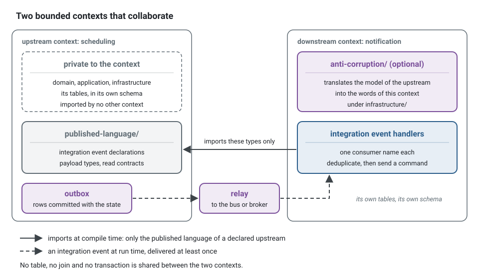
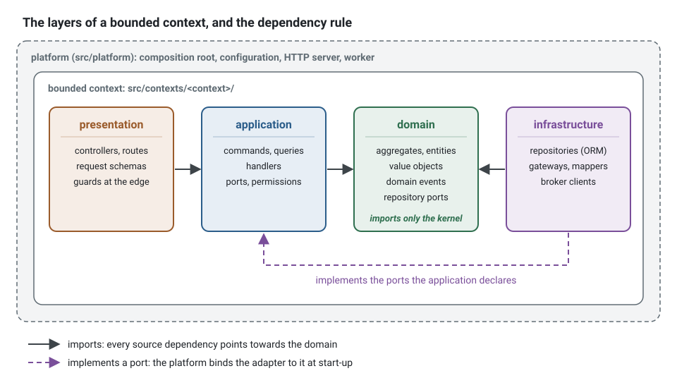
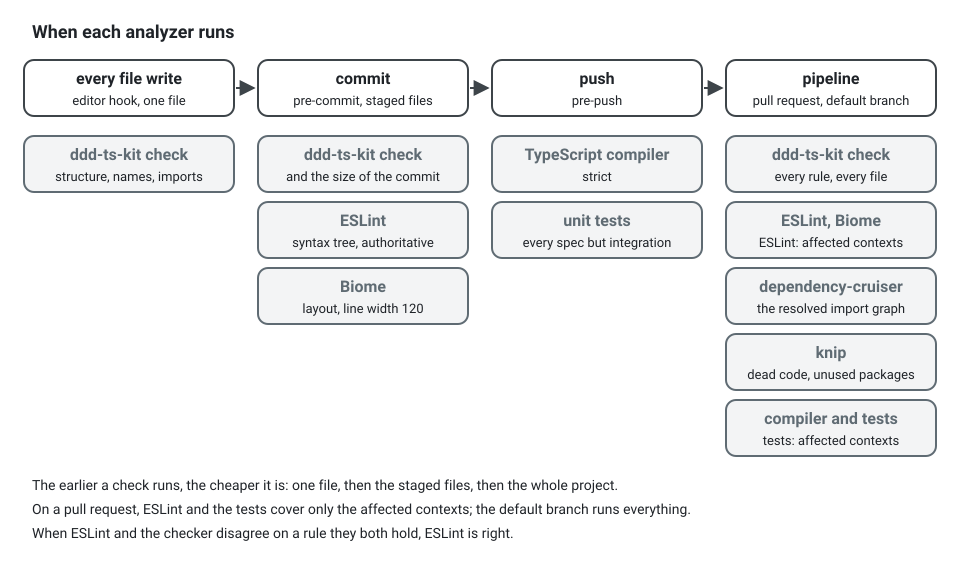

**English** · [Français](ARCHITECTURE.fr.md)

# Architecture reference

The single normative document. The CLI (`ddd-ts-kit check`), the templates, the skills and the
hook all implement what is written here. When they disagree, this file is right and the tool is
to be fixed.

## 1. Strategic design

A system is a set of **bounded contexts**. Each one owns a model, a vocabulary and its data.

- Every context has a `CONTEXT.md`: purpose, classification, ubiquitous language (glossary),
  aggregates, published events, relationships.
  It ends with a generated `## Reference`: use cases with their permission, routes, consumed
  and published events, ports with their adapters, policies, gateways and a dependencies
  line. `ddd-ts-kit docs` writes it, `docs --check` detects its drift, and
  `ddd-ts-kit describe <context> --json` gives the same facts as data. `ddd-ts-kit docs` also
  writes `docs/behaviour/<context>.md`, what the tests of the context state, read from the titles
  of its specs.
- Every context is classified: `core` (differentiating, gets the best design effort),
  `supporting` (needed, not differentiating) or `generic` (buy or keep trivial).
- Relationships are declared in `ddd-ts-kit.config.json`, never implied by an import. A
  downstream context names its upstream and the pattern: `published-language` (default),
  `customer-supplier`, `conformist`, `anti-corruption-layer`, `open-host-service`,
  `shared-kernel`.
- The only code another context may import is the upstream's `published-language/` folder:
  event types, payload types, read contracts. Everything else goes through integration events.
- A downstream that does not want the upstream's model translates it in
  `infrastructure/anti-corruption/`.
- No shared database tables. A context reads another context's data through a published
  contract or its own projection fed by integration events.
- The shared kernel holds only what at least two contexts use. A file read by one context
  belongs to that context. Its value objects and their refusals are generated as those of a
  context are (`generate value-object|error|domain-error shared-kernel <Name>`), at its root
  beside their specs, and named with the terms of its own glossary, `CONTEXT.md` of the shared
  kernel, which `--term` writes and `language/glossary-term` reads.
- A context too large to read, whose language stays one, is divided into **modules of the
  model** (Evans, Modules), never into sub-contexts: one folder per part of the model, declared
  in `contexts.<name>.modules`, named with terms of its glossary. See section 2 and
  [Modules of the model](concepts/modules.md).



The relationship is written down before the first import. In the example application,
`notification` reacts to what `scheduling` and `identity` publish, and its entry in
`ddd-ts-kit.config.json` says so:

```json
"notification": {
  "classification": "supporting",
  "upstreams": [
    { "context": "scheduling", "relationship": "published-language" },
    { "context": "identity", "relationship": "published-language" }
  ]
}
```

A file of `notification` then reaches `scheduling` through its published language, and nowhere
else:

```ts
// Instead of: the model of another context (context/published-language-only)
import { Appointment } from '@/contexts/scheduling/domain/aggregates/appointment.aggregate';

// Write: the contract the upstream designed for the others, and react to its events
import { appointmentCancelledV1, type AppointmentCancelledV1 } from '@/contexts/scheduling/published-language';
```

## 2. Canonical tree

```
src/
  main.ts                        composition root: tracing first, then wiring
  shared-kernel/                 optional: value objects used by two contexts or more, their refusals, specs beside them
    CONTEXT.md                   its glossary: the terms every context that imports it agrees on
    shared-kernel.codes.ts       the codes of its refusals, under "stack.refusals": "named"
    presentation/                schemas of the HTTP contract several contexts answer with (*.schema.ts)
  platform/                      technical capabilities: config, database, events, auth, tracing, http server
    composition/                 what turns the platform and the contexts into an application
    observability/               tracing.ts (the first import of every entry point), logs, measures, error reports
    jobs/                        the settings of the scheduled jobs
    audit/search-audit-entries/  the read side of the audit trail
    event-sourcing/              with --event-sourcing on: the event store, the keys of the data subjects and the cipher of the stored events
    privacy/                     with --privacy on: the copies and exports each context declares, the erasure and the export the scripts run
    auth/
      authentication/            who is calling: the authenticator, the session of a request, the HTTP boundary
      authorization/             what they may do, whatever the model: the authorizer behind the port, the guard of the buses, Role
      roles/ | attributes/ | relationships/ | custom/   the model stack.authz names, one folder
  apps/<context>/main.ts         optional: one context run alone as a service
  apps/worker/main.ts            optional: the scheduled jobs in a process of their own
  contexts/<context>/
    CONTEXT.md
    <context>.codes.ts           the closed list of the codes of the context
    <context>.permissions.ts     the permission set of the context: who may do what, here
    <context>.declarations.ts    generated: re-exports the <layer>.declarations.ts of each layer (below the tree)
    <context>.dependencies.ts    generated, under discovery only: what each constructor is injected
    <context>.module.ts          explicit style only: binds ports to adapters by hand
    published-language/          contracts designed for other contexts
    <module>/                    optional, a module of the model: its own domain/ ... presentation/ (below the tree)
      <module>.module.ts         explicit style only: what the module registers, composed by <context>.module.ts
    domain/
      aggregates/                *.aggregate.ts
      entities/                  *.entity.ts
      value-objects/             *.vo.ts
      vocabularies/              *.vocabulary.ts   (closed vocabularies: an object `as const` and its union type)
      events/                    *.event.ts
      errors/                    *.error.ts        (one class per refusal, built by its static factories)
      repositories/              *.repository.ts   (ports: abstract classes)
      services/                  *.service.ts      (stateless domain logic over several aggregates)
      state-machines/            *.state-machine.ts (the lifecycle of an aggregate: states, transitions, refusals)
    application/
      commands/<use-case>/       *.command.ts, *.handler.ts
      queries/<use-case>/        *.query.ts, *.result.ts, *.handler.ts
      ports/                     *.port.ts         (ports to the outside world: abstract classes)
      authorization/             *.policy.ts       (who may do what on one element, once it is loaded)
      event-handlers/            *.event-handler.ts (reactions to this context's domain events)
      scheduling/                *.job.ts          (jobs run by time: schedule to command)
      background/                *.background-job.ts (work enqueued by a use case, run by a worker)
      processes/                 *.process.ts      (process managers: state, decisions, timeouts)
      projections/               *.projection.ts   (projectors: events to one read model)
      integration/
        publishers/              *.publisher.ts    (domain event to integration event)
        handlers/                *.integration-handler.ts (integration event to command)
    infrastructure/
      persistence/               *.repository.ts adapters, *.mapper.ts, *.reader.ts, *.schema.ts, *.personal-fields.ts
      external/                  adapters of outside systems, remote or simulated
      anti-corruption/           translators of another context's or system's model
    presentation/
      http/                      <name>.routes.ts  (a route group: prefix, tags, guards)
        <resource>/<use-case>/   *.controller.ts, its schemas (*.params.ts, *.query.ts, *.headers.ts, *.body.ts,
                                 *.accepted.ts, *.answer.ts, *.line.ts), *.mapper.ts, *.serializer.ts
        guards/                  *.guard.ts        (guards of the project: declared classes)
        shared/                  schemas (*.schema.ts, `generate schema`) and serializers several routes use
                                 function routes stay flat: *.route.ts, *.dto.ts, <context>.routes.ts (their list)
      cli/
    test/
      unit/  integration/
      fakes/                     in-memory implementations of ports and repositories
      builders/                  *.builder.ts      (test data builders, one per aggregate)
      worlds/                    *.world.ts        (the arrangement several specs of the context share: the test
                                 application or the buses with the fakes of the context)
```

**Modules of the model.** A context may divide its model into modules, declared in
`contexts.<name>.modules` of the config. A module is one folder of the context that holds its
own layers, each with the role folders of the tree above, unchanged:
`<module>/domain/aggregates/`, `<module>/application/commands/<use-case>/`,
`<module>/infrastructure/persistence/`, `<module>/presentation/http/<resource>/<use-case>/`; the
specs of its files sit in the module folder of their test folder, `test/unit/<module>/` and
`test/integration/<module>/`. Everything about a part of the model is then under one folder.
What every module shares stays at the level of the context: `CONTEXT.md`, which gains a
`## Modules` section (one row per module: its name and its purpose), `<context>.codes.ts`,
`<context>.permissions.ts`, `<context>.module.ts`, the generated `<context>.declarations.ts` and
`<context>.dependencies.ts`, `published-language/`, the schema, tables and migrations of its
database (the `*.schema.ts` of `infrastructure/persistence/` that are no row schema), its route
groups, guards and shared shapes (`presentation/http/*.routes.ts`, `guards/`, `shared/`), and the
fakes, builders and worlds of its specs. A module never has a glossary, a schema or a published
language of its own; a part that needs one is a context. In the explicit style a module has its
module file, `<module>/<module>.module.ts`, the only file at the root of its folder: it registers
what the module holds (its handlers, consumers, reactions, jobs, permissions and routes), and
`<context>.module.ts` composes it, so that the module file of the context keeps only what the
context holds at its own level. `generate module` writes it with its composition, and a
registration generated with `--module` goes there; wired by hand, a use case whose repository
another module file creates is registered in that file, a repository being created once per
context. Declared, a module has no module file: its classes declare themselves. Every rule reads a
file of a module as the same file outside one: its role is its path with the module folder left
out. `generate <kind> <context> ... --module <module>` writes into a module, the specs with their
subject, `generate module <context> <module>` declares one, and
`move-to-module <context> <module> <path>...` moves existing files into it with their imports,
the specs named after them following. In a context that declares modules, the generator refuses
to write a file of a layer without `--module`, the files the context keeps aside, and names the
modules. The kinds that write such a file show `[--module <module>]` in their usage, and the
others refuse `--module`. The layout of 0.86 and 0.87, a module under `domain/<module>/` and `application/<module>/`, is
read for one minor version, warned about by `module/complete`, and `ddd-ts-kit context-layout`
moves it, telling the module of each adapter, route and spec by what it imports. Why and when:
[Modules of the model](concepts/modules.md).

**Generated declarations.** In the declared style assembled by barrel, every layer of a context
that holds a declared role file has a generated `<layer>.declarations.ts`, directly in the layer:
`application/application.declarations.ts`, `infrastructure/infrastructure.declarations.ts`,
`presentation/presentation.declarations.ts`; in a module, `<module>/application/application.declarations.ts`.
A role folder holds its role files and nothing else. Each file holds the imports it needs, one
`export *` per role file of its layer, sorted by path, then one `injected(Class, [Tokens])` per
class of the layer whose constructor takes something. `<context>.declarations.ts`, at the root
of the context, only re-exports these files, sorted by path: it is what the composition root
imports. The declarations of a layer that holds no role file any more are deleted by the next
`generate`, `docs` or `npm run dev`, and so are the `<folder>.declarations.ts` of each role
folder that 0.85 and 0.86 wrote. Under discovery, `<context>.dependencies.ts` also names the modules of
the model the config declares (`export const modules = [...]`), where `discoverContext` reads
them. None of these files is edited by hand (`declarations/barrel-current`).

Under `presentation/http/` one route is one folder. `"stack.routes": "controllers"` (the form of
a new project) writes each route as a class carrying `@Controller` of `@ddd-ts-kit/http`, in
`<resource>/<use-case>/` with the schemas of its request and of its answer; the resource is the
first segment of its path, and the group of that resource, `<resource>.routes.ts`, gives the
prefix, the tag and the guards. A schema file is named after its class, which is the name of the
schema in the published contract: `book-appointment.accepted.ts` holds `BookAppointmentAccepted`.
`"stack.routes": "functions"` keeps one `defineRoute` function per route, flat, listed in
`<context>.routes.ts`. Both forms run in one project.

**A shape is declared once.** Under `"stack.schemas": "shared"` (the form of a new project), a
shape several routes use, whole or in part, is declared once in `presentation/http/shared/` of
its context (`generate schema <context> <Name>`), or in `presentation/` of the shared kernel when
several contexts answer with it (`generate schema shared-kernel <Name>`), and shared: the OpenAPI
contract holds it once in `components.schemas` and each route points at it. A route derives the
part it needs from it (pick, omit, partial, extend) instead of copying it, and a command answers
an identifier with `acceptedSchema` of `@ddd-ts-kit/http`, the `Accepted` component of the
platform. `schema/no-duplicate-shape` reports a shape declared by hand twice in one context, and
`schema/presentation-only` keeps every schema in a presentation layer: a schema is a type of the
contract, the domain and the use cases never read one.

**Guards and permissions are two things, and each has one place.** A guard is a control at the
edge, over a set of routes: is the caller authenticated, does it hold a role, does the tenant of
its token match the one of the path, is the key of the request known. It reads the caller and
the request, runs before the controller (before the request is read when it decides on the
caller alone), and answers 401 or 403; a route group or a controller
names it in `guards`. A permission is a business right: it may depend on the element (who owns
this appointment, is this invoice still a draft) and it is declared on the use case, with
`@Requires` on the command or the query, decided by the bus through the `Authorizer` port. A
job, an event handler and another transport send the same command and are held to the same
permission; none of them passes a guard. So a guard never replaces a permission, never loads an
aggregate (`presentation/guard-at-the-edge`), and every use case still says who may send it
(`authz/declared`).


Each one is written where it belongs: the guard on the route group, the permission on the
command.

<!-- checked sample -->
```ts
import { definePermissions } from '@ddd-ts-kit/auth';
import { Authenticated, RouteGroup } from '@ddd-ts-kit/http';
import { AuthorizedCommand, type Actor } from '@ddd-ts-kit/kernel';
import { Requires } from '@ddd-ts-kit/kernel/declarations';

// presentation/http/invoices.routes.ts: runs before every controller of the group, answers 401
@RouteGroup({ prefix: '/invoices', tags: ['billing'], guards: [Authenticated], errors: ['FORBIDDEN'] })
export class InvoicesRoutes {}

// billing.permissions.ts: the rights of the context, as data
export const billingPermissions = definePermissions('billing', {
  'invoice.pay': { description: 'Record the payment of an invoice' },
});

// application/commands/pay-invoice/pay-invoice.command.ts: whoever sends it needs the permission
@Requires(billingPermissions['invoice.pay'])
export class PayInvoiceCommand extends AuthorizedCommand<void> {
  constructor(
    actor: Actor,
    readonly invoiceId: string,
  ) {
    super(actor);
  }
}
```

The tree is **closed**: a directory not listed here is a design decision, added to
`extraDirectories` in the config with a reason, not created ad hoc. The levels named
`<use-case>` are open, and so is everything below `test/unit/`, `test/integration/`,
`test/fakes/`, `test/builders/` and `test/worlds/`. `test/unit/` and `test/integration/` hold
specs only: a helper several specs share has the place of its kind, a fake, a builder or a world
(`test/helper-placed`). End-to-end specs (`test/e2e/`), the acceptance specs of the stories
(`test/acceptance/`, each with its lock), the architecture test (`test/architecture/`) and the
global setup of the test runs (`test/support/`) live at the project root, outside the contexts.
An end-to-end spec is named after the use case whose route it drives (`<use-case>.e2e.spec.ts`,
generated). A spec split by behaviour keeps that name in each part
(`<use-case>-<behaviour>.e2e.spec.ts`, beside it), and a journey across use cases is
`journey-<name>.e2e.spec.ts`. Their helpers live in
`test/e2e/support/`, those the specs of one context share in `test/e2e/support/<context>/`.

**A concept with no role of its own still has a home.** The domain has no `types/`,
`functions/` or `utils/` directory: each would hold concepts nobody named. A type alone or a
function alone is a sign that a concept of the model is missing, and it goes where that
concept lives:

| What it is | Where it goes | Why |
|---|---|---|
| a function without side effect that reads one value (a total, a conversion, a comparison) | a method of that value object | the value answers about itself (side-effect-free functions); a function next to it would leave the value anemic |
| a decision over several aggregates or values that belongs to none of them | a domain service, `domain/services/*.service.ts`, with its spec | the name is then accurate: a stateless business decision, no I/O |
| a shape of data the model shares (thresholds, a business setting) | a value object, `domain/value-objects/*.vo.ts`; the types of its props are exported from the same file | a named value checks its invariants once, where a bare type checks nothing |
| an interchangeable rule (a strategy: the way a threshold, a price or a delay is decided) | an abstract class in `domain/services/` and one concrete service per variant, each in its file with its spec; the abstract base needs no spec of its own | the model picks the variant and calls it through the base; nothing outside the domain knows the variants |
| a reshaping of a value for reading or display | not the domain: the result of a query (`*.result.ts`) or a mapper of `presentation/` | the domain decides, it does not format |

A strategy is not a port: the model chooses the implementation from its own data, and nothing
is wired. A rule whose variant comes from the outside (a setting, a provider) is a port of
`application/ports/`. `*.policy.ts` stays the suffix of the authorization policies of
`application/authorization/`.

<!-- checked sample -->
```ts
// domain/services/approval-threshold.service.ts: the rule, with a name of the business
export abstract class ApprovalThresholdService {
  abstract requiresApproval(amountInCents: number): boolean;
}

// domain/services/fixed-approval-threshold.service.ts: one variant, with its spec
export class FixedApprovalThresholdService extends ApprovalThresholdService {
  constructor(private readonly ceilingInCents: number) {
    super();
  }

  requiresApproval(amountInCents: number): boolean {
    return amountInCents > this.ceilingInCents;
  }
}
```

## 3. Dependency rules



Every source dependency points towards the domain. The one arrow that goes the other way is
not an import: infrastructure implements a port the application or the domain declares, and
the platform binds it at start-up. Why, and what each layer holds:
[Layers and the dependency rule](concepts/layers-and-dependency-rule.md).

| Id | Rule |
|---|---|
| `layer/domain-purity` | `domain/` imports only its own `domain/`, the shared kernel and `@ddd-ts-kit/kernel`. No framework, no ORM, no validation library, no Node built-in doing I/O. |
| `layer/application-inward` | `application/` imports `domain/`, `application/`, published languages, the kernel and `@ddd-ts-kit/auth` (permissions and policies). Never `infrastructure/` or `presentation/`, never a framework or a driver. A background job, `application/background/*.background-job.ts` and no other file of the layer, also imports `@ddd-ts-kit/validation` and the validation library its payload schema is written with (zod, class-validator, class-transformer, TypeBox, valibot, arktype): a stored payload is data at rest that outlives a deploy, the same kind of contract as the payload of an integration event, which `published-language/` already validates. |
| `layer/presentation-no-infrastructure` | `presentation/` imports `application/` (and domain types for mapping), never `infrastructure/`. |
| `layer/infrastructure-no-presentation` | `infrastructure/` implements ports of `application/` and `domain/`, never imports `presentation/`. |
| `context/published-language-only` | A file imports from another context only through that context's `published-language/`. |
| `context/declared-relationship` | Such an import requires the relationship to be declared in the config. |
| `context/published-language-is-a-contract` | `published-language/` imports only the kernel, `@ddd-ts-kit/events`, `@ddd-ts-kit/validation`, the schema library of the project and other published languages (`publishedLanguageAllowedPackages`). |
| `context/no-cycle` | The declared relationships form no cycle. |
| `tree/closed` | A context holds only the canonical directories, plus its declared `extraDirectories` and the folders of its declared modules, and no source file outside a role directory. At the root of a declared module the only file is its module file, `<module>/<module>.module.ts`. What git ignores and the dot-directories of a context are not part of the tree (see [Who checks what](#who-checks-what)). A folder at the root of a context that is no canonical directory and no declared module is reported; if it is a module of the model, `generate module <context> <module>` declares it. The code list and the permission set of a context sit at its root, `<context>.codes.ts` and `<context>.permissions.ts`. Where 0.86 and 0.87 kept them, `domain/errors/codes.ts` and `application/authorization/<context>.permissions.ts`, they are a warning whatever the severity of the rule until a later minor version makes it an error, and an error next to the file at the root; `ddd-ts-kit context-layout` moves them and every import of them. |
| `tree/context-doc` | Every context has a `CONTEXT.md` with the required sections (`Purpose`, `Classification`, `Ubiquitous language`, `Aggregates`, `Published events`, `Relationships`) and the classification declared in the config. |
| `tree/documented-paths` | A path of a bounded context written as code in a Markdown file of `docs/architecture/` (a plan, a design note, a review) is a place the canonical tree allows, judged as `tree/closed` judges a file: its directories and the file itself. A path written relative to its context (it starts with `domain/`, `application/`, `infrastructure/`, `presentation/` or `published-language/`) names no context: it is reported only when every declared context refuses it, their extra directories considered. A path that does not exist yet is not reported, a plan names files to create, nor one through a dot-directory of a context, which is no part of the tree; one that the tree refuses (`application/services/`) describes a design the code no longer has. Default severity `warn`. |
| `module/declared` | Every module of `contexts.<name>.modules` is named with terms of the `## Ubiquitous language` table of its context's `CONTEXT.md`, every word of its name, and never with a technical word (`shared`, `common`, `core`, `misc`, `utils` and the other technical words of `language/no-technical-name`), and has a row in the `## Modules` section of that `CONTEXT.md`. Its name is in kebab-case, unique in the context, and neither a role folder nor a folder of the context (`domain`, `test`, `published-language`...). Fix: `generate module <context> <module> --purpose "..." [--term "<Term>=<meaning>"]`. |
| `module/complete` | Once a context declares modules, a file of a layer outside every module is reported, and so is a spec left in `test/unit/` or `test/integration/` while the file it is named after sits in a module, the files the context keeps aside (section 2, modules of the model). One finding per folder. Fix: `move-to-module <context> <module> <path>`. A module still where 0.86 and 0.87 put it, `domain/<module>/` or `application/<module>/`, is reported too, with `ddd-ts-kit context-layout` as its fix. Default severity `warn`, so that a context moves into modules one commit at a time. |
| `module/no-cycle` | The imports between the modules of one context form no cycle. Default severity `warn`: coupling between modules is a signal to change the model (Evans, Modules), not a refusal. |
| `naming/suffix` | A file in a role directory carries the role's suffix, in kebab-case. The code list of a context, `<context>.codes.ts` at its root, is read as `domain/errors/codes.ts`, the one file of a role named otherwise. |
| `naming/one-concept-per-file` | One exported aggregate, entity, value object, event, handler, job or projection per file, and one declared class per role file. |
| `naming/search-not-list` | A read that takes criteria, a scope or a page is a search. In a context, no method is named `list`, or `list` followed by an upper-case letter (`listByCustomer`), in a port (`domain/repositories/*.repository.ts`, `application/ports/*.port.ts`) nor in a class of `infrastructure/` or `test/fakes/`: it is named `search...`. Under `application/queries/`, no folder or file is named `list` or starts with `list-` or `list.`, and no class is named `List` or starts with `List` followed by an upper-case letter: the query is `Search<Things>Query` in `search-<things>/`. A property is not judged, nor `listAccessible`, which the `Authorizer` port of the kit requires; a read of one element or none stays `findById` or `findBy...`. |
| `naming/business-name` | A variable, a loop variable, a destructured binding, a parameter (of a function, a method, a signature or an arrow) and a property (of a class, an interface or a type of an object) of `domain/` and `application/` of a context, and of the shared kernel outside `presentation/`, is named after the concept it holds, never by a generic word: `target`, `targets`, `data`, `item`, `items`, `obj`, `object`, `thing`, `things`, `stuff`, `info`, `element`, `el`, `tmp`, `temp`, `foo`, `bar`, `baz`. `businessNames.words` of the config replaces the list, `businessNames.allow` removes words from it. A key of an object literal follows the type it is written for and is not judged, nor the tests. ESLint fixes a variable built by `X.create(..)` or `new X(..)`, or read from a repository, renaming it with every use to the camel name of `X` (`appointment`) unless that name is taken; a loop variable is reported with the singular of its collection. |
| `test/spec-required` | Every aggregate, value object, domain service, command handler, query handler, domain event handler, integration event handler, job and projection has a `*.spec.ts` in the context's `test/`. A file whose exported classes are all abstract and that exports no function is a base held by the specs of its implementations, and needs none. |
| `events/name-format` | Domain and integration event names follow `<context>.<aggregate>.<fact-in-past-tense>`: the `static readonly eventName` a domain event declares once (or its `readonly name`, as 0.5 wrote it) and the `type` of an integration event declaration. |
| `events/name-declared-once` | Every class of `domain/events/` but an abstract one declares its name once, `static readonly eventName = '<context>.<aggregate>.<fact>'`, which handlers and projections are attached under; its `readonly name` reads it instead of writing the name a second time: extend `NamedDomainEvent('<context>.<aggregate>.<fact>')` of the kernel, which declares both, or write `readonly name = InvoiceIssued.eventName`. Checked on every domain event, consumed or not. |
| `events/defined-in-published-language` | An integration event is declared once with `defineIntegrationEvent` in the producer's `published-language/`, with a payload schema. Catalog and AsyncAPI document are generated from these declarations. |
| `test/no-mocks` | No `vi.mock`, `jest.mock`, `vi.fn`, `jest.fn`, `vi.spyOn`, `jest.spyOn` or mocking library in a context's `test/`. Use the fake of the port. Default severity `warn`. |
| `test/builder-required` | An aggregate has a builder in `test/builders/`. Default severity `warn`. |
| `test/helper-placed` | A file of a context's `test/unit/` or `test/integration/` is a spec (`*.spec.ts`, `*.test.ts`). A helper written among them is moved to the place of its kind: an arrangement several specs share to `test/worlds/*.world.ts`, test data to `test/builders/`, an in-memory port to `test/fakes/`. Default severity `warn`. |
| `test/acceptance-black-box` | An acceptance spec (`test/acceptance/<story>.acceptance.spec.ts`) drives the application as a client does: it imports nothing from the source root but the builders of a context (`test/builders/`) and its `published-language/`. Its scenarios are written before the code of the story and assert what a client observes. Default severity `warn`. |
| `test/coverage-governed` | Coverage cannot be gamed by exclusion. The test runner config reads what it measures and its thresholds from the `coverage` key of `ddd-ts-kit.config.json` through `governedCoverage` (`governedJestCoverage` under jest) of `@ddd-ts-kit/testing/coverage`: the four layers of every context, the files no spec loads included, the ports aside (abstract members only, `ports/abstract-class`: nothing runs in them, and a module file that wires by hand never loads them), each context and layer held to its floor from its first source file, and each layer of a module of the model (`<module>/domain/`) to the same floor on its own. Refused: `include`, `exclude`, `thresholds` or `ignoreClassMethods` written by hand in a `coverage` block (`collectCoverageFrom`, `coveragePathIgnorePatterns`, `coverageThreshold` under jest), the same set by a flag in a script of `package.json`, and a `v8 ignore`, `c8 ignore` or `istanbul ignore` comment in a production source that does not end with `-- ADR-NNNN: <reason>` naming an existing decision record. |
| `test/no-only-no-skip` | No `.only` or `.skip` on a test or a group, no `fit`, `xit` or `xdescribe`, no `.skipIf` or `.runIf` on a constant, in every test file of the project: every test runs, or runs wherever its condition holds (`describe.runIf(process.env['VARNISH_URL'])`). A behaviour not proven yet is an `it.todo` named after it, which `ddd-ts-kit todo` lists and `story --gate close` refuses while one belongs to the story. |
| `test/title-states-a-rule` | The title of an `it` states the rule it proves: in lower case, what the subject does (`refuses to pay an invoice twice`), after the rows and the criterion it cites (`#US5.02 AC1 ...`); never `should`, `test`, `works`, `correctly`, nor the name of a method or a class (`execute()`, `issueInvoice`). The first word of a table-driven title may be its placeholder (`%s`, `$kind`); a title held in a variable is not judged. A `describe` names the unit under test, never `tests`, `spec` or `suite`. |
| `test/no-logic` | A test holds no `if`, `switch`, ternary, loop or `try`: it arranges, acts and asserts, and fails for one reason. A case per row is an `it.each`; a decision belongs to a builder, a fake or a helper named after what it decides. Hooks and the functions declared next to the tests are not judged. |
| `test/assertion-present` | Every test asserts something: an `expect`, a helper named `expect...` or `assert...`, or the outcome of a scenario (`thenEvents`, `thenError`, `thenState`, `thenNoEvent`), the scenario `pending(...)` wraps included. A test with a title and no body is written `it.todo`. |
| `test/refusal-by-code` | A refusal is asserted by its code and its facts: `thenError(code, facts)` on an aggregate, `expectRefusal(action, code, facts)` on an action, `rejects.toMatchObject({ code })` through the bus, `expectProblem(response, { status, code })` end to end. `toThrow` or `toThrowError` with a message, a regular expression, a class or nothing is reported in the specs of the model and of the application (`test/unit/` of a context, the shared kernel, `test/e2e/`, `test/acceptance/`); `not.toThrow()` and `toThrow(expect.objectContaining({ code }))` are not, nor are the specs of the adapters (`*.adapter.spec.ts`, `test/integration/`) and of the platform, whose failures are technical; a failure the test injected is asserted as itself, `rejects.toBe(outage)`. |
| `test/no-snapshot` | No snapshot matcher (`toMatchSnapshot`, `toMatchInlineSnapshot`, `toMatchFileSnapshot`, `toThrowErrorMatchingSnapshot`) in a test file: a snapshot records whatever the code produced and is renewed with one flag. A test asserts the fields the rule depends on. |
| `test/mutation-governed` | The mutation score cannot be gamed by configuration. The Stryker config of a project (`stryker.config.mjs`) reads what it mutates, what it leaves out and its floor from the `mutation` key of `ddd-ts-kit.config.json` through `governedMutation` of `@ddd-ts-kit/testing/mutation`: the domain and application layers of every context, at their level and in the modules of its model, the generated declarations left out; the texts of refusals left out by the ignorer of the kit (`appendPlugins`, `ignorers`: the message of `refusal(..)`, a text handed to a factory of a refusal, the message of `super(..)` in an error class and of `new ..Error(..)`), since a refusal is asserted by its code and never by its text, every other string literal measured; the static mutants ignored, those of code that runs once when the module loads; the floor as `thresholds`. Refused: `mutate`, `mutator`, `ignorers`, `ignoreStatic`, `incremental`, `force` or `thresholds` written by hand in a Stryker config, and a Stryker config that does not read the kit. `ddd-ts-kit mutation` then holds each layer of each context to its floor from the report of the run; the pipeline runs both every night, and on a pull request reads the change alone: an incremental run from the report of the night (`DDD_TS_KIT_MUTATION_SINCE`), whole again when the change touches code Stryker does not diff, then the survivors of the files it touched (`--changed`), never a gate. |
| `language/glossary-term` | Every aggregate, entity, value object, domain service, domain event, command and query is named with terms of the `## Ubiquitous language` table of its context's `CONTEXT.md`, and under `"stack.refusals": "factories"` or `"named"` every class of `domain/errors/` too: `AppointmentError` is named after `Appointment`, `SlotTaken` after `Slot` and `Take`. A value object of the shared kernel (`*.vo.ts` outside its `presentation/`), and under those two forms its refusals (`*.error.ts`), are named with the terms of the glossary of the shared kernel, `<sharedKernelDir>/CONTEXT.md`. A refusal class of `named` (one that extends `DomainRefusal`) may also use the qualifiers of a refusal, `invalid`, `unknown`, `already`, `too`, `no`, `missing` and `required` (`InvalidAppointment`, `BookingTooLate`); `<context>.codes.ts` holds no class and is not judged. The glossary is written before the code. |
| `language/declared-vocabulary` | A value of a closed vocabulary the project declares, an object `as const` exported with the union type of its name (`domain/vocabularies/*.vocabulary.ts`, the `Role` of the platform) or a permission set of `definePermissions`, is read through it (`AppointmentStatus.NoShow`, `billingPermissions['invoice.issue']`), never written again as a string literal outside its declaration, a quoted key included (`[AppointmentStatus.NoShow]: ..`). Under `"stack.literals": "named"`, which `init` writes; a config that does not say keeps free literals. Where: the vocabulary of a context in that context only, the one of the platform in the platform and the route groups `*.routes.ts`, a permission id and a vocabulary of the shared kernel everywhere. Tests, published languages and the relationship schema (`defineSchema`) are not judged. In the persistence of a context (`infrastructure/persistence/`), the name of a column, a table or a schema is a word of the storage and is not judged: the first argument of a call (`text('note')`, `createTable('invoice')`, `.where('note', ..)`) and the value of `name`, `tableName` or `schema`; a stored value, the argument of `.default(..)` or a value compared in a query, is. A word of another language is not the context's and is not judged when its type says so, outside `domain/`: a key of an object typed `Record<T, ..>` and a string value of one typed `Record<.., T>` (by the annotation of its declaration or by `satisfies`; `as const` and `Readonly`, `Partial`, `Required` around allowed), and a literal written `'x' satisfies T`, where `T` is one type reference (`Payload['state']`, `typeof x`, no union) whose name is imported from a published language, imported as a type from a package, or imported from or declared in `infrastructure/anti-corruption/` or `infrastructure/external/`. There, the literal types of an interface or a type alias, which describe an outside record as it arrives, are not judged either. A key of a table typed by the context's own vocabulary, a comparison or a `case` without `satisfies`, and a value of the context in a translation table are still judged. Read as a vocabulary: each entry a key and a string literal, comments, either quote and `as const satisfies ..` allowed, next to `export type X = (typeof X)[keyof typeof X]`; a number, a spread or a computed entry leaves the object unread. |
| `language/no-technical-name` | No `Manager`, `Helper`, `Util`, `Utils`, `Data`, `Info`, `Processor`, `Wrapper`, `Impl`, `Base`, `Abstract`, `Dto`, `Entity`, `Model` in a name under `domain/` or in a use case name, unless a term of the `## Ubiquitous language` table of its context's `CONTEXT.md` holds the word: the words of the name around it say the whole term, inflected or not (`Scoring model` holds `ScoringModel` and `ScoringModelVersioned`, `Copy of data` holds `CopyOfData`). The generator judges a name the same way. Fix: the business word, or, when the business does use that word, its row in the glossary. |
| `purity/no-system-clock` | No `new Date()` without argument, `Date.now()` or `performance.now()` in `domain/` or `application/`: time comes from the `Clock` port. |
| `purity/no-ambient-randomness` | No `Math.random`, `crypto.randomUUID` or id library in `domain/` or `application/`: identifiers come from the `IdGenerator` port. |
| `purity/no-environment` | No `process.env`, `console`, file system or network access in `domain/` or `application/`. |
| `clean/stepdown` | A file reads top to bottom: static factories, public members, then protected and private ones, and a function above the functions it calls. |
| `clean/function-size` | A function has at most 3 parameters and 30 lines (configurable, never above 100); a longer one is doing more than one thing. Parameters that travel together are one concept: they become a typed props object or a value object, never a fourth parameter. One parameter typed `Actor` or `Date`, who acts and when, is the context of an intention rather than its input and is not counted (`invoice.issue(lines, customer, actor, now)` counts three). Default severity `warn`. No function is longer than 100 lines of code, `describe` callbacks included: that ceiling is an `error`. A spec file holds one top-level `describe` per behaviour (a nested `describe` counts in its parent); a second spec file is needed only past the 350 lines of `clean/file-size`. |
| `clean/no-commented-out-code` | No code in comments. Version control remembers. |
| `clean/no-noise-comment` | No comment that restates the code, no banner, no journal, no closing-brace comment, no `@param` without description, no `TODO` or `FIXME` without an owner or a reference (the markers of section 6 carry theirs). Default severity `warn`. |
| `clean/no-escape-hatch` | No `any`, no non-null assertion, no type assertion outside mappers and infrastructure, no `@ts-ignore`, no `@ts-expect-error` without a reason, no `eslint-disable` without a reason. |
| `clean/no-flag-argument` | No boolean parameter on a public method of the domain or a use case: two intentions are two methods. Default severity `warn`. |
| `clean/no-magic-number` | Under `"stack.literals": "named"`, no number literal in `domain/` and `application/` but 0, 1, -1 (the `allow` option of the ESLint rule changes the list), an index and a type: a duration, a limit or a rate is named where it is decided, a constant of the module or a `static readonly` (`const MINUTES_PER_HOUR = 60`), or a value object of the business. Held by the ESLint plugin. |
| `domain/aggregate-encapsulation` | An aggregate or entity has a private or protected constructor, no public mutable property and no setter. |
| `domain/value-object-immutability` | A value object has only readonly properties and never assigns to itself outside its constructor. |
| `domain/value-object-class` | Under `"stack.values": "classes"`, which `init` writes (a config without the key is `free` and the rule is silent), a value object is a class. A file of `domain/value-objects/` of a context, or a `*.vo.ts` of the shared kernel outside `presentation/`, exports exactly one class extending `ValueObject` of the kernel (directly, or through a class of the same file or of another value object file that does), whose constructor is private or protected (or inherited from `ValueObject`), built through static factories (a concrete class has a static method that is not private); it exports no function, no constant bound to an arrow or a function expression and no object literal, inline, by an export list or by default, and may export the types and interfaces of its props. In `domain/` of a context and in the shared kernel outside `presentation/`, no exported function answers a record of data: an object literal, in the expression of an arrow or in a `return` of its own body, that holds data (a literal, a parameter, an operation on them, a call of the language such as `Math.round` or `new Date`), no spread and nothing a call or `new` of the model built (`Money.of(..)`, `total.add(..)`); such a value is written as a value object class (`generate value-object`). A domain service, a state machine (`defineStateMachine(..)`), a specification answering a boolean or an object of functions, a record of value objects the function builds, a record derived by a spread and a function declaring a return type of a package are not concerned; a decision answered as a plain record is. Specs are not judged. |
| `domain/no-generic-error` | `domain/` and `application/` never `throw new Error(...)`: a business failure is a `DomainError` subclass. |
| `errors/through-factory` | Under `"stack.refusals": "named"`, which `init` writes, and `"factories"`, a domain error is built by a static factory of its class: `throw SlotTaken.forCalendar(calendar.id, slot.startsAt)` under `named`, `throw AppointmentError.slotTaken(calendar.id, slot.startsAt)` under `factories`. No `new` of a class imported from `domain/errors/`, in any file of a context, tests included; under `named`, no `new` either of a class of the same file that extends `DomainRefusal`, in its own factories too: a factory builds with `refusal(message, facts)`. The errors of the kit, each one refusal under a fixed code (`NotFoundError`, `InvariantViolation`, `ValidationError`), are not concerned. |
| `errors/constructor-not-public` | Under `"stack.refusals": "named"` or `"factories"`, the constructor of an error class of `domain/errors/` is not public: the class extends `DomainRefusal` (under `named`) or `ConceptError` (under `factories`) of the kernel, whose constructor is protected, and declares none; a constructor it declares is private or protected. Refused: a public constructor, and a class that extends `DomainError` without a constructor, which inherits a public one. An abstract class is not judged. |
| `errors/factory-name` | A factory is a public static method of an error class that calls `refusal(..)`. Under `"stack.refusals": "named"`, the class says what is refused and the factory what the refusal is about: the class is never named `...Error` (`SlotTaken`, `InsufficientFunds`), and a factory starts with `for`, `with`, `because`, `on` or `at` followed by an upper-case letter, with no digit (`forCalendar`, `withNotice`, `becauseOf`, `onDate`, `atStart`; `slotTaken`, `create` and `forAccount2` are reported). The code is not read there: `errors/code-listed` holds it. Under `"factories"`, a factory is named after the refusal, in the words of the business: never `create`, `make`, `of`, `from`, `build`, `new`, `error`, `failure`, `fail`, `refusal`, `refuse`, nor a name holding a digit. Its code is a string literal in constant case, and is the name of the factory in constant case, alone or with the name of the concept before or after it: `AppointmentError.notFound` sets `NOT_FOUND`, `APPOINTMENT_NOT_FOUND` or `NOT_FOUND_APPOINTMENT`; `slotTaken` setting `BOOKING_FAILED` is reported. |
| `errors/code-unique` | Under `"stack.refusals": "named"` or `"factories"`, a code names one refusal of a context: no two keys of `<context>.codes.ts` hold the same value, and no two factories, and no two error classes, of the `domain/errors/` of one context set the same code, whichever form writes it (a value of `<context>.codes.ts`, the first argument of `refusal(..)` in a concept class, a `readonly code` field). The same code in two contexts is allowed: each context owns its language, and the error mapper gives a code one status. |
| `errors/code-listed` | Under `"stack.refusals": "named"`, which `init` writes, the codes of a context are one closed list, `<context>.codes.ts`: `export const SchedulingCodes = { SlotTaken: 'SLOT_TAKEN' } as const`, with its union type `SchedulingCode`. Every refusal class of `domain/errors/` (a class that extends `DomainRefusal`, an abstract one aside) reads its code from the list of its own context under its own name, `readonly code = SchedulingCodes.SlotTaken`, and `<context>.codes.ts` exists as soon as one such class does. Every key of the list is a refusal class of the context, and every value a string literal in constant case, usually the name of the class in constant case but not always: a migrated project keeps its codes, since the code is the contract. Refused: a refusal class without a code or with a code written another way (a string literal, another entry, the list of another context), a context with refusal classes and no `<context>.codes.ts`, a class the list does not hold, a list missing from `<context>.codes.ts` or not declared `as const`, a key that names no refusal class (a code nothing raises), a value not in constant case. |
| `schema/presentation-only` | Under `"stack.schemas": "shared"`, a schema of the HTTP contract lives in `presentation/`: of its context, or of the shared kernel when several contexts answer with it. In the shared kernel outside `presentation/`, no import of a validation library (zod, class-validator, class-transformer, class-validator-jsonschema, valibot, arktype, TypeBox, `@ddd-ts-kit/validation`); in `domain/`, `application/`, `infrastructure/` and `published-language/` of a context, and in the shared kernel outside `presentation/`, no import of a file of `presentation/` of the shared kernel. Specs are not judged. |
| `schema/no-duplicate-shape` | Under `"stack.schemas": "shared"`, one shape of the contract is declared once in its context: in the presentation layer of one context, or in it and `presentation/` of the shared kernel, no two DTO classes (of the module, extending nothing, without method, every property decorated) with the same properties, decorators and optionality, and no two object schemas (`z.object`, `v.object`, `Type.Object`) with the same entries, whatever their order and layout. Request parameters (`*.params.ts`, `*.query.ts`, `*.headers.ts`, objects assigned to `params`, `query` or `headers`) empty shapes and shapes that still carry a `TODO(domain)` of the generator (a search line starts as `{ id }`) or a `TODO(review)` are not judged. Two contexts may declare the same shape: an equal structure with two meanings is two concepts, and moving it to the shared kernel would couple contexts that stay extractable. The original is the declaration of the shared kernel, then of `presentation/http/shared/` of the context, then the first in path order; each copy is reported. |
| `errors/known-code` | Under `"stack.refusals": "named"` or `"factories"`, every code a route (`*.route.ts`) or a controller (`*.controller.ts`) declares in `errors` exists: it is a value of the `<context>.codes.ts` of the context of the route, a factory or an error class of that context sets it, a class outside the contexts (the platform, the shared kernel) does, the code list of the shared kernel (`shared-kernel.codes.ts`) holds it, or it is a code of the kit (`VALIDATION_FAILED`, `NOT_FOUND`, `CONFLICT`, `INVARIANT_VIOLATION`, `UNAUTHORIZED`, `FORBIDDEN`, `NOT_ACCEPTABLE`, `CONCURRENCY_CONFLICT`, `INVALID_CRITERIA`, `INVALID_PAGE_REQUEST`, `TIMEOUT`, `CIRCUIT_OPEN`, `BULKHEAD_FULL`, `ATTEMPTS_EXHAUSTED`, the conditions of a write, `PRECONDITION_FAILED`, `PRECONDITION_REQUIRED`, and the refusals of a file, `FILE_TOO_LARGE`, `UNSUPPORTED_MEDIA_TYPE`, `FILE_NOT_FOUND`, `FILE_REJECTED`, `INVALID_FILE_KEY`). A code another context sets does not count. |
| `persistence/migration-history` | Every migration of the migration tool the config names (drizzle-kit `migrations/*.sql`, knex and TypeORM `migrations/*`, Prisma `prisma/migrations/*/`) starts with the number that orders it, then what it does (`20261012093000_add-invoices`, written by `npm run db:generate <what-it-does>`), and no two share a number. A working migration, named `<timestamp>_working-<what-it-does>` (Prisma writes `working_`), is the one a worker generates in its worktree so that the specs of its branch run against the tables it changes: it is accepted only where the worker scope file `.ddd-ts-kit/worker.json` exists, and reported anywhere else, since the conductor deletes it and generates the real one on the trunk at merge. Under drizzle-kit, `meta/_journal.json` and the `.sql` files match one for one, the entries keep the order they were generated in (`idx` and `when` ascending: the migrator skips an entry older than the last one a database applied) and each snapshot was generated from the one of the entry before it (two snapshots with one parent are two branches merged without regenerating). |
| `persistence/primary-key-order` | Under drizzle-kit, no migration (`migrations/*.sql`) changes a primary key in an order PostgreSQL refuses: it adds the new primary key of a table before the old one is dropped (a table has one primary key), or drops a column before the dropped primary key that holds it (the column takes the key with it, and the later `DROP CONSTRAINT` fails). A dropped constraint is a primary key when the snapshot the migration was generated from records it, or its name ends in `_pkey` or `_pk`. It reads the `ALTER TABLE` statements of PostgreSQL. drizzle-kit can write either order; `drizzle-generate` warns when it does, and this rule reports the migration until the old key is dropped first or the change is written with `--custom`. Default severity `warn`. |
| `persistence/no-file-content` | No column of file content in a persistence schema or a migration (the persistence sources of the contexts and of the platform database, `migrations/`, `drizzle/`, `prisma/`): no binary type (`bytea`, `blob` and its sizes, `varbinary`, knex `.binary()`, a drizzle `customType` of `Buffer` or `Uint8Array`, a Prisma `Bytes` field) and no column of base64 text (a text column whose name says base64; the word in a cursor, an ETag, a comment or a URL is not a column). Files live in the `FileStorage` port of the kernel; a row keeps the `StoredFile` reference (key, size, media type, checksum). A small binary value that is not a file (a hash, a key) is a recorded deviation. |
| `files/port-not-connector` | `domain/` and `application/` name the `FileStorage` port of the kernel (or `FileStaging` and `FileKeys`), never one of its connectors (`InMemoryFileStorage`, `LocalFileStorage`, `SelfSignedFileStorage`); `@ddd-ts-kit/s3` is refused there whatever the allow-lists say. The platform binds the connector of each environment. |
| `application/handler-shape` | A `*.handler.ts` file exports one class with a single public method, `execute`. |
| `presentation/controller-shape` | A `*.controller.ts` file whose class carries `@Controller` of `@ddd-ts-kit/http` exports that one class, with a single public method, `handle`: one class per route. |
| `presentation/controller-delegates` | A controller decides nothing: its constructor takes the bus of its method (`CommandBus` for `POST`, `PUT`, `PATCH` and `DELETE`, `QueryBus` for `GET` and `HEAD`), a request mapper (`*Mapper`) and a serializer (`*Serializer`), and nothing else. |
| `presentation/guard-at-the-edge` | A guard controls the caller at the edge: a `*.guard.ts` file imports nothing from `domain/` or `infrastructure/`, no repository, no unit of work and no command bus. A right that depends on an element of the model is a permission of the use case. |
| `presentation/shared-cache-varies` | A cache policy of `@ddd-ts-kit/http` whose `scope` is `public` (kept by shared caches: Varnish, a CDN), on a route, a controller or a route group that knows its caller (a guard other than `Public`, a function route with `security`), names in `vary` the request headers its answer depends on: a shared cache files an answer by its URL and would hand the answer of one caller to the next. Held by `@ddd-ts-kit/http` when the routes are built (`DeclarationError`), and in the editor by the ESLint plugin for what one file shows. |
| `application/command-query-separation` | A query handler never saves, deletes or publishes. Default severity `warn`. |
| `events/outbox-required` | With a database, integration events are published through the transactional outbox, never straight to a broker or a bus from a handler. `stack.events` is `outbox` whenever `stack.orm` is set. |
| `events/consumer-idempotent` | Every integration event handler is declared (`@IntegrationEventHandler(definition, { consumer })`) or registered with a stable consumer name, unique in the project, and deduplicates through a processed-event store (bound once for the application, or given to the subscription). Never a bare `subscribe`. |
| `context/extractable` | A context can run alone: its module and its declared classes wire nothing of another context, it reads no table or schema of another context, imports no repository nor port of one, and exports no mutable state. It calls another context only through a port of its own whose adapter could be remote. |
| `authz/declared` | Every command, query and route declares the permission it requires, or declares itself public. Nothing is reachable by default: a function route declares its `security`, a controller names its route group or its own `guards`, `[Public]` when anybody may call it. |
| `authz/in-application` | The permission is decided in the application layer through the `Authorizer` port. No role or ownership test in `presentation/`, no authorization in `infrastructure/`, no knowledge of the acting user's rights in `domain/` (a context whose model is access itself may hold roles as its own state). |
| `authz/actor-explicit` | Use cases receive the actor in the command or query. `domain/` and `application/` never read the ambient `ExecutionScope` or `ActorContext`; only infrastructure and the platform may, for audit columns, tenant scoping and correlation. |
| `authz/fields-by-schema` | A query never shapes its answer by the roles of the actor: no test on the roles, comparison with a role or `isAdmin` under `application/queries/`. A field reserved to some callers is marked on the response schema with `withFieldAccess` of `@ddd-ts-kit/http`, which leaves it out of every representation, refuses it in a request body, documents it in the contract and makes it read-only or absent in a form. |
| `authz/policy-asked` | A use case whose permission a policy refines (`@Policy` or `definePolicy` in `application/authorization/`) has a handler that asks `Access` about that permission (`authorize`, `decide` or `decideOn`), once it holds the element. The bus decides the permission without the element, and a policy is applied only when the handler asks. At run time the authorization module refuses the result of a handler that returned without asking (`PolicyNotAskedError`), inside the unit of work, so that its change is rolled back. The `TODO(domain)` the generator leaves in such a handler, naming the permission, is accepted until it is done, and so is a `TODO(review)` that names it. |
| `authz/granted` | Every permission a context declares is granted to someone. Under roles (`stack.authz` `rbac`) it is granted by name, to a role in `platform/auth/roles/roles.ts` or to every signed-in person in `platform/auth/authorization/signed-in-grants.ts`: by the entry of its set, its id or the wildcard of its context (`billing:*`). The super-admin wildcard `*` does not count: a permission only it reaches is refused to everybody else at run time. A permission meant for administrators is granted to `Role.Admin` by name. Under relationships (`stack.authz` `rebac`) a permission the schema leaves on the context is held by the operators of the context, and nobody is one until a relationship says so: it is granted when every signed-in person holds it, or when a source outside the tests writes `{ object: 'context:<context>', relation: 'operator', subject: '<subject>' }` for it, for a person or for a system actor (which then holds the permissions of a use case only the system sends). A permission derived on an element is held through relations written at run time, which the tree does not show: not judged. Judged only in a project that provisions operators in its tree (some source makes a person, a subject other than `system:..`, operator of a context); one that writes none provisions them out of the tree, and a project as generated is silent. Silent when the schema or an operator tuple cannot be read, with attributes, and with an authorizer of the project's own (`createAuthorizer` imports a `*Authorizer` of the project), which may grant what the schema does not. Default severity `warn`: a permission granted to nobody can be a state between two slices. |
| `authz/system-actor-granted` | Under relationships (`stack.authz` `rebac`), a system actor a context acts as is named by a relationship of the platform. Every `systemActor(<name>)` of a context outside the tests, whose name the checker reads (a string literal, or `<Class>.name` of a class of the file) and whose file sends a command or a query not declared public, needs the subject `system:system:<name>` (the actor type, then its id `system:<name>`) in a file of `platform/auth/relationships/` (`relate-system-actors.ts`, where `generate job` writes the line of a job): without it the application refuses the command with FORBIDDEN when it runs, which a spec on a fake authorizer never shows. Under roles or attributes the right is the permission of the role or rule shared by system actors, not a relationship per actor: not judged. Silent without `relate-system-actors.ts` and with an authorizer of the project's own. An error from the first day. |
| `authz/scope-narrows` | A search narrows by the scope of a permission the model decides. A handler of a context never asks `Access.scope` about a permission every signed-in person holds: `SignedInGrantsAuthorizer` lists it `all` before the model is asked, so every person who signed in would read every element. Under relationships, the requirement of such a search names an enclosing resource (the context, or the tenant) and the scope answers the ids. Judged on the second argument of a `.scope(` call, the entry of a permission set written in place or held in a constant or a field of the same file, against the grants of `platform/auth/authorization/signed-in-grants.ts` and those given to every `new SignedInGrantsAuthorizer({ grants })` as an array literal or a constant declared as one (an entry, an id, the wildcard of a context, `*`). What it cannot read is reported, never taken as safe: grants built by a call or a spread, a permission handed in to a `.scope(` call on `access`. It does not see a permission every person holds through the model itself (a role every account has, a relation every member of a tenant has), nor a search that does not ask `Access.scope`: the specs of the search prove those, with the real authorizer. Default severity `warn`. |
| `authz/resource-modelled` | Under relationships (`stack.authz` `rebac`), a requirement names the element its permission is checked on. The schema written by `init` derives on `context` only the permissions no element derives, so a permission the relationship schema derives on an element type is not held by the operators of the context: a requirement whose `resource` is `{ type: 'context' }` for it is reported, with the type it never reaches. A search whose gate is on the context while its `Access.scope` asks the same permission, derived on the element, is reported too: it needs two permissions, one held on the context to run it and one derived on the element for the scope. Judged: the permissions the types other than `context` derive in `platform/auth/relationships/relationship-schema.ts` (the types written in place, or in the `elements` object the schema spreads), against the resource of every `@Requires`, `.requires(` and `requires(` outside the tests. What it cannot read is reported, never taken as safe: a schema built by a call, a spread other than `elements`, a key computed in another way, a resource that is not an object literal with a literal `type`. An error from the first day; silent with any other model. |
| `governance/recorded-deviation` | A suppression, a lowered severity (for the whole project or for some files), a coverage threshold lowered under the reference, an extra directory, a context declared the control plane of the tenants or an extra allowed package carries a reason and points to a decision record in `docs/adr/`. Raising a threshold is free. |
| `aspects/outside-in` | Aspects are applied from outside. The decorators of `@ddd-ts-kit/aspects/decorators` are imported only by an adapter in `infrastructure/` or by the platform; everywhere else an aspect is a wrapper given to a binding or to a declaration (`.with(...)`, `aspects` of `@Adapter`), put around every binding of a kind by the platform (`builder.around(...)`), or a bus middleware. |
| `standard/no-parallel-interface` | No home-made copy of a standard interface of the kernel: no declared `ILogger`, `AppLogger`, `UserContext`, `CurrentUser`, `UserSession`, `PaginatedResult`, `AuditLog` and the like. Use the kernel interface and extend it by declaration merging; the list is `standardInterfaces` in the config. Default severity `warn`. |
| `nest/no-parallel-pipeline` | A context uses none of the tools of Nest the kit does its own way, since the routes of the kit do not go through Nest's pipeline and a controller of Nest is a route the kit does not see. Refused in `presentation/`, `infrastructure/` and the module file of a context, outside its tests: from `@nestjs/common` a controller Nest serves and its route and parameter decorators, the raw request or answer (`@Req`, `@Res`, `@Header`, `@Redirect`...), a guard (`UseGuards`, `CanActivate`, `SetMetadata`), a pipe, an exception filter or an `HttpException`, an interceptor, the `Logger`, a bare import; the packages `@nestjs/core`, `@nestjs/platform-*`, `@nestjs/swagger`, `@nestjs/cqrs`, `@nestjs/passport`, `@nestjs/jwt`, `@nestjs/schedule`, `@nestjs/bull`, `@nestjs/bullmq`, `@nestjs/config`, `@nestjs/throttler`, `@nestjs/cache-manager`, `@nestjs/event-emitter`, `@nestjs/typeorm`, `@nestjs/mongoose`, `@nestjs/sequelize`, `@nestjs/terminus`. Each finding names what the kit does in its place. A Nest controller the kit serves (a file that imports `KitRoute` or `KitRoutes` of `@ddd-ts-kit/http/nest`) declares its routes with the route and parameter decorators of Nest, which the kit reads; the rest stays refused there. Outside the contexts, under the source root and outside the tests, a controller Nest serves (one that imports neither) that reaches a use case (it names `CommandBus` or `QueryBus`, or imports a file of a context) is reported: moving it out of a context would keep the hole. Not judged: the container of Nest (`Injectable`, `Inject`), which an adapter bound as a provider may carry, and the packages the kit has no answer to (`@nestjs/websockets`, `@nestjs/graphql`, `@nestjs/microservices`, `@nestjs/testing`); `domain/` and `application/` refuse every framework already. See [HTTP frameworks](tools/http-frameworks.md), "Where each tool of Nest goes". |
| `nest/controllers-current` | With `"stack.routes": "nest"`, the generated `<context>.controllers.ts` of each context lists the Nest controllers the kit serves in its `presentation/` (a class carrying `@Controller` of Nest in a file that imports the bridge), each with what the signatures of its route methods say: the type of each part of the request a parameter takes whole (`@Body() body: IssueInvoiceBody`), a DTO class exported by the file its import names, and the answer, such a class, `Accepted` of `@ddd-ts-kit/http`, or nothing for `void`. A file left behind is reported; so is a part taken whole by any other type and that `request` of `@KitRoute` does not give, and a route method that answers anything else (an array, a type written inline, an interface, no type) and whose `@KitRoute` declares no `response`. `ddd-ts-kit generate`, `docs` and the `dev` script rewrite the file. |
| `declarations/role-declared` | In the declared style, a role file exports a class carrying the decorator of its role, and a declared class lives in a role file. Consumer and policy names are non-empty string literals; a domain event handler writes no name, `@DomainEventHandler(InvoiceIssued)`, and is attached under the one its event class declares once, `static readonly eventName`. No class under `domain/` carries a declaration. |
| `declarations/barrel-current` | In the declared style, the generated files of a context are what its tree says. With a barrel, the `<layer>.declarations.ts` of each layer (section 2, generated declarations) holds exactly one `export *` per role file of its layer, sorted by path, then one `injected(Class, [Tokens])` per declared class of the layer whose constructor takes something and whose decorator lists nothing, with the imports they need, and `<context>.declarations.ts` holds one `export *` per such file, sorted by path, and nothing else: a role file cannot be silently left unregistered, and a constructor cannot change without its list. The declarations of a layer that holds no role file any more are reported until they are deleted. A context still declared as an earlier version wrote it, exactly what that version would write for the current tree, is a warning whatever the severity of the rule, until a later minor version makes it an error: the single `<context>.declarations.ts` of 0.84, with no other declarations file yet, or one `<folder>.declarations.ts` per role folder as 0.85 and 0.86 wrote them (`application/commands/commands.declarations.ts`), with no declarations of a layer yet; `ddd-ts-kit docs` moves it, `docs --check` passes on it and prints the warning. Two role files of one name in two folders of the context, as two modules of the model may hold, are reported at the second: the summary would export the name twice. Under discovery `<context>.dependencies.ts` holds the `injected` statements and the modules of the model alone, may be absent while it would hold none, and generated declarations left behind are reported. The message names the file, the role file that is missing or the class whose list is stale; `ddd-ts-kit docs` rewrites the files and deletes the ones nothing derives. |
| `declarations/constructor-injection` | In the declared style, the constructor of a declared class is the one statement of what it depends on. A class whose decorator lists no dependency (every decorator but `@Requires` and `@Public`, which declare messages) types each constructor parameter by exactly one class, type arguments aside (`Cache<Session>` names `Cache`): a port, a port of the kernel, another declared class, or an abstract class that types a value bound in the platform. Refused: a parameter that is optional, has a default value, is a rest parameter or is destructured; a parameter without a type, or typed by a union, an intersection, an array, a function, a literal, an object type, a qualified name or a type of the language; a parameter typed by an interface, a type alias, an enum or a class its file does not export, in the file or in the file of the project it is imported from (a name imported from a package is trusted: the compiler judges the generated file, which imports it as a value); a class that inherits its constructor from a class the project cannot read, a class of a package (a constructor inherited from a class of the project is followed and read there). Under `"stack.dependencies": "signature"`, what `init` writes, a decorator carries no dependency list when the constructor can be read: a list that repeats the constructor is reported and ESLint removes it; a list that differs is reported, since it wins at run time. Under `"stack.dependencies": "listed"`, what a config without the key means, lists are never reported, and a class that inherits a constructor nothing can read and lists nothing takes nothing, as it always did. |
| `declarations/port-adapter-wired` | A class of `infrastructure/` that implements a port (a class imported from `domain/repositories/*.repository.ts` or `application/ports/*.port.ts`), an abstract one aside, is wired. In the declared style it carries `@Repository`, `@Gateway` or `@Adapter` (the exported class of a role file is judged by `declarations/role-declared`); in both styles a file of the composition root (`<context>.module.ts` or the module file of a module of its model, `main.ts`, `apps/<context>/main.ts`, the platform directory) may import it as a value instead, to bind it. A test that builds it does not wire it. A file that still carries a `TODO(domain)` or `TODO(platform)` is not judged yet: the generator writes an adapter before the outside system is ready, wired once its markers are done, and `ddd-ts-kit todo` lists it meanwhile. An adapter whose port no class needs yet (no file outside the infrastructure and the tests names it, but the one that declares it) is not judged either: nothing misses it at run time, and a context wired by hand creates the repository of an aggregate with the first command that needs it. An adapter kept unwired on purpose says so above its class, `// ddd-ts-kit-disable-next-line declarations/port-adapter-wired -- ADR-NNNN: <why>`, and its decision record is in `docs/adr/` (`governance/recorded-deviation`). Default severity `warn`. |
| `ports/abstract-class` | A port (`domain/repositories/*.repository.ts`, `application/ports/*.port.ts`) is an abstract class with abstract members only: no constructor, no private or protected member, no body, no initializer, `static readonly tokenKey` excepted. Never an interface. |
| `ports/implements-never-extends` | An adapter implements its port and never extends it: the class declared with `@Repository`, `@Gateway` or `@Adapter`, the class given to `bind(Port).toClass(..)`, and any class of `infrastructure/`. |
| `ports/no-token-constant` | A dependency is named by the class of its port: no `token(..)`, no symbol or string given to `bind`, `rebind`, `resolve`, `fake` or `override`, no UPPER_SNAKE constant in a dependency list, no `*.ports.ts` or `tokens.ts` file. |
| `ports/no-concrete-dependency` | A dependency is named by its port: nothing imported from `infrastructure/` or from `test/fakes/` in a dependency list (of a decorator, of `.toClass(C, [..])`, of `.handledBy(H, [..])`), nor as the type of a constructor parameter of a declared class whose decorator lists nothing. |
| `ports/value-import` | A port named in a dependency list or given to `bind` is imported as a value, never with `import type`. A port that only types a constructor parameter is not concerned: the generated file of the context imports the value. |
| `clean/no-hash-private` | A class member is `private`, never `#name`. |
| `clean/blank-lines` | A blank line before every `return` that is not alone in its block and between the logical blocks of a function (after a group of declarations, around `if`, `for`, `try`, around a multiline statement, around a method); no blank line at the edges of a block, never two in a row. Consecutive declarations and fields may stay together. |
| `clean/braces` | Every `if`, `else`, `for`, `while` and `do` has braces, and its body is on its own lines; `else` follows the closing brace on the same line. A ternary, an arrow function returning an expression and a one-line object literal are not judged. |
| `clean/formatted` | Every TypeScript, JavaScript and JSON file is laid out by the formatter of the project, Biome, at a line width of 120: `npm run format:check` reports nothing to change. Markdown and YAML are not formatted. |
| `clean/one-export-per-file` | A source file exports one class, interface or function and is named after it in kebab-case. Its companions are the types of its own signature, a derived form it calls, or a closed family (a type with its constructors or combinators, the accessors of one private state); anything else is listed in `onePerFile.allow` with its reason. Entry files (`index.ts`, subpath entries) only re-export. The generated files of a declared context (`<context>.declarations.ts` and the `<layer>.declarations.ts` of its layers, `<context>.dependencies.ts`) are not judged here: `declarations/barrel-current` holds every line of them. |
| `clean/file-size` | A file is at most 350 lines, tests included, under the source root, `test/` (the end-to-end specs) and `scripts/`, and the limit is not configurable; files under a directory named `generated`, the generated `<context>.declarations.ts` and `<context>.dependencies.ts` at the root of a context, the generated `<layer>.declarations.ts` of its layers, and `.d.ts` files are exempt. |
| `scheduling/job-triggers-use-case` | A job lives in `application/scheduling/*.job.ts`, implements `ScheduledJob` and only sends commands: no repository among its dependencies, no import of aggregates, entities, domain services or `infrastructure/`. |
| `scheduling/job-name` | A job is named `<context>.<job-name>` by a string literal in lower-case kebab-case, the context being its own; its `systemActor` carries the same name; the name is unique in the project. |
| `scheduling/job-registered` | In the explicit style, every job (`application/scheduling/*.job.ts`) and background job (`application/background/*.background-job.ts`) is registered: another file outside the tests names its class in `.handledBy(..)`, in `.register(..)` (`platform.jobs.register`, `platform.backgroundJobs.register`) or builds it with `new`. A class nobody registers never runs, and its spec, the checker and the build all pass. A registration the checker cannot read (a loop, a list) is reported too: write the plain form. The declared style registers a class by its decorator, which `declarations/role-declared` requires. An error from the first day. |
| `scheduling/tenancy-declared` | In a multi-tenant project (`stack.tenancy` other than `none`), a job states whether it runs per tenant or globally: the options of every `@Scheduled(..)` and `builder.job(..)` outside the tests carry `tenancy: 'per-tenant'` (one run per tenant of the `TenantDirectory`, each in the execution scope of that tenant) or `tenancy: 'global'` (work across tenants, in no tenant). Without it the job runs globally, as a system actor that names no tenant, and a tenant-scoped repository refuses it at run time (`NoCurrentTenantError`) while every spec on fakes stays green. What it cannot read is reported, never taken as safe: options that are not an object literal, a spread or a computed key in them, a `tenancy` that is not one of the two literals. An error from the first day; silent without tenancy. |
| `lifecycle/status-through-machine` | The status of an aggregate that has a state machine changes only through it: an aggregate of `domain/aggregates/<name>.aggregate.ts` whose `domain/state-machines/<name>.state-machine.ts` exists imports it as soon as it writes a status (a machine just generated waits for the field), and inside the members of its classes every `status: <value>` of an object, every `<target>.status = <value>` and every shorthand `{ ...this.state, status }` (the value of its local `const status = ..`) takes its value from `<machine>.next(..)` or `<machine>.start(..)` of an imported machine, or copies a status already read (`state.status`, a parameter `status`, `const { status } = ..`). |
| `process/sends-commands-only` | A process manager of `application/processes/*.process.ts` changes the world only through the commands its steps decide: it imports no aggregate, entity, repository or domain service (`domain/aggregates/`, `domain/entities/`, `domain/repositories/`, `domain/services/`), no port (`application/ports/`) and nothing of `infrastructure/`, of its context or another. |
| `domain-events/dispatched-on-save` | Domain events leave with the save: no `pullEvents()` call in `application/` or `infrastructure/` of a context, and no `DomainEventDispatcher` imported, named in a dependency list or received by a constructor in `application/commands/`, `application/queries/` or a repository adapter. A handler writes `await repository.save(aggregate)` and nothing else; a removal that announces an event takes the aggregate. |
| `domain-events/transactional-before-commit` | A domain event handler that runs before the commit has only transactional effects: the commit can still fail after the handlers ran (a deferred constraint, a serialization failure, a lost connection), so a before-commit handler may only have effects the rollback undoes. Judged: every production domain event handler of a context, that is a class of `application/event-handlers/*.event-handler.ts` or `application/integration/publishers/*.publisher.ts`, and any class carrying `@DomainEventHandler`. Its phase is `after-commit` when the options of its `@DomainEventHandler` write `phase: 'after-commit'`, or, for a class without the decorator, when every `.on(` registration of the module file that registers it (`<context>.module.ts`, or the module file of a module of its model that names it) whose callback mentions it (the class name, or the variable assigned from `new <Class>(`) has a third argument holding `phase: 'after-commit'`; otherwise it is `before-commit`. Its dependencies are the names of the dependency list of its decorator, the types of its constructor parameters and the list of `.toClass(Handler, [..])`, each resolved through the imports of the file that writes it. A before-commit handler may depend on a repository port and anything else of the `domain/` layer of its context; on the ports of `@ddd-ts-kit/kernel` except `Cache`, `CachePurger`, `Lock`, `RateLimiter`, `JobScheduler` and `EventBus`; on `@ddd-ts-kit/auth`; on the files of its context outside `infrastructure/` and `application/ports/`; and on a port of `application/ports/` of its context only when it is a persistence port: at least one production class of the context implements it under `infrastructure/persistence/` and none anywhere else under `infrastructure/`. Refused before the commit: those six kernel ports, any other port of `application/ports/`, anything imported from `infrastructure/`, from another context, from the platform or from a package other than `@ddd-ts-kit/kernel` and `@ddd-ts-kit/auth`. An after-commit handler is refused `IntegrationEventPublisher` alone (after the commit nothing makes the outbox row atomic with a state change: it sends a command through `CommandBus`). |
| `event-sourcing/state-in-apply` | An event-sourced aggregate (a class of `domain/aggregates/` that extends `EventSourcedAggregate`) changes its state only in its apply methods, `apply<Fact>` for each event and `restore` for a snapshot: outside them, the constructor and static methods, no assignment, increment or mutating call writes something of `this`. An apply method records no event, which a replay would record again. |
| `event-sourcing/past-tense` | The events an event-sourced aggregate imports from `domain/events/` are named in the past tense. The fact is judged, the words after the name of the aggregate (`InvoiceIssued` of `Invoice`: `Issued`), or the whole name when it does not start with it: one word is a past participle (a word ending in `-ed`, or a common irregular one: `paid`, `held`, `taken`, `withdrawn`, `set`...), and a participle spelled like its imperative (`set`, `put`, `read`, `run`, `cut`...) does not count at the head of the fact, where it reads as a command (`SetPrice`). The same words `generate domain-event` accepts; a test holds the lists of the CLI and of the ESLint plugin equal. |
| `event-sourcing/store-behind-repository` | `domain/` and `application/` never name `EventStore`, `SnapshotStore`, `CheckpointStore`, `EventSourcedRepository`, `EventSerializer`, `CatchUpSubscription` nor `InMemoryEventStore`: an event-sourced aggregate is loaded and saved through its repository port, whose adapter in `infrastructure/persistence/` delegates to `EventSourcedRepository`. |
| `event-sourcing/projection-never-appends` | A projection (`application/projections/`, or a class carrying `@Projection`) never appends to a stream: it names neither `EventStore` nor `EventSourcedRepository`, and a projection declared `@Projection(name, { feed: 'event-store' })`, replayed from position zero at every rebuild, names nothing of `domain/repositories/` either. A projection fed by the dispatcher keeps the imports it had before event sourcing. |
| `event-sourcing/upcaster-required` | Stored events are never rewritten. Each `defineStoredEvent(Event, { version, encode, decode, upcasters })` names the type of its data in the signature of `encode`, declared in the same codec file with every named type it reaches (the kit's own `PersonalValue` aside); a `version` above 1 has an upcaster from each version below it; and the fingerprint of that type and of the types it reaches (their members, layout and order aside) recorded for a version in `stored-events.lock.json` never changes. `ddd-ts-kit docs --stored-events`, run once the shape of a version is final, records each new version and never rewrites one; until then a shape is free to change. A fingerprint recorded by 0.82.0 or earlier, which read the type arguments of a member (`Record<string, number>`) apart so that two shapes could share one, is taken for the same shape until `docs --stored-events` records it again as the kit reads it now. `ddd-ts-kit docs --check`, which the generated pipeline runs, fails while a declared version is not recorded, or recorded by 0.82.0 or earlier, so no version reaches the main branch unrecorded. A version below the last recorded is refused. |
| `tracing/platform-only` | `@ddd-ts-kit/tracing` (every entry) and `@opentelemetry/*` are imported only by the platform directory, `main.ts` and `apps/`. |
| `privacy/declared-field` | In a project whose `stack.privacy` is `on`, every column a context keeps whose name holds a word of the personal vocabulary (`email`, `phone`, `first_name`, `last_name`, `display_name`, `birth_date`, `street`, `postal_code`, `address`, `iban`, `card_number`, `ssn`, `national_id`, `passport_number`, `ip_address`, `gender`, `nationality` and the others of the kit; `privacy.vocabulary` of the config adds words, `privacy.allow` removes some) is named by a `personalFields` declaration of that context, among its fields, its files or as its subject, in either spelling (`customer_email`, `customerEmail`): the erasure, the export, the retention and the register read the declarations, never the columns. Read in the persistence files of the context (a Knex table, a Drizzle table, a TypeORM entity schema) and in the models of the files of `prisma/schema/` whose `@@schema` is the schema of the context. A name says nothing of what a text column holds, and a column added only by a migration written by hand is not read. Default severity `warn`. |
| `privacy/event-payload-declared` | In a project whose `stack.privacy` is `on`, a field of the payload of an integration event whose name holds a word of the personal vocabulary is listed in the `personal` option of its declaration (a path compared by its last name), or is its subject: the catalog, AsyncAPI and the register say then which events hand a copy of a person to their consumers. Read on the keys of the `z.object` of the declaration, nested objects included, and on the members of the class or the interface of its `.payload.ts`. Default severity `warn`. |
| `privacy/erasure-reaches-copies` | In a project whose `stack.privacy` is `on`, a context that consumes an integration event whose `personal` option is declared (its application layer names the definition of the event: an integration handler, a projection, a process manager) declares a `PersonalDataErasure` or handles `privacy.data-subject.erased`, so that the erasure of the person reaches its copy (GDPR articles 17 and 19). A consumer that keeps nothing of the person records it. Default severity `warn`. |
| `privacy/subject-is-opaque` | In a project whose `stack.privacy` is `on`, the subject of a `personalFields` declaration and of the `personal` option of an integration event is an opaque identifier: neither a word of the personal vocabulary nor one of the personal fields. The erasure leaves the subject in place and every copy names the person by it. Default severity `warn`. |
| `privacy/no-personal-data-in-logs` | In a project whose `stack.privacy` is `on`, a call to the logger or to the metrics (`logger.info(...)`, `this.log.warn(...)`, `metrics.increment(...)`) in a context or the platform names no field that a `personalFields` declaration or the `personal` option of an integration event says is personal data (an identifier, a property or a key among its arguments, in either spelling); a declared field of one word outside the vocabulary (`name`) is left out. An approximation at the level of the text: a value reached through a variable of another name is not seen. Default severity `warn`. |
| `tenancy/scoped-statement` | In a project whose `stack.tenancy` is not `none`, the infrastructure of a context confines every statement on tenant data to the tenant of the work through the helpers of its ORM package: on Knex the executor is never used straight (called, chained, held in a variable) but handed to a helper, tables are reached through `tenantTable` (reads) and `ownTenantTable` (writes), a select over a grouped query through `derivedTable`, and no raw SQL reaches rows by itself (a raw call whose first argument is a literal is judged by it: a statement of the schema, `create`, `alter`, `drop` or `comment` with no word that reads or writes rows, and an expression that holds no such word, no word that starts a statement or names a table (`table`, `with`, `values`, `call`, `do`...) and calls only known expression functions (aggregates, casts, arithmetic, text) are not reported; a raw call whose text is not a literal, or is a template that interpolates, is); on Drizzle each statement on the executor carries `tenantCondition` or `ownTenantCondition` in its where (inline or in the local it is given), each insert spreads `tenantScopeOf` into its row, and no relational query (`executor().query`) nor raw `execute` is written; on Prisma each statement on the client spreads `tenantWhere` into the where of a read (`findFirst`, `findMany`, `count`, `aggregate`, `groupBy`) and `ownTenantWhere` into that of an update or a delete, inline or in a local its arguments name, each create spreads `tenantScopeOf` into its data, and no `findUnique`, `upsert` or raw query is written, since the key never holds the tenant; on TypeORM the same on the manager (`find*`, `count*`, `update`, `delete`, `insert`, the row handed to `insertIgnoringConflict`, a query builder whose where carries the condition), and no `save`, `upsert` or `query`; a read model store (`KnexReadModelStore`, `KnexReadModelTable`, `DrizzleReadModelStore`, `DrizzleReadModelTable`, `PrismaReadModelStore`, `PrismaReadModelTable`, `TypeOrmReadModelStore`, `TypeOrmReadModelTable`) is built with its `tenant` option. Judged by text: a where built by another function, or SQL reached other than through the executor, the client or the manager, is not seen. A table that holds no tenant data is a recorded deviation; a context whose tables all belong to no tenant, since it decides who belongs to which, is declared so (`contexts.<name>.tenancy`: `control-plane`, a recorded deviation) and is not judged. See [Multitenancy](concepts/multitenancy.md). |
| `composition/only-in-module` | Adapters are instantiated or bound, and declared classes assembled (`contextModule`, `discoverContext`, `include`), only in `<context>.module.ts` and the module files of the modules of its model (`<module>/<module>.module.ts`), `main.ts`, `apps/` and the platform directory. In the declared style an adapter is bound by its own declaration and nothing instantiates it. |
| `imports/alias-only` | A file of the project is imported by its alias (`@/...`, `$test/...`, `$scripts/...`), never by a relative path, the same directory included: `import`, `export ... from` and `import()`, under the source root, `test/` and `scripts/`. An alias path holds no `.` or `..` segment. ESLint fixes it. |
| `imports/extension` | An import of a file of the project ends as `importExtension` of the config says: with no extension under `none` (the default of a new project), a directory being written as itself (`.../published-language`); with `.js` under `js` (what a config without the key means). A package is never judged, whatever its subpath ends with. ESLint fixes it. |
| `imports/alias-declared` | The alias has one source and every tool follows it: `importAlias` is `@/` or `$<name>/`, two forms no package can be named by; `paths` in `tsconfig.json` is exactly what it gives, with no other entry under an alias and no `baseUrl`, and `tsconfig.build.json` does not differ; vitest and dependency-cruiser are told to read tsconfig, jest repeats the same mapping, knip adds none; a script that compiles runs `ddd-ts-kit build-aliases` afterwards, and tsx runs under `tsconfig.json`. The ending of an import has one source too, `importExtension`, and what derives from it follows: `module` and `moduleResolution` of `tsconfig.json` (`ESNext` and `Bundler` with the `node` condition under `none`, a Node resolution under `js`), the pattern of each jest mapping, and the build step, which writes the `.js` Node needs. |
| `config/valid` | `ddd-ts-kit.config.json` is consistent: known contexts, classifications, relationships, rule ids and severities (a rule set for some files names them in `files`), guard mode and import extension, directories (`sourceRoot`, `contextsDir`, `sharedKernelDir`, `platformDir`) inside the project, the same contexts as on disk, a function limit within the ceiling, complete `onePerFile.allow` entries, positive commit limits, coverage thresholds that are percentages, known extra pipeline jobs (`ci.extras`), a known contract format and contract documents that each have a file-safe name of their own and name what they hold, known contexts included (`openapi`). |
| `config/rule-off-everywhere` | A rule turned `off` is turned off for the files it is meant for: `"<id>": { "severity": "off", "files": ["<glob>"] }`, which leaves every other file judged. A bare `"off"` is reported, even when a deviation records it; `"files": ["**"]` says that the whole project is meant. Default severity `warn`. |
| `config/suppression-needs-reason` | An inline suppression names its rule and gives a reason after `--`. |

### Imports

A file of the project is named by its alias, from the root of the project, never by a relative
path: `@/contexts/billing/domain/aggregates/invoice.aggregate`, whatever the file that
imports it, the same directory included. `@/` is `importAlias` of the config and names the
source root; `$test/` names `test/`, `$scripts/` names `scripts/`, and with Prisma
`$generated/` names the generated client: none of these can be the name of a package. The alias
is declared once, under `paths` in `tsconfig.json`, which the compiler, the runners, knip and
dependency-cruiser read; they always load the sources. Node reads no alias, so the build ends
with `ddd-ts-kit build-aliases`, which rewrites each alias of the compiled output into a
relative path: production is plain `node`, with no loader and no runtime dependency. Every rule
of this section reads an alias exactly as a relative path. The mechanism, what each tool reads,
what the build step does and what was measured:
[tools/import-aliases.md](tools/import-aliases.md).

```ts
// src/contexts/billing/application/commands/issue-invoice/issue-invoice.handler.ts
import { IssueInvoiceCommand } from '@/contexts/billing/application/commands/issue-invoice/issue-invoice.command';
import { Invoice } from '@/contexts/billing/domain/aggregates/invoice.aggregate';
```

Only the composition root (`main.ts`, `apps/`, the platform directory) and what assembles a
context (its generated declarations, `<context>.declarations.ts` and those of its layers,
or its `<context>.module.ts` in the explicit style, with the module files of the modules of
its model) are allowed to know every layer.

### Who checks what

Three analyzers and a formatter hold the rules, each where it is exact, and each at the moment
it is cheap enough to run:



| Analyzer | Holds | When |
|---|---|---|
| `ddd-ts-kit check` (zero dependency, text level) | alone, structure and project-wide facts: `tree/*`, `naming/*`, `language/*`, `config/*`, `persistence/migration-history`, `persistence/primary-key-order`, `tenancy/scoped-statement`, `scheduling/tenancy-declared`, `scheduling/job-registered`, `context/no-cycle`, `module/*`, `authz/policy-asked`, `authz/granted`, `authz/scope-narrows`, `authz/resource-modelled`, `authz/system-actor-granted`, `privacy/*`, `nest/*`, `test/spec-required`, `test/builder-required`, `test/helper-placed`, `test/acceptance-black-box`, `test/coverage-governed`, `test/mutation-governed`, `events/defined-in-published-language`, `events/name-declared-once`, `composition/only-in-module`, `declarations/barrel-current`, `declarations/port-adapter-wired`, `imports/alias-declared`, `imports/alias-only` and `imports/extension` in `test/` and `scripts/` as under the source root, the config side of `events/outbox-required` and of `governance/recorded-deviation` (decision records exist), and what must be unique in the project (consumer names, job names) or in a context (error codes, `errors/code-unique`), the code list of a context (`errors/code-listed`), `errors/known-code` and `schema/no-duplicate-shape`, the lock of `event-sourcing/upcaster-required`. It also holds a fast approximation of every code rule below except `domain/*` (but `domain/value-object-class`, which it reads from the text of the files), `application/*`, the three code rules of `errors/*` and the six rules on the shape of a test (`test/no-only-no-skip`, `test/title-states-a-rule`, `test/no-logic`, `test/assertion-present`, `test/refusal-by-code`, `test/no-snapshot`); of `clean/blank-lines` it holds the `return` and the padded block only, and it holds nothing of `clean/formatted` | at every file write (editor hook), on staged files, in CI |
| `@ddd-ts-kit/eslint-plugin` (syntax tree) | code: `layer/*`, the imports of `context/*` and `context/extractable`, `purity/*`, `clean/*` but `clean/formatted` (`clean/blank-lines` through two rules of `@stylistic/eslint-plugin` and `clean/braces` through `curly`, which its presets enable), `domain/*`, `application/*`, `errors/through-factory`, `errors/constructor-not-public`, `errors/factory-name`, `authz/*` but `authz/policy-asked`, `events/name-format`, `events/outbox-required`, `events/consumer-idempotent`, `aspects/*`, `tracing/*`, `domain-events/*`, `event-sourcing/*` but the lock of `event-sourcing/upcaster-required`, `schema/presentation-only`, `standard/*`, `ports/*`, `scheduling/*`, `lifecycle/*` (of `lifecycle/status-through-machine`, the writes one file shows; the machine left unimported is read by `ddd-ts-kit check` alone), `process/*`, `declarations/role-declared`, `declarations/constructor-injection` (which it also fixes, removing a redundant list), `test/no-mocks`, the shape of a test (`test/no-only-no-skip`, `test/title-states-a-rule`, `test/no-logic`, `test/assertion-present`, `test/refusal-by-code`, `test/no-snapshot`), `imports/alias-only` and `imports/extension` (which it also fixes), `naming/business-name` (which it also fixes where the name is known), and the comment side of `governance/recorded-deviation`. `domain/*` but `domain/value-object-class`, `application/*`, those three rules of `errors/*` and the shape of a test are held by it alone. Of `declarations/constructor-injection` and of the constructor side of `ports/no-concrete-dependency` it holds what one file shows: an interface or a type alias declared in another file and a constructor inherited from another class are read by `ddd-ts-kit check`. Of `domain-events/transactional-before-commit` it holds what one declared class shows; where the adapters of an `application/ports/` port live and the phase an explicit-style module file registers a handler in are held by `ddd-ts-kit check` alone. Authoritative when the two disagree | on staged files, in CI |
| Biome (formatter only: its linter and its import organiser are off) | `clean/formatted`: where every token goes, at a line width of 120, with the `biome.json` that `init` writes; it also removes the padding of a block and never leaves a body on the line of its braces, which completes `clean/blank-lines` and `clean/braces`. ESLint enables no rule that decides the same thing | on staged files, in CI |
| dependency-cruiser (resolved import graph) | the same boundaries through barrels and re-exports, cycles between files, orphans, undeclared dependencies; its configuration is generated from the config by `ddd-ts-kit depcruise-config` | in CI |

knip (dead code and unused dependencies) and the TypeScript compiler in `strict` mode complete the gate;
the compiler and the unit tests also run before every push.

`ddd-ts-kit check` reads the source root as git sees it: an entry git ignores (a `.gitignore`,
`.git/info/exclude`, the global excludes file of the machine) and no one tracks is not read, nor
a dot-directory under the contexts directory (the `.claude/` a tool or a sandbox leaves in a
context). Outside a git repository, or when the project sits in a folder its enclosing repository
ignores, it reads every entry but `node_modules`, `dist`, `.git` and `.worktrees`, and still leaves
the dot-directories of the contexts out.

## 4. Tactical rules

**Aggregates.** Private constructor, a `create` factory for birth and a `rehydrate` factory for
loading. State changes through methods named after the business intention, never setters. One
aggregate per transaction; another aggregate is referenced by id. Invariants are checked inside,
and a violated one raises a `DomainError` with a stable `code`, built by a static factory of the
class named after the refusal: `throw SlotTaken.forCalendar(calendar.id, slot.startsAt)`.

```ts
// Instead of: a setter, and the rule lives in every caller that remembers it
invoice.paidAt = new Date();

// Write: an intention of the business, which guards the rule and records the fact
invoice.pay(clock.now());
```

<!-- checked sample -->
```ts
import { AggregateRoot, DomainRefusal, NamedDomainEvent } from '@ddd-ts-kit/kernel';

// billing.codes.ts: the closed list of the codes of the context
export const BillingCodes = {
  InvoiceAlreadyPaid: 'INVOICE_ALREADY_PAID',
} as const;

// domain/errors/invoice-already-paid.error.ts: one class per refusal, built by its static factories
export class InvoiceAlreadyPaid extends DomainRefusal {
  readonly code = BillingCodes.InvoiceAlreadyPaid;

  static forInvoice(invoiceId: string) {
    return InvoiceAlreadyPaid.refusal(`Invoice ${invoiceId} is already paid.`, { invoiceId });
  }
}

// domain/events/invoice-paid.event.ts: a fact, in the past tense
export class InvoicePaid extends NamedDomainEvent('billing.invoice.paid') {
  constructor(
    readonly aggregateId: string,
    readonly occurredAt: Date,
  ) {
    super();
  }
}

// domain/aggregates/invoice.aggregate.ts
export interface InvoiceState {
  readonly customerId: string;
  readonly paidAt: Date | null;
}

export class Invoice extends AggregateRoot<string> {
  private constructor(
    id: string,
    private state: InvoiceState,
  ) {
    super(id);
  }

  /** Birth: the only way to a new invoice. */
  static create(id: string, customerId: string): Invoice {
    return new Invoice(id, { customerId, paidAt: null });
  }

  /** Loading: what the mapper of the repository adapter calls. */
  static rehydrate(id: string, state: InvoiceState): Invoice {
    return new Invoice(id, state);
  }

  pay(at: Date): void {
    if (this.state.paidAt !== null) {
      throw InvoiceAlreadyPaid.forInvoice(this.id);
    }

    this.state = { ...this.state, paidAt: at };
    this.record(new InvoicePaid(this.id, at));
  }

  get isPaid(): boolean {
    return this.state.paidAt !== null;
  }
}
```

**Value objects.** A class extending `ValueObject`, with a private constructor and static
factories (`domain/value-object-class`): immutable, validated in `create`, compared with
`equals`, its operations as methods. Never a function that builds a plain object. Primitive
obsession is a defect: an email, an amount, a period are types.

<!-- checked sample -->
```ts
import { DomainRefusal, ValueObject } from '@ddd-ts-kit/kernel';

// identity.codes.ts
export const IdentityCodes = {
  InvalidEmail: 'INVALID_EMAIL',
} as const;

// domain/errors/invalid-email.error.ts
export class InvalidEmail extends DomainRefusal {
  readonly code = IdentityCodes.InvalidEmail;

  static forAddress(raw: string) {
    return InvalidEmail.refusal(`"${raw}" is not an email address.`, { raw });
  }
}

export class Email extends ValueObject<{ readonly address: string }> {
  private constructor(address: string) {
    super({ address });
  }

  static create(raw: string): Email {
    const address = raw.trim().toLowerCase();

    if (!/^[^\s@]+@[^\s@]+$/.test(address)) {
      throw InvalidEmail.forAddress(raw);
    }

    return new Email(address);
  }

  get address(): string {
    return this.props.address;
  }
}

Email.create(' Ada@Example.org ').equals(Email.create('ada@example.org')); // true: compared by value
```

**Domain events.** Past tense, immutable, recorded by the aggregate. A handler writes
`await this.orders.save(order)` and nothing else: no `pullEvents()`, no dispatcher. A
repository adapter only persists.

```ts
// Instead of: dispatching by hand (domain-events/dispatched-on-save)
await this.invoices.save(invoice);
await this.dispatcher.dispatch(invoice.pullEvents());

// Write: the save hands the recorded events to the unit of work
await this.invoices.save(invoice);
```

**An effect of a domain event exists only if the state change that recorded it is committed.**
A `before-commit` handler commits with it, an `after-commit` handler runs only after it, an
integration event is published only after it.


- **Timing.** Inside a unit of work a save only queues the events its aggregates recorded, in
  recording order across all the saves. Once the work (the command handler) has returned, still
  inside the transaction, the queue is dispatched: every handler sees every save. A handler may
  save an aggregate, whose events join the queue behind those waiting (same order, no
  recursion), and may append to the outbox. Then the transaction commits.
- **`before-commit`, the default phase.** The handler runs in that dispatch. What it writes
  commits or rolls back with the state change, and its failure fails the command.
- **`after-commit`.** Declared with `phase: 'after-commit'` (`@DomainEventHandler` options, or
  `dispatcher.on(name, callback, { phase: 'after-commit' })`). The handler runs once the
  transaction has committed, never when it rolled back, in the order the events were dispatched,
  and is awaited before the command answers. Its failure cannot fail the command: it is logged
  and handed to the `ErrorReporter`, and the other handlers still run. The phase is at most
  once: a crash between the commit and the run loses it. What must not be lost is an
  integration event, through the outbox.
- **Failure.** When the work throws, a save rejects, a `before-commit` handler fails or the
  commit itself fails, everything rolls back and the events still queued are dropped: no
  `after-commit` handler runs, nothing is stored, no outbox row remains. A save that rejects
  pulls nothing: its events stay on the aggregate. Events pulled by a save of a unit of work
  that rolled back are never put back on the aggregate: a retry runs the command again on
  reloaded aggregates, and an aggregate instance of a failed command is not reused.
- **Why `before-commit` is restricted.** The commit can fail after the `before-commit`
  handlers ran (a deferred constraint, a serialization failure, a lost connection). The
  guarantee holds only because such a handler has transactional effects alone, which
  `domain-events/transactional-before-commit` enforces: repository ports and the domain of its
  context, kernel ports other than `Cache`, `CachePurger`, `Lock`, `RateLimiter`, `JobScheduler` and
  `EventBus` (`CacheInvalidation` is one: its purge request commits with the work), and ports of `application/ports/` whose adapters are all under
  `infrastructure/persistence/`. A gateway, an external port or an adapter of
  `infrastructure/external/` requires `phase: 'after-commit'` (the effect may be lost) or an
  integration event (it must not be). An `after-commit` handler does not depend on
  `IntegrationEventPublisher`.
- **After the commit, no save.** An `after-commit` handler that hands an aggregate to a
  repository (`save`, `saveAll`, `remove(aggregate)`) is refused before the write with
  `SaveAfterCommitError`: the unit of work is over, nothing would dispatch its events nor roll
  it back. It sends a command through the `CommandBus`, which opens a unit of work of its own.
- **One scope per unit of work.** Every `UnitOfWork.run` is built on `withinUnitOfWork` of the
  kernel, so a `run` called directly (a consumer, a script) has the timing of a command. A
  nested `run`, or a command sent from inside a unit of work, joins the one in progress: one
  dispatch, at the end of the outermost. Two concurrent commands never share a scope. A
  project's own `UnitOfWork` builds `run` on `withinUnitOfWork` and passes `unitOfWorkContract`.
- **Outside any unit of work** (a domain test, a repository used alone, a script) the save
  dispatches before it resolves, `before-commit` handlers then `after-commit` ones, and nothing
  is atomic.

Two reactions to the same fact, one in each phase. The publisher only writes an outbox row, so
it commits with the payment; the receipt goes to a mail provider no transaction covers, so it
waits for the commit:

<!-- checked sample -->
```ts
import type { IntegrationEventDefinition } from '@ddd-ts-kit/events';
import { IdGenerator, IntegrationEventPublisher, type DomainEvent } from '@ddd-ts-kit/kernel';
import { DomainEventHandler } from '@ddd-ts-kit/kernel/declarations';

declare class InvoicePaid implements DomainEvent {
  static readonly eventName: 'billing.invoice.paid';
  readonly name: string;
  readonly aggregateId: string;
  readonly occurredAt: Date;
}

declare const invoicePaidV1: IntegrationEventDefinition<{ readonly invoiceId: string; readonly paidAt: string }>;

// application/ports/receipt-mailer.port.ts: an effect outside the database
export abstract class ReceiptMailer {
  abstract sendFor(invoiceId: string): Promise<void>;
}

// application/integration/publishers/invoice-paid.publisher.ts: before-commit, the default
@DomainEventHandler(InvoicePaid)
export class InvoicePaidPublisher implements DomainEventHandler<InvoicePaid> {
  constructor(
    private readonly publisher: IntegrationEventPublisher,
    private readonly ids: IdGenerator,
  ) {}

  async handle(event: InvoicePaid): Promise<void> {
    const published = invoicePaidV1.create(
      { invoiceId: event.aggregateId, paidAt: event.occurredAt.toISOString() },
      { id: this.ids.next(), occurredAt: event.occurredAt },
    );

    // With a database, the publisher bound here is the outbox: a row in the transaction of the command.
    await this.publisher.publish([published]);
  }
}

// application/event-handlers/invoice-paid-receipt.event-handler.ts: after the commit, at most once
@DomainEventHandler(InvoicePaid, { phase: 'after-commit' })
export class InvoicePaidReceiptEventHandler implements DomainEventHandler<InvoicePaid> {
  constructor(private readonly receipts: ReceiptMailer) {}

  async handle(event: InvoicePaid): Promise<void> {
    await this.receipts.sendFor(event.aggregateId);
  }
}
```

A receipt that must never be lost is not sent from an `after-commit` handler: it is the
reaction of a consumer to the integration event, which the outbox delivers at least once.

**Event-sourced aggregates.** Chosen per aggregate, never per project: the other aggregates of
the context keep their state in tables. The aggregate extends `EventSourcedAggregate`; a
command checks its invariants on the state, then records the event of what it decided, and the
apply method `appliers()` names for that event changes the state
(`event-sourcing/state-in-apply`). `rehydrate(id, history)` replays the stream, from a
snapshot when one was taken. Its events are named in the past tense
(`event-sourcing/past-tense`). Its repository port is the same as any other's; the adapter
delegates to `EventSourcedRepository`, which appends at the version the aggregate was loaded at
in the transaction of the unit of work (a `ConcurrencyError` otherwise). Nothing in `domain/`
or `application/` reads the store (`event-sourcing/store-behind-repository`). The integration
events of such an aggregate are published by a before-commit handler of its domain events, to
the outbox: the stream and the outbox commit together. Each stored event is declared in the
codec of its aggregate, `infrastructure/persistence/<aggregate>-events.mapper.ts`, with the
named type of its data; a change of that type is a new version with its upcaster
(`event-sourcing/upcaster-required`). Personal data is stored sealed with the key of its data
subject (`personalData(subject, value)`), and erasing the subject destroys the key. A
projection fed by the store (`@Projection(name, { feed: 'event-store' })`) is applied by a
catch-up subscription and rebuilt from position zero; no projection appends to a stream
(`event-sourcing/projection-never-appends`). When to choose it and what it costs:
[concepts/event-sourcing.md](concepts/event-sourcing.md).

**Use cases.** One command or query per folder, one handler per command. A command returns at
most an identifier. A query never changes state and may bypass aggregates to read a projection
through a port. Handlers orchestrate; business decisions live in the domain.

**Buses.** Presentation and integration event handlers talk to the application through `CommandBus` and
`QueryBus`, never to a handler class. Both are ports of `@ddd-ts-kit/kernel` with in-process
implementations; another transport is an adapter chosen in the composition root. Cross-cutting
behaviour (unit of work, authorization, logging, metrics, audit) is a bus middleware, not
code repeated in handlers. A command is a class extending `Command<Result>`, a query a class extending
`Query<Result>`. In the declared style, the default, a handler is registered by its own
declaration (`@CommandHandler`, `@QueryHandler`) and the context has no module file; in the
explicit style it is registered in `<context>.module.ts`.

**Ports.** A port is an abstract class with abstract members only: no constructor, no
field, no body. The class is the contract and the injection token at once, so there is no
constant and no token file. An adapter implements its port and never extends it; a fake or a
plain object fits as well, the type being structural. A repository port extends the kernel
`Repository<Aggregate>`. A value that is not a port (settings, a database handle) is carried
the same way, by an abstract class with readonly members bound to a plain object.

```ts
// Instead of: an interface, which leaves nothing at run time, and a token beside it
// (ports/abstract-class, ports/no-token-constant)
export interface PaymentGateway {
  charge(invoiceId: string, amountInCents: number): Promise<void>;
}
export const PAYMENT_GATEWAY = Symbol('PaymentGateway');
```

<!-- checked sample -->
```ts
import { Gateway } from '@ddd-ts-kit/kernel/declarations';

// application/ports/payment-gateway.port.ts: the contract and the token at once
export abstract class PaymentGateway {
  abstract charge(invoiceId: string, amountInCents: number): Promise<void>;
}

// infrastructure/external/payment-settings.ts: a value, bound to a plain object by the platform
export abstract class PaymentSettings {
  abstract readonly apiUrl: string;
  abstract readonly secretKey: string;
}

// infrastructure/external/http-payment.gateway.ts: implements the port, never extends it
@Gateway(PaymentGateway)
export class HttpPaymentGateway implements PaymentGateway {
  constructor(private readonly settings: PaymentSettings) {}

  async charge(invoiceId: string, amountInCents: number): Promise<void> {
    const response = await fetch(`${this.settings.apiUrl}/charges`, {
      method: 'POST',
      headers: { authorization: `Bearer ${this.settings.secretKey}`, 'content-type': 'application/json' },
      body: JSON.stringify({ reference: invoiceId, amount: amountInCents, currency: 'EUR' }),
    });

    if (!response.ok) {
      throw new Error(`The payment provider answered ${response.status}.`);
    }
  }
}

// test/fakes/payment-gateway.fake.ts: fits the same port, the type being structural
export class PaymentGatewayFake implements PaymentGateway {
  readonly charges: { readonly invoiceId: string; readonly amountInCents: number }[] = [];

  async charge(invoiceId: string, amountInCents: number): Promise<void> {
    this.charges.push({ invoiceId, amountInCents });
  }
}
```

**Declarations.** A class says what it is where it is written, and that is its
registration: a command or a query carries `@Requires(permission)` or `@Public()`, its
handler `@CommandHandler(Message)` or `@QueryHandler(Message)`, a reaction to an event
`@DomainEventHandler` or `@IntegrationEventHandler(definition, { consumer })`, a job
`@Scheduled`, a projector `@Projection`, an adapter `@Repository`, `@Gateway` or `@Adapter`
with the port it implements, a policy `@Policy`. Declarations are metadata of the kernel:
they instantiate nothing and import no container. The composition root turns a context's
declarations into its module, from its generated declarations or by discovery, so a context has no
hand-maintained registration file.

**Constructor injection.** The constructor signature of a declared class is the single
statement of what it depends on: `constructor(private readonly orders: OrderRepository,
private readonly clock: Clock) {}`, each parameter typed by one class, which is its
injection token (`declarations/constructor-injection`). Nothing repeats it in the decorator.
`ddd-ts-kit docs` (and every `generate`, and every start of `npm run dev`) reads the
signatures from the sources and writes `injected(Class, [Tokens])` statements in the
generated files of each context, the `<layer>.declarations.ts` of each layer, which
`<context>.declarations.ts` re-exports, or, under discovery, `<context>.dependencies.ts`; the
composition root reads the lists from there, and the
compiler checks each one against its constructor. The types are never asked of the compiler
at run time: `emitDecoratorMetadata` exists only with legacy decorators compiled by `tsc` or
swc, so it is absent with standard decorators and under `tsx` or esbuild, and it records
`Object` for a port imported with `import type`. Three things keep the generated lists
honest: `declarations/barrel-current` and `ddd-ts-kit docs --check` fail, naming the class,
when a constructor changed without regeneration; `npm run dev` regenerates before every
start and reload; and the composition root refuses, by name and before anything is built,
a class that takes parameters and has no list, or a list of another length
(`WiringError` `MISSING_DEPENDENCIES`, `DEPENDENCY_ARITY`). A list written as the last
argument of a decorator, `@CommandHandler(PlaceOrder, [OrderRepository, Clock])`, is the
form of a 0.1 project (`"stack.dependencies": "listed"`): it is still read, checked by the
compiler against the constructor, and wins over the signature. The explicit style stays
explicit: `.toClass(Adapter, [Ports])` and `.handledBy(Handler, [Ports])` list what a class
is given, which is what a module file is for. The domain declares
nothing: aggregates, entities, value objects and domain events carry no decorator. Decorators
work in both decorator modes of TypeScript, so a project bound to the legacy mode by
class-validator or NestJS uses the same ones. The explicit style (`<context>.module.ts`
listing the bindings) remains available and can be mixed in.

The handler of the `PayInvoiceCommand` of [section 2](#2-canonical-tree): its decorator is its
registration, its constructor is the list of what it is given, and it ends with the save.

<!-- checked sample -->
```ts
import { AggregateRoot, AuthorizedCommand, Clock, DomainRefusal, Repository } from '@ddd-ts-kit/kernel';
import { CommandHandler } from '@ddd-ts-kit/kernel/declarations';

declare class Invoice extends AggregateRoot<string> {
  pay(at: Date): void;
}

declare class PayInvoiceCommand extends AuthorizedCommand<void> {
  readonly invoiceId: string;
}

declare class UnknownInvoice extends DomainRefusal {
  readonly code: 'INVOICE_NOT_FOUND';
  static forInvoice(invoiceId: string): UnknownInvoice;
}

// domain/repositories/invoice.repository.ts: the port is the injection token
export abstract class InvoiceRepository extends Repository<Invoice> {}

// application/commands/pay-invoice/pay-invoice.handler.ts
@CommandHandler(PayInvoiceCommand)
export class PayInvoiceHandler implements CommandHandler<PayInvoiceCommand> {
  constructor(
    private readonly invoices: InvoiceRepository,
    private readonly clock: Clock,
  ) {}

  async execute(command: PayInvoiceCommand): Promise<void> {
    const invoice = await this.invoices.findById(command.invoiceId);

    if (invoice === undefined) {
      throw UnknownInvoice.forInvoice(command.invoiceId);
    }

    invoice.pay(this.clock.now());

    await this.invoices.save(invoice);
  }
}
```

`ddd-ts-kit docs` reads that constructor and writes, in the generated file of the context,
`injected(PayInvoiceHandler, [InvoiceRepository, Clock])`: nothing else repeats it.

**Error reporting.** Unexpected failures go to the `ErrorReporter` port, from outside the
use cases: a response answered 5xx, a command failing on something that is not a business
refusal, an integration event buried after its retries, a failed job, a crash of the process.
A `DomainError` is an answer, not an incident, and is not reported. One failure is one
report, by the first boundary that sees it, carrying the correlation id and the trace id and
nothing personal beyond the actor's identifier.

**Scheduled jobs.** A job run by time is declared with
`@Scheduled('<context>.<job>', { every } or { cron, timeZone })` in
`application/scheduling/` and does one thing: it sends a command. It runs in its own
execution scope (origin `schedule`, a system actor named after the job, a fresh correlation
id), so it is logged, measured and audited like any other unit of work. Across several
instances a lock keeps an occurrence to one run, best effort: an occurrence may run twice or
not at all, so the job or its command is idempotent, and `execution.scheduledAt`, never the
clock, says which period the work is for. Jobs can run in the API process or in a dedicated
worker, and a context extracted as a service takes its jobs with it.

The job of the example application that sends the reminders falling due, every 15 minutes:

<!-- checked sample -->
```ts
import { AuthorizedCommand, systemActor, type Actor, type CommandBus } from '@ddd-ts-kit/kernel';
import { Scheduled, type JobExecution, type ScheduledJob } from '@ddd-ts-kit/kernel/declarations';

declare class SendDueRemindersCommand extends AuthorizedCommand<void> {
  constructor(actor: Actor, asOf: Date);
}

// application/scheduling/send-due-reminders.job.ts
@Scheduled('notification.send-due-reminders', { every: '15m' })
export class SendDueRemindersJob implements ScheduledJob {
  constructor(private readonly commands: CommandBus) {}

  async run(execution: JobExecution): Promise<void> {
    // The occurrence the run is for, never the clock: a late or repeated run sends the same reminders.
    await this.commands.execute(
      new SendDueRemindersCommand(systemActor('notification.send-due-reminders'), execution.scheduledAt),
    );
  }
}
```

**Background jobs.** Work a use case hands to a worker, to run later and outside of its
request, is a background job: a class with a static `jobName` (`<context>.<job>`), declared
with `@Background({ maxAttempts, timeout, lease })`, that triggers use cases like a scheduled
job. A use case enqueues it on the `JobQueue` port of the kernel, in its unit of work: with a
database the job is a row of the jobs table of its context, written by the transaction of the
command, so a command that rolls back leaves no job and one that commits loses none. The queue
of a job is its context, and a worker consumes the queues of the contexts it is given. Delivery
is at least once (a lease that the worker extends by heartbeats brings back the job of a worker
that died), so the job is idempotent and a long one saves a checkpoint to resume from. The run
continues the correlation, the actor, the tenant and the trace of the work that enqueued it.
See [Background jobs](concepts/background-jobs.md).

**State machines.** The lifecycle of an aggregate with a status is declared once, in
`domain/state-machines/<aggregate>.state-machine.ts`, with `defineStateMachine` of the kernel:
its states (the values of a closed vocabulary), the states it is created in, the transitions
named after the intention methods, their guards, and the refusal of a forbidden transition from
a static factory of the concept error. The aggregate asks it the next status
(`lifecycle.next(this.state.status, 'confirm')`) instead of testing its status by hand
(`lifecycle/status-through-machine`), and `CONTEXT.md` shows the diagram drawn from it.
See [State machines](concepts/state-machines.md).

**Process managers.** A long-running process that reacts to events, keeps a state of its own
and sends commands is a class of `application/processes/<name>.process.ts` with a static
`processName` and `isState`: each step is a function of its state and of what happened that
answers a decision (the next state, the commands, the timeouts armed or disarmed, its end). The
`ProcessRunner` port runs a step in one unit of work: it loads the instance the event correlates,
saves its state with optimistic concurrency (`ProcessStore`), arms each timeout as a delayed
background job of the context, and sends the commands. Event handlers of the context call it;
the timeout job of the process calls it with the job id, so a disarmed or replaced timeout never
runs. A process never writes an aggregate itself (`process/sends-commands-only`).
See [Sagas and process managers](concepts/sagas-and-process-managers.md).

**Ports and adapters.** A port is named for what the application needs
(`PaymentGateway`), not for the technology (`StripeClient`). Each port has a fake in `test/fakes/`.

**Simulated outside systems.** An application that must run without an outside system (a
sandbox, a demo, an environment kept for examiners, a provider not ready yet) answers its port
with a simulated adapter, never with the fake: `generate adapter <context> <Port> --kind simulated`
writes `infrastructure/external/simulated-<port>.adapter.ts`, a class of production code that
answers in the memory of the process the way the outside system would. It is bound to the port
like any adapter (kind `external`, by `@Adapter` or in the module file) and carries no policy of
its own, since nothing it does leaves the process. Its records keep the shape the outside system
sends and go through the translator of `infrastructure/anti-corruption/` when the system has one,
so the simulation runs the same anti-corruption layer as the remote adapter. The fake stays in
the tests, where it records what it received; no production file imports it (`not-to-test` of
the import graph). A port has one adapter: the simulated one answers until the remote one
replaces it, and the kit does not choose between the two by environment.

**Errors.** Expected business failures are `DomainError`s with codes; presentation maps codes to
transport statuses in one place. Infrastructure faults are plain errors and become a 5xx.
Messages of caught errors never go into logs or spans (they quote data).

A refusal of the model is a class of its own, named after what is refused, in the words of the
business (`SlotTaken`, `InsufficientFunds`, `AppointmentEnded`, never `...Error`), in
`domain/errors/<refusal>.error.ts`. It extends `DomainRefusal` of the kernel, reads its code from
the closed list of the codes of its context, and is built by static factories named after what
the refusal is about: `for`, `with`, `because`, `on` or `at`, then a word of the business
(`SlotTaken.forCalendar`, `BookingTooLate.withNotice`, `AgendaUnreachable.becauseOf`). The code
that refuses reads as a sentence, `throw SlotTaken.forCalendar(calendar.id, slot.startsAt)`, and
the constructor is protected: a refusal exists only through a factory. The refusals of a value
object are classes of the same list (`InvalidEmail.forAddress(raw)`), thrown by its `create` as an
aggregate throws its own (`"stack.valueObjects": "throwing"`, what `init` writes), or returned in
a `Result` that the caller unwraps under `"result"`, the form of a config without the key. A
factory takes the facts of the refusal as typed parameters, more than three as one typed object,
writes the message and gives both to `refusal(message, facts)`. A class may have several
factories, one per place the refusal is seen from, all under its one code.
`ddd-ts-kit generate error <context> <Refusal> <factory>` writes the class, its entry in the
list, the factory and its spec case, each when absent. A refusal of a value object of the shared
kernel is written there with `generate error shared-kernel <Refusal> <factory>`: its code goes
to the list of the shared kernel, `SharedKernelCodes` of `shared-kernel.codes.ts`.

- **The code is the contract.** `<context>.codes.ts` holds every code of the context, one
  entry per refusal class under the name of the class: `SchedulingCodes` and its union type
  `SchedulingCode` are the closed vocabulary the HTTP mapper, the OpenAPI document, the audit
  trail, the spans, the logs and the tests key on; nothing downstream names the class or the
  factory of a refusal. A class reads its code from the list under its own name,
  `readonly code = SchedulingCodes.SlotTaken` (`errors/code-listed`), and a code names one
  refusal of the context (`errors/code-unique`). The value is usually the name of the class in
  constant case, but need not be: a published code stays as it is when the class is renamed.
  `SlotTaken.is(error)` narrows what was caught to that refusal, with the facts of its factories,
  and `isRefusal(error, 'SLOT_TAKEN')` knows a refusal whatever its class.
- **The facts travel with the error, and are private.** `error.facts` holds what the factory was
  given, as plain data (text, numbers, booleans, dates, lists of them), for the code that catches
  it and for the tests. A fact leaves the process only when its factory names it,
  `.exposing('startsAt')`: the problem document then carries it under `facts`. Nothing is exposed
  by default, and nothing that identifies a person is. The audit trail and the spans record the
  code alone, and no logger writes the facts. The message is answered as `detail`: it says
  nothing the caller did not send.
- **Two refusals are two classes.** A class is one refusal, seen from as many places as it has
  factories (`SlotTaken.forCalendar`, `SlotTaken.atStart`); a second code is a second class
  (`SlotOutsideAvailability`), never a factory of the first. A file holds one refusal class, and
  the list grows by one entry.
- **Three forms.** `"stack.refusals": "named"` is what `init` writes, and what the `errors/*`
  rules judge. Two earlier forms keep working. Under `factories`, a context has one error class
  per concept of its glossary, which extends `ConceptError`, each refusal a static factory of it
  that gives its code to `refusal(code, message, facts)` (`AppointmentError.slotTaken(..)` sets
  `SLOT_TAKEN`); the `errors/*` rules judge it by the rules of that form, and
  `generate error <context> <Concept> <refusal>` adds a factory. A config without the key was
  written when an error was a class built with `new` (`class SlotTakenError extends DomainError
  { readonly code = 'SLOT_TAKEN' }`): it is read as `classes`, nothing new is reported, and
  `generate domain-error` writes one. The three forms run in any project: `DomainRefusal`,
  `ConceptError` and `DomainError` are one family, and the HTTP mapper reads the code of each.
  `ddd-ts-kit error-factories` moves a project to `named` from either: `--plan` proposes, for each
  refusal, a class (the PascalCase of its code, which it keeps, `Unknown<X>` for `X_NOT_FOUND`)
  and a factory (`for` and its first parameter), both editable; `--apply` writes `<context>.codes.ts` and the classes, moves the specs, rewrites every
  usage, removes the concept classes left empty and sets the key. `--to factories` is the earlier
  move, from `classes` to concept classes.

<!-- checked sample -->
```ts
import { DomainRefusal, isRefusal } from '@ddd-ts-kit/kernel';

// scheduling.codes.ts: the closed list of the codes of the context
export const SchedulingCodes = {
  SlotTaken: 'SLOT_TAKEN',
  AppointmentEnded: 'APPOINTMENT_ENDED',
} as const;

// 'SLOT_TAKEN' | 'APPOINTMENT_ENDED'
export type SchedulingCode = (typeof SchedulingCodes)[keyof typeof SchedulingCodes];

// domain/errors/slot-taken.error.ts
export class SlotTaken extends DomainRefusal {
  readonly code = SchedulingCodes.SlotTaken;

  static forCalendar(calendarId: string, startsAt: Date) {
    return SlotTaken.refusal(`The slot starting at ${startsAt.toISOString()} is already held.`, {
      calendarId,
      startsAt,
    }).exposing('startsAt');
  }
}

// domain/errors/appointment-ended.error.ts
export class AppointmentEnded extends DomainRefusal {
  readonly code = SchedulingCodes.AppointmentEnded;

  static forAppointment(appointmentId: string, status: string) {
    return AppointmentEnded.refusal(`Appointment ${appointmentId} is ${status} and does not change any more.`, {
      appointmentId,
      status,
    }).exposing('status');
  }
}

// Code that catches one refusal narrows to its class, and reads the facts of its factories.
export function nextStep(error: unknown): string | undefined {
  if (SlotTaken.is(error)) {
    return `Choose a slot other than ${error.facts.startsAt.toISOString()}.`;
  }

  if (AppointmentEnded.is(error)) {
    return `Book again: this appointment is ${error.facts.status}.`;
  }

  return undefined;
}

// Code that handles every refusal of the context keys on the code: the switch is exhaustive.
export function advice(code: SchedulingCode): string {
  switch (code) {
    case SchedulingCodes.SlotTaken:
      return 'Choose another slot.';
    case SchedulingCodes.AppointmentEnded:
      return 'Book a new appointment.';
  }
}

// What was caught is a refusal of the context when the list holds its code.
export function adviceFor(error: unknown): string | undefined {
  return isRefusal(error, SchedulingCodes) ? advice(error.code) : undefined;
}

// Whatever its class, a refusal is known by its code.
export function isSlotTaken(error: unknown): boolean {
  return isRefusal(error, SchedulingCodes.SlotTaken);
}
```

Answered over HTTP, the refusal is a problem document that carries the code and the facts its
factory exposed, and nothing else: `calendarId` stays in the process.

**Integration events.** The only way two contexts communicate. Each event is declared once in
the producer's `published-language/` with `defineIntegrationEvent({ type, version, payload })`:
the declaration gives the payload type, validates what is published and consumed, and feeds
the generated event catalog and AsyncAPI document. Versioned envelope (`IntegrationEvent`),
additive changes only inside a version, at-least-once delivery, idempotent consumers. The
provider is technology-agnostic: any `EventBus` (`IntegrationEventPublisher` and
`IntegrationEventSubscriber`), in-memory by default, a broker or queue service through an
adapter that passes the provider contract suite, chosen in the composition root. With a
database, events leave through a transactional outbox: stored in the transaction of the
command, relayed afterwards.

<!-- checked sample -->
```ts
import { defineIntegrationEvent, type PayloadOf } from '@ddd-ts-kit/events';
import { AuthorizedCommand, systemActor, type Actor, type CommandBus, type IntegrationEvent } from '@ddd-ts-kit/kernel';
import { IntegrationEventHandler } from '@ddd-ts-kit/kernel/declarations';
import { zodSchema } from '@ddd-ts-kit/validation/zod';
import { z } from 'zod';

// billing/published-language/invoice-paid.v1.integration-event.ts: declared once, by the producer
export const invoicePaidV1 = defineIntegrationEvent({
  type: 'billing.invoice.paid',
  version: 1,
  description: 'An invoice was paid in full.',
  payload: zodSchema(z.object({ invoiceId: z.string(), orderId: z.string(), paidAt: z.iso.datetime() })),
});

export type InvoicePaidV1 = PayloadOf<typeof invoicePaidV1>;

declare class ReleaseShipmentCommand extends AuthorizedCommand<void> {
  constructor(actor: Actor, orderId: string, cause: string);
}

// shipping/application/integration/handlers/billing-invoice-paid.integration-handler.ts
@IntegrationEventHandler(invoicePaidV1, { consumer: 'shipping.billing-invoice-paid' })
export class BillingInvoicePaidIntegrationHandler {
  // Read by the generated event catalog: who consumes what.
  static readonly eventType = invoicePaidV1.type;

  readonly actor = systemActor('shipping.billing-invoice-paid');

  constructor(private readonly commands: CommandBus) {}

  async handle(event: IntegrationEvent<InvoicePaidV1>): Promise<void> {
    // Delivered at least once: the consumer name scopes the deduplication, the event id makes the command idempotent.
    await this.commands.execute(new ReleaseShipmentCommand(this.actor, event.payload.orderId, event.id));
  }
}
```

**Outbox, by transport.** Publishing an integration event and committing the state change it
describes must succeed or fail together. The rule is one: the handler writes the event to the
outbox in the transaction of the command, a relay publishes it afterwards, the consumer
deduplicates. What varies with the tools is the relay and the consumer side:

| Transport | Relay | Consumer side |
|---|---|---|
| same process, no broker | polling relay to the in-memory bus (or woken by the database: PostgreSQL `LISTEN/NOTIFY`) | processed-event store in the consumer's transaction |
| RabbitMQ and other queue brokers | polling relay publishing with publisher confirms, mark published on confirm | durable queue per consumer, manual ack after commit, dead-letter exchange after bounded retries |
| Kafka and other logs | polling relay, or change data capture reading the outbox table (Debezium outbox router); key = aggregate id for per-aggregate order | consumer group per consumer, offset committed after the handler's transaction, bounded retries in place then a dead-letter topic, processed-event store for redelivery |
| NATS JetStream, Redis Streams | polling relay publishing with an acknowledgement (on JetStream the event id is the message id, so the stream drops a relay retry) | one durable consumer (JetStream) or consumer group (Redis) per consumer and event type, explicit acknowledgement after commit, bounded delayed redeliveries then a dead-letter stream |
| cloud queues and topics (SQS/SNS, Pub/Sub) | polling relay, batch publish | visibility timeout above the handler's worst case, redrive policy to a dead-letter queue |

Without a database there is nothing to be atomic with, and the in-memory bus alone is enough.
Change data capture is a relay strategy, not a way around the outbox table.

**Extractable contexts.** A bounded context is a deployable unit in waiting. Moving one to its
own service must be a change of composition root and adapters, never of domain or application
code. Hence: one database schema per context and no cross-context foreign key, join or
transaction; collaboration through integration events, and for a synchronous need a port in
the caller (`kind: gateway`) whose adapter is in-process today and an HTTP or RPC client
tomorrow; configuration read through the platform, namespaced by context; no shared mutable
state. `src/apps/<context>/main.ts` composes one context with the kernel and the platform, and
a generated architecture test boots every context alone to prove it stays true.

**Authentication and authorization.** Three separate responsibilities, three places:

- *Authentication* (who is calling) is a platform concern at the boundary: an adapter of the
  `Authenticator` port verifies the credential and produces a `Session` holding the `Actor`
  (subject, tenant, roles or attributes, never the raw token) and how it authenticated.
  Routes and integration event handlers put the actor in the command or query. Every route declares its
  `security`; the type refuses a route that does not.
- *Authorization* (may this actor do this, on this) is an application concern: each context
  declares its permissions in `<context>.permissions.ts`, each
  command and query names the permission it requires, and a bus middleware asks the
  `Authorizer` port before the handler runs. Deny by default. Rules that need the state of the
  aggregate (only the author may edit, not after closing) are policies in
  `application/authorization/*.policy.ts`; the handler asks them, once the aggregate is
  loaded, through the `Access` port of `@ddd-ts-kit/auth`
  (`access.authorize(command.actor, permission, appointment)`). A handler that returns without
  asking the policy of its permission is refused with `PolicyNotAskedError`, and
  `authz/policy-asked` reports it before it runs.
- *Invariants* stay in the domain: "an invoice cannot be paid twice" is not a permission.

The authorization model is the project's choice, behind the one port: roles (RBAC), policies
over attributes (ABAC), or relationships in the manner of Google Zanzibar (ReBAC: tuples
`object#relation@subject`, permissions as relations derived from them, check and list operations), in
process or delegated to a dedicated service. Changing model changes an adapter and the
permission definitions, not the handlers.

*The current actor.* Use cases get it explicitly, as data of the command or query. Searches are
filtered by passing the access scope of the actor (`access.scope(actor, permission, type)`)
to the read port, never by filtering in memory after loading. Every unit of work (a request, a consumed event, a
scheduled job) runs inside an `ExecutionScope` opened at the boundary, holding the
`ExecutionContext`: correlation and causation ids, actor, session, tenant, origin.
Infrastructure that needs any of it without being handed it (audit columns, tenant scoping of
every query, log fields, the correlation id stamped on published events) reads the scope;
`ActorContext` is a view of it. Domain and application code never read it.

**Standard interfaces.** The kernel defines the shapes every project shares, so adapters and
tooling interoperate: `Actor`, `Session`, `ExecutionContext`, `Logger`, `Metrics`, `Cache`,
`Lock`, `RateLimiter`, `JobScheduler`, `JobQueue`, `ErrorReporter`, `CacheInvalidation` and `CachePurger`, `Page` and `PageRequest`, `AuditStamp`, `TenantScoped`, the audit
ports `AuditTrail` and `AuditReader` with their `AuditEntry`, next to `Clock`, `IdGenerator`
and `UnitOfWork`. A project extends them without forking, by augmenting the extension interfaces
the kernel leaves open (`SessionExtensions`, `ExecutionContextExtensions`, ...). A project
that needs a concept of this kind uses the standard one; a parallel home-made `UserContext`
or `ILogger` is a defect.

**Cross-cutting behaviour.** Logging, metrics, tracing, retry, timeout, circuit breaking and
caching are never written inside domain or application code. They are applied from outside,
in this order of preference: wrappers given from outside, for every binding of a kind by the
platform (`builder.around(['external', 'gateway'], ...)`), or for one adapter on its
declaration or its binding (`aspects` of `@Adapter`, `.with(retry(...), timeout(...))`);
bus middlewares for what concerns every use case; and, for an adapter whose policy is part of
its definition, a standard decorator on the adapter class in `infrastructure/` or `platform/`.
None of the three is allowed in `domain/` or `application/`. Tracing is one more layer of
the same kind, wired once by the platform: `kernelModule({ instrumentation: traceApplication() })`
puts the spans around the buses, the bindings, the domain events, the publications, the
consumers and the jobs, `tracedRoutes()` around the routes and `tracedPublisher(bus)` around
what the outbox relay delivers with. What an aspect records follows
the tracing rule: class, method, context, duration, error code; never arguments, results or
error messages.

**Deviations.** The architecture is not negotiable case by case, but it can be changed
deliberately. Choosing among supported options (ORM, broker, authorization model, framework)
is the project owner's call. Bypassing a rule is different: it is either refused, or recorded
as a decision (`docs/adr/`), with the reason, the scope and the condition for removing it,
and referenced from the suppression or the config entry. A shortcut that is not written down
is a defect, whoever asked for it.

**Standard persistence shapes.** Audit columns are named `created_at`, `created_by`,
`updated_at`, `updated_by` and the tenant column `tenant_id` in every project, written from
the execution scope by the repository adapter through the kernel helpers. Searches use the
kernel `Page` and `PageRequest`; a cursor always ends on a unique tie-breaker so paging is
stable.

**Persistence.** Repositories are ports of the domain. Drizzle on PostgreSQL is the
default adapter family, one database schema per context; Knex, Prisma and TypeORM have
adapter packages too, and any other mature ORM or database is an adapter of the same interfaces and passes the same repository contract suite. Rows never
leave `infrastructure/persistence/`: a mapper translates to and from the aggregate.

**Validation.** Two different things. Input shape is validated at the boundary (presentation)
with the schema library of the project, behind the `Schema` port. Business rules are enforced
in the domain and never depend on a validation library.

**Contract.** The OpenAPI document is generated from route definitions and committed. CI
regenerates it and fails on a diff. It is never edited by hand.

**Tracing.** Non-invasive: no tracing import in `domain/` or `application/`; the platform
wires it once. One action is one trace: the request, the use case, each call to a repository,
a gateway or an outside system, the domain events dispatched at the end of the unit of work
and their handlers (before the commit, then after it), the outbox append, then, later and in
the same trace, the publication by the relay and each consuming
context with the commands it sends. A scheduled job is a trace of its own; a background job
continues the trace of the work that enqueued it, one `job <name>` span per attempt. Span names are
stable and low in cardinality (`command BookAppointment`, `repository
AppointmentRepository.save`, `process notification.appointment-booked`: `<kind> <Name>` for a
use case, `<kind> <Port>.<method>` for a binding, `process <consumer>` for a consumed event); health, readiness
and documentation routes and plumbing produce none. A span carries class, method, context,
outcome and an error code, the root also the correlation id and the origin, never arguments,
results, error messages or anything about the actor. The same correlation id is on log
lines, audit entries and error reports.

## 5. Tests

| Kind | Target | Doubles |
|---|---|---|
| unit | aggregates, value objects, domain services; the invariants of a value object as properties on generated values (fast-check) | none |
| unit | handlers | fakes of ports and repositories (no mocking library needed) |
| integration | adapters against the real dependency | none |
| contract | each fake and each adapter pass the same port contract suite | |
| architecture | `ddd-ts-kit check` | |

Tests name behaviour in business language, with Vitest by default.

**Fakes, not mocks.** A fake is a working in-memory implementation of a port, kept in
`test/fakes/` and held to the same contract suite as the real adapter. Mocks, spies and module
mocking are avoided: they assert calls instead of outcomes and break on refactoring. Assert
the state of the fake, the events on the in-memory bus, the returned value.

```ts
// Instead of: a mock, which checks that a call was made, and breaks when the call changes
const charge = vi.fn();
await new ChargeInvoiceHandler({ charge }).execute(command);
expect(charge).toHaveBeenCalledWith('invoice-1', 12000); // test/no-mocks
```

<!-- checked sample -->
```ts
import { expect, it } from 'vitest';

declare abstract class PaymentGateway {
  abstract charge(invoiceId: string, amountInCents: number): Promise<void>;
}

declare class ChargeInvoiceHandler {
  constructor(payments: PaymentGateway);
  execute(command: { readonly invoiceId: string; readonly amountInCents: number }): Promise<void>;
}

// test/fakes/payment-gateway.fake.ts: a working implementation, held to the contract suite of the port
class PaymentGatewayFake implements PaymentGateway {
  readonly charges: { readonly invoiceId: string; readonly amountInCents: number }[] = [];

  async charge(invoiceId: string, amountInCents: number): Promise<void> {
    this.charges.push({ invoiceId, amountInCents });
  }
}

// Write: assert the outcome, what the provider was left with
it('charges the amount of the invoice', async () => {
  const payments = new PaymentGatewayFake();

  await new ChargeInvoiceHandler(payments).execute({ invoiceId: 'invoice-1', amountInCents: 12000 });

  expect(payments.charges).toEqual([{ invoiceId: 'invoice-1', amountInCents: 12000 }]);
});
```

**Builders.** Test data comes from builders in `test/builders/`: `anOrder().paid().withLine(aLine().of('sku-1')).build()`.
A builder has valid defaults, intention-revealing methods in the ubiquitous language, and
builds through the aggregate's public API so a test can never start from an invalid state.
A test states only what matters to the rule it checks.

**Worlds.** The arrangement several specs of a context share, the test application (or the
in-memory buses) with the fakes of the context, is written once, as a world in
`test/worlds/<name>.world.ts`: `npx ddd-ts-kit generate test-world <context> [Name]` reads the
fakes of `test/fakes/` and the port each one implements, and writes `a<Name>World(options)`,
which builds the fakes, hands them to `given` so that the spec stores what it starts from, then
returns the application and every fake under the name of its port. Its options pass `now` and
`idPrefix` through, and, with an injection container, the modules a spec adds (its
authorization), the fakes of the ports it cannot build (a reader that answers what the spec
gives it) and, under tenancy, the tenants of a per-tenant job. Without one, it returns the buses
and the fakes, each repository wrapped by `dispatching`, and the spec registers the handler it
tests. The world named after the context is the one the specs of a command, a query or a job
generated after it arrange through; a spec generated before it, or needing a fake it lacks,
arranges without it and says so. A world imports fakes and builders; no production file imports
a world, as none imports a test file (`not-to-test` of the import graph). A helper written in `test/unit/` or `test/integration/` instead is reported
(`test/helper-placed`).

<!-- checked sample -->
```ts
import { RoleBasedAuthorizer } from '@ddd-ts-kit/auth';
import { authorizationModule } from '@ddd-ts-kit/auth/di';
import { createTestApplication, fake, type ContextModule } from '@ddd-ts-kit/di';
import { Command } from '@ddd-ts-kit/kernel';
import { expect, it } from 'vitest';

declare abstract class InvoiceRepository {
  abstract findById(id: string): Promise<{ readonly id: string } | undefined>;
}

declare class FakeInvoiceRepository implements InvoiceRepository {
  findById(id: string): Promise<{ readonly id: string } | undefined>;
}

declare class IssueInvoiceCommand extends Command<string> {
  constructor(customerId: string);
}

declare const platformTestModule: ContextModule;
declare const billingModule: ContextModule;
declare const accountants: ContextModule;

const nobody = authorizationModule({ authorizer: new RoleBasedAuthorizer({ roles: {} }) });

interface BillingWorldFakes {
  readonly invoiceRepository: FakeInvoiceRepository;
}

interface BillingWorldOptions {
  readonly now?: Date;
  readonly idPrefix?: string;
  readonly modules?: readonly ContextModule[];
  readonly given?: (fakes: BillingWorldFakes) => Promise<void>;
}

// test/worlds/billing.world.ts: written by `npx ddd-ts-kit generate test-world billing`
export async function aBillingWorld({ modules = [nobody], given, ...settings }: BillingWorldOptions = {}) {
  const fakes = { invoiceRepository: new FakeInvoiceRepository() };

  // What the spec starts from is stored before the application announces what a save records.
  await given?.(fakes);

  const application = createTestApplication({
    ...settings,
    modules: [platformTestModule, billingModule, ...modules],
    fakes: [fake(InvoiceRepository, fakes.invoiceRepository)],
  });

  return { application, ...fakes };
}

// test/unit/issue-invoice.handler.spec.ts: the spec states only what its rule depends on
it('stores the issued invoice', async () => {
  const { application, invoiceRepository } = await aBillingWorld({ modules: [accountants], idPrefix: 'invoice' });

  const id = await application.commandBus.execute(new IssueInvoiceCommand('customer-1'));

  expect(await invoiceRepository.findById(id)).toBeDefined();
});
```

**Scenarios.** Aggregate specs read given / when / then: past events or a built state, one
intention, then the recorded events or the raised error.

<!-- checked sample -->
```ts
import { AggregateRoot } from '@ddd-ts-kit/kernel';
import { Builder, given, sequence, type Defaults } from '@ddd-ts-kit/testing';
import { it } from 'vitest';

declare class Invoice extends AggregateRoot<string> {
  static create(id: string, customerId: string): Invoice;
  pay(at: Date): void;
}

interface InvoiceIngredients {
  readonly id: string;
  readonly customerId: string;
  readonly paidAt: Date | undefined;
}

// test/builders/invoice.builder.ts: valid defaults, methods in the words of the business
export class InvoiceBuilder extends Builder<InvoiceIngredients, Invoice> {
  ofCustomer(customerId: string): this {
    return this.with('customerId', customerId);
  }

  paid(at: Date = new Date('2026-01-05T10:00:00.000Z')): this {
    return this.with('paidAt', at);
  }

  protected defaults(): Defaults<InvoiceIngredients> {
    return { id: sequence('invoice'), customerId: 'customer-1', paidAt: undefined };
  }

  // Through the public API of the aggregate: a test cannot start from a state the model refuses.
  protected construct({ id, customerId, paidAt }: InvoiceIngredients): Invoice {
    const invoice = Invoice.create(id, customerId);

    if (paidAt !== undefined) {
      invoice.pay(paidAt);
    }

    return invoice;
  }
}

export function anInvoice(): InvoiceBuilder {
  return new InvoiceBuilder();
}

// test/unit/invoice.aggregate.spec.ts: the events recorded while building are not asserted
it('records the payment of an invoice', () => {
  given(anInvoice())
    .when((invoice) => invoice.pay(new Date('2026-01-05T10:00:00.000Z')))
    .thenEventNames(['billing.invoice.paid']);
});

it('refuses to pay an invoice twice', () => {
  given(anInvoice().paid())
    .when((invoice) => invoice.pay(new Date('2026-01-06T10:00:00.000Z')))
    .thenError('INVOICE_ALREADY_PAID');
});
```

**Shape.** A test is named after the rule it proves, in lower case, after the rows and the
criterion it cites (`test/title-states-a-rule`); it holds no `if`, no loop, no `try`
(`test/no-logic`); it asserts an outcome (`test/assertion-present`), a refusal by its code and its
facts (`test/refusal-by-code`), never a snapshot (`test/no-snapshot`); and every test runs, no
`.only`, no `.skip` (`test/no-only-no-skip`). A behaviour not proven yet is an `it.todo` named
after it: `ddd-ts-kit todo` lists it, and `story --gate close` refuses to close a story while one
of its own is left.

## 6. Clean code

After Robert C. Martin's *Clean Code*, applied to TypeScript.

**Names.** From the ubiquitous language, pronounceable, searchable, one word per concept
across a context. A class is a noun of the domain, a method a verb of the domain, a boolean a
predicate (`isOverdue`). No encoding, no technical suffix in the domain.

**Functions.** Small, one thing, one level of abstraction. At most three parameters; beyond
that the parameters are a concept that deserves a type. No flag argument, no output argument.
Command or query, never both: a function changes state or answers, not both.

**Files.** One exported class, interface or function per file, named after it; the only
companions are the types of its own signature. A file never exceeds 350 lines: past that it
holds more than one responsibility. Index files only re-export.

**Layout.** A blank line before every `return` unless it is alone in its block, and between
the logical blocks of a function: after a group of declarations, around `if`, `for`, `try`.
Every `if`, `else`, `for`, `while` and `do` has braces and its body on its own lines: a branch
is visible at a glance, and a statement added to it later cannot silently fall outside it.
Where everything else goes is not a matter of taste: the formatter lays out every file, at a
line width of 120. Class members are `private`, not `#`.

**Size.** A function does one thing and stays short: 30 lines by default, never more than 100.

**Order (the stepdown rule).** A file reads like a newspaper: the high-level intention at the
top, details below. In a class: static factories, then public methods, then private methods,
each private method placed after its first caller. In a module: the exported function first,
its helpers after it in the order they are called.

**Comments.** The code says what; a comment is kept only for what the code cannot say: why a
non-obvious decision was taken, a warning about a consequence, the reference of an external
rule (law, RFC, vendor quirk), a public API contract. No comment that paraphrases a name, no
commented-out code, no banner, no history, no author. A comment that explains what a block
does is a function name waiting to be extracted.

**Markers.** Work left to do is written where it is, as a marker that `ddd-ts-kit todo` lists
as `file:line` and `ddd-ts-kit status` counts per context: `TODO(domain)`, a decision of the
business the generator leaves; `TODO(platform)`, a technical choice of the platform; `it.todo`,
a test to write; `TODO(review)`, a non-blocking remark of a review, written at the line it is
about instead of in the body of a pull request, naming the row it belongs to:
`TODO(review): #M1.03 <remark>`. A slice is closed when its context has none left but
`TODO(review)`; a story or a milestone is closed when none of its own is left
(`ddd-ts-kit story-check <code>`), each handled in a slice or dismissed by a decision record
(`generate adr`). A marker belongs to the rows its text names (`#M1.03` or `M1.03`), else to the
rows the commit that wrote its line names (its `Slice: <id>` trailer, else its message), else, not
committed in the worktree of a worker, to the rows of that worker; it belongs to the stories of
those rows, wherever it is. A marker of a context that belongs to no row keeps a story of that
context open only when no other open story has a row there; otherwise it is listed, without
blocking, for the conductor to settle or to attribute by naming its row. Any other
`TODO` names its owner or a reference (`TODO(billing-team)`, `#142`). A rule that accepts a
`TODO(domain)` where it would otherwise report (`authz/policy-asked`, `schema/no-duplicate-shape`)
accepts a `TODO(review)` the same way.

**Errors.** Exceptions or `Result`, never error codes mixed with return values, never `null`
for "failed". One class per refusal, built by factories named after what it is about, its code
in the closed list of its context, the facts as data.

**Types.** `strict` TypeScript. No `any`, no non-null assertion, no type assertion outside
mappers, no suppressed diagnostics without a written reason.

**Testability by construction.** Domain and application are pure with respect to the outside
world: time through `Clock`, identifiers through `IdGenerator`, every I/O through a port,
dependencies received by constructor. A class that needs a mock of a module to be tested is
breaking one of these rules.

## 7. Test levels

| Level | What runs | Data | Speed |
|---|---|---|---|
| domain | aggregates, value objects, services, no double at all | builders | milliseconds |
| application | real handlers through the in-memory buses, fakes for every port, `FixedClock` | builders | milliseconds |
| adapter | one real adapter against its real dependency, plus the contract suite | builders | seconds |
| end to end | the whole application with real adapters, driven through HTTP and the event bus | builders with generated data (seeded faker), created through the public API | seconds |
| acceptance | the end-to-end level, one scenario per acceptance criterion of a story, written before its code | as end to end | seconds |

The same builders serve every level. End-to-end tests use generated, realistic data with a
fixed seed that is printed on failure, so a failing run can be replayed exactly. They assert
what a client observes (responses, published events), never the database directly.

Each spec file is held to the time budget of its level (`budget` of `ddd-ts-kit.config.json`, five
seconds for a unit spec and thirty for an integration spec by the reference, a spec of the platform
counting as integration): the reporter of the runner names the slowest spec of each level at the end
of a run and warns when a file is over, failing the run once the project enforces the budget (`"enforce": true`), so that the loop stays fast; a budget is raised only
by a recorded deviation.

A sixth measure sits beside the levels: the mutation score of the domain and application layers.
Every night the pipeline runs Stryker on both layers of every context (`npm run test:mutation`),
the texts of refusals left out and the static mutants ignored, then `ddd-ts-kit mutation` holds
each layer of each context to its `mutation` floor of `ddd-ts-kit.config.json`, 80 and 75 by the
reference. A survivor is a rule no
test states: it is read as a business decision, then stated by a test, or left alive and said so.
A rule written as a declaration, in code that runs once when the module loads, is never mutated: a
test states it, the score says nothing about it. A pull request gets a reading of its change: the
survivors of the files it touched, from an incremental run that reuses the report of the night. The
floor is not a goal, and the measure is never narrowed by hand (`test/mutation-governed`).

What the tests state is read back as a document: `ddd-ts-kit docs` writes `docs/behaviour/`, one
page per context and one for the application, from the titles of the specs: one heading per use
case (its handler, policy, route, end-to-end and acceptance specs together), then one per part of
the model and one per reaction, the specs that fit none under their directory; under each, the
titles a template of the kit wrote apart from the rules written for the project, a planned rule
(`it.todo`) last and said so, the row a title cites (`#US5.02 AC1`) before it, and the rows cited
counted at the end. The title of a test states a rule
(`test/title-states-a-rule`), so the page reads as the business would write it; the pre-commit hook
regenerates it when a spec is committed and `docs --check` holds it current: the test is the proof,
the page its reading, and no second language is kept in step with the code.

An acceptance spec (`test/acceptance/<story>.acceptance.spec.ts`) is the contract of a story,
written from the criteria of `docs/architecture/stories/<story>.md` before any of its code. Each
scenario names the rows that make it pass and the criterion it proves (`#US5.02 AC1 ...`), and
runs wrapped in `pending(...)` of `@ddd-ts-kit/testing/e2e`, which holds it while it fails on an
assertion, until the slice that satisfies it removes the wrapper. `ddd-ts-kit acceptance <story>
--lock` records the fingerprint of each criterion and scenario: a locked scenario then changes
only with its criterion; a changed criterion, or a scenario changed while its criteria were not,
only with a verdict `amend` of the `acceptance-judge` agent on that very version, which the lock
keeps for the owner to validate; `ddd-ts-kit acceptance` reports any other change. A story starts its code once
`acceptance <story> --gate written` passes, and closes once `--gate passing` does.
