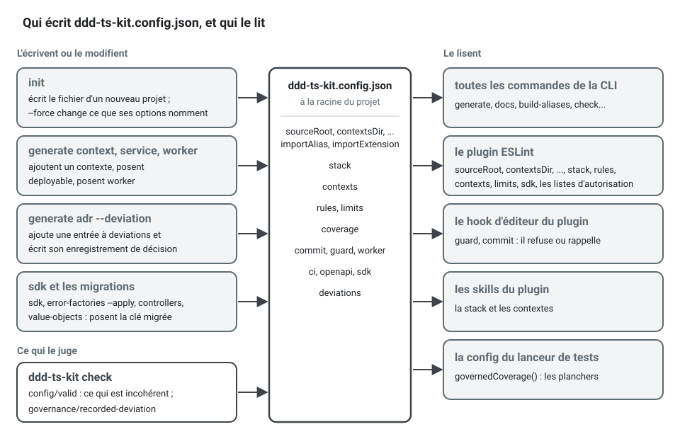

[English](CONFIG.md) · **Français**
<!-- translation-of: CONFIG.md sha256:7a1b7c85f6be9489 -->

# `ddd-ts-kit.config.json`

Lu par la CLI, le plugin ESLint, le *hook* d'éditeur et les *skills*. Il se trouve à la racine
du projet qui utilise le kit. `ddd-ts-kit init` l'écrit ; `generate context`, `generate service`,
`generate worker` et `generate adr --deviation` le modifient, tout comme `ddd-ts-kit sdk` et les
commandes qui font passer un projet d'une forme de code à une autre (`error-factories --apply`,
`controllers`, `value-objects`), chacune posant la clé qu'elle fait évoluer ; `ddd-ts-kit check`
signale ce qu'il a d'incohérent sous `config/valid`.



C'est le seul endroit où s'écrit une décision du projet. Une décision change d'abord ici, puis
les fichiers qui en découlent sont remis en accord, et la manière dépend du fichier. Deux sont
tenus par une règle de `ddd-ts-kit check`, qui les signale quand ils ne s'accordent plus avec
leur clé : les `paths`, `module` et `moduleResolution` de `tsconfig.json`
(`imports/alias-declared`, à partir d'`importAlias` et d'`importExtension`), et les réglages de
couverture du lanceur de tests, qui lisent les couches mesurées et leurs planchers dans ce
fichier au lieu de les répéter (`test/coverage-governed`). Les autres ne sont réécrits que par
une commande et ne sont pas vérifiés : les scripts, les pipelines et les *hooks* git dans le
dialecte du gestionnaire de *packages* suivent `stack.packageManager` quand
`init --force --package-manager <pm>` les réécrit, et une clé modifiée à la main les laisse tels
qu'ils étaient.

L'exemple ci-dessous est ce qu'écrit `init --context billing:core --context catalog:supporting`,
après `generate context shipping --classification supporting --upstream billing`. Il ne contient
aucune dérogation.

```json
{
  "initVersion": "0.26.0",
  "sourceRoot": "src",
  "contextsDir": "src/contexts",
  "sharedKernelDir": "src/shared-kernel",
  "platformDir": "src/platform",
  "importAlias": "@/",
  "importExtension": "none",
  "stack": {
    "http": "express",
    "validation": "zod",
    "di": "tsyringe",
    "events": "outbox",
    "orm": "drizzle",
    "database": "postgres",
    "tests": "vitest",
    "docsUi": "swagger",
    "ci": "github",
    "authn": "jwt",
    "authz": "rbac",
    "broker": "none",
    "cache": "none",
    "httpCache": "none",
    "storage": "local",
    "audit": "on",
    "errors": "none",
    "logger": "stdout",
    "style": "declared",
    "refusals": "named",
    "routes": "controllers",
    "schemas": "shared",
    "valueObjects": "throwing",
    "literals": "named",
    "values": "classes",
    "queue": "database",
    "assembly": "barrel",
    "dependencies": "signature",
    "packageManager": "pnpm",
    "representations": "negotiated",
    "forms": "on"
  },
  "contexts": {
    "billing": { "classification": "core", "upstreams": [] },
    "catalog": { "classification": "supporting", "upstreams": [] },
    "shipping": {
      "classification": "supporting",
      "upstreams": [{ "context": "billing", "relationship": "published-language" }]
    }
  },
  "rules": {},
  "domainAllowedPackages": ["@ddd-ts-kit/kernel"],
  "applicationAllowedPackages": ["@ddd-ts-kit/kernel", "@ddd-ts-kit/auth"]
}
```

`init` écrit chaque valeur par défaut en toutes lettres, pour que le fichier documente le projet.
Trois clés ne sont écrites que lorsqu'elles disent quelque chose : `stack.assembly` et
`stack.dependencies` dans le style déclaré seulement, `stack.tenancy` quand elle ne vaut pas
`none`. Les clés facultatives (`coverage`, `deviations`, `commit`, `worker`, `ci`, `owners`, `openapi`,
`sdk`, ...) apparaissent dès qu'un projet les pose.

`initVersion` est la version de la CLI dont l'`init` a écrit les fichiers de la plateforme.
`init` l'écrit en tête du fichier et `init --force` la réécrit, puisqu'il a réécrit ces fichiers ;
`init` relancé sans `--force`, `generate context` et toute autre commande la laissent telle quelle.
Elle ne se modifie pas à la main : elle permettra à un `init` ultérieur de distinguer ce que ses
*templates* ont changé depuis cette version de ce que l'équipe a adapté dans les fichiers, et rien
ne la lit encore. Un projet initialisé avant que la clé existe n'en a pas et reste valide ;
`init --force` l'ajoute.

## Comment une clé est lue


Une valeur `stack.*` erronée arrête toutes les commandes avant qu'elles ne fassent quoi que ce
soit, avec la liste des valeurs acceptées :

```text
$ npx ddd-ts-kit list
Error: ddd-ts-kit.config.json: "stack.http" is "expres".
  fix: Set "stack.http" to one of: express, fastify, hono, nest, none.
```

Toute autre valeur erronée laisse les commandes s'exécuter, et `ddd-ts-kit check` la signale
avec sa ligne dans le fichier :

```text
$ npx ddd-ts-kit check --rule config/valid
ddd-ts-kit.config.json:39  error  config/valid
  The context "billing" has the classification "central".
  fix: Set contexts.billing.classification to one of: core, supporting, generic.
```

Une clé qui n'est pas écrite n'est pas toujours lue comme ce qu'écrit `init` aujourd'hui : un
fichier sans la clé a été écrit par une version qui ne la connaissait pas, et le kit le lit
comme cette version fonctionnait, si bien qu'une mise à jour des *packages* ne change rien dans
un projet existant. Les treize clés concernées sont dans [la table de la section Stack](#une-clé-absente-de-stack),
et `importExtension` plus bas. Les règles exactes de l'analyseur sont dans [Limites](#limites).

## Chemins

| Clé | Signification | Défaut |
|---|---|---|
| `sourceRoot` | où vivent les sources | `src` |
| `contextsDir` | les contextes délimités (bounded contexts), un répertoire chacun | `<sourceRoot>/contexts` |
| `sharedKernelDir` | le noyau partagé | `<sourceRoot>/shared-kernel` |
| `platformDir` | la plateforme technique | `<sourceRoot>/platform` |
| `importAlias` | le préfixe qui nomme `sourceRoot` dans les imports : `@/`, ou `$`, un nom en minuscules (lettres, chiffres, traits d'union) et `/`. Chaque fichier du projet est importé par lui (`imports/alias-only`) | `@/` |
| `importExtension` | ce par quoi se termine l'import d'un fichier du projet : `none`, rien (`@/contexts/billing/domain/aggregates/invoice.aggregate`), ou `js`, l'extension du fichier qu'émet le compilateur (`.../invoice.aggregate.js`). Tenu par `imports/extension` | `none` dans ce qu'écrit `init` ; `js` quand la clé est absente |

`importAlias` est le seul endroit où une personne écrit l'alias. `init` (option `--import-alias`)
en dérive les `paths` de `tsconfig.json`, et `ddd-ts-kit build-aliases` le lit quand il réécrit
la sortie compilée ; `ddd-ts-kit check` les compare, ainsi que tout ce qui doit suivre
(`imports/alias-declared`). Seul est accepté un préfixe qui ne peut pas être le nom d'un
*package* : `#<name>/` est refusé (un import de sous-chemin Node est un autre mécanisme),
`@<name>/` est refusé (c'est ainsi que se nomment les *packages* d'un scope, et
dependency-cruiser résoudrait d'abord un *package* installé), et un `name/` nu l'est aussi.
`$test/`, `$scripts/` et `$generated/` sont pris : ils nomment `test/`, `scripts/` et le client
que génère Prisma, et ne sont pas configurables. Pour renommer l'alias d'un projet existant :
changez la clé, écrivez l'entrée `paths` que donne le constat, et remplacez le préfixe dans les
sources. Voir [tools/import-aliases.fr.md](tools/import-aliases.fr.md).

Ce que `imports/alias-only` demande à une source, ici dans un gestionnaire (handler) du contexte
billing :

```ts
// src/contexts/billing/application/commands/issue-invoice/issue-invoice.handler.ts

// Au lieu de : un chemin relatif, qui compte les "../" et change quand le fichier bouge
import { Invoice } from '../../../domain/aggregates/invoice.aggregate';
import { IssueInvoiceCommand } from './issue-invoice.command';

// Écrivez : l'alias, qui nomme le contexte et la couche depuis la racine des sources
import { IssueInvoiceCommand } from '@/contexts/billing/application/commands/issue-invoice/issue-invoice.command';
import { Invoice } from '@/contexts/billing/domain/aggregates/invoice.aggregate';
```

`eslint --fix` réécrit la première forme en la seconde.

`importExtension` est le seul endroit où une personne dit comment se termine un import. `init`
écrit `none` (option `--import-extension none|js`) et en dérive trois choses, que
`imports/alias-declared` tient alignées sur la clé :

| | `none` | `js` |
|---|---|---|
| `module`, `moduleResolution` et `customConditions` dans `tsconfig.json` | `ESNext`, `Bundler`, `["node"]` | `NodeNext`, `NodeNext`, aucun |
| chaque entrée `moduleNameMapper` d'une configuration jest | `'^@/(.*)$': '<rootDir>/src/$1.ts'` | `'^@/(.*)\\.js$': '<rootDir>/src/$1.ts'` |
| ce que `ddd-ts-kit build-aliases` lit dans la sortie compilée | `@/x`, qui nomme `x.js` | `@/x.js` |

Le même import sous chaque valeur, et ce qu'en fait le build :

```ts
// importExtension "none" : la source nomme le fichier, sans extension
import { Invoice } from '@/contexts/billing/domain/aggregates/invoice.aggregate';

// importExtension "js" : la source nomme le fichier qu'émet le compilateur
import { Invoice } from '@/contexts/billing/domain/aggregates/invoice.aggregate.js';

// Dans les deux cas, ddd-ts-kit build-aliases écrit dans
// dist/src/contexts/billing/application/commands/issue-invoice/issue-invoice.handler.js :
import { Invoice } from '../../../domain/aggregates/invoice.aggregate.js';
```

Dans les deux cas, le build écrit un chemin relatif qui se termine par `.js`, ce que Node
résout. Un fichier de configuration sans la clé est lu comme `js` : un projet généré par une
version qui ne la connaissait pas garde ses imports, son `tsconfig.json` et son build intacts,
et `init` relancé (avec ou sans `--force`) garde `js` pour lui. Une valeur qui n'est ni l'une ni
l'autre est signalée par `config/valid` et lue comme `js`.

Pour faire passer un projet existant aux imports sans extension :

1. posez `"importExtension": "none"` ;
2. lancez `ddd-ts-kit check` : `imports/alias-declared` donne les `module`, `moduleResolution` et
   `customConditions` à écrire dans `tsconfig.json`, et la correspondance jest d'un projet sous jest ; `imports/extension`
   liste chaque import à changer ;
3. lancez `eslint --fix` (`npm run lint:fix`), qui retire l'extension de chacun d'eux, puis
   `npm run format` : un import plus court peut désormais tenir sur une ligne ;
4. lancez `ddd-ts-kit docs`, qui réécrit les barrels de déclarations, puis `npm run verify`.

`init --force --import-extension none` fait les étapes 1 et 2 et réécrit les fichiers dont
`init` est propriétaire ; les étapes 3 et 4 restent à faire. Sous `none`, un import peut nommer un
répertoire : la résolution « bundler » du compilateur complète
`.../published-language` avec son `index.ts`, et le build avec son `index.js`. Ce que le compilateur ne modélise plus sous `none` est dit dans
[tools/import-aliases.fr.md](tools/import-aliases.fr.md), « Limites ».

## Stack

La colonne « Défaut » est ce qu'écrit `ddd-ts-kit init` quand l'option est omise. Une valeur
hors de la liste arrête toutes les commandes avec la liste des valeurs acceptées.

| Clé | Valeurs | Défaut |
|---|---|---|
| `stack.http` | `express`, `fastify`, `hono` (Hono 4 sur Node par `@hono/node-server`), `nest`, `none` | `express` |
| `stack.validation` | `zod`, `class-validator`, `typebox` (TypeBox 1, le *package* `typebox`), `standard-schema`, `none` | `zod` |
| `stack.di` | `tsyringe`, `nest`, `manual` ; `init` accepte `nest` avec `http: nest` et seulement avec lui | `tsyringe` (`nest` quand `http` vaut `nest`) |
| `stack.events` | `in-memory`, `outbox`, `custom` ; `init` propose `in-memory` et `outbox` | `outbox` quand un ORM est posé (toute autre valeur demande alors une dérogation `stack.events`), `in-memory` sinon |
| `stack.orm` | `drizzle`, `knex`, `prisma`, `typeorm`, `custom`, `none`. Avec un outil de migration, `npm run db:generate <what-it-does>` nomme chaque migration `<timestamp>_<what-it-does>` et `persistence/migration-history` vérifie leur ordre ([persistance](tools/persistence.fr.md#migrations--noms-fusions-et-ordre)) | `drizzle` (`none` avec `database: none`) |
| `stack.database` | `postgres`, `mysql`, `sqlite`, `mongodb`, `none`. Les adaptateurs générés sont écrits pour PostgreSQL : `init` refuse une autre base avec `drizzle`, `knex`, `prisma` ou `typeorm`, et son option `--database` ne propose pas `mongodb` | `postgres` avec l'un des quatre ORM, `none` sinon |
| `stack.tests` | `vitest`, `jest` | `vitest` |
| `stack.docsUi` | `swagger`, `scalar`, `redoc`, `none` | `swagger` (`none` quand `http` vaut `none`) |
| `stack.ci` | `github`, `gitlab`, `both`, `none` | `github` |
| `stack.authn` | `jwt`, `keycloak`, `none` | `jwt` |
| `stack.authz` | `rbac`, `abac`, `rebac`, `custom` | `rbac` |
| `stack.broker` | `none`, `rabbitmq`, `kafka`, `nats`, `redis` (Redis Streams), `custom` ; `init` refuse un *broker* sans ORM, puisqu'un *broker* est atteint par l'outbox | `none` |
| `stack.cache` | `none`, `redis` : ce qui porte le port `Cache` du kernel, le réveil du relais de l'outbox, le limiteur de débit et le verrou des *jobs* planifiés | `none` |
| `stack.httpCache` | `none`, `varnish` : le cache HTTP partagé devant l'API. `varnish` (`init --http-cache varnish`, avec un framework HTTP et `events: outbox`) ajoute le service Varnish 9.1.0 au fichier compose avec son VCL dans `docker/varnish/default.vcl` (il ne garde qu'une réponse dont le `Cache-Control` l'autorise par `max-age` ou `s-maxage`, et laisse entrer une purge venant de sa machine ou munie de `VARNISH_PURGE_KEY`), lit `VARNISH_URL` et `VARNISH_PURGE_KEY`, étiquette les réponses publiques dans `xkey` (`cacheTags` de la bordure HTTP), et confie les demandes de purge de l'outbox à `VarnishCachePurger` dans `main.ts` et dans chaque point d'entrée qu'écrit `generate service` ; l'application de bout en bout les enregistre à la place (`purges.purged`). Sous `di: manual` et `nest`, la plateforme gagne `cacheInvalidation`, ce qu'un gestionnaire d'avant validation demande de purger. Avec un `stack.tenancy` autre que `none`, les étiquettes des réponses et des purges sont rangées sous le *tenant* (`perTenant`), et la bordure HTTP lit le *tenant* d'une requête HTTP dans `x-tenant-id` (`resolveTenant: tenantFromHeader()`), si bien qu'un appel public nomme son *tenant* et que ses réponses varient selon lui. Une configuration sans la clé vaut `none` : rien ne change. Voir [Caches HTTP](tools/http-caches.fr.md) | `none` |
| `stack.storage` | `local`, `s3`, `none` : où vit le contenu des fichiers, jamais dans la base. `local` : un répertoire en développement (`FILES_DIRECTORY`, `.data/files`), la mémoire du processus dans les tests et les outils, les liens signés servis par l'application sous `/files` ; `s3` : un bucket de n'importe quel fournisseur du protocole S3 (`@ddd-ts-kit/s3`, MinIO dans la stack compose, variables `S3_*`), la mémoire dans les tests ; `none` : aucun stockage de fichiers câblé. Dans tous les cas, `platform/files/` lie `FileStorage`, `FileKeys`, `FileScanner` et `FileStaging`, enregistre la purge horaire des fichiers déposés, dépose le fichier que porte une commande sur le bus de commandes avant la transaction, et monte le lecteur d'envoi ; `generate file-upload` en a besoin. Avec `local`, `FILES_PUBLIC_URL` et `FILES_SIGNING_SECRET` sont obligatoires en production. Voir [stockage de fichiers](concepts/file-storage.fr.md) | `local` dans ce qu'écrit `init` ; `none` quand la clé est absente |
| `stack.audit` | `on`, `off` : si le journal d'audit est câblé ; `on` enregistre aussi les refus des gardes en bordure pour les appelants authentifiés (`onGuardRefusal`), jamais ceux d'un appelant sans identifiants | `on` quand un ORM est posé, `off` sinon |
| `stack.errors` | `none`, `sentry` : où sont remontées les défaillances inattendues ; `sentry` lie l'`ErrorReporter` du kernel à `@ddd-ts-kit/sentry` (Sentry ou GlitchTip) | `none` |
| `stack.logger` | `stdout`, `pino`, `winston` : ce qui implémente le port `Logger` du kernel | `stdout` |
| `stack.style` | `declared` : chaque classe déclare ce qu'elle est par un décorateur et un contexte n'a pas de fichier de module ; `explicit` : chaque liaison est écrite dans `<context>.module.ts`. `init` n'accepte `declared` qu'avec `di: tsyringe` | `declared` avec `di: tsyringe`, `explicit` sinon |
| `stack.assembly` | `barrel`, `discovery` : comment un contexte déclaré atteint la racine de composition, par le `<context>.declarations.ts` généré, qui réexporte les déclarations générées de chaque couche (`application/application.declarations.ts`), ou par un parcours au démarrage. `init` n'accepte l'option que dans le style déclaré | `barrel` |
| `stack.dependencies` | `signature`, `listed` : où une classe déclarée dit ce dont elle dépend. `signature` : dans son constructeur et nulle part ailleurs ; `ddd-ts-kit docs` lit les signatures dans les déclarations générées de chaque contexte, et une liste laissée dans un décorateur est signalée (`declarations/constructor-injection`, qu'ESLint corrige). `listed` : dans le dernier argument de son décorateur, comme l'écrivait la 0.1. Les deux formes fonctionnent sous l'une comme sous l'autre : une classe qui liste reçoit sa liste, une classe qui ne liste pas reçoit ce que prend son constructeur. `init` n'accepte l'option que dans le style déclaré | `signature` |
| `stack.refusals` | `named`, `factories`, `classes` : comment s'écrit une erreur du domaine. `named` : une classe par refus, nommée d'après ce qui est refusé (`SlotTaken`), qui étend `DomainRefusal`, construite par des fabriques statiques nommées d'après ce sur quoi porte le refus (`SlotTaken.forCalendar(..)`), son code lu dans la liste fermée de son contexte, `<context>.codes.ts` ; tenue par les règles `errors/*`, et `generate error <context> <Refusal> <factory>` écrit la classe, son code et la fabrique. `factories` : une classe d'erreur par concept du modèle, qui étend `ConceptError`, chaque refus une fabrique statique nommée dans les mots du métier (`AppointmentError.slotTaken(..)`), comme l'écrivait `init` avant `named` ; tenue par les règles `errors/*`, et `generate error <context> <Concept> <refusal>` en ajoute une. `classes` : une classe par erreur, construite avec `new`, comme les écrivaient la 0.1 et la 0.2 ; `generate domain-error` en écrit une, et aucune règle `errors/*` ne juge. Les trois formes fonctionnent dans n'importe quel projet : `DomainRefusal`, `ConceptError` et `DomainError` forment une seule famille | `named` |
| `stack.routes` | `controllers`, `functions` : comment s'écrit une route. `controllers` : une classe par route portant le `@Controller` de `@ddd-ts-kit/http`, dans un dossier à elle sous `presentation/http/<resource>/<use-case>/`, derrière les gardes de son `@RouteGroup` ; `generate route` l'écrit, avec `--mapper` et `--serializer` sur demande. `functions` : une fonction `defineRoute` par route, listée dans `<context>.routes.ts`, comme les écrivaient les versions 0.1 à 0.3. Les deux formes fonctionnent sous l'une comme sous l'autre, et dans un même projet pendant une migration : `generate controller` écrit un contrôleur quoi que dise la clé, et `ddd-ts-kit controllers` transforme les routes en fonctions d'un contexte en contrôleurs | `controllers` |
| `stack.schemas` | `shared`, `per-route` : comment s'écrivent les schémas du contrat HTTP. `shared` : une forme qu'utilisent plusieurs routes est déclarée une fois, `presentation/http/shared/<name>.schema.ts` de son contexte ou `presentation/<name>.schema.ts` du noyau partagé (`generate schema`), partagée (un `.meta({ id })` de zod, `classSchema(Dto, { shared: true })`, `sharedSchema`), documentée une fois dans `components.schemas` et référencée par `$ref` ; une commande répond son identifiant avec `acceptedSchema` de `@ddd-ts-kit/http` ; `schema/no-duplicate-shape` et `schema/presentation-only` jugent. `per-route` : chaque route déclare ses propres schémas, réponse d'identifiant comprise (`<use-case>.accepted.ts` avec class-validator), comme les écrivaient les versions 0.1 à 0.5, et aucune règle `schema/*` ne juge | `shared` |
| `stack.valueObjects` | `throwing`, `result` : comment refuse la fabrique d'un objet-valeur. `throwing` : `create` renvoie l'objet-valeur ou lève le refus construit par la fabrique statique de son concept (`throw PersonError.invalidEmail(raw)`), comme refuse un agrégat ; un appelant prend la valeur telle quelle, et une *spec* affirme `expectRefusal(() => Email.create(raw), 'INVALID_EMAIL')`. `result` : `create` renvoie un `Result` du kernel, `err(PersonError.invalidEmail(raw))`, qu'un appelant déballe avec `unwrap(..)`, comme les écrivaient les versions 0.1 à 0.5. `generate value-object` écrit la forme que dit la clé ; `Result`, `ok`, `err` et `unwrap` restent dans le kernel pour un projet qui les garde. La validation en bordure (le schéma d'une requête HTTP) n'est pas concernée : une valeur refusée là n'atteint jamais la fabrique | `throwing` |
| `stack.literals` | `named`, `free` : comment le code écrit une valeur fermée et un nombre. `named` : une valeur que déclare un vocabulaire fermé du projet est lue par lui, `AppointmentStatus.NoShow`, `billingPermissions['invoice.issue']`, `Role.Admin`, jamais réécrite en chaîne (`language/declared-vocabulary`, *checker* et ESLint), et un nombre de `domain/` ou d'`application/` autre que 0, 1, -1 et un indice a un nom (`clean/no-magic-number`, ESLint). `free` : les deux règles se taisent, comme le code qu'écrivaient les versions 0.1 à 0.5. Les *templates* de règles qu'écrit `init` ne mentionnent les règles que sous `named` | `named` |
| `stack.values` | `classes`, `free` : comment s'écrit une valeur du modèle. `classes` : une classe d'objet-valeur qui étend `ValueObject`, construite par des fabriques statiques (`generate value-object` en écrit une), et jamais une fonction qui construit un objet simple ; `domain/value-object-class` (*checker* et ESLint) tient les fichiers de `domain/value-objects/` et les fonctions de `domain/` et du noyau partagé ([Entités et objets-valeurs](concepts/entities-and-value-objects.fr.md#pourquoi-un-objet-valeur-est-une-classe)). `free` : la règle se tait, comme les versions 0.1 à 0.15 écrivaient le code. Le *template* de règles qu'écrit `init` ne nomme la règle que sous `classes` | `classes` |
| `stack.tenancy` | `none`, `shared-table` ; lues aussi : `row-level-security`, `schema-per-tenant`, `database-per-tenant`. Comment les données d'un *tenant* sont tenues à l'écart des autres ([Multitenance](concepts/multitenancy.fr.md)). `shared-table` : chaque *repository* généré, sur Knex ou Drizzle, restreint ses requêtes SQL au *tenant* du travail par `tenantTable` et `ownTenantTable` ou `tenantCondition` et `ownTenantCondition`, l'outbox garde le *tenant* de chaque événement pour que les consommateurs s'exécutent dans celui-ci, et `tenancy/scoped-statement` signale une requête SQL qui contourne ces aides. `init --tenancy` propose `none` et `shared-table`, et refuse `shared-table` avec Prisma, TypeORM, `custom` ou sans ORM ; les trois autres stratégies sont livrées par les *packages* de persistance et câblées à la main (`init` les refuse en disant quoi ajouter). Absente : `none`, et le fichier ne dit rien de la multitenance | absente (`none`) |
| `stack.representations` | `negotiated`, `json` : ce dans quoi une route répond. `negotiated` : `src/platform/http/presentation-of.ts` enregistre `Representations.standard()` de `@ddd-ts-kit/http` dans la frontière HTTP et dans le script du contrat, si bien que chaque requête HTTP reçoit sa réponse dans le type de média que préfère son en-tête `Accept` parmi JSON et ce que sa route déclare dans `produces` (XML, CSV, `406` quand aucun ne convient), un corps XML est lu sur une route qui déclare `consumes`, et les champs qu'un schéma réserve avec `withFieldAccess` sont décidés par l'`Access` de l'application ; `generate representation` ajoute `produces` à un contrôleur. `json` : du JSON quoi que la requête accepte, comme avant que la clé n'existe. `init` écrit `json` sans *stack* HTTP | `negotiated` (`json` avec `http: none`) |
| `stack.forms` | `on`, `off` : si une route qui déclare `form` est servie comme un formulaire. `on` : `src/platform/http/with-forms.ts` ajoute `formRoutes` de `@ddd-ts-kit/http` aux routes, un `GET /forms/<operationId>` par route de ce genre (JSON Forms, ou `?format=blocks`), les champs cachés ou en lecture seule pour chaque appelant par le même accès aux champs, et `npm run docs:generate` écrit chaque formulaire en entier dans `openapi/forms/<operationId>.json` ; `generate form` donne à un contrôleur ses indications. `off` : aucun formulaire n'est servi | `on` (`off` avec `http: none`) |
| `stack.queue` | `database`, `redis`, `memory`. Où sont gardés les *jobs* en arrière-plan et les instances des gestionnaires de processus ([Jobs en arrière-plan](concepts/background-jobs.fr.md), [Sagas et gestionnaires de processus](concepts/sagas-and-process-managers.fr.md)). `database` : les tables `background_jobs` et `process_instances` de `@ddd-ts-kit/knex` ou de `@ddd-ts-kit/drizzle` dans le schéma `messaging`, créées par la première migration, liées à la place des magasins en mémoire par le module de la plateforme : un *job* mis en file par une commande existe si et seulement si la commande a été validée. `redis` : `RedisJobStore` sur le serveur du cache (`--cache redis`, Dragonfly dans docker-compose et en CI), écrit une fois la commande validée ; les instances de processus restent dans la base avec Knex ou Drizzle. `memory` : dans le processus, ce qu'un *worker* d'un autre processus ne voit pas. `init --queue` vaut par défaut `database` sur Knex ou Drizzle avec `--di tsyringe`, `memory` sinon ; il refuse un magasin avec un autre conteneur que tsyringe, `database` avec un autre ORM, et `redis` sans `--cache redis`. `generate background-job` et `generate process` demandent `--di tsyringe`. Avec `memory` et un *worker*, chaque processus consomme la file dans sa propre mémoire, que ses *jobs* soient actifs ou non : l'API exécute les *jobs* qu'elle met en file, le *worker* ceux que mettent en file ses *jobs* planifiés, et un redémarrage perd ce qui attend. Avec `redis`, l'écriture d'un *job* perdue après la validation de sa commande est journalisée et remontée (`reportLostJobs` de `@ddd-ts-kit/redis`, lié par le module de la plateforme). Absente : `memory`, le magasin d'un projet initialisé avant que les *jobs* en arrière-plan n'existent | `database` sur Knex ou Drizzle avec tsyringe, `memory` sinon |
| `stack.packageManager` | `npm`, `pnpm` : ce qui installe les dépendances et exécute les scripts. Chaque commande qu'écrit la CLI est dans son dialecte : les scripts de `package.json`, les *pipelines*, les *hooks* git, le `Dockerfile`, le README et les notes qu'affichent `init` et `generate` (`pnpm run verify` et `pnpm exec ddd-ts-kit`, ou `npm run verify` et `npx ddd-ts-kit`). pnpm est épinglé par le champ `packageManager` de `package.json`, que fournit corepack (`corepack enable`, une fois par machine) ; npm vient avec Node et n'est pas épinglé. `init --package-manager npm\|pnpm` | `pnpm` dans ce qu'écrit `init` ; `npm` quand la clé est absente |

### Une clé absente de `stack`

Un fichier de configuration qui omet une clé de `stack` est lu avec les valeurs par défaut de la
table ci-dessus, sauf pour treize clés. Un fichier sans l'une d'elles a été écrit par une version
qui n'offrait pas ce choix, et il est lu comme cette version fonctionnait :

| Clé | Absente, lue comme | Ce qu'écrit `init` | Pour faire évoluer un projet |
|---|---|---|---|
| `stack.style` | `explicit` | `declared` avec tsyringe | aucune commande ne la fait évoluer |
| `stack.dependencies` | `listed`, dans le style déclaré | `signature` | poser la clé, `eslint --fix`, puis `ddd-ts-kit docs` |
| `stack.refusals` | `classes` | `named` | `error-factories --plan`, puis `--apply` |
| `stack.routes` | `functions` | `controllers` | `controllers`, ou `controllers <context>` |
| `stack.storage` | `none` | `local` | `init --force --storage local` (ou `s3`) |
| `stack.valueObjects` | `result` | `throwing` | `value-objects` |
| `stack.literals` | `free` | `named` | poser la clé, puis suivre `check` et ESLint |
| `stack.queue` | `memory` | `database` sur Knex ou Drizzle avec tsyringe, `memory` sinon | `init --force --queue database` |
| `stack.schemas` | `per-route` | `shared` | poser la clé, puis suivre `check --rule schema/no-duplicate-shape` |
| `stack.packageManager` | `npm` | `pnpm` | `init --force --package-manager pnpm` |
| `stack.representations` | `json` | `negotiated` (`json` avec `http: none`) | `init --force --representations negotiated` |
| `stack.forms` | `off` | `on` (`off` avec `http: none`) | `init --force --forms on` |
| `stack.values` | `free` | `classes` | poser la clé, puis suivre `check --rule domain/value-object-class` et ESLint |

Les paragraphes ci-dessous disent pourquoi pour chacune, et ce que chaque évolution laisse à une
personne.

Les deux premières : sans `stack.style`, le projet est lu comme `explicit`, quoi que dise `stack.di`, parce
qu'un tel fichier a été écrit avant que le style déclaré n'existe ; et sans `stack.dependencies`,
un projet déclaré est lu comme `listed`, parce qu'un tel fichier a été écrit quand chaque
décorateur listait ses dépendances. Un projet 0.1 continue donc de fonctionner sans retouche
après la mise à jour des *packages*. Pour le faire passer aux signatures de constructeur :
posez `"dependencies": "signature"`, lancez `npx eslint . --fix` (la règle retire chaque liste
qui répète son constructeur et signale celles qui en diffèrent), puis `npx ddd-ts-kit docs`, et
ajoutez `--import ddd-ts-kit/dist/refresh-declarations.js` au script `dev` comme l'écrit `init`.

La troisième : sans `stack.refusals`, le projet est lu comme `classes`, parce qu'un tel fichier
a été écrit quand une erreur du domaine était une classe construite avec `new`. Rien de nouveau
n'y est signalé. Un projet qui dit `factories` a été initialisé quand `init` écrivait une classe
d'erreur par concept : il continue de fonctionner tel quel, et les règles `errors/*` le jugent
selon les règles de cette forme. Les deux passent à `named` de la même façon.
`npx ddd-ts-kit error-factories --plan` écrit `error-factories.plan.json`, une entrée par refus
avec la classe qui lui est proposée (le PascalCase de son code, pour que le code soit gardé,
`Unknown<X>` pour `X_NOT_FOUND`) et sa fabrique (`for` et son premier paramètre) ; modifiez les noms que vous voulez
autres, puis `npx ddd-ts-kit error-factories --apply` écrit `<context>.codes.ts` dans chaque
contexte, un fichier de classe par refus et sa *spec*, réécrit chaque usage
(`AppointmentError.ended(a, b)` devient `AppointmentEnded.forAppointment(a, b)`,
`AppointmentError.is(error, 'APPOINTMENT_ENDED')` devient `AppointmentEnded.is(error)`, `new`,
`thenError`, `toThrow`, `expect.any`, `toBeInstanceOf`, `instanceof`, imports et types), supprime
les classes de concept restées vides et pose la clé. Il finit par ce qui reste à une personne :
ce qu'il ne sait pas réécrire (un `AppointmentError.is(error)` sans code,
`CodeOf<typeof AppointmentError>`), les classes nommées avec des mots que le glossaire de leur
contexte ne définit pas, les faits à exposer, les fabriques qui prennent encore une
phrase, les propriétés devenues des faits. `--to factories` fait à la place le passage
antérieur, de `classes` à une classe d'erreur par concept.

La quatrième : sans `stack.routes`, le projet est lu comme `functions`, parce qu'un tel fichier
a été écrit quand chaque route était une fonction `defineRoute`. Rien n'y change : les fonctions
restent prises en charge, `generate route` continue d'en écrire une, et aucune règle sur les
contrôleurs ne signale quoi que ce soit. Pour le faire évoluer : `npx ddd-ts-kit controllers
--dry-run` dit ce qui bougerait, contexte par contexte ; `npx ddd-ts-kit controllers` (ou
`controllers <context>`, un contexte à la fois) transforme chaque `<name>.route.ts` en
`<resource>/<name>/<name>.controller.ts` derrière le groupe de routes de sa ressource, déplace
avec lui ses fichiers de schéma et sa *spec*, réécrit chaque import, retire la liste d'un
contexte déclaré et pose `"routes": "controllers"` une fois qu'il ne reste plus de route en
fonction dans les contextes. Un contexte est transformé en entier ou pas du tout : une route qui
répond plusieurs statuts, pose des en-têtes ou n'est pas écrite sous la forme
`defineRoute(spec, async (input) => { .. })` est nommée avec la raison, et reste une fonction,
qui continue de tourner à côté des contrôleurs. Ce que la commande vous laisse est affiché :
lancer le formateur et `ddd-ts-kit docs`, déplacer vers un *mapper* ou un sérialiseur les
fonctions utilitaires qu'un contrôleur a gardées, donner leurs gardes aux groupes et, dans un
projet initialisé avant la 0.4, ajouter à `compose-application.ts` la ligne qui monte les
contrôleurs déclarés.

La cinquième : sans `stack.storage`, le projet est lu comme `none`, parce qu'un tel fichier a
été écrit avant que le kit ne garde des fichiers : rien n'est câblé, rien ne change. Pour
ajouter le stockage de fichiers : `npx ddd-ts-kit init --force --storage local` (ou `s3`)
enregistre la clé et écrit les fichiers de `platform/files/` et `platform/config/read-files.ts`
avec les fichiers dont `init` est propriétaire ; puis
`npx ddd-ts-kit generate file-upload <context> <UseCase>` écrit le premier envoi de fichier. Un
projet qui garde `local` pose `FILES_PUBLIC_URL` et `FILES_SIGNING_SECRET` en production, avant
même de recevoir un fichier : le démarrage refuse sans eux.

La sixième : sans `stack.valueObjects`, le projet est lu comme `result`, parce qu'un tel fichier
a été écrit quand chaque objet-valeur renvoyait un `Result`. Rien n'y change : `generate
value-object` continue d'écrire un `Result`. Pour le faire évoluer : `npx ddd-ts-kit
value-objects --dry-run` dit ce qui changerait, `npx ddd-ts-kit value-objects` le réécrit. Dans
chaque classe qui étend `ValueObject`, chaque méthode qui renvoie `Result<T, E>` renvoie `T` ;
`return err(refusal)` devient `throw refusal`, `return ok(value)` devient `return value`, et
`return valid ? ok(value) : err(refusal)` devient un `if` et un `throw`. Dans chaque source du
projet, le `unwrap(..)` de l'un de ces appels disparaît, imbriqué ou sur plusieurs lignes
compris ; une *spec* qui affirmait le `Result` affirme la fabrique :
`expect(result.ok).toBe(true)` devient `expect(() => ..).not.toThrow()`,
`toMatchObject({ ok: false, error: { code } })` devient `expectRefusal(() => .., code)`, et un
`const result = Email.create(raw)` lu seulement par de telles assertions est mis en ligne. Les
imports de `err`, `ok`, `Result` et `unwrap` que plus rien ne lit sont retirés, `expectRefusal`
est importé là où il est désormais appelé, et la clé est posée. Ce qui reste à une personne est
affiché avec sa ligne : un refus affirmé avec ses faits, un appelant qui branchait sur `.ok` ou
lisait `.error`, un `err(..)` qui n'était pas renvoyé. L'application d'exemple a été migrée par
elle : 28 refus levés, 168 `unwrap` retirés, 31 assertions réécrites, rien à la main.

Les deux formes côte à côte, sur l'`Email` d'une personne. Sous `result`, `create` renvoie un
`Result` que chaque appelant déballe :

<!-- checked sample -->
```ts
import { DomainRefusal, err, ok, type Result, unwrap, ValueObject } from '@ddd-ts-kit/kernel';

// identity.codes.ts
export const IdentityCodes = {
  InvalidEmail: 'INVALID_EMAIL',
} as const;

// domain/errors/invalid-email.error.ts
export class InvalidEmail extends DomainRefusal {
  readonly code = IdentityCodes.InvalidEmail;

  static forAddress(value: string) {
    return InvalidEmail.refusal(`"${value}" is not an address the platform can write to.`, { value });
  }
}

const ADDRESS = /^[^\s@]+@[^\s@]+\.[^\s@]+$/;

export class Email extends ValueObject<{ readonly value: string }> {
  // stack.valueObjects "result" : le refus est une valeur que l'appelant doit déballer
  static create(value: string): Result<Email, InvalidEmail> {
    const normalized = value.trim().toLowerCase();

    return ADDRESS.test(normalized) ? ok(new Email({ value: normalized })) : err(InvalidEmail.forAddress(value));
  }
}

const email = unwrap(Email.create('ada@example.com'));
```

Sous `throwing`, la forme qu'écrit `init`, `create` renvoie l'objet-valeur ou lève le refus,
comme refuse un agrégat, et une *spec* l'affirme avec `expectRefusal` :

<!-- checked sample -->
```ts
import { DomainRefusal, ValueObject } from '@ddd-ts-kit/kernel';
import { expectRefusal } from '@ddd-ts-kit/testing';

// identity.codes.ts
export const IdentityCodes = {
  InvalidEmail: 'INVALID_EMAIL',
} as const;

// domain/errors/invalid-email.error.ts
export class InvalidEmail extends DomainRefusal {
  readonly code = IdentityCodes.InvalidEmail;

  static forAddress(value: string) {
    return InvalidEmail.refusal(`"${value}" is not an address the platform can write to.`, { value });
  }
}

const ADDRESS = /^[^\s@]+@[^\s@]+\.[^\s@]+$/;

export class Email extends ValueObject<{ readonly value: string }> {
  // stack.valueObjects "throwing" : l'appelant prend la valeur telle quelle
  static create(value: string): Email {
    const normalized = value.trim().toLowerCase();

    if (!ADDRESS.test(normalized)) {
      throw InvalidEmail.forAddress(value);
    }

    return new Email({ value: normalized });
  }
}

const email = Email.create('ada@example.com');

// dans une spec
expectRefusal(() => Email.create('ada@'), 'INVALID_EMAIL');
```

La septième : sans `stack.literals`, le projet est lu comme `free`, parce qu'un tel fichier a été
écrit avant que les deux règles n'existent, et le code que le kit générait alors écrit certaines
valeurs en brut : `generate job` écrivait l'autorisation d'un acteur système par son
identifiant de permission (`'billing:invoice.cancel',` dans `roles.ts`,
`permit('system-..', ['billing:invoice.cancel'], ..)` dans `attribute-policies.ts`). Rien n'y
est signalé, et un *job* généré de nouveau retrouve cette autorisation et n'en ajoute pas une
seconde. Pour nommer les littéraux : posez `"literals": "named"` sous `stack` et lancez
`npx ddd-ts-kit check` et ESLint. Chaque valeur est signalée avec ce qu'il faut écrire à la
place (`billingPermissions['invoice.cancel']`, importé du fichier de permissions du contexte) ;
une liste fermée qui vous est propre devient un vocabulaire avec
`npx ddd-ts-kit generate vocabulary <context> <Name> --value ..`, et les rôles un objet `Role`
dans `<platformDir>/auth/authorization/role.ts` écrit de la même manière. Un nombre du modèle devient une
constante du module ou un `static readonly`. Tant que ce n'est pas fait, une règle peut rester à
`warn` sous `rules`, enregistrée dans `deviations`.

La huitième : sans `stack.queue`, le projet est lu comme `memory`, parce qu'un tel fichier a été
écrit avant que les *jobs* en arrière-plan n'existent, et son module de plateforme ne lie aucun
magasin : le module du kernel garde les *jobs* et les instances de processus dans le processus,
qui les consomme même à côté d'un *worker* (`RUN_JOBS` désactivé) : rien de ce qu'un processus
met en file ne reste sans exécution, mais rien ne survit à son redémarrage. Pour les garder dans
la base : ajoutez les tables au schéma (`createJobTable` et `createProcessTable` de
`@ddd-ts-kit/knex` dans une nouvelle migration, ou `jobsTable` et `processesTable` de
`@ddd-ts-kit/drizzle/postgres` et `npm run db:generate`), donnez les magasins à `Persistence`
(`KnexJobStore`, `KnexProcessStore`, ou leurs jumeaux Drizzle), liez de nouveau `JobStore` et
`ProcessStore` dans le module de la plateforme, ajoutez `@ddd-ts-kit/scheduling` aux
dépendances et posez `"queue": "database"` ; `init --force --queue database` sur un arbre propre
écrit la même chose.

La neuvième : sans `stack.schemas`, le projet est lu comme `per-route`, parce qu'un tel fichier a
été écrit quand chaque route déclarait ses propres schémas. Rien n'y est signalé, et `generate
route` continue d'écrire une réponse d'identifiant par route. Pour le faire évoluer : posez
`"schemas": "shared"`, lancez `npx ddd-ts-kit check --rule schema/no-duplicate-shape`, et pour
chaque forme qu'il signale gardez une seule déclaration (`generate schema` écrit son fichier),
partagez-la et utilisez-la depuis chaque route ; remplacez chaque réponse `{ id }` par
`acceptedSchema` de `@ddd-ts-kit/http` et supprimez sa classe ; puis `npm run docs:generate`. Le
format sur le réseau ne change pas ; le contrat renvoie alors à un composant par forme au lieu
d'une copie par route.

La dixième : sans `stack.packageManager`, le projet est lu comme `npm`, parce qu'un tel fichier a
été écrit avant que le choix n'existe, quand le kit écrivait des commandes npm. Rien n'y change :
les scripts, les *pipelines* et les notes continuent de dire `npm run` et `npx`. Pour le faire
passer à pnpm : `npx ddd-ts-kit init --force --package-manager pnpm` enregistre la clé, épingle
pnpm dans le champ `packageManager` de `package.json` et réécrit dans son dialecte les fichiers
dont `init` est propriétaire ; puis `corepack enable`, `pnpm install` (qui écrit
`pnpm-lock.yaml`) et `pnpm run verify`.

La onzième et la douzième : sans `stack.representations`, le projet est lu comme `json`, et sans
`stack.forms` comme `off`, parce qu'un tel fichier a été écrit avant que l'une ou l'autre
n'existe. Rien n'y change : chaque réponse reste en JSON, aucun formulaire n'est servi, et un
schéma marqué avec `withFieldAccess` cache ses champs restreints à tout le monde tant qu'aucun
décideur n'est donné. Pour le faire évoluer : `npx ddd-ts-kit init --force --representations
negotiated --forms on` pose les deux clés et réécrit les fichiers dont `init` est propriétaire
(`http-boundary.ts`, `compose-application.ts`, `scripts/openapi.ts`, avec les nouveaux
`presentation-of.ts` et `with-forms.ts`) ; puis `npm run docs:generate`, qui liste les types de
média de chaque route et écrit les formulaires. Un projet qui a réécrit l'un de ces fichiers à la
main réapplique son changement, comme pour tout `init --force`.

La treizième : sans `stack.values`, le projet est lu comme `free`, parce qu'un tel fichier a été
écrit avant que `domain/value-object-class` n'existe, et qu'une valeur écrite à la main peut être
une fonction qui construit un objet simple. Rien n'y est signalé. Pour le faire évoluer :

1. Posez `"stack.values": "classes"` et lancez `npx ddd-ts-kit check --rule domain/value-object-class`
   et ESLint : chaque valeur écrite comme une fonction, chaque classe d'objet-valeur au
   constructeur public ou sans fabrique, et chaque fonction utilitaire qu'exporte un fichier
   d'objet-valeur sont signalées.
2. Pour une valeur écrite comme une fonction, `npx ddd-ts-kit generate value-object <context> <Name>`
   écrit la classe et sa *spec* ; déplacez dans sa fabrique statique les vérifications que
   faisaient les appelants, et en méthodes les fonctions utilitaires qui prenaient
   l'enregistrement, puis remplacez `money(a, c)` par `Money.of(a, c)`, une comparaison champ à
   champ par `equals`, et un *mapper* qui lisait les champs par `instanceof` et `toJSON()`.
3. Pour une classe d'objet-valeur, rendez le constructeur privé (protégé sur une classe de base)
   et ajoutez la fabrique statique que nomme la règle ; une fonction utilitaire exportée à côté
   devient une fabrique statique ou une méthode.

Tant que ce n'est pas fait, la règle peut rester à `warn` sous `rules`, enregistrée dans
`deviations` avec l'ADR qui dit quand elle s'en va, comme toute autre règle assouplie
(`governance/recorded-deviation`).

## Pipeline

| Clé | Valeurs | Défaut |
|---|---|---|
| `ci.extras[]` | des *jobs* ajoutés au *pipeline* en plus des portes gratuites, chacun demandant une offre payante sur un dépôt privé ou ne remontant dans une *merge request* que dans une offre payante : `codeql` (`.github/workflows/codeql.yml` ; gratuit sur un dépôt public, GitHub Code Security sur un dépôt privé), `dependency-review` (une étape du *job* `security` ; gratuit sur un dépôt public, GitHub Code Security ou Advanced Security sur un dépôt privé), `gitlab-sast` et `gitlab-secret-detection` (les *templates* de GitLab : ils tournent dans toutes les offres, leurs constats n'atteignent une *merge request* que sous Ultimate), `gitlab-dependency-scanning` (Ultimate), `claude-review` et `claude-triage` (les deux plateformes : une revue de chaque *pull request* ou *merge request* par Claude Code, publiée en commentaire qui n'approuve ni ne bloque, et un triage en trois lignes, en lecture seule, d'une exécution en échec ; des jetons d'API à chaque exécution, jamais exigés par le *job* `gate`). `init --ci-extras codeql,dependency-review` les écrit et enregistre la liste ; `--ci-extras none` les retire lors d'un `init --force`. `init` refuse un nom inconnu, ou un *job* d'une plateforme que `stack.ci` ne couvre pas ; `config/valid` signale un nom inconnu écrit à la main. La table de chaque outil, de sa classe et de sa source est dans [pipeline/README.md](../pipeline/README.md#free-by-default-paid-on-request) | `[]` : aucun, la clé est omise, `intent-to-spec` (GitHub seulement : `.github/workflows/intent-to-spec.yml`, le skill de *story* lancé sans responsable sur chaque intention qu'une fusion accepte ; des jetons d'API par intention acceptée) |

## Contrats

| Clé | Valeurs | Défaut |
|---|---|---|
| `openapi.format` | `yaml`, `json` : comment `npm run docs:generate` écrit les contrats générés, `openapi/openapi.yaml` et `docs/integration/asyncapi.yaml`, ou leurs jumeaux `.json`. En changer les régénère sous le nouveau nom et retire les anciens fichiers ; `docs:check` signale un contrat resté dans l'autre format | `yaml` |
| `openapi.documents[]` | `{ "name", "title"?, "groups"?, "contexts"?, "tags"? }` : découpe le contrat OpenAPI en documents, `openapi/<name>.yaml` chacun, quand un seul contiendrait trop de routes. Une route appartient à un document quand son groupe de routes ou un groupe au-dessus de lui (`groups`, par nom de classe), son contexte (`contexts`, lu dans les routes que déclare chaque contexte) ou l'une de ses étiquettes (`tags`) y figure ; une route peut appartenir à plusieurs documents à dessein, et une route qui n'appartient à aucun arrête `docs:generate` avec sa méthode, son chemin et son opération. Chaque document est autonome : les schémas qu'il utilise y sont copiés, jamais référencés d'un fichier à l'autre. `npx ddd-ts-kit docs` écrit le découpage dans `<platformDir>/http/openapi-documents.ts`, que lisent le script du contrat et la page de documentation (`/openapi/<name>.json`, et un sélecteur entre les documents sur `/docs`). `config/valid` signale un document sans nom utilisable comme nom de fichier, deux documents du même nom, un document qui ne nomme rien, et un contexte inconnu | aucun : un seul document, `openapi/openapi.yaml` |

```json
"openapi": {
  "documents": [
    { "name": "public", "title": "Booking API", "contexts": ["scheduling"], "groups": ["PeopleRoutes"] },
    { "name": "back-office", "title": "Back office", "contexts": ["identity", "analytics"], "tags": ["audit"] }
  ]
}
```

### Clients du contrat

| Clé | Valeurs | Défaut |
|---|---|---|
| `sdk` | `{ "name", "access"? }` : génère un client typé de chaque document du contrat, un *package* de *workspace* par document sous `clients/<document>` (`clients/api` pour le contrat entier, `clients/<name>` pour chaque document d'un contrat découpé), régénéré par `npm run docs:generate` et comparé par `docs:check` (`ddd-ts-kit sdk`, `ddd-ts-kit sdk --check`). `init --sdk` l'écrit avec le nom par défaut ; `ddd-ts-kit sdk` l'écrit dans un projet qui n'en a pas. La commande câble aussi le projet : les clients listés comme *packages* de *workspace* (`"workspaces"`, ou `pnpm-workspace.yaml` sous pnpm), leurs noms de *package* résolus vers leurs sources dans les `paths` de `tsconfig.json`, leurs sources exclues de Biome et de knip (et du préréglage ESLint, qui lit la clé), et les scripts `sdk:generate`, `sdk:build` (`tsc -b clients`, lancé par `ci:build`) | aucun : pas de client, les scripts et les fichiers comme avant |
| `sdk.name` | un nom de *package* contenant `{document}`, et `{project}` pour le nom de package.json : `"@acme/{project}-{document}-client"` | `{project}-{document}-client` |
| `sdk.access` | `public`, `restricted` : écrit dans `publishConfig.access` de chaque client. `restricted` demande un nom avec scope. La publication reste une étape manuelle ([SDK client](tools/client-sdk.fr.md#publier)) | aucun : npm décide (un *package* avec scope est restreint) |

`config/valid` signale un `sdk` qui n'est pas un objet, un nom que npm refuserait ou sans
`{document}`, un accès inconnu, et `restricted` sur un nom sans scope.

## Contextes

| Clé | Valeurs | Défaut |
|---|---|---|
| `contexts.<name>.classification` | `core`, `supporting`, `generic` | obligatoire |
| `contexts.<name>.upstreams[]` | un nom de contexte, ou `{ "context", "relationship" }` | `[]` |
| `contexts.<name>.upstreams[].relationship` | `published-language`, `customer-supplier`, `conformist`, `anti-corruption-layer`, `open-host-service`, `shared-kernel` | `published-language` |
| `contexts.<name>.extraDirectories[]` | un chemin dans le contexte, ou `{ "path", "reason" }` : un répertoire ajouté à l'arborescence canonique. Chacun est une dérogation | `[]` |
| `contexts.<name>.deployable` | `true`, `false` : le contexte a son propre point d'entrée `src/apps/<name>/main.ts` ; `generate service <name>` la pose | `false` |
| `contexts.<name>.owners[]` | les identifiants de qui possède le contexte, tels que la plateforme du dépôt les connaît (`@org/equipe`, `@personne`, un courriel) : `ddd-ts-kit docs` les écrit dans `CODEOWNERS` pour l'arborescence du contexte et son `published-language/` ([Propriétaires](#propriétaires)) | `[]` : aucune ligne pour le contexte |
| `contexts.<name>.modules` | `{ "<module>": {} }` : les modules du modèle du contexte, chacun un dossier du contexte qui contient ses propres couches, de `<module>/domain/` à `<module>/presentation/`, ses *specs* dans `test/unit/<module>/` ([Modules du modèle](concepts/modules.fr.md)). Un nom est en kebab-case, unique dans le contexte, et jamais le nom d'un dossier de rôle (`aggregates`, `commands`...) ni d'un dossier du contexte (`domain`, `test`...) ; `generate module <context> <module>` l'écrit | aucun |
| `contexts.<name>.modules.<module>.classification` | `core`, `supporting`, `generic` : le sous-domaine que le module porte, quand il diffère de la classification de son contexte | la classification du contexte |

Les contextes de la configuration et les répertoires de `contextsDir` doivent former le même
ensemble.

Aucune clé n'enregistre de *preset*. `init --preset identity` et `generate context <name>
--preset identity` écrivent un contexte une fois, comme les générateurs l'auraient écrit pièce par
pièce, puis le déclarent ici comme n'importe quel autre (`generic`, sauf si `--classification` ou
`--context <name>:<classification>` dit autre chose) ; dès lors, ses fichiers sont le code du
projet, et une configuration sans *preset* se comporte comme avant. Voir
[Démarrer avec des contextes bien conçus](guides/bootstrap-with-well-designed-contexts.fr.md).

## Propriétaires

| Clé | Valeurs | Défaut |
|---|---|---|
| `owners.platform[]` | les identifiants de qui possède ce qui n'est pas un contexte : `src/platform/`, `src/main.ts`, `ddd-ts-kit.config.json`, les fichiers du *pipeline* (`lefthook.yml`, `commitlint.config.mjs`, `.github/workflows/` et `.github/actions/` ou `.gitlab-ci.yml` et `.gitlab/`, selon `stack.ci`), `REVIEW.md`, `AGENTS.md` et `docs/adr/` ; et `src/shared-kernel/` tant qu'aucun contexte ne l'importe | `[]` : aucune ligne pour eux, la clé est omise |

Dès qu'une de ces clés nomme un propriétaire, `ddd-ts-kit docs` écrit `CODEOWNERS` à la racine du
projet (où GitHub et GitLab le lisent tous deux) entre des marqueurs `# ddd-ts-kit:code-owners`,
d'après le tableau des propriétaires de
[Travailler en équipe](guides/team-workflow.fr.md#un-propriétaire-par-contexte-délimité), et
`docs --check` le signale périmé. Un `CODEOWNERS` écrit par l'équipe reçoit le bloc à la suite de
ses lignes. Sans aucun propriétaire, rien n'est écrit. Les identifiants sont gardés tels quels :
la plateforme du dépôt les juge.

## Règles et limites

| Clé | Valeurs | Défaut |
|---|---|---|
| `rules.<id>` | `error`, `warn`, `off`, pour un identifiant de règle de la section 3 d'[ARCHITECTURE.fr.md](ARCHITECTURE.fr.md) (`ddd-ts-kit rules` les liste) ; ou `{ "severity": "<one of them>", "files": ["<glob>"] }`, cette sévérité pour les constats sur les fichiers que les motifs désignent (relatifs à la racine du projet, `*` dans un segment, `**` à travers les segments) et le défaut pour tous les autres fichiers, lu par `ddd-ts-kit check` et par le préréglage ESLint. Un réglage sans `files` est signalé (`config/valid`) ; un `off` seul l'est aussi (`config/rule-off-everywhere`, un avertissement) : voir [Dérogations](#dérogations) | la sévérité qu'affiche `ddd-ts-kit rules` : `error`, sauf pour les règles qui valent `warn` par défaut |
| `limits` | `{ "maxParameters": 3, "maxFunctionLines": 30 }`, lu par `clean/function-size` ; `maxFunctionLines` vaut au plus 100, une valeur plus grande est lue comme 100 et signalée | comme montré |
| `onePerFile.allow` | `[{ "file": "<path or glob>", "reason": "<why these exports are one thing>" }]` : exempte un fichier du décompte de `clean/one-export-per-file`, jamais de son contrôle du nom de fichier. Une entrée sans `file` ou sans `reason` n'autorise rien et est signalée | `[]` |
| `standardInterfaces` | `{ "<DeclaredName>": "<kernel interface to use instead>" }`, fusionné par-dessus les noms par défaut de `standard/no-parallel-interface` ; `false` retire un nom par défaut | `{}` |
| `businessNames` | `{ "words": ["<word>"], "allow": ["<word>"] }`, lu par `naming/business-name` (par `ddd-ts-kit check` et par ESLint, dont les options `words` et `allow` passent par-dessus) : `words` remplace les mots génériques que la règle signale, `allow` en retire ; une entrée qui n'est pas un mot est ignorée | les mots de la règle (`target`, `targets`, `data`, `item`, `items`, `obj`, `object`, `thing`, `things`, `stuff`, `info`, `element`, `el`, `tmp`, `temp`, `foo`, `bar`, `baz`), aucun autorisé |
| `coverage` | `{ "<layer>": { "<rate>": <0 to 100> } }` pour les couches `domain`, `application`, `presentation`, `infrastructure` et les taux `statements`, `branches`, `functions`, `lines` : la couverture de tests minimale de chaque couche, appliquée à chaque contexte. Un taux omis vaut la référence ; un taux qui n'est pas un pourcentage, une couche inconnue ou un taux inconnu est signalé (`config/valid`). `init` n'écrit pas la clé : la référence s'applique jusqu'à ce qu'un projet change un taux | domain 90, 85, 90, 90 ; application 85, 80, 85, 85 ; presentation 80, 70, 80, 80 ; infrastructure 70, 60, 70, 70 |
| `domainAllowedPackages` | les *packages* que `domain/` peut importer | `["@ddd-ts-kit/kernel"]` |
| `applicationAllowedPackages` | les *packages* qu'`application/` peut importer | `["@ddd-ts-kit/kernel", "@ddd-ts-kit/auth"]` |
| `publishedLanguageAllowedPackages` | les *packages* que `published-language/` peut importer | `@ddd-ts-kit/kernel`, `@ddd-ts-kit/events`, `@ddd-ts-kit/validation` et la bibliothèque de schémas de `stack.validation` (`zod` ; `class-validator` avec `class-transformer` ; `typebox` ; aucune pour `standard-schema` et `none`) |

`@ddd-ts-kit/aspects`, `@ddd-ts-kit/audit`, `@ddd-ts-kit/redis`, `@ddd-ts-kit/s3`, `@ddd-ts-kit/scheduling`,
`@ddd-ts-kit/sentry` et `@ddd-ts-kit/tracing` restent refusés dans `domain/` et `application/`,
même listés dans une liste d'autorisation.

## Accords de travail

| Clé | Valeurs | Défaut |
|---|---|---|
| `commit` | `{ "maxFiles": 20, "maxLines": 600 }` : taille conseillée d'un *commit*, lue par `ddd-ts-kit check --commit-size` (indicatif, `--strict` sort en 1) et par le *hook* d'éditeur (un rappel, jamais bloquant). Les fichiers générés ne sont pas comptés. Une limite qui n'est pas un entier positif est lue comme sa valeur par défaut et signalée | comme montré |
| `commit.agentTrailer` | `true`, `false` : si un *commit* fait par un agent du *plugin* le dit. À `true`, la *skill* story, l'agent `context-builder` qu'elle instruit et la *skill* fix terminent chaque *commit* qu'ils font par le *trailer* `Agent: <host> ddd-ts-kit@<plugin version> <agent name>` (`Agent: claude-code ddd-ts-kit@0.85.0 context-builder`), et le rapport d'une *story* compte les *commits* faits par un agent face à ceux faits à la main. Désactivé par défaut : beaucoup d'équipes refusent les lignes d'attribution dans les *commits*, et la séparation que veut vraiment le journal d'audit du cycle de vie passe par l'identité de l'exécution, qu'un *trailer* ne fait qu'approcher. Une valeur qui n'est pas un booléen est lue comme `false` et signalée | `false` |
| `guard` | `enforce`, `advise`, `off` : comment le *hook* d'éditeur du *plugin* réagit à une violation. La variable d'environnement `DDD_TS_KIT_GUARD` l'emporte sur elle | `enforce` |
| `worktrees` | `required`, `advised` : où la garde du *plugin* laisse une session écrire le code d'un contexte. `required` : dans un *worktree* seulement (`npx ddd-ts-kit worktree <name>`, `story-scope`, `worker-scope`, tous sous `.worktrees/`) ; dans le *checkout* principal, sur la branche du tronc, le code des contextes et les générateurs qui l'écrivent sont refusés. `advised` : partout, avec un avis au démarrage de la session, ce que garde un projet démarré avant cette clé tant qu'elle n'est pas posée | `required` dans un projet que crée `init`, `advised` quand la clé est absente |
| `formatOnWrite` | `true`, `false` (`init` écrit `true` pour un nouveau projet ; un projet qui a adopté le kit la pose) : si le *hook* d'éditeur du *plugin* lance le Biome du projet (`node_modules/.bin/biome format --write`) sur chaque fichier qu'une session écrit, avant de le vérifier, pour que la mise en page soit réglée à l'écriture et que les constats du lint qui suivent une ligne repliée reviennent dans la même sortie du *hook*. Un fichier, aucun autre formateur, rien quand Biome n'est pas installé dans le projet. C'est le projet qui la pose ; la clé n'est lue que comme `true`. Issu du [*playbook* du cycle de vie natif à l'IA d'Anthropic](https://cdn.prod.website-files.com/6889473510b50328dbb70ae6/6aba736348bdf4f08183f463_AI%20Native%20SDLC%20Playbook_designv2%20(1).pdf) | `false` |
| `worker` | `true`, `false` : le projet a `src/apps/worker/main.ts` ; les *jobs* planifiés tournent alors là et non dans le processus de l'API. `generate worker` la pose | `false` |
| `agents.profile` | `regulated` : le bac à sable de Claude Code et les deux *hooks* d'une organisation réglementée, écrits dans `.claude/settings.json` par `init --agent-profile regulated` (avec ou sans `--force`), signalés par `doctor` quand les réglages en manquent ; `init --agent-profile none` retire la clé. `config/valid` signale une autre valeur. Voir [Mettre les agents de code en bac à sable](guides/agent-sandbox.fr.md#le-profil-réglementé) | aucun, la clé est omise |
| `deviations[]` | `{ "what", "adr", "reason" }` : une exception enregistrée ; `adr` nomme un `docs/adr/<number>-*.md` existant | `[]` |

## Dérogations

Ces réglages assouplissent la référence, et `governance/recorded-deviation` signale chacun
d'eux qui n'a pas d'entrée dans `deviations` :

| Réglage | `what` de sa dérogation |
|---|---|
| une règle passée à `off`, ou à `warn` quand elle vaut `error` par défaut, pour tout le projet ou pour certains fichiers | `rules.<id>` |
| un répertoire supplémentaire dans un contexte | `contexts.<name>.extraDirectories.<path>` |
| un *package* ajouté à une liste d'autorisation | `domainAllowedPackages.<package>`, `applicationAllowedPackages.<package>`, `publishedLanguageAllowedPackages.<package>` |
| un seuil de couverture sous la référence | `coverage.<layer>.<rate>`, par exemple `coverage.infrastructure.branches` |
| une garde qui ne vaut pas `enforce` | `guard` |
| un ORM avec des événements hors de l'outbox | `stack.events` |

`npx ddd-ts-kit generate adr "<title>" --deviation <what> --reason "<why>"` écrit
l'enregistrement de décision et l'entrée ensemble.


Un exemple complet. Une équipe désactive `clean/function-size`, et `check` demande pourquoi :

```json
"rules": { "clean/function-size": "off" }
```

```text
$ npx ddd-ts-kit check --rule governance/recorded-deviation
ddd-ts-kit.config.json:57  error  governance/recorded-deviation
  The rule "clean/function-size" is lowered to "off", and no deviation records why.
  fix: Restore the default, or add { "what": "rules.clean/function-size", "adr": "NNNN", "reason": "<why>" } to "deviations" in ddd-ts-kit.config.json and write docs/adr/NNNN-<slug>.md (context, what is deviated from, why, scope, condition for removing it).
```

Une seule commande enregistre la décision :

```bash
npx ddd-ts-kit generate adr "Long mapping functions in the billing adapters" \
  --deviation rules.clean/function-size \
  --reason "The generated mappers of the legacy ledger are long and regenerated, never edited."
```

Elle écrit `docs/adr/0001-long-mapping-functions-in-the-billing-adapters.md`, avec son contexte
ouvert par la raison, et un `TODO(domain)` dans chaque section qu'une personne complète (le
contexte compris, puis décision, conséquences, alternatives, portée, condition de retrait), et
ajoute l'entrée :

```json
"deviations": [
  {
    "what": "rules.clean/function-size",
    "adr": "0001",
    "reason": "The generated mappers of the legacy ledger are long and regenerated, never edited."
  }
]
```

`check --rule governance/recorded-deviation` ne signale alors plus rien. Une entrée sans raison,
ou dont l'`adr` nomme un enregistrement que `docs/adr/` ne contient pas, est signalée elle aussi.
Un commentaire de désactivation dans le code suit la même règle :
`// ddd-ts-kit-disable-next-line <rule> -- ADR-0001: <reason>`.

La décision porte sur les *mappers*, mais `"off"` seul fait taire la règle dans tous les fichiers
du projet : une longue fonction écrite la semaine suivante dans un *handler* passerait inaperçue.
`check` le dit, par un avertissement :

```text
$ npx ddd-ts-kit check --rule config/rule-off-everywhere
ddd-ts-kit.config.json:57  warn   config/rule-off-everywhere
  The rule "clean/function-size" is off for the whole project: no file is judged by it, not only the ones its exception is about.
  fix: Turn it off for the files it is meant for, `"clean/function-size": { "severity": "off", "files": ["<glob>"] }`; when the whole project is meant, say so with `"files": ["**"]`.
```

Réglez la règle pour les fichiers dont parle l'enregistrement, et gardez la même dérogation :

```json
"rules": {
  "clean/function-size": { "severity": "off", "files": ["src/contexts/billing/infrastructure/ledger/*.mapper.ts"] }
}
```

Tous les autres fichiers sont jugés comme avant. La même forme abaisse une règle à `warn` pour
certains fichiers, ou l'y relève à `error`.

## Seuils de couverture

La configuration du lanceur de tests n'écrit aucun nombre : elle étale `governedCoverage(mode)`
(`governedJestCoverage()` sous jest) de `@ddd-ts-kit/testing/coverage`, qui lit la clé
`coverage` à chaque démarrage d'une exécution. Un seul endroit porte un seuil, et `check` tient
cet endroit.

Au lieu d'écrire un nombre dans la configuration du lanceur, ce que `test/coverage-governed`
refuse :

```ts
// vitest.config.ts
export default defineConfig({
  test: { coverage: { provider: 'v8', thresholds: { branches: 80 } } },
});
```

écrivez ce qu'écrit `init`, la mesure et les planchers lus dans le fichier de configuration :

<!-- checked sample -->
```ts
// vitest.config.ts
import { governedCoverage } from '@ddd-ts-kit/testing/coverage';
import { defineConfig } from 'vitest/config';

export default defineConfig(({ mode }) => ({
  test: {
    coverage: {
      provider: 'v8',
      // Ce qui est mesuré et le plancher de chaque couche viennent de "coverage" dans ddd-ts-kit.config.json.
      ...governedCoverage(mode),
    },
  },
}));
```

Sous jest, `export default { coverageProvider: 'v8', ...governedJestCoverage() };`. Dans
l'application d'exemple, `governedCoverage('unit')` mesure trois couches de chaque contexte et
donne un plancher par contexte et par couche qui contient un fichier source ; voici ceux de son
premier contexte, `analytics`, à la référence, puisque l'exemple ne pose pas `coverage` :

```json
{
  "include": ["src/contexts/*/domain/**/*.ts", "src/contexts/*/application/**/*.ts", "src/contexts/*/presentation/**/*.ts"],
  "thresholds": {
    "src/contexts/analytics/domain/**/*.ts": { "statements": 90, "branches": 85, "functions": 90, "lines": 90 },
    "src/contexts/analytics/application/**/*.ts": { "statements": 85, "branches": 80, "functions": 85, "lines": 85 },
    "src/contexts/analytics/presentation/**/*.ts": { "statements": 80, "branches": 70, "functions": 80, "lines": 80 }
  }
}
```

La clé `coverage` relève ou abaisse un plancher ; un plancher sous la référence vient avec sa
dérogation :

```json
"coverage": { "domain": { "branches": 95 }, "infrastructure": { "branches": 50 } },
"deviations": [
  { "what": "coverage.infrastructure.branches", "adr": "0011", "reason": "The failure branches of the driver are held by its contract suite." }
]
```

| Couche | Référence (statements, branches, functions, lines) | Pourquoi ce plancher |
|---|---|---|
| `domain` | 90, 85, 90, 90 | le plus haut : du code pur qui n'a besoin d'aucun double et porte les règles du métier ; seul un test manquant empêche une ligne de s'exécuter |
| `application` | 85, 80, 85, 85 | les gestionnaires orchestrent par des ports, chacun avec un *fake* : chaque chemin est atteignable, quelques-uns sont du câblage |
| `presentation` | 80, 70, 80, 80 | correspondance et traduction des statuts ; les chemins d'erreur d'un transport sont aussi tenus par les *specs* de bout en bout, qui ne sont pas mesurées |
| `infrastructure` | 70, 60, 70, 70 | le plus bas : les branches d'échec d'un pilote sont difficiles à provoquer et ce n'est pas à l'adaptateur de les prouver ; ce que promet un adaptateur est tenu par les suites de contrat des *specs* d'intégration |

- **Relever un taux est libre. En abaisser un sous la référence est une dérogation** (`governance/recorded-deviation`) avec son enregistrement de décision.
- **Chaque contexte est tenu séparément** : les seuils d'une couche s'appliquent à `contexts/<name>/<layer>/` de chaque contexte, si bien qu'un contexte bien testé n'en cache pas un autre.
- **Une couche vide n'est tenue à rien, et à son seuil dès son premier fichier source** (une *spec* ou un document n'en est pas un). Un projet tout juste initialisé passe ; la première route d'un contexte apporte avec elle le plancher de la présentation.
- **Une exécution est tenue aux couches qu'elle exécute** : `npm run test:coverage`, l'exécution de `verify`, lance chaque *spec* et mesure les quatre couches ; dans le *pipeline*, `ci:test:unit` (`--mode unit`) mesure domain, application et presentation, `ci:test:integration` (`--mode integration`) mesure infrastructure. Jest lance chaque *spec* en une seule exécution.
- **La mesure ne peut pas être restreinte en silence** (`test/coverage-governed`) : ni `include`, ni `exclude`, ni `thresholds` à la main dans la configuration du lanceur, aucune option de ce genre dans un script, aucun commentaire `v8 ignore` ou `istanbul ignore` sans `-- ADR-NNNN: <reason>`.
- Sous le mode des décorateurs historiques (legacy), la configuration Vitest générée liste `decoratorCoverage()` de `@ddd-ts-kit/testing/vitest` : les instructions qu'écrit la transformation pour appliquer les décorateurs portent une branche par type nommé qu'aucun test ne peut prendre, et sont tenues hors de la mesure.

## Score de mutation

La config Stryker n'écrit ni *glob* ni nombre : elle étale `governedMutation()` de
`@ddd-ts-kit/testing/mutation`, qui lit la clé `mutation` à chaque démarrage d'une exécution. Un
seul endroit tient le plancher, et `check` tient cet endroit (`test/mutation-governed`).

<!-- checked sample -->
```ts
// stryker.config.mjs
import { governedMutation } from '@ddd-ts-kit/testing/mutation';

export default {
  testRunner: 'vitest',
  vitest: { configFile: 'vitest.mutation.config.ts' },
  checkers: [],
  coverageAnalysis: 'perTest',
  // Ce qui est muté, ce qui est laissé de côté et le plancher viennent de "mutation" dans ddd-ts-kit.config.json.
  ...governedMutation(),
};
```

`governedMutation()` mute la couche domaine de chaque contexte, à son niveau et dans les modules de
son modèle, les déclarations générées exclues ; elle exclut le mutateur `StringLiteral`, puisqu'un
test du kit vérifie un refus par son code et jamais par son texte, de sorte qu'un tel mutant
survivrait par construction ; elle ignore les mutants statiques, ceux du code qui s'exécute une fois
au chargement du module, qui rechargeraient l'environnement et relanceraient tous les tests pour
chacun d'eux ; et elle écrit le plancher comme `thresholds` de Stryker. `npm run test:mutation`
lance Stryker, puis `ddd-ts-kit mutation`, qui lit le rapport (`reports/mutation/mutation.json`) et
tient chaque contexte au plancher, comme la couverture tient chaque contexte à ses seuils. Le
*pipeline* le lance chaque nuit, pas sur une *pull request*.

```json
"mutation": { "domain": 90 }
```

| Couche | Référence | Pourquoi ce plancher |
|---|---|---|
| `domain` | 80 | du code pur qui porte les règles du métier : un mutant que ses tests ne remarquent pas est une règle qu'aucun test n'énonce. L'application d'exemple atteint 96,6 avec la configuration livrée, son contexte le plus bas 95,8 |

- **Monter le plancher est libre. Le baisser sous la référence est une dérogation** (`governance/recorded-deviation`) avec son enregistrement de décision, `"what": "mutation.domain"`.
- **Chaque contexte est tenu pour lui-même** : `ddd-ts-kit mutation` note la couche domaine de chaque contexte que le rapport contient, comme Stryker le fait (détectés sur détectés et non détectés, les erreurs exclues), et sort en 1 tant qu'un contexte est sous le plancher.
- **La mesure ne se rétrécit pas en silence** (`test/mutation-governed`) : ni `mutate`, ni `mutator`, ni `ignoreStatic`, ni `thresholds` à la main dans la config Stryker.
- **Ce dont le score ne dit rien.** Les textes des refus, exclus avec leur mutateur, et les mutants statiques : une règle écrite en déclaration en haut d'un fichier, les transitions d'une machine à états, une constante métier, une expression régulière, n'est jamais mutée, et une transition fausse dans une telle table ne fait baisser aucun score. Le test qui énonce une telle règle en est la seule preuve ; `ddd-ts-kit mutation` montre les mutants ignorés de chaque contexte à côté de son score. Sur l'exemple, 222 des 1441 mutants sont ignorés : 158 littéraux de chaînes et 64 statiques, dont la déclaration de la machine à états des rendez-vous.
- **Sous les deux lanceurs.** Un projet sous Vitest fait tourner contre chaque mutant les *specs* unitaires de `vitest.mutation.config.ts` ; un projet sous Jest celles de `jest.mutation.config.js`, en modules ES sous le drapeau que le script `test` passe (`testRunnerNodeArgs`), Jest lançant les *specs* qui importent le fichier muté.

## Limites

L'analyseur est tolérant : une clé qu'il ne connaît pas est ignorée sans message, et une
classification, une relation, un identifiant de règle, un mode de garde, un mode des *worktrees*, une extension d'import
ou un taux de couverture erronés sont signalés par `check` sous `config/valid`, pas à la lecture
du fichier. Seule une valeur `stack.*` erronée, ou un fichier qui n'est pas un objet JSON,
arrête une commande.
