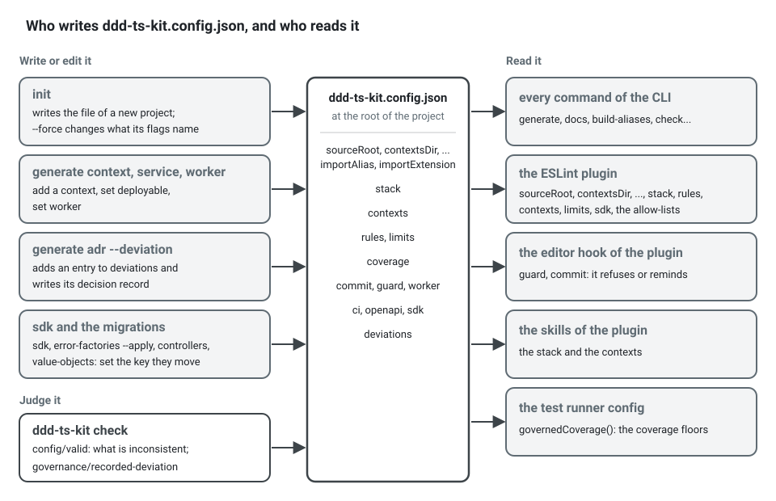

**English** · [Français](CONFIG.fr.md)

# `ddd-ts-kit.config.json`

Read by the CLI, the ESLint plugin, the editor hook and the skills. It lives at the root of
the consuming project. `ddd-ts-kit init` writes it; `generate context`, `generate service`,
`generate worker` and `generate adr --deviation` edit it, and so do `ddd-ts-kit sdk` and the
commands that move a project from one form of code to another (`error-factories --apply`,
`controllers`, `value-objects`), each setting the key it moves; `ddd-ts-kit check` reports what
is inconsistent in it as `config/valid`.



It is the one place a decision of the project is written. A decision changes here first, then
the files that follow from it are brought in line, and how depends on the file. Two are held by
a rule of `ddd-ts-kit check`, which reports them when they no longer agree with their key: the
`paths`, `module` and `moduleResolution` of `tsconfig.json` (`imports/alias-declared`, from
`importAlias` and `importExtension`), and the coverage settings of the test runner, which read
the measured layers and their floors from this file instead of repeating them
(`test/coverage-governed`). The others are only rewritten by a command and are not checked: the
scripts, pipelines and git hooks in the dialect of the package manager follow
`stack.packageManager` when `init --force --package-manager <pm>` rewrites them, and a key
changed by hand leaves them as they were.

The example below is what `init --context billing:core --context catalog:supporting` writes,
after `generate context shipping --classification supporting --upstream billing`. It holds no
deviation.

```json
{
  "initVersion": "0.26.0",
  "sourceRoot": "src",
  "contextsDir": "src/contexts",
  "sharedKernelDir": "src/shared-kernel",
  "platformDir": "src/platform",
  "importAlias": "@/",
  "importExtension": "none",
  "stack": {
    "http": "express",
    "validation": "zod",
    "di": "tsyringe",
    "events": "outbox",
    "orm": "drizzle",
    "database": "postgres",
    "tests": "vitest",
    "docsUi": "swagger",
    "ci": "github",
    "authn": "jwt",
    "authz": "rbac",
    "broker": "none",
    "cache": "none",
    "httpCache": "none",
    "storage": "local",
    "audit": "on",
    "errors": "none",
    "logger": "stdout",
    "style": "declared",
    "refusals": "named",
    "routes": "controllers",
    "schemas": "shared",
    "valueObjects": "throwing",
    "literals": "named",
    "values": "classes",
    "queue": "database",
    "assembly": "barrel",
    "dependencies": "signature",
    "packageManager": "pnpm",
    "representations": "negotiated",
    "forms": "on"
  },
  "contexts": {
    "billing": { "classification": "core", "upstreams": [] },
    "catalog": { "classification": "supporting", "upstreams": [] },
    "shipping": {
      "classification": "supporting",
      "upstreams": [{ "context": "billing", "relationship": "published-language" }]
    }
  },
  "rules": {},
  "domainAllowedPackages": ["@ddd-ts-kit/kernel"],
  "applicationAllowedPackages": ["@ddd-ts-kit/kernel", "@ddd-ts-kit/auth"]
}
```

`init` spells every default out, so that the file documents the project. Three keys are written
only when they say something: `stack.assembly` and `stack.dependencies` in the declared style
only, `stack.tenancy` when it is not `none`. The optional keys (`coverage`, `deviations`,
`commit`, `worker`, `ci`, `owners`, `openapi`, `sdk`, ...) appear once a project sets them.

`initVersion` is the version of the CLI whose `init` wrote the files of the platform. `init`
writes it first in the file and `init --force` rewrites it, since it rewrote those files; `init`
run again without `--force`, `generate context` and every other command leave it as it is. It is
not edited by hand: it is there for a later `init` to tell what its templates changed since that
version from what the team adapted in the files, and nothing reads it yet. A project initialised
before the key existed has none and stays valid; `init --force` adds it.

## How a key is read


A wrong `stack.*` value stops every command before it does anything, with the list of accepted
values:

```text
$ npx ddd-ts-kit list
Error: ddd-ts-kit.config.json: "stack.http" is "expres".
  fix: Set "stack.http" to one of: express, fastify, hono, nest, none.
```

Any other wrong value lets the commands run, and `ddd-ts-kit check` reports it with its line in
the file:

```text
$ npx ddd-ts-kit check --rule config/valid
ddd-ts-kit.config.json:39  error  config/valid
  The context "billing" has the classification "central".
  fix: Set contexts.billing.classification to one of: core, supporting, generic.
```

A key that is not written is not always read as what `init` writes today: a file without the key
was written by a version that did not know it, and the kit reads it the way that version
worked, so that an upgrade of the packages changes nothing in an existing project. The thirteen keys
concerned are in [the table of the Stack section](#a-key-left-out-of-stack), and `importExtension`
below. The exact rules of the parser are in [Limits](#limits).

## Paths

| Key | Meaning | Default |
|---|---|---|
| `sourceRoot` | where the sources live | `src` |
| `contextsDir` | the bounded contexts, one directory each | `<sourceRoot>/contexts` |
| `sharedKernelDir` | the shared kernel | `<sourceRoot>/shared-kernel` |
| `platformDir` | the technical platform | `<sourceRoot>/platform` |
| `importAlias` | the prefix that names `sourceRoot` in imports: `@/`, or `$`, one name in lower case (letters, digits, hyphens) and `/`. Every file of the project is imported by it (`imports/alias-only`) | `@/` |
| `importExtension` | what an import of a file of the project ends with: `none`, nothing (`@/contexts/billing/domain/aggregates/invoice.aggregate`), or `js`, the extension of the file the compiler emits (`.../invoice.aggregate.js`). Held by `imports/extension` | `none` in what `init` writes; `js` when the key is absent |

`importAlias` is the one place a person writes the alias. `init` (flag `--import-alias`)
derives the `paths` of `tsconfig.json` from it, and `ddd-ts-kit build-aliases` reads it when it
rewrites the compiled output; `ddd-ts-kit check` compares them and everything that has to
follow (`imports/alias-declared`). Only a prefix that cannot be the name of a package is
accepted: `#<name>/` is refused (a Node subpath import is another mechanism), `@<name>/` is
refused (it is how the packages of a scope are named, and dependency-cruiser would resolve an
installed one first), and so is a bare `name/`. `$test/`, `$scripts/` and `$generated/` are
taken: they name `test/`, `scripts/` and the client Prisma generates, and are not configurable.
To rename the alias of an existing project: change the key, write the `paths` entry the finding
gives, and replace the prefix in the sources. See [tools/import-aliases.md](tools/import-aliases.md).

What `imports/alias-only` asks of a source, here in a handler of the billing context:

```ts
// src/contexts/billing/application/commands/issue-invoice/issue-invoice.handler.ts

// Instead of: a relative path, which counts "../" and changes when the file moves
import { Invoice } from '../../../domain/aggregates/invoice.aggregate';
import { IssueInvoiceCommand } from './issue-invoice.command';

// Write: the alias, which names the context and the layer from the root of the sources
import { IssueInvoiceCommand } from '@/contexts/billing/application/commands/issue-invoice/issue-invoice.command';
import { Invoice } from '@/contexts/billing/domain/aggregates/invoice.aggregate';
```

`eslint --fix` rewrites the first form into the second.

`importExtension` is the one place a person says how an import ends. `init` writes `none`
(flag `--import-extension none|js`) and derives three things from it, which
`imports/alias-declared` holds to the key:

| | `none` | `js` |
|---|---|---|
| `module`, `moduleResolution` and `customConditions` in `tsconfig.json` | `ESNext`, `Bundler`, `["node"]` | `NodeNext`, `NodeNext`, none |
| each `moduleNameMapper` entry of a jest config | `'^@/(.*)$': '<rootDir>/src/$1.ts'` | `'^@/(.*)\\.js$': '<rootDir>/src/$1.ts'` |
| what `ddd-ts-kit build-aliases` reads in the compiled output | `@/x`, which names `x.js` | `@/x.js` |

The same import under each value, and what the build makes of it:

```ts
// importExtension "none": the source names the file, without an extension
import { Invoice } from '@/contexts/billing/domain/aggregates/invoice.aggregate';

// importExtension "js": the source names the file the compiler emits
import { Invoice } from '@/contexts/billing/domain/aggregates/invoice.aggregate.js';

// Either way, ddd-ts-kit build-aliases writes in
// dist/src/contexts/billing/application/commands/issue-invoice/issue-invoice.handler.js:
import { Invoice } from '../../../domain/aggregates/invoice.aggregate.js';
```

Either way the build writes a relative path ending in `.js`, which is what Node resolves. A
config file without the key is read as `js`: a project generated by a version that did not
know it keeps its imports, its `tsconfig.json` and its build untouched, and `init` run again
(with or without `--force`) keeps `js` for it. A value that is neither is reported by
`config/valid` and read as `js`.

To move an existing project to imports without an extension:

1. set `"importExtension": "none"`;
2. run `ddd-ts-kit check`: `imports/alias-declared` gives the `module`, `moduleResolution` and
   `customConditions` to write in `tsconfig.json`, and the jest mapping of a project on jest; `imports/extension`
   lists every import to change;
3. run `eslint --fix` (`npm run lint:fix`), which removes the extension of each of them, then
   `npm run format`: a shorter import may now fit on one line;
4. run `ddd-ts-kit docs`, which rewrites the declarations barrels, then `npm run verify`.

`init --force --import-extension none` does steps 1 and 2 and rewrites the files `init` owns;
steps 3 and 4 remain. Under `none` an import may name a directory: the bundler resolution of the
compiler completes `.../published-language` with its `index.ts`, and the build with its
`index.js`. What the compiler no longer models under
`none` is said in [tools/import-aliases.md](tools/import-aliases.md), "Limits".

## Stack

The "Default" column is what `ddd-ts-kit init` writes when the flag is left out. A value
outside the list stops every command with the list of accepted values.

| Key | Values | Default |
|---|---|---|
| `stack.http` | `express`, `fastify`, `hono` (Hono 4 on Node through `@hono/node-server`), `nest`, `none` | `express` |
| `stack.validation` | `zod`, `class-validator`, `typebox` (TypeBox 1, the `typebox` package), `standard-schema`, `none` | `zod` |
| `stack.di` | `tsyringe`, `nest`, `manual`; `init` accepts `nest` with `http: nest` and only with it | `tsyringe` (`nest` when `http` is `nest`) |
| `stack.events` | `in-memory`, `outbox`, `custom`; `init` offers `in-memory` and `outbox` | `outbox` when an ORM is set (anything else then needs a `stack.events` deviation), `in-memory` otherwise |
| `stack.orm` | `drizzle`, `knex`, `prisma`, `typeorm`, `custom`, `none`. With a migration tool, `npm run db:generate <what-it-does>` names every migration `<timestamp>_<what-it-does>` and `persistence/migration-history` checks their order ([persistence](tools/persistence.md#migrations-names-merges-and-order)) | `drizzle` (`none` with `database: none`) |
| `stack.database` | `postgres`, `mysql`, `sqlite`, `mongodb`, `none`. The generated adapters are written for PostgreSQL: `init` refuses another database with `drizzle`, `knex`, `prisma` or `typeorm`, and its `--database` flag does not offer `mongodb` | `postgres` with one of the four ORMs, `none` otherwise |
| `stack.tests` | `vitest`, `jest` | `vitest` |
| `stack.docsUi` | `swagger`, `scalar`, `redoc`, `none` | `swagger` (`none` when `http` is `none`) |
| `stack.ci` | `github`, `gitlab`, `both`, `none` | `github` |
| `stack.authn` | `jwt`, `keycloak`, `none` | `jwt` |
| `stack.authz` | `rbac`, `abac`, `rebac`, `custom` | `rbac` |
| `stack.broker` | `none`, `rabbitmq`, `kafka`, `nats`, `redis` (Redis Streams), `custom`; `init` refuses a broker without an ORM, since a broker is reached through the outbox | `none` |
| `stack.cache` | `none`, `redis`: what backs the kernel `Cache` port, the wake-up of the outbox relay, the rate limiter and the lock of the scheduled jobs | `none` |
| `stack.httpCache` | `none`, `varnish`: the shared HTTP cache in front of the API. `varnish` (`init --http-cache varnish`, with an HTTP framework and `events: outbox`) adds the Varnish 9.1.0 service to the compose file with its VCL in `docker/varnish/default.vcl` (it keeps only an answer whose `Cache-Control` allows it by `max-age` or `s-maxage`, and lets a purge in from its machine or with `VARNISH_PURGE_KEY`), reads `VARNISH_URL` and `VARNISH_PURGE_KEY`, tags the public answers in `xkey` (`cacheTags` of the HTTP boundary), and hands the purge requests of the outbox to `VarnishCachePurger` in `main.ts` and in every entry point `generate service` writes; the end-to-end application records them instead (`purges.purged`). On `di: manual` and `nest`, the platform gains `cacheInvalidation`, what a before-commit handler asks to purge. With `stack.tenancy` other than `none`, the tags of the answers and of the purges are filed under the tenant (`perTenant`), and the HTTP boundary reads the tenant of a request from `x-tenant-id` (`resolveTenant: tenantFromHeader()`), so that a public call names its tenant and its answers vary on it. A config without the key is `none`: nothing changes. See [HTTP caches](tools/http-caches.md) | `none` |
| `stack.storage` | `local`, `s3`, `none`: where the content of files lives, never in the database. `local`: a directory in development (`FILES_DIRECTORY`, `.data/files`), the memory of the process in the tests and the tools, the signed links answered by the application under `/files`; `s3`: a bucket of any provider of the S3 protocol (`@ddd-ts-kit/s3`, MinIO in the compose stack, `S3_*` variables), the memory in the tests; `none`: no file storage wired. Either way `platform/files/` binds `FileStorage`, `FileKeys`, `FileScanner` and `FileStaging`, registers the hourly purge of staged files, stages the file a command carries on the command bus before the transaction, and mounts the upload reader; `generate file-upload` needs it. With `local`, `FILES_PUBLIC_URL` and `FILES_SIGNING_SECRET` are required in production. See [file storage](concepts/file-storage.md) | `local` in what `init` writes; `none` when the key is absent |
| `stack.audit` | `on`, `off`: whether the audit trail is wired; `on` also records the refusals of the guards at the edge of authenticated callers (`onGuardRefusal`), never those of a caller without a credential | `on` when an ORM is set, `off` otherwise |
| `stack.errors` | `none`, `sentry`: where unexpected failures are reported; `sentry` binds the kernel `ErrorReporter` to `@ddd-ts-kit/sentry` (Sentry or GlitchTip) | `none` |
| `stack.logger` | `stdout`, `pino`, `winston`: what implements the kernel `Logger` port | `stdout` |
| `stack.style` | `declared`: each class declares what it is with a decorator and a context has no module file; `explicit`: every binding is written in `<context>.module.ts`. `init` accepts `declared` with `di: tsyringe` only | `declared` with `di: tsyringe`, `explicit` otherwise |
| `stack.assembly` | `barrel`, `discovery`: how a declared context reaches the composition root, the generated `<context>.declarations.ts`, which re-exports the generated declarations of each layer (`application/application.declarations.ts`), or a scan at startup. `init` accepts the flag in the declared style only | `barrel` |
| `stack.dependencies` | `signature`, `listed`: where a declared class states what it depends on. `signature`: in its constructor and nowhere else; `ddd-ts-kit docs` reads the signatures into the generated declarations of each context, and a list left in a decorator is reported (`declarations/constructor-injection`, which ESLint fixes). `listed`: in the last argument of its decorator, as 0.1 wrote it. Both forms run in either: a class that lists is given its list, a class that does not is given what its constructor takes. `init` accepts the flag in the declared style only | `signature` |
| `stack.refusals` | `named`, `factories`, `classes`: how a domain error is written. `named`: one class per refusal, named after what is refused (`SlotTaken`), extending `DomainRefusal`, built by static factories named after what the refusal is about (`SlotTaken.forCalendar(..)`), its code read from the closed list of its context, `<context>.codes.ts`; held by the `errors/*` rules, and `generate error <context> <Refusal> <factory>` writes the class, its code and the factory. `factories`: one error class per concept of the model, extending `ConceptError`, each refusal a static factory named in the words of the business (`AppointmentError.slotTaken(..)`), as `init` wrote it before `named`; held by the `errors/*` rules, and `generate error <context> <Concept> <refusal>` adds one. `classes`: one class per error, built with `new`, as 0.1 and 0.2 wrote them; `generate domain-error` writes one, and no `errors/*` rule judges. The three forms run in any project: `DomainRefusal`, `ConceptError` and `DomainError` are one family | `named` |
| `stack.routes` | `controllers`, `functions`: how a route is written. `controllers`: one class per route carrying `@Controller` of `@ddd-ts-kit/http`, in a folder of its own under `presentation/http/<resource>/<use-case>/`, behind the guards of its `@RouteGroup`; `generate route` writes it, with `--mapper` and `--serializer` when asked. `functions`: one `defineRoute` function per route, listed in `<context>.routes.ts`, as 0.1 to 0.3 wrote them. Both forms run in either, and in one project during a migration: `generate controller` writes a controller whatever the key says, and `ddd-ts-kit controllers` turns the function routes of a context into controllers | `controllers` |
| `stack.schemas` | `shared`, `per-route`: how the schemas of the HTTP contract are written. `shared`: a shape several routes use is declared once, `presentation/http/shared/<name>.schema.ts` of its context or `presentation/<name>.schema.ts` of the shared kernel (`generate schema`), shared (a zod `.meta({ id })`, `classSchema(Dto, { shared: true })`, `sharedSchema`), documented once in `components.schemas` and referenced by `$ref`; a command answers its identifier with `acceptedSchema` of `@ddd-ts-kit/http`; `schema/no-duplicate-shape` and `schema/presentation-only` judge. `per-route`: each route declares its own schemas, an identifier answer included (`<use-case>.accepted.ts` with class-validator), as 0.1 to 0.5 wrote them, and no `schema/*` rule judges | `shared` |
| `stack.valueObjects` | `throwing`, `result`: how the factory of a value object refuses. `throwing`: `create` returns the value object or throws the refusal built by the static factory of its concept (`throw PersonError.invalidEmail(raw)`), as an aggregate refuses; a caller takes the value as it is, and a spec asserts `expectRefusal(() => Email.create(raw), 'INVALID_EMAIL')`. `result`: `create` returns a `Result` of the kernel, `err(PersonError.invalidEmail(raw))`, that a caller unwraps with `unwrap(..)`, as 0.1 to 0.5 wrote them. `generate value-object` writes the form the key says; `Result`, `ok`, `err` and `unwrap` stay in the kernel for a project that keeps them. Validation at the edge (the schema of a request) is not concerned: a value refused there never reaches the factory | `throwing` |
| `stack.literals` | `named`, `free`: how the code writes a closed value and a number. `named`: a value a closed vocabulary of the project declares is read through it, `AppointmentStatus.NoShow`, `billingPermissions['invoice.issue']`, `Role.Admin`, never written again as a string (`language/declared-vocabulary`, checker and ESLint), and a number of `domain/` or `application/` other than 0, 1, -1 and an index has a name (`clean/no-magic-number`, ESLint). `free`: both rules are silent, as 0.1 to 0.5 wrote code. The rules templates `init` writes say the rules under `named` only | `named` |
| `stack.values` | `classes`, `free`: how a value of the model is written. `classes`: a value object class extending `ValueObject`, built through static factories (`generate value-object` writes one), and never a function that builds a plain object; `domain/value-object-class` (checker and ESLint) holds the files of `domain/value-objects/` and the functions of `domain/` and of the shared kernel ([Entities and value objects](concepts/entities-and-value-objects.md#why-a-value-object-is-a-class)). `free`: the rule is silent, as 0.1 to 0.15 wrote code. The rules template `init` writes names the rule under `classes` only | `classes` |
| `stack.tenancy` | `none`, `shared-table`; read also: `row-level-security`, `schema-per-tenant`, `database-per-tenant`. How the data of one tenant is kept from the others ([Multitenancy](concepts/multitenancy.md)). `shared-table`: every generated repository, on Knex or Drizzle, confines its statements to the tenant of the work through `tenantTable` and `ownTenantTable` or `tenantCondition` and `ownTenantCondition`, the outbox keeps the tenant of each event so that consumers run in it, and `tenancy/scoped-statement` reports a statement that bypasses the helpers. `init --tenancy` offers `none` and `shared-table`, and refuses `shared-table` with Prisma, TypeORM, `custom` or no ORM; the three other strategies are shipped by the persistence packages and wired by hand (`init` refuses them with what to add). Absent: `none`, and the file says nothing of tenancy | absent (`none`) |
| `stack.representations` | `negotiated`, `json`: what a route answers in. `negotiated`: `src/platform/http/presentation-of.ts` registers `Representations.standard()` of `@ddd-ts-kit/http` in the HTTP boundary and the contract script, so each request is answered in the media type its `Accept` header prefers among JSON and what its route declares in `produces` (XML, CSV, `406` when none fits), an XML body is read on a route that declares `consumes`, and the fields a schema reserves with `withFieldAccess` are decided through the `Access` of the application; `generate representation` adds `produces` to a controller. `json`: JSON whatever the request accepts, as before the key existed. `init` writes `json` without an HTTP stack | `negotiated` (`json` with `http: none`) |
| `stack.forms` | `on`, `off`: whether a route that declares `form` is served as a form. `on`: `src/platform/http/with-forms.ts` adds `formRoutes` of `@ddd-ts-kit/http` to the routes, one `GET /forms/<operationId>` per such route (JSON Forms, or `?format=blocks`), fields hidden or read-only for each caller by the same field access, and `npm run docs:generate` writes each form whole to `openapi/forms/<operationId>.json`; `generate form` gives a controller its hints. `off`: no form is served | `on` (`off` with `http: none`) |
| `stack.queue` | `database`, `redis`, `memory`. Where the background jobs and the instances of the process managers are kept ([Background jobs](concepts/background-jobs.md), [Sagas and process managers](concepts/sagas-and-process-managers.md)). `database`: the `background_jobs` and `process_instances` tables of `@ddd-ts-kit/knex` or `@ddd-ts-kit/drizzle` in the `messaging` schema, created by the first migration, bound in place of the stores in memory by the platform module: a job enqueued by a command exists if and only if the command committed. `redis`: `RedisJobStore` on the server of the cache (`--cache redis`, Dragonfly in docker-compose and in CI), written once the command committed; the process instances stay in the database with Knex or Drizzle. `memory`: in the process, which a worker of another process does not see. `init --queue` defaults to `database` on Knex or Drizzle with `--di tsyringe`, `memory` otherwise; it refuses a store with another container than tsyringe, `database` with another ORM, and `redis` without `--cache redis`. `generate background-job` and `generate process` need `--di tsyringe`. With `memory` and a worker, each process consumes the queue in its own memory, its jobs on or off: the API runs the jobs it enqueues, the worker those its scheduled jobs enqueue, and a restart loses what waits. With `redis`, a job write lost after its command committed is logged and reported (`reportLostJobs` of `@ddd-ts-kit/redis`, bound by the platform module). Absent: `memory`, the store of a project initialised before background jobs existed | `database` on Knex or Drizzle with tsyringe, `memory` otherwise |
| `stack.packageManager` | `npm`, `pnpm`: what installs the dependencies and runs the scripts. Every command the CLI writes is in its dialect: the scripts of `package.json`, the pipelines, the git hooks, the `Dockerfile`, the README and the notes `init` and `generate` print (`pnpm run verify` and `pnpm exec ddd-ts-kit`, or `npm run verify` and `npx ddd-ts-kit`). pnpm is pinned by the `packageManager` field of `package.json`, which corepack provides (`corepack enable`, once per machine); npm comes with Node and is not pinned. `init --package-manager npm\|pnpm` | `pnpm` in what `init` writes; `npm` when the key is absent |

### A key left out of `stack`

A config file that omits a `stack` key is read with the defaults of the table above, except for
thirteen keys. A file without one of them was written by a version that did not have the choice, and
it is read the way that version worked:

| Key | Left out, read as | What `init` writes | To move a project |
|---|---|---|---|
| `stack.style` | `explicit` | `declared` with tsyringe | no command moves it |
| `stack.dependencies` | `listed`, in the declared style | `signature` | set the key, `eslint --fix`, then `ddd-ts-kit docs` |
| `stack.refusals` | `classes` | `named` | `error-factories --plan`, then `--apply` |
| `stack.routes` | `functions` | `controllers` | `controllers`, or `controllers <context>` |
| `stack.storage` | `none` | `local` | `init --force --storage local` (or `s3`) |
| `stack.valueObjects` | `result` | `throwing` | `value-objects` |
| `stack.literals` | `free` | `named` | set the key, then follow `check` and ESLint |
| `stack.queue` | `memory` | `database` on Knex or Drizzle with tsyringe, `memory` otherwise | `init --force --queue database` |
| `stack.schemas` | `per-route` | `shared` | set the key, then follow `check --rule schema/no-duplicate-shape` |
| `stack.packageManager` | `npm` | `pnpm` | `init --force --package-manager pnpm` |
| `stack.representations` | `json` | `negotiated` (`json` with `http: none`) | `init --force --representations negotiated` |
| `stack.forms` | `off` | `on` (`off` with `http: none`) | `init --force --forms on` |
| `stack.values` | `free` | `classes` | set the key, then follow `check --rule domain/value-object-class` and ESLint |

The paragraphs below say why for each, and what each move leaves to a person.

The first two: without `stack.style` the project is read as `explicit`, whatever `stack.di` says, because
such a file was written before the declared style existed; and without `stack.dependencies`
a declared project is read as `listed`, because such a file was written when every decorator
listed its dependencies. A 0.1 project therefore keeps working untouched after it upgrades
the packages. To move it to constructor signatures: set `"dependencies": "signature"`, run
`npx eslint . --fix` (the rule removes every list that repeats its constructor and reports
the ones that differ), then `npx ddd-ts-kit docs`, and add
`--import ddd-ts-kit/dist/refresh-declarations.js` to the `dev` script as `init` writes it.

The third: without `stack.refusals` the project is read as `classes`, because such a file was
written when a domain error was a class built with `new`. Nothing new is reported there. A
project that says `factories` was initialised when `init` wrote one error class per concept: it
keeps working as it is, and the `errors/*` rules judge it by the rules of that form. Both move
to `named` the same way. `npx ddd-ts-kit error-factories --plan` writes
`error-factories.plan.json`, one entry per refusal with the class proposed for it (the PascalCase
of its code, so that the code is kept, `Unknown<X>` for `X_NOT_FOUND`) and its factory (`for` and
its first parameter);
edit the names you want otherwise, then `npx ddd-ts-kit error-factories --apply` writes
`<context>.codes.ts` in each context, one class file per refusal and its spec, rewrites
every usage (`AppointmentError.ended(a, b)` becomes `AppointmentEnded.forAppointment(a, b)`,
`AppointmentError.is(error, 'APPOINTMENT_ENDED')` becomes `AppointmentEnded.is(error)`, `new`,
`thenError`, `toThrow`, `expect.any`, `toBeInstanceOf`, `instanceof`, imports and types), removes
the concept classes left empty and sets the key. It ends with what is left to a person: what it
cannot rewrite (a bare `AppointmentError.is(error)`, `CodeOf<typeof AppointmentError>`), the
classes named with words the glossary of their context does not define, the facts to expose, the factories that still take a sentence, the properties that became facts.
`--to factories` makes the earlier move instead, from `classes` to one error class per concept.

The fourth: without `stack.routes` the project is read as `functions`, because such a file was
written when every route was a `defineRoute` function. Nothing changes there: the functions
stay supported, `generate route` keeps writing one, and no rule about controllers reports
anything. To move it: `npx ddd-ts-kit controllers --dry-run` says what would move, context by
context; `npx ddd-ts-kit controllers` (or `controllers <context>`, one context at a time) turns
each `<name>.route.ts` into `<resource>/<name>/<name>.controller.ts` behind the route group of
its resource, moves its schema files and its spec with it, rewrites every import, removes the
list of a declared context and sets `"routes": "controllers"` once no function route is left
in the contexts. A context is turned whole or not at all: a route that answers several
statuses, sets headers or is not written as `defineRoute(spec, async (input) => { .. })` is
named with the reason, and stays a function, which keeps running next to the controllers.
What the command leaves to you is printed: run the formatter and `ddd-ts-kit docs`, move the
helpers a controller kept to a mapper or a serializer, give the groups their guards, and, in a
project initialised before 0.4, add the line that mounts the declared controllers to
`compose-application.ts`.

The fifth: without `stack.storage` the project is read as `none`, because such a file was
written before the kit kept files: nothing is wired, nothing changes. To add file storage:
`npx ddd-ts-kit init --force --storage local` (or `s3`) records the key and writes the files of
`platform/files/` and `platform/config/read-files.ts` with the files `init` owns; then
`npx ddd-ts-kit generate file-upload <context> <UseCase>` writes the first upload. A project
that keeps `local` sets `FILES_PUBLIC_URL` and `FILES_SIGNING_SECRET` in production, even before
it receives a file: the start refuses without them.

The sixth: without `stack.valueObjects` the project is read as `result`, because such a file was
written when every value object returned a `Result`. Nothing changes there: `generate
value-object` keeps writing a `Result`. To move it: `npx ddd-ts-kit value-objects --dry-run`
says what would change, `npx ddd-ts-kit value-objects` rewrites it. In every class that extends
`ValueObject`, each method returning `Result<T, E>` returns `T`; `return err(refusal)` becomes
`throw refusal`, `return ok(value)` becomes `return value`, and `return valid ? ok(value) :
err(refusal)` becomes an `if` and a `throw`. In every source of the project, `unwrap(..)` of one
of those calls goes, nested and multi-line ones included; a spec that asserted the `Result`
asserts the factory: `expect(result.ok).toBe(true)` becomes `expect(() => ..).not.toThrow()`,
`toMatchObject({ ok: false, error: { code } })` becomes `expectRefusal(() => .., code)`, and a
`const result = Email.create(raw)` read only by such assertions is inlined. The imports of `err`,
`ok`, `Result` and `unwrap` nothing reads any more are dropped, `expectRefusal` is imported where
it is now called, and the key is set. What is left to a person is printed with its line: a
refusal asserted with its facts, a caller that branched on `.ok` or read `.error`, an `err(..)`
that was not returned. The example application was moved by it: 28 refusals thrown, 168
`unwrap` removed, 31 assertions rewritten, nothing left by hand.

The two forms side by side, on the `Email` of a person. Under `result`, `create` returns a
`Result` that every caller unwraps:

<!-- checked sample -->
```ts
import { DomainRefusal, err, ok, type Result, unwrap, ValueObject } from '@ddd-ts-kit/kernel';

// identity.codes.ts
export const IdentityCodes = {
  InvalidEmail: 'INVALID_EMAIL',
} as const;

// domain/errors/invalid-email.error.ts
export class InvalidEmail extends DomainRefusal {
  readonly code = IdentityCodes.InvalidEmail;

  static forAddress(value: string) {
    return InvalidEmail.refusal(`"${value}" is not an address the platform can write to.`, { value });
  }
}

const ADDRESS = /^[^\s@]+@[^\s@]+\.[^\s@]+$/;

export class Email extends ValueObject<{ readonly value: string }> {
  // stack.valueObjects "result": the refusal is a value the caller has to unwrap
  static create(value: string): Result<Email, InvalidEmail> {
    const normalized = value.trim().toLowerCase();

    return ADDRESS.test(normalized) ? ok(new Email({ value: normalized })) : err(InvalidEmail.forAddress(value));
  }
}

const email = unwrap(Email.create('ada@example.com'));
```

Under `throwing`, the form `init` writes, `create` returns the value object or throws the refusal,
as an aggregate refuses, and a spec asserts it with `expectRefusal`:

<!-- checked sample -->
```ts
import { DomainRefusal, ValueObject } from '@ddd-ts-kit/kernel';
import { expectRefusal } from '@ddd-ts-kit/testing';

// identity.codes.ts
export const IdentityCodes = {
  InvalidEmail: 'INVALID_EMAIL',
} as const;

// domain/errors/invalid-email.error.ts
export class InvalidEmail extends DomainRefusal {
  readonly code = IdentityCodes.InvalidEmail;

  static forAddress(value: string) {
    return InvalidEmail.refusal(`"${value}" is not an address the platform can write to.`, { value });
  }
}

const ADDRESS = /^[^\s@]+@[^\s@]+\.[^\s@]+$/;

export class Email extends ValueObject<{ readonly value: string }> {
  // stack.valueObjects "throwing": the caller takes the value as it is
  static create(value: string): Email {
    const normalized = value.trim().toLowerCase();

    if (!ADDRESS.test(normalized)) {
      throw InvalidEmail.forAddress(value);
    }

    return new Email({ value: normalized });
  }
}

const email = Email.create('ada@example.com');

// in a spec
expectRefusal(() => Email.create('ada@'), 'INVALID_EMAIL');
```

The seventh: without `stack.literals` the project is read as `free`, because such a file was
written before the two rules existed, and code the kit generated then spells some values raw:
`generate job` wrote the grant of a system actor by its permission id (`'billing:invoice.cancel',`
in `roles.ts`, `permit('system-..', ['billing:invoice.cancel'], ..)` in `attribute-policies.ts`).
Nothing is reported there, and a job generated again finds that grant and does not add a second
one. To name the literals: set `"literals": "named"` under `stack` and run `npx ddd-ts-kit check` and
ESLint. Each value is reported with what to write instead (`billingPermissions['invoice.cancel']`,
imported from the permissions file of the context); a closed list of your own becomes a
vocabulary with `npx ddd-ts-kit generate vocabulary <context> <Name> --value ..`, and the roles
an object `Role` in `<platformDir>/auth/authorization/role.ts` written the same way. A number of the model
becomes a constant of the module or a `static readonly`. Until it is done, a rule can stay at
`warn` under `rules`, recorded in `deviations`.

The eighth: without `stack.queue` the project is read as `memory`, because such a file was
written before background jobs existed, and its platform module binds no store: the kernel
module keeps jobs and process instances in the process, which consumes them even next to a
worker (`RUN_JOBS` off): nothing a process enqueues is left unrun, but nothing survives its
restart. To keep them in the database: add the
tables to the schema (`createJobTable` and `createProcessTable` of `@ddd-ts-kit/knex` in a new
migration, or `jobsTable` and `processesTable` of `@ddd-ts-kit/drizzle/postgres` and `npm run
db:generate`), give `Persistence` the stores (`KnexJobStore`, `KnexProcessStore`, or their
Drizzle twins), rebind `JobStore` and `ProcessStore` in the platform module, add
`@ddd-ts-kit/scheduling` to the dependencies and set `"queue": "database"`; `init --force
--queue database` on a clean tree writes the same.

The ninth: without `stack.schemas` the project is read as `per-route`, because such a file was
written when each route declared its own schemas. Nothing is reported there, and `generate
route` keeps writing an identifier answer per route. To move it: set `"schemas": "shared"`, run
`npx ddd-ts-kit check --rule schema/no-duplicate-shape`, and for each shape it reports keep one
declaration (`generate schema` writes its file), share it and use it from every route; replace
each `{ id }` answer by `acceptedSchema` of `@ddd-ts-kit/http` and delete its class; then
`npm run docs:generate`. The wire format does not change; the contract then refers to one
component per shape instead of a copy per route.

The tenth: without `stack.packageManager` the project is read as `npm`, because such a file was
written before the choice existed, when the kit wrote npm commands. Nothing changes there: the scripts, the
pipelines and the notes keep saying `npm run` and `npx`. To move it to pnpm:
`npx ddd-ts-kit init --force --package-manager pnpm` records the key, pins pnpm in the
`packageManager` field of `package.json` and rewrites the files `init` owns in its dialect; then
`corepack enable`, `pnpm install` (which writes `pnpm-lock.yaml`) and `pnpm run verify`.

The eleventh and the twelfth: without `stack.representations` the project is read as `json`, and
without `stack.forms` as `off`, because such a file was written before either existed. Nothing
changes there: every answer stays JSON, no form is served, and a schema marked with
`withFieldAccess` hides its restricted fields from everybody until a decider is given. To move
it: `npx ddd-ts-kit init --force --representations negotiated --forms on` sets both keys and
rewrites the files `init` owns (`http-boundary.ts`, `compose-application.ts`,
`scripts/openapi.ts`, with the new `presentation-of.ts` and `with-forms.ts`); then
`npm run docs:generate`, which lists the media types of every route and writes the forms. A
project that rewrote one of those files by hand reapplies its change, as for any `init --force`.

The thirteenth: without `stack.values` the project is read as `free`, because such a file was
written before `domain/value-object-class` existed, and a hand-written value may be a function
that builds a plain object. Nothing is reported there. To move it:

1. Set `"stack.values": "classes"` and run `npx ddd-ts-kit check --rule domain/value-object-class`
   and ESLint: each value written as a function, each value object class with a public
   constructor or no factory, and each helper a value object file exports is reported.
2. For a value written as a function, `npx ddd-ts-kit generate value-object <context> <Name>`
   writes the class and its spec; move the checks the callers made into its static factory,
   the helpers that took the record into methods, and replace `money(a, c)` by `Money.of(a, c)`,
   a field-by-field comparison by `equals`, and a mapper that read the fields by `instanceof`
   and `toJSON()`.
3. For a value object class, make the constructor private (protected on a base) and add the
   static factory the rule names; a helper exported next to it becomes a static factory or a
   method.

Until it is done, the rule can stay at `warn` under `rules`, recorded in `deviations` with the
ADR that says when it goes, as any other relaxed rule (`governance/recorded-deviation`).

## Pipeline

| Key | Values | Default |
|---|---|---|
| `ci.extras[]` | jobs added to the pipeline over the free gates, each needing a paid plan on a private repository or reporting into a merge request only in a paid tier: `codeql` (`.github/workflows/codeql.yml`; free on a public repository, GitHub Code Security on a private one), `dependency-review` (a step of the `security` job; free on a public repository, GitHub Code Security or Advanced Security on a private one), `gitlab-sast` and `gitlab-secret-detection` (GitLab's templates: they run on every tier, their findings reach a merge request on Ultimate only), `gitlab-dependency-scanning` (Ultimate), `claude-review` and `claude-triage` (both platforms: a review of each pull or merge request by Claude Code posted as a comment that neither approves nor blocks, and a three-line read-only triage of a failed run; API tokens on every run, never required by the `gate` job). `init --ci-extras codeql,dependency-review` writes them and records the list; `--ci-extras none` removes them on `init --force`. `init` refuses an unknown name, or a job of a platform `stack.ci` does not cover; `config/valid` reports an unknown name written by hand. The table of every tool, its class and its source is in [pipeline/README.md](../pipeline/README.md#free-by-default-paid-on-request) | `[]`: none, the key is left out, `intent-to-spec` (GitHub only: `.github/workflows/intent-to-spec.yml`, the story skill run headless on each intent a merge accepts; API tokens per accepted intent) |

## Contracts

| Key | Values | Default |
|---|---|---|
| `openapi.format` | `yaml`, `json`: how `npm run docs:generate` writes the generated contracts, `openapi/openapi.yaml` and `docs/integration/asyncapi.yaml`, or their `.json` twins. Switching regenerates them under the new name and removes the old files; `docs:check` reports a contract left in the other format | `yaml` |
| `openapi.documents[]` | `{ "name", "title"?, "groups"?, "contexts"?, "tags"? }`: splits the OpenAPI contract into documents, `openapi/<name>.yaml` each, when one would hold too many routes. A route belongs to a document when its route group or a group above it (`groups`, by class name), its context (`contexts`, read from the routes each context declares) or one of its tags (`tags`) is listed; a route may belong to several on purpose, and a route that belongs to none stops `docs:generate` with its method, path and operation. Each document is self-contained: the schemas it uses are copied into it, never referenced across files. `npx ddd-ts-kit docs` writes the split into `<platformDir>/http/openapi-documents.ts`, which the contract script and the documentation page read (`/openapi/<name>.json`, and a selector between the documents on `/docs`). `config/valid` reports a document without a file-safe name, two of one name, one that names nothing, and an unknown context | none: one document, `openapi/openapi.yaml` |

```json
"openapi": {
  "documents": [
    { "name": "public", "title": "Booking API", "contexts": ["scheduling"], "groups": ["PeopleRoutes"] },
    { "name": "back-office", "title": "Back office", "contexts": ["identity", "analytics"], "tags": ["audit"] }
  ]
}
```

### Clients of the contract

| Key | Values | Default |
|---|---|---|
| `sdk` | `{ "name", "access"? }`: generates a typed client of each document of the contract, one workspace package per document under `clients/<document>` (`clients/api` for the whole contract, `clients/<name>` for each document of a split one), regenerated by `npm run docs:generate` and compared by `docs:check` (`ddd-ts-kit sdk`, `ddd-ts-kit sdk --check`). `init --sdk` writes it with the default name; `ddd-ts-kit sdk` writes it in a project that has none. The command also wires the project: the clients listed as workspace packages (`"workspaces"`, or `pnpm-workspace.yaml` under pnpm), their package names resolved to their sources in the `paths` of `tsconfig.json`, their sources left out of Biome and knip (and of the ESLint preset, which reads the key), and the scripts `sdk:generate`, `sdk:build` (`tsc -b clients`, run by `ci:build`) | none: no client, the scripts and files as before |
| `sdk.name` | a package name holding `{document}`, and `{project}` for the name in package.json: `"@acme/{project}-{document}-client"` | `{project}-{document}-client` |
| `sdk.access` | `public`, `restricted`: written to `publishConfig.access` of each client. `restricted` needs a scoped name. Publishing stays a manual step ([client SDK](tools/client-sdk.md#publish)) | none: npm decides (a scoped package is restricted) |

`config/valid` reports an `sdk` that is not an object, a name npm would refuse or without
`{document}`, an unknown access, and `restricted` on a name without a scope.

## Contexts

| Key | Values | Default |
|---|---|---|
| `contexts.<name>.classification` | `core`, `supporting`, `generic` | required |
| `contexts.<name>.upstreams[]` | a context name, or `{ "context", "relationship" }` | `[]` |
| `contexts.<name>.upstreams[].relationship` | `published-language`, `customer-supplier`, `conformist`, `anti-corruption-layer`, `open-host-service`, `shared-kernel` | `published-language` |
| `contexts.<name>.extraDirectories[]` | a path inside the context, or `{ "path", "reason" }`: a directory added to the canonical tree. Each one is a deviation | `[]` |
| `contexts.<name>.deployable` | `true`, `false`: the context has its own entry point `src/apps/<name>/main.ts`; `generate service <name>` sets it | `false` |
| `contexts.<name>.owners[]` | the handles of who owns the context, as the platform of the repository knows them (`@org/team`, `@person`, an email): `ddd-ts-kit docs` writes them to `CODEOWNERS` for the tree of the context and its `published-language/` ([Owners](#owners)) | `[]`: no line for the context |
| `contexts.<name>.modules` | `{ "<module>": {} }`: the modules of the model of the context, each one folder of the context holding its own layers, `<module>/domain/` to `<module>/presentation/`, its specs in `test/unit/<module>/` ([Modules of the model](concepts/modules.md)). A name is in kebab-case, unique in the context, and never the name of a role folder (`aggregates`, `commands`...) nor of a folder of the context (`domain`, `test`...); `generate module <context> <module>` writes it | none |
| `contexts.<name>.modules.<module>.classification` | `core`, `supporting`, `generic`: the subdomain the module holds, when it differs from the classification of its context | the classification of the context |

The contexts of the config and the directories of `contextsDir` must be the same set.

No key records a preset. `init --preset identity` and `generate context <name> --preset identity`
write a context once, as the generators would have written it piece by piece, then declare it
here like any other (`generic` unless `--classification` or `--context <name>:<classification>`
says otherwise); from then on its files are the code of the project, and a config without a
preset behaves as before. See
[Bootstrap with well-designed contexts](guides/bootstrap-with-well-designed-contexts.md).

## Owners

| Key | Values | Default |
|---|---|---|
| `owners.platform[]` | the handles of who owns what is not a context: `src/platform/`, `src/main.ts`, `ddd-ts-kit.config.json`, the pipeline files (`lefthook.yml`, `commitlint.config.mjs`, `.github/workflows/` and `.github/actions/` or `.gitlab-ci.yml` and `.gitlab/`, as `stack.ci` says), `REVIEW.md`, `AGENTS.md` and `docs/adr/`; and `src/shared-kernel/` while no context imports it | `[]`: no line for them, the key is left out |

Once one of these keys names an owner, `ddd-ts-kit docs` writes `CODEOWNERS` at the root of the
project (where GitHub and GitLab both read it) between `# ddd-ts-kit:code-owners` markers, from
the ownership table of [Working as a team](guides/team-workflow.md#ownership-per-bounded-context),
and `docs --check` reports it stale. A `CODEOWNERS` the team wrote gets the block appended after
its lines. Without any owner nothing is written. The handles are kept as written: the platform of
the repository judges them.

## Rules and limits

| Key | Values | Default |
|---|---|---|
| `rules.<id>` | `error`, `warn`, `off`, for a rule id of [ARCHITECTURE.md](ARCHITECTURE.md) section 3 (`ddd-ts-kit rules` lists them); or `{ "severity": "<one of them>", "files": ["<glob>"] }`, that severity for the findings on the files the globs match (relative to the project root, `*` inside one segment, `**` across segments) and the default for every other file, read by `ddd-ts-kit check` and by the ESLint preset. A setting with no `files` is reported (`config/valid`); a bare `off` is reported too (`config/rule-off-everywhere`, a warning): see [Deviations](#deviations) | the severity `ddd-ts-kit rules` prints: `error`, except the rules that default to `warn` |
| `limits` | `{ "maxParameters": 3, "maxFunctionLines": 30 }`, read by `clean/function-size`; `maxFunctionLines` is at most 100, a larger value is read as 100 and reported | as shown |
| `onePerFile.allow` | `[{ "file": "<path or glob>", "reason": "<why these exports are one thing>" }]`: exempts a file from the count of `clean/one-export-per-file`, never from its file name check. An entry without `file` or without `reason` allows nothing and is reported | `[]` |
| `standardInterfaces` | `{ "<DeclaredName>": "<kernel interface to use instead>" }`, merged over the default names of `standard/no-parallel-interface`; `false` drops a default name | `{}` |
| `businessNames` | `{ "words": ["<word>"], "allow": ["<word>"] }`, read by `naming/business-name` (by `ddd-ts-kit check` and by ESLint, whose `words` and `allow` options come over it): `words` replaces the generic words the rule reports, `allow` removes some of them; an entry that is not a word is left out | the words of the rule (`target`, `targets`, `data`, `item`, `items`, `obj`, `object`, `thing`, `things`, `stuff`, `info`, `element`, `el`, `tmp`, `temp`, `foo`, `bar`, `baz`), none allowed |
| `coverage` | `{ "<layer>": { "<rate>": <0 to 100> } }` for the layers `domain`, `application`, `presentation`, `infrastructure` and the rates `statements`, `branches`, `functions`, `lines`: the minimum test coverage of each layer, applied to every context. A rate left out is the reference; a rate that is not a percentage, an unknown layer or an unknown rate is reported (`config/valid`). `init` does not write the key: the reference applies until a project changes a rate | domain 90, 85, 90, 90; application 85, 80, 85, 85; presentation 80, 70, 80, 80; infrastructure 70, 60, 70, 70 |
| `domainAllowedPackages` | packages `domain/` may import | `["@ddd-ts-kit/kernel"]` |
| `applicationAllowedPackages` | packages `application/` may import | `["@ddd-ts-kit/kernel", "@ddd-ts-kit/auth"]` |
| `publishedLanguageAllowedPackages` | packages `published-language/` may import | `@ddd-ts-kit/kernel`, `@ddd-ts-kit/events`, `@ddd-ts-kit/validation` and the schema library of `stack.validation` (`zod`; `class-validator` with `class-transformer`; `typebox`; none for `standard-schema` and `none`) |

`@ddd-ts-kit/aspects`, `@ddd-ts-kit/audit`, `@ddd-ts-kit/redis`, `@ddd-ts-kit/s3`, `@ddd-ts-kit/scheduling`,
`@ddd-ts-kit/sentry` and `@ddd-ts-kit/tracing` stay refused in `domain/` and `application/`
even when listed in an allow-list.

## Working agreements

| Key | Values | Default |
|---|---|---|
| `commit` | `{ "maxFiles": 20, "maxLines": 600 }`: advised size of one commit, read by `ddd-ts-kit check --commit-size` (advisory, `--strict` exits 1) and by the editor hook (a reminder, never blocking). Generated files are not counted. A limit that is not a positive integer is read as its default and reported | as shown |
| `commit.agentTrailer` | `true`, `false`: whether a commit made by an agent of the plugin says so. When `true`, the story skill, the `context-builder` agent it briefs and the fix skill end each commit they make with the trailer `Agent: <host> ddd-ts-kit@<plugin version> <agent name>` (`Agent: claude-code ddd-ts-kit@0.85.0 context-builder`), and the report of a story counts the commits made by an agent against those made by hand. Off by default: many teams refuse attribution lines in commits, and the separation the audit trail of the lifecycle really wants is by the identity of the run, which a trailer only approximates. A value that is not a boolean is read as `false` and reported | `false` |
| `guard` | `enforce`, `advise`, `off`: how the editor hook of the plugin reacts to a violation. The environment variable `DDD_TS_KIT_GUARD` takes precedence over it | `enforce` |
| `worktrees` | `required`, `advised`: where the guard of the plugin lets a session write the code of a context. `required`: in a worktree only (`npx ddd-ts-kit worktree <name>`, `story-scope`, `worker-scope`, all under `.worktrees/`); in the main checkout, on the branch of the trunk, the code of the contexts and the generators that write it are refused. `advised`: anywhere, with a notice at session start, what a project started before this key keeps until it is set | `required` in a project `init` creates, `advised` when the key is absent |
| `formatOnWrite` | `true`, `false` (`init` writes `true` for a new project; a project that adopted the kit sets it): whether the editor hook of the plugin runs the Biome of the project (`node_modules/.bin/biome format --write`) on each file a session writes, before it checks it, so that the layout is settled at the write and the lint findings that follow a wrapped line come back in the same hook output. One file, no other formatter, nothing when Biome is not installed in the project. A project sets it; the key is read as `true` only. From [the AI-native SDLC playbook of Anthropic](https://cdn.prod.website-files.com/6889473510b50328dbb70ae6/6aba736348bdf4f08183f463_AI%20Native%20SDLC%20Playbook_designv2%20(1).pdf) | `false` |
| `worker` | `true`, `false`: the project has `src/apps/worker/main.ts`; scheduled jobs then run there and not in the API process. `generate worker` sets it | `false` |
| `agents.profile` | `regulated`: the sandbox of Claude Code and the two hooks of a regulated organisation, written in `.claude/settings.json` by `init --agent-profile regulated` (with or without `--force`), reported by `doctor` when the settings lack them; `init --agent-profile none` removes the key. `config/valid` reports another value. See [Sandboxing coding agents](guides/agent-sandbox.md#the-regulated-profile) | none, the key is left out |
| `deviations[]` | `{ "what", "adr", "reason" }`: a recorded exception; `adr` names an existing `docs/adr/<number>-*.md` | `[]` |

## Deviations

These settings relax the reference, and `governance/recorded-deviation` reports each one that
has no entry in `deviations`:

| Setting | `what` of its deviation |
|---|---|
| a rule set to `off`, or to `warn` when its default is `error`, for the whole project or for some files | `rules.<id>` |
| an extra directory in a context | `contexts.<name>.extraDirectories.<path>` |
| a package added to an allow-list | `domainAllowedPackages.<package>`, `applicationAllowedPackages.<package>`, `publishedLanguageAllowedPackages.<package>` |
| a coverage threshold under the reference | `coverage.<layer>.<rate>`, for example `coverage.infrastructure.branches` |
| a guard that is not `enforce` | `guard` |
| an ORM with events off the outbox | `stack.events` |

`npx ddd-ts-kit generate adr "<title>" --deviation <what> --reason "<why>"` writes the
decision record and the entry together.


A worked example. A team turns `clean/function-size` off, and `check` asks why:

```json
"rules": { "clean/function-size": "off" }
```

```text
$ npx ddd-ts-kit check --rule governance/recorded-deviation
ddd-ts-kit.config.json:57  error  governance/recorded-deviation
  The rule "clean/function-size" is lowered to "off", and no deviation records why.
  fix: Restore the default, or add { "what": "rules.clean/function-size", "adr": "NNNN", "reason": "<why>" } to "deviations" in ddd-ts-kit.config.json and write docs/adr/NNNN-<slug>.md (context, what is deviated from, why, scope, condition for removing it).
```

One command records the decision:

```bash
npx ddd-ts-kit generate adr "Long mapping functions in the billing adapters" \
  --deviation rules.clean/function-size \
  --reason "The generated mappers of the legacy ledger are long and regenerated, never edited."
```

It writes `docs/adr/0001-long-mapping-functions-in-the-billing-adapters.md`, with its context
opened with the reason, and a `TODO(domain)` in every section a person completes (the context
included, then decision, consequences, alternatives, scope, removal condition), and adds the
entry:

```json
"deviations": [
  {
    "what": "rules.clean/function-size",
    "adr": "0001",
    "reason": "The generated mappers of the legacy ledger are long and regenerated, never edited."
  }
]
```

`check --rule governance/recorded-deviation` then reports nothing. An entry without a reason, or whose `adr` names a record that
`docs/adr/` does not hold, is reported too. A suppression comment in the code follows the same
rule: `// ddd-ts-kit-disable-next-line <rule> -- ADR-0001: <reason>`.

The decision is about the mappers, but `"off"` alone silences the rule in every file of the
project: a long function written next week in a handler would pass unseen. `check` says so, as
a warning:

```text
$ npx ddd-ts-kit check --rule config/rule-off-everywhere
ddd-ts-kit.config.json:57  warn   config/rule-off-everywhere
  The rule "clean/function-size" is off for the whole project: no file is judged by it, not only the ones its exception is about.
  fix: Turn it off for the files it is meant for, `"clean/function-size": { "severity": "off", "files": ["<glob>"] }`; when the whole project is meant, say so with `"files": ["**"]`.
```

Set the rule for the files the record is about, and keep the same deviation:

```json
"rules": {
  "clean/function-size": { "severity": "off", "files": ["src/contexts/billing/infrastructure/ledger/*.mapper.ts"] }
}
```

Every other file is judged as before. The same form lowers a rule to `warn` for some files, or
raises one to `error` there.

## Coverage thresholds

The test runner config writes no number: it spreads `governedCoverage(mode)` (`governedJestCoverage()`
under jest) of `@ddd-ts-kit/testing/coverage`, which reads the `coverage` key each time a run
starts. One place holds a threshold, and `check` holds that place.

Instead of writing a number in the runner config, which `test/coverage-governed` refuses:

```ts
// vitest.config.ts
export default defineConfig({
  test: { coverage: { provider: 'v8', thresholds: { branches: 80 } } },
});
```

write what `init` writes, the measure and the floors read from the config file:

<!-- checked sample -->
```ts
// vitest.config.ts
import { governedCoverage } from '@ddd-ts-kit/testing/coverage';
import { defineConfig } from 'vitest/config';

export default defineConfig(({ mode }) => ({
  test: {
    coverage: {
      provider: 'v8',
      // What is measured and the floor of each layer come from "coverage" in ddd-ts-kit.config.json.
      ...governedCoverage(mode),
    },
  },
}));
```

Under jest, `export default { coverageProvider: 'v8', ...governedJestCoverage() };`. In the
example application, `governedCoverage('unit')` measures three layers of every context and gives
one floor per context and layer that holds a source file; here those of its first context,
`analytics`, at the reference, since the example sets no `coverage`:

```json
{
  "include": ["src/contexts/*/domain/**/*.ts", "src/contexts/*/application/**/*.ts", "src/contexts/*/presentation/**/*.ts"],
  "thresholds": {
    "src/contexts/analytics/domain/**/*.ts": { "statements": 90, "branches": 85, "functions": 90, "lines": 90 },
    "src/contexts/analytics/application/**/*.ts": { "statements": 85, "branches": 80, "functions": 85, "lines": 85 },
    "src/contexts/analytics/presentation/**/*.ts": { "statements": 80, "branches": 70, "functions": 80, "lines": 80 }
  }
}
```

The `coverage` key raises or lowers a floor; a floor under the reference comes with its
deviation:

```json
"coverage": { "domain": { "branches": 95 }, "infrastructure": { "branches": 50 } },
"deviations": [
  { "what": "coverage.infrastructure.branches", "adr": "0011", "reason": "The failure branches of the driver are held by its contract suite." }
]
```

| Layer | Reference (statements, branches, functions, lines) | Why this floor |
|---|---|---|
| `domain` | 90, 85, 90, 90 | the highest: pure code that needs no double and holds the rules of the business; nothing but a missing test keeps a line from running |
| `application` | 85, 80, 85, 85 | handlers orchestrate through ports, each with a fake: every path is reachable, a few are wiring |
| `presentation` | 80, 70, 80, 80 | mapping and status translation; the error paths of a transport are also held by the end-to-end specs, which are not measured |
| `infrastructure` | 70, 60, 70, 70 | the lowest: the failure branches of a driver are hard to provoke and are not the adapter's to prove; what an adapter promises is held by the contract suites of the integration specs |

- **Raising a rate is free. Lowering one under the reference is a deviation** (`governance/recorded-deviation`) with its decision record.
- **Each context is held on its own**: the thresholds of a layer apply to `contexts/<name>/<layer>/` of every context, so a well tested context does not hide another.
- **An empty layer is held to nothing, and to its threshold from its first source file** (a spec or a document is not one). A project just initialised passes; the first route of a context brings the presentation floor with it.
- **A run is held to the layers it executes**: `npm run test:coverage`, the run of `verify`, executes every spec and measures the four layers; in the pipeline `ci:test:unit` (`--mode unit`) measures domain, application and presentation, `ci:test:integration` (`--mode integration`) measures infrastructure. Jest runs every spec in one run.
- **The measure cannot be narrowed quietly** (`test/coverage-governed`): no `include`, `exclude` or `thresholds` by hand in the runner config, no such flag in a script, no `v8 ignore` or `istanbul ignore` comment without `-- ADR-NNNN: <reason>`.
- Under the legacy decorator mode the generated Vitest config lists `decoratorCoverage()` of `@ddd-ts-kit/testing/vitest`: the statements the transform writes to apply decorators hold a branch per named type that no test can take, and are kept out of the measure.

## Mutation score

The Stryker config writes no glob and no number: it spreads `governedMutation()` of
`@ddd-ts-kit/testing/mutation`, which reads the `mutation` key each time a run starts. One place
holds the floor, and `check` holds that place (`test/mutation-governed`).

<!-- checked sample -->
```ts
// stryker.config.mjs
import { governedMutation } from '@ddd-ts-kit/testing/mutation';

export default {
  testRunner: 'vitest',
  vitest: { configFile: 'vitest.mutation.config.ts' },
  checkers: [],
  coverageAnalysis: 'perTest',
  // What is mutated, what is left out and the floor come from "mutation" in ddd-ts-kit.config.json.
  ...governedMutation(),
};
```

`governedMutation()` mutates the domain layer of every context, at its level and in the modules of
its model, the generated declarations left out; it loads the ignorer of the kit (`appendPlugins`,
`ignorers`), which leaves the texts of refusals out, the message of `refusal(..)`, a text handed to
a factory of a refusal (`InvalidSlot.forRule('ends after it starts')`), the message of `super(..)`
in an error class and of `new ..Error(..)`, since a test of the kit asserts a refusal by its code
and never by its text, so that such a mutant would survive by design, and leaves every other string
of the domain measured, the name of an event, a status, a code, a key; it ignores the static
mutants, those of code that runs once when the module loads, which would reload the environment
and run every test for each of them; and it writes the floor as the `thresholds` of Stryker. `npm run test:mutation` runs Stryker, then
`ddd-ts-kit mutation`, which reads the report (`reports/mutation/mutation.json`) and holds each
context to the floor, as the coverage holds each context to its thresholds. The pipeline runs it
every night, not on a pull request.

```json
"mutation": { "domain": 90 }
```

| Layer | Reference | Why this floor |
|---|---|---|
| `domain` | 80 | pure code that holds the rules of the business: a mutant its tests do not notice is a rule no test states. The example application reaches 96.3 with the shipped configuration, its lowest context 95.4 |

- **Raising the floor is free. Lowering it under the reference is a deviation** (`governance/recorded-deviation`) with its decision record, `"what": "mutation.domain"`.
- **Each context is held on its own**: `ddd-ts-kit mutation` scores the domain layer of every context the report holds, as Stryker does (detected over detected and undetected, the errors left out), and exits 1 while one is under the floor.
- **The measure cannot be narrowed quietly** (`test/mutation-governed`): no `mutate`, `mutator`, `ignorers`, `ignoreStatic` or `thresholds` by hand in the Stryker config.
- **What the score says nothing about.** The texts of refusals, and the static mutants: a rule written as a declaration at the top of a file, the transitions of a state machine, a business constant, a regular expression, is never mutated, and a wrong transition in such a table lowers no score. The test that states such a rule is its only proof; `ddd-ts-kit mutation` shows the ignored mutants of each context beside its score. A text of a refusal that a helper returns before the factory is called is not recognised and survives: throw where the rule is checked, or leave it alive and say why. On the example, 163 of the 1436 mutants are ignored: 73 texts of refusals and 90 static ones, the declaration of the appointment state machine among them; every other string of the domain is measured.
- **On both runners.** A project on Vitest runs the unit specs of `vitest.mutation.config.ts` against each mutant; a project on Jest those of `jest.mutation.config.js`, as ES modules under the flag the `test` script passes (`testRunnerNodeArgs`), Jest running the specs that import the mutated file.
- **On a pull request, a reading of the change.** The `mutation-changed` job runs Stryker incrementally: `DDD_TS_KIT_MUTATION_SINCE` names the merge base of the change, `governedMutation()` turns `incremental` on, and the results of the last night, kept with its report (`reports/mutation/incremental.json`), are reused for what the change leaves alone, so that the run takes the time of its initial test run, about a minute on the example instead of five. Stryker diffs the mutated sources and the specs alone: when the change touches other code the tests lean on, a fake, a builder, a world, the platform, a dependency, `force` makes it a whole run. Then `ddd-ts-kit mutation`, which reads the same variable (`--changed <ref>` says it by hand), lists the survivors of the files the change touched and exits 0 whatever the scores: a reading before the review, never a gate, the floor being held by the night. `--survivors` lists every survivor of the report.

## Limits

The parser is tolerant: a key it does not know is ignored without a message, and a wrong
classification, relationship, rule id, guard mode, worktrees mode, import extension or coverage rate is reported by `check` as `config/valid`,
not when the file is read. Only a wrong `stack.*` value, or a file that is not a JSON object,
stops a command.
