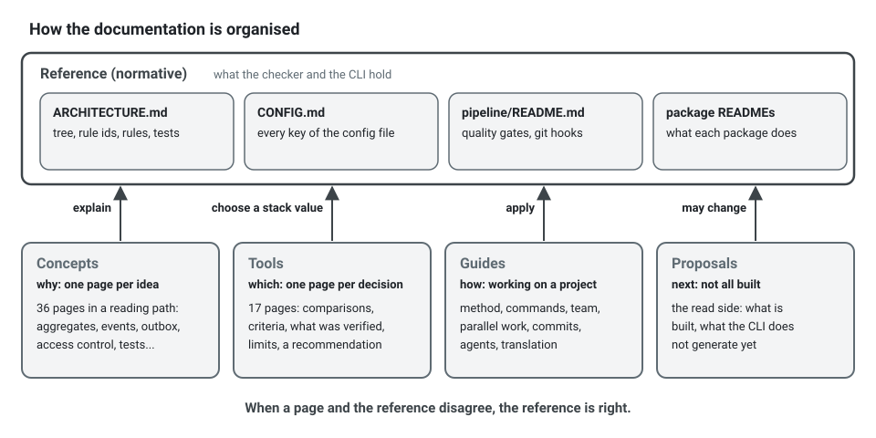

**English** · [Français](README.fr.md)

# Documentation

**Summary.** This is the index of the long-form documentation of ddd-ts-kit. Four entries are
normative, two short reference documents first: the [architecture reference](ARCHITECTURE.md)
(the canonical tree, the rule ids, the tactical and clean code conventions, the test levels) and
the [configuration reference](CONFIG.md); then the [pipeline README](../pipeline/README.md) (the
quality gates) and the README of each package. Everything else explains and teaches: the concepts
behind the rules, the tool decisions with their comparisons and limits, and guides for working
on such a project as a team and with coding agents. When a page here and the architecture
reference disagree, the reference is right.

**In French.** Every page listed here has a French translation next to it (`X.fr.md`), reached
by the link on its first line; the French index is [README.fr.md](README.fr.md). Its diagrams
have French labels, and its code samples are compiled by the pipeline like the English ones.

**On the web.** These pages, the README of every package and the documents of the example are
also published as a website, with search, in English and in French:
<https://gbourgeat.github.io/ddd-ts-kit/>. The Markdown files here stay its only source.



## Reference (normative)

| Page | What it holds |
|---|---|
| [Architecture reference](ARCHITECTURE.md) | the canonical tree, every rule id, the tactical rules, tests, clean code |
| [Configuration](CONFIG.md) | every key of `ddd-ts-kit.config.json` |
| [Lines left out of the coverage measure](adr/0001-lines-left-out-of-the-coverage-measure.md) | the checks nothing can reach, why, and when each one goes |
| [A read model store on OpenSearch](adr/0008-a-read-model-store-on-opensearch.md) | each choice of `@ddd-ts-kit/opensearch`, and what reverses it |
| [Pipeline](../pipeline/README.md) | the quality gates, the git hooks, GitHub and GitLab side by side |
| Package READMEs under [`packages/`](../packages) | what each package does, its limits and what was verified |

## Concepts: one page per idea

Ordered as a reading path in [concepts/README.md](concepts/README.md).

| Page | In one line |
|---|---|
| [Domain and subdomains](concepts/domain-and-subdomains.md) | core, supporting, generic: how to classify and what it changes |
| [Bounded context](concepts/bounded-context.md) | what a boundary is, and the language, autonomy and consistency tests |
| [Modules of the model](concepts/modules.md) | a context too large to read, divided into parts of one model (Evans), not into sub-contexts: the gains, the limits, how to adopt them |
| [Ubiquitous language](concepts/ubiquitous-language.md) | the glossary-first rule and how a glossary is written |
| [Context map](concepts/context-map.md) | the relationship patterns, when each fits and what it costs |
| [Context map: a worked example](concepts/context-map-worked-example.md) | the scheduling application, from a statement of needs to its map |
| [Entities and value objects](concepts/entities-and-value-objects.md) | identity versus value, and primitive obsession |
| [Aggregates](concepts/aggregates.md) | consistency boundary, one transaction, reference by id, sizing |
| [Domain building blocks](concepts/domain-building-blocks.md) | domain event, domain service, repository, factory |
| [State machines](concepts/state-machines.md) | the lifecycle of an aggregate: states, transitions, guards, refusals, its diagram |
| [Invariants, permissions, validation](concepts/invariants-permissions-validation.md) | three different things in three places |
| [Anemic model](concepts/anemic-model.md) | how to recognise one, and when a thin model is fine |
| [Layers and the dependency rule](concepts/layers-and-dependency-rule.md) | hexagonal, onion, clean: what they share, where they differ |
| [Ports and composition](concepts/ports-and-composition.md) | ports as abstract classes, the composition root, declared or explicit wiring |
| [The presentation layer](concepts/presentation-layer.md) | one controller class per route, route groups, guards at the edge and permissions on the use case, mapper and serializer |
| [Representations, field access and forms](concepts/representations-and-forms.md) | one schema in JSON, XML or CSV by content negotiation, fields reserved to a permission, forms described by the server for each caller |
| [CQRS](concepts/cqrs.md) | command and query buses, and event sourcing as a separate choice: what it buys and what it does not |
| [Modular monolith](concepts/modular-monolith.md) | one deployable, contexts kept extractable |
| [Domain and integration events](concepts/domain-and-integration-events.md) | the two kinds of events and the translation between them |
| [Transactional outbox](concepts/transactional-outbox.md) | the dual write problem, the outbox, relay strategies |
| [Delivery and idempotency](concepts/delivery-and-idempotency.md) | at-least-once, idempotent consumers, ordering |
| [Eventual consistency](concepts/eventual-consistency.md) | explained to a product person |
| [Sagas and process managers](concepts/sagas-and-process-managers.md) | long-running processes: what the kit provides and what it does not |
| [Event versioning](concepts/event-versioning.md) | evolving a published event |
| [Event sourcing, per aggregate](concepts/event-sourcing.md) | when to keep an aggregate as its events, what it costs, upcasters, crypto-shredding, projections fed by the store, migrating to it and back |
| [Personal data in a generated project](concepts/personal-data.md) | what `init --privacy on` and `generate repository --personal` write, the erasure and the export of a person end to end, the two modes of erasure, the retention purged every night, the register generated by `docs`, the `privacy/*` rules, what stays out of reach and what the tool does not decide |
| [Authentication and authorization](concepts/authentication-and-authorization.md) | RBAC, ABAC, ReBAC compared, with a decision table |
| [Authorization in practice](concepts/authorization-in-practice.md) | `@Requires`, the bus middleware, the `Authorizer` port and policies, followed through one command |
| [Actor and execution scope](concepts/actor-and-execution-scope.md) | the explicit actor, and what every unit of work carries |
| [Multitenancy](concepts/multitenancy.md) | the tenant from the edge to the storage: isolation strategies, propagation, elevation of platform staff, the proof |
| [Audit trail](concepts/audit-trail.md) | tamper-evident history recorded around the use cases |
| [Observability](concepts/observability.md) | tracing, logs, metrics, error reporting, the correlation id |
| [Resilience](concepts/resilience.md) | retry, timeout, circuit breaker, bulkhead, cache and their failure modes |
| [HTTP caching](concepts/http-caching.md) | what to cache at which layer, cache policies, never a decision of authorization across actors |
| [File storage](concepts/file-storage.md) | files in a storage, never in the database: staged before the transaction, moved to their key with the commit, served by short signed links |
| [Scheduled jobs](concepts/scheduled-jobs.md) | jobs that trigger use cases, several instances, idempotence |
| [Background jobs](concepts/background-jobs.md) | work enqueued in the transaction of a command, run by a worker at least once, leases, checkpoints |
| [File import and export](concepts/file-import-export.md) | a design, not built: a large file read or written by a background job, batch by batch, between the queue and the file storage |
| [Clean code](concepts/clean-code.md) | naming, small functions, stepdown, comments, with before and after |
| [Testing strategy](concepts/testing-strategy.md) | fakes versus mocks, builders, contract tests, the four levels |

## Tools: one page per decision

Each page has a comparison table, selection criteria, what the kit supports and verified, the
limits, and a recommendation by situation.

| Page | The decision |
|---|---|
| [HTTP frameworks](tools/http-frameworks.md) | Express, Fastify, Hono or NestJS, and what framework-agnostic routes cost with Nest |
| [Validation](tools/validation.md) | zod, class-validator, TypeBox or a Standard Schema library; shared schemas |
| [Contract pairs](tools/contract-pairs.md) | which framework with which validation library, by team: the four pairs proven end to end, measured; oRPC and tRPC as a second door, not a pair |
| [Representations and forms](tools/representations-and-forms.md) | XML and CSV without a library, and why; JSON Forms renderers for React, Angular and Vue, and the alternatives |
| [Dependency injection](tools/dependency-injection.md) | the kit's declarations on tsyringe, InversifyJS or Awilix, NestJS, or manual wiring, compared and measured |
| [Persistence](tools/persistence.md) | Drizzle, Knex, Prisma or TypeORM; PostgreSQL versus others; a read model on OpenSearch |
| [Message brokers](tools/message-brokers.md) | in-process, RabbitMQ, Kafka, NATS JetStream or Redis Streams |
| [Cache and coordination](tools/cache-and-coordination.md) | Redis, Dragonfly or Valkey; what the lock does and does not guarantee |
| [HTTP caches](tools/http-caches.md) | Varnish, Souin, nginx, Fastly, Cloudflare or Bunny in front of the API: how each purges by tag, what the kit verified |
| [File storage connectors](tools/file-storage.md) | memory, local directory or S3 compatible (AWS, MinIO, OVHcloud, Scaleway, R2); how to write one for Google Cloud Storage or Azure |
| [Identity](tools/identity.md) | Keycloak or plain OIDC and JWT |
| [Authorization engines](tools/authorization-engines.md) | in-process models versus OpenFGA, SpiceDB, Cedar, OPA |
| [Observability](tools/observability.md) | OpenTelemetry with Jaeger or Tempo; loggers; Sentry or GlitchTip |
| [Static analysis and pipeline](tools/static-analysis-and-pipeline.md) | the checker, the ESLint plugin, dependency-cruiser, knip, TypeScript 6 and 7; GitHub or GitLab |
| [Quality baseline](tools/quality-baseline.md) | what every project gets and what each tool answers: type check, lint, format, dead code, import graph, architecture check, tests |
| [Test runners](tools/test-runners.md) | Vitest or Jest |
| [Client SDK](tools/client-sdk.md) | openapi-typescript with openapi-fetch, hey-api or orval, measured on the example contract, against the client `ddd-ts-kit sdk` writes: typed error codes, no dependency; how it is checked and published |
| [Import aliases](tools/import-aliases.md) | `@/`, declared once under tsconfig `paths` and rewritten into relative paths by the build; imports without an extension by default, and why the build writes the `.js` Node needs; why not a Node subpath import; what each tool reads |

## Guides

| Page | For |
|---|---|
| [Methodology](guides/methodology.md) | the end-to-end path from a statement of needs to running code, step by step: the supported path |
| [Which command, when](guides/commands.md) | the command or skill for each moment of a project, a first feature from zero, and the reference of every command and flag |
| [One slice, end to end](guides/first-slice.md) | the request `POST /orders` through the four layers of a generated slice, and its domain and application code once filled |
| [The plugin for coding agents](guides/coding-agents.md) | installing the plugin in Claude Code, Codex and Copilot, its twenty-six skills, six agents and hook, and what each host runs |
| [Team workflow](guides/team-workflow.md) | ownership per context, the glossary, contracts first, review, decisions, onboarding |
| [Parallel work](guides/parallel-work.md) | several people or agents at once: what is safe, what is sequenced, a concrete plan |
| [Story workflow](guides/story-workflow.md) | one session per user story, one story per terminal: questions first, design review and acceptance tests before the code, a report of every provisional decision |
| [Closing the loop](guides/closing-the-loop.md) | from a metric out of its band to the next story: the queries on the metrics the kit emits, a `bands.yaml` with three tiers, what a stateless run needs, the incident record a fix story starts from, what arrives from a chat channel |
| [Commit discipline](guides/commit-discipline.md) | commit and pull request size, generated files, what hooks and CI enforce |
| [A handler with many dependencies](guides/many-dependencies.md) | constructor over-injection read as a smell: an order of diagnosis, each remedy with its place in the tree, no limit |
| [A cycle between two contexts](guides/cycle-between-contexts.md) | three questions before merging: one language or two, an event for one direction, a missing concept |
| [When to extract microservices](guides/when-to-extract-microservices.md) | the signals, the costs, a readiness checklist, the steps, when to merge back |
| [Bootstrap with well-designed contexts](guides/bootstrap-with-well-designed-contexts.md) | a generic context written whole with `--preset identity`: what it writes, what it asks of the stack, how it composes with each access model and with tenants |
| [Choosing access control](guides/choosing-access-control.md) | five questions that pick roles, attributes or relationships (Zanzibar), worked presets for each, the combined model of the example, scopes and refusals at the edge |
| [Token economy](guides/token-economy.md) | spending fewer tokens with coding agents, and complementary tools |
| [Sandboxing coding agents](guides/agent-sandbox.md) | what loads a machine and what the kit does about it; capping an agent, the sandbox of the agent, NVIDIA OpenShell for the security of a session |
| [Deploy and rollback](guides/deploy-and-rollback.md) | what a project ships beyond its image, the order of a release, what a rollback of each piece means, three tiers of autonomy for an agent by environment, deploy, status and rollback as one script each, the rehearsal in staging |
| [The French documentation](translation.md) | contributors: how every page keeps its French translation current, the glossary, the style of the diagrams, the code samples the pipeline compiles |

## Proposals

| Page | Status |
|---|---|
| [Which contexts deserve a preset](proposals/context-presets.md) | the criteria, then notification next, personal data requests as a guide; files (a capability of the platform), audit, billing and settings no |
| [Modules inside a bounded context](proposals/modules.md) | built: sub-contexts are not a concept of the references, modules of the model are (Evans); the judgement of its gains and limits, and the spike that measured the cost on the example |
| [The read side](proposals/read-side.md) | criteria, representations, forms, read models and projections; the page says, part by part, what is built in the runtime packages, what the CLI does not generate yet and what is not built |
| [Velocity of the build, the checks and the tests](proposals/build-and-test-velocity.md) | studied, not built: where the time and the memory of this repository go, on a workstation and in the pipeline; the levers of Vitest, ESLint, Oxlint, the native compiler and the package managers measured on this tree; what other teams published about orchestrators, test selection and GitHub Actions; a plan in order of gain per cost, and why no orchestrator; the tools of the oxc-project (Oxlint, Oxfmt, tsdown, oxc-transform, the Oxc transform of Vitest) measured on 2026-10-26, with a verdict for each and the plan of their adoption |
| [The families that generate projects](proposals/generated-project-families.md) | studied, one line built, then the levers the maintainer decided on 2026-10-26: what the pipeline jobs that generate projects cost per run and per day on a pull request, the trunk and at night (70 percent of a pull request run), what they repeat, nine levers with their gain and what a pull request would no longer prove, and a plan of pull requests in order of gain per effort |
| [Privacy by design, beyond event sourcing](proposals/privacy-by-design.md) | built, every part: why the kit, which erased the personal values of stored events alone, now declares the personal fields once and reads them in ports with an adapter per ORM (erasure, export, retention), generators, a register and `privacy/*` rules; the pull requests in merge order, the example adopting the ports; what a tool can never guarantee and the words to use |
| [A second example, spend management on the most popular stack](proposals/spend-management-example.md) | specified, not built: NestJS, Prisma, Jest, Kafka, S3, ABAC on a business of money and workflows; first the four capabilities that stack switches off today (queue and processes on Nest, tenancy and audit on Prisma, the identity preset), then the example as the proof; MySQL left out, with what it would take |
| [Where to take the kit next, from what neighbouring tools do](proposals/direction-from-neighbouring-tools.md) | proposed, not built: sixteen neighbouring tools read on 2026-10-25 (agent methods, DDD plugins, import boundary tools, CQRS and event sourcing runtimes), nine proposals rated by value, cost and relevance, in tiers (now, next, later), and what the comparison suggests that the kit should not do, with the reason |

## Start from a question

| Your question | Where the answer is |
|---|---|
| Where does this file go, and what may it import? | the [architecture reference](ARCHITECTURE.md), [2. Canonical tree](ARCHITECTURE.md#2-canonical-tree) and [3. Dependency rules](ARCHITECTURE.md#3-dependency-rules) |
| Why was this reported, and how do I fix it? | `npx ddd-ts-kit explain <rule-id>`, then [When something is refused](guides/commands.md#when-something-is-refused) |
| Which command, or which skill, now? | [Which command, when](guides/commands.md) |
| Does this rule belong in the aggregate, the handler or the schema? | [Invariants, permissions, validation](concepts/invariants-permissions-validation.md) |
| Why does the generator refuse my name? | [Ubiquitous language](concepts/ubiquitous-language.md): a name comes from the glossary of its context |
| How does one context react to another? | [Domain and integration events](concepts/domain-and-integration-events.md), then [Transactional outbox](concepts/transactional-outbox.md) |
| How do I test a handler without a mock? | [Testing strategy](concepts/testing-strategy.md) |
| Which value for a `stack` key? | the tools page of the decision, then [Configuration](CONFIG.md#stack) |
| A rule does not fit this project | [Deviations](CONFIG.md#deviations): a recorded decision, never a silent `off` |
| What changes after an upgrade of the kit? | [Migrate after a kit upgrade](guides/commands.md#migrate-after-a-kit-upgrade) and [a key left out of `stack`](CONFIG.md#a-key-left-out-of-stack) |

Part of the reference also answers in the terminal of a project, from the installed version of
the kit, so it never disagrees with the code you run:

```bash
npx ddd-ts-kit rules                        # every rule id, its severity and what it holds
npx ddd-ts-kit explain imports/alias-only   # why a rule exists, a bad and a good example, how to suppress it
npx ddd-ts-kit generate --help              # every kind of file the generator writes, and its flags
npx ddd-ts-kit describe billing             # one context as facts: use cases, routes, events, ports
```

## Suggested reading order

**New to DDD.** Follow the reading path of [concepts/README.md](concepts/README.md) in order,
at least sections 1 and 2, then:

1. [Layers and the dependency rule](concepts/layers-and-dependency-rule.md)
2. [Domain and integration events](concepts/domain-and-integration-events.md) and
   [Eventual consistency](concepts/eventual-consistency.md)
3. [Testing strategy](concepts/testing-strategy.md)
4. [Methodology](guides/methodology.md), to see the ideas as steps
5. the [architecture reference](ARCHITECTURE.md), which will now read as a summary

**Tech lead adopting the kit.**

1. the root README and the [architecture reference](ARCHITECTURE.md)
2. [Methodology](guides/methodology.md)
3. the tools pages for the decisions you have to take, starting with
   [Persistence](tools/persistence.md), [Message brokers](tools/message-brokers.md) and
   [Static analysis and pipeline](tools/static-analysis-and-pipeline.md)
4. [Modular monolith](concepts/modular-monolith.md) and
   [When to extract microservices](guides/when-to-extract-microservices.md)
5. [Team workflow](guides/team-workflow.md), [Parallel work](guides/parallel-work.md),
   [Commit discipline](guides/commit-discipline.md)
6. [Token economy](guides/token-economy.md), if the team works with coding agents
7. [Configuration](CONFIG.md)
8. [Personal data](concepts/personal-data.md), before production: what is declared, erased,
   exported and purged, and what stays the decision of the controller

**Contributor to the kit.**

1. `CONTRIBUTING.md` at the root, then the [architecture reference](ARCHITECTURE.md): a change
   of rule starts there
2. [Ports and composition](concepts/ports-and-composition.md) and
   [Layers and the dependency rule](concepts/layers-and-dependency-rule.md)
3. the README of the package you change, and of the
   [CLI](../packages/cli/README.md) and the
   [ESLint plugin](../packages/eslint-plugin/README.md), which hold the rules
4. [Static analysis and pipeline](tools/static-analysis-and-pipeline.md) and
   [Testing strategy](concepts/testing-strategy.md)
5. the tools page of the area you touch: it states what was verified and what was not, which
   is where a contribution is most useful
6. [The French documentation](translation.md), before changing a page: its French translation
   changes in the same pull request

## See also

- [Concepts: a reading path](concepts/README.md)
- [Architecture reference](ARCHITECTURE.md)
- [Configuration](CONFIG.md)
- [Pipeline](../pipeline/README.md)
