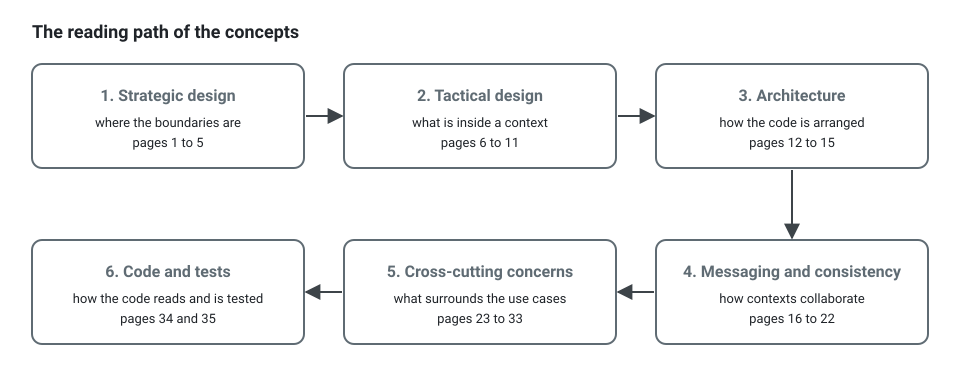

**English** · [Français](README.fr.md)

# Concepts: a reading path

**Summary.** These pages explain the ideas this kit is built on: Domain-Driven Design
(strategic and tactical), the layered architecture and its dependency rule, messaging and
consistency between bounded contexts, the cross-cutting concerns, clean code and testing. They
teach and give the reasons; the rules themselves are stated once, in the
[architecture reference](../ARCHITECTURE.md), and each page links to them by rule id. Every
page can be read on its own in a few minutes. Read in order, they form a path from "what is a
domain" to "how do I test this", using one example throughout: an appointment scheduling
application.

## The running example

Clients book appointments with practitioners. Five bounded contexts are built, and identity is
bought:

| Context | Classification | Owns |
|---|---|---|
| `appointments` | core | booking, rescheduling and cancellation rules; no practitioner is booked twice |
| `availability` | supporting | the open slots, computed from calendars and booked appointments |
| `calendars` | supporting | the working hours and time off of each practitioner |
| `notifications` | supporting | confirmations and reminders, through email and SMS providers |
| `analytics` | supporting | occupancy and no-show statistics |
| identity | generic | an OpenID Connect provider; no context in the code |

How they depend on each other, upstream to downstream, as the
[worked example of the context map](context-map-worked-example.md) finds it:

The example application of the repository, [`examples/scheduling`](../../examples/scheduling),
is a smaller cut of the same domain that runs; several pages quote its code.

## 1. Strategic design: where the boundaries are

Read these first. They decide everything that follows, and they are decisions of people, not
of tools.

1. [Domain and subdomains](domain-and-subdomains.md): core, supporting, generic, and how to
   classify.
2. [Bounded context](bounded-context.md): what a boundary is and the tests that find one.
3. [Ubiquitous language](ubiquitous-language.md): the glossary, and why it is written before
   the code.
4. [Context map](context-map.md): the relationship patterns between contexts, when each fits
   and what it costs.
5. [Context map: a worked example](context-map-worked-example.md): from a plain statement of
   needs to the map of the scheduling application.

## 2. Tactical design: what is inside a context

6. [Entities and value objects](entities-and-value-objects.md): identity versus value.
7. [Aggregates](aggregates.md): the consistency boundary, one transaction, reference by id,
   sizing.
8. [Domain building blocks](domain-building-blocks.md): domain event, domain service,
   repository, factory.
9. [Invariants, permissions, validation](invariants-permissions-validation.md): three
   different things, three places.
10. [Anemic model](anemic-model.md): how to recognise one, and when a thin model is fine.
11. [State machines](state-machines.md): the lifecycle of an aggregate declared once, asked by
    the aggregate, drawn in its CONTEXT.md.

## 3. Architecture: how the code is arranged

12. [Layers and the dependency rule](layers-and-dependency-rule.md): hexagonal, onion and
    clean architecture, what they share and where they differ.
13. [Ports and composition](ports-and-composition.md): ports as abstract classes, the
    composition root, declarations by decorators or explicit wiring.
14. [CQRS](cqrs.md): command and query buses as used here; event sourcing is a separate
    choice, per aggregate.
    [The presentation layer](presentation-layer.md) comes with it: one controller class per
    route, route groups, guards at the edge and permissions on the use case.
15. [Modular monolith](modular-monolith.md): one deployable, real modules.

## 4. Messaging and consistency: how contexts collaborate

16. [Domain and integration events](domain-and-integration-events.md): the two kinds and what
    separates them.
17. [Transactional outbox](transactional-outbox.md): why publishing straight to a broker loses
    or invents events, and the relay strategies.
18. [Delivery and idempotency](delivery-and-idempotency.md): at-least-once, idempotent
    consumers, the processed-event store, ordering.
19. [Eventual consistency](eventual-consistency.md): explained to a product person.
20. [Sagas and process managers](sagas-and-process-managers.md): what the kit provides and
    what it does not.
21. [Event versioning](event-versioning.md): changing a contract that others consume.
22. [Event sourcing, per aggregate](event-sourcing.md): when an aggregate keeps its events
    instead of its state, what it costs, and how to move one to it and back.

## 5. Cross-cutting concerns: what surrounds the use cases

23. [Authentication and authorization](authentication-and-authorization.md): roles,
    attributes, relationships, with a decision table.
24. [Actor and execution scope](actor-and-execution-scope.md): who acts, explicitly, and what
    every unit of work carries.
25. [Multitenancy](multitenancy.md): one deployment, many customers, and no read or write
    that crosses from one to another.
26. [Audit trail](audit-trail.md): who did what, recorded from outside the use cases.
27. [Observability](observability.md): tracing, logs, metrics, error reporting, and the
    correlation id that ties them.
28. [Resilience](resilience.md): retry, timeout, circuit breaker, bulkhead, cache, and how
    each one fails.
29. [HTTP caching](http-caching.md): what to cache at which layer, who may keep an answer,
    and never a decision of authorization across actors.
30. [Scheduled jobs](scheduled-jobs.md): work triggered by time, and why it must be
    idempotent.
31. [Background jobs](background-jobs.md): work a use case hands to a worker, enqueued in its
    transaction, run at least once.
32. [File storage](file-storage.md): files in a storage and never in the database, the order
    that keeps both consistent, signed links.
33. [File import and export](file-import-export.md): a design, not built yet: a large file
    read or written by a background job, row by row, between the queue and the file storage.

## 6. Code and tests

34. [Clean code](clean-code.md): naming, small functions, stepdown, comments, testability by
    construction.
35. [Testing strategy](testing-strategy.md): fakes rather than mocks, builders, contract
    tests, the four levels.

## Shorter paths

- **A product person or a newcomer to DDD:** 1, 2, 3, 5, then 19.
- **Before writing a first use case:** 3, 7, 9, 12, 14, 35.
- **Before making two contexts talk:** 4, 16, 17, 18, 21.
- **Before keeping an aggregate as its events:** 7, 16, 17, 21, 22.
- **Before serving several customers from one deployment:** 23, 24, 25.
- **Before putting the system in production:** 23, 27, 28, 29, 30, 31, 32, then the
  [tools pages](../README.md#tools-one-page-per-decision).

## Limits and when not to use it

These pages describe one opinionated way of applying the patterns, the one this kit enforces.
Other valid applications exist (event sourcing, a separate read database, aggregates persisted
as documents), and several pages say where the kit stops. The patterns themselves have a cost:
for a small tool with little business logic, most of sections 2 to 4 is more than the problem
needs, and each page has a "Limits and when not to use it" section that says so in its own
terms.

## See also

- [Documentation index](../README.md)
- [Architecture reference](../ARCHITECTURE.md): the normative rules
- [Methodology](../guides/methodology.md): the same ideas as a sequence of steps
- [Configuration](../CONFIG.md)
