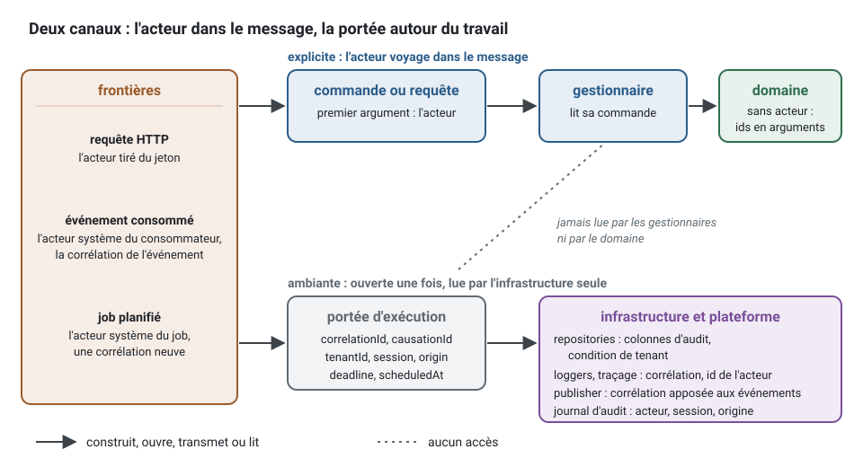

[English](actor-and-execution-scope.md) · **Français**
<!-- translation-of: actor-and-execution-scope.md sha256:f2868ddf27e5e86c -->

# L'acteur et la portée d'exécution

**Résumé.** Deux mécanismes portent « qui et pourquoi » à travers le système, et ils sont
différents à dessein. L'acteur est explicite : c'est un champ de chaque commande et de chaque
requête protégées, si bien qu'un cas d'usage dit dans sa signature qui agit. La portée
d'exécution est ambiante : ouverte une fois à la frontière pour chaque unité de travail (une
requête HTTP, un événement consommé, un *job* planifié), elle contient l'identifiant de
corrélation, l'identifiant de causalité, le *tenant*, la session et l'origine, et elle n'est lue
que par l'infrastructure. Les cas d'usage et le domaine ne la lisent jamais. Ce partage garde les
gestionnaires (handlers) testables, oblige les consommateurs et les *jobs* à dire honnêtement
pour le compte de qui ils agissent, et garde un contexte extractible.

## L'acteur explicite

Un cas d'usage protégé reçoit l'acteur comme une donnée :

<!-- checked sample -->
```ts
// appointments/application/commands/cancel-appointment/cancel-appointment.command.ts
import { AuthorizedCommand, systemActor, type Actor } from '@ddd-ts-kit/kernel';

export class CancelAppointment extends AuthorizedCommand {
  constructor(
    actor: Actor,
    readonly appointmentId: string,
    readonly reason: string,
  ) {
    super(actor);
  }
}

// Celui qui l'envoie dit qui agit : un utilisateur authentifié à la frontière, ou une spec...
const client: Actor = { id: 'u-7', type: 'user', tenantId: 'acme', roles: ['client'], attributes: {} };
export const byTheClient = new CancelAppointment(client, 'a-1', 'moved away');

// ... ou le système lui-même, nommé d'après le job qui l'envoie.
export const byTheJob = new CancelAppointment(systemActor('notifications.send-reminders'), 'a-1', 'not confirmed');
// byTheJob.actor.id === 'system:notifications.send-reminders'
```

L'acteur est le premier argument du constructeur, donc aucun site d'appel ne peut l'oublier. Un
`Actor` est une simple donnée : un identifiant, un type (un utilisateur, un service, le système),
un *tenant*, des rôles et des attributs. Il ne détient jamais le justificatif d'identité (credential) à partir
duquel il a été construit.

Ce qui découle du fait de le rendre explicite :

- **Une spec de gestionnaire passe qui elle veut.** Aucune variable globale à préparer, aucune
  requête HTTP à simuler.
- **Un consommateur ou un job doit dire pour le compte de qui il agit.** Il n'y a pas
  d'« utilisateur courant » quand un événement arrive d'un *broker* à 3 heures du matin. Le
  gestionnaire d'événement d'intégration `notifications.remind-on-appointment-booked` envoie sa
  commande comme un acteur système nommé d'après ce consommateur ; le *job*
  `notifications.send-reminders` comme un acteur système nommé d'après le *job*. Que cet acteur
  système détienne la permission est alors une décision visible du modèle d'autorisation, pas un
  accident.
- **Le cas d'usage fonctionne de la même façon derrière n'importe quel transport.** HTTP
  aujourd'hui, une file d'attente ou un appel RPC demain : l'acteur voyage dans le message,
  jamais sous forme de session.

```ts
// Au lieu de : une entrée cachée, lue dans la portée ambiante
async execute(command: CancelAppointment): Promise<void> {
  const actor = this.scope.require().actor; // dans un job ou un consommateur, échoue loin de sa cause
  // ...
}

// Écrire : l'acteur de la commande, visible dans la signature
async execute({ actor, appointmentId }: CancelAppointment): Promise<void> {
  const appointment = await this.appointments.findById(appointmentId);
  // ...
  await this.access.authorize(actor, appointmentPermissions['appointment.cancel'], appointment);
}
```

Le domaine va un pas plus loin : il ne connaît aucun acteur. Quand un agrégat a besoin de
« qui », le gestionnaire passe l'identifiant en argument, nommé d'après son rôle dans le métier :
`appointment.cancel(reason, at)` enregistre un fait, `calendar.approveTimeOff(approverId)` nomme
celui qui approuve. Un indicateur `isAdmin` qui décide de l'accès à l'intérieur d'une entité,
c'est du contrôle d'accès qui fuit dans le modèle.

C'est la règle [`authz/actor-explicit`](../ARCHITECTURE.fr.md#3-règles-de-dépendance).

## La portée d'exécution

Certains faits concernent chaque instruction d'une unité de travail et seraient du bruit s'ils
étaient passés à travers chaque méthode : quelle requête HTTP a causé ceci, pour quel *tenant*,
déclenché par quoi. Ils vivent dans le contexte d'exécution :

| Champ | Sens |
|---|---|
| `correlationId` | nomme tout ce qu'un même stimulus a causé, à travers les processus |
| `causationId` | la cause directe : pour un événement consommé, l'identifiant de cet événement |
| `actor`, `session` | qui, et comment il s'est authentifié (y compris l'emprunt d'identité par l'équipe de support) |
| `tenantId` | le *tenant* du travail en cours |
| `elevation` | l'équipe de la plateforme qui lit à travers les *tenants*, ouverte par `acrossTenants` et auditée ([Multitenance](multitenancy.fr.md)) |
| `locale` | la langue et la région de l'appelant, quand la frontière les connaît |
| `origin` | `http`, `event`, `schedule`, `queue`, `cli`, ou une valeur du projet |
| `scheduledAt` | pour un *job*, l'instant où l'exécution était due |
| `deadline` | un instant après lequel le travail ne sert plus à rien |
| `extensions` | les champs qu'ajoute le projet |

La frontière ouvre une portée par unité de travail et tout ce qui est en dessous s'exécute à
l'intérieur, tandis que l'acteur voyage dans le message :



## Qui peut lire la portée, et qui ne le peut pas

| Code | Lit la portée ? | Obtient ce dont il a besoin de |
|---|---|---|
| Adaptateurs de *repository* | oui | la portée : colonnes d'audit, condition de *tenant* |
| *Loggers*, traçage, remontée des erreurs | oui | la portée : corrélation, identifiant de l'acteur, *tenant* |
| Décorateur du *publisher* d'événements | oui | la portée : la corrélation apposée sur les événements sortants |
| Sources du journal d'audit | oui | la portée : acteur, session, emprunt d'identité, origine |
| Les frontières (HTTP, abonnement aux événements, planificateur) | elles l'ouvrent | le justificatif d'identité, l'enveloppe ou la planification |
| Gestionnaires de commandes et de requêtes | non | la commande ou la requête |
| Agrégats, objets-valeurs, services du domaine | non | les arguments de leurs méthodes |

L'infrastructure lit le port `ExecutionScope`. `ActorContext` est une vue de la même portée qui
ne répond que l'acteur ; elle ne détient aucun état propre. Le noyau fournit les lectures
qu'utilisent les adaptateurs du kit, si bien que l'adaptateur propre d'un projet lit la portée de
la même façon :

<!-- checked sample -->
```ts
import { logFieldsOf, stampCreation, type Clock, type ExecutionScope, type Logger } from '@ddd-ts-kit/kernel';

// Injectés dans un adaptateur de l'infrastructure, jamais dans un gestionnaire :
declare const scope: ExecutionScope;
declare const clock: Clock;
declare const logger: Logger;

// Les colonnes d'audit d'une ligne insérée : { createdAt, createdBy : l'id de l'acteur, updatedAt, updatedBy }
export const stamp = stampCreation(scope, clock);

// Les identifiants du travail sur une ligne de journal : correlationId, origin, actorId et, s'ils sont
// présents, causationId, tenantId, elevation (sa raison) et impersonatedBy
logger.info('reminder stored', logFieldsOf(scope.require()));
```

Pourquoi les gestionnaires n'y ont pas droit, même si cela économiserait un paramètre :

1. **Des entrées cachées rendent le code intestable.** Un gestionnaire qui lit un contexte
   ambiant a un argument que sa signature ne montre pas. Sa *spec* réussit ou échoue selon ce
   qu'un autre code a préparé plus tôt.
2. **Un contexte manquant devient une surprise en production.** Un *job* ou un consommateur qui
   atteint un gestionnaire sans que personne ait ouvert la portée échoue loin de sa cause. Avec un
   acteur explicite, c'est le compilateur qui refuse l'appel.
3. **L'extraction.** Un contexte qui part dans son propre service reçoit des messages, pas des
   sessions. Si les gestionnaires ne lisent que leur commande, rien ne change ce jour-là.
4. **Les audits.** « Qui peut faire quoi » se répond à partir des déclarations quand l'acteur est
   une donnée. Ce n'est plus le cas quand un gestionnaire consulte une variable globale.

Pour l'infrastructure, le compromis est inverse. La restriction au *tenant* et les colonnes
d'audit s'appliquent à chaque instruction de chaque *repository* ; les passer à travers chaque
méthode serait répétitif et facile à oublier, et oublier la condition de *tenant* est une fuite
de données. Les *helpers* de persistance du kit lèvent donc une erreur pour un travail qui ne
nomme aucun *tenant*, si bien qu'une instruction ne peut pas s'exécuter sans portée par oubli.
C'est une défense en profondeur : la permission elle-même a déjà été décidée dans la couche
application.

## Corrélation et causalité

L'identifiant de corrélation est fixé une fois, à la première frontière, et survit à chaque saut :

1. Un client prend un rendez-vous. La frontière HTTP ouvre une portée avec un identifiant de
   corrélation neuf (ou celui que le client a envoyé).
2. Le gestionnaire enregistre le rendez-vous et publie `appointments.appointment.booked`. Un
   décorateur du *publisher* appose la corrélation du travail en cours sur l'événement, si bien
   que le gestionnaire ne la passe jamais à la main.
3. Le contexte notifications consomme l'événement. Sa frontière ouvre une nouvelle portée : même
   identifiant de corrélation, l'identifiant de l'événement comme identifiant de causalité,
   l'origine `event`, l'acteur système du consommateur.
4. Le rappel qu'il stocke porte des colonnes d'audit qui nomment cet acteur système, et chaque
   ligne de journal, chaque *span* et chaque entrée d'audit des deux contextes partagent un même
   identifiant de corrélation.


La portée de l'étape 3 est ce que `executionContextOfEvent` du noyau répond pour l'événement, et
ce que les abonnements du kit ouvrent autour d'un consommateur :

<!-- checked sample -->
```ts
import { executionContextOfEvent, type IntegrationEvent } from '@ddd-ts-kit/kernel';

const booked: IntegrationEvent = {
  id: 'evt-9',
  type: 'appointments.appointment.booked',
  version: 1,
  occurredAt: '2026-03-01T09:00:00.000Z',
  payload: { appointmentId: 'a-1' },
  correlationId: 'req-42', // apposé par le publisher du contexte appointments
  tenantId: 'acme',
};

const context = executionContextOfEvent(booked, { consumer: 'notifications.remind-on-appointment-booked' });

console.log(context.correlationId); // 'req-42' : la même chaîne
console.log(context.causationId); // 'evt-9' : la cause directe
console.log(context.actor.id); // 'system:notifications.remind-on-appointment-booked'
console.log(context.origin, context.tenantId); // 'event' 'acme'
```

L'enveloppe d'un événement d'intégration ne porte aucun acteur par défaut, à dessein : un acteur
est une donnée personnelle, et les *brokers* gardent les messages. Un projet qui en décide
autrement associe une référence tirée de sa propre charge utile à l'ouverture de la portée.

Un *job* planifié démarre une corrélation qui lui est propre à chaque exécution : rien ne l'a
causé, sinon le temps.

## Étendre les formes standard

`Actor`, `Session` et `ExecutionContext` sont des interfaces standard du noyau : chaque projet a
la même forme sous le même nom, si bien qu'un adaptateur ou un tableau de bord écrit une fois
convient à tous. Un projet ajoute ses propres champs par fusion de déclarations (declaration
merging), une fois, dans un fichier de déclarations de sa plateforme :

```ts
// src/platform/kernel-extensions.d.ts
declare module '@ddd-ts-kit/kernel' {
  interface SessionExtensions {
    readonly clinicId: string;
  }
  interface ExecutionContextExtensions {
    readonly region: 'eu' | 'us';
  }
}
```

Trois propriétés de cette conception méritent d'être connues. Les champs du projet vivent sous
`extensions`, si bien qu'un champ standard ajouté dans une version ultérieure du noyau ne peut
pas entrer en collision avec eux. Ils se lisent comme possiblement indéfinis, parce que la
session anonyme et la session système n'en portent aucun et doivent rester véridiques dans
chaque projet. Et rien n'est enregistré à l'exécution : l'augmentation ne porte que sur les
types.

Un second `UserContext` ou `CurrentUser` fait maison à côté de la forme standard est un défaut :
deux formes pour une seule idée, et des adaptateurs qui ne s'y adaptent plus. Voir la règle
[`standard/no-parallel-interface`](../ARCHITECTURE.fr.md#3-règles-de-dépendance).

## Limites et quand ne pas l'utiliser

- **Une portée ambiante suit la chaîne d'appels asynchrones.** Le travail qui s'en détache (un
  minuteur armé puis laissé derrière, un rappel enregistré sur un émetteur de longue durée) peut
  s'exécuter hors de la portée ou dans une portée périmée. Lancez ce travail depuis une frontière
  qui ouvre sa propre portée.
- **Une frontière qui oublie d'ouvrir la portée** est une erreur de câblage trouvée à
  l'exécution : la première lecture de l'infrastructure lève une erreur qui nomme le contexte
  manquant. Les adaptateurs HTTP, les consommateurs et le planificateur du kit l'ouvrent ; une
  frontière écrite à la main doit le faire aussi.
- **La règle est vérifiée par nom.** `authz/actor-explicit` reconnaît les types et les *helpers*
  du noyau sous leurs propres noms ; le README de la CLI précise qu'une portée détenue sous un
  autre nom n'est pas vue par le *checker* au niveau du texte. Le *plugin* ESLint lit l'arbre
  syntaxique et fait foi.
- **L'acteur explicite coûte un paramètre sur chaque message protégé.** Dans un outil à un seul
  utilisateur et sans besoin d'audit, il apporte peu ; les cas d'usage publics utilisent les
  simples `Command` et `Query`.
- **Un job global n'a pas de tenant.** Les *helpers* de persistance qui en ont besoin le
  refusent ; un *job* déclaré `tenancy: 'per-tenant'` s'exécute à la place une fois par
  *tenant*, chaque exécution dans la portée de ce *tenant*. Voir
  [Multitenance](multitenancy.fr.md).
- **L'emprunt d'identité est enregistré, pas empêché.** La session dit qui emprunte l'identité
  de qui ; décider de ce que peut faire celui qui emprunte une identité est une règle du
  modèle d'autorisation.

## Sources

- Robert C. Martin, Clean Architecture, Prentice Hall, 2017 : des cas d'usage indépendants du
  mécanisme de livraison.
- Gregor Hohpe et Bobby Woolf, Enterprise Integration Patterns, Addison-Wesley, 2003 :
  Correlation Identifier.
- W3C Trace Context (recommandation) : l'en-tête `traceparent` qui voyage dans l'enveloppe.
- Documentation de Node.js, `AsyncLocalStorage` (`node:async_hooks`) : le mécanisme derrière une
  portée ambiante qui suit les appels asynchrones.
- [`@ddd-ts-kit/kernel`](../../packages/kernel/README.fr.md) : `Actor`, `Session`,
  `ExecutionContext`, `ExecutionScope`, « Comment étendre ».

## Voir aussi

- [Authentification et autorisation](authentication-and-authorization.fr.md)
- [Multitenance](multitenancy.fr.md)
- [Journal d'audit](audit-trail.fr.md)
- [Observabilité](observability.fr.md)
- [Jobs planifiés](scheduled-jobs.fr.md)
- [Événements du domaine et d'intégration](domain-and-integration-events.fr.md)
- [Quand extraire un microservice](../guides/when-to-extract-microservices.fr.md)
- [Référence d'architecture](../ARCHITECTURE.fr.md) : « L'acteur courant », règles
  `authz/actor-explicit` et `standard/no-parallel-interface`
