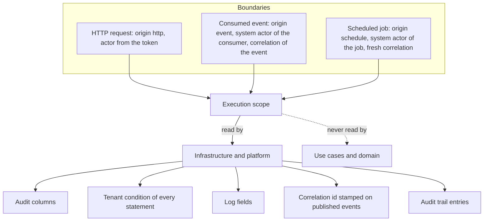

**English** · [Français](actor-and-execution-scope.fr.md)

# The actor and the execution scope

**Summary.** Two mechanisms carry "who and why" through the system, and they are deliberately
different. The actor is explicit: it is a field of every protected command and query, so a use
case states in its signature who acts. The execution scope is ambient: opened once at the
boundary for each unit of work (a request, a consumed event, a scheduled job), it holds the
correlation id, the causation id, the tenant, the session and the origin, and it is read by
infrastructure only. Use cases and the domain never read it. This split keeps handlers
testable, keeps consumers and jobs honest about on whose behalf they act, and keeps a context
extractable.

## The explicit actor

A use case that is protected receives the actor as data:

```ts
// appointments/application/commands/cancel-appointment/cancel-appointment.command.ts
export class CancelAppointment extends AuthorizedCommand {
  constructor(
    actor: Actor,
    readonly appointmentId: string,
    readonly reason: string,
  ) {
    super(actor);
  }
}
```

The actor is the first constructor argument, so no call site can forget it. An `Actor` is plain
data: an id, a type (a user, a service, the system), a tenant, roles and attributes. It never
holds the credential it was built from.

What follows from making it explicit:

- **A handler spec passes whoever it wants.** No global to set up, no request to fake.
- **A consumer or a job must say on whose behalf it acts.** There is no "current user" when an
  event arrives from a broker at 3 a.m. The integration event handler
  `notifications.remind-on-appointment-booked` sends its command as a system actor named after
  that consumer; the job `notifications.send-reminders` as a system actor named after the job.
  Whether that system actor holds the permission is then a visible decision of the
  authorization model, not an accident.
- **The use case works the same behind any transport.** HTTP today, a queue or an RPC call
  tomorrow: the actor travels in the message, never as a session.

The domain goes one step further: it knows no actor at all. When an aggregate needs "who", the
handler passes the identifier as an argument named for its role in the business:
`appointment.cancel(reason, at)` records a fact, `calendar.approveTimeOff(approverId)` names
the approver. An `isAdmin` flag deciding access inside an entity is access control leaking into
the model.

This is rule [`authz/actor-explicit`](../ARCHITECTURE.md#3-dependency-rules).

## The execution scope

Some facts concern every statement of a unit of work and would be noise if threaded through
every method: which request caused this, for which tenant, started by what. They live in the
execution context:

| Field | Meaning |
|---|---|
| `correlationId` | names everything one stimulus caused, across processes |
| `causationId` | the direct cause: for a consumed event, the id of that event |
| `actor`, `session` | who, and how they authenticated (including impersonation by support staff) |
| `tenantId` | the tenant of the work in progress |
| `origin` | `http`, `event`, `schedule`, `cli`, or a value of the project |
| `scheduledAt` | for a job, the instant the run was due |
| `deadline` | an instant after which the work is pointless |
| `extensions` | the fields the project adds |

The boundary opens one scope per unit of work and everything below runs inside it:



## Who may read the scope, and who may not

| Code | Reads the scope? | Gets what it needs from |
|---|---|---|
| Repository adapters | yes | the scope: audit columns, tenant condition |
| Loggers, tracing, error reporting | yes | the scope: correlation, actor id, tenant |
| Event publisher decorator | yes | the scope: the correlation stamped on outgoing events |
| Audit trail sources | yes | the scope: actor, session, impersonation, origin |
| The boundaries (HTTP, event subscription, scheduler) | they open it | the credential, the envelope or the schedule |
| Command and query handlers | no | the command or the query |
| Aggregates, value objects, domain services | no | arguments of their methods |

Infrastructure reads the `ExecutionScope` port. `ActorContext` is a view of the same scope that
answers the actor only; it holds no state of its own.

Why handlers may not, even though it would save a parameter:

1. **Hidden inputs make untestable code.** A handler that reads an ambient context has an
   argument the signature does not show. Its spec passes or fails depending on what some other
   code set up earlier.
2. **A missing context becomes a production surprise.** A job or a consumer that reaches a
   handler without anybody opening the scope fails far from its cause. With an explicit actor
   the compiler refuses the call instead.
3. **Extraction.** A context that moves to its own service receives messages, not sessions. If
   handlers only read their command, nothing changes that day.
4. **Audits.** "Who may do what" is answerable from declarations when the actor is data. It is
   not when a handler consults a global.

For infrastructure the trade-off is the reverse. Tenant scoping and audit columns apply to
every statement of every repository; threading them through every method would be repetitive
and easy to forget, and forgetting the tenant condition is a data leak. The kit's persistence
helpers therefore raise an error for work that names no tenant, so a statement cannot run
unscoped by omission. This is defence in depth: the permission itself was already decided in
the application layer.

## Correlation and causation

The correlation id is set once, at the first boundary, and survives every hop:

1. A client books an appointment. The HTTP boundary opens a scope with a fresh correlation id
   (or the one the client sent).
2. The handler saves the appointment and publishes `appointments.appointment.booked`. A
   decorator of the publisher stamps the correlation of the work in progress on the event, so
   the handler never passes it by hand.
3. The notifications context consumes the event. Its boundary opens a new scope: same
   correlation id, the event id as causation id, origin `event`, the system actor of the
   consumer.
4. The reminder it stores carries audit columns naming that system actor, and every log line,
   span and audit entry of both contexts shares one correlation id.

The envelope of an integration event carries no actor by default, on purpose: an actor is
personal data, and brokers keep messages. A project that decides otherwise maps a reference
from its own payload when the scope is opened.

A scheduled job starts a correlation of its own for each run: nothing caused it but time.

## Extending the standard shapes

`Actor`, `Session` and `ExecutionContext` are standard interfaces of the kernel: every project
has the same shape under the same name, so an adapter or a dashboard written once fits them
all. A project adds its own fields by declaration merging, once, in a declaration file of its
platform:

```ts
// src/platform/kernel-extensions.d.ts
declare module '@ddd-ts-kit/kernel' {
  interface SessionExtensions {
    readonly clinicId: string;
  }
  interface ExecutionContextExtensions {
    readonly region: 'eu' | 'us';
  }
}
```

Three properties of this design are worth knowing. Project fields live under `extensions`, so a
standard field added in a later version of the kernel cannot collide with them. They read as
possibly undefined, because the anonymous session and the system session carry none and must
stay truthful in every project. And nothing is registered at run time: the augmentation is
types only.

A second, home-made `UserContext` or `CurrentUser` next to the standard one is a defect: two
shapes for one idea, and adapters that no longer fit. See rule
[`standard/no-parallel-interface`](../ARCHITECTURE.md#3-dependency-rules).

## Limits and when not to use it

- **An ambient scope follows the asynchronous call chain.** Work detached from it (a timer set
  and left behind, a callback registered on a long-lived emitter) may run outside the scope or
  inside a stale one. Start such work from a boundary that opens its own scope.
- **A boundary that forgets to open the scope** is a wiring mistake found at run time: the
  first infrastructure read raises an error naming the missing context. The kit's HTTP
  adapters, consumers and scheduler open it; a boundary written by hand must too.
- **The rule is checked by name.** `authz/actor-explicit` recognises the kernel's types and
  helpers under their own names; the CLI README states that a scope held under another name is
  not seen by the text-level checker. The ESLint plugin reads the syntax tree and is the
  authority.
- **The explicit actor costs a parameter on every protected message.** In a tool with one user
  and no audit need it buys little; public use cases use the plain `Command` and `Query`.
- **A global job has no tenant.** Persistence helpers that need one refuse it; a job declared
  `tenancy: 'per-tenant'` runs once per tenant instead, each run in that tenant's scope. See
  [Multitenancy](multitenancy.md).
- **Impersonation is recorded, not prevented.** The session says who impersonates; deciding
  what an impersonator may do is a rule of the authorization model.

## Sources

- Robert C. Martin, Clean Architecture, Prentice Hall, 2017: use cases independent of the
  delivery mechanism.
- Gregor Hohpe and Bobby Woolf, Enterprise Integration Patterns, Addison-Wesley, 2003:
  Correlation Identifier.
- W3C Trace Context (Recommendation): the `traceparent` header that travels in the envelope.
- Node.js documentation, `AsyncLocalStorage` (`node:async_hooks`): the mechanism behind an
  ambient scope that follows asynchronous calls.
- [`@ddd-ts-kit/kernel`](../../packages/kernel/README.md): `Actor`, `Session`,
  `ExecutionContext`, `ExecutionScope`, "How to extend".

## See also

- [Authentication and authorization](authentication-and-authorization.md)
- [Multitenancy](multitenancy.md)
- [Audit trail](audit-trail.md)
- [Observability](observability.md)
- [Scheduled jobs](scheduled-jobs.md)
- [Domain and integration events](domain-and-integration-events.md)
- [When to extract microservices](../guides/when-to-extract-microservices.md)
- [Architecture reference](../ARCHITECTURE.md): "The current actor", rules
  `authz/actor-explicit` and `standard/no-parallel-interface`
