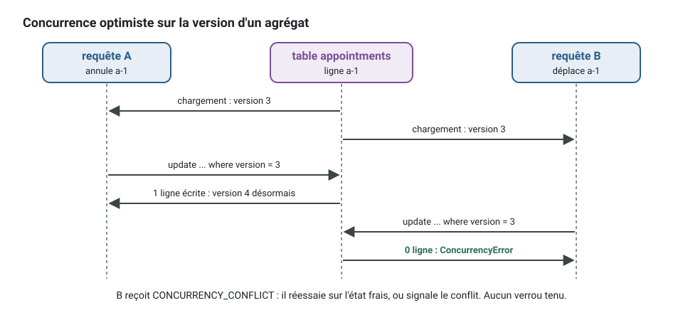
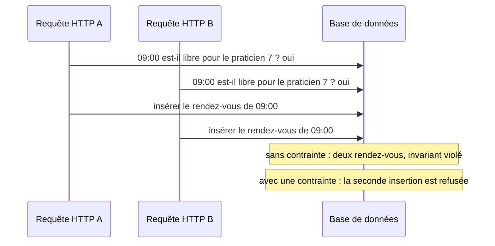

[English](aggregates.md) · **Français**
<!-- translation-of: aggregates.md sha256:3fe2cd3e8eabedbf -->

# Agrégats

**Résumé.** Un agrégat est un ensemble d'entités et d'objets-valeurs qui change d'un seul bloc,
derrière un point d'entrée unique, sa racine. C'est une frontière de cohérence : les règles qu'il
garde (ses invariants) sont vraies après chacune de ses méthodes, et il est enregistré en une
seule transaction. Tout ce qui est hors de cette frontière devient cohérent plus tard, par des
événements. Les règles pratiques en découlent : garder les agrégats petits, n'en modifier qu'un
par transaction, désigner les autres agrégats par leur identifiant, et ne jamais compter sur un
agrégat pour garder une règle qui porte sur l'ensemble des agrégats de son type. Dans ce kit, un
agrégat a un constructeur privé, une fabrique (factory) `create` pour la naissance, une fabrique
`rehydrate` pour le chargement, des méthodes nommées d'après des intentions métier, et une
`version` pour la concurrence optimiste.

## Une frontière de cohérence

La question à laquelle répond un agrégat est : « qu'est-ce qui doit être vrai ensemble, tout de
suite ? ». Pour un rendez-vous :

- un rendez-vous annulé ne peut pas être déplacé ;
- un rendez-vous ne peut pas être annulé deux fois ;
- une annulation à moins de 24 heures du début est refusée comme annulation gratuite.

Chaque règle ne met en jeu que l'état de ce rendez-vous. Ce sont des invariants de l'agrégat
`Appointment`, vérifiés dans ses méthodes, et aucun chemin de code ne peut laisser un rendez-vous
dans un état qui les viole.


Le code de cet agrégat. Les objets-valeurs, les événements et les erreurs qu'il utilise vivent
dans leurs propres fichiers de `domain/` ; leurs formes sont déclarées en tête pour que l'exemple
se suffise à lui-même :

<!-- checked sample -->
```ts
// contexts/appointments/domain/aggregates/appointment.aggregate.ts
import { AggregateRoot, DomainRefusal, type DomainEvent } from '@ddd-ts-kit/kernel';

// Dans domain/value-objects/, domain/events/ et domain/errors/ :
declare class TimeSlot {
  readonly startsAt: Date;
  startsWithin(durationMs: number, at: Date): boolean;
}
declare class CancellationReason {
  readonly text: string;
}
declare class AppointmentBooked implements DomainEvent {
  constructor(aggregateId: string, occurredAt: Date, practitionerId: string, slot: TimeSlot);
  readonly name: string;
  readonly occurredAt: Date;
  readonly aggregateId: string;
}
declare class AppointmentRescheduled implements DomainEvent {
  constructor(aggregateId: string, occurredAt: Date, slot: TimeSlot);
  readonly name: string;
  readonly occurredAt: Date;
  readonly aggregateId: string;
}
declare class AppointmentCancelled implements DomainEvent {
  constructor(aggregateId: string, occurredAt: Date, reason: CancellationReason);
  readonly name: string;
  readonly occurredAt: Date;
  readonly aggregateId: string;
}
declare class AppointmentAlreadyCancelled extends DomainRefusal {
  readonly code: 'APPOINTMENT_ALREADY_CANCELLED';
  static forAppointment(appointmentId: string): AppointmentAlreadyCancelled;
}
declare class CancellationWindowPassed extends DomainRefusal {
  readonly code: 'CANCELLATION_WINDOW_PASSED';
  static forAppointment(appointmentId: string, startsAt: Date): CancellationWindowPassed;
}

const FREE_CANCELLATION_MS = 24 * 60 * 60 * 1000;

export interface AppointmentState {
  readonly practitionerId: string;
  readonly clientId: string;
  readonly slot: TimeSlot;
  readonly status: 'booked' | 'cancelled';
}

export class Appointment extends AggregateRoot<string> {
  private constructor(
    id: string,
    private state: AppointmentState,
  ) {
    super(id);
  }

  static book(id: string, booking: Omit<AppointmentState, 'status'>, now: Date): Appointment {
    const booked = new Appointment(id, { ...booking, status: 'booked' });

    booked.record(new AppointmentBooked(id, now, booking.practitionerId, booking.slot));

    return booked;
  }

  static rehydrate(id: string, state: AppointmentState): Appointment {
    return new Appointment(id, state);
  }

  reschedule(slot: TimeSlot, at: Date): void {
    this.assertNotCancelled();
    this.state = { ...this.state, slot };
    this.record(new AppointmentRescheduled(this.id, at, slot));
  }

  cancel(reason: CancellationReason, at: Date): void {
    this.assertNotCancelled();
    this.assertCancellationStillFree(at);
    this.state = { ...this.state, status: 'cancelled' };
    this.record(new AppointmentCancelled(this.id, at, reason));
  }

  toState(): AppointmentState {
    return { ...this.state };
  }

  private assertNotCancelled(): void {
    if (this.state.status === 'cancelled') {
      throw AppointmentAlreadyCancelled.forAppointment(this.id);
    }
  }

  private assertCancellationStillFree(at: Date): void {
    if (this.state.slot.startsWithin(FREE_CANCELLATION_MS, at)) {
      throw CancellationWindowPassed.forAppointment(this.id, this.state.slot.startsAt);
    }
  }
}
```

Ici, la fabrique de naissance s'appelle `book`, dans la langue du contexte ; la référence la
nomme `create` de façon générique ([ARCHITECTURE.md](../ARCHITECTURE.fr.md), section 4,
« Agrégats »). L'instant de la naissance est l'`occurredAt` de `AppointmentBooked`, et la colonne
d'audit `created_at` date la ligne : l'état ne garde un instant que si une règle le lit, nommé
d'après son fait (`bookedAt`), comme l'écrit `generate aggregate --birth "Appointment Booked"`
(`examples/scheduling` garde `registeredAt` tant que ses agrégats ne sont pas régénérés). Ce que
cette forme garantit :

- **Une seule porte d'entrée.** Constructeur privé, aucun *setter*, aucune propriété publique
  modifiable (`domain/aggregate-encapsulation`). L'état ne change que par `reschedule` et
  `cancel`.
- **Naissance ou chargement.** `book` vérifie les invariants de naissance et enregistre le fait ;
  `rehydrate` restaure un état stocké et n'enregistre rien.
- **Les refus sont nommés.** Un invariant violé lève une `DomainError` au code stable, jamais une
  erreur générique (`domain/no-generic-error`), et elle est construite par une fabrique statique
  de la classe nommée d'après le refus, `AppointmentAlreadyCancelled.forAppointment(..)`, pour que
  le refus se lise comme une phrase (`errors/through-factory`). La classe lit son code
  (`APPOINTMENT_ALREADY_CANCELLED`) dans la liste du contexte, et la fabrique écrit une fois le
  message et les faits : voir
  [Invariants, permissions et validation](invariants-permissions-validation.fr.md).
- **Le temps est un argument.** L'agrégat ne détient aucune horloge ; le gestionnaire (handler)
  lui passe `clock.now()`.
- **Les faits sont enregistrés.** Chaque intention enregistre un
  [événement du domaine](domain-building-blocks.fr.md), que l'enregistrement transmet : il est
  distribué à la fin de l'unité de travail de la commande, une fois que le gestionnaire de la
  commande a rendu la main et avant la validation (commit).

Chaque refus est une classe à part, dans `domain/errors/<refus>.error.ts`, qui lit son code dans
`<context>.codes.ts`, la liste fermée des codes du contexte. Ses fabriques écrivent une seule
fois le message, les faits, et les faits qu'un client peut lire :

<!-- checked sample -->
```ts
import { DomainRefusal } from '@ddd-ts-kit/kernel';

// appointments.codes.ts
export const AppointmentsCodes = {
  AppointmentAlreadyCancelled: 'APPOINTMENT_ALREADY_CANCELLED',
  CancellationWindowPassed: 'CANCELLATION_WINDOW_PASSED',
} as const;

export type AppointmentsCode = (typeof AppointmentsCodes)[keyof typeof AppointmentsCodes];

// domain/errors/appointment-already-cancelled.error.ts
export class AppointmentAlreadyCancelled extends DomainRefusal {
  readonly code = AppointmentsCodes.AppointmentAlreadyCancelled;

  static forAppointment(appointmentId: string) {
    return AppointmentAlreadyCancelled.refusal(`Appointment ${appointmentId} is already cancelled.`, { appointmentId });
  }
}

// domain/errors/cancellation-window-passed.error.ts
export class CancellationWindowPassed extends DomainRefusal {
  readonly code = AppointmentsCodes.CancellationWindowPassed;

  static forAppointment(appointmentId: string, startsAt: Date) {
    return CancellationWindowPassed.refusal(
      `Appointment ${appointmentId} starts at ${startsAt.toISOString()}: too late to cancel for free.`,
      { appointmentId, startsAt },
    ).exposing('startsAt');
  }
}
```

Comme les règles vivent dans l'agrégat, chacune est une courte *spec* sans base de données, sans
horloge et sans bus : étant donné un état, quand une intention, alors un événement ou un refus
([Stratégie de test](testing-strategy.fr.md)). Le *builder* `anAppointment()` est généré avec
l'agrégat :

<!-- checked sample -->
```ts
// contexts/appointments/test/unit/appointment.aggregate.spec.ts
import { describe, it } from 'vitest';
import { AggregateRoot } from '@ddd-ts-kit/kernel';
import { given, type Resolvable } from '@ddd-ts-kit/testing';

// L'agrégat ci-dessus, et son builder de test/builders/ :
declare class CancellationReason {
  readonly text: string;
}
declare class Appointment extends AggregateRoot<string> {
  private constructor();
  cancel(reason: CancellationReason, at: Date): void;
}
interface AppointmentBuilder extends Resolvable<Appointment> {
  startingAt(startsAt: Date): AppointmentBuilder;
  cancelled(): AppointmentBuilder;
}
declare function anAppointment(): AppointmentBuilder;
declare const movedAway: CancellationReason;

const now = new Date('2026-03-01T09:00:00.000Z');

describe('Appointment', () => {
  it('records its cancellation', () => {
    given(anAppointment().startingAt(new Date('2026-03-05T09:00:00.000Z')))
      .when((appointment) => appointment.cancel(movedAway, now))
      .thenEventNames(['appointments.appointment.cancelled']);
  });

  it('cannot be cancelled twice', () => {
    given(anAppointment().cancelled())
      .when((appointment) => appointment.cancel(movedAway, now))
      .thenError('APPOINTMENT_ALREADY_CANCELLED');
  });

  it('refuses a free cancellation within 24 hours of its start', () => {
    given(anAppointment().startingAt(new Date('2026-03-01T18:00:00.000Z')))
      .when((appointment) => appointment.cancel(movedAway, now))
      .thenError('CANCELLATION_WINDOW_PASSED');
  });
});
```

## Un agrégat par transaction

Une commande change un agrégat et l'enregistre. Si la prise d'un rendez-vous doit aussi créer un
rappel, le rappel est créé par une autre transaction, en réaction à l'événement d'intégration
`appointments.appointment.booked` : le contexte des rendez-vous le publie par l'outbox, dans la
validation du rendez-vous, et le gestionnaire d'événement d'intégration du contexte des rappels
le reçoit plus tard, au moins une fois, puis envoie la commande qui crée le rappel.

Un gestionnaire d'événement du domaine n'est pas le bon endroit pour cette commande. Par défaut,
il s'exécute avant la validation, et une commande qu'il envoie rejoint l'unité de travail en
cours : le rappel serait enregistré dans la transaction du rendez-vous, exactement ce que cette
section exclut. Un gestionnaire `after-commit` ouvre sa propre unité de travail, mais sa réaction
peut se perdre. Le choix est détaillé dans
[Où va la réaction à un événement du domaine](domain-and-integration-events.fr.md#pourquoi-un-gestionnaire-before-commit-na-que-des-effets-transactionnels).


```ts
// Au lieu de : un gestionnaire, deux agrégats, une transaction
await this.appointments.save(appointment);
await this.reminders.save(Reminder.create(reminderId, appointment.id, remindAt)); // un second agrégat

// Écrire : le gestionnaire de la commande n'enregistre que son agrégat
await this.appointments.save(appointment);
// ... et le gestionnaire d'événement d'intégration de appointments.appointment.booked du contexte
// des rappels (publié par l'outbox, livré au moins une fois) envoie la commande qui crée le rappel
```

Les raisons :

- **Contention.** Une transaction qui verrouille deux agrégats échoue ou attend dès que l'un des
  deux est occupé.
- **Frontières.** Deux agrégats qui doivent être validés ensemble sont, par définition, dans une
  même frontière de cohérence : soit la frontière est mal tracée, soit la règle n'est pas
  vraiment immédiate.
- **Extraction.** Une transaction qui couvre deux contextes ne survit pas au jour où l'un d'eux
  devient un service (`context/extractable`).

« Un gestionnaire qui enregistre deux agrégats » est l'un des signaux que cherche l'agent
`architecture-reviewer` du *plugin*.
Quand le métier a vraiment besoin que plusieurs étapes réussissent ou soient défaites ensemble,
c'est un processus avec compensation, pas une transaction plus grande
([Sagas et gestionnaires de processus](sagas-and-process-managers.fr.md)).

## Désigner les autres agrégats par leur identifiant

`Appointment` détient `practitionerId` et `clientId`, pas un objet `Calendar` ou `Client`. Une
référence d'objet permettrait à une méthode d'aller modifier un autre agrégat, obligerait à le
charger, et étendrait la transaction sans le dire. Un identifiant garde chaque agrégat chargeable
et enregistrable seul. Quand une règle a besoin de données d'un autre agrégat, le gestionnaire
charge ce qu'il faut et le passe en argument, ou un
[service du domaine](domain-building-blocks.fr.md) prend les deux.

```ts
// Au lieu de : une référence d'objet, qui laisse le rendez-vous modifier l'agenda
interface AppointmentState {
  readonly calendar: Calendar; // chargé avec chaque rendez-vous, enregistré avec lui
}

// Écrire : l'identifiant ; le gestionnaire charge ce dont la règle a besoin et le lui passe
interface AppointmentState {
  readonly practitionerId: string;
}

// Si la prise de rendez-vous devait aussi respecter les horaires de travail du praticien :
const calendar = await this.calendars.findByPractitioner(command.practitionerId);
const appointment = Appointment.book(id, booking, calendar.workingHours, this.clock.now());
```

L'agenda est lu, jamais modifié, par cette commande : ses horaires de travail sont un argument de
l'intention, et l'agenda reste libre pour ses propres commandes.

## Dimensionner

Les règles empiriques de Vernon (« Effective Aggregate Design ») :

1. Modéliser les vrais invariants dans des frontières de cohérence.
2. Concevoir de petits agrégats.
3. Désigner les autres agrégats par leur identité.
4. Utiliser la cohérence à terme hors de la frontière.

Un test pour chaque membre candidat : « existe-t-il une règle qui doit tenir, au même instant,
entre cet élément et la racine ? ». Si non, il n'a pas sa place à l'intérieur.

| Conception | Conséquence |
|---|---|
| `Calendar` contient chaque `Appointment` du praticien | chaque prise de rendez-vous charge et verrouille l'agenda entier ; deux clients qui réservent des jours différents entrent en conflit |
| `Appointment` est son propre agrégat, `Calendar` ne détient que les horaires de travail et les absences | les prises de rendez-vous sont indépendantes ; la règle contre la double réservation a besoin d'une autre garde (ci-dessous) |

La seconde a la bonne taille. La première paraît séduisante parce qu'elle fait de « pas de
double réservation » une vérification en mémoire, et elle ne tient pas au-delà de quelques
rendez-vous. Un agrégat qui charge des collections dont ses invariants n'ont pas besoin est
surdimensionné.

## Concurrence optimiste

Deux requêtes HTTP peuvent charger le même rendez-vous, passer toutes deux les invariants, et
enregistrer toutes deux. L'agrégat porte une `version`, gérée par l'adaptateur du *repository* :
la mise à jour ne réussit que si la version stockée correspond à celle qui a été chargée, et
lève sinon un conflit de concurrence (la `ConcurrencyError` du noyau, code
`CONCURRENCY_CONFLICT`, qu'exige la suite de contrat du *repository*). L'appelant réessaie ou
signale le conflit. Aucun verrou n'est tenu pendant que l'utilisateur réfléchit. Un
interblocage ou un échec de sérialisation que la base de données lève n'importe où dans la
transaction mène au même résultat : l'unité de travail est rejetée par une
`TransactionConflictError`, une `ConcurrencyError` dont la `cause` est l'erreur du pilote. Un
enregistrement que la base refuse pour une valeur qu'une autre ligne détient sous une contrainte
d'unicité (un e-mail) n'en est pas un : il lève `UniqueViolationError`, une `ConflictError` (code
`CONFLICT`), puisque le relancer est refusé de nouveau.



`optimisticUpdate` du noyau est cette garde, autour des deux instructions de l'adaptateur (les
*packages* d'ORM et les *repositories* générés l'appellent de la même façon) :

<!-- checked sample -->
```ts
// contexts/appointments/infrastructure/persistence/appointment-versioning.ts
import { AggregateRoot, optimisticUpdate } from '@ddd-ts-kit/kernel';

declare class Appointment extends AggregateRoot<string> {
  private constructor();
}

interface AppointmentRow {
  readonly id: string;
  readonly status: 'booked' | 'cancelled';
  readonly version: number;
}

// Les instructions de l'adaptateur, sur l'ORM du projet :
declare function rowOf(appointment: Appointment): Omit<AppointmentRow, 'version'>;
declare function insertUnlessExists(row: AppointmentRow): Promise<boolean>;
declare function updateWhereVersion(row: AppointmentRow, expected: number): Promise<number>;

export async function save(appointment: Appointment): Promise<void> {
  // expected : la version chargée (0 : jamais enregistré) ; next : la version à écrire.
  await optimisticUpdate(appointment, async ({ expected, next }) => {
    const row = { ...rowOf(appointment), version: next };

    if (expected === 0) {
      return (await insertUnlessExists(row)) ? 1 : 0;
    }

    return updateWhereVersion(row, expected); // le nombre de lignes écrites
  });
  // Une ligne écrite : appointment.version vaut maintenant `next`. Aucune : une ConcurrencyError a été levée.
}
```

Quand un client ne doit pas écraser une version qu'il n'a pas vue (un `If-Match` HTTP), le
gestionnaire compare aussi la version que porte la commande à celle qui a été chargée, avec
`expectVersion(appointment, command.expectedVersion)` du noyau, avant d'appeler l'intention.

Un agrégat dont l'historique est le métier peut être gardé sous forme de ses événements plutôt
que de son état : il étend `EventSourcedAggregate`, ne change son état que dans une méthode
d'application par événement, et garde le même port de *repository* ; sa version est la longueur
de son flux. Les autres agrégats du contexte ne sont pas concernés. Quand le choisir et ce que
cela coûte : [Event sourcing, par agrégat](event-sourcing.fr.md).

## Un invariant d'ensemble a besoin d'une contrainte de base de données

« Un praticien n'est jamais réservé deux fois sur des créneaux qui se chevauchent » n'est pas
une règle sur un rendez-vous. C'est une règle sur l'ensemble des rendez-vous d'un praticien, et
aucun petit agrégat seul ne détient cet ensemble.



Vérifier d'abord et insérer ensuite est une situation de concurrence : les deux requêtes HTTP voient
un créneau libre. Les versions optimistes n'aident pas, parce que les deux insertions touchent
deux lignes différentes. Les options :

| Garde | Tient ? | Remarque |
|---|---|---|
| une vérification dans le gestionnaire avant l'enregistrement | non | la situation de concurrence ci-dessus |
| interroger `availability` | non | c'est une projection, en retard par construction |
| un verrou distribué | non | le noyau et `@ddd-ts-kit/redis` le disent : un verrou est un outil d'efficacité, jamais la garde d'un invariant |
| un agrégat plus grand qui détient tous les rendez-vous | oui, à un coût prohibitif | voir Dimensionner |
| une contrainte de base de données sur la table des rendez-vous | oui | un index unique sur des créneaux discrets, ou une contrainte d'exclusion sur des intervalles dans PostgreSQL |

L'invariant est donc gardé deux fois, chaque garde faisant ce qu'elle peut : le domaine énonce la
règle et nomme son refus (`SlotAlreadyTaken.forPractitioner`), et le stockage rend impossible de
la violer en concurrence. L'adaptateur du *repository* traduit la violation de contrainte en
erreur du domaine, si bien que le gestionnaire et le client voient un refus métier au code
`SLOT_ALREADY_TAKEN`, pas une erreur du pilote. La vérification préalable dans le gestionnaire
reste utile comme chemin rapide et aimable ; ce n'est pas la garantie.

Sur PostgreSQL, une contrainte d'exclusion dit « deux rendez-vous actifs d'un praticien ne se
chevauchent jamais », quelle que soit leur durée :

```sql
-- une migration du contexte appointments
CREATE EXTENSION IF NOT EXISTS btree_gist;

ALTER TABLE appointments.appointments
  ADD CONSTRAINT appointments_no_overlap
  EXCLUDE USING gist (practitioner_id WITH =, tstzrange(starts_at, ends_at) WITH &&)
  WHERE (status <> 'cancelled');
```

L'adaptateur reconnaît cette contrainte à son nom et lève le refus du domaine, en gardant l'erreur
du pilote comme cause :

<!-- checked sample -->
```ts
import { DomainRefusal } from '@ddd-ts-kit/kernel';

// appointments.codes.ts
export const AppointmentsCodes = {
  SlotAlreadyTaken: 'SLOT_ALREADY_TAKEN',
} as const;

// domain/errors/slot-already-taken.error.ts
export class SlotAlreadyTaken extends DomainRefusal {
  readonly code = AppointmentsCodes.SlotAlreadyTaken;

  static forPractitioner(practitionerId: string, startsAt: Date, cause: unknown) {
    return SlotAlreadyTaken.refusal(
      `Practitioner ${practitionerId} already has an appointment at ${startsAt.toISOString()}.`,
      { practitionerId, startsAt },
    )
      .exposing('startsAt')
      .causedBy(cause);
  }
}

// infrastructure/persistence/ : l'insertion de l'adaptateur du repository
const EXCLUSION_VIOLATION = '23P01'; // le SQLSTATE de PostgreSQL
const NO_OVERLAP = 'appointments_no_overlap';

interface AppointmentRow {
  readonly id: string;
  readonly practitioner_id: string;
  readonly starts_at: Date;
  readonly ends_at: Date;
}

declare function insertRow(row: AppointmentRow): Promise<void>;

export async function insertAppointment(row: AppointmentRow): Promise<void> {
  try {
    await insertRow(row);
  } catch (error) {
    if (violates(error, NO_OVERLAP)) {
      throw SlotAlreadyTaken.forPractitioner(row.practitioner_id, row.starts_at, error);
    }

    throw error;
  }
}

function violates(error: unknown, constraint: string): boolean {
  return (
    typeof error === 'object' &&
    error !== null &&
    'code' in error &&
    error.code === EXCLUSION_VIOLATION &&
    'constraint' in error &&
    error.constraint === constraint
  );
}
```

## Limites et quand ne pas l'utiliser

- **Les agrégats demandent un effort de conception.** Dans un contexte de soutien dont les
  données n'ont aucune règle au-delà de leur forme, un agrégat n'est guère plus qu'un
  enregistrement validé, et c'est acceptable ([Modèle anémique](anemic-model.fr.md)).
- **Les lectures n'en ont pas besoin.** Une requête peut contourner les agrégats et lire une
  projection par un port ([CQRS](cqrs.fr.md)). Charger des agrégats pour construire une liste est
  un mauvais usage.
- **Un par transaction est une règle aux rares exceptions.** Créer ensemble deux agrégats du même
  contexte peut se défendre ; c'est une dérogation à enregistrer, et elle ne franchit jamais un
  contexte.
- **L'encapsulation est vérifiée sur la syntaxe.** `domain/aggregate-encapsulation` voit les
  constructeurs, les propriétés et les *setters*. Elle ne voit pas une méthode nommée
  `changeStatus` qui est un *setter* déguisé : c'est le modèle anémique, que la revue attrape.
- **La contrainte de base de données vit hors du domaine**, dans une migration. Rien dans le kit
  ne la relie à l'invariant qu'elle protège : nommez-la clairement et couvrez-la par un test de
  l'adaptateur qui réserve deux fois le même créneau.

## Sources

- Eric Evans, *Domain-Driven Design*, Addison-Wesley, 2003, chapitre 6 « The Life Cycle of a
  Domain Object » (agrégats, fabriques, *repositories*).
- Vaughn Vernon, « Effective Aggregate Design », parties I à III, 2011, dddcommunity.org ; et
  *Implementing Domain-Driven Design*, Addison-Wesley, 2013, chapitre 10 « Aggregates ».
- Vlad Khononov, *Learning Domain-Driven Design*, O'Reilly, 2021, chapitre 6.
- Pat Helland, « Life beyond Distributed Transactions: an Apostate's Opinion », CIDR 2007.
- Documentation de PostgreSQL, « Constraints », section sur les contraintes d'exclusion,
  postgresql.org/docs/current/ddl-constraints.html.

## Voir aussi

- [Entités et objets-valeurs](entities-and-value-objects.fr.md)
- [Événements du domaine, services du domaine, repositories et fabriques](domain-building-blocks.fr.md)
- [Event sourcing, par agrégat](event-sourcing.fr.md)
- [Invariants, permissions et validation](invariants-permissions-validation.fr.md)
- [Modèle anémique](anemic-model.fr.md)
- [Contexte délimité](bounded-context.fr.md)
- [Cohérence à terme](eventual-consistency.fr.md)
- [Sagas et gestionnaires de processus](sagas-and-process-managers.fr.md)
- [Cache et coordination](../tools/cache-and-coordination.fr.md)
- [Référence d'architecture](../ARCHITECTURE.fr.md)
- [Index des concepts](README.fr.md)
