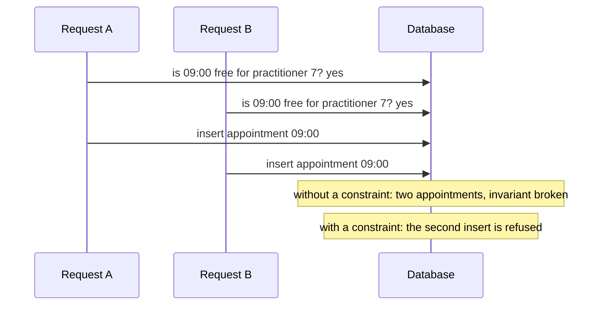

# Aggregates

**Summary.** An aggregate is a cluster of entities and value objects that changes as one unit,
behind a single entry point, its root. It is a consistency boundary: the rules it guards
(its invariants) are true after every one of its methods, and it is saved in one transaction.
Everything outside that boundary is consistent later, through events. The practical rules
follow from this: keep aggregates small, modify one per transaction, reference other aggregates
by identifier, and never rely on an aggregate to guard a rule that spans the whole set of its
kind. In this kit an aggregate has a private constructor, a `create` factory for birth, a
`rehydrate` factory for loading, methods named after business intentions, and a `version` for
optimistic concurrency.

## A consistency boundary

The question an aggregate answers is "what must be true together, immediately?". For an
appointment:

- a cancelled appointment cannot be rescheduled;
- an appointment cannot be cancelled twice;
- cancelling within 24 hours of the start is refused as a free cancellation.

Each rule involves only the state of that appointment. They are invariants of the `Appointment`
aggregate, checked inside its methods, and no code path can leave an appointment in a state
that breaks them.

```ts
// contexts/appointments/domain/aggregates/appointment.aggregate.ts
import { AggregateRoot } from '@ddd-ts-kit/kernel';
import { AppointmentAlreadyCancelled } from '../errors/appointment-already-cancelled.error.js';
import { CancellationWindowPassed } from '../errors/cancellation-window-passed.error.js';
import { AppointmentBooked } from '../events/appointment-booked.event.js';
import { AppointmentCancelled } from '../events/appointment-cancelled.event.js';
import { AppointmentRescheduled } from '../events/appointment-rescheduled.event.js';
import type { CancellationReason } from '../value-objects/cancellation-reason.vo.js';
import type { TimeSlot } from '../value-objects/time-slot.vo.js';

const FREE_CANCELLATION_MS = 24 * 60 * 60 * 1000;

export interface AppointmentState {
  readonly practitionerId: string;
  readonly clientId: string;
  readonly slot: TimeSlot;
  readonly status: 'booked' | 'cancelled';
  readonly registeredAt: Date;
}

export class Appointment extends AggregateRoot<string> {
  private constructor(
    id: string,
    private state: AppointmentState,
  ) {
    super(id);
  }

  static book(id: string, booking: Omit<AppointmentState, 'status' | 'registeredAt'>, now: Date): Appointment {
    const booked = new Appointment(id, { ...booking, status: 'booked', registeredAt: now });

    booked.record(new AppointmentBooked(id, now, booking.practitionerId, booking.slot));

    return booked;
  }

  static rehydrate(id: string, state: AppointmentState): Appointment {
    return new Appointment(id, state);
  }

  reschedule(slot: TimeSlot, at: Date): void {
    this.assertNotCancelled();
    this.state = { ...this.state, slot };
    this.record(new AppointmentRescheduled(this.id, at, slot));
  }

  cancel(reason: CancellationReason, at: Date): void {
    this.assertNotCancelled();
    this.assertCancellationStillFree(at);
    this.state = { ...this.state, status: 'cancelled' };
    this.record(new AppointmentCancelled(this.id, at, reason));
  }

  toState(): AppointmentState {
    return { ...this.state };
  }

  private assertNotCancelled(): void {
    if (this.state.status === 'cancelled') {
      throw new AppointmentAlreadyCancelled();
    }
  }

  private assertCancellationStillFree(at: Date): void {
    if (this.state.slot.startsWithin(FREE_CANCELLATION_MS, at)) {
      throw new CancellationWindowPassed();
    }
  }
}
```

Here the birth factory is named `book`, in the language of the context; the reference names it
`create` generically ([ARCHITECTURE.md](../ARCHITECTURE.md), section 4, "Aggregates"). What
the shape guarantees:

- **One door.** Private constructor, no setter, no public mutable property
  (`domain/aggregate-encapsulation`). State changes only through `reschedule` and `cancel`.
- **Birth versus loading.** `book` checks birth invariants and records the fact;
  `rehydrate` restores a stored state and records nothing.
- **Refusals are named.** A violated invariant raises a `DomainError` subclass with a stable
  code (`domain/no-generic-error`), never a generic error.
- **Time is an argument.** The aggregate holds no clock; the handler passes `clock.now()`.
- **Facts are recorded.** Each intention records a [domain event](domain-building-blocks.md),
  which the save hands over: it is dispatched at the end of the unit of work of the command,
  once the command handler has returned and before the commit.

## One aggregate per transaction

A command changes one aggregate and saves it. If booking an appointment must also create a
reminder, the reminder is created by another transaction, in reaction to
`appointments.appointment.booked`. The reasons:

- **Contention.** A transaction locking two aggregates fails or waits whenever either is busy.
- **Boundaries.** Two aggregates that must commit together are, by definition, inside one
  consistency boundary: either the boundary is drawn wrong, or the rule is not really
  immediate.
- **Extraction.** A transaction that spans two contexts cannot survive one of them becoming a
  service (`context/extractable`).

"A handler saving two aggregates" is one of the smells the `architecture-reviewer` agent of
the plugin looks for.
When the business truly needs several steps to succeed or be undone together, that is a
process with compensation, not a bigger transaction
([Sagas and process managers](sagas-and-process-managers.md)).

## Reference other aggregates by identifier

`Appointment` holds `practitionerId` and `clientId`, not a `Calendar` or a `Client` object. An
object reference would let a method reach into another aggregate and change it, would force
loading it, and would silently extend the transaction. An identifier keeps each aggregate
loadable and saveable alone. When a rule needs data from another aggregate, the handler loads
what is needed and passes it as an argument, or a [domain service](domain-building-blocks.md)
takes both.

## Sizing

Vernon's rules of thumb ("Effective Aggregate Design"):

1. Model true invariants in consistency boundaries.
2. Design small aggregates.
3. Reference other aggregates by identity.
4. Use eventual consistency outside the boundary.

A test for each candidate member: "is there a rule that must hold, in the same instant, between
this and the root?". If not, it does not belong inside.

| Design | Consequence |
|---|---|
| `Calendar` contains every `Appointment` of the practitioner | every booking loads and locks the whole calendar; two clients booking different days conflict |
| `Appointment` is its own aggregate, `Calendar` holds only working hours and time off | bookings are independent; the double-booking rule needs another guard (below) |

The second is the right size. The first looks attractive because it makes "no double booking"
an in-memory check, and it does not scale past a handful of appointments. An aggregate that
loads collections it does not need for its invariants is oversized.

## Optimistic concurrency

Two requests can load the same appointment, both pass the invariants, and both save. The
aggregate carries a `version`, managed by the repository adapter: the update succeeds only
where the stored version matches the loaded one, and otherwise raises a concurrency conflict
(the kernel's `ConcurrencyError`, code `CONCURRENCY_CONFLICT`, which the repository contract
suite requires). The caller retries or reports the conflict. No lock is held while the user
thinks.

## A set-wide invariant needs a database constraint

"A practitioner is never booked twice for overlapping slots" is not a rule about one
appointment. It is a rule about the set of all appointments of a practitioner, and no single
small aggregate holds that set.



Checking first and inserting after is a race: both requests see a free slot. Optimistic
versions do not help, because the two inserts touch two different rows. The options:

| Guard | Holds? | Note |
|---|---|---|
| a check in the handler before saving | no | the race above |
| asking `availability` | no | it is a projection, late by design |
| a distributed lock | no | the kernel and `@ddd-ts-kit/redis` say it: a lock is an efficiency tool, never the guard of an invariant |
| a larger aggregate holding all appointments | yes, at a prohibitive cost | see Sizing |
| a database constraint on the appointments table | yes | a unique index on discrete slots, or an exclusion constraint on ranges in PostgreSQL |

So the invariant is guarded twice, each guard doing what it can: the domain states the rule and
names its refusal (`SlotAlreadyTaken`), and the storage makes it impossible to violate under
concurrency. The repository adapter translates the constraint violation into the domain error,
so the handler and the client see a business refusal with the code `SLOT_ALREADY_TAKEN`, not a
driver error. The pre-check in the handler remains useful as the fast, friendly path; it is not
the guarantee.

## Limits and when not to use it

- **Aggregates cost design effort.** In a supporting context whose data has no rule beyond its
  shape, an aggregate is little more than a validated record, and that is acceptable
  ([Anemic model](anemic-model.md)).
- **Reads do not need them.** A query may bypass aggregates and read a projection through a
  port ([CQRS](cqrs.md)). Loading aggregates to build a list is a misuse.
- **One per transaction is a rule with rare exceptions.** Creating two aggregates of the same
  context together can be defensible; it is a deviation to record, and it never crosses a
  context.
- **Encapsulation is checked on syntax.** `domain/aggregate-encapsulation` sees constructors,
  properties and setters. It does not see a method named `changeStatus` that is a setter in
  disguise: that is the anemic model, caught by review.
- **The database constraint lives outside the domain**, in a migration. Nothing in the kit
  links it to the invariant it protects: name it clearly and cover it with an adapter test
  that books the same slot twice.

## Sources

- Eric Evans, *Domain-Driven Design*, Addison-Wesley, 2003, chapter 6 "The Life Cycle of a
  Domain Object" (aggregates, factories, repositories).
- Vaughn Vernon, "Effective Aggregate Design", parts I to III, 2011, dddcommunity.org; and
  *Implementing Domain-Driven Design*, Addison-Wesley, 2013, chapter 10 "Aggregates".
- Vlad Khononov, *Learning Domain-Driven Design*, O'Reilly, 2021, chapter 6.
- Pat Helland, "Life beyond Distributed Transactions: an Apostate's Opinion", CIDR 2007.
- PostgreSQL documentation, "Constraints", section on exclusion constraints,
  postgresql.org/docs/current/ddl-constraints.html.

## See also

- [Entities and value objects](entities-and-value-objects.md)
- [Domain events, domain services, repositories and factories](domain-building-blocks.md)
- [Invariants, permissions and validation](invariants-permissions-validation.md)
- [Anemic model](anemic-model.md)
- [Bounded context](bounded-context.md)
- [Eventual consistency](eventual-consistency.md)
- [Sagas and process managers](sagas-and-process-managers.md)
- [Cache and coordination](../tools/cache-and-coordination.md)
- [Architecture reference](../ARCHITECTURE.md)
- [Concepts index](README.md)
