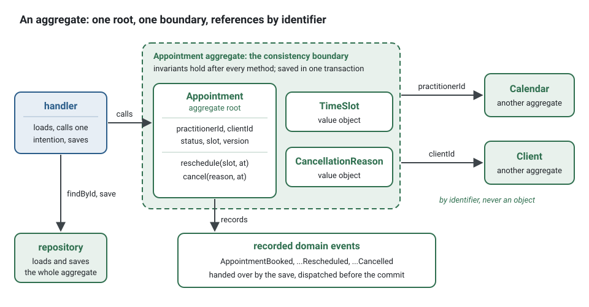
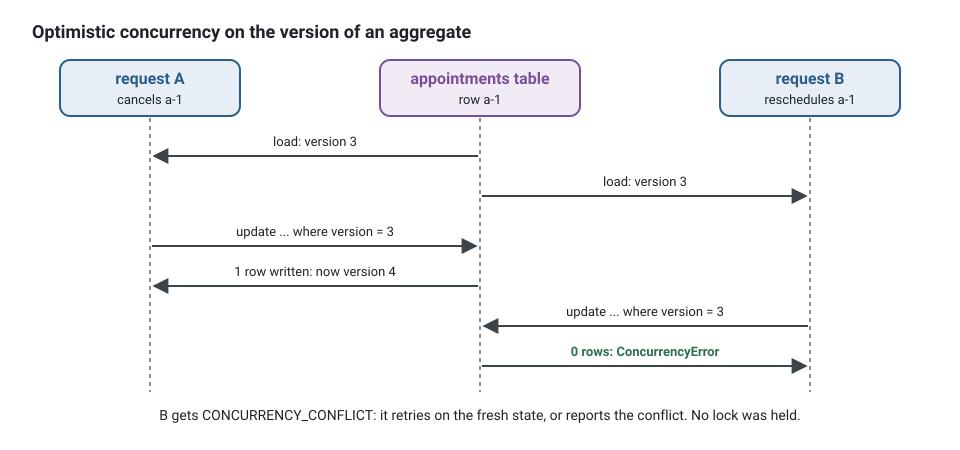
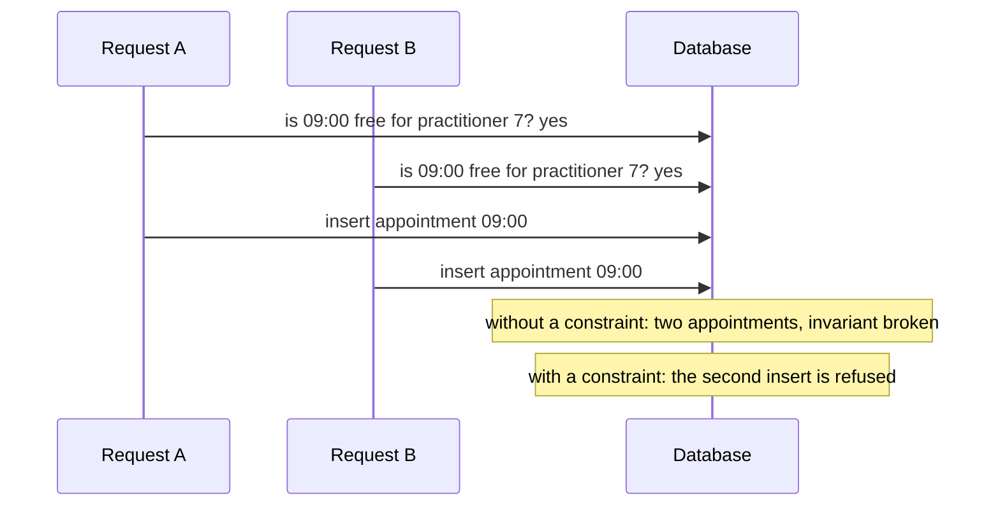

**English** · [Français](aggregates.fr.md)

# Aggregates

**Summary.** An aggregate is a cluster of entities and value objects that changes as one unit,
behind a single entry point, its root. It is a consistency boundary: the rules it guards
(its invariants) are true after every one of its methods, and it is saved in one transaction.
Everything outside that boundary is consistent later, through events. The practical rules
follow from this: keep aggregates small, modify one per transaction, reference other aggregates
by identifier, and never rely on an aggregate to guard a rule that spans the whole set of its
kind. In this kit an aggregate has a private constructor, a `create` factory for birth, a
`rehydrate` factory for loading, methods named after business intentions, and a `version` for
optimistic concurrency.

## A consistency boundary

The question an aggregate answers is "what must be true together, immediately?". For an
appointment:

- a cancelled appointment cannot be rescheduled;
- an appointment cannot be cancelled twice;
- cancelling within 24 hours of the start is refused as a free cancellation.

Each rule involves only the state of that appointment. They are invariants of the `Appointment`
aggregate, checked inside its methods, and no code path can leave an appointment in a state
that breaks them.



The code of that aggregate. The value objects, events and errors it uses live in their own files
of `domain/`; their shapes are declared at the top so that the sample stands alone:

<!-- checked sample -->
```ts
// contexts/appointments/domain/aggregates/appointment.aggregate.ts
import { AggregateRoot, ConceptError, type DomainEvent } from '@ddd-ts-kit/kernel';

// In domain/value-objects/, domain/events/ and domain/errors/:
declare class TimeSlot {
  readonly startsAt: Date;
  startsWithin(durationMs: number, at: Date): boolean;
}
declare class CancellationReason {
  readonly text: string;
}
declare class AppointmentBooked implements DomainEvent {
  constructor(aggregateId: string, occurredAt: Date, practitionerId: string, slot: TimeSlot);
  readonly name: string;
  readonly occurredAt: Date;
  readonly aggregateId: string;
}
declare class AppointmentRescheduled implements DomainEvent {
  constructor(aggregateId: string, occurredAt: Date, slot: TimeSlot);
  readonly name: string;
  readonly occurredAt: Date;
  readonly aggregateId: string;
}
declare class AppointmentCancelled implements DomainEvent {
  constructor(aggregateId: string, occurredAt: Date, reason: CancellationReason);
  readonly name: string;
  readonly occurredAt: Date;
  readonly aggregateId: string;
}
declare class AppointmentError extends ConceptError {
  static alreadyCancelled(appointmentId: string): AppointmentError;
  static cancellationWindowPassed(appointmentId: string, startsAt: Date): AppointmentError;
}

const FREE_CANCELLATION_MS = 24 * 60 * 60 * 1000;

export interface AppointmentState {
  readonly practitionerId: string;
  readonly clientId: string;
  readonly slot: TimeSlot;
  readonly status: 'booked' | 'cancelled';
  readonly registeredAt: Date;
}

export class Appointment extends AggregateRoot<string> {
  private constructor(
    id: string,
    private state: AppointmentState,
  ) {
    super(id);
  }

  static book(id: string, booking: Omit<AppointmentState, 'status' | 'registeredAt'>, now: Date): Appointment {
    const booked = new Appointment(id, { ...booking, status: 'booked', registeredAt: now });

    booked.record(new AppointmentBooked(id, now, booking.practitionerId, booking.slot));

    return booked;
  }

  static rehydrate(id: string, state: AppointmentState): Appointment {
    return new Appointment(id, state);
  }

  reschedule(slot: TimeSlot, at: Date): void {
    this.assertNotCancelled();
    this.state = { ...this.state, slot };
    this.record(new AppointmentRescheduled(this.id, at, slot));
  }

  cancel(reason: CancellationReason, at: Date): void {
    this.assertNotCancelled();
    this.assertCancellationStillFree(at);
    this.state = { ...this.state, status: 'cancelled' };
    this.record(new AppointmentCancelled(this.id, at, reason));
  }

  toState(): AppointmentState {
    return { ...this.state };
  }

  private assertNotCancelled(): void {
    if (this.state.status === 'cancelled') {
      throw AppointmentError.alreadyCancelled(this.id);
    }
  }

  private assertCancellationStillFree(at: Date): void {
    if (this.state.slot.startsWithin(FREE_CANCELLATION_MS, at)) {
      throw AppointmentError.cancellationWindowPassed(this.id, this.state.slot.startsAt);
    }
  }
}
```

Here the birth factory is named `book`, in the language of the context; the reference names it
`create` generically ([ARCHITECTURE.md](../ARCHITECTURE.md), section 4, "Aggregates"). What
the shape guarantees:

- **One door.** Private constructor, no setter, no public mutable property
  (`domain/aggregate-encapsulation`). State changes only through `reschedule` and `cancel`.
- **Birth versus loading.** `book` checks birth invariants and records the fact;
  `rehydrate` restores a stored state and records nothing.
- **Refusals are named.** A violated invariant raises a `DomainError` with a stable code,
  never a generic error (`domain/no-generic-error`), and it is built by a static factory of the
  error class of the concept, `AppointmentError`, so that the refusal reads as a sentence
  (`errors/through-factory`). The factory writes the code (`APPOINTMENT_ALREADY_CANCELLED`),
  the message and the facts once: see
  [Invariants, permissions and validation](invariants-permissions-validation.md).
- **Time is an argument.** The aggregate holds no clock; the handler passes `clock.now()`.
- **Facts are recorded.** Each intention records a [domain event](domain-building-blocks.md),
  which the save hands over: it is dispatched at the end of the unit of work of the command,
  once the command handler has returned and before the commit.

The error class of the concept, in `domain/errors/appointment.error.ts`, writes each refusal
once: its code, its message, its facts, and the facts a client may read:

<!-- checked sample -->
```ts
import { ConceptError } from '@ddd-ts-kit/kernel';

export class AppointmentError extends ConceptError {
  static alreadyCancelled(appointmentId: string) {
    return AppointmentError.refusal(
      'APPOINTMENT_ALREADY_CANCELLED',
      `Appointment ${appointmentId} is already cancelled.`,
      { appointmentId },
    );
  }

  static cancellationWindowPassed(appointmentId: string, startsAt: Date) {
    return AppointmentError.refusal(
      'CANCELLATION_WINDOW_PASSED',
      `Appointment ${appointmentId} starts at ${startsAt.toISOString()}: too late to cancel for free.`,
      { appointmentId, startsAt },
    ).exposing('startsAt');
  }
}
```

Because the rules live in the aggregate, each one is a short spec with no database, no clock and
no bus: given a state, when an intention, then an event or a refusal
([Testing strategy](testing-strategy.md)). The builder `anAppointment()` is generated with the
aggregate:

<!-- checked sample -->
```ts
// contexts/appointments/test/unit/appointment.aggregate.spec.ts
import { describe, it } from 'vitest';
import { AggregateRoot } from '@ddd-ts-kit/kernel';
import { given, type Resolvable } from '@ddd-ts-kit/testing';

// The aggregate above, and its builder of test/builders/:
declare class CancellationReason {
  readonly text: string;
}
declare class Appointment extends AggregateRoot<string> {
  private constructor();
  cancel(reason: CancellationReason, at: Date): void;
}
interface AppointmentBuilder extends Resolvable<Appointment> {
  startingAt(startsAt: Date): AppointmentBuilder;
  cancelled(): AppointmentBuilder;
}
declare function anAppointment(): AppointmentBuilder;
declare const movedAway: CancellationReason;

const now = new Date('2026-03-01T09:00:00.000Z');

describe('Appointment', () => {
  it('records its cancellation', () => {
    given(anAppointment().startingAt(new Date('2026-03-05T09:00:00.000Z')))
      .when((appointment) => appointment.cancel(movedAway, now))
      .thenEventNames(['appointments.appointment.cancelled']);
  });

  it('cannot be cancelled twice', () => {
    given(anAppointment().cancelled())
      .when((appointment) => appointment.cancel(movedAway, now))
      .thenError('APPOINTMENT_ALREADY_CANCELLED');
  });

  it('refuses a free cancellation within 24 hours of its start', () => {
    given(anAppointment().startingAt(new Date('2026-03-01T18:00:00.000Z')))
      .when((appointment) => appointment.cancel(movedAway, now))
      .thenError('CANCELLATION_WINDOW_PASSED');
  });
});
```

## One aggregate per transaction

A command changes one aggregate and saves it. If booking an appointment must also create a
reminder, the reminder is created by another transaction, in reaction to the integration event
`appointments.appointment.booked`: the appointments context publishes it through the outbox, in
the commit of the appointment, and the integration event handler of the reminder context
receives it later, at least once, and sends the command that creates the reminder.

A domain event handler is not the place for that command. By default it runs before the commit,
and a command it sends joins the unit of work in progress: the reminder would be saved in the
transaction of the appointment, which is exactly what this section rules out. An `after-commit`
handler opens a unit of work of its own, but its reaction may be lost. The choice is laid out in
[Where the reaction to a domain event goes](domain-and-integration-events.md#why-a-before-commit-handler-has-transactional-effects-only).


```ts
// Instead of: one handler, two aggregates, one transaction
await this.appointments.save(appointment);
await this.reminders.save(Reminder.create(reminderId, appointment.id, remindAt)); // a second aggregate

// Write: the command handler saves its aggregate only
await this.appointments.save(appointment);
// ... and the reminder context's integration event handler of appointments.appointment.booked
// (published through the outbox, delivered at least once) sends the command that creates the reminder
```

The reasons:

- **Contention.** A transaction locking two aggregates fails or waits whenever either is busy.
- **Boundaries.** Two aggregates that must commit together are, by definition, inside one
  consistency boundary: either the boundary is drawn wrong, or the rule is not really
  immediate.
- **Extraction.** A transaction that spans two contexts cannot survive one of them becoming a
  service (`context/extractable`).

"A handler saving two aggregates" is one of the smells the `architecture-reviewer` agent of
the plugin looks for.
When the business truly needs several steps to succeed or be undone together, that is a
process with compensation, not a bigger transaction
([Sagas and process managers](sagas-and-process-managers.md)).

## Reference other aggregates by identifier

`Appointment` holds `practitionerId` and `clientId`, not a `Calendar` or a `Client` object. An
object reference would let a method reach into another aggregate and change it, would force
loading it, and would silently extend the transaction. An identifier keeps each aggregate
loadable and saveable alone. When a rule needs data from another aggregate, the handler loads
what is needed and passes it as an argument, or a [domain service](domain-building-blocks.md)
takes both.

```ts
// Instead of: an object reference, which lets the appointment change the calendar
interface AppointmentState {
  readonly calendar: Calendar; // loaded with every appointment, saved with it
}

// Write: the identifier; the handler loads what the rule needs and passes it in
interface AppointmentState {
  readonly practitionerId: string;
}

// If booking also had to respect the working hours of the practitioner:
const calendar = await this.calendars.findByPractitioner(command.practitionerId);
const appointment = Appointment.book(id, booking, calendar.workingHours, this.clock.now());
```

The calendar is read, never changed, by this command: its working hours are an argument of the
intention, and the calendar stays free for its own commands.

## Sizing

Vernon's rules of thumb ("Effective Aggregate Design"):

1. Model true invariants in consistency boundaries.
2. Design small aggregates.
3. Reference other aggregates by identity.
4. Use eventual consistency outside the boundary.

A test for each candidate member: "is there a rule that must hold, in the same instant, between
this and the root?". If not, it does not belong inside.

| Design | Consequence |
|---|---|
| `Calendar` contains every `Appointment` of the practitioner | every booking loads and locks the whole calendar; two clients booking different days conflict |
| `Appointment` is its own aggregate, `Calendar` holds only working hours and time off | bookings are independent; the double-booking rule needs another guard (below) |

The second is the right size. The first looks attractive because it makes "no double booking"
an in-memory check, and it does not scale past a handful of appointments. An aggregate that
loads collections it does not need for its invariants is oversized.

## Optimistic concurrency

Two requests can load the same appointment, both pass the invariants, and both save. The
aggregate carries a `version`, managed by the repository adapter: the update succeeds only
where the stored version matches the loaded one, and otherwise raises a concurrency conflict
(the kernel's `ConcurrencyError`, code `CONCURRENCY_CONFLICT`, which the repository contract
suite requires). The caller retries or reports the conflict. No lock is held while the user
thinks.



`optimisticUpdate` of the kernel is that guard, around the two statements of the adapter (the
ORM packages and the generated repositories call it the same way):

<!-- checked sample -->
```ts
// contexts/appointments/infrastructure/persistence/appointment-versioning.ts
import { AggregateRoot, optimisticUpdate } from '@ddd-ts-kit/kernel';

declare class Appointment extends AggregateRoot<string> {
  private constructor();
}

interface AppointmentRow {
  readonly id: string;
  readonly status: 'booked' | 'cancelled';
  readonly version: number;
}

// The statements of the adapter, on the ORM of the project:
declare function rowOf(appointment: Appointment): Omit<AppointmentRow, 'version'>;
declare function insertUnlessExists(row: AppointmentRow): Promise<boolean>;
declare function updateWhereVersion(row: AppointmentRow, expected: number): Promise<number>;

export async function save(appointment: Appointment): Promise<void> {
  // expected: the version loaded (0: never saved); next: the version to write.
  await optimisticUpdate(appointment, async ({ expected, next }) => {
    const row = { ...rowOf(appointment), version: next };

    if (expected === 0) {
      return (await insertUnlessExists(row)) ? 1 : 0;
    }

    return updateWhereVersion(row, expected); // the number of rows written
  });
  // One row written: appointment.version is now `next`. None: a ConcurrencyError was thrown.
}
```

When a client must not overwrite a version it has not seen (an HTTP `If-Match`), the handler
also compares the version the command carries with the loaded one, with
`expectVersion(appointment, command.expectedVersion)` of the kernel, before calling the
intention.

An aggregate whose history is the business can be kept as its events instead of its state: it
extends `EventSourcedAggregate`, changes its state only in one apply method per event, and keeps
the same repository port; its version is the length of its stream. The other aggregates of the
context are not affected. When to choose it and what it costs:
[Event sourcing, per aggregate](event-sourcing.md).

## A set-wide invariant needs a database constraint

"A practitioner is never booked twice for overlapping slots" is not a rule about one
appointment. It is a rule about the set of all appointments of a practitioner, and no single
small aggregate holds that set.



Checking first and inserting after is a race: both requests see a free slot. Optimistic
versions do not help, because the two inserts touch two different rows. The options:

| Guard | Holds? | Note |
|---|---|---|
| a check in the handler before saving | no | the race above |
| asking `availability` | no | it is a projection, late by design |
| a distributed lock | no | the kernel and `@ddd-ts-kit/redis` say it: a lock is an efficiency tool, never the guard of an invariant |
| a larger aggregate holding all appointments | yes, at a prohibitive cost | see Sizing |
| a database constraint on the appointments table | yes | a unique index on discrete slots, or an exclusion constraint on ranges in PostgreSQL |

So the invariant is guarded twice, each guard doing what it can: the domain states the rule and
names its refusal (`AppointmentError.slotAlreadyTaken`), and the storage makes it impossible to
violate under concurrency. The repository adapter translates the constraint violation into the
domain error, so the handler and the client see a business refusal with the code
`SLOT_ALREADY_TAKEN`, not a driver error. The pre-check in the handler remains useful as the
fast, friendly path; it is not the guarantee.

On PostgreSQL, an exclusion constraint says "no two active appointments of a practitioner
overlap", whatever their length:

```sql
-- a migration of the appointments context
CREATE EXTENSION IF NOT EXISTS btree_gist;

ALTER TABLE appointments.appointments
  ADD CONSTRAINT appointments_no_overlap
  EXCLUDE USING gist (practitioner_id WITH =, tstzrange(starts_at, ends_at) WITH &&)
  WHERE (status <> 'cancelled');
```

The adapter recognises that constraint by its name and raises the refusal of the domain, the
driver error kept as its cause:

<!-- checked sample -->
```ts
import { ConceptError } from '@ddd-ts-kit/kernel';

// domain/errors/appointment.error.ts
export class AppointmentError extends ConceptError {
  static slotAlreadyTaken(practitionerId: string, startsAt: Date, cause: unknown) {
    return AppointmentError.refusal(
      'SLOT_ALREADY_TAKEN',
      `Practitioner ${practitionerId} already has an appointment at ${startsAt.toISOString()}.`,
      { practitionerId, startsAt },
    )
      .exposing('startsAt')
      .causedBy(cause);
  }
}

// infrastructure/persistence/: the insert of the repository adapter
const EXCLUSION_VIOLATION = '23P01'; // the SQLSTATE of PostgreSQL
const NO_OVERLAP = 'appointments_no_overlap';

interface AppointmentRow {
  readonly id: string;
  readonly practitioner_id: string;
  readonly starts_at: Date;
  readonly ends_at: Date;
}

declare function insertRow(row: AppointmentRow): Promise<void>;

export async function insertAppointment(row: AppointmentRow): Promise<void> {
  try {
    await insertRow(row);
  } catch (error) {
    if (violates(error, NO_OVERLAP)) {
      throw AppointmentError.slotAlreadyTaken(row.practitioner_id, row.starts_at, error);
    }

    throw error;
  }
}

function violates(error: unknown, constraint: string): boolean {
  return (
    typeof error === 'object' &&
    error !== null &&
    'code' in error &&
    error.code === EXCLUSION_VIOLATION &&
    'constraint' in error &&
    error.constraint === constraint
  );
}
```

## Limits and when not to use it

- **Aggregates cost design effort.** In a supporting context whose data has no rule beyond its
  shape, an aggregate is little more than a validated record, and that is acceptable
  ([Anemic model](anemic-model.md)).
- **Reads do not need them.** A query may bypass aggregates and read a projection through a
  port ([CQRS](cqrs.md)). Loading aggregates to build a list is a misuse.
- **One per transaction is a rule with rare exceptions.** Creating two aggregates of the same
  context together can be defensible; it is a deviation to record, and it never crosses a
  context.
- **Encapsulation is checked on syntax.** `domain/aggregate-encapsulation` sees constructors,
  properties and setters. It does not see a method named `changeStatus` that is a setter in
  disguise: that is the anemic model, caught by review.
- **The database constraint lives outside the domain**, in a migration. Nothing in the kit
  links it to the invariant it protects: name it clearly and cover it with an adapter test
  that books the same slot twice.

## Sources

- Eric Evans, *Domain-Driven Design*, Addison-Wesley, 2003, chapter 6 "The Life Cycle of a
  Domain Object" (aggregates, factories, repositories).
- Vaughn Vernon, "Effective Aggregate Design", parts I to III, 2011, dddcommunity.org; and
  *Implementing Domain-Driven Design*, Addison-Wesley, 2013, chapter 10 "Aggregates".
- Vlad Khononov, *Learning Domain-Driven Design*, O'Reilly, 2021, chapter 6.
- Pat Helland, "Life beyond Distributed Transactions: an Apostate's Opinion", CIDR 2007.
- PostgreSQL documentation, "Constraints", section on exclusion constraints,
  postgresql.org/docs/current/ddl-constraints.html.

## See also

- [Entities and value objects](entities-and-value-objects.md)
- [Domain events, domain services, repositories and factories](domain-building-blocks.md)
- [Event sourcing, per aggregate](event-sourcing.md)
- [Invariants, permissions and validation](invariants-permissions-validation.md)
- [Anemic model](anemic-model.md)
- [Bounded context](bounded-context.md)
- [Eventual consistency](eventual-consistency.md)
- [Sagas and process managers](sagas-and-process-managers.md)
- [Cache and coordination](../tools/cache-and-coordination.md)
- [Architecture reference](../ARCHITECTURE.md)
- [Concepts index](README.md)
