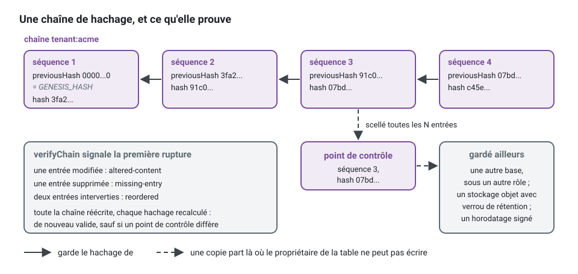

[English](audit-trail.md) · **Français**
<!-- translation-of: audit-trail.md sha256:fdcd02e14f86e0c1 -->

# Journal d'audit

**Résumé.** Un journal d'audit (audit trail) répond à « qui a fait quoi, sur quoi, quand, avec
quelle issue, pour le compte de qui » à quelqu'un qui ne fait pas confiance à l'application : un
auditeur, un client, un régulateur. Dans ce kit, il est enregistré autour des cas d'usage,
jamais par eux : les décisions d'autorisation, les commandes exécutées, les événements
d'intégration et les effacements de données personnelles passent déjà par quelques endroits,
et les entrées y sont écrites. Les entrées sont
en ajout seul et chaînées par hachage, si bien qu'une modification, une suppression ou un
réordonnancement se détecte ; elles contiennent des identifiants et des codes, jamais de
contenu, et c'est aussi ce qui permet à une chaîne en ajout seul de coexister avec le droit à
l'effacement. La chaîne prouve que ce qui a été enregistré n'a pas été réécrit. Elle ne prouve
pas que tout a été enregistré.

## Ce qu'il n'est pas

| Il n'est pas | Parce que |
|---|---|
| un journal applicatif | les journaux sont échantillonnés, font l'objet d'une rotation, sont filtrés par niveau et perdus ; personne ne peut prouver qu'une ligne n'a pas été supprimée |
| de l'*event sourcing* | il ne reconstruit pas l'état ; il enregistre que quelque chose s'est produit et comment cela s'est terminé |
| des colonnes d'audit | `created_by` et `updated_by` nomment le dernier auteur d'une ligne, pas l'historique, et pas les refus |
| un outil de débogage | il ne porte ni charge utile, ni message, ni pile d'appels |

Les quatre peuvent coexister, chacun avec sa durée de conservation et ses lecteurs. C'est en les
mélangeant qu'un journal applicatif finit par garder des données personnelles pendant dix ans,
ou qu'un journal d'audit devient illisible.

## Pourquoi les gestionnaires ne l'écrivent jamais

Un gestionnaire (handler) qui doit penser à appeler l'audit l'oubliera un jour, et rien
n'échouera. Un agrégat qui l'appelle a cessé d'être un modèle. Le kit enregistre donc depuis
les endroits que chaque unité de travail traverse déjà, câblés une fois dans la plateforme :

| Source | Enregistre | Mécanisme |
|---|---|---|
| décisions d'autorisation | chaque refus ; chaque action autorisée qui n'est pas une lecture ; les lectures autorisées que vous déclarez sensibles | le *hook* de décision du *middleware* d'autorisation |
| commandes | chaque commande avec `succeeded` ou `failed` et le code de l'erreur | un *middleware* de bus placé avant l'unité de travail |
| événements d'intégration | qu'un événement d'un type donné a eu lieu, d'après sa seule enveloppe | un abonnement idempotent |
| effacements de personnes concernées | que la clé d'une personne a été détruite, ou qu'il n'en restait aucune ; combien de lignes chaque copie a atteintes, `0` compris ; par qui et quand | le stockage des clés, décoré par `auditedSubjectKeys`, et chaque copie, décorée par `auditedPersonalDataErasure`, avec ou sans event store |
| exports de personnes concernées | qu'un contexte a remis ce qu'il garde d'une personne, combien d'enregistrements, par qui et quand, jamais les valeurs | le port d'export de chaque contexte, décoré par `auditedPersonalDataExport` |


Une requête qu'une garde refuse à la frontière HTTP (un rôle, un périmètre, un *tenant*
auquel l'appelant n'appartient pas) n'atteint jamais le bus : le *pipeline* HTTP la signale à
`auditGuardRefusals`, qui l'enregistre comme une entrée `authorization`, `denied`, pour les
appelants authentifiés seulement (un appelant sans justificatif relève du journal d'accès et de
la limitation de débit). Une source de plus, exceptionnelle, existe pour ce qu'aucune de
celles-ci ne voit : un enregistrement explicite écrit par l'infrastructure, comme un export en
masse. Un appel au journal depuis `domain/` ou `application/` est le défaut que la conception
existe pour empêcher.

Qui a agi, dans quelle session, sous l'identité empruntée par qui, pour quel *tenant*, avec quel
identifiant de corrélation et depuis quelle origine : tout cela vient de la portée d'exécution
([L'acteur et la portée d'exécution](actor-and-execution-scope.fr.md)), jamais transmis à
travers un cas d'usage.

Plutôt qu'un gestionnaire qui pense à enregistrer :

```ts
// à éviter : l'audit à l'intérieur du cas d'usage
async execute(command: CancelAppointment): Promise<void> {
  const appointment = await this.appointments.findById(command.appointmentId);
  appointment.cancel(this.clock.now());
  await this.appointments.save(appointment);
  await this.trail.record({ category: 'command', action: 'CancelAppointment', outcome: 'succeeded', ... }); // oublié dans le gestionnaire suivant, perdu en cas d'échec
}
```

écrivez un gestionnaire qui ne fait que son travail, et câblez le journal une fois, sur le bus.
Assemblé à la main, avec les pièces en mémoire du noyau et du *package*, pour qu'il s'exécute
tel quel :

<!-- checked sample -->
```ts
import {
  AuthorizedCommand,
  DomainRefusal,
  FixedExecutionScope,
  InMemoryCommandBus,
  InMemoryUnitOfWork,
  SequentialIdGenerator,
  SystemClock,
  executionContext,
  unitOfWorkMiddleware,
  type Actor,
} from '@ddd-ts-kit/kernel';
import { InMemoryAuditTrail, auditMiddleware, auditedFields } from '@ddd-ts-kit/audit';

// le cas d'usage : une commande et son gestionnaire, sans aucun appel d'audit
const SchedulingCodes = { CancellationWindowPassed: 'CANCELLATION_WINDOW_PASSED' } as const;

class CancellationWindowPassed extends DomainRefusal {
  readonly code = SchedulingCodes.CancellationWindowPassed;

  static forAppointment(appointmentId: string) {
    return CancellationWindowPassed.refusal(`Appointment ${appointmentId} starts in less than 24 hours.`, { appointmentId });
  }
}

class CancelAppointment extends AuthorizedCommand<void> {
  constructor(
    actor: Actor,
    readonly appointmentId: string,
  ) {
    super(actor);
  }
}

const handler = {
  async execute(command: CancelAppointment): Promise<void> {
    throw CancellationWindowPassed.forAppointment(command.appointmentId);
  },
};

// la plateforme : qui agit vient de la portée d'exécution, ce qui est enregistré se déclare ici
const ada: Actor = { id: 'user-ada', type: 'user', roles: ['client'], attributes: {} };
const scope = new FixedExecutionScope(executionContext({ correlationId: 'corr-1', actor: ada, origin: 'http' }));
const trail = new InMemoryAuditTrail();
const unitOfWork = new InMemoryUnitOfWork();

const commands = new InMemoryCommandBus()
  .use(
    auditMiddleware(trail, {
      scope,
      clock: new SystemClock(),
      ids: new SequentialIdGenerator('audit'),
      unitOfWork,
      fields: [
        auditedFields(CancelAppointment, ['appointmentId'], {
          resource: (command) => ({ type: 'appointment', id: command.appointmentId }),
          context: 'appointments',
        }),
      ],
    }),
  )
  .use(unitOfWorkMiddleware(unitOfWork))
  .register(CancelAppointment, handler);

await commands.execute(new CancelAppointment(ada, '8f2')).catch(() => undefined);

const [entry] = trail.entries;
console.log(entry?.category, entry?.action, entry?.outcome, entry?.reason);
// command CancelAppointment failed CANCELLATION_WINDOW_PASSED
```

Dans un projet généré avec `stack.audit` activé, ce câblage est déjà écrit sous
`src/platform/audit/`, avec le stockage PostgreSQL, le *hook* d'autorisation et l'abonnement aux
événements ; le README de [`@ddd-ts-kit/audit`](../../packages/audit/README.fr.md) montre chaque
pièce.

### Le problème de la transaction

Deux exigences tirent en sens opposés. L'entrée d'une commande en échec doit survivre à
l'annulation (rollback). L'entrée d'une commande réussie ne doit pas exister si sa transaction
n'a pas été validée.


Un *middleware* placé à l'intérieur de l'unité de travail perd les échecs ; placé à l'extérieur,
il perd l'atomicité des succès. D'où l'agencement ci-dessus : le *middleware* d'audit se place
avant l'unité de travail et l'ouvre lui-même. Un succès et son entrée sont validés ensemble, ou
aucun des deux n'existe ; si l'entrée ne peut pas être écrite, la commande échoue. Enregistrer
par l'outbox serait atomique pour les succès aussi, mais une ligne de l'outbox partage le sort de
sa transaction et ne peut pas porter les échecs.

L'ordre compte pour la même raison : l'autorisation d'abord, pour qu'une commande refusée laisse
une seule entrée `denied` et n'ouvre aucune transaction.

## L'entrée

Une entrée nomme une catégorie (`authorization`, `command`, `integration-event`, `data-access`,
...), une action (un identifiant de permission, un nom de commande, un type d'événement), une
issue (`allowed`, `denied`, `succeeded`, `failed`), un code de raison stable, l'acteur, le
*tenant*, une ressource facultative, les identifiants de corrélation et de causalité, l'origine,
et sa place dans une chaîne. Pour le domaine qui sert d'exemple :

| catégorie | action | issue | raison | ressource |
|---|---|---|---|---|
| authorization | `appointments:appointment.cancel` | denied | `NO_MATCHING_ROLE` | rendez-vous 8f2 |
| command | `CancelAppointment` | failed | `CANCELLATION_WINDOW_PASSED` | rendez-vous 8f2 |
| command | `RescheduleAppointment` | succeeded | | rendez-vous 8f2 |
| integration-event | `appointments.appointment.rescheduled` | succeeded | | |
| data-access | `personal-data:erase` | succeeded | | personne concernée 41c |

## Caviardage : des identifiants et des codes, jamais de contenu

Par défaut, une entrée ne porte aucune charge utile. Une valeur n'y entre que si le projet la
déclare, champ par champ, pour une commande : le nouveau `startsAt` d'un rendez-vous déplacé,
par exemple. Un champ non déclaré n'est jamais lu, et le compilateur refuse un nom que la
commande n'a pas.

```ts
// src/platform/audit : passé à auditMiddleware comme `fields`, avec `masker: hmacMasker(secret, { keyId: 'k1' })`
auditedFields(RescheduleAppointment, ['startsAt', masked('clientEmail')], {
  resource: (command) => ({ type: 'appointment', id: command.appointmentId }),
});
// l'entrée porte alors : changes: { startsAt: '2026-03-02T09:00:00.000Z', clientEmail: { masked: 'k1:5d0e...' } }
```

Les données personnelles qu'il faut pouvoir corréler (« toutes les entrées qui concernent ce
client ») sont stockées masquées : un hachage à clé de la valeur. Deux entrées sur le même
e-mail portent le même masque, si bien qu'on peut répondre à la question en masquant de nouveau
l'e-mail, alors que l'e-mail lui-même n'est pas là et qu'une supposition ne peut pas être
vérifiée sans le secret. Un hachage simple ne suffirait pas : un e-mail ou un numéro de
téléphone se devine en quelques secondes.

Ce qui n'y entre jamais, déclaré ou non : le texte libre saisi par un utilisateur, les
justificatifs et les jetons (même hachés), les charges utiles ou les agrégats entiers, les
messages d'erreur et les piles d'appels (le code est enregistré), et les catégories
particulières de données personnelles, sauf si un enregistrement de décision d'architecture
(ADR) dit pourquoi. Dans un produit de prise de rendez-vous lié à la santé, le motif d'un
rendez-vous appartient à ce dernier groupe.

## La chaîne de hachage

Chaque entrée stocke le hachage de la précédente et son propre hachage, calculé sur une forme
canonique que n'importe quel programme, dans n'importe quel langage, peut recalculer. Modifier,
supprimer ou réordonner une entrée rompt la chaîne à un endroit que la vérification nomme :
contenu altéré, entrée manquante ou réordonnancement. Une entrée est hachée telle que le store la
garde, un texte qui ne peut pas être stocké tel quel recevant un caractère de remplacement à sa
place : une chaîne à laquelle personne n'a touché se vérifie toujours.



Le hachage est un SHA-256 de l'entrée sans son propre `hash`, si bien que `previousHash`,
`chain` et `sequence` sont scellés eux aussi ; la première entrée d'une chaîne se lie à
`GENESIS_HASH`, 64 zéros. Quand quelqu'un transforme un échec en succès dans un export, la
vérification dit où :

<!-- checked sample -->
```ts
import { verifyChain, type AuditEntry } from '@ddd-ts-kit/audit';

declare const exported: AuditEntry[]; // les entrées d'une chaîne, telles qu'un export les remet

const untouched = await verifyChain(exported, { chain: 'tenant:acme' });
// { valid: true, checked: 3 }

const second = exported[1];
if (second !== undefined) {
  exported[1] = { ...second, outcome: 'succeeded' }; // quelqu'un transforme un échec en succès
}

const tampered = await verifyChain(exported, { chain: 'tenant:acme' });
// { valid: false, checked: 1, break: { kind: 'altered-content', chain: 'tenant:acme', position: 1, sequence: 2, entryId: '...' } }
console.log(untouched, tampered);
```

Le kit tient une chaîne par *tenant* par défaut. Un *tenant* peut alors être vérifié, exporté et
remis sans les entrées des autres, les ajouts de *tenants* différents ne s'attendent pas, et un
*tenant* parti laisse des chaînes qui se vérifient toujours. Le prix : l'ordre entre les entrées
de deux *tenants* n'est donné que par leurs horodatages, il n'est pas prouvé par un hachage.

Le stockage refuse aussi la mise à jour et la suppression au niveau de la base de données
(triggers), et le rôle de base de données de l'application ne devrait posséder ni la table ni
les triggers. La seule suppression admise est celle d'une entrée qu'une ligne de `audit_archives`
couvre, que l'archive écrit dans la même transaction : un rôle qui peut à la fois insérer une telle
ligne et supprimer des entrées peut laisser partir des entrées derrière une ligne de son cru. Cette
ligne reste, les archives n'acceptant que l'ajout, et la vérification à qui l'on donne le stockage
des fichiers relit le fichier de la dernière archive de chaque chaîne : une ligne qu'aucun fichier
ne prouve est la rupture de sa chaîne. Ces deux privilèges reviennent au rôle qui archive, pas à
l'application.

## Vérification et ancrage

Une chaîne protège contre quiconque peut modifier quelques lignes. Quiconque peut réécrire toute
la table (un administrateur de base de données, un attaquant qui détient le rôle propriétaire)
peut recalculer chaque hachage à partir de l'entrée altérée, et le résultat est une chaîne
parfaitement valide. La seule défense est une copie de certains hachages là où cette personne ne
peut pas écrire. C'est l'ancrage : à intervalles réguliers, un point de contrôle (checkpoint : le
hachage à une position donnée) part ailleurs, par exemple dans une autre base de données sous un
autre rôle, un stockage objet avec verrouillage de rétention, un journal de transparence ou un
horodatage signé. La vérification ultérieure compare la chaîne à ces points de contrôle. Une fin
de chaîne tronquée ne se voit qu'en comparant avec un point de contrôle plus récent : une chaîne
qui s'arrête avant un point de contrôle qu'on lui donne ne se vérifie pas.

Une vérification signale la première rupture et s'arrête là : au-delà, la chaîne ne prouve rien
de ce qui suit. Qui a examiné une rupture reprend à l'entrée suivante. Une chaîne qui a des
archives se vérifie depuis l'ancre de sa dernière archive, que l'appelant nomme : les entrées
d'avant ont quitté la base.

La vérification s'exécute selon une planification et alerte ; une chaîne que personne ne vérifie
ne prouve rien en pratique. `verifyTrail(trail)` vérifie chaque chaîne d'un journal, chacune de sa
dernière archive à sa tête, de sorte qu'une chaîne coupée à sa fin ne se vérifie pas, et réunit la
première rupture de chaque chaîne. Un projet généré avec le journal actif l'exécute chaque nuit à
04:30 UTC comme job de la plateforme `audit.verify`, dont l'exécution échoue sur une rupture en
nommant la chaîne et la séquence (`AuditTrailBrokenError`), et `npm run audit:verify` l'exécute à
la main, code de sortie 1 sur une rupture. La tête d'une chaîne est une ligne que le rôle de
l'application écrit : elle montre une fin coupée dans le dos du journal, pas une chaîne réécrite
en entier, que seul un point de contrôle publié ailleurs montre.

## Archivage

Chaque entrée garde les identifiants d'une personne, et un journal grandit aussi longtemps que
vit le système : la limitation de la conservation (RGPD, article 5(1)(e)) s'applique à lui aussi.
L'archivage sort de la base les plus anciennes entrées de chaque chaîne vers le stockage de
fichiers, sans casser ce que la chaîne prouve. Les entrées sont d'abord vérifiées, depuis l'ancre
de l'archive précédente ; écrites dans un fichier par plage ; enregistrées avec le hash de la
dernière et l'empreinte du fichier ; puis supprimées, ce que la garde n'autorise que pour des
entrées couvertes. Les entrées restées en base se rattachent à ce dernier hash, et chaque fichier
se vérifie de nouveau seul, contre son enregistrement et l'archive qui le précède. Une chaîne qui
ne se vérifie pas n'est pas archivée, une rupture étant à examiner par quelqu'un, et n'arrête
aucune autre chaîne : les autres sont archivées, puis les refus sont signalés ensemble.

Un projet généré dont le journal est en base le fait le premier jour de chaque mois et garde douze
mois entiers en ligne, par défaut avec un stockage objet et seulement sur demande avec un stockage
local : l'archive supprime les entrées de la base, les fichiers doivent donc arriver là où ils
durent, durables et sauvegardés. Le fichier est relu et vérifié avant que rien ne soit supprimé. Archiver n'est pas effacer :
les fichiers gardent des identifiants, et combien de temps ils sont gardés, sous quel verrou, est
la décision du responsable de traitement. Voir [Archivage](../../packages/audit/README.fr.md#archivage).

## Le droit à l'effacement et une chaîne en ajout seul

Une entrée ne peut pas être supprimée sans rompre sa chaîne, et une réglementation comme le RGPD
(article 17) peut exiger l'effacement de données personnelles. Les deux coexistent tant que la
chaîne ne contient jamais les données :

1. **Garder les données personnelles dehors.** Un identifiant d'acteur, un identifiant de
   ressource et un identifiant de permission sont des identifiants. Si les identifiants sont
   eux-mêmes personnels (un e-mail utilisé comme identifiant d'utilisateur), corrigez cela
   d'abord.
2. **Masquer ce qu'il faut corréler.** Une valeur masquée est illisible, mais reste liée à une
   personne pour qui détient le secret.
3. **Le crypto-shredding (effacement cryptographique) pour effacer.** `subjectMasker(keys)` de
   `@ddd-ts-kit/audit` masque chaque valeur sous une clé dérivée de la clé de sa personne
   concernée dans le `SubjectKeyStore`, les mêmes clés qui scellent les événements stockés ;
   `masked(field, { subject })` dit à qui appartient chaque valeur. Effacer une personne, c'est
   détruire sa clé : les masques deviennent des jetons que personne ne peut recalculer, les
   entrées restent, les hachages restent valides.
4. **Enregistrer l'effacement lui-même.** L'effacement laisse une entrée par copie atteinte, et une
   pour la clé quand il y a un event store, avec son acteur et sa date, qui, plus la rétention des
   sauvegardes des clés, donne le jour où il est complet
   ([`@ddd-ts-kit/audit`](../../packages/audit/README.fr.md#e-effacements-de-personnes-concernées)).
   Un export de ce que le système garde d'une personne en laisse une aussi, avec le nombre
   d'enregistrements et jamais les valeurs (`auditedPersonalDataExport`) : un document remis sans
   sa trace est une lecture dont personne ne peut rendre compte.

Ce qui reste après l'effacement, c'est « un acteur avec cet identifiant opaque a fait ceci à ce
moment-là ». Que ce soit acceptable est une question juridique pour le projet, à trancher avant
d'écrire la première entrée. Le stockage de clés devient alors le système à protéger : gardez-le
à part du journal et des événements, avec une rétention des sauvegardes plus courte.

## Le lire

Lire le journal d'audit est en soi un acte sensible. Il est exposé comme un cas d'usage comme un
autre : sa propre permission, la pagination, le filtre restreint au *tenant* de l'acteur, et ses
lectures enregistrées. Qui lit le journal y laisse une entrée. Le personnel du support qui agit
en tant qu'utilisateur apparaît comme tel : la personne qui emprunte l'identité figure sur
l'entrée.

```ts
// le gestionnaire de SearchAuditEntriesQuery, qui dépend du port AuditReader du noyau
const page = await this.reader.search(
  { ...query.filter, tenantId: query.tenantId, category: 'authorization', outcome: 'denied' },
  cursorPage({ limit: 50, sort: [{ field: 'occurredAt', direction: 'desc' }] }),
);
```

Dans un projet multitenant, `TenantAuditReader` lié à `AuditReader` confine chaque recherche au
*tenant* du travail en cours, quoi que dise son filtre.

## Limites et quand ne pas l'utiliser

Elles sont énoncées par [`@ddd-ts-kit/audit`](../../packages/audit/README.fr.md) :

- **L'intégrité, pas l'exhaustivité.** Un fait qui n'a jamais atteint une source (un script qui
  écrit dans la base de données, une route qui contourne le bus) n'est pas dans le journal.
  Garder chaque route sur le bus, c'est à cela que servent
  [`authz/declared`](../ARCHITECTURE.fr.md#3-règles-de-dépendance) et les règles de dépendance.
- **PostgreSQL seulement** pour les stockages SQL livrés (Knex, Drizzle, Prisma et TypeORM). Avec
  un ORM maison ou sans ORM, le projet généré démarre sur un journal en mémoire derrière un
  `TODO(platform)` ; une autre base de données est un autre adaptateur, soumis à la suite de
  contrat.
- **Les ajouts à une même chaîne sont sérialisés.** Dans une unité de travail, les entrées sont
  écrites à sa validation, les têtes en dernier et toujours dans le même ordre : deux unités de
  travail d'un même *tenant* ne s'attendent que pendant leurs validations, et un ajout ne referme
  jamais d'interblocage avec les lignes que le travail a verrouillées. Le prix : une entrée n'est
  pas visible dans son unité de travail avant la validation.
- **L'horodatage est l'horloge de l'instance qui a enregistré.** Dans une chaîne, l'ordre est la
  séquence.
- **Archiver déplace, n'efface pas.** Combien de temps les fichiers d'archive sont gardés, et le
  verrou du stockage qui les garde, sont des décisions du projet ; la recherche ne lit que la base.
- **L'ancrage est un *hook*, pas un service.** Sans points de contrôle gardés ailleurs, une
  réécriture complète de la table est indétectable.
- **La vérification lit sa plage en mémoire** : vérifiez les longues chaînes par plages.
- **Quand ne pas l'utiliser.** Un prototype, ou un système sans exigence de redevabilité, paie
  l'ajout sérialisé et le stockage pour rien : le journal peut être désactivé dans la
  configuration, `stack.audit: "off"` (voir [Configuration](../CONFIG.fr.md)). Si vous voulez
  reconstruire un état ou déboguer une requête HTTP, c'est l'*event sourcing* ou le traçage
  qu'il vous faut, pas ceci.

## Sources

- Bruce Schneier et John Kelsey, « Secure Audit Logs to Support Computer Forensics », ACM
  Transactions on Information and System Security, 1999 : des entrées de journal chaînées par
  hachage.
- Scott A. Crosby et Dan S. Wallach, « Efficient Data Structures for Tamper-Evident Logging »,
  USENIX Security Symposium, 2009.
- Règlement (UE) 2016/679 (RGPD), article 17 (droit à l'effacement) et article 5(1)(c)
  (minimisation des données).
- NIST Special Publication 800-92, Guide to Computer Security Log Management, 2006.
- Martin Fowler, « Event Sourcing » et « Audit Log », martinfowler.com : ce qu'est un journal
  d'audit à côté de l'*event sourcing*.
- [`@ddd-ts-kit/audit`](../../packages/audit/README.fr.md) : l'entrée, les sources, les
  stockages et les limites citées plus haut.

## Voir aussi

- [Authentification et autorisation](authentication-and-authorization.fr.md)
- [L'acteur et la portée d'exécution](actor-and-execution-scope.fr.md)
- [Observabilité](observability.fr.md)
- [Outbox transactionnelle](transactional-outbox.fr.md)
- [Jobs planifiés](scheduled-jobs.fr.md) : là où s'exécute la vérification périodique
- [Référence de l'architecture](../ARCHITECTURE.fr.md) : « Interfaces standard », « Comportement transverse »
