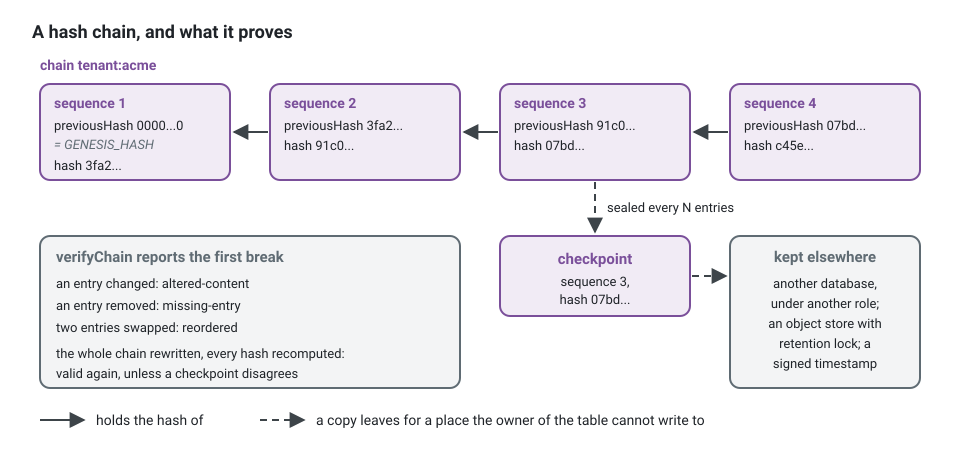

**English** · [Français](audit-trail.fr.md)

# Audit trail

**Summary.** An audit trail answers "who did what, on what, when, with what outcome, on whose
behalf" to somebody who does not trust the application: an auditor, a customer, a regulator.
In this kit it is recorded around the use cases, never by them: authorization decisions,
executed commands, integration events and erasures of personal data already pass through a few
places, and the entries are written there. Entries are append-only and hash-chained, so a change, a removal or a
reordering is detectable; they hold identifiers and codes, never content, which is also what
lets an append-only chain coexist with the right to erasure. The chain proves that what was
recorded was not rewritten. It does not prove that everything was recorded.

## What it is not

| It is not | Because |
|---|---|
| a log | logs are sampled, rotated, filtered by level and lost; nobody can prove a line was not removed |
| event sourcing | it does not rebuild state; it records that something happened and how it ended |
| audit columns | `created_by` and `updated_by` name the last writer of a row, not the history, and not the refusals |
| a debugging tool | it carries no payload, no message, no stack trace |

The four can coexist, each with its own retention and readers. Mixing them is how a log ends
up holding personal data for ten years, or an audit trail ends up unreadable.

## Why handlers never write it

A handler that must remember to call the audit will one day forget, and nothing will fail. An
aggregate that calls it has stopped being a model. So the kit records from the places every
unit of work already crosses, wired once in the platform:

| Source | Records | Mechanism |
|---|---|---|
| authorization decisions | every denial; every allowed action that is not a read; the allowed reads you declare sensitive | the decision hook of the authorization middleware |
| commands | each command with `succeeded` or `failed` and the code of the error | a bus middleware placed before the unit of work |
| integration events | that an event of a given type occurred, from its envelope only | one idempotent subscription |
| erasures of data subjects | that the key of a subject was destroyed, or that none was left; how many rows each copy reached, `0` included; by whom and when | the key store, wrapped by `auditedSubjectKeys`, and each copy, wrapped by `auditedPersonalDataErasure`, with or without an event store |
| exports of data subjects | that a context handed over what it keeps of a subject, how many records, by whom and when, never the values | the export port of each context, wrapped by `auditedPersonalDataExport` |


A request a guard refuses at the HTTP edge (a role, a scope, a tenant the caller does not
belong to) never reaches the bus: the HTTP pipeline reports it to `auditGuardRefusals`, which
records it as an `authorization` entry, `denied`, for authenticated callers only (a caller
without a credential belongs to the access log and to rate limiting). One more source,
exceptional, exists for what none of these can see: an explicit record written by infrastructure,
such as a bulk export. A call to the trail from `domain/` or
`application/` is the defect the design exists to prevent.

Who acted, in which session, impersonated by whom, for which tenant, with which correlation id
and from which origin: all of it comes from the execution scope
([The actor and the execution scope](actor-and-execution-scope.md)), never threaded through a
use case.

Instead of a handler that remembers to record:

```ts
// instead of: the audit inside the use case
async execute(command: CancelAppointment): Promise<void> {
  const appointment = await this.appointments.findById(command.appointmentId);
  appointment.cancel(this.clock.now());
  await this.appointments.save(appointment);
  await this.trail.record({ category: 'command', action: 'CancelAppointment', outcome: 'succeeded', ... }); // forgotten in the next handler, lost on a failure
}
```

write a handler that only does its work, and wire the trail once, on the bus. Assembled by
hand, with the in-memory pieces of the kernel and the package, so that it runs as it is:

<!-- checked sample -->
```ts
import {
  AuthorizedCommand,
  DomainRefusal,
  FixedExecutionScope,
  InMemoryCommandBus,
  InMemoryUnitOfWork,
  SequentialIdGenerator,
  SystemClock,
  executionContext,
  unitOfWorkMiddleware,
  type Actor,
} from '@ddd-ts-kit/kernel';
import { InMemoryAuditTrail, auditMiddleware, auditedFields } from '@ddd-ts-kit/audit';

// the use case: a command and its handler, with no audit call anywhere
const SchedulingCodes = { CancellationWindowPassed: 'CANCELLATION_WINDOW_PASSED' } as const;

class CancellationWindowPassed extends DomainRefusal {
  readonly code = SchedulingCodes.CancellationWindowPassed;

  static forAppointment(appointmentId: string) {
    return CancellationWindowPassed.refusal(`Appointment ${appointmentId} starts in less than 24 hours.`, { appointmentId });
  }
}

class CancelAppointment extends AuthorizedCommand<void> {
  constructor(
    actor: Actor,
    readonly appointmentId: string,
  ) {
    super(actor);
  }
}

const handler = {
  async execute(command: CancelAppointment): Promise<void> {
    throw CancellationWindowPassed.forAppointment(command.appointmentId);
  },
};

// the platform: who acts comes from the execution scope, what is recorded is declared here
const ada: Actor = { id: 'user-ada', type: 'user', roles: ['client'], attributes: {} };
const scope = new FixedExecutionScope(executionContext({ correlationId: 'corr-1', actor: ada, origin: 'http' }));
const trail = new InMemoryAuditTrail();
const unitOfWork = new InMemoryUnitOfWork();

const commands = new InMemoryCommandBus()
  .use(
    auditMiddleware(trail, {
      scope,
      clock: new SystemClock(),
      ids: new SequentialIdGenerator('audit'),
      unitOfWork,
      fields: [
        auditedFields(CancelAppointment, ['appointmentId'], {
          resource: (command) => ({ type: 'appointment', id: command.appointmentId }),
          context: 'appointments',
        }),
      ],
    }),
  )
  .use(unitOfWorkMiddleware(unitOfWork))
  .register(CancelAppointment, handler);

await commands.execute(new CancelAppointment(ada, '8f2')).catch(() => undefined);

const [entry] = trail.entries;
console.log(entry?.category, entry?.action, entry?.outcome, entry?.reason);
// command CancelAppointment failed CANCELLATION_WINDOW_PASSED
```

In a project generated with `stack.audit` on, this wiring is already written under
`src/platform/audit/`, with the PostgreSQL store, the authorization hook and the event
subscription; the [`@ddd-ts-kit/audit`](../../packages/audit/README.md) README shows each
piece.

### The transaction problem

Two requirements pull in opposite directions. The entry of a failed command must survive the
rollback. The entry of a succeeded command must not exist if its transaction did not commit.


A middleware inside the unit of work loses the failures; one outside loses atomicity for the
successes. Hence the arrangement above: the audit middleware sits before the unit of work and
opens it itself. A success and its entry commit together or neither exists; if the entry cannot
be written, the command fails. Recording through the outbox would be atomic for successes too,
but an outbox row shares the fate of its transaction and cannot carry the failures.

Order matters for the same reason: authorization first, so a refused command leaves one
`denied` entry and opens no transaction.

## The entry

An entry names a category (`authorization`, `command`, `integration-event`, `data-access`, ...),
an action (a permission id, a command name, an event type), an outcome (`allowed`, `denied`,
`succeeded`, `failed`), a stable reason code, the actor, the tenant, an optional resource, the
correlation and causation ids, the origin, and its place in a chain. For the running domain:

| category | action | outcome | reason | resource |
|---|---|---|---|---|
| authorization | `appointments:appointment.cancel` | denied | `NO_MATCHING_ROLE` | appointment 8f2 |
| command | `CancelAppointment` | failed | `CANCELLATION_WINDOW_PASSED` | appointment 8f2 |
| command | `RescheduleAppointment` | succeeded | | appointment 8f2 |
| integration-event | `appointments.appointment.rescheduled` | succeeded | | |
| data-access | `personal-data:erase` | succeeded | | data subject 41c |

## Redaction: identifiers and codes, never content

By default an entry carries no payload at all. A value enters only when the project declares
it, field by field, for one command: the new `startsAt` of a rescheduled appointment, for
instance. A field that is not declared is never read, and the compiler refuses a name the
command does not have.

```ts
// src/platform/audit: given to auditMiddleware as `fields`, with `masker: hmacMasker(secret, { keyId: 'k1' })`
auditedFields(RescheduleAppointment, ['startsAt', masked('clientEmail')], {
  resource: (command) => ({ type: 'appointment', id: command.appointmentId }),
});
// the entry then carries: changes: { startsAt: '2026-03-02T09:00:00.000Z', clientEmail: { masked: 'k1:5d0e...' } }
```

Personal data that must be correlated ("every entry about this client") is stored masked: a
keyed hash of the value. Two entries about the same email carry the same mask, so the question
can be answered by masking the email again, while the email itself is not there and a guess
cannot be checked without the secret. A plain hash would not do: an email or a phone number is
guessed in seconds.

What never goes in, declared or not: free text typed by a user, credentials and tokens (even
hashed), whole payloads or aggregates, error messages and stack traces (the code is recorded),
and special categories of personal data unless a decision record says why. In a health-related
scheduling product, the reason of an appointment belongs to that last group.

## The hash chain

Each entry stores the hash of the previous one and its own hash, computed over a canonical form
that any program in any language can recompute. Changing, removing or reordering an entry
breaks the chain at a place the verification names: altered content, a missing entry, or a
reordering. An entry is hashed as the store keeps it, a text that cannot be stored as it came
having a replacement character in its place, so a chain nobody touched always verifies.



The hash is a SHA-256 of the entry without its own `hash`, so `previousHash`, `chain` and
`sequence` are sealed too; the first entry of a chain links to `GENESIS_HASH`, 64 zeros.
When somebody turns a failure into a success in an export, its verification says where:

<!-- checked sample -->
```ts
import { verifyChain, type AuditEntry } from '@ddd-ts-kit/audit';

declare const exported: AuditEntry[]; // the entries of one chain, as an export hands them over

const untouched = await verifyChain(exported, { chain: 'tenant:acme' });
// { valid: true, checked: 3 }

const second = exported[1];
if (second !== undefined) {
  exported[1] = { ...second, outcome: 'succeeded' }; // somebody turns a failure into a success
}

const tampered = await verifyChain(exported, { chain: 'tenant:acme' });
// { valid: false, checked: 1, break: { kind: 'altered-content', chain: 'tenant:acme', position: 1, sequence: 2, entryId: '...' } }
console.log(untouched, tampered);
```

The kit keeps one chain per tenant by default. A tenant can then be verified, exported and
handed over without the entries of the others, appends of different tenants do not wait for
each other, and an offboarded tenant leaves chains that still verify. The price: the order
between entries of two tenants is given by their timestamps only, not proven by a hash.

The store refuses update and delete at the database level too (triggers), and the application's
database role should own neither the table nor the triggers. The one delete let through is that of
an entry a row of `audit_archives` covers, which the archive writes in the same transaction: a role
that may both insert such a row and delete entries can let entries go behind a row of its own. That
row stays, the archives being append-only, and the verification given the storage of the files
reads back the file of the last archive of each chain: a row that no file proves is the break of
its chain. Those two privileges belong to the role that archives, not to the application.

## Verification and anchoring

A chain protects against whoever can change some rows. Whoever can rewrite the whole table (a
database administrator, an attacker holding the owner role) can recompute every hash from the
altered entry onwards, and the result is a perfectly valid chain. The only defence is a copy of
some hashes where that person cannot write. That is anchoring: at intervals, a checkpoint (the
hash at a given position) leaves for somewhere else, such as another database under another
role, an object store with retention lock, a transparency log or a signed timestamp. Later
verification compares the chain with those checkpoints. A truncated tail is only seen by
comparing with a later checkpoint: a chain that stops before a checkpoint it is given does not
verify.

A verification reports the first break and stops there: past it the chain proves nothing of what
comes next. Whoever has looked at a break walks on from the entry after it. A chain that has
archives is verified from the anchor of its last archive, which the caller names: the entries
before it have left the database.

Verification runs on a schedule and alerts; a chain nobody verifies proves nothing in practice.
`verifyTrail(trail)` verifies every chain of a trail, each from its last archive to its head, so
that a chain cut at its tail does not verify, and gathers the first break of each chain. A
generated project with the trail on runs it every night at 04:30 UTC as the platform job
`audit.verify`, which fails its run on a break, naming the chain and the sequence
(`AuditTrailBrokenError`), and `npm run audit:verify` runs it by hand, exit code 1 on a break.
The head of a chain is a row the application role writes: it shows a tail cut behind the back of
the trail, not a chain rewritten as a whole, which only a checkpoint published elsewhere shows.

## Archiving

Every entry keeps the identifiers of a person, and a trail grows for as long as the system
lives: storage limitation (GDPR article 5(1)(e)) applies to it too. Archiving moves the oldest
entries of each chain out of the database to the file storage, without breaking what the chain
proves. The entries are verified first, from the anchor of the previous archive; written to one
file per range; recorded with the hash of the last one and the digest of the file; then deleted,
which the guard allows for covered entries only. The entries left in the database link to that
last hash, and each file can be verified again on its own, against its record and the archive
before it. A chain that does not verify is not archived, a break being for someone to look at,
and stops no other chain: the others are archived, then the refusals are reported together.

A generated project whose trail is in a database runs this on the first day of every month and
keeps twelve whole months online, by default with an object store and only on request with a
local storage: the archive removes the entries from the database, so the files have to land
where they last, durable and backed up. The file is read back and checked before anything is
removed. Archiving is not erasing:
the files still hold identifiers, and how long they are kept, and under which lock, is the
controller's decision. See [Archiving](../../packages/audit/README.md#archiving).

## The right to erasure and an append-only chain

An entry cannot be deleted without breaking its chain, and a regulation such as the GDPR
(article 17) may require erasure of personal data. The two coexist as long as the chain never
holds the data:

1. **Keep personal data out.** An actor id, a resource id and a permission id are identifiers.
   If the identifiers are themselves personal (an email used as user id), fix that first.
2. **Mask what must be correlated.** A masked value is unreadable but still linked to a person
   for whoever holds the secret.
3. **Crypto-shredding for erasure.** `subjectMasker(keys)` of `@ddd-ts-kit/audit` masks each
   value under a key derived from the key of its data subject in the `SubjectKeyStore`, the same
   keys that seal the stored events; `masked(field, { subject })` says whose each value is.
   Erasing a person is destroying their key: the masks become tokens nobody can recompute, the
   entries stay, the hashes stay valid.
4. **Record the erasure itself.** The erasure leaves an entry per copy it reaches, and one for the
   key when there is an event store, with its actor and its date,
   which, plus the retention of the backups of the keys, is the day it is complete
   ([`@ddd-ts-kit/audit`](../../packages/audit/README.md#e-erasures-of-data-subjects)). An export
   of what the system keeps of a person leaves one too, with the number of records and never the
   values (`auditedPersonalDataExport`): a document handed over without its trace is a read nobody
   can account for.

What remains after erasure is "an actor with this opaque id did this at that time". Whether
that is acceptable is a legal question for the project, to be answered before the first entry
is written. The key store then becomes the system to protect: keep it apart from the trail and
from the events, with a shorter backup retention.

## Reading it

Reading the audit trail is itself a sensitive act. It is exposed as a use case like any other:
its own permission, pagination, the filter narrowed to the tenant of the actor, and its reads
recorded. Whoever reads the trail leaves an entry in it. Support staff acting as a user appear
as such: the impersonator is on the entry.

```ts
// the handler of SearchAuditEntriesQuery, which depends on the AuditReader port of the kernel
const page = await this.reader.search(
  { ...query.filter, tenantId: query.tenantId, category: 'authorization', outcome: 'denied' },
  cursorPage({ limit: 50, sort: [{ field: 'occurredAt', direction: 'desc' }] }),
);
```

In a multitenant project, `TenantAuditReader` bound to `AuditReader` confines every search to
the tenant of the work, whatever its filter says.

## Limits and when not to use it

These are stated by [`@ddd-ts-kit/audit`](../../packages/audit/README.md):

- **Integrity, not completeness.** A fact that never reached a source (a script writing to the
  database, a route bypassing the bus) is not in the trail. Keeping every route on the bus is
  what [`authz/declared`](../ARCHITECTURE.md#3-dependency-rules) and the dependency rules are
  for.
- **PostgreSQL only** for the SQL stores shipped (Knex, Drizzle, Prisma and TypeORM). With a
  custom ORM or no ORM, the generated project starts on an in-memory trail behind a
  `TODO(platform)`; another database is another adapter held to the contract suite.
- **Appends to one chain are serialized.** Inside a unit of work the entries are written at its
  commit, the heads last and always in the same order: two units of work of one tenant wait for
  each other during their commits only, and an append never closes a deadlock with the rows the
  work locked. The price: an entry is not visible inside its unit of work before the commit.
- **The timestamp is the clock of the instance that recorded.** Inside a chain the order is the
  sequence.
- **Archiving moves, it does not erase.** How long the archive files are kept, and the lock of
  the storage that keeps them, are decisions of the project; the search reads the database only.
- **Anchoring is a hook, not a service.** Without checkpoints kept elsewhere, a full rewrite of
  the table is undetectable.
- **Verification reads its range into memory**: verify long chains by ranges.
- **When not to use it.** A prototype, or a system with no accountability requirement, pays the
  serialized append and the storage for nothing: the trail can be switched off in the config,
  `stack.audit: "off"` (see [Configuration](../CONFIG.md)). If what you want is to reconstruct state or debug a
  request, you want event sourcing or tracing, not this.

## Sources

- Bruce Schneier and John Kelsey, "Secure Audit Logs to Support Computer Forensics", ACM
  Transactions on Information and System Security, 1999: hash-chained log entries.
- Scott A. Crosby and Dan S. Wallach, "Efficient Data Structures for Tamper-Evident Logging",
  USENIX Security Symposium, 2009.
- Regulation (EU) 2016/679 (GDPR), article 17 (right to erasure) and article 5(1)(c) (data
  minimisation).
- NIST Special Publication 800-92, Guide to Computer Security Log Management, 2006.
- Martin Fowler, "Event Sourcing" and "Audit Log", martinfowler.com: what an audit log is next
  to event sourcing.
- [`@ddd-ts-kit/audit`](../../packages/audit/README.md): the entry, the sources, the stores and
  the limits quoted above.

## See also

- [Authentication and authorization](authentication-and-authorization.md)
- [The actor and the execution scope](actor-and-execution-scope.md)
- [Observability](observability.md)
- [Transactional outbox](transactional-outbox.md)
- [Scheduled jobs](scheduled-jobs.md): where the periodic verification runs
- [Architecture reference](../ARCHITECTURE.md): "Standard interfaces", "Cross-cutting behaviour"
