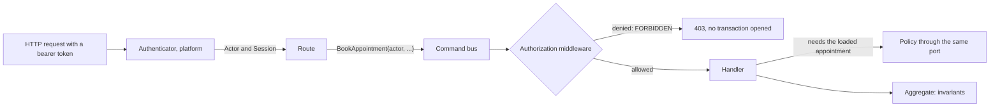

# Authentication and authorization

**Summary.** Authentication answers "who is calling", authorization answers "may this actor do
this, on this element". They are two responsibilities with two homes: authentication is a
platform concern at the boundary, authorization is an application concern declared per use
case and decided through one port. The model behind that port is a choice: roles (RBAC),
policies over attributes (ABAC) or relationships in the manner of Google Zanzibar (ReBAC). This
page explains the three, compares them fairly, and shows how the kit keeps the choice
reversible. A third question, "is this a valid thing to do at all", is an invariant and is
covered in [Invariants, permissions and validation](invariants-permissions-validation.md).

## Two questions, two places

| | Authentication | Authorization |
|---|---|---|
| Question | who is calling? | may this actor do this, on this? |
| Input | a credential (a bearer token, a session cookie, an API key) | an actor, a permission, sometimes an element |
| Output | an actor and a session, as plain data | allowed, or denied with a stable reason code |
| Where | the platform, at the boundary | the application layer of each context |
| Changes when | the identity provider changes | the business changes who may do what |

Keeping them apart has a practical effect. The identity provider can be replaced without
touching a use case, and a business rule about rights can change without touching a route. The
credential never travels inward: the boundary turns it into an `Actor` (subject, tenant, roles
or attributes) and a `Session` (how and when the actor authenticated), and from there on only
that data moves. The token itself is kept nowhere.



## Deny by default, declared per use case

Every command, query and route says which permission it requires, or says that it is public.
There is no third state: a use case nobody thought about is not reachable. This is rule
[`authz/declared`](../ARCHITECTURE.md#3-dependency-rules).

A permission is data owned by the context, named in its ubiquitous language:
`appointment.book`, `appointment.cancel`, `calendar.manage`. It is not a role. Roles such as
"receptionist" or "practitioner" belong to the model chosen in the composition root; the code
of a context names permissions only. That separation is what lets the model change later.

In the running domain:

| Use case | Requires | Why not simply a role test |
|---|---|---|
| `BookAppointment` | `appointment.book` | a client, a receptionist and an integration partner may all book; the list will change |
| `CancelAppointment` | `appointment.cancel`, plus a policy | "only the client who booked or the practitioner" depends on the loaded appointment |
| `SetWorkingHours` | `calendar.manage` | on the calendar of that practitioner, not on every calendar |
| `FindOpenSlots` | public | declared public on purpose, not by omission |

The decision is taken in the application layer, before the handler runs and before a
transaction opens. A route builds the command and nothing else; a repository applies the scope
it is handed and nothing else; the domain knows no actor. This is rule
[`authz/in-application`](../ARCHITECTURE.md#3-dependency-rules).

## Rules that need the loaded element

"A client may cancel only their own appointment" cannot be decided from the command alone: the
appointment must be loaded first. Such a rule is a policy: a named, pure function kept in
`application/authorization/`, with a spec of its own. The handler loads the aggregate and asks
the authorizer with it.

```ts
// appointments/application/commands/cancel-appointment/cancel-appointment.handler.ts
async execute(command: CancelAppointment): Promise<void> {
  const appointment = await this.appointments.findById(command.appointmentId);
  if (appointment === undefined) throw new NotFoundError('Appointment not found');

  await this.access.authorize(command.actor, permissions['appointment.cancel'], appointment);

  appointment.cancel(command.reason, this.clock.now());
  await this.appointments.save(appointment);
}
```

The test that separates a policy from an invariant: would the rule hold whoever asks? "Not
after the cancellation window has passed" holds for everybody, so it is an invariant of the
aggregate (`CancellationWindowPassed`). "Only the client who booked" depends on who asks, so it
is a policy.

## Lists are filtered by the query

Loading every appointment and filtering in memory leaks counts, breaks paging and is slow. The
handler asks the authorizer for the access scope of the actor (everything, nothing, a set of
ids or a filter) and hands it to the read port; the adapter turns it into the condition of the
statement. `ListAppointments` for a client therefore reads only that client's rows, and page 2
is still page 2.

## Three models

### Roles (RBAC)

The actor has roles; a role grants permissions. The question is "does one of the actor's roles
grant this action". It fits when rights follow job functions and are the same for every
element: a receptionist may book for anyone, an administrator may manage every calendar. It is
cheap (no I/O per check) and easy to explain to an auditor.

Its limit is the element. As soon as "may edit" depends on which calendar, RBAC answers with
more roles (`practitioner-of-calendar-42`), which is the role explosion the literature warns
about.

### Attribute policies (ABAC)

A rule reads attributes of the actor, of the resource and of the moment: "a receptionist may
book for practitioners of their own clinic, during opening hours, and never for a suspended
client". It fits when rights depend on properties rather than on identity, and when explicit
refusals are needed (a matching forbid wins over every permit).

Its costs: the attributes of the resource must be available at decision time (a projection or
a cache to maintain), rules spread out and need tests and discipline, and a predicate is not a
query, so listing "everything this actor may see" is not something a pure ABAC engine answers.

### Relationships (ReBAC, after Zanzibar)

Rights follow stored relationships between subjects and objects, written as tuples
`object#relation@subject`: `calendar:42#owner@user:ada`, `clinic:7#member@user:bob`,
`calendar:42#parent@clinic:7`. Permissions are derived by rewriting: "may manage a calendar:
its owner, or whoever manages its parent clinic". The two core operations are check (is there a
path from this object to this actor) and list (which objects can this actor reach).

It fits when rights are per element and shared: ownership, teams, delegation ("my assistant
manages my calendar"), hierarchies. It answers lists by construction. Its costs: tuples must be
written whenever an aggregate is created or shared and kept in sync, a check costs several
reads bounded by a depth limit, listing grows with what the actor can reach, and at scale the
evaluation moves to a dedicated service with its own consistency model.

## A fair comparison

| | RBAC | ABAC | ReBAC |
|---|---|---|---|
| Granularity | action (plus a tenant check) | element, through attributes you supply | element, by construction |
| Data to maintain | a role table, roles in the token | attributes of resources | relation tuples |
| Cost of a check | constant, no I/O | one attribute read | several tuple reads |
| Listing accessible elements | all, none or a tenant filter | not available | ids, by reverse expansion |
| Explaining a decision | which role | which rule matched | which path of tuples |
| Typical failure | role explosion | scattered, untested rules | tuples out of sync |

These figures are those of the kit's three in-process authorizers, as stated in
[`@ddd-ts-kit/auth`](../../packages/auth/README.md); a dedicated service changes the costs, not
the shape. See [Authorization engines](../tools/authorization-engines.md).

## Decision table

| Situation | Start with | Reason |
|---|---|---|
| Rights follow job functions, few exceptions per element | RBAC | simplest model that works |
| A handful of per-element rules ("only the one who booked") on top of roles | RBAC plus policies | no tuple store needed |
| Rights depend on properties: clinic, amount, status, time of day, explicit refusals | ABAC | rules read attributes |
| Users share elements with each other, delegation, nested groups or folders | ReBAC | the relationship is the data |
| Multi-tenant product where a tenant is the only boundary | RBAC with the tenant check | a relationship per row would be waste |
| Lists must be narrowed per actor over many elements | ReBAC, or RBAC with a tenant filter | ABAC cannot answer a list |
| Regulated context needing explicit deny rules | ABAC layered over roles | a forbid that wins |

The models combine. Roles for coarse rights and instance policies for the few per-element rules
is the place to start in most projects, and it is what the running domain uses: roles grant
`appointment.book` and `calendar.manage`, one policy guards cancellation. If clients later
delegate their bookings to relatives, or practitioners share calendars with assistants, the
calendars context moves to relationships.

## What changes when the model changes

The adapter given to the authorization module, and the data that adapter needs. From roles to
relationships: each requirement names the element it bears on (a relationship is always to
something), each permission is mapped to a schema permission, and the application starts
writing tuples. Permissions, commands, queries, handlers, policies, routes and handler tests do
not change. That is the practical meaning of "behind one port".

Tuples are written through a port named in the words of the application (a `CalendarGrants`
with `ownerAssigned`), never by the domain. Written in the handler, the tuple and the aggregate
commit together when the tuple store is SQL-backed. Written by a reaction to a domain event,
the write is a second step that must be idempotent and retried, and the aggregate exists for a
short while without its relationship.

## Limits and when not to use it

- **Declaring a permission does not make the model right.** The rules check that every use case
  declares something and that decisions sit in the application layer. They cannot tell whether
  `appointment.book` is granted to the right roles.
- **Text-level checks miss shapes.** An ownership test written by hand
  (`appointment.clientId === actor.id`) in a handler or a route is not detected, as the CLI
  README states. Review still matters.
- **A revoked session lives until its token expires.** The JWT and Keycloak authenticators
  verify signatures against a key set and never call the provider per request. Keep access
  token lifespans short, or add a revocation check behind the `Authenticator` port.
- **In-process ReBAC does not scale forever.** Listing costs one store read per reached
  subject. Past a certain size the check belongs to a dedicated service; the port stays.
- **ABAC offers no listing** in the kit: a predicate is not a query.
- **Tenant filtering in a repository is defence in depth, not authorization.** It stops a bug
  from leaking rows; the permission is still decided in the application layer.
- **Not every project needs this.** A single-user internal tool with no element-level rights
  can declare its use cases with one permission each and one role, and stop there.

## Sources

- Ruoming Pang et al., "Zanzibar: Google's Consistent, Global Authorization System", USENIX
  Annual Technical Conference, 2019.
- David F. Ferraiolo and D. Richard Kuhn, "Role-Based Access Controls", 15th National Computer
  Security Conference, 1992; ANSI INCITS 359-2004 (RBAC standard).
- Vincent C. Hu et al., "Guide to Attribute Based Access Control (ABAC) Definition and
  Considerations", NIST Special Publication 800-162, 2014.
- RFC 7519 (JSON Web Token), RFC 8176 (Authentication Method Reference Values), RFC 8693 (OAuth
  2.0 Token Exchange), OpenID Connect Core 1.0.
- OWASP Top 10 (2021), A01 Broken Access Control: deny by default and enforcing access control
  in trusted server-side code.
- [`@ddd-ts-kit/auth`](../../packages/auth/README.md), the reference for the API and for the
  figures of the comparison table.

## See also

- [Invariants, permissions and validation](invariants-permissions-validation.md)
- [The actor and the execution scope](actor-and-execution-scope.md)
- [Audit trail](audit-trail.md)
- [Identity providers](../tools/identity.md)
- [Authorization engines](../tools/authorization-engines.md)
- [Architecture reference](../ARCHITECTURE.md): rules `authz/declared`, `authz/in-application`,
  `authz/actor-explicit`
