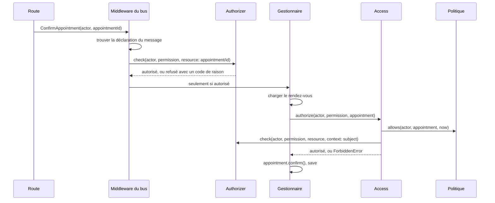

[English](authorization-in-practice.md) · **Français**
<!-- translation-of: authorization-in-practice.md sha256:8d84c26fe2554203 -->

# L'autorisation en pratique

**Résumé.** [Authentification et autorisation](authentication-and-authorization.fr.md) explique
quel modèle choisir. Cette page suit une requête à travers la mécanique une fois le choix fait :
ce qu'enregistre `@Requires(...)`, ce que le *middleware* du bus demande au port `Authorizer`,
comment une politique complète la décision quand le gestionnaire a chargé l'élément, et ce que
chacun des trois autorisateurs en processus fait de la question. L'exemple suivi est
`appointment.confirm` dans le contexte scheduling. Tout ce qui suit est lu dans le code source de
`@ddd-ts-kit/auth` et des déclarations du noyau ; la référence de l'API reste dans le
[README du *package*](../../packages/auth/README.fr.md).

## Le chemin d'une commande



Deux décisions sont prises, pour deux quantités d'information différentes. Le *middleware*
décide avant le gestionnaire, à partir de l'acteur, de la permission et de l'identifiant de
l'élément. Le gestionnaire décide de nouveau après avoir chargé l'élément, par `Access`, pour les
règles qui ont besoin de son état. Les deux aboutissent au même port `Authorizer`.

## Ce que déclare `@Requires`

```ts
// scheduling/application/commands/confirm-appointment/confirm-appointment.command.ts
@Requires(schedulingPermissions['appointment.confirm'], {
  resource: (command: ConfirmAppointmentCommand) => ({ type: 'appointment', id: command.appointmentId }),
})
export class ConfirmAppointmentCommand extends AuthorizedCommand { /* ... */ }
```

Le décorateur n'exécute rien à l'endroit de l'appel. Il enregistre des métadonnées sur la
classe : le message est `protected`, quelle permission il exige, et deux fonctions qui lisent le
message (`resourceOf`, `contextOf`). Le module d'autorisation rassemble ces enregistrements dans
l'`AuthorizationMap` au démarrage de l'application.

| Argument | Signification |
|---|---|
| `schedulingPermissions['appointment.confirm']` | une permission faite par `definePermissions`, propriété du contexte : un `id` (`appointment.confirm`) et un `context` (`scheduling`). Toute autre chose fait échouer le démarrage avec `AuthorizationSetupError`. |
| `resource` | l'élément sur lequel porte le droit, sous la forme `{ type, id }`. Sans lui, la question est « cet acteur peut-il confirmer des rendez-vous » ; avec lui, « cet acteur peut-il confirmer ce rendez-vous ». |
| `context` (facultatif) | des faits du message dont l'autorisateur peut avoir besoin, comme le *tenant* qu'il vise. |

Le décorateur est accepté sur un message qui porte son acteur (`AuthorizedCommand`,
`AuthorizedQuery`), parce qu'un droit est toujours celui de quelqu'un. Le style explicite dit la
même chose à côté de l'enregistrement du gestionnaire :
`builder.command(...).requires(permission, { resource })`.

## Ce que fait le *middleware*

`authorizationMiddleware` s'exécute en premier sur les bus de commandes et de requêtes.
Installez-le avant l'unité de travail : une commande refusée n'ouvre alors aucune transaction.

1. **Trouver la déclaration.** Un message que la table ne connaît pas est refusé avec
   `UndeclaredUseCaseError`. C'est la règle du refus par défaut
   [`authz/declared`](../ARCHITECTURE.fr.md#3-règles-de-dépendance) à l'exécution.
2. **Les cas d'usage publics passent.** Un message déclaré `@Public()` va droit à son
   gestionnaire.
3. **Construire la demande.** Pour un message protégé, `{ actor, permission, resource?, context? }`.
   Un message sans acteur lève `MissingActorError`.
4. **Les acteurs anonymes n'atteignent jamais l'autorisateur.** La réponse est
   `UnauthenticatedError` (401), avec le code de raison `ANONYMOUS`.
5. **Demander `authorizer.check(request)`.**
6. **Enregistrer la décision.** Le *hook* `onDecision` reçoit l'identifiant de l'acteur,
   l'identifiant de la permission, la ressource, la décision et le nom du cas d'usage, que la
   décision ait autorisé ou refusé. C'est ce qui alimente le
   [journal d'audit](audit-trail.fr.md).
7. **Refuser ou continuer.** Un refus lève `ForbiddenError(permission.id, reason)` (403).

## Le port

```ts
abstract class Authorizer {
  abstract check(request: CheckRequest): Promise<Decision>;
  abstract listAccessible?(request: ListRequest): Promise<AccessScope>;
  abstract explain?(request: CheckRequest): Promise<Explanation>;
}
```

| Type | Forme |
|---|---|
| `CheckRequest` | `{ actor, permission, resource?, context? }` |
| `Decision` | `{ allowed: true }`, ou `{ allowed: false, reason }` |
| `AccessScope` | `all`, `none`, `ids` (un ensemble d'identifiants) ou `filter` (une condition) |

La `reason` est un code machine stable, jamais une phrase et jamais une donnée. Le *package*
fournit `ANONYMOUS`, `NO_MATCHING_ROLE`, `TENANT_MISMATCH`, `EXPLICIT_DENY`, `NO_MATCHING_POLICY`,
`SUBJECT_MISMATCH`, `RESOURCE_REQUIRED`, `UNMAPPED_PERMISSION`, `NO_RELATION` et
`DEPTH_EXCEEDED`, et un adaptateur peut ajouter les siens. `listAccessible` est facultatif : un
modèle qui ne sait pas énumérer le laisse de côté, et demander un périmètre échoue alors avec
`ListingNotSupportedError` au lieu de renvoyer une mauvaise réponse.
`explain` est facultatif aussi : la même décision que `check`, avec une trace en mots, une
ligne par question que le modèle a posée, que `traceText` met en page. Les trois autorisateurs
du kit y répondent ; un modèle qui ne sait pas dire plus que sa raison le laisse de côté.

## Ce que chaque modèle fait de la question

| | `RoleBasedAuthorizer` | `PolicyBasedAuthorizer` | `RelationBasedAuthorizer` |
|---|---|---|---|
| Sous-chemin | `@ddd-ts-kit/auth` | `@ddd-ts-kit/auth` | `@ddd-ts-kit/auth/rebac` |
| Utilise `resource` | seulement pour la vérification du *tenant* | pour charger les attributs de l'élément | comme objet de la relation |
| Codes de refus | `NO_MATCHING_ROLE`, `TENANT_MISMATCH` | `EXPLICIT_DENY`, `NO_MATCHING_POLICY` | `NO_RELATION`, `DEPTH_EXCEEDED`, `UNMAPPED_PERMISSION` |
| `listAccessible` | oui, en temps constant | non | oui, par expansion inverse |
| `explain` | les rôles de l'acteur et ce que chacun accorde, puis le contrôle du *tenant* | chaque politique qui porte sur la permission, tenue ou non | chaque question posée aux tuples |

### Rôles

`roles` associe un rôle à ses attributions. Une attribution est un identifiant de permission
(`appointment.confirm`), `scheduling:*` pour un contexte entier, ou `*` pour tout. `inherits`
permet à un rôle d'en inclure d'autres (`{ admin: ['receptionist'] }`). Les attributions
effectives de chaque rôle sont calculées une fois, dans le constructeur, et un rôle inconnu ou un
cycle dans la hiérarchie lève `AuthorizationSetupError` au démarrage plutôt qu'à la première
requête, comme un rôle multi-*tenant* ou un rôle système qu'aucun rôle ne déclare et
`crossTenantRoles` sans `tenantOf`.

Une vérification refuse l'acteur anonyme, puis cherche un rôle de l'acteur qui couvre la
permission, puis, quand `tenantOf` est configuré, refuse une demande qui vise un *tenant* auquel
l'acteur n'appartient pas (son `tenantId` ou ses `tenants`), qui n'est pas un identifiant de
*tenant*, ou qui est un autre *tenant* que celui où s'exécute le travail (`workTenantId`, donné
par la garde et `Access` depuis la portée d'exécution), sauf si l'un de ses rôles figure dans
`crossTenantRoles`. Les acteurs de type `system` ne portent aucun rôle ; `systemRole` leur en
donne un, et ils appartiennent au *tenant* où s'exécute leur travail. La liste vaut `none` sans le
droit, `all` quand les *tenants* ne sont pas gérés ou que l'acteur les traverse,
`filter: { tenantId }` sur le *tenant* du travail ou le seul *tenant* de l'acteur sinon, et
`none` pour un acteur de plusieurs *tenants* hors du travail d'un *tenant*.
`explain` dit la même chose en mots : les rôles de l'acteur, ce que chacun accorde et à travers
quel rôle inclus, puis où la demande peut agir.

Dans un projet généré, les rôles vivent dans `platform/auth/roles/roles.ts`, et le
super-administrateur détient `*`. Une nouvelle permission n'est donc atteinte que par les
administrateurs tant qu'aucun rôle ne la détient par son nom : `generate
command|query|file-upload ... --permission <p> --grant <role>` écrit l'attribution (et ajoute
le rôle à `platform/auth/authorization/role.ts` s'il est nouveau), et sans `--grant` les étapes `next` du
générateur désignent les rôles à modifier.
[`authz/granted`](../ARCHITECTURE.fr.md#3-règles-de-dépendance) avertit sur une permission que
seul le `*` nu atteint ; une permission réservée aux administrateurs est accordée à
`Role.Admin` par son nom, pour que la revue lise l'intention.

### Politiques par attributs

`policies` est une liste de règles avec un effet (`permit` ou `forbid`), les attributions sur
lesquelles elles portent et un prédicat `when(input)`. L'entrée contient l'acteur, la
permission, la ressource, ses attributs (fournis par un port `ResourceAttributes`), le contexte
et `now` tiré de la `Clock`. Parmi les règles qui s'appliquent, un seul `forbid` l'emporte sur
tous les `permit` ; sans aucun `permit`, la réponse est non. Il n'y a pas de `listAccessible` : un
prédicat n'est pas une requête.
`explain` nomme ce que l'on sait de l'élément, par nom d'attribut, puis chaque politique qui
porte sur la permission et si elle a tenu.

### Relations

Un schéma définit des types, leurs relations stockées et les relations qui en dérivent (une
voie, ou `anyOf`, `allOf`, `butNot` et `via`) ; une relation dérivée nommée d'après une
permission l'accorde sur son type ; un `RelationTupleStore` contient les tuples. Parce qu'une
relation porte toujours sur quelque chose, un message protégé vérifié de cette façon doit nommer
sa `resource` ; sans elle, la réponse est `RESOURCE_REQUIRED`. `explain` dit pourquoi une
décision a été prise, en une trace en mots. Le schéma est décrit dans le README de
`@ddd-ts-kit/auth`, et [`@ddd-ts-kit/openfga`](../../packages/openfga/README.fr.md) exécute le
même schéma sur OpenFGA.

Changer de modèle remplace l'autorisateur donné à `authorizationModule` et les données dont il a
besoin. Les permissions, les commandes, les gestionnaires, les politiques et les routes ne
changent pas.

## Ce qu'ajoute `Access` : des politiques sur l'élément chargé

Le *middleware* n'a que l'identifiant. Il ne peut pas décider « seulement le praticien de ce
rendez-vous » parce qu'il ne charge pas le rendez-vous, et une garde ou un *middleware* qui le
ferait mettrait un *repository* dans la mauvaise couche. Cette règle est une politique, et le
gestionnaire la demande par le port `Access` une fois qu'il détient l'élément.

```bash
npx ddd-ts-kit generate policy scheduling ConfirmAppointment --permission appointment.confirm --json
```

Le générateur écrit le fichier avec un corps qui ne refuse que l'acteur anonyme, et un
`TODO(domain)` là où va la règle. Une fois rempli, dans le style déclaré :

```ts
// scheduling/application/authorization/confirm-appointment.policy.ts
@Policy(schedulingPermissions['appointment.confirm'], { name: 'scheduling.confirm-appointment' })
export class ConfirmAppointmentPolicy {
  appliesTo(subject: unknown): subject is Appointment {
    return subject instanceof Appointment;
  }

  allows(actor: Actor, appointment: Appointment, { now }: PolicyContext): boolean {
    return isAuthenticated(actor) && appointment.isHandledBy(actor.id) && appointment.startsAt > now;
  }
}
```

```ts
// scheduling/application/commands/confirm-appointment/confirm-appointment.handler.ts
async handle(command: ConfirmAppointmentCommand): Promise<void> {
  const appointment = await this.appointments.getById(command.appointmentId);

  await this.access.authorize(command.actor, schedulingPermissions['appointment.confirm'], appointment);

  appointment.confirm();
  await this.appointments.save(appointment);
}
```

Ce qu'il faut y lire :

- **`name` est le code de refus.** Quand `allows` répond `false`, l'erreur est
  `ForbiddenError('appointment.confirm', 'scheduling.confirm-appointment')`. Le nom doit être
  fait de mots en minuscules séparés par des points ou des tirets ; `definePolicy` le vérifie.
- **`appliesTo` garde le sujet.** Un gestionnaire qui transmet autre chose est refusé avec
  `SUBJECT_MISMATCH`.
- **`allows` est pure.** Elle reçoit l'acteur, l'élément chargé et le contexte, dont le seul
  membre est `now`, tiré du port `Clock` pour qu'une règle sur le temps soit testable. Elle ne
  fait aucune entrée ni sortie.
- **La règle sur l'élément vit dans l'agrégat.** `isHandledBy(actor.id)` est une méthode
  d'`Appointment`. Le domaine reçoit un identifiant nommé selon son rôle et jamais un `Actor`.
- **L'ordre d'évaluation est fixe.** `Access` évalue chaque politique de la permission dans
  l'ordre, et le premier refus met fin à l'évaluation. Si toutes passent, il demande à
  l'autorisateur, avec le sujet dans le contexte. La réponse finale est la conjonction de toutes.
- **Sans aucune politique**, `Access` va à l'autorisateur seul. Sans politique et sans
  autorisateur, la réponse est `NO_POLICY` : une règle non déclarée est refusée.

Une règle qui tient quel que soit celui qui demande n'a pas sa place ici. « Un rendez-vous
confirmé ne peut pas être confirmé de nouveau » est un invariant d'`Appointment.confirm()`. Le
test qui sépare les deux est dans
[Invariants, permissions et validation](invariants-permissions-validation.fr.md). Dans l'exemple
ci-dessus, `startsAt > now` est écrit comme une règle d'accès ; si le métier la tient pour tout
appelant, elle passe dans l'agrégat.

### Sa *spec*

Une politique est un objet ordinaire, donc sa *spec* n'a besoin ni d'application ni de *mock*. Le
générateur écrit les deux premiers tests (la déclaration, et le refus de l'acteur anonyme) et
laisse des entrées `it.todo` pour la règle.

```ts
describe('Confirm appointment policy', () => {
  const policy = new ConfirmAppointmentPolicy();
  const now = new Date('2026-10-13T09:00:00Z');

  it('allows the practitioner of a future appointment', () => {
    const practitioner = anActor().named('pr-1').build();
    const appointment = anAppointment().handledBy('pr-1').startingAt(new Date('2026-10-14T09:00:00Z')).build();

    expect(policy.allows(practitioner, appointment, { now })).toBe(true);
  });

  it('refuses another practitioner, whatever their role', () => {
    const other = anActor().named('pr-2').withRole('admin').build();

    expect(policy.allows(other, anAppointment().handledBy('pr-1').build(), { now })).toBe(false);
  });

  it('refuses an appointment already in the past', () => {
    const practitioner = anActor().named('pr-1').build();
    const past = anAppointment().handledBy('pr-1').startingAt(new Date('2026-10-12T09:00:00Z')).build();

    expect(policy.allows(practitioner, past, { now })).toBe(false);
  });
});
```

Les *builders* (`anActor` de `@ddd-ts-kit/auth/testing`, `anAppointment` des `test/builders` du
contexte) produisent de vrais objets. Voir [Stratégie de test](testing-strategy.fr.md).

## Câblage

`authorizationModule({ authorizer, authenticator?, policies?, resourceOf?, onDecision? })` lie
les pièces :

| Liaison | Ce que c'est |
|---|---|
| `Authorizer` | l'instance ou la fabrique donnée dans `authorizer` : l'endroit où le modèle est choisi |
| `AuthorizationMap` | construite à partir des déclarations de chaque module |
| `Access` | un `PolicyAccess` sur l'autorisateur, l'horloge, l'option `policies` et chaque classe déclarée avec `@Policy` |
| `UseCaseGuard` | le *middleware* que les bus du noyau exécutent en premier, et, en dernier sur le bus, la vérification qu'un gestionnaire a interrogé la politique de sa permission |

La garde est résolue au démarrage. Une déclaration qui n'est pas une vraie permission, ou une
politique liée à quelque chose qui n'en est pas une, fait refuser le démarrage à l'application
avec `AuthorizationSetupError`. Voir [Ports et composition](ports-and-composition.fr.md) pour la
façon dont le style déclaré atteint la racine de composition.

`resourceOf` dans les options dit comment un sujet nomme sa ressource quand l'autorisateur
décide élément par élément (`appointment => ({ type: 'appointment', id: appointment.id })`). Par
défaut, seul un simple `{ type, id }` est pris comme référence de ressource.

## Écrire votre propre autorisateur

Implémentez `check` et, quand le modèle sait énumérer, `listAccessible`, puis passez l'instance
à `authorizationModule`. Un adaptateur `implements` le port et ne l'étend jamais. Gardez les
raisons stables, et exécutez contre lui la suite de contrat de `@ddd-ts-kit/auth/testing`. Un
adaptateur pour un service dédié est le sujet de
[Moteurs d'autorisation](../tools/authorization-engines.fr.md) ;
[`@ddd-ts-kit/openfga`](../../packages/openfga/README.fr.md) en est un, prêt à l'emploi.

## Limites, et quand ne pas l'utiliser

- **Le *middleware* ne voit pas l'état.** Il connaît l'identifiant de l'élément, pas l'élément.
  Une règle sur l'état est une politique, vérifiée par le gestionnaire. Un oubli d'appeler
  `access.authorize` est rattrapé deux fois : `authz/policy-asked` signale le gestionnaire d'un
  cas d'usage dont une politique affine la permission quand il ne nomme jamais cette permission
  dans une question à `Access`, et à l'exécution le module d'autorisation refuse son résultat
  par `PolicyNotAskedError`, à l'intérieur de l'unité de travail, si bien que rien n'est validé.
  Les générateurs écrivent la question : un cas d'usage généré une fois qu'une politique affine
  sa permission reçoit `Access` et l'interroge sur le message, avec un `TODO(domain)` pour
  l'interroger plutôt sur l'élément chargé.
  Seules les questions posées à `PolicyAccess` sont vues : un projet qui lie son propre `Access`
  coupe la vérification à l'exécution avec `policiesAsked: false`.
- **Une politique est évaluée dans le processus du gestionnaire.** Au-delà d'une certaine
  échelle, les règles par élément passent dans un moteur dédié derrière le même port.
- **Deux décisions par commande coûtent deux vérifications.** Avec des rôles, elles sont
  gratuites ; avec un moteur distant, chacune est un appel, ce qui est une raison de garder bon
  marché la vérification du *middleware* et peu nombreuses les politiques.
- **Un test de propriété écrit à la main** (`appointment.practitionerId === actor.id` dans un
  gestionnaire) n'est pas détecté comme une politique manquante. La revue compte toujours.
- **Un petit outil n'a pas besoin de politiques.** Une permission par cas d'usage et un seul
  rôle forment une conception complète et valable.

## Voir aussi

- [Authentification et autorisation](authentication-and-authorization.fr.md) : les modèles comparés
- [Choisir le contrôle d'accès](../guides/choosing-access-control.fr.md) : quel modèle, avec des préréglages commentés
- [Invariants, permissions et validation](invariants-permissions-validation.fr.md)
- [L'acteur et la portée d'exécution](actor-and-execution-scope.fr.md)
- [Journal d'audit](audit-trail.fr.md) : ce qu'alimente `onDecision`
- [Moteurs d'autorisation](../tools/authorization-engines.fr.md)
- [`@ddd-ts-kit/auth`](../../packages/auth/README.fr.md) : la référence de l'API
- [Référence d'architecture](../ARCHITECTURE.fr.md) : règles `authz/declared`, `authz/in-application`,
  `authz/actor-explicit`, `authz/granted`, `authz/scope-narrows`, `authz/resource-modelled`
