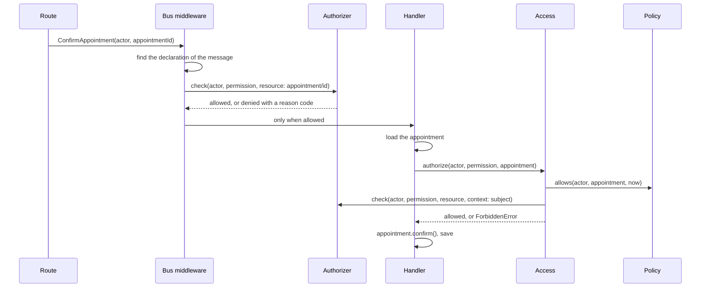

**English** · [Français](authorization-in-practice.fr.md)

# Authorization in practice

**Summary.** [Authentication and authorization](authentication-and-authorization.md) explains
which model to choose. This page follows one request through the machinery once the choice is
made: what `@Requires(...)` records, what the bus middleware asks the `Authorizer` port, how a
policy completes the decision when the handler has loaded the element, and what each of the
three in-process authorizers does with the question. The running example is
`appointment.confirm` in the scheduling context. Everything below is read from the source of
`@ddd-ts-kit/auth` and of the kernel declarations; the API reference stays in the
[package README](../../packages/auth/README.md).

## The path of one command



Two decisions are taken, for two different amounts of information. The middleware decides
before the handler, from the actor, the permission and the identifier of the element. The
handler decides again after loading the element, through `Access`, for the rules that need its
state. Both end in the same `Authorizer` port.

## What `@Requires` declares

```ts
// scheduling/application/commands/confirm-appointment/confirm-appointment.command.ts
@Requires(schedulingPermissions['appointment.confirm'], {
  resource: (command: ConfirmAppointmentCommand) => ({ type: 'appointment', id: command.appointmentId }),
})
export class ConfirmAppointmentCommand extends AuthorizedCommand { /* ... */ }
```

The decorator executes nothing at the call site. It records metadata on the class: the message
is `protected`, which permission it requires, and two functions that read the message
(`resourceOf`, `contextOf`). The authorization module collects these records into the
`AuthorizationMap` when the application starts.

| Argument | Meaning |
|---|---|
| `schedulingPermissions['appointment.confirm']` | a permission made by `definePermissions`, owned by the context: an `id` (`appointment.confirm`) and a `context` (`scheduling`). Anything else makes the start fail with `AuthorizationSetupError`. |
| `resource` | the element the right bears on, as `{ type, id }`. Without it the question is "may this actor confirm appointments"; with it, "may this actor confirm this appointment". |
| `context` (optional) | facts of the message the authorizer may need, such as the tenant it targets. |

The decorator is accepted on a message that carries its actor (`AuthorizedCommand`,
`AuthorizedQuery`), because a right is always somebody's. The explicit style says the same
thing next to the handler registration: `builder.command(...).requires(permission, { resource })`. In a context divided into modules of
the model, that registration, and so the declaration, is written by `generate command ... --module
<module>` in `<module>/<module>.module.ts`, not in the module file of the context and not in a
file of `application/authorization/`, which holds the policies on one element.

## What the middleware does

`authorizationMiddleware` runs first on the command and query buses. Install it before the unit
of work: a refused command then opens no transaction.

1. **Find the declaration.** A message the map does not know is refused with
   `UndeclaredUseCaseError`. This is the deny-by-default rule
   [`authz/declared`](../ARCHITECTURE.md#3-dependency-rules) at run time.
2. **Public use cases pass.** A message declared `@Public()` goes straight to its handler.
3. **Build the request.** For a protected message, `{ actor, permission, resource?, context? }`.
   A message without an actor raises `MissingActorError`.
4. **Anonymous actors never reach the authorizer.** The answer is `UnauthenticatedError`
   (401), with the reason code `ANONYMOUS`.
5. **Ask `authorizer.check(request)`.**
6. **Record the decision.** The `onDecision` hook receives the actor id, the permission id, the
   resource, the decision and the use case name, whether the decision allowed or refused. This
   is what feeds the [audit trail](audit-trail.md).
7. **Refuse or continue.** A refusal raises `ForbiddenError(permission.id, reason)` (403).

## The port

```ts
abstract class Authorizer {
  abstract check(request: CheckRequest): Promise<Decision>;
  abstract listAccessible?(request: ListRequest): Promise<AccessScope>;
  abstract explain?(request: CheckRequest): Promise<Explanation>;
}
```

| Type | Shape |
|---|---|
| `CheckRequest` | `{ actor, permission, resource?, context? }` |
| `Decision` | `{ allowed: true }`, or `{ allowed: false, reason }` |
| `AccessScope` | `all`, `none`, `ids` (a set of ids) or `filter` (a condition) |

The `reason` is a stable machine code, never a sentence and never data. The package gives
`ANONYMOUS`, `NO_MATCHING_ROLE`, `TENANT_MISMATCH`, `EXPLICIT_DENY`, `NO_MATCHING_POLICY`,
`SUBJECT_MISMATCH`, `RESOURCE_REQUIRED`, `UNMAPPED_PERMISSION`, `NO_RELATION` and
`DEPTH_EXCEEDED`, and an adapter may add its own. `listAccessible` is optional: a model that
cannot enumerate leaves it out, and asking for a scope then fails with
`ListingNotSupportedError` instead of returning a wrong answer.
`explain` is optional too: the same decision as `check`, with a trace in words, one line per
question the model asked, which `traceText` lays out. The three authorizers of the kit answer
it; a model that cannot say more than its reason leaves it out.

## What each model does with the question

| | `RoleBasedAuthorizer` | `PolicyBasedAuthorizer` | `RelationBasedAuthorizer` |
|---|---|---|---|
| Subpath | `@ddd-ts-kit/auth` | `@ddd-ts-kit/auth` | `@ddd-ts-kit/auth/rebac` |
| Uses `resource` | only for the tenant check | to load the attributes of the element | as the object of the relationship |
| Refusal codes | `NO_MATCHING_ROLE`, `TENANT_MISMATCH` | `EXPLICIT_DENY`, `NO_MATCHING_POLICY` | `NO_RELATION`, `DEPTH_EXCEEDED`, `UNMAPPED_PERMISSION` |
| `listAccessible` | yes, in constant time | no | yes, by reverse expansion |
| `explain` | the roles of the actor and what each grants, then the tenant check | each policy that bears on the permission, held or not | every question asked of the tuples |

### Roles

`roles` maps a role to its grants. A grant is a permission id (`appointment.confirm`),
`scheduling:*` for a whole context, or `*` for everything. `inherits` lets a role include
others (`{ admin: ['receptionist'] }`). The effective grants of every role are computed once,
in the constructor, and an unknown role or a cycle in the hierarchy raises
`AuthorizationSetupError` at start rather than at the first request, as do a cross-tenant role
or a system role no role declares and `crossTenantRoles` without `tenantOf`.

A check refuses the anonymous actor, then looks for a role of the actor that covers the
permission, then, when `tenantOf` is configured, refuses a request that targets a tenant the
actor does not belong to (its `tenantId` or its `tenants`), that is not a tenant id, or that is
another tenant than the one the work runs in (`workTenantId`, given by the guard and `Access`
from the execution scope), unless one of its roles is in `crossTenantRoles`. Actors of type
`system` carry no roles; `systemRole` gives them one, and they belong to the tenant their work
runs in. The list is `none` without the right, `all` when tenants are not managed or the actor
crosses them, `filter: { tenantId }` on the tenant of the work or the one tenant of the actor
otherwise, and `none` for an actor of several tenants outside of a tenant's work.
`explain` says the same in words: the roles of the actor, what each one grants and through
which included role, then where the request may act.

In a generated project, the roles live in `platform/auth/roles/roles.ts`, and the super-admin holds
`*`. A new permission is therefore reached by administrators only until a role holds it by
name: `generate command|query|file-upload ... --permission <p> --grant <role>` writes the grant
(and adds the role to `platform/auth/authorization/role.ts` when it is new), and without `--grant` a step of the
generator (`todos`) points at the roles to edit.
[`authz/granted`](../ARCHITECTURE.md#3-dependency-rules) warns on a permission that only the
bare `*` reaches; a permission meant for administrators only is granted to `Role.Admin` by
name, so that review reads the intent. Under relationships the same rule asks who is an operator:
a permission the schema leaves on the context is held by the operators of the context, and a
project that never writes an `operator` relationship on it (a provisioning step, a
bootstrap, the grant of a system actor) has a use case nobody can run. A system actor that sends a protected command from a
job or a handler needs its own relationship, which `authz/system-actor-granted` (an error)
checks in `relate-system-actors.ts`. The application writes those relationships when it starts, and
so does `reset()` of the end-to-end support after it emptied the database, so a spec's second test
finds the system actors as granted as its first.

### Attribute policies

`policies` is a list of rules with an effect (`permit` or `forbid`), the grants they bear on and
a `when(input)` predicate. The input holds the actor, the permission, the resource, its
attributes (supplied by a `ResourceAttributes` port), the context and `now` from the `Clock`.
Among the rules that apply, one `forbid` wins over every `permit`; with no `permit` the answer
is no. There is no `listAccessible`: a predicate is not a query.
`explain` names what is known of the element, by attribute name, then each policy that bears
on the permission and whether it held.

### Relationships

A schema defines types, their stored relations and the relations derived from them (one way,
or `anyOf`, `allOf`, `butNot` and `via`); a derived relation named after a permission grants it
on its type; a `RelationTupleStore` holds the tuples. Because a relationship is always to
something, a protected message that is checked this way must name its `resource`; without one
the answer is `RESOURCE_REQUIRED`. `explain` answers why a decision was taken, as a trace in
words. The schema is described in the README of `@ddd-ts-kit/auth`, and
[`@ddd-ts-kit/openfga`](../../packages/openfga/README.md) runs the same schema on OpenFGA.

Changing the model replaces the authorizer given to `authorizationModule` and the data it needs.
Permissions, commands, handlers, policies and routes do not change.

## What `Access` adds: policies on the loaded element

The middleware only has the identifier. It cannot decide "only the practitioner of this
appointment" because it does not load the appointment, and a guard or a middleware that did
would put a repository in the wrong layer. That rule is a policy, and the handler asks for it
through the `Access` port once it holds the element.

```bash
npx ddd-ts-kit generate policy scheduling ConfirmAppointment --permission appointment.confirm --json
```

The generator writes the file with a body that only refuses the anonymous actor, and a
`TODO(domain)` where the rule goes. Filled in, in the declared style:

```ts
// scheduling/application/authorization/confirm-appointment.policy.ts
@Policy(schedulingPermissions['appointment.confirm'], { name: 'scheduling.confirm-appointment' })
export class ConfirmAppointmentPolicy {
  appliesTo(subject: unknown): subject is Appointment {
    return subject instanceof Appointment;
  }

  allows(actor: Actor, appointment: Appointment, { now }: PolicyContext): boolean {
    return isAuthenticated(actor) && appointment.isHandledBy(actor.id) && appointment.startsAt > now;
  }
}
```

```ts
// scheduling/application/commands/confirm-appointment/confirm-appointment.handler.ts
async handle(command: ConfirmAppointmentCommand): Promise<void> {
  const appointment = await this.appointments.getById(command.appointmentId);

  await this.access.authorize(command.actor, schedulingPermissions['appointment.confirm'], appointment);

  appointment.confirm();
  await this.appointments.save(appointment);
}
```

What to read in it:

- **`name` is the refusal code.** When `allows` answers `false`, the error is
  `ForbiddenError('appointment.confirm', 'scheduling.confirm-appointment')`. The name must be
  lower-case words separated by dots or dashes; `definePolicy` checks it.
- **`appliesTo` guards the subject.** A handler that hands over something else is refused with
  `SUBJECT_MISMATCH`.
- **`allows` is pure.** It receives the actor, the loaded element and the context, whose only
  member is `now`, taken from the `Clock` port so that a rule about time is testable. It does no
  input or output.
- **The rule about the element lives in the aggregate.** `isHandledBy(actor.id)` is a method of
  `Appointment`. The domain receives an identifier named for its role and never an `Actor`.
- **The order of evaluation is fixed.** `Access` evaluates every policy of the permission in
  order, and the first refusal ends the evaluation. If all pass, it asks the authorizer, with
  the subject in the context. The final answer is the conjunction of all of them.
- **Without any policy**, `Access` goes to the authorizer alone. Without a policy and without
  an authorizer, the answer is `NO_POLICY`: an undeclared rule is refused.

A rule that holds whoever asks does not belong here. "A confirmed appointment cannot be
confirmed again" is an invariant of `Appointment.confirm()`. The test that separates the two is
in [Invariants, permissions and validation](invariants-permissions-validation.md). In the
example above, `startsAt > now` is written as an access rule; if the business holds it for
every caller, it moves into the aggregate.

### Its spec

A policy is a plain object, so its spec needs no application and no mock. The generator writes
the first two tests (the declaration, and the refusal of the anonymous actor) and leaves
`it.todo` entries for the rule.

```ts
describe('Confirm appointment policy', () => {
  const policy = new ConfirmAppointmentPolicy();
  const now = new Date('2026-10-13T09:00:00Z');

  it('allows the practitioner of a future appointment', () => {
    const practitioner = anActor().named('pr-1').build();
    const appointment = anAppointment().handledBy('pr-1').startingAt(new Date('2026-10-14T09:00:00Z')).build();

    expect(policy.allows(practitioner, appointment, { now })).toBe(true);
  });

  it('refuses another practitioner, whatever their role', () => {
    const other = anActor().named('pr-2').withRole('admin').build();

    expect(policy.allows(other, anAppointment().handledBy('pr-1').build(), { now })).toBe(false);
  });

  it('refuses an appointment already in the past', () => {
    const practitioner = anActor().named('pr-1').build();
    const past = anAppointment().handledBy('pr-1').startingAt(new Date('2026-10-12T09:00:00Z')).build();

    expect(policy.allows(practitioner, past, { now })).toBe(false);
  });
});
```

The builders (`anActor` from `@ddd-ts-kit/auth/testing`, `anAppointment` from the context's
`test/builders`) produce real objects. See [Testing strategy](testing-strategy.md).

## Wiring

`authorizationModule({ authorizer, authenticator?, policies?, resourceOf?, onDecision? })` binds
the pieces:

| Binding | What it is |
|---|---|
| `Authorizer` | the instance or the factory given in `authorizer`: the place where the model is chosen |
| `AuthorizationMap` | built from the declarations of every module |
| `Access` | a `PolicyAccess` over the authorizer, the clock, the `policies` option and every class declared with `@Policy` |
| `UseCaseGuard` | the middleware the kernel buses run first, and, last on the bus, the check that a handler asked the policy of its permission |

The guard is resolved at start. A declaration that is not a real permission, or a policy bound
to something that is not one, makes the application refuse to boot with
`AuthorizationSetupError`. See [Ports and composition](ports-and-composition.md) for how the
declared style reaches the composition root.

`resourceOf` in the options says how a subject names its resource when the authorizer decides
per element (`appointment => ({ type: 'appointment', id: appointment.id })`). By default only a
plain `{ type, id }` is taken as a resource reference.

## Writing your own authorizer

Implement `check` and, when the model can enumerate, `listAccessible`, then pass the instance to
`authorizationModule`. An adapter `implements` the port and never extends it. Keep the reasons
stable, and run the contract suite from `@ddd-ts-kit/auth/testing` against it. An adapter for a
dedicated service is the subject of [Authorization engines](../tools/authorization-engines.md);
[`@ddd-ts-kit/openfga`](../../packages/openfga/README.md) is one, ready to use.

## Limits and when not to use it

- **The middleware cannot see state.** It knows the identifier of the element, not the element.
  A rule on state is a policy, checked by the handler. Forgetting to call `access.authorize` is
  caught twice: `authz/policy-asked` reports the handler of a use case whose permission a policy
  refines when it never names that permission in a question to `Access`, and at run time the
  authorization module refuses its result with `PolicyNotAskedError`, inside the unit of work,
  so that nothing is committed. A decision asked and dropped is caught the same two ways: the
  rule reports a `decide` written as a statement of its own, and the module refuses the result
  of a handler that answers with a success when its last question on the permission was not
  allowed (`PolicyDenialIgnoredError`); a failed `Result` or a throw stays the handler's refusal. The generators write the question: a use case generated once a
  policy refines its permission receives `Access` and asks it about the message, with a
  `TODO(domain)` to ask about the loaded element instead. Only the questions put to
  `PolicyAccess` are seen: a project
  that binds its own `Access` turns the run-time check off with `policiesAsked: false`.
- **A policy is evaluated in the process of the handler.** Past a certain scale, per-element
  rules move to a dedicated engine behind the same port.
- **Two decisions per command cost two checks.** With roles they are free; with a remote
  engine each is a call, which is a reason to keep the middleware check cheap and the policies
  few.
- **An ownership test written by hand** (`appointment.practitionerId === actor.id` in a
  handler) is not detected as a missing policy. Review still matters.
- **A small tool does not need policies.** One permission per use case and one role is a
  complete, valid design.

## See also

- [Authentication and authorization](authentication-and-authorization.md): the models compared
- [Choosing access control](../guides/choosing-access-control.md): which model, with worked presets
- [Invariants, permissions and validation](invariants-permissions-validation.md)
- [The actor and the execution scope](actor-and-execution-scope.md)
- [Audit trail](audit-trail.md): what `onDecision` feeds
- [Authorization engines](../tools/authorization-engines.md)
- [`@ddd-ts-kit/auth`](../../packages/auth/README.md): the API reference
- [Architecture reference](../ARCHITECTURE.md): rules `authz/declared`, `authz/in-application`,
  `authz/actor-explicit`, `authz/granted`, `authz/scope-narrows`, `authz/resource-modelled`, `authz/system-actor-granted`
