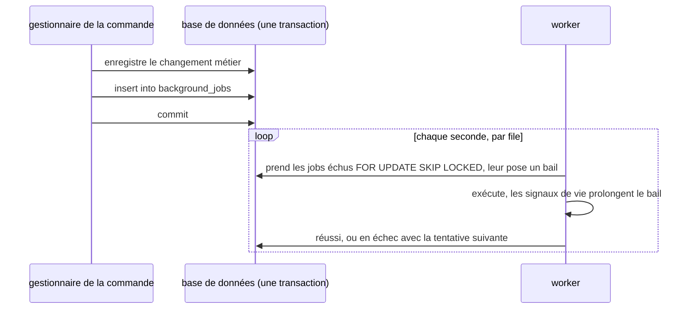
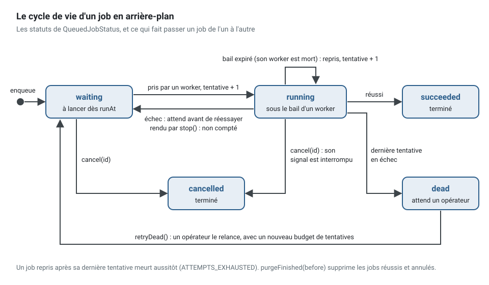
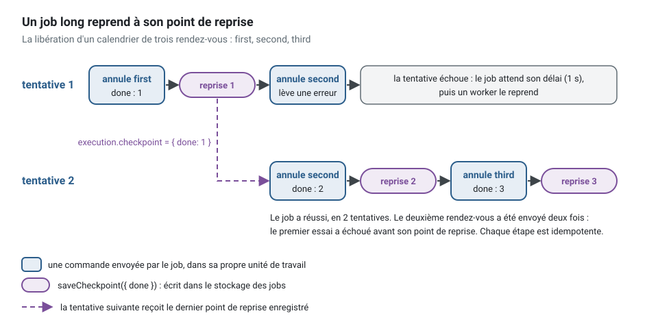
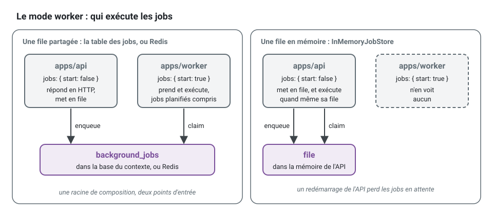

[English](background-jobs.md) · **Français**
<!-- translation-of: background-jobs.md sha256:a5d8a50548888ceb -->

# Jobs en arrière-plan

**Résumé.** Un *job* en arrière-plan (background job) est un travail qu'un cas d'usage confie à
un *worker*, pour l'exécuter plus tard et en dehors de l'appel qui l'a demandé : compiler un
rapport mensuel, déplacer tous les rendez-vous d'un praticien absent, importer un fichier de dix
mille lignes. Le cas d'usage met le *job* en file dans sa propre unité de travail, si bien que le *job*
existe si et seulement si le changement métier a été validé. Un *worker*, dans un autre processus
ou dans le même, le prend, l'exécute au nom de l'acteur qui l'a mis en file, dans la même
corrélation et la même trace, et le retente avec un délai croissant (backoff) quand il échoue. La
livraison se fait au moins une fois : le *job* est idempotent, et un *job* long enregistre un
point de reprise d'où repartir. Comme un *job* planifié, un *job* en arrière-plan ne décide rien :
il déclenche des cas d'usage.

## Quand un cas d'usage en a besoin

| Le travail | Où il se place |
|---|---|
| tient dans l'appel lui-même, quelques centaines de millisecondes | le cas d'usage lui-même |
| apprend à un autre contexte que quelque chose s'est produit | un événement d'intégration, par l'[outbox](transactional-outbox.fr.md) |
| s'exécute parce que le temps a passé, selon un calendrier | un [*job* planifié](scheduled-jobs.fr.md) |
| s'exécute une fois, plus tard, parce que cette commande l'a demandé, et peut durer des minutes | un *job* en arrière-plan |
| est un processus en plusieurs étapes qui attend des événements et a des échéances | un [gestionnaire de processus](sagas-and-process-managers.fr.md), dont les délais d'expiration sont des *jobs* en arrière-plan |

Un *job* en arrière-plan est une commande que l'application s'envoie à elle-même, plus tard. Un
événement d'intégration est un fait auquel d'autres contextes réagissent ; un *job* est un travail
que ce contexte doit. Les deux sortent de la transaction de la commande par une table de la même
base de données, pour la même raison.

## Déclarer et mettre en file

Un *job* est une classe de `application/background/` : un `jobName` statique, un décorateur avec
ses options, et une méthode `run` qui envoie des commandes. Celui-ci est le *job* de l'exemple
fil rouge, qui annule les rendez-vous d'un calendrier avant une absence de son praticien :

<!-- checked sample -->
```ts
// scheduling/application/background/clear-calendar.background-job.ts
import {
  AuthorizedCommand,
  isRefusal,
  type Actor,
  type BackgroundJob,
  type BackgroundJobExecution,
  type CommandBus,
} from '@ddd-ts-kit/kernel';
import { Background } from '@ddd-ts-kit/kernel/declarations';

// la commande d'un autre cas d'usage du contexte, que le job envoie
declare class CancelAppointmentCommand extends AuthorizedCommand {
  constructor(actor: Actor, appointmentId: string, reason: string);
}

/** Du JSON simple : des identifiants et du texte, une date sous forme de texte ISO. */
export interface ClearCalendarPayload {
  readonly calendarId: string;
  readonly appointmentIds: readonly string[];
  readonly reason: string;
}

/** Ce qu'une tentative a laissé : le nombre de rendez-vous du payload déjà traités. */
interface ClearCalendarCheckpoint {
  readonly done: number;
}

@Background({ timeout: '30m', lease: '1m' })
export class ClearCalendarBackgroundJob implements BackgroundJob<ClearCalendarPayload> {
  static readonly jobName = 'scheduling.clear-calendar';

  constructor(private readonly commands: CommandBus) {}

  async run(payload: ClearCalendarPayload, execution: BackgroundJobExecution): Promise<void> {
    const total = payload.appointmentIds.length;
    // là où une tentative précédente s'est arrêtée : 0 au premier départ
    let done = doneBefore(execution.checkpoint);

    // un client qui interroge le job voit 0 sur 3, ou 1 sur 3 après une reprise, avant la première étape
    await execution.reportProgress({ done, total });

    for (const appointmentId of payload.appointmentIds.slice(done)) {
      // annulé, délai dépassé, bail perdu ou worker qui s'arrête : s'arrêter entre deux étapes
      execution.signal.throwIfAborted();
      await this.cancel(appointmentId, payload.reason, execution.actor);
      done += 1;

      const checkpoint: ClearCalendarCheckpoint = { done };

      await execution.saveCheckpoint(checkpoint);
      await execution.reportProgress({ done, total });
    }
  }

  /** Idempotent : un rendez-vous déjà terminé est ce que le job veut obtenir. */
  private async cancel(appointmentId: string, reason: string, actor: Actor): Promise<void> {
    try {
      await this.commands.execute(new CancelAppointmentCommand(actor, appointmentId, reason));
    } catch (error) {
      if (!isRefusal(error, 'APPOINTMENT_ENDED')) {
        throw error;
      }
    }
  }
}

/** Le point de reprise est stocké en JSON et revient en `unknown` : le lire, jamais le transtyper. */
function doneBefore(checkpoint: unknown): number {
  return typeof checkpoint === 'object' &&
    checkpoint !== null &&
    'done' in checkpoint &&
    typeof checkpoint.done === 'number'
    ? checkpoint.done
    : 0;
}
```

Le cas d'usage le met en file par le port `JobQueue`, dans sa propre unité de travail, et répond
l'identifiant du *job*, qu'un client interroge ensuite. Le gestionnaire de l'exemple refuse
aussi un calendrier inconnu (`UnknownCalendar.forCalendar`) et ne garde que les rendez-vous que la
période couvre ; cet extrait, raccourci, garde la mise en file :

<!-- checked sample -->
```ts
// scheduling/application/commands/clear-calendar/clear-calendar.handler.ts
import { definePermissions } from '@ddd-ts-kit/auth';
import {
  AuthorizedCommand,
  JobQueue,
  type Actor,
  type BackgroundJob,
  type BackgroundJobExecution,
} from '@ddd-ts-kit/kernel';
import { CommandHandler, Requires } from '@ddd-ts-kit/kernel/declarations';

// le job de l'exemple précédent, et un port de repository du domaine
interface ClearCalendarPayload {
  readonly calendarId: string;
  readonly appointmentIds: readonly string[];
  readonly reason: string;
}
declare class ClearCalendarBackgroundJob implements BackgroundJob<ClearCalendarPayload> {
  static readonly jobName: 'scheduling.clear-calendar';
  run(payload: ClearCalendarPayload, execution: BackgroundJobExecution): Promise<void>;
}
declare abstract class AppointmentRepository {
  heldOn(calendarId: string, from: Date, to: Date): Promise<readonly { readonly id: string }[]>;
}

const permissions = definePermissions('scheduling', { 'calendar.clear': { description: 'Clear calendar' } });

@Requires(permissions['calendar.clear'], {
  resource: (command: ClearCalendarCommand) => ({ type: 'calendar', id: command.calendarId }),
})
export class ClearCalendarCommand extends AuthorizedCommand<string> {
  constructor(
    actor: Actor,
    readonly calendarId: string,
    readonly startsAt: Date,
    readonly endsAt: Date,
    readonly reason: string,
  ) {
    super(actor);
  }
}

@CommandHandler(ClearCalendarCommand)
export class ClearCalendarHandler implements CommandHandler<ClearCalendarCommand> {
  constructor(
    private readonly appointments: AppointmentRepository,
    private readonly jobs: JobQueue,
  ) {}

  async execute(command: ClearCalendarCommand): Promise<string> {
    const covered = await this.appointments.heldOn(command.calendarId, command.startsAt, command.endsAt);

    // écrit dans la transaction de la commande : pas de validation, pas de job ; une validation, un job
    const clearance = await this.jobs.enqueue(
      ClearCalendarBackgroundJob,
      { calendarId: command.calendarId, appointmentIds: covered.map(({ id }) => id), reason: command.reason },
      { subject: command.calendarId },
    );

    return clearance.id;
  }
}
```

La charge utile (payload) est vérifiée par rapport à `run` :
`enqueue(ClearCalendarBackgroundJob, { calendarId })` ne compile pas, puisque `appointmentIds` et
`reason` manquent.

- **Le nom** est un `jobName` statique, `<context>.<job-name>` : ce par quoi le *job* est mis en
  file, le libellé de ses métriques et de ses *spans*, et la clé de son idempotence. La **file**
  d'un *job* est son contexte, la première partie de son nom.
- **La charge utile** est du JSON simple, typé par la classe : `enqueue` refuse à la compilation
  une charge utile qui n'est pas celle que prend `run`. Une date voyage sous forme de texte ISO.
- **Options** : `delay` ou `runAt` (pas avant), `idempotencyKey` (un second *job* de même nom et
  de même clé, mis en file pour le même *tenant*, n'est pas ajouté tant que le premier est gardé :
  `enqueue` répond son identifiant avec `duplicate: true` ; deux *tenants* ne partagent jamais une
  clé) et `subject` (l'identifiant de ce sur quoi le *job* travaille, gardé avec lui). Sur la
  déclaration : `maxAttempts` (5 par défaut), `backoff` (exponentiel, 1 s doublée jusqu'à 5 min),
  `timeout` (aucun) et `lease` (30 s).
- **`JobQueue`** est un port du noyau : `enqueue`, `cancel` et `find`, qui répond le statut, les
  tentatives, la progression, le dernier code d'erreur, le *tenant* et le sujet d'un *job*, jamais
  sa charge utile. Les statuts forment le vocabulaire fermé `QueuedJobStatus`, qu'une route publie
  comme une énumération (`@IsIn(Object.values(QueuedJobStatus))`). Une requête qui lit un *job* à
  travers un élément (`GET /calendars/:id/clearances/:clearanceId`) vérifie que `subject` est cet
  élément : l'identifiant d'un *job* n'a rien de secret, c'est la cause de tout ce que fait le *job*.
- ***Tenants*.** Un travail fait pour un *tenant* ne trouve et n'annule que les *jobs* de ce
  *tenant*, et ceux des *tenants* qu'une élévation nomme ; un travail sans *tenant* (un projet
  mono-*tenant*, un *job* système) atteint tous les *jobs*.
- **Généré** : `ddd-ts-kit generate background-job <context> <Name> --command <UseCase>` écrit la
  classe (`@Background()` dans le style déclaré, `builder.backgroundJob(..)` dans le fichier de
  module sur tsyringe, `platform.backgroundJobs.register(..)` dans le fichier de module là où la
  plateforme est câblée à la main, sous Nest ou sans conteneur), qui envoie sa commande en tant
  que `execution.actor` avec un champ de sa charge utile par autre entrée de la commande (une
  `Date` voyage sous forme de texte ISO, un objet-valeur est refusé : une commande prend des
  primitives et des identifiants), et une *spec* qui le met en file en tant qu'utilisateur et
  exécute ce qui est échu. `init --queue database|redis|memory` choisit le store
  ([`stack.queue`](../CONFIG.fr.md)), quel que soit le conteneur : le module noyau de
  `@ddd-ts-kit/di` le lie sur tsyringe, `src/platform/jobs/create-background-work.ts` construit dessus
  la file, le *worker* et le *runner* des processus sinon.

**Une clé d'idempotence se déduit du travail, elle ne se tire jamais au hasard.** Une requête HTTP
retentée par son client, ou une commande envoyée deux fois par un consommateur, doit retrouver le
*job* qu'elle a déjà mis en file :

<!-- checked sample -->
```ts
import { randomUUID } from 'node:crypto';
import type { BackgroundJob, BackgroundJobExecution, JobQueue } from '@ddd-ts-kit/kernel';

interface CompileMonthlyReportPayload {
  readonly practiceId: string;
  readonly month: string;
}
declare class CompileMonthlyReportJob implements BackgroundJob<CompileMonthlyReportPayload> {
  static readonly jobName: 'reporting.compile-monthly-report';
  run(payload: CompileMonthlyReportPayload, execution: BackgroundJobExecution): Promise<void>;
}
declare const jobs: JobQueue;

const report = { practiceId: 'practice-42', month: '2026-10' };

// au lieu de : une nouvelle clé à chaque appel, si bien qu'une requête retentée compile le rapport deux fois
await jobs.enqueue(CompileMonthlyReportJob, report, { idempotencyKey: randomUUID() });

// écrivez : la même clé pour le même travail
const key = `${report.practiceId}:${report.month}`;
const first = await jobs.enqueue(CompileMonthlyReportJob, report, { idempotencyKey: key });
const again = await jobs.enqueue(CompileMonthlyReportJob, report, { idempotencyKey: key });
// again.id === first.id et again.duplicate === true : rien n'a été ajouté
console.log(first.id === again.id, again.duplicate);
```

## La mise en file partage la transaction de la commande

Le choix fait par le kit : **une table des *jobs* du contexte, dans la base de données du
contexte**, écrite par l'exécuteur de l'unité de travail. C'est le raisonnement de l'outbox
appliqué à du travail plutôt qu'à des faits, sans son relais :



Réutiliser l'outbox était l'autre candidat. Il n'a pas été retenu : un enregistrement de l'outbox
est publié puis oublié, alors qu'un *job* a un état que ses utilisateurs demandent (progression,
tentatives, annulé, mort), un bail prolongé pendant qu'il s'exécute, et un point de reprise ; faire
passer tout cela par l'outbox demande de toute façon un second store, et un saut de relais. La
table des *jobs* porte à la fois la mise en file et cet état.

Ce qui le prouve : le contrat du store des *jobs* (`jobStoreContract` de `@ddd-ts-kit/testing`)
exécute, pour chaque adaptateur SQL, une suite à l'intérieur de la vraie unité de travail de
l'ORM : un *job* ajouté dans une unité de travail annulée (rollback) n'est pas là, un *job* ajouté
dans une unité de travail validée (commit) est pris.

Un store qui ne peut pas partager la transaction (Redis, Dragonfly, la mémoire du processus)
attend la validation : la fonction utilitaire `whenCommitted` du noyau exécute l'écriture une fois
l'unité de travail validée, jamais quand elle a été annulée, pour une mise en file, une annulation
et une relance de la même façon. Le contrat le prouve : un *job* annulé ou relancé dans une unité de
travail qui est annulée reste tel qu'il était. Ce qu'il ne peut pas couvrir, c'est un arrêt brutal
entre la validation et l'écriture, qui perd cette écriture ; la racine de composition est prévenue
(`onLostJob`) quand l'écriture échoue. Deux *jobs* d'une même clé d'idempotence préparés avant que
l'un ou l'autre ne soit validé répondent chacun leur propre identifiant, et seul le premier est
gardé. Avec une base de données, gardez la table des *jobs*.

## Un *worker* les exécute

`QueueWorker` (`@ddd-ts-kit/scheduling`) prend (claim) les *jobs* échus de chaque file pour
laquelle il a des *jobs*, jusqu'à la concurrence de cette file, et redemande à chaque
interrogation (une seconde par défaut) quand la file est inactive.



- **Au moins une fois.** Une prise est un bail. Le *worker* le prolonge par des signaux de vie
  (heartbeats) tant que l'exécution continue (un tiers du bail) ; un *worker* mort cesse de le
  prolonger, et le *job* est repris quand le bail expire, avec une tentative de plus. Un *job* est
  donc exécuté deux fois quand son *worker* meurt après le travail et avant de l'avoir signalé : le
  travail est idempotent, déduit de l'état ou protégé par une contrainte d'unicité, comme pour un
  [événement consommé](delivery-and-idempotency.fr.md).
- **Seule la tentative qui détient le *job* est entendue.** Chaque rapport nomme sa tentative : une
  fois le *job* repris ou annulé, le store répond non, et le *worker* interrompt le signal de
  l'exécution (`JobInterruptedError`).
- **Nouvelles tentatives.** Une tentative en échec attend son délai ; après `maxAttempts`, le *job*
  est mort et reste dans la table jusqu'à ce qu'un opérateur le relance (`retryDead`). Un *job*
  repris après sa dernière tentative (son *worker* est mort pendant celle-ci) meurt aussitôt
  (`ATTEMPTS_EXHAUSTED`).
- **Les *jobs* longs** consultent `execution.signal` entre deux étapes, signalent leur progression
  (`reportProgress({ done, total })`) et enregistrent un point de reprise (`saveCheckpoint(value)`) :
  la tentative suivante le reçoit dans `execution.checkpoint` et reprend là. Les deux prolongent le
  bail. Un point de reprise enregistré dans l'unité de travail d'une étape est validé avec cette
  étape.
- **Délai d'expiration.** `timeout` interrompt le signal et compte la tentative comme un échec.
  Comme pour les *jobs* planifiés, rien ne tue une promesse : un *job* qui ignore son signal
  continue derrière.
- **Annulation.** `jobs.cancel(id)` termine un *job* en attente une fois validée l'unité de travail
  dans laquelle il est appelé (aussitôt en dehors d'une unité de travail) ; un *job* en cours
  l'apprend à son prochain signal de vie ou rapport, et son signal est interrompu.
- **Arrêt en douceur.** `stop()` cesse de prendre des *jobs*, attend une prise en vol (dont les
  *jobs* sont rendus, sans être comptés) et les tentatives en cours jusqu'à son délai de grâce
  (30 s), puis les interrompt : une tentative interrompue rend son *job* sans le compter, pour le
  *worker* suivant. L'arrêt, comme un délai d'expiration ou une annulation, est coopératif : un
  *job* qui ignore son signal continue derrière, hors de la concurrence de sa file, jusqu'à ce que
  son corps se termine.

Ce qu'apporte un point de reprise, sur le *job* de l'exemple : une tentative qui échoue à
mi-chemin ne recommence pas depuis le début, et la seule étape qui peut s'exécuter deux fois est
celle sur laquelle elle a échoué.



## Dans l'exemple

Un praticien qui s'absente ne peut pas poser un congé par-dessus des rendez-vous réservés
(`TIME_OFF_OVER_APPOINTMENTS`). `POST /calendars/:calendarId/clearances` envoie `ClearCalendar` :
son gestionnaire nomme les rendez-vous que le congé couvrirait et met en file
`ClearCalendarBackgroundJob` dans la même unité de travail, le calendrier comme `subject`, en
répondant `202` avec l'identifiant de la libération. Le *job* les annule un par un, chacun par un
`CancelAppointment` qui lui est propre, envoyé au nom de la personne qui l'a demandé, avec le motif
que lisent les patients ; il enregistre un point de reprise et signale sa progression après
chacun, lit son signal entre deux, et tient pour fait un rendez-vous annulé entre-temps
(`APPOINTMENT_ENDED`). `GET /calendars/:calendarId/clearances/:clearanceId` répond son statut (une
énumération du contrat) et `{ done, total }` à partir de `JobQueue.find`, et `UNKNOWN_CLEARANCE`
pour un *job* dont le sujet est un autre calendrier. Ses *specs* interrompent une tentative à
mi-chemin et observent la suivante reprendre après le dernier rendez-vous traité ; un parcours de
bout en bout l'exécute sur le *worker* de l'application, sur PostgreSQL.

La requête qui lit une libération ne fait pas confiance à l'identifiant qu'on lui donne. Renvoyer
`jobs.find(clearanceId)` tel quel montrerait n'importe quel *job* du *tenant* à quiconque peut
libérer un calendrier : le gestionnaire vérifie que le *job* est une libération, et une libération
du calendrier que nomme l'URL.

<!-- checked sample -->
```ts
// scheduling/application/queries/get-clearance/get-clearance.handler.ts
import { definePermissions } from '@ddd-ts-kit/auth';
import { AuthorizedQuery, DomainRefusal, JobQueue, type Actor, type QueuedJobStatus } from '@ddd-ts-kit/kernel';
import { QueryHandler, Requires } from '@ddd-ts-kit/kernel/declarations';

const permissions = definePermissions('scheduling', { 'calendar.clear': { description: 'Clear calendar' } });

// scheduling.codes.ts
export const SchedulingCodes = { UnknownClearance: 'UNKNOWN_CLEARANCE' } as const;

// scheduling/domain/errors/unknown-clearance.error.ts
export class UnknownClearance extends DomainRefusal {
  readonly code = SchedulingCodes.UnknownClearance;

  static forClearance(clearanceId: string) {
    return UnknownClearance.refusal(`There is no clearance ${clearanceId}.`, { clearanceId });
  }
}

export interface GetClearanceResult {
  readonly status: QueuedJobStatus;
  readonly done: number;
  readonly total?: number;
}

// quiconque peut libérer ce calendrier peut suivre ses libérations
@Requires(permissions['calendar.clear'], {
  resource: (query: GetClearanceQuery) => ({ type: 'calendar', id: query.calendarId }),
})
export class GetClearanceQuery extends AuthorizedQuery<GetClearanceResult> {
  constructor(
    actor: Actor,
    readonly calendarId: string,
    readonly clearanceId: string,
  ) {
    super(actor);
  }
}

@QueryHandler(GetClearanceQuery)
export class GetClearanceHandler implements QueryHandler<GetClearanceQuery> {
  constructor(private readonly jobs: JobQueue) {}

  async execute(query: GetClearanceQuery): Promise<GetClearanceResult> {
    const job = await this.jobs.find(query.clearanceId);

    // une autre sorte de job, ou la libération d'un autre calendrier : inconnue ici
    if (job?.name !== 'scheduling.clear-calendar' || job.subject !== query.calendarId) {
      throw UnknownClearance.forClearance(query.clearanceId);
    }

    const { status, progress } = job;

    return { status, done: progress?.done ?? 0, ...(progress?.total === undefined ? {} : { total: progress.total }) };
  }
}
```

## Le mode *worker*

Chaque processus qui démarre l'application avec ses *jobs* actifs (`jobs: { start: true }`)
exécute les *jobs* planifiés et consomme les files des contextes dont on lui donne les modules.
Avec `apps/worker` (`ddd-ts-kit generate worker`), l'API démarre avec ses *jobs* inactifs, met en
file, et le *worker* exécute : la même racine de composition, un autre point d'entrée. Un contexte
extrait en service emporte avec lui ses *jobs*, sa file et sa table : rien n'est global. Une file
gardée dans la mémoire d'un processus (`InMemoryJobStore`, `stack.queue` `memory`, le store d'un
projet initialisé avant l'arrivée des *jobs* en arrière-plan) n'est vue par aucun autre processus :
ce processus la consomme même avec ses *jobs* inactifs, si bien que l'API placée à côté d'un
*worker* exécute quand même ce qu'elle met en file, et perd ce qui attend quand elle redémarre.
Partagez la file (la table des *jobs*, Redis) pour que le *worker* l'exécute.



## Ce qui voyage avec le *job*

| Champ du contexte d'exécution d'une exécution | Valeur |
|---|---|
| `origin` | `queue` |
| `actor` | l'acteur du travail qui l'a mis en file (un acteur système quand rien ne l'a fait), aussi `execution.actor` : un instantané pris à la mise en file, rôles et attributs compris, utilisé tel quel par une exécution différée et par chaque nouvelle tentative |
| `tenantId` | le *tenant* de ce travail, quand il en portait un |
| `correlationId` | la corrélation de ce travail : l'appel d'origine et son *job* se retrouvent ensemble |
| `causationId` | l'identifiant du *job* |
| `deadline` | le départ plus `timeout`, quand le *job* en a un |

Avec le traçage actif, le `traceparent` du *span* qui l'a mis en file est enregistré avec le *job*,
et chaque tentative est un *span* CONSUMER `job <name>` enfant de celui-ci, qui porte
`app.job.name`, `app.job.id`, `app.job.attempt` et le résultat. Métriques :
`background_job_runs_total` et `background_job_duration_ms`, étiquetées par *job*, contexte, statut
(`succeeded`, `retried`, `dead`, `released`, `interrupted`) et code d'erreur, à côté de
`scheduled_job_runs_total`. Une tentative qui échoue avec autre chose qu'une `DomainError` part vers
l'`ErrorReporter` (origine `queue`), adaptateur Sentry compris.

## Stores

| Store | *Package* | Partage la transaction | Prouvé par |
|---|---|---|---|
| `InMemoryJobStore` | `@ddd-ts-kit/scheduling` | attend la validation | le contrat, dans les *specs* unitaires ; tests et processus unique sans base de données |
| `KnexJobStore`, `createJobTable` | `@ddd-ts-kit/knex` | oui | le contrat sur PGlite et sur PostgreSQL en CI |
| `DrizzleJobStore`, `jobsTable` | `@ddd-ts-kit/drizzle` | oui | le contrat sur PGlite et sur PostgreSQL en CI |
| `RedisJobStore` | `@ddd-ts-kit/redis` | attend la validation | le contrat sur Dragonfly en CI (lancé à la main sur Redis 8) |
| Prisma, TypeORM | aucun dans cette version | | un projet écrit un `JobStore` sur son ORM, tenu par `jobStoreContract` avec son unité de travail (le store Knex, environ deux cents lignes, sert de modèle) |

Les stores SQL prennent les *jobs* avec `FOR UPDATE SKIP LOCKED` dans une courte transaction qui
leur est propre, sur PostgreSQL ; en CI, leur contrat s'exécute sur un serveur derrière un pool de
plusieurs connexions, où deux prises entrent réellement en concurrence. La clé d'idempotence est
unique par nom, *tenant* et clé (`tenant_id` contient le texte vide pour un *job* sans *tenant*,
afin que l'index tienne sur tout PostgreSQL). Le store Redis se compose de quelques scripts Lua
sur le client du *package*, chaque clé qu'il touche étant déclarée et dans un seul *hash slot* :
BullMQ a été envisagé et non retenu, parce qu'il apporte un second client et son propre modèle de
*worker*, sur lequel le contrat du store (prise, bail, signal de vie, rapports par tentative) ne se
calque pas sans l'envelopper entièrement, et qu'il exige le mode cluster émulé sur Dragonfly. BullMQ
ne peut pas non plus partager la transaction.

## Tester

Une *spec* d'un *job* en arrière-plan est une *spec* des cas d'usage qu'il déclenche :
l'application de test garde la file en mémoire, `application.backgroundJobs.runDue()` exécute
ce qui est échu selon son horloge (et relance ce qu'une tentative a levé), et
`application.backgroundJobs.store.list()` montre ce qui a été mis en file. Une *spec* du
gestionnaire qui met en file vérifie le *job* par la même liste. Le temps avance avec
`application.clock.advance(ms)` pour un *job* différé. Là où la plateforme est câblée à la main,
la *spec* générée construit les mêmes pièces sur les bus de test de `@ddd-ts-kit/testing` : un
`InMemoryJobStore`, une `StoredJobQueue` et un `QueueWorker` sur l'horloge et la portée
d'exécution de `createTestBuses()`, le *job* enregistré sur le *worker*, `worker.runDue()` à la
place de `application.backgroundJobs.runDue()`.

Une *spec* de l'exemple, raccourcie : la deuxième annulation échoue une fois, et la tentative
suivante reprend au point de reprise au lieu de recommencer depuis le début.

```ts
it('resumes after the last appointment an interrupted attempt handled, never cancelling one twice', async () => {
  const { application } = await cleared(); // trois rendez-vous, la libération demandée par le titulaire du calendrier
  const sent: string[] = [];
  let failures = 1;

  application.commandBus.use(async (message, next) => {
    if (message instanceof CancelAppointmentCommand) {
      sent.push(message.appointmentId);

      if (message.appointmentId === 'second' && failures-- > 0) {
        throw new Error('the database went away');
      }
    }

    return next();
  });

  await expect(application.backgroundJobs.runDue()).rejects.toThrow('the database went away');
  expect(application.backgroundJobs.store.list()).toMatchObject([{ status: 'waiting', progress: { done: 1 } }]);

  application.clock.advance(1_000); // le premier délai avant nouvelle tentative
  await application.backgroundJobs.runDue();

  expect(sent).toEqual(['first', 'second', 'second', 'third']);
  expect(application.backgroundJobs.store.list()).toMatchObject([{ status: 'succeeded', attempts: 2 }]);
});
```

Ni *mock* ni minuterie : la file, l'horloge et le bus de l'application de test sont réels, en
mémoire. Le *middleware* sur le bus de commandes est le seul endroit où le test injecte une panne.

## Limites et quand ne pas l'utiliser

- **Au moins une fois, jamais exactement une fois.** L'idempotence est l'affaire du *job*.
- **Aucun ordre.** Les *jobs* d'une file sont pris par échéance la plus proche d'abord, mais
  s'exécutent en concurrence, et une nouvelle tentative passe derrière ; un *job* qui a besoin du
  résultat d'un autre est un processus, pas deux *jobs*.
- **La concurrence est par processus.** `concurrency: { scheduling: 4 }` vaut par *worker* ; deux
  *workers* en exécutent huit. Une limite globale demande un verrou ou un store qui compte.
- **Interrogation périodique.** Une file inactive est interrogée une fois par intervalle : un *job*
  démarre avec jusqu'à ce retard.
- **Ni priorité, ni limite de débit par *job*, ni *jobs* répétables.** Un travail répété est un
  *job* planifié qui met en file.
- **La table grossit** : `background_jobs` garde les charges utiles et l'acteur de chaque *job*, et
  la clé d'idempotence d'un *job* tient aussi longtemps que le *job* est gardé. Purgez ce qui est
  terminé (`purgeFinished(before)` du `JobStore`) depuis un *job* planifié du projet : ni le kit ni
  un projet généré n'en planifie un, parce que la durée de conservation est la décision du projet.
  Les *jobs* morts restent jusqu'à ce qu'un opérateur décide. `process_instances` grossit de la
  même façon.
- **Les permissions sont celles de la mise en file.** Une exécution différée ou une nouvelle
  tentative des heures plus tard agit avec les rôles et attributs que l'acteur avait quand le *job*
  a été mis en file : un *job* qui doit voir un droit révoqué relit l'acteur (par son identifiant)
  avant d'agir.
- **Chaque *worker* d'une file connaît chaque *job* de son contexte.** Un *worker* prend n'importe
  quel *job* échu des files qu'il consomme : celui qui ne connaît pas un nom de *job* (un *worker*
  plus ancien pendant un déploiement progressif) fait échouer la tentative
  (`UNKNOWN_BACKGROUND_JOB`) et le *job* meurt après ses tentatives. Déployez les *workers* avant le
  code qui met en file un nouveau *job*.
- **Redis perd un *job*** quand le processus meurt entre la validation et l'écriture.
- **Pas un moteur de *workflow*.** Les processus longs, à embranchements, avec des étapes humaines,
  relèvent d'un moteur dédié derrière un port.

## Sources

- Gregor Hohpe et Bobby Woolf, Enterprise Integration Patterns, Addison-Wesley, 2003
  (Guaranteed Delivery, Competing Consumers, Message Expiration, Dead Letter Channel).
- Chris Richardson, Microservices Patterns, Manning, 2018, chapitre 3 (messagerie
  transactionnelle).
- Documentation de PostgreSQL, `SELECT ... FOR UPDATE SKIP LOCKED`,
  https://www.postgresql.org/docs/current/sql-select.html#SQL-FOR-UPDATE-SHARE
- Documentation d'Amazon SQS, « Visibility timeout » (le bail et sa prolongation).
- Martin Kleppmann, Designing Data-Intensive Applications, O'Reilly, 2017, chapitre 11 (au moins
  une fois, idempotence).
- Documentation de Dragonfly, « Lua scripting » (clés non déclarées), https://www.dragonflydb.io/docs

## Voir aussi

- [Jobs planifiés](scheduled-jobs.fr.md)
- [Outbox transactionnelle](transactional-outbox.fr.md)
- [Garanties de livraison et consommateurs idempotents](delivery-and-idempotency.fr.md)
- [Sagas et gestionnaires de processus](sagas-and-process-managers.fr.md)
- [Import et export de fichiers](file-import-export.fr.md) : une conception sur la file et le
  stockage de fichiers
- [Acteur et portée d'exécution](actor-and-execution-scope.fr.md)
- [Observabilité](observability.fr.md)
- [`@ddd-ts-kit/scheduling`](../../packages/scheduling/README.fr.md)
- [Référence de l'architecture](../ARCHITECTURE.fr.md) : « Jobs en arrière-plan »
