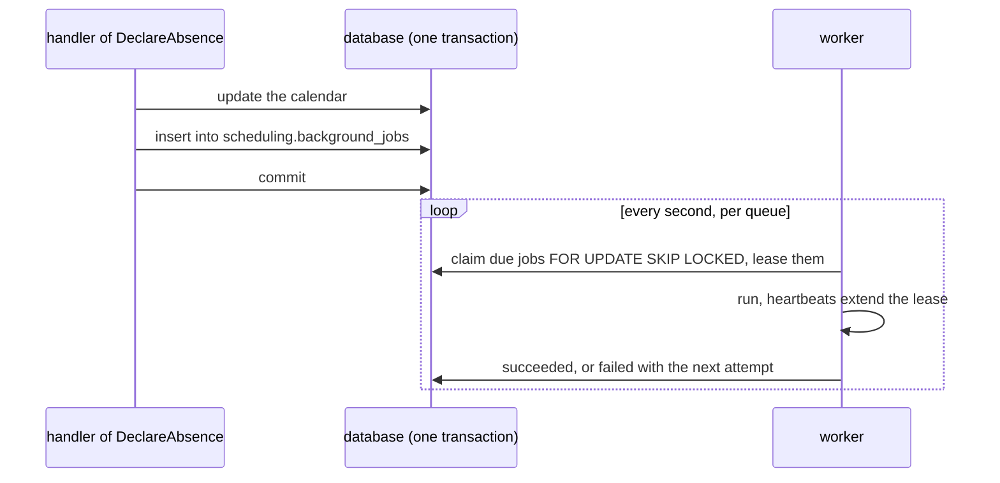

# Background jobs

**Summary.** A background job is work a use case hands to a worker, to run later and outside
of its request: compile a monthly report, move every appointment of an absent practitioner,
import a file of ten thousand rows. The use case enqueues the job in its own unit of work, so
the job exists if and only if the business change committed. A worker in another process, or
the same one, claims it, runs it as the actor that enqueued it, in the same correlation and
the same trace, and retries it with a backoff when it fails. Delivery is at least once: the job
is idempotent, and a long one stores a checkpoint to resume from. Like a scheduled job, a
background job decides nothing: it triggers use cases.

## When a use case needs one

| The work | Where it belongs |
|---|---|
| fits in the request, a few hundred milliseconds | the use case itself |
| tells another context that something happened | an integration event, through the [outbox](transactional-outbox.md) |
| runs because time passed, on a schedule | a [scheduled job](scheduled-jobs.md) |
| runs once, later, because this command asked for it, and may take minutes | a background job |
| is a multi-step process that waits for events and has deadlines | a [process manager](sagas-and-process-managers.md), whose timeouts are background jobs |

A background job is a command the application sends to itself, later. An integration event is
a fact other contexts react to; a job is work this context owes. Both leave the transaction of
the command through a table of the same database, for the same reason.

## Declaring and enqueueing

```ts
// scheduling/application/background/reschedule-absence.background-job.ts
@Background({ maxAttempts: 5, timeout: '30m', lease: '1m' })
export class RescheduleAbsenceBackgroundJob implements BackgroundJob<RescheduleAbsencePayload> {
  static readonly jobName = 'scheduling.reschedule-absence';

  constructor(private readonly commands: CommandBus) {}

  async run(payload: RescheduleAbsencePayload, execution: BackgroundJobExecution): Promise<void> {
    // one command per appointment, each safe to send twice; progress and checkpoint between them
  }
}

// in the handler of DeclareAbsence, inside its unit of work
await this.jobs.enqueue(RescheduleAbsenceBackgroundJob, { calendarId, from, to }, { idempotencyKey: absenceId });
```

- **The name** is a static `jobName`, `<context>.<job-name>`: how the job is enqueued, the
  label of its metrics and its spans, and the key of its idempotency. The **queue** of a job is
  its context, the first part of its name.
- **The payload** is plain JSON, typed by the class: `enqueue` refuses at compile time a payload
  that is not the one `run` takes. A date travels as its ISO text.
- **Options**: `delay` or `runAt` (not before), `idempotencyKey` (a second job of the same name
  and key is not added while the first is kept: `enqueue` answers its id with
  `duplicate: true`). On the declaration: `maxAttempts` (default 5), `backoff` (exponential,
  1 s doubled up to 5 min), `timeout` (none) and `lease` (30 s).
- **`JobQueue`** is a port of the kernel: `enqueue`, `cancel` and `find`, which answers the
  status, the attempts, the progress and the last error code of a job, never its payload.
- **Generated**: `ddd-ts-kit generate background-job <context> <Name> --command <UseCase>` writes
  the class (`@Background()` in the declared style, `builder.backgroundJob(..)` in the module
  file otherwise), sending its command as `execution.actor`, and a spec that enqueues it as a
  user and runs what is due. `init --queue database|redis|memory` chooses the store
  ([`stack.queue`](../CONFIG.md)).

## The enqueue shares the transaction of the command

The choice made by the kit: **a jobs table of the context, in the database of the context**,
written through the executor of the unit of work. It is the outbox reasoning applied to work
instead of facts, without its relay:



Reusing the outbox was the other candidate. It was not kept: an outbox record is published and
forgotten, while a job has a state its users ask about (progress, attempts, cancelled, dead), a
lease extended while it runs, and a checkpoint; carrying that through the outbox needs a second
store anyway, and a relay hop. The jobs table holds both the enqueue and that state.

What proves it: the contract of the job store (`jobStoreContract` of `@ddd-ts-kit/testing`)
runs, for every SQL adapter, a suite inside the real unit of work of the ORM: a job added in a
unit of work that rolls back is not there, one added in a unit of work that commits is claimed.

A store that cannot share the transaction (Redis, Dragonfly, the memory of the process) waits
for the commit: the kernel helper `whenCommitted` runs the write once the unit of work
committed, never when it rolled back. What it cannot cover is a crash between the commit and
the write, which loses the job; the composition root is told (`onLostJob`) when the write
fails. With a database, keep the jobs table.

## A worker runs them

`QueueWorker` (`@ddd-ts-kit/scheduling`) claims the due jobs of each queue it has jobs for, up
to the concurrency of that queue, and asks again at each poll (one second by default) when the
queue is idle.

- **At least once.** A claim is a lease. The worker extends it by heartbeats while the run goes
  on (a third of the lease); a worker that died stops extending it, and the job is claimed
  again when the lease ends, one attempt more. A job is therefore run twice when its worker
  dies after the work and before it said so: the work is idempotent, derived from state or
  keyed behind a unique constraint, as for a [consumed event](delivery-and-idempotency.md).
- **Only the attempt that holds the job is heard.** Every report names its attempt: once the
  job was claimed again or cancelled, the store answers no, and the worker aborts the signal
  of the run (`JobInterruptedError`).
- **Retries.** A failed attempt waits for its backoff; after `maxAttempts` the job is dead and
  stays in the table until an operator revives it (`retryDead`). A job claimed again after its
  last attempt (its worker died during it) dies at once (`ATTEMPTS_EXHAUSTED`).
- **Long jobs** check `execution.signal` between two steps, report their progress
  (`reportProgress({ done, total })`) and store a checkpoint (`saveCheckpoint(value)`): the next
  attempt receives it in `execution.checkpoint` and resumes there. Both extend the lease. A
  checkpoint saved inside the unit of work of a step commits with that step.
- **Timeout.** `timeout` aborts the signal and counts the attempt as failed. As for scheduled
  jobs, nothing kills a promise: a job that ignores its signal goes on behind.
- **Cancellation.** `jobs.cancel(id)` ends a waiting job at once; a running one learns it at
  its next heartbeat or report, and its signal is aborted.
- **Graceful shutdown.** `stop()` stops claiming, waits for the attempts in progress up to its
  grace period (30 s), then aborts them: an aborted attempt gives its job back without counting
  it, for the next worker.

## In the example

A practitioner going away cannot add a time off over booked appointments
(`TIME_OFF_OVER_APPOINTMENTS`). `POST /calendars/:calendarId/clearances` sends `ClearCalendar`:
its handler names the appointments the time off would cover and enqueues
`ClearCalendarBackgroundJob` in the same unit of work, answering `202` with the identifier of
the clearance. The job cancels them one by one, each a `CancelAppointment` of its own sent as
the person who asked, with the reason the patients read; it saves a checkpoint and reports its
progress after each one, reads its signal between two, and takes an appointment cancelled
meanwhile (`APPOINTMENT_ENDED`) as done. `GET /calendars/:calendarId/clearances/:clearanceId`
answers its status and `{ done, total }` from `JobQueue.find`. Its specs interrupt an attempt
half-way and watch the next one resume after the last appointment handled; an end-to-end
journey runs it on the worker of the application, on PostgreSQL.

## Worker mode

Every process that starts the application with its jobs on (`jobs: { start: true }`) runs the
scheduled jobs and consumes the queues of the contexts whose modules it is given. With
`apps/worker` (`ddd-ts-kit generate worker`), the API starts with its jobs off, enqueues, and
the worker runs: the same composition root, another entry point. A context extracted as a
service takes its jobs, its queue and its table with it: nothing is global.

## What travels with the job

| Field of the execution context of a run | Value |
|---|---|
| `origin` | `queue` |
| `actor` | the actor of the work that enqueued it (a system actor when nothing did), also `execution.actor` |
| `tenantId` | the tenant of that work, when it carried one |
| `correlationId` | the correlation of that work: the request and its job are found together |
| `causationId` | the id of the job |
| `deadline` | the start plus `timeout`, when the job has one |

With tracing on, the `traceparent` of the span that enqueued it is stored with the job, and
each attempt is a CONSUMER span `job <name>` child of it, carrying `app.job.name`, `app.job.id`,
`app.job.attempt` and the outcome. Metrics: `background_job_runs_total` and
`background_job_duration_ms`, labelled by job, context, status (`succeeded`, `retried`, `dead`,
`released`, `interrupted`) and error code, next to `scheduled_job_runs_total`. An attempt that
fails with something else than a `DomainError` goes to the `ErrorReporter` (origin `queue`),
the Sentry adapter included.

## Stores

| Store | Package | Shares the transaction | Proven by |
|---|---|---|---|
| `InMemoryJobStore` | `@ddd-ts-kit/scheduling` | waits for the commit | the contract, in the unit specs; tests and one process without a database |
| `KnexJobStore`, `createJobTable` | `@ddd-ts-kit/knex` | yes | the contract on PGlite and on PostgreSQL in CI |
| `DrizzleJobStore`, `jobsTable` | `@ddd-ts-kit/drizzle` | yes | the contract on PGlite |
| `RedisJobStore` | `@ddd-ts-kit/redis` | waits for the commit | the contract on Dragonfly in CI, and on Redis |
| Prisma, TypeORM | none in this version | | a project writes a `JobStore` over its ORM, held by `jobStoreContract` with its unit of work (the Knex store is about two hundred lines to follow) |

The SQL stores claim with `FOR UPDATE SKIP LOCKED` in a short transaction of their own, on
PostgreSQL. The Redis store is a few Lua scripts on the client of the package, every key it
touches declared and in one hash slot: BullMQ was considered and not taken, because it brings a
second client and its own worker model, which the contract of the store (claim, lease,
heartbeat, reports by attempt) does not map onto without wrapping it whole, and it needs
emulated cluster mode on Dragonfly. BullMQ cannot share the transaction either.

## Testing

A spec of a background job is a spec of the use cases it triggers: the test application holds
the queue in memory, `app.backgroundJobs.runDue()` runs what is due on its clock (and throws
what an attempt threw), and `app.backgroundJobs.store.list()` shows what was enqueued. A spec
of the handler that enqueues asserts the job through the same list. Time is moved with
`app.clock.advance(ms)` for a delayed job.

## Limits and when not to use it

- **At least once, never exactly once.** Idempotence is the job's business.
- **No ordering.** Jobs of a queue are claimed earliest due first, but run concurrently and a
  retry goes behind; a job that needs another one's result is a process, not two jobs.
- **Concurrency is per process.** `concurrency: { scheduling: 4 }` is per worker; two workers
  run eight. A global limit needs a lock or a store that counts.
- **Polling.** An idle queue is asked once per poll interval: a job starts up to that late.
- **No priority, no rate limit per job, no repeatable jobs.** Repeated work is a scheduled job
  that enqueues.
- **The table grows**: purge what finished (`purgeFinished(before)`) from a scheduled job.
- **Redis loses a job** when the process dies between the commit and the write.
- **Not a workflow engine.** Long, branching processes with human steps belong to a dedicated
  engine behind a port.

## Sources

- Gregor Hohpe and Bobby Woolf, Enterprise Integration Patterns, Addison-Wesley, 2003
  (Guaranteed Delivery, Competing Consumers, Message Expiration, Dead Letter Channel).
- Chris Richardson, Microservices Patterns, Manning, 2018, chapter 3 (transactional messaging).
- PostgreSQL documentation, `SELECT ... FOR UPDATE SKIP LOCKED`,
  https://www.postgresql.org/docs/current/sql-select.html#SQL-FOR-UPDATE-SHARE
- Amazon SQS documentation, "Visibility timeout" (the lease and its extension).
- Martin Kleppmann, Designing Data-Intensive Applications, O'Reilly, 2017, chapter 11 (at
  least once, idempotence).
- Dragonfly documentation, "Lua scripting" (undeclared keys), https://www.dragonflydb.io/docs

## See also

- [Scheduled jobs](scheduled-jobs.md)
- [Transactional outbox](transactional-outbox.md)
- [Delivery and idempotency](delivery-and-idempotency.md)
- [Sagas and process managers](sagas-and-process-managers.md)
- [File import and export](file-import-export.md): a design on the queue and the file storage
- [Actor and execution scope](actor-and-execution-scope.md)
- [Observability](observability.md)
- [`@ddd-ts-kit/scheduling`](../../packages/scheduling/README.md)
- [Architecture reference](../ARCHITECTURE.md): "Background jobs"
