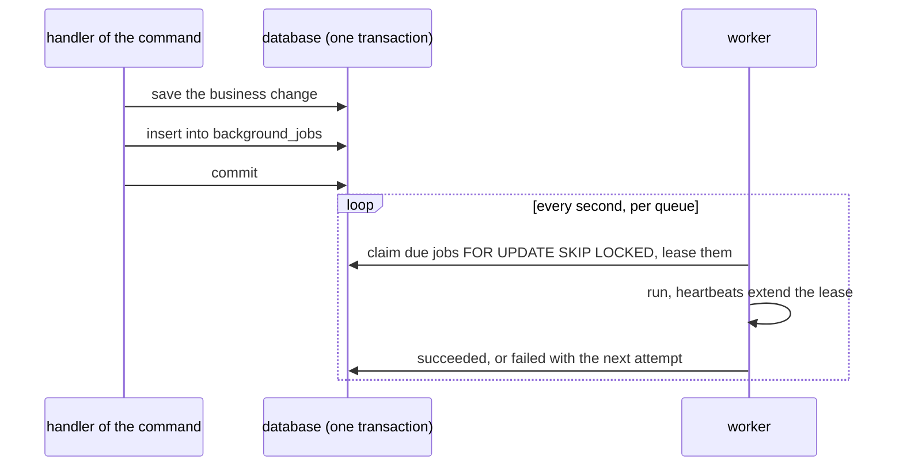
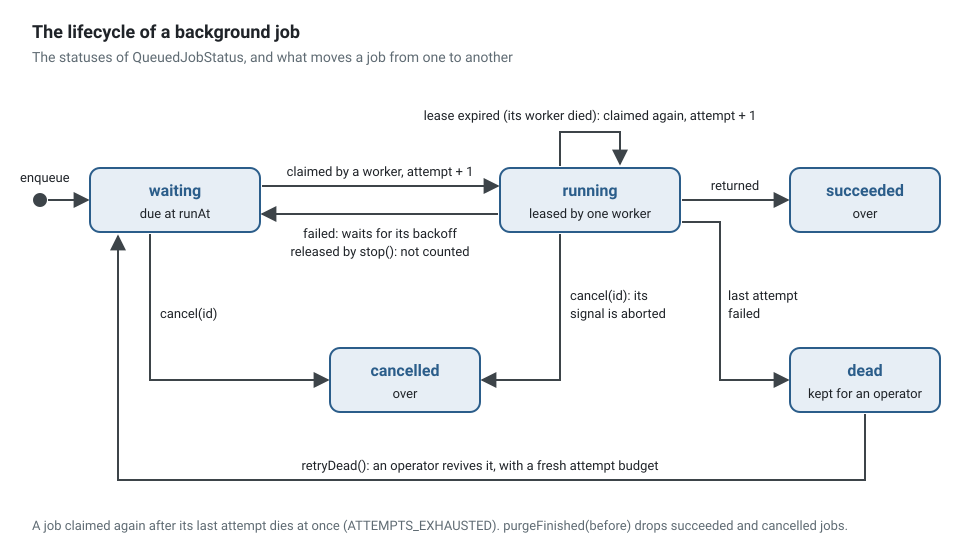
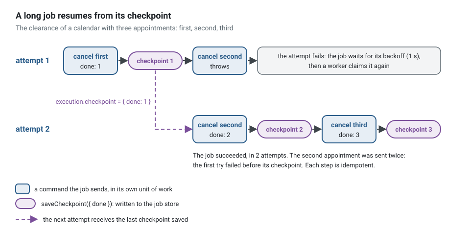
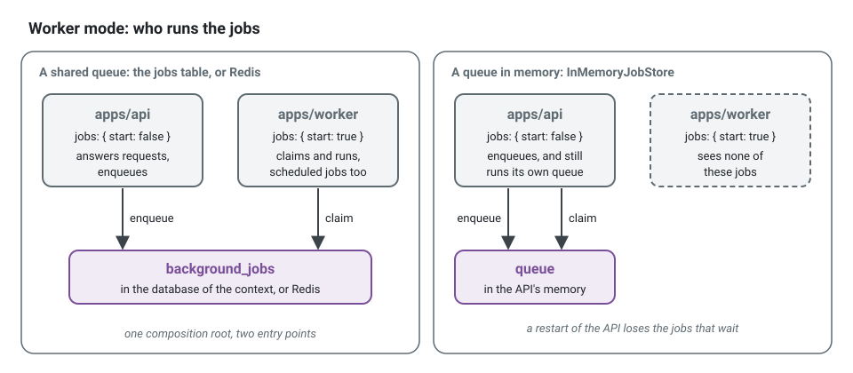

**English** · [Français](background-jobs.fr.md)

# Background jobs

**Summary.** A background job is work a use case hands to a worker, to run later and outside
of its request: compile a monthly report, move every appointment of an absent practitioner,
import a file of ten thousand rows. The use case enqueues the job in its own unit of work, so
the job exists if and only if the business change committed. A worker in another process, or
the same one, claims it, runs it as the actor that enqueued it, in the same correlation and
the same trace, and retries it with a backoff when it fails. Delivery is at least once: the job
is idempotent, and a long one stores a checkpoint to resume from. Like a scheduled job, a
background job decides nothing: it triggers use cases.

## When a use case needs one

| The work | Where it belongs |
|---|---|
| fits in the request, a few hundred milliseconds | the use case itself |
| tells another context that something happened | an integration event, through the [outbox](transactional-outbox.md) |
| runs because time passed, on a schedule | a [scheduled job](scheduled-jobs.md) |
| runs once, later, because this command asked for it, and may take minutes | a background job |
| is a multi-step process that waits for events and has deadlines | a [process manager](sagas-and-process-managers.md), whose timeouts are background jobs |

A background job is a command the application sends to itself, later. An integration event is
a fact other contexts react to; a job is work this context owes. Both leave the transaction of
the command through a table of the same database, for the same reason.

## Declaring and enqueueing

A job is a class of `application/background/`: a static `jobName`, a decorator with its
options, and a `run` method that sends commands. This one is the job of the running example,
which cancels the appointments of a calendar before an absence of its practitioner:

<!-- checked sample -->
```ts
// scheduling/application/background/clear-calendar.background-job.ts
import {
  AuthorizedCommand,
  isRefusal,
  type Actor,
  type BackgroundJob,
  type BackgroundJobExecution,
  type CommandBus,
} from '@ddd-ts-kit/kernel';
import { Background } from '@ddd-ts-kit/kernel/declarations';

// the command of another use case of the context, which the job sends
declare class CancelAppointmentCommand extends AuthorizedCommand {
  constructor(actor: Actor, appointmentId: string, reason: string);
}

/** Plain JSON: ids and text, a date as its ISO text. */
export interface ClearCalendarPayload {
  readonly calendarId: string;
  readonly appointmentIds: readonly string[];
  readonly reason: string;
}

/** What an attempt left behind: the number of appointments of the payload already handled. */
interface ClearCalendarCheckpoint {
  readonly done: number;
}

@Background({ timeout: '30m', lease: '1m' })
export class ClearCalendarBackgroundJob implements BackgroundJob<ClearCalendarPayload> {
  static readonly jobName = 'scheduling.clear-calendar';

  constructor(private readonly commands: CommandBus) {}

  async run(payload: ClearCalendarPayload, execution: BackgroundJobExecution): Promise<void> {
    const total = payload.appointmentIds.length;
    // where an earlier attempt stopped: 0 on a fresh start
    let done = doneBefore(execution.checkpoint);

    // a client polling the job sees 0 of 3, or 1 of 3 after a resume, before the first step
    await execution.reportProgress({ done, total });

    for (const appointmentId of payload.appointmentIds.slice(done)) {
      // cancelled, timed out, lease lost or worker stopping: stop between two steps
      execution.signal.throwIfAborted();
      await this.cancel(appointmentId, payload.reason, execution.actor);
      done += 1;

      const checkpoint: ClearCalendarCheckpoint = { done };

      await execution.saveCheckpoint(checkpoint);
      await execution.reportProgress({ done, total });
    }
  }

  /** Idempotent: an appointment that is already over is what the job wants. */
  private async cancel(appointmentId: string, reason: string, actor: Actor): Promise<void> {
    try {
      await this.commands.execute(new CancelAppointmentCommand(actor, appointmentId, reason));
    } catch (error) {
      if (!isRefusal(error, 'APPOINTMENT_ENDED')) {
        throw error;
      }
    }
  }
}

/** The checkpoint is stored as JSON and comes back as `unknown`: read it, never cast it. */
function doneBefore(checkpoint: unknown): number {
  return typeof checkpoint === 'object' &&
    checkpoint !== null &&
    'done' in checkpoint &&
    typeof checkpoint.done === 'number'
    ? checkpoint.done
    : 0;
}
```

The use case enqueues it through the `JobQueue` port, inside its own unit of work, and answers
the id of the job, which a client polls. The handler of the example also refuses an unknown
calendar (`CalendarError.unknown`) and keeps only the appointments the period covers; this
sample, shortened, keeps the enqueueing:

<!-- checked sample -->
```ts
// scheduling/application/commands/clear-calendar/clear-calendar.handler.ts
import { definePermissions } from '@ddd-ts-kit/auth';
import {
  AuthorizedCommand,
  JobQueue,
  type Actor,
  type BackgroundJob,
  type BackgroundJobExecution,
} from '@ddd-ts-kit/kernel';
import { CommandHandler, Requires } from '@ddd-ts-kit/kernel/declarations';

// the job of the previous sample, and a repository port of the domain
interface ClearCalendarPayload {
  readonly calendarId: string;
  readonly appointmentIds: readonly string[];
  readonly reason: string;
}
declare class ClearCalendarBackgroundJob implements BackgroundJob<ClearCalendarPayload> {
  static readonly jobName: 'scheduling.clear-calendar';
  run(payload: ClearCalendarPayload, execution: BackgroundJobExecution): Promise<void>;
}
declare abstract class AppointmentRepository {
  heldOn(calendarId: string, from: Date, to: Date): Promise<readonly { readonly id: string }[]>;
}

const permissions = definePermissions('scheduling', { 'calendar.clear': { description: 'Clear calendar' } });

@Requires(permissions['calendar.clear'], {
  resource: (command: ClearCalendarCommand) => ({ type: 'calendar', id: command.calendarId }),
})
export class ClearCalendarCommand extends AuthorizedCommand<string> {
  constructor(
    actor: Actor,
    readonly calendarId: string,
    readonly startsAt: Date,
    readonly endsAt: Date,
    readonly reason: string,
  ) {
    super(actor);
  }
}

@CommandHandler(ClearCalendarCommand)
export class ClearCalendarHandler implements CommandHandler<ClearCalendarCommand> {
  constructor(
    private readonly appointments: AppointmentRepository,
    private readonly jobs: JobQueue,
  ) {}

  async execute(command: ClearCalendarCommand): Promise<string> {
    const covered = await this.appointments.heldOn(command.calendarId, command.startsAt, command.endsAt);

    // written in the transaction of the command: no commit, no job; a commit, a job
    const clearance = await this.jobs.enqueue(
      ClearCalendarBackgroundJob,
      { calendarId: command.calendarId, appointmentIds: covered.map(({ id }) => id), reason: command.reason },
      { subject: command.calendarId },
    );

    return clearance.id;
  }
}
```

The payload is checked against `run`: `enqueue(ClearCalendarBackgroundJob, { calendarId })`
does not compile, since `appointmentIds` and `reason` are missing.

- **The name** is a static `jobName`, `<context>.<job-name>`: how the job is enqueued, the
  label of its metrics and its spans, and the key of its idempotency. The **queue** of a job is
  its context, the first part of its name.
- **The payload** is plain JSON, typed by the class: `enqueue` refuses at compile time a payload
  that is not the one `run` takes. A date travels as its ISO text.
- **Options**: `delay` or `runAt` (not before), `idempotencyKey` (a second job of the same name
  and key, enqueued for the same tenant, is not added while the first is kept: `enqueue` answers
  its id with `duplicate: true`; two tenants never share a key) and `subject` (the id of what the
  job works on, kept with it). On the declaration: `maxAttempts` (default 5), `backoff`
  (exponential, 1 s doubled up to 5 min), `timeout` (none) and `lease` (30 s).
- **`JobQueue`** is a port of the kernel: `enqueue`, `cancel` and `find`, which answers the
  status, the attempts, the progress, the last error code, the tenant and the subject of a job,
  never its payload. The statuses are the closed vocabulary `QueuedJobStatus`, which a route
  publishes as an enum (`@IsIn(Object.values(QueuedJobStatus))`). A query that reads a job
  through an element (`GET /calendars/:id/clearances/:clearanceId`) checks that `subject` is
  that element: a job id is no secret, it is the causation of everything the job does.
- **Tenants.** Work done for a tenant finds and cancels the jobs of that tenant only, and those
  of the tenants an elevation names; work without a tenant (a single-tenant project, a system
  job) reaches every job.
- **Generated**: `ddd-ts-kit generate background-job <context> <Name> --command <UseCase>` writes
  the class (`@Background()` in the declared style, `builder.backgroundJob(..)` in the module
  file otherwise), sending its command as `execution.actor` with one field of its payload per
  other input of the command (a `Date` travels as its ISO text, a value object is refused: a
  command takes primitives and ids), and a spec that enqueues it as a user and runs what is
  due. `init --queue database|redis|memory` chooses the store ([`stack.queue`](../CONFIG.md)).

**An idempotency key is derived from the work, never drawn at random.** A request retried by
its client, or a command sent twice by a consumer, must find the job it already enqueued:

<!-- checked sample -->
```ts
import { randomUUID } from 'node:crypto';
import type { BackgroundJob, BackgroundJobExecution, JobQueue } from '@ddd-ts-kit/kernel';

interface CompileMonthlyReportPayload {
  readonly practiceId: string;
  readonly month: string;
}
declare class CompileMonthlyReportJob implements BackgroundJob<CompileMonthlyReportPayload> {
  static readonly jobName: 'reporting.compile-monthly-report';
  run(payload: CompileMonthlyReportPayload, execution: BackgroundJobExecution): Promise<void>;
}
declare const jobs: JobQueue;

const report = { practiceId: 'practice-42', month: '2026-10' };

// instead of: a new key at every call, so a retried request compiles the report twice
await jobs.enqueue(CompileMonthlyReportJob, report, { idempotencyKey: randomUUID() });

// write: the same key for the same work
const key = `${report.practiceId}:${report.month}`;
const first = await jobs.enqueue(CompileMonthlyReportJob, report, { idempotencyKey: key });
const again = await jobs.enqueue(CompileMonthlyReportJob, report, { idempotencyKey: key });
// again.id === first.id and again.duplicate === true: nothing was added
console.log(first.id === again.id, again.duplicate);
```

## The enqueue shares the transaction of the command

The choice made by the kit: **a jobs table of the context, in the database of the context**,
written through the executor of the unit of work. It is the outbox reasoning applied to work
instead of facts, without its relay:



Reusing the outbox was the other candidate. It was not kept: an outbox record is published and
forgotten, while a job has a state its users ask about (progress, attempts, cancelled, dead), a
lease extended while it runs, and a checkpoint; carrying that through the outbox needs a second
store anyway, and a relay hop. The jobs table holds both the enqueue and that state.

What proves it: the contract of the job store (`jobStoreContract` of `@ddd-ts-kit/testing`)
runs, for every SQL adapter, a suite inside the real unit of work of the ORM: a job added in a
unit of work that rolls back is not there, one added in a unit of work that commits is claimed.

A store that cannot share the transaction (Redis, Dragonfly, the memory of the process) waits
for the commit: the kernel helper `whenCommitted` runs the write once the unit of work
committed, never when it rolled back, for an enqueue, a cancellation and a revival alike. The
contract proves it: a job cancelled or revived in a unit of work that rolls back is left as it
was. What it cannot cover is a crash between the commit and the write, which loses that write;
the composition root is told (`onLostJob`) when the write fails. Two jobs of one idempotency
key staged before either committed both answer their own id, and only the first is kept. With
a database, keep the jobs table.

## A worker runs them

`QueueWorker` (`@ddd-ts-kit/scheduling`) claims the due jobs of each queue it has jobs for, up
to the concurrency of that queue, and asks again at each poll (one second by default) when the
queue is idle.



- **At least once.** A claim is a lease. The worker extends it by heartbeats while the run goes
  on (a third of the lease); a worker that died stops extending it, and the job is claimed
  again when the lease ends, one attempt more. A job is therefore run twice when its worker
  dies after the work and before it said so: the work is idempotent, derived from state or
  keyed behind a unique constraint, as for a [consumed event](delivery-and-idempotency.md).
- **Only the attempt that holds the job is heard.** Every report names its attempt: once the
  job was claimed again or cancelled, the store answers no, and the worker aborts the signal
  of the run (`JobInterruptedError`).
- **Retries.** A failed attempt waits for its backoff; after `maxAttempts` the job is dead and
  stays in the table until an operator revives it (`retryDead`). A job claimed again after its
  last attempt (its worker died during it) dies at once (`ATTEMPTS_EXHAUSTED`).
- **Long jobs** check `execution.signal` between two steps, report their progress
  (`reportProgress({ done, total })`) and store a checkpoint (`saveCheckpoint(value)`): the next
  attempt receives it in `execution.checkpoint` and resumes there. Both extend the lease. A
  checkpoint saved inside the unit of work of a step commits with that step.
- **Timeout.** `timeout` aborts the signal and counts the attempt as failed. As for scheduled
  jobs, nothing kills a promise: a job that ignores its signal goes on behind.
- **Cancellation.** `jobs.cancel(id)` ends a waiting job once the unit of work it is called in
  commits (at once outside of one); a running one learns it at its next heartbeat or report,
  and its signal is aborted.
- **Graceful shutdown.** `stop()` stops claiming, waits for a claim in flight (whose jobs go
  back, uncounted) and for the attempts in progress up to its grace period (30 s), then aborts
  them: an aborted attempt gives its job back without counting it, for the next worker.
  Stopping, like a timeout or a cancellation, is cooperative: a job that ignores its signal
  goes on behind, outside of the concurrency of its queue, until its body settles.

What a checkpoint buys, on the job of the example: an attempt that fails half-way does not
start over, and the one step that may run twice is the step it failed on.



## In the example

A practitioner going away cannot add a time off over booked appointments
(`TIME_OFF_OVER_APPOINTMENTS`). `POST /calendars/:calendarId/clearances` sends `ClearCalendar`:
its handler names the appointments the time off would cover and enqueues
`ClearCalendarBackgroundJob` in the same unit of work, the calendar as its `subject`, answering
`202` with the identifier of the clearance. The job cancels them one by one, each a `CancelAppointment` of its own sent as
the person who asked, with the reason the patients read; it saves a checkpoint and reports its
progress after each one, reads its signal between two, and takes an appointment cancelled
meanwhile (`APPOINTMENT_ENDED`) as done. `GET /calendars/:calendarId/clearances/:clearanceId`
answers its status (an enum of the contract) and `{ done, total }` from `JobQueue.find`, and
`UNKNOWN_CLEARANCE` for a job whose subject is another calendar. Its specs interrupt an attempt
half-way and watch the next one resume after the last appointment handled; an end-to-end
journey runs it on the worker of the application, on PostgreSQL.

The query that reads a clearance does not trust the id it is given. Returning
`jobs.find(clearanceId)` as it is would show any job of the tenant to whoever may clear one
calendar: the handler checks that the job is a clearance, and a clearance of the calendar the
URL names.

<!-- checked sample -->
```ts
// scheduling/application/queries/get-clearance/get-clearance.handler.ts
import { definePermissions } from '@ddd-ts-kit/auth';
import { AuthorizedQuery, ConceptError, JobQueue, type Actor, type QueuedJobStatus } from '@ddd-ts-kit/kernel';
import { QueryHandler, Requires } from '@ddd-ts-kit/kernel/declarations';

const permissions = definePermissions('scheduling', { 'calendar.clear': { description: 'Clear calendar' } });

export class CalendarError extends ConceptError {
  static unknownClearance(clearanceId: string) {
    return CalendarError.refusal('UNKNOWN_CLEARANCE', `There is no clearance ${clearanceId}.`, { clearanceId });
  }
}

export interface GetClearanceResult {
  readonly status: QueuedJobStatus;
  readonly done: number;
  readonly total?: number;
}

// whoever may clear this calendar may follow its clearances
@Requires(permissions['calendar.clear'], {
  resource: (query: GetClearanceQuery) => ({ type: 'calendar', id: query.calendarId }),
})
export class GetClearanceQuery extends AuthorizedQuery<GetClearanceResult> {
  constructor(
    actor: Actor,
    readonly calendarId: string,
    readonly clearanceId: string,
  ) {
    super(actor);
  }
}

@QueryHandler(GetClearanceQuery)
export class GetClearanceHandler implements QueryHandler<GetClearanceQuery> {
  constructor(private readonly jobs: JobQueue) {}

  async execute(query: GetClearanceQuery): Promise<GetClearanceResult> {
    const job = await this.jobs.find(query.clearanceId);

    // another kind of job, or the clearance of another calendar: unknown here
    if (job?.name !== 'scheduling.clear-calendar' || job.subject !== query.calendarId) {
      throw CalendarError.unknownClearance(query.clearanceId);
    }

    const { status, progress } = job;

    return { status, done: progress?.done ?? 0, ...(progress?.total === undefined ? {} : { total: progress.total }) };
  }
}
```

## Worker mode

Every process that starts the application with its jobs on (`jobs: { start: true }`) runs the
scheduled jobs and consumes the queues of the contexts whose modules it is given. With
`apps/worker` (`ddd-ts-kit generate worker`), the API starts with its jobs off, enqueues, and
the worker runs: the same composition root, another entry point. A context extracted as a
service takes its jobs, its queue and its table with it: nothing is global. A queue kept in the
memory of a process (`InMemoryJobStore`, `stack.queue` `memory`, the store of a project
initialised before background jobs existed) is seen by no other process: that process consumes it even with its
jobs off, so the API next to a worker still runs what it enqueues, and loses what waits when
it restarts. Share the queue (the jobs table, Redis) to let the worker run it.



## What travels with the job

| Field of the execution context of a run | Value |
|---|---|
| `origin` | `queue` |
| `actor` | the actor of the work that enqueued it (a system actor when nothing did), also `execution.actor`: a snapshot taken at the enqueue, roles and attributes included, used as is by a delayed run and by every retry |
| `tenantId` | the tenant of that work, when it carried one |
| `correlationId` | the correlation of that work: the request and its job are found together |
| `causationId` | the id of the job |
| `deadline` | the start plus `timeout`, when the job has one |

With tracing on, the `traceparent` of the span that enqueued it is stored with the job, and
each attempt is a CONSUMER span `job <name>` child of it, carrying `app.job.name`, `app.job.id`,
`app.job.attempt` and the outcome. Metrics: `background_job_runs_total` and
`background_job_duration_ms`, labelled by job, context, status (`succeeded`, `retried`, `dead`,
`released`, `interrupted`) and error code, next to `scheduled_job_runs_total`. An attempt that
fails with something else than a `DomainError` goes to the `ErrorReporter` (origin `queue`),
the Sentry adapter included.

## Stores

| Store | Package | Shares the transaction | Proven by |
|---|---|---|---|
| `InMemoryJobStore` | `@ddd-ts-kit/scheduling` | waits for the commit | the contract, in the unit specs; tests and one process without a database |
| `KnexJobStore`, `createJobTable` | `@ddd-ts-kit/knex` | yes | the contract on PGlite and on PostgreSQL in CI |
| `DrizzleJobStore`, `jobsTable` | `@ddd-ts-kit/drizzle` | yes | the contract on PGlite and on PostgreSQL in CI |
| `RedisJobStore` | `@ddd-ts-kit/redis` | waits for the commit | the contract on Dragonfly in CI (run by hand on Redis 8) |
| Prisma, TypeORM | none in this version | | a project writes a `JobStore` over its ORM, held by `jobStoreContract` with its unit of work (the Knex store is about two hundred lines to follow) |

The SQL stores claim with `FOR UPDATE SKIP LOCKED` in a short transaction of their own, on
PostgreSQL; in CI their contract runs on a server behind a pool of several connections, where
two claims race for real. The idempotency key is unique per name, tenant and key (`tenant_id`
holds the empty text for a job without a tenant, so that the index holds on every PostgreSQL). The Redis store is a few Lua scripts on the client of the package, every key it
touches declared and in one hash slot: BullMQ was considered and not taken, because it brings a
second client and its own worker model, which the contract of the store (claim, lease,
heartbeat, reports by attempt) does not map onto without wrapping it whole, and it needs
emulated cluster mode on Dragonfly. BullMQ cannot share the transaction either.

## Testing

A spec of a background job is a spec of the use cases it triggers: the test application holds
the queue in memory, `application.backgroundJobs.runDue()` runs what is due on its clock (and
throws what an attempt threw), and `application.backgroundJobs.store.list()` shows what was
enqueued. A spec of the handler that enqueues asserts the job through the same list. Time is
moved with `application.clock.advance(ms)` for a delayed job.

A spec of the example, shortened: the second cancellation fails once, and the next attempt
resumes from the checkpoint instead of starting over.

```ts
it('resumes after the last appointment an interrupted attempt handled, never cancelling one twice', async () => {
  const { application } = await cleared(); // three appointments, the clearance asked as the holder of the calendar
  const sent: string[] = [];
  let failures = 1;

  application.commandBus.use(async (message, next) => {
    if (message instanceof CancelAppointmentCommand) {
      sent.push(message.appointmentId);

      if (message.appointmentId === 'second' && failures-- > 0) {
        throw new Error('the database went away');
      }
    }

    return next();
  });

  await expect(application.backgroundJobs.runDue()).rejects.toThrow('the database went away');
  expect(application.backgroundJobs.store.list()).toMatchObject([{ status: 'waiting', progress: { done: 1 } }]);

  application.clock.advance(1_000); // the first backoff
  await application.backgroundJobs.runDue();

  expect(sent).toEqual(['first', 'second', 'second', 'third']);
  expect(application.backgroundJobs.store.list()).toMatchObject([{ status: 'succeeded', attempts: 2 }]);
});
```

No mock and no timer: the queue, the clock and the bus of the test application are real, in
memory. The middleware on the command bus is the one place where the test injects a failure.

## Limits and when not to use it

- **At least once, never exactly once.** Idempotence is the job's business.
- **No ordering.** Jobs of a queue are claimed earliest due first, but run concurrently and a
  retry goes behind; a job that needs another one's result is a process, not two jobs.
- **Concurrency is per process.** `concurrency: { scheduling: 4 }` is per worker; two workers
  run eight. A global limit needs a lock or a store that counts.
- **Polling.** An idle queue is asked once per poll interval: a job starts up to that late.
- **No priority, no rate limit per job, no repeatable jobs.** Repeated work is a scheduled job
  that enqueues.
- **The table grows**: `background_jobs` keeps payloads and the actor of each job, and the
  idempotency key of a job holds as long as the job is kept. Purge what finished
  (`purgeFinished(before)` of the `JobStore`) from a scheduled job of the project: neither the
  kit nor a generated project schedules one, because how long to keep is the project's
  decision. Dead jobs stay until an operator decides. `process_instances` grows the same way.
- **Permissions are those of the enqueue.** A delayed run or a retry hours later acts with the
  roles and attributes the actor had when the job was enqueued: a job that must see a revoked
  right reads the actor again (by its id) before it acts.
- **Every worker of a queue knows every job of its context.** A worker claims any due job of
  the queues it consumes: one that does not know a job name (an older worker during a rolling
  deploy) fails the attempt (`UNKNOWN_BACKGROUND_JOB`) and the job dies after its attempts.
  Deploy the workers before the code that enqueues a new job.
- **Redis loses a job** when the process dies between the commit and the write.
- **Not a workflow engine.** Long, branching processes with human steps belong to a dedicated
  engine behind a port.

## Sources

- Gregor Hohpe and Bobby Woolf, Enterprise Integration Patterns, Addison-Wesley, 2003
  (Guaranteed Delivery, Competing Consumers, Message Expiration, Dead Letter Channel).
- Chris Richardson, Microservices Patterns, Manning, 2018, chapter 3 (transactional messaging).
- PostgreSQL documentation, `SELECT ... FOR UPDATE SKIP LOCKED`,
  https://www.postgresql.org/docs/current/sql-select.html#SQL-FOR-UPDATE-SHARE
- Amazon SQS documentation, "Visibility timeout" (the lease and its extension).
- Martin Kleppmann, Designing Data-Intensive Applications, O'Reilly, 2017, chapter 11 (at
  least once, idempotence).
- Dragonfly documentation, "Lua scripting" (undeclared keys), https://www.dragonflydb.io/docs

## See also

- [Scheduled jobs](scheduled-jobs.md)
- [Transactional outbox](transactional-outbox.md)
- [Delivery and idempotency](delivery-and-idempotency.md)
- [Sagas and process managers](sagas-and-process-managers.md)
- [File import and export](file-import-export.md): a design on the queue and the file storage
- [Actor and execution scope](actor-and-execution-scope.md)
- [Observability](observability.md)
- [`@ddd-ts-kit/scheduling`](../../packages/scheduling/README.md)
- [Architecture reference](../ARCHITECTURE.md): "Background jobs"
