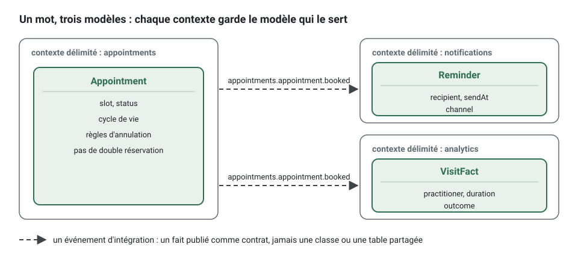

[English](bounded-context.md) · **Français**
<!-- translation-of: bounded-context.md sha256:4b2321dc101e0a76 -->

# Contexte délimité

**Résumé.** Un contexte délimité (bounded context) est la frontière explicite à l'intérieur de
laquelle un modèle et un vocabulaire sont valides. À l'intérieur, un mot a un seul sens et les
règles sont cohérentes ; à l'extérieur, le même mot peut vouloir dire autre chose, et personne n'a
tort. Trouver la frontière est la décision de conception la plus lourde de conséquences d'un
projet : quatre tests y aident (langage, autonomie, cohérence, taille). Dans ce kit, un contexte
est un dossier à l'arborescence fermée, avec un `CONTEXT.md`, son propre schéma de base de
données et une seule porte d'entrée pour les autres : son `published-language/`.

## Un modèle par contexte

Les grands systèmes échouent quand ils tentent de tenir un modèle unique de tout. Le
« rendez-vous » des règles de réservation est un engagement doté d'un cycle de vie ; pour les
statistiques, c'est une ligne avec une durée et une issue ; pour les notifications, c'est une
date, un destinataire et un modèle de message. Une seule classe au service des trois finit avec
tous ses champs facultatifs et toutes ses règles conditionnelles.

Un contexte délimité met fin à cette négociation : chacun des trois garde le modèle qui le sert,
et les contextes échangent des faits par des contrats au lieu de partager une classe ou une
table.



## Sous-domaine ou contexte délimité

Un [sous-domaine](domain-and-subdomains.fr.md) appartient au problème : c'est la façon dont le
métier se découpe. Un contexte délimité appartient à la solution : c'est la façon dont le
logiciel se découpe. Visez un contexte par sous-domaine, et attendez-vous à des exceptions. Ce
qui compte, c'est que la frontière soit explicite et que l'équipe sache dire quel modèle est
valide où.

## Comment trouver une frontière

Le *skill* `bounded-contexts` du *plugin* déroule les quatre tests ci-dessous, dans le
vocabulaire du porteur du projet, et en ajoute un cinquième, qui porte sur les personnes : une
personne ou un agent pourrait-il tenir le contexte en tête à lui seul ? Aucun test ne tranche
seul ; ensemble, ils s'accordent en général.

| Test | Question | Un signe qu'il y a deux contextes |
|---|---|---|
| Langage | Un mot change-t-il de sens ici ? | « Créneau » est un intervalle libre dans availability et l'intervalle réservé d'un rendez-vous dans appointments |
| Autonomie | Cette partie peut-elle changer ses règles, ou être réécrite, sans que ses voisins s'en aperçoivent ? Qui décide de ses règles ? | la politique de rappel change tous les mois, décidée par le support, et la réservation ne doit pas bouger avec elle |
| Cohérence | Qu'est-ce qui doit être vrai à chaque instant, dans une transaction, et qu'est-ce qui peut l'être un instant plus tard ? | un praticien ne doit jamais être réservé deux fois (immédiat) ; la liste des créneaux libres peut avoir une seconde de retard (à terme) |
| Taille | Est-ce un modèle, ou seulement une table pour quelqu'un d'autre ? Le glossaire a-t-il deux moitiés sans rapport ? | un contexte « settings » qui ne fait que stocker des valeurs pour un autre est une table, pas un contexte |

Le test de cohérence est le plus tranchant. Ce qui exige une cohérence immédiate vit dans un
[agrégat](aggregates.fr.md), donc dans un contexte. Si deux contextes candidats doivent valider
ensemble pour qu'une règle tienne, soit ils ne forment qu'un contexte, soit la règle doit être
reformulée en processus : un côté décide, l'autre réagit ([Cohérence à
terme](eventual-consistency.fr.md)).

### Les signes d'une frontière mal placée

- Un cas d'usage écrit dans deux contextes en une seule transaction.
- Un contexte a besoin de la plupart des champs de l'agrégat d'un autre contexte.
- Un noyau partagé qui ne cesse de grossir.
- Deux contextes qui ont besoin l'un de l'autre : un cycle (`context/no-cycle`). Soit ils ne
  forment qu'un contexte, soit l'un des deux sens devient un événement, soit il manque un
  troisième contexte.
- Chaque changement touche ensemble les deux mêmes contextes : ils changent pour la même raison.
- Un contexte dont le seul contenu est du stockage pour un autre.

Des frontières trop fines coûtent autant que des frontières trop grossières : chacune ajoute des
contrats, des événements et de la cohérence à terme. Dans le doute, commencez avec moins de
contextes et notez le doute sous « Known tensions » dans la carte des contextes ; fusionner deux
contextes plus tard est plus difficile que d'en scinder un dont le modèle est resté propre.

## Ce que le kit fait d'un contexte

```
src/contexts/appointments/
  CONTEXT.md
  published-language/     le seul dossier qu'un autre contexte peut importer
  domain/                 agrégats, entités, objets-valeurs, événements, erreurs, ports de repository, services
  application/            commandes, requêtes, ports, autorisation, gestionnaires d'événements, intégration
  infrastructure/         persistance, adaptateurs externes, anticorruption
  presentation/           http, cli
  test/                   unitaires, intégration, fakes, builders
```

L'arborescence canonique complète est dans [ARCHITECTURE.md](../ARCHITECTURE.fr.md), section 2.
Ce qui fait du dossier une frontière, c'est un ensemble de règles, chacune avec un identifiant :

| Ce qui est tenu | Règle |
|---|---|
| l'arborescence est fermée : un nouveau dossier est une décision, pas un accident | `tree/closed` |
| chaque contexte documente sa raison d'être, sa classification, son langage, ses agrégats, ses événements et ses relations | `tree/context-doc` |
| on n'atteint un autre contexte que par son `published-language/` | `context/published-language-only` |
| et seulement quand la relation est déclarée dans la configuration | `context/declared-relationship` |
| un langage publié est un contrat, libre de tout détail interne | `context/published-language-is-a-contract` |
| les relations déclarées ne forment aucun cycle | `context/no-cycle` |
| le contexte peut tourner seul : ses propres données, aucune transaction partagée | `context/extractable` |

`npx ddd-ts-kit explain <rule-id>` affiche la raison et un exemple pour chacune.


Trois conséquences méritent d'être explicitées :

- **Des données à soi.** Un schéma de base de données par contexte, aucune clé étrangère,
  jointure ou transaction d'un contexte à l'autre. Un contexte qui a besoin des données d'un
  autre lit un contrat publié ou tient une projection locale alimentée par des événements
  d'intégration.
- **`CONTEXT.md` fait partie du code.** Son glossaire est la référence contre laquelle les noms
  sont vérifiés ([Langage omniprésent](ubiquitous-language.fr.md)), et sa première phrase de
  raison d'être est reprise dans la carte des contextes générée.
- **Un contexte est une unité déployable en attente.** Comme rien ne franchit la frontière hormis
  des contrats et des événements, déplacer un contexte dans son propre service est un changement
  de composition, pas de modèle ([Monolithe modulaire](modular-monolith.fr.md),
  [Quand extraire un microservice](../guides/when-to-extract-microservices.fr.md)).

En créer un tient en une commande, et le glossaire vient en premier :

```bash
npx ddd-ts-kit generate context availability --classification supporting \
  --upstream calendars:published-language --upstream appointments:published-language \
  --purpose "Answers which slots a practitioner can still offer. It is derived from calendars and booked appointments and never decides a booking." \
  --term "Slot=An interval a practitioner can still offer to a client"
```

### Franchir la frontière, dans le code

Un consommateur qui doit être informé d'une réservation n'importe pas l'agrégat `Appointment`.
Au lieu de :

```ts
// contexts/notifications/application/integration/handlers/appointment-booked.integration-handler.ts
// refusé : context/published-language-only (le domaine d'appointments n'est pas un contrat)
import { Appointment } from '@/contexts/appointments/domain/aggregates/appointment.aggregate';
```

écrivez le fait une fois, dans le langage publié du producteur, sous forme d'un événement
d'intégration versionné doté d'un schéma, et laissez le consommateur construire son propre modèle
à partir de ce contenu :

<!-- checked sample -->
```ts
import { defineIntegrationEvent } from '@ddd-ts-kit/events';
import type { IntegrationEvent } from '@ddd-ts-kit/kernel';
import { zodSchema } from '@ddd-ts-kit/validation/zod';
import { z } from 'zod';

// contexts/appointments/published-language/appointment-booked.v1.integration-event.ts
// Le contrat dont appointments est propriétaire : des faits simples et sérialisables, aucune classe de son domaine.
const AppointmentBookedV1Payload = z.object({
  appointmentId: z.string(),
  practitionerId: z.string(),
  clientId: z.string(),
  startsAt: z.iso.datetime(),
  endsAt: z.iso.datetime(),
});

export const appointmentBookedV1 = defineIntegrationEvent({
  type: 'appointments.appointment.booked',
  version: 1,
  description: 'A client booked a slot with a practitioner.',
  payload: zodSchema(AppointmentBookedV1Payload),
});

export type AppointmentBookedV1 = IntegrationEvent<z.output<typeof AppointmentBookedV1Payload>>;

// contexts/notifications : son propre modèle du même rendez-vous, construit à partir du seul contrat.
interface Reminder {
  readonly recipientId: string;
  readonly appointmentId: string;
  readonly sendAt: Date;
}

const ONE_DAY_MS = 24 * 60 * 60 * 1000;

export function reminderFor(event: AppointmentBookedV1): Reminder {
  const { clientId, appointmentId, startsAt } = event.payload;

  return { recipientId: clientId, appointmentId, sendAt: new Date(Date.parse(startsAt) - ONE_DAY_MS) };
}
```

Le contrat peut désormais évoluer à son propre rythme (une `v2` à côté de la `v1`, voir
[Versionnement des événements](event-versioning.fr.md)), et `appointments` peut renommer tous les
champs de son agrégat sans le moindre changement dans `notifications`. La relation est déclarée
dans la configuration du consommateur (`"upstreams": [{ "context": "appointments",
"relationship": "published-language" }]`), sinon `context/declared-relationship` refuse l'import.

## L'exemple : où vit l'interdiction de la double réservation ?

Une première ébauche place la règle dans `availability` : il connaît les créneaux libres, il
devrait donc refuser un créneau pris. Le test de cohérence dit le contraire. La disponibilité est
calculée à partir d'événements de deux autres contextes, elle est donc toujours légèrement en
retard. Une règle qui doit tenir à chaque instant ne peut pas reposer sur des données en retard.
La règle appartient à `appointments`, gardée par l'agrégat et par une contrainte de base de
données ; `availability` ne fait que conseiller l'interface utilisateur, et réserver un créneau
pris un instant plus tôt se termine par le refus `SLOT_TAKEN`, construit par une fabrique de la
classe d'erreur du concept :

<!-- checked sample -->
```ts
import { ConceptError } from '@ddd-ts-kit/kernel';

// contexts/appointments/domain/errors/appointment.error.ts
export class AppointmentError extends ConceptError {
  static slotTaken(practitionerId: string, startsAt: Date) {
    return AppointmentError.refusal(
      'SLOT_TAKEN',
      `The slot starting at ${startsAt.toISOString()} is already held for practitioner ${practitionerId}.`,
      { practitionerId, startsAt },
    ).exposing('startsAt');
  }
}

interface HeldSlot {
  readonly practitionerId: string;
  readonly startsAt: Date;
  readonly endsAt: Date;
}

// Décidé là où les rendez-vous sont écrits, contre les rendez-vous du même praticien lus
// dans la même transaction (avec une contrainte d'unicité derrière), jamais contre la liste
// des créneaux libres d'availability, qui a toujours un instant de retard.
export function assertFree(wish: HeldSlot, held: readonly HeldSlot[]): void {
  const taken = held.some(
    (other) =>
      other.practitionerId === wish.practitionerId && other.startsAt < wish.endsAt && wish.startsAt < other.endsAt,
  );

  if (taken) {
    throw AppointmentError.slotTaken(wish.practitionerId, wish.startsAt);
  }
}
```

La route compte `SLOT_TAKEN` parmi les erreurs auxquelles elle répond, la plateforme associe le
code à un statut (`409` dans l'application d'exemple, `src/platform/http/error-statuses.ts`), et
le client reçoit un document *problem* avec le code et le fait exposé `startsAt` : il peut
proposer à la place les créneaux libres les plus proches.

## Limites et cas où s'en passer

- **Les outils vérifient les murs, pas leur emplacement.** Le *checker* peut prouver que rien ne
  franchit une frontière de façon illégitime. Il ne peut pas dire si la frontière est au bon
  endroit : cela reste un jugement humain, revu par l'agent `architecture-reviewer` et par des
  personnes.
- **Les règles d'import sont approchées au niveau du texte par le *checker* de la CLI** et tenues
  exactement par le *plugin* ESLint et dependency-cruiser. Le README de la CLI liste ce que le
  *checker* rapide ne voit pas (un type qui atteint une couche à travers un *barrel*, un nom de
  schéma dans du SQL brut, une transaction entre contextes). C'est l'ensemble des trois
  analyseurs qui fait la garantie, pas l'un d'eux.
- **Rien ne contraint ce qu'importent `shared-kernel/`, `platform/` et `main.ts`** (README de la
  CLI, Limits). Un noyau partagé peut devenir une porte dérobée entre contextes si on le laisse
  grossir.
- **Un seul contexte est une réponse valable.** Un petit produit doté d'un vocabulaire unique et
  cohérent n'a pas besoin de plusieurs contextes, et les inventer achète des contrats et de la
  cohérence à terme pour rien.
- **Un contexte n'est pas par définition une équipe, un service ou un dépôt.** Il correspond
  souvent à une équipe et peut devenir un service, mais la frontière concerne d'abord le modèle.

## Sources

- Eric Evans, *Domain-Driven Design*, Addison-Wesley, 2003, chapitre 14 « Maintaining Model
  Integrity » (contexte délimité, intégration continue, carte des contextes).
- Vaughn Vernon, *Implementing Domain-Driven Design*, Addison-Wesley, 2013, chapitre 2.
- Vlad Khononov, *Learning Domain-Driven Design*, O'Reilly, 2021, chapitre 3 « Managing Domain
  Complexity » (sous-domaines et contextes délimités).
- Martin Fowler, « BoundedContext », martinfowler.com/bliki/BoundedContext.html.
- Sam Newman, *Building Microservices*, 2e édition, O'Reilly, 2021, chapitre 2 (masquage de
  l'information, couplage et cohésion comme critères de frontière).

## Voir aussi

- [Domaine et sous-domaines](domain-and-subdomains.fr.md)
- [Langage omniprésent](ubiquitous-language.fr.md)
- [Carte des contextes](context-map.fr.md)
- [Un exemple détaillé : la carte des contextes de l'application de prise de rendez-vous](context-map-worked-example.fr.md)
- [Agrégats](aggregates.fr.md)
- [Monolithe modulaire](modular-monolith.fr.md)
- [Référence d'architecture](../ARCHITECTURE.fr.md)
- [Index des concepts](README.fr.md)
