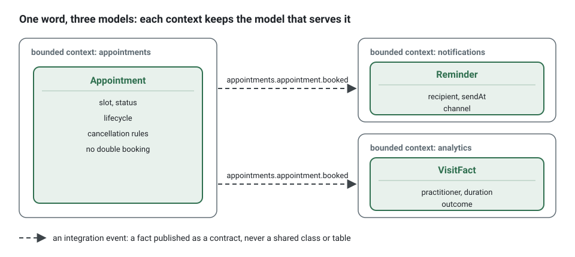
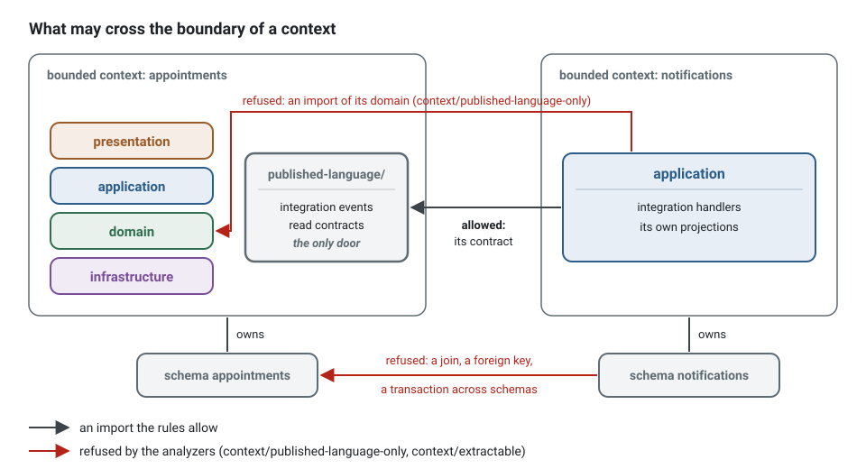

**English** · [Français](bounded-context.fr.md)

# Bounded context

**Summary.** A bounded context is the explicit boundary inside which one model and one
vocabulary are valid. Inside it a word has one meaning and the rules are consistent; outside
it, the same word may mean something else, and nobody is wrong. Finding the boundary is the
most consequential design decision of a project: four tests help (language, autonomy,
consistency, size). In this kit a context is a folder with a closed tree, a `CONTEXT.md`, its
own database schema, and a single door for the others: its `published-language/`.

## One model per context

Large systems fail when they try to hold a single model of everything. "Appointment" for the
booking rules is a commitment with a lifecycle; for analytics it is a row with a duration and an
outcome; for notifications it is a date, a recipient and a message template. One class serving
the three ends up with every field optional and every rule conditional.

A bounded context ends that negotiation: each of the three keeps the model that serves it, and
the contexts exchange facts through contracts instead of sharing a class or a table.



## Subdomain versus bounded context

A [subdomain](domain-and-subdomains.md) belongs to the problem: it is how the business is
divided. A bounded context belongs to the solution: it is how the software is divided. Aim for
one context per subdomain, and expect exceptions. What matters is that the boundary is explicit
and that the team can say which model is valid where.

## How to find a boundary

The `bounded-contexts` skill of the plugin walks through the four tests below, in the
vocabulary of the project owner, and adds a fifth about people: could one person or one agent
hold the context in mind alone? None decides alone; together they usually agree.

| Test | Question | A sign that there are two contexts |
|---|---|---|
| Language | Does a word change meaning here? | "Slot" is a free interval in availability and the booked interval of one appointment in appointments |
| Autonomy | Can this part change its rules, or be rewritten, without its neighbours noticing? Who decides its rules? | the reminder policy changes monthly, decided by support, and booking must not move with it |
| Consistency | What must be true at every instant, in one transaction, and what may be true a moment later? | a practitioner must never be double-booked (immediate); the list of open slots may lag by a second (eventual) |
| Size | Is it a model, or only a table for somebody else? Does the glossary have two unrelated halves? | a "settings" context that only stores values for another is a table, not a context |

The consistency test is the sharpest. Whatever needs immediate consistency lives in one
[aggregate](aggregates.md), hence in one context. If two candidate contexts must commit together
for a rule to hold, either they are one context, or the rule must be restated as a process:
one side decides, the other reacts ([Eventual consistency](eventual-consistency.md)).

### Signals that a boundary is wrong

- A use case writes in two contexts in one transaction.
- A context needs most fields of another context's aggregate.
- A shared kernel that keeps growing.
- Two contexts that need each other: a cycle (`context/no-cycle`). Either they are one context,
  or one direction becomes an event, or a third context is missing.
- Every change touches the same two contexts together: they change for the same reason.
- A context whose only content is storage for another.

Boundaries drawn too fine cost as much as boundaries drawn too coarse: each one adds contracts,
events and eventual consistency. When in doubt, start with fewer contexts and write the doubt
down under "Known tensions" in the context map; merging two contexts later is harder than
splitting one whose model was kept clean.

## What the kit makes of a context

```
src/contexts/appointments/
  CONTEXT.md
  published-language/     the only folder another context may import
  domain/                 aggregates, entities, value objects, events, errors, repository ports, services
  application/            commands, queries, ports, authorization, event handlers, integration
  infrastructure/         persistence, external adapters, anti-corruption
  presentation/           http, cli
  test/                   unit, integration, fakes, builders
```

The full canonical tree is in [ARCHITECTURE.md](../ARCHITECTURE.md), section 2. What turns the
folder into a boundary is a set of rules, each with an id:

| What is held | Rule |
|---|---|
| the tree is closed: a new directory is a decision, not an accident | `tree/closed` |
| every context documents its purpose, classification, language, aggregates, events and relationships | `tree/context-doc` |
| another context is reached only through its `published-language/` | `context/published-language-only` |
| and only when the relationship is declared in the config | `context/declared-relationship` |
| a published language is a contract, free of internals | `context/published-language-is-a-contract` |
| declared relationships form no cycle | `context/no-cycle` |
| the context can run alone: own data, no shared transaction | `context/extractable` |

`npx ddd-ts-kit explain <rule-id>` prints the reason and an example for each.



Three consequences are worth spelling out:

- **Own data.** One database schema per context, no foreign key, join or transaction across
  contexts. A context that needs another's data reads a published contract or keeps a local
  projection fed by integration events.
- **`CONTEXT.md` is part of the code.** Its glossary is what names are checked against
  ([Ubiquitous language](ubiquitous-language.md)), and its first sentence of purpose is reused
  in the generated context map.
- **A context is a deployable unit in waiting.** Because nothing crosses the boundary except
  contracts and events, moving a context to its own service is a change of composition, not of
  model ([Modular monolith](modular-monolith.md),
  [When to extract microservices](../guides/when-to-extract-microservices.md)).

Creating one is a single command, and the glossary comes first:

```bash
npx ddd-ts-kit generate context availability --classification supporting \
  --upstream calendars:published-language --upstream appointments:published-language \
  --purpose "Answers which slots a practitioner can still offer. It is derived from calendars and booked appointments and never decides a booking." \
  --term "Slot=An interval a practitioner can still offer to a client"
```

### Crossing the boundary, in code

A consumer that needs to know about a booking does not import the `Appointment` aggregate.
Instead of:

```ts
// contexts/notifications/application/integration/handlers/appointment-booked.integration-handler.ts
// refused: context/published-language-only (the domain of appointments is not a contract)
import { Appointment } from '@/contexts/appointments/domain/aggregates/appointment.aggregate';
```

write the fact once, in the published language of the producer, as a versioned integration
event with a schema, and let the consumer build its own model from that payload:

<!-- checked sample -->
```ts
import { defineIntegrationEvent } from '@ddd-ts-kit/events';
import type { IntegrationEvent } from '@ddd-ts-kit/kernel';
import { zodSchema } from '@ddd-ts-kit/validation/zod';
import { z } from 'zod';

// contexts/appointments/published-language/appointment-booked.v1.integration-event.ts
// The contract appointments owns: plain, serializable facts, no class of its domain.
const AppointmentBookedV1Payload = z.object({
  appointmentId: z.string(),
  practitionerId: z.string(),
  clientId: z.string(),
  startsAt: z.iso.datetime(),
  endsAt: z.iso.datetime(),
});

export const appointmentBookedV1 = defineIntegrationEvent({
  type: 'appointments.appointment.booked',
  version: 1,
  description: 'A client booked a slot with a practitioner.',
  payload: zodSchema(AppointmentBookedV1Payload),
});

export type AppointmentBookedV1 = IntegrationEvent<z.output<typeof AppointmentBookedV1Payload>>;

// contexts/notifications: its own model of the same appointment, built from the contract only.
interface Reminder {
  readonly recipientId: string;
  readonly appointmentId: string;
  readonly sendAt: Date;
}

const ONE_DAY_MS = 24 * 60 * 60 * 1000;

export function reminderFor(event: AppointmentBookedV1): Reminder {
  const { clientId, appointmentId, startsAt } = event.payload;

  return { recipientId: clientId, appointmentId, sendAt: new Date(Date.parse(startsAt) - ONE_DAY_MS) };
}
```

The contract can now evolve on its own terms (a `v2` next to `v1`, see
[Event versioning](event-versioning.md)), and `appointments` can rename every field of its
aggregate without a single change in `notifications`. The relationship is declared in the
config of the consumer (`"upstreams": [{ "context": "appointments", "relationship":
"published-language" }]`), or `context/declared-relationship` refuses the import.

## The example: where does "no double booking" live?

A first sketch puts the rule in `availability`: it knows the open slots, so it should refuse a
taken one. The consistency test says otherwise. Availability is computed from events of two
other contexts and is therefore always slightly late. A rule that must hold at every instant
cannot rest on late data. The rule belongs to `appointments`, guarded by the aggregate and by a
database constraint; `availability` only advises the user interface, and booking a slot that
was taken a moment ago ends in the refusal `SLOT_TAKEN`, built by a factory of the class named
after it, `SlotTaken`, which reads its code from the list of the codes of `appointments`:

<!-- checked sample -->
```ts
import { DomainRefusal } from '@ddd-ts-kit/kernel';

// contexts/appointments/domain/errors/codes.ts
export const AppointmentsCodes = {
  SlotTaken: 'SLOT_TAKEN',
} as const;

// contexts/appointments/domain/errors/slot-taken.error.ts
export class SlotTaken extends DomainRefusal {
  readonly code = AppointmentsCodes.SlotTaken;

  static forPractitioner(practitionerId: string, startsAt: Date) {
    return SlotTaken.refusal(
      `The slot starting at ${startsAt.toISOString()} is already held for practitioner ${practitionerId}.`,
      { practitionerId, startsAt },
    ).exposing('startsAt');
  }
}

interface HeldSlot {
  readonly practitionerId: string;
  readonly startsAt: Date;
  readonly endsAt: Date;
}

// Decided where appointments are written, against the appointments of the same practitioner
// read in the same transaction (and a unique constraint behind it), never against the list
// of open slots of availability, which is always a moment late.
export function assertFree(wish: HeldSlot, held: readonly HeldSlot[]): void {
  const taken = held.some(
    (other) =>
      other.practitionerId === wish.practitionerId && other.startsAt < wish.endsAt && wish.startsAt < other.endsAt,
  );

  if (taken) {
    throw SlotTaken.forPractitioner(wish.practitionerId, wish.startsAt);
  }
}
```

The route lists `SLOT_TAKEN` among the errors it answers, the platform maps the code to a
status (`409` in the example application, `src/platform/http/error-statuses.ts`), and the
client receives a problem document with the code and the exposed fact `startsAt`: it can offer
the nearest open slots instead.

## Limits and when not to use it

- **The tools check the walls, not their position.** The checker can prove that nothing crosses
  a boundary illegally. It cannot tell whether the boundary is in the right place: that remains
  a human judgement, reviewed by the `architecture-reviewer` agent and by people.
- **The import rules are approximated at text level by the CLI checker** and held exactly by
  the ESLint plugin and dependency-cruiser. The CLI README lists what the fast checker does not
  see (a type reaching a layer through a barrel, a schema name in raw SQL, a cross-context
  transaction). The three analyzers together are the guarantee, not one of them.
- **Nothing constrains what `shared-kernel/`, `platform/` and `main.ts` import** (CLI README,
  Limits). A shared kernel can become a back door between contexts if it is allowed to grow.
- **One context is a valid answer.** A small product with one coherent vocabulary does not need
  several contexts, and inventing them buys contracts and eventual consistency for nothing.
- **A context is not a team, a service or a repository by definition.** It often maps to one
  team and can become one service, but the boundary is about the model first.

## Sources

- Eric Evans, *Domain-Driven Design*, Addison-Wesley, 2003, chapter 14 "Maintaining Model
  Integrity" (bounded context, continuous integration, context map).
- Vaughn Vernon, *Implementing Domain-Driven Design*, Addison-Wesley, 2013, chapter 2.
- Vlad Khononov, *Learning Domain-Driven Design*, O'Reilly, 2021, chapter 3 "Managing Domain
  Complexity" (subdomains versus bounded contexts).
- Martin Fowler, "BoundedContext", martinfowler.com/bliki/BoundedContext.html.
- Sam Newman, *Building Microservices*, 2nd edition, O'Reilly, 2021, chapter 2 (information
  hiding, coupling and cohesion as boundary criteria).

## See also

- [Domain and subdomains](domain-and-subdomains.md)
- [Ubiquitous language](ubiquitous-language.md)
- [Context map](context-map.md)
- [A worked example: the context map of the scheduling application](context-map-worked-example.md)
- [Aggregates](aggregates.md)
- [Modular monolith](modular-monolith.md)
- [Architecture reference](../ARCHITECTURE.md)
- [Concepts index](README.md)
