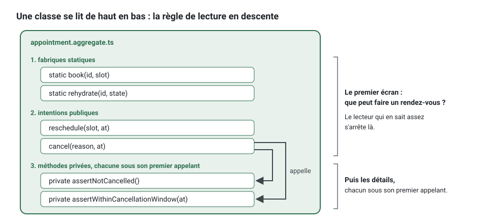

[English](clean-code.md) · **Français**
<!-- translation-of: clean-code.md sha256:c68747a88bff63b7 -->

# Le code propre, tel que le kit l'applique

**Résumé.** Le kit applique à TypeScript un sous-ensemble réduit, et vérifiable, du Clean Code
de Robert C. Martin : des noms tirés du langage omniprésent (ubiquitous language), de petites
fonctions qui font une seule chose, des fichiers qui se lisent de haut en bas (la règle de
lecture en descente, ou stepdown), un concept par fichier, des commentaires réservés à ce que le
code ne peut pas dire, aucune échappatoire au système de types, et un code testable par
construction parce que le temps, les identifiants et les entrées-sorties passent par des ports.
Chaque convention a un identifiant de règle, une raison et une correction ; cette page montre à
quoi elles ressemblent sur du vrai code, avant et après, et ce qu'un outil ne peut pas juger. Le
texte normatif est la
[section 6 de la référence d'architecture](../ARCHITECTURE.fr.md#6-code-propre).

## Pourquoi ces règles, et pourquoi les faire respecter par un outil

Le code est lu bien plus souvent qu'il n'est écrit, et dans un projet où des agents de code en
écrivent une grande partie, il est lu par des gens qui ne l'ont pas écrit. Les conventions qui
reposent sur la bonne volonté s'effritent à la première échéance. Le kit transforme donc
chacune d'elles en une vérification accompagnée d'une phrase `fix` (`npx ddd-ts-kit explain
<rule-id>` en donne la raison et un exemple) : un commentaire de revue qui revient sans cesse
devient une vérification en échec, et les relecteurs gardent leur attention pour la conception.

## Les noms viennent du langage

Un nom est soit un mot du glossaire du contexte, soit un mot qui nomme un rôle architectural
hors du domaine (`AppointmentRepository`, `BookAppointmentHandler`). Règles
`language/glossary-term` et `language/no-technical-name`.

Avant :

```ts
export class AppointmentManager {
  updateStatus(data: AppointmentData, status: string, flag: boolean): void { /* ... */ }
}
```

Après :

```ts
export class Appointment extends AggregateRoot {
  cancel(reason: CancellationReason, at: Date): void { /* ... */ }

  reschedule(slot: TimeSlot, at: Date): void { /* ... */ }
}
```

Ce qui a changé : `Manager` et `Data` ne disaient rien et sont refusés dans le domaine ;
`updateStatus` était un mutateur déguisé, remplacé par ce que le métier dit qu'il se passe ; le
statut en `string` et le booléen sont devenus des types et des intentions. Si le mot dont vous
avez besoin n'est pas dans le glossaire, c'est que le concept n'est pas encore compris : ajoutez
d'abord le terme avec sa signification, ou posez la question. Voir
[Langage omniprésent](ubiquitous-language.fr.md).

De petites habitudes aux grands effets : un seul mot par concept dans un contexte (pas `fetch`
ici et `retrieve` là), un booléen se lit comme un prédicat (`isCancelled`), une collection porte
un nom au pluriel.

Pas de valeur magique non plus. Un statut, un type ou un rôle est un vocabulaire fermé, déclaré
une fois et lu par sa clé, `AppointmentStatus.NoShow`, jamais `'no-show'` écrit à nouveau
(`language/declared-vocabulary`, voir [Langage omniprésent](ubiquitous-language.fr.md#vocabulaires-fermés)).
Un nombre dans `domain/` ou `application/`, autre que 0, 1, -1 ou un indice, porte un nom là où
il est décidé, une constante du module ou un objet-valeur (`clean/no-magic-number`) :

```ts
// Avant
return Number(hours) * 60 + Number(minutes);

// Après
const MINUTES_PER_HOUR = 60;

return Number(hours) * MINUTES_PER_HOUR + Number(minutes);
```

## De petites fonctions, une seule chose, un seul niveau d'abstraction

Une fonction a au plus trois paramètres et reste courte (règle `clean/function-size`, limite de
30 lignes par défaut, réglable sous `limits`, jamais plus de 100). Davantage de paramètres, c'est
un concept qui mérite un type. Un commentaire qui annonce une « étape » à l'intérieur d'une
fonction signale une fonction qui attend d'être extraite, avec un nom qui remplace le
commentaire.

Avant :

```ts
cancel(reason: string, at: Date, byPractitioner: boolean): void {
  // vérifier l'état
  if (this.status === 'cancelled') {
    throw new Error('already cancelled');
  }
  // vérifier le délai
  const hours = (this.slot.startsAt.getTime() - at.getTime()) / 3_600_000;
  if (!byPractitioner && hours < 24) {
    throw new Error('too late');
  }
  this.status = 'cancelled';
  this.cancelledAt = at;
}
```

Après :

```ts
cancel(reason: CancellationReason, at: Date): void {
  this.assertNotCancelled();
  this.assertWithinCancellationWindow(at);

  this.status = { kind: 'cancelled', at, reason };
  this.record(new AppointmentCancelled(this.id, at, reason));
}

private assertNotCancelled(): void {
  if (this.status.kind === 'cancelled') {
    throw AppointmentError.alreadyCancelled(this.id);
  }
}

private assertWithinCancellationWindow(at: Date): void {
  if (!this.slot.startsAtLeast(CANCELLATION_NOTICE_HOURS, at)) {
    throw AppointmentError.cancellationWindowPassed(this.id, this.slot.startsAt);
  }
}
```

Quatre règles respectées d'un coup :

- `clean/no-flag-argument` : le booléen `byPractitioner` mettait deux intentions dans une seule
  méthode. Qui annule est une question de droits, tranchée par une politique (policy) avant
  l'appel à l'agrégat
  ([Invariants, permissions, validation](invariants-permissions-validation.fr.md)) ; si le
  métier a vraiment deux comportements, ce sont deux méthodes.
- `domain/no-generic-error` : un échec métier est une `DomainError` spécifique avec un code
  stable, pas `new Error('too late')`. Il est nommé deux fois dans les mots du métier, par la
  fabrique qui le construit et par son code (`errors/through-factory`, `errors/factory-name`).
- `clean/no-noise-comment` : `// vérifier l'état` répétait le code ; le nom extrait le dit.
- Commande ou requête, jamais les deux : `cancel` change l'état et ne renvoie rien.

Les clauses de garde viennent d'abord et le chemin nominal reste sans indentation ; il n'y a pas
de `else` après un `return` ou un `throw`.

```ts
// refusé : la règle est enfouie dans un else, le chemin nominal est indenté
if (this.status.kind !== 'cancelled') {
  this.status = { kind: 'cancelled', at, reason };
} else {
  throw AppointmentError.alreadyCancelled(this.id);
}

// exigé : la garde d'abord, puis le chemin nominal contre la marge gauche
if (this.status.kind === 'cancelled') {
  throw AppointmentError.alreadyCancelled(this.id);
}

this.status = { kind: 'cancelled', at, reason };
```

Mise bout à bout, la version « après » est un agrégat complet. L'exemple ci-dessous compile avec
le kit tel qu'il est ; dans un projet, chaque classe vit dans son propre fichier (voir
[Un concept par fichier](#un-concept-par-fichier)), et le générateur en écrit les squelettes.

Son `AppointmentStatus` n'est pas le vocabulaire `AppointmentStatus.NoShow` du paragraphe sur
les valeurs magiques : c'est une union discriminée dont le `kind` porte ses propres données
(l'instant et le motif d'une annulation), et une telle union reste une union de types
littéraux, que le compilateur vérifie à chaque `switch`. `CancellationReason` reste lui aussi
une union de deux littéraux, pour garder les exemples courts et autonomes ; dans un projet où
d'autre code compare, accorde ou stocke les motifs, déclarez-le comme vocabulaire et écrivez
`CancellationReason.ClientRequest` ([Langage omniprésent](ubiquitous-language.fr.md#vocabulaires-fermés)
pèse le même choix pour `'patient' | 'practice'`).

<!-- checked sample -->
```ts
import { AggregateRoot, ConceptError, ValueObject, type DomainEvent } from '@ddd-ts-kit/kernel';

const CANCELLATION_NOTICE_HOURS = 24;
const MILLISECONDS_PER_HOUR = 3_600_000;

export type CancellationReason = 'client-request' | 'practitioner-unavailable';

/** Un rendez-vous annulé a toujours un motif et un instant : aucune autre forme n'est possible. */
export type AppointmentStatus =
  | { readonly kind: 'booked' }
  | { readonly kind: 'cancelled'; readonly at: Date; readonly reason: CancellationReason };

export class TimeSlot extends ValueObject<{ startsAt: Date; endsAt: Date }> {
  static of(startsAt: Date, endsAt: Date): TimeSlot {
    return new TimeSlot({ startsAt, endsAt });
  }

  get startsAt(): Date {
    return this.props.startsAt;
  }

  /** Vrai quand le créneau commence `hours` heures ou plus après `at`. */
  startsAtLeast(hours: number, at: Date): boolean {
    return this.props.startsAt.getTime() - at.getTime() >= hours * MILLISECONDS_PER_HOUR;
  }
}

export class AppointmentError extends ConceptError {
  static alreadyCancelled(appointmentId: string) {
    return AppointmentError.refusal(
      'APPOINTMENT_ALREADY_CANCELLED',
      `Appointment ${appointmentId} is already cancelled.`,
      { appointmentId },
    );
  }

  static cancellationWindowPassed(appointmentId: string, startsAt: Date) {
    return AppointmentError.refusal(
      'CANCELLATION_WINDOW_PASSED',
      `Appointment ${appointmentId} starts too soon to be cancelled.`,
      { appointmentId, startsAt },
    );
  }
}

export class AppointmentCancelled implements DomainEvent {
  static readonly eventName = 'appointments.appointment.cancelled';

  readonly name = AppointmentCancelled.eventName;

  constructor(
    readonly aggregateId: string,
    readonly occurredAt: Date,
    readonly reason: CancellationReason,
  ) {}
}

export class Appointment extends AggregateRoot {
  private constructor(
    id: string,
    private readonly slot: TimeSlot,
    private status: AppointmentStatus,
  ) {
    super(id);
  }

  static book(id: string, slot: TimeSlot): Appointment {
    return new Appointment(id, slot, { kind: 'booked' });
  }

  cancel(reason: CancellationReason, at: Date): void {
    this.assertNotCancelled();
    this.assertWithinCancellationWindow(at);

    this.status = { kind: 'cancelled', at, reason };
    this.record(new AppointmentCancelled(this.id, at, reason));
  }

  private assertNotCancelled(): void {
    if (this.status.kind === 'cancelled') {
      throw AppointmentError.alreadyCancelled(this.id);
    }
  }

  private assertWithinCancellationWindow(at: Date): void {
    if (!this.slot.startsAtLeast(CANCELLATION_NOTICE_HOURS, at)) {
      throw AppointmentError.cancellationWindowPassed(this.id, this.slot.startsAt);
    }
  }
}
```

Une *spec* lit le refus par son code, celui que voient à la fois le métier et l'API :

<!-- checked sample -->
```ts
import { expectRefusal } from '@ddd-ts-kit/testing';
import { it } from 'vitest';

declare class Appointment {
  cancel(reason: 'client-request', at: Date): void;
}
declare function aBookedAppointmentStartingAt(startsAt: Date): Appointment;

it('refuses to cancel an appointment that starts in less than 24 hours', () => {
  const appointment = aBookedAppointmentStartingAt(new Date('2026-03-02T10:00:00.000Z'));

  expectRefusal(
    () => appointment.cancel('client-request', new Date('2026-03-01T12:00:00.000Z')),
    'CANCELLATION_WINDOW_PASSED',
  );
});
```

## La règle de lecture en descente

Un fichier se lit comme un article de journal : l'intention en haut, les détails en dessous.
Dans une classe : les fabriques statiques, puis les méthodes publiques, puis les méthodes
privées, chaque méthode privée placée après son premier appelant. Dans un module : la fonction
exportée d'abord, ses fonctions auxiliaires ensuite, dans l'ordre où elles sont appelées. Règle
`clean/stepdown`.

```ts
export class Appointment extends AggregateRoot {
  static book(...)                          // 1. fabriques
  static rehydrate(...)
  reschedule(slot: TimeSlot, at: Date)      // 2. intentions publiques
  cancel(reason: CancellationReason, at: Date)
  private assertNotCancelled()              // 3. chaque auxiliaire sous son premier appelant
  private assertWithinCancellationWindow(at: Date)
}
```



Le bénéfice est à la lecture : ouvrir le fichier répond dès le premier écran à « que peut faire
un rendez-vous », et le lecteur s'arrête dès qu'il en sait assez. Cela rend aussi les fichiers
prévisibles pour un outil ou un agent qui ne lit que le haut d'un fichier.

## Un concept par fichier

Une classe, une interface ou une fonction exportée par fichier, nommé d'après elle, dans le
répertoire de son rôle avec le suffixe de son rôle : `appointment.aggregate.ts`,
`time-slot.vo.ts`, `book-appointment.handler.ts`. Règles `naming/suffix`,
`naming/one-concept-per-file` et `clean/one-export-per-file` : les seuls compagnons du concept
exporté sont les types de sa propre signature et de petites familles fermées, tout le reste est
listé dans `onePerFile.allow` de la configuration avec sa raison, et un fichier index ne fait que
réexporter. Un fichier de plus de 350 lignes, tests compris, porte plus d'une responsabilité
(`clean/file-size`).

La raison est la navigation. Le chemin d'un concept se déduit de son nom, donc personne ne le
cherche ; un diff touche les fichiers d'un seul concept ; deux personnes modifient rarement le
même fichier. Voir [Économie de jetons](../guides/token-economy.fr.md) pour ce que cela vaut
avec des agents de code.

## Mise en forme

Une ligne vide avant chaque `return` qui n'est pas seul dans son bloc et entre les blocs
logiques d'une fonction ; aucune ligne vide qui rembourre les bords d'un bloc
(`clean/blank-lines` ; le *checker* au niveau du texte tient le `return` et le bloc rembourré,
ESLint les lignes vides entre instructions, avec une correction automatique). Les membres d'une
classe sont `private`, jamais `#name` (`clean/no-hash-private`) : une seule façon de cacher un
membre, celle que vérifie le compilateur.

Chaque `if`, `else`, `for`, `while` et `do` a ses accolades, et son corps est sur ses propres
lignes (`clean/braces`) : une branche se voit d'un coup d'œil, et une instruction ajoutée plus
tard ne peut pas tomber en silence hors d'elle. Un opérateur ternaire et une fonction fléchée qui
renvoie une expression restent tels quels.

```ts
// refusé
if (wrapped.has(repository)) return repository;

// exigé
if (wrapped.has(repository)) {
  return repository;
}
```

Tout le reste de la place des éléments du code est décidé par le formateur, Biome, avec une
largeur de ligne de 120 (`clean/formatted`) : `npm run format` l'écrit, `npm run format:check`
le vérifie avant un *commit* et dans le *pipeline*. Voir le
[socle de qualité](../tools/quality-baseline.fr.md).

## Commentaires

Par défaut, aucun : le code dit quoi. Un commentaire est réservé à ce que le code ne peut pas
dire.

| À garder | Exemple |
|---|---|
| pourquoi un choix non évident a été fait | `// Le préavis se compte en heures d'horloge, pas en heures ouvrées : décidé avec le support, ADR-0004` |
| un avertissement sur une conséquence | `// L'ordre compte : l'ajout à l'outbox doit partager la transaction de la sauvegarde` |
| une référence externe | une loi, une RFC, une bizarrerie d'un fournisseur avec son lien |
| le contrat d'une API publique ou d'un port | ce qu'une méthode garantit, ses unités, l'erreur qu'elle lève |

À supprimer : les paraphrases de la ligne suivante, les bannières et les séparateurs de section,
les étiquettes d'accolade fermante, l'historique des modifications, les noms d'auteur, un
`@param id the id`, et le code commenté (le gestionnaire de versions s'en souvient). Règles
`clean/no-noise-comment` et `clean/no-commented-out-code`. Les fichiers générés ne portent que
des marqueurs `TODO(domain)` et `TODO(platform)`, chacun énonçant la décision attendue.

## Aucune échappatoire

TypeScript en mode `strict`, pas de `any` (utilisez `unknown` et affinez), pas d'assertion
non nulle, pas d'assertion de type hors des *mappers* et de l'infrastructure, pas de diagnostic
désactivé sans raison écrite. Règle `clean/no-escape-hatch`. Chacune de ces échappatoires fait
taire le compilateur exactement là où il allait dire quelque chose. Modélisez les alternatives
en unions discriminées pour qu'un `switch` soit exhaustif, et rendez les états invalides
impossibles à représenter au lieu de les valider plus tard :

```ts
// avant : un rendez-vous annulé sans motif est représentable
interface AppointmentState { status: 'booked' | 'cancelled'; cancelledAt?: Date; reason?: string }

// après : il ne l'est pas
type AppointmentStatus =
  | { kind: 'booked' }
  | { kind: 'cancelled'; at: Date; reason: CancellationReason };
```

Avec l'union, le compilateur vérifie chaque `switch` sur le statut : un type de statut ajouté
plus tard fait échouer la compilation partout où il n'est pas encore traité. Et là où arrive une
valeur dont la forme n'est pas connue (un corps analysé, une colonne JSON stockée), `unknown` et
un test que suit le compilateur remplacent `any` :

<!-- checked sample -->
```ts
type CancellationReason = 'client-request' | 'practitioner-unavailable';

type AppointmentStatus =
  | { readonly kind: 'booked' }
  | { readonly kind: 'cancelled'; readonly at: Date; readonly reason: CancellationReason }
  | { readonly kind: 'completed'; readonly at: Date };

/** Pas de branche par défaut : un nouveau type de statut ne compile pas tant qu'il n'est pas traité ici. */
export function isOpen(status: AppointmentStatus): boolean {
  switch (status.kind) {
    case 'booked':
      return true;
    case 'cancelled':
    case 'completed':
      return false;
  }
}

/** Au lieu de `(row as any).reason` : `unknown`, affiné par des tests que suit le compilateur. */
export function reasonOf(row: unknown): CancellationReason | undefined {
  if (typeof row !== 'object' || row === null || !('reason' in row)) {
    return undefined;
  }

  return row.reason === 'client-request' || row.reason === 'practitioner-unavailable' ? row.reason : undefined;
}
```

Une désactivation est une dérogation : elle nomme sa règle, donne une raison et renvoie à un
enregistrement de décision (règle `governance/recorded-deviation`).

## Testable par construction

Le code du domaine et de l'application est pur vis-à-vis du monde extérieur. Le temps vient du
port `Clock`, les identifiants du port `IdGenerator`, chaque entrée-sortie d'un port, les
dépendances par le constructeur. Règles `purity/no-system-clock`,
`purity/no-ambient-randomness`, `purity/no-environment`.

Avant :

```ts
async execute(command: BookAppointment): Promise<string> {
  const id = crypto.randomUUID();
  const appointment = Appointment.book(id, command.clientId, command.slot, new Date());
  if (process.env.SMS_ENABLED === 'true') {
    await sendSms(command.clientId, 'Booked');
  }
  await this.appointments.save(appointment);
  return id;
}
```

Après :

```ts
async execute(command: BookAppointment): Promise<string> {
  const appointment = Appointment.book(this.ids.next(), command.clientId, command.slot, this.clock.now());

  await this.appointments.save(appointment);

  return appointment.id;
}
```

La première version ne peut pas être testée sans simuler (mock) un module, une variable globale
et l'environnement, et son résultat change à chaque exécution. La seconde reçoit, dans une
*spec*, une horloge fixe et des identifiants séquentiels, et vérifie des valeurs exactes. Le SMS
a quitté le gestionnaire (handler) : confirmer une réservation est une réaction du contexte
`notifications` à `appointments.appointment.booked`. Notez que l'agrégat reçoit l'instant en
argument ; les agrégats ne détiennent pas d'horloge.


Le gestionnaire complet de la seconde version, avec ce qu'il reçoit :

<!-- checked sample -->
```ts
import {
  AggregateRoot,
  AuthorizedCommand,
  Clock,
  IdGenerator,
  Repository,
  type Actor,
  type CommandHandler,
} from '@ddd-ts-kit/kernel';

// Déclarés ici pour que l'exemple compile seul ; dans un projet, ce sont des fichiers du domaine.
declare class TimeSlot {
  readonly startsAt: Date;
}
declare class Appointment extends AggregateRoot {
  static book(id: string, clientId: string, slot: TimeSlot, at: Date): Appointment;
}
export abstract class AppointmentRepository extends Repository<Appointment> {}

export class BookAppointment extends AuthorizedCommand<string> {
  constructor(
    actor: Actor,
    readonly clientId: string,
    readonly slot: TimeSlot,
  ) {
    super(actor);
  }
}

export class BookAppointmentHandler implements CommandHandler<BookAppointment> {
  constructor(
    private readonly appointments: AppointmentRepository,
    private readonly ids: IdGenerator,
    private readonly clock: Clock,
  ) {}

  async execute(command: BookAppointment): Promise<string> {
    const appointment = Appointment.book(this.ids.next(), command.clientId, command.slot, this.clock.now());

    await this.appointments.save(appointment);

    return appointment.id;
  }
}
```

Et sa *spec*, qui lui donne une horloge fixe, des identifiants séquentiels et le *fake* en
mémoire du *repository*, puis vérifie des valeurs exactes. Le gestionnaire est construit à la
main ici pour montrer ce qu'il reçoit ; [Stratégie de test](testing-strategy.fr.md) montre
l'application de test qui câble ces mêmes *fakes* pour vous.

<!-- checked sample -->
```ts
import { AggregateRoot, Clock, FixedClock, IdGenerator, SequentialIdGenerator, type Actor } from '@ddd-ts-kit/kernel';
import { anActor } from '@ddd-ts-kit/auth/testing';
import { InMemoryRepository } from '@ddd-ts-kit/testing';
import { describe, expect, it } from 'vitest';

// Ce que la spec importe du contexte, déclaré ici pour que l'exemple compile seul.
declare class TimeSlot {
  static of(startsAt: Date, endsAt: Date): TimeSlot;
}
declare class Appointment extends AggregateRoot {
  readonly bookedAt: Date;
}
declare class FakeAppointmentRepository extends InMemoryRepository<Appointment> {
  constructor();
}
declare class BookAppointment {
  constructor(actor: Actor, clientId: string, slot: TimeSlot);
}
declare class BookAppointmentHandler {
  constructor(appointments: FakeAppointmentRepository, ids: IdGenerator, clock: Clock);
  execute(command: BookAppointment): Promise<string>;
}

describe('Booking an appointment', () => {
  it('books the slot at the instant of the clock, under the next identifier', async () => {
    const now = new Date('2026-03-02T09:00:00.000Z');
    const appointments = new FakeAppointmentRepository();
    const ids = new SequentialIdGenerator('appointment');
    const handler = new BookAppointmentHandler(appointments, ids, new FixedClock(now));
    const slot = TimeSlot.of(new Date('2026-03-04T10:00:00.000Z'), new Date('2026-03-04T10:30:00.000Z'));

    const id = await handler.execute(new BookAppointment(anActor().named('client-1').build(), 'client-1', slot));

    expect(id).toBe('appointment-1');
    expect((await appointments.findById(id))?.bookedAt).toEqual(now);
  });
});
```

Une classe qui a besoin d'un *mock* de module pour être testée enfreint l'une de ces règles.
C'est le lien entre cette page et [Stratégie de test](testing-strategy.fr.md).

## Ce que les outils ne voient pas

Les vérifications sont volontairement mécaniques, et leurs limites sont documentées dans le
[README de la CLI](../../packages/cli/README.fr.md) et le
[README du plugin ESLint](../../packages/eslint-plugin/README.fr.md) :

- **Un bon nom.** La règle du glossaire compare mot à mot, avec une flexion anglaise
  rudimentaire. Elle ne connaît aucun synonyme et ne peut pas savoir que `process` est vague
  quand le glossaire se trouve définir « process ».
- **Une seule chose.** Une fonction de vingt lignes peut encore faire trois choses ; la taille
  n'est qu'un indicateur.
- **Un commentaire utile.** Les règles sur les commentaires sont des heuristiques sur la forme
  d'une ligne : une phrase qui se termine comme une instruction peut être signalée, du code
  écrit comme une phrase passe inaperçu.
- **La pureté à travers une enveloppe.** Les règles de pureté cherchent les éléments et les
  modules listés ; une fonction auxiliaire qui cache `Date.now()` dans un endroit autorisé
  échappe à la vue.
- **Les fonctions fléchées et les fonctions imbriquées** ne sont pas jugées par le *checker* au
  niveau du texte pour l'ordre, la taille et les arguments booléens ; le plugin ESLint, qui lit
  l'arbre syntaxique, fait autorité quand les deux divergent.
- **La justesse du modèle.** Un agrégat anémique aux méthodes parfaitement ordonnées et bien
  dimensionnées passe toutes les règles du code propre ([Modèle anémique](anemic-model.fr.md)).

La revue de conception existe pour ce reste.

## Limites et quand ne pas l'utiliser

- **Les règles sont un plancher, pas une définition de la qualité.** Les passer prouve l'absence
  d'une liste de défauts connus.
- **On peut abuser des petites fonctions.** Extraire toutes les deux lignes éparpille un
  algorithme simple dans tout un fichier ; extrayez quand un nom apporte de l'information.
- **Les limites sont réglables pour une raison.** Un projet peut les relever délibérément, avec
  un enregistrement de décision ; les relever pour passer au vert est le défaut.
- **Une partie du code est légitimement différente.** Les *mappers* et les adaptateurs
  d'infrastructure ont besoin d'assertions de type, et les fichiers d'un répertoire
  `generated/` échappent à la règle de taille de fichier. Les règles prévoient déjà ces
  exceptions.
- **Le code jetable.** Un prototype destiné à être supprimé n'a pas besoin de cette discipline ;
  le seul problème est que les prototypes sont rarement supprimés. `ddd-ts-kit check
  --clean-only` applique les règles au niveau du fichier à n'importe quel répertoire, sans
  projet, pour mesurer l'écart avant d'adopter le kit.

## Sources

- Robert C. Martin, Clean Code, Prentice Hall, 2008 : chapitres 2 (Meaningful Names), 3
  (Functions, dont la règle de lecture en descente et les arguments booléens), 4 (Comments), 7
  (Error Handling), 10 (Classes).
- Robert C. Martin, Clean Architecture, Prentice Hall, 2017.
- Eric Evans, Domain-Driven Design, Addison-Wesley, 2003 : Ubiquitous Language,
  Intention-Revealing Interfaces, Side-Effect-Free Functions.
- Bertrand Meyer, Object-Oriented Software Construction, 2e édition, Prentice Hall, 1997 :
  séparation commande-requête.
- Martin Fowler, Refactoring, 2e édition, Addison-Wesley, 2018 : Extract Function, Replace
  Primitive with Object, Remove Flag Argument.
- Yaron Minsky, « Effective ML » (2010) : la formule « make illegal states unrepresentable ».

## Voir aussi

- [Langage omniprésent](ubiquitous-language.fr.md)
- [Entités et objets-valeurs](entities-and-value-objects.fr.md)
- [Modèle anémique](anemic-model.fr.md)
- [Stratégie de test](testing-strategy.fr.md)
- [Analyse statique et pipeline](../tools/static-analysis-and-pipeline.fr.md)
- [Économie de jetons](../guides/token-economy.fr.md)
- [Référence d'architecture](../ARCHITECTURE.fr.md) : section 6, règles `clean/*`, `purity/*`,
  `language/*`, `naming/*`
