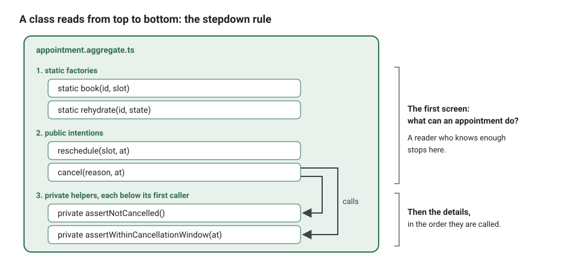

**English** · [Français](clean-code.fr.md)

# Clean code as applied here

**Summary.** The kit applies a small, enforceable subset of Robert C. Martin's Clean Code to
TypeScript: names taken from the ubiquitous language, small functions that do one thing, files
that read top to bottom (the stepdown rule), one concept per file, comments only for what the
code cannot say, no escape hatch around the type system, and code that is testable by
construction because time, identifiers and I/O come through ports. Each convention has a rule
id, a reason and a fix; this page shows what they look like on real code, before and after, and
what a tool cannot judge. The normative text is
[section 6 of the architecture reference](../ARCHITECTURE.md#6-clean-code).

## Why these rules, and why enforced

Code is read far more often than it is written, and in a project where coding agents write
much of it, it is read by people who did not write it. Conventions that depend on goodwill
erode at the first deadline. The kit therefore turns each one into a check with a `fix`
sentence (`npx ddd-ts-kit explain <rule-id>` gives the reason and an example), so a recurring
review comment becomes a failing check and reviewers keep their attention for design.

## Names come from the language

A name is either a word of the context's glossary or a word that names an architectural role
outside the domain (`AppointmentRepository`, `BookAppointmentHandler`). Rules
`language/glossary-term` and `language/no-technical-name`.

Before:

```ts
export class AppointmentManager {
  updateStatus(data: AppointmentData, status: string, flag: boolean): void { /* ... */ }
}
```

After:

```ts
export class Appointment extends AggregateRoot {
  cancel(reason: CancellationReason, at: Date): void { /* ... */ }

  reschedule(slot: TimeSlot, at: Date): void { /* ... */ }
}
```

What changed: `Manager` and `Data` said nothing and are refused in the domain; `updateStatus`
was a setter in disguise, replaced by what the business says happens; the `string` status and
the boolean became types and intentions. If the word you need is not in the glossary, the
concept is not understood yet: add the term with its meaning first, or ask. See
[Ubiquitous language](ubiquitous-language.md).

Smaller habits with large effects: one word per concept in a context (not `fetch` here and
`retrieve` there), a boolean reads as a predicate (`isCancelled`), a collection is a plural.

No magic value either. A status, a kind or a role is a closed vocabulary declared once and read
by its key, `AppointmentStatus.NoShow`, never `'no-show'` written again
(`language/declared-vocabulary`, see [Ubiquitous language](ubiquitous-language.md#closed-vocabularies)).
A number in `domain/` or `application/` other than 0, 1, -1 or an index has a name where it is
decided, a constant of the module or a value object (`clean/no-magic-number`):

```ts
// Before
return Number(hours) * 60 + Number(minutes);

// After
const MINUTES_PER_HOUR = 60;

return Number(hours) * MINUTES_PER_HOUR + Number(minutes);
```

## Name things after the business, never generic

The same holds for the names inside a function. A variable, a parameter, a property, a
destructured name and a loop variable of `domain/` and `application/` name the concept they hold:
`appointment`, `reminder`, `delegation`, never `target`, `data`, `item`, `obj`, `info`, `tmp`
and the like. A generic word says that a value is there and nothing of what it is: `target` could
be an appointment, a calendar or a practice, and the reader has to scroll up to the line that
loaded it; `data` and `item` say even less. The ubiquitous language then stops at the class names,
and a handler no longer reads as the domain expert would tell it. A generic name also spreads,
because the next line is written by copying the last: the command handler templates of the kit
wrote `const target = X.create(..)` until 0.17, and the example application inherited it in
forty places.

Rule `naming/business-name`, held by `ddd-ts-kit check` and by ESLint. `npx eslint --fix` renames
a variable whose initializer names the concept (`X.create(..)`, `new X(..)`, a read of a
repository, `found ?? X.create(..)`) with every use of it; a loop variable is reported with the
singular of its collection. The list of words is `businessNames` of the config
([Configuration](../CONFIG.md)).

<!-- checked sample -->
```ts
export class Reminder {
  private sentAt: Date | undefined;

  constructor(
    readonly id: string,
    readonly dueAt: Date,
  ) {}

  get isSent(): boolean {
    return this.sentAt !== undefined;
  }

  send(at: Date): void {
    this.sentAt = at;
  }
}

export abstract class ReminderRepository {
  abstract findDue(at: Date): Promise<readonly Reminder[]>;

  abstract save(reminder: Reminder): Promise<void>;
}

// Before: something is sent, and the reader has to find out what.
export async function sendDue(repository: ReminderRepository, at: Date): Promise<void> {
  for (const target of await repository.findDue(at)) {
    target.send(at);
    await repository.save(target);
  }
}

// After: the loop reads as the business says it.
export async function sendDueReminders(reminderRepository: ReminderRepository, at: Date): Promise<void> {
  for (const reminder of await reminderRepository.findDue(at)) {
    reminder.send(at);
    await reminderRepository.save(reminder);
  }
}
```

A word inside a longer name is qualified and stays (`targetDate`, `itemCount`); infrastructure,
presentation and the tests are not judged, though a serializer is still better named after what
it serializes.

## Small functions, one thing, one level of abstraction

A function has at most three parameters and stays short (rule `clean/function-size`, limits
30 lines by default, configurable under `limits`, never more than 100). More parameters are a
concept that deserves a type. A comment announcing a "step" inside a function marks a function
waiting to be extracted, with a name that replaces the comment.

Before:

```ts
cancel(reason: string, at: Date, byPractitioner: boolean): void {
  // check state
  if (this.status === 'cancelled') {
    throw new Error('already cancelled');
  }
  // check window
  const hours = (this.slot.startsAt.getTime() - at.getTime()) / 3_600_000;
  if (!byPractitioner && hours < 24) {
    throw new Error('too late');
  }
  this.status = 'cancelled';
  this.cancelledAt = at;
}
```

After:

```ts
cancel(reason: CancellationReason, at: Date): void {
  this.assertNotCancelled();
  this.assertWithinCancellationWindow(at);

  this.status = { kind: 'cancelled', at, reason };
  this.record(new AppointmentCancelled(this.id, at, reason));
}

private assertNotCancelled(): void {
  if (this.status.kind === 'cancelled') {
    throw AppointmentError.alreadyCancelled(this.id);
  }
}

private assertWithinCancellationWindow(at: Date): void {
  if (!this.slot.startsAtLeast(CANCELLATION_NOTICE_HOURS, at)) {
    throw AppointmentError.cancellationWindowPassed(this.id, this.slot.startsAt);
  }
}
```

Four rules met at once:

- `clean/no-flag-argument`: the boolean `byPractitioner` meant two intentions in one method.
  Who cancels is a question of rights, answered by a policy before the aggregate is called
  ([Invariants, permissions and validation](invariants-permissions-validation.md)); if the
  business truly has two behaviours, they are two methods.
- `domain/no-generic-error`: a business failure is a specific `DomainError` with a stable
  code, not `new Error('too late')`. It is named twice in the words of the business, by the
  factory that builds it and by its code (`errors/through-factory`, `errors/factory-name`).
- `clean/no-noise-comment`: `// check state` restated the code; the extracted name says it.
- Command or query, never both: `cancel` changes state and returns nothing.

Guard clauses come first and the happy path stays unindented; there is no `else` after a
`return` or a `throw`.

```ts
// refused: the rule is buried in an else, the happy path is indented
if (this.status.kind !== 'cancelled') {
  this.status = { kind: 'cancelled', at, reason };
} else {
  throw AppointmentError.alreadyCancelled(this.id);
}

// required: the guard first, then the happy path at the left margin
if (this.status.kind === 'cancelled') {
  throw AppointmentError.alreadyCancelled(this.id);
}

this.status = { kind: 'cancelled', at, reason };
```

Put together, the "after" version is a complete aggregate. The sample below compiles against the
kit as it is; in a project, each class sits in its own file (see
[One concept per file](#one-concept-per-file)), and the generator writes their skeletons.

Its `AppointmentStatus` is not the vocabulary `AppointmentStatus.NoShow` of the paragraph on
magic values: it is a discriminated union whose `kind` carries data of its own (the instant and
the reason of a cancellation), and such a union stays a union of literal types, which the
compiler checks at every `switch`. `CancellationReason` stays a union of two literals too, to
keep the samples short and self-contained; in a project where other code compares, grants or
stores the reasons, declare it as a vocabulary and write `CancellationReason.ClientRequest`
([Ubiquitous language](ubiquitous-language.md#closed-vocabularies) weighs the same choice for
`'patient' | 'practice'`).

<!-- checked sample -->
```ts
import { AggregateRoot, ConceptError, ValueObject, type DomainEvent } from '@ddd-ts-kit/kernel';

const CANCELLATION_NOTICE_HOURS = 24;
const MILLISECONDS_PER_HOUR = 3_600_000;

export type CancellationReason = 'client-request' | 'practitioner-unavailable';

/** A cancelled appointment always has a reason and an instant: no other shape is possible. */
export type AppointmentStatus =
  | { readonly kind: 'booked' }
  | { readonly kind: 'cancelled'; readonly at: Date; readonly reason: CancellationReason };

export class TimeSlot extends ValueObject<{ startsAt: Date; endsAt: Date }> {
  static of(startsAt: Date, endsAt: Date): TimeSlot {
    return new TimeSlot({ startsAt, endsAt });
  }

  get startsAt(): Date {
    return this.props.startsAt;
  }

  /** True when the slot starts `hours` or more after `at`. */
  startsAtLeast(hours: number, at: Date): boolean {
    return this.props.startsAt.getTime() - at.getTime() >= hours * MILLISECONDS_PER_HOUR;
  }
}

export class AppointmentError extends ConceptError {
  static alreadyCancelled(appointmentId: string) {
    return AppointmentError.refusal(
      'APPOINTMENT_ALREADY_CANCELLED',
      `Appointment ${appointmentId} is already cancelled.`,
      { appointmentId },
    );
  }

  static cancellationWindowPassed(appointmentId: string, startsAt: Date) {
    return AppointmentError.refusal(
      'CANCELLATION_WINDOW_PASSED',
      `Appointment ${appointmentId} starts too soon to be cancelled.`,
      { appointmentId, startsAt },
    );
  }
}

export class AppointmentCancelled implements DomainEvent {
  static readonly eventName = 'appointments.appointment.cancelled';

  readonly name = AppointmentCancelled.eventName;

  constructor(
    readonly aggregateId: string,
    readonly occurredAt: Date,
    readonly reason: CancellationReason,
  ) {}
}

export class Appointment extends AggregateRoot {
  private constructor(
    id: string,
    private readonly slot: TimeSlot,
    private status: AppointmentStatus,
  ) {
    super(id);
  }

  static book(id: string, slot: TimeSlot): Appointment {
    return new Appointment(id, slot, { kind: 'booked' });
  }

  cancel(reason: CancellationReason, at: Date): void {
    this.assertNotCancelled();
    this.assertWithinCancellationWindow(at);

    this.status = { kind: 'cancelled', at, reason };
    this.record(new AppointmentCancelled(this.id, at, reason));
  }

  private assertNotCancelled(): void {
    if (this.status.kind === 'cancelled') {
      throw AppointmentError.alreadyCancelled(this.id);
    }
  }

  private assertWithinCancellationWindow(at: Date): void {
    if (!this.slot.startsAtLeast(CANCELLATION_NOTICE_HOURS, at)) {
      throw AppointmentError.cancellationWindowPassed(this.id, this.slot.startsAt);
    }
  }
}
```

A spec reads the refusal by its code, which is what the business and the API both see:

<!-- checked sample -->
```ts
import { expectRefusal } from '@ddd-ts-kit/testing';
import { it } from 'vitest';

declare class Appointment {
  cancel(reason: 'client-request', at: Date): void;
}
declare function aBookedAppointmentStartingAt(startsAt: Date): Appointment;

it('refuses to cancel an appointment that starts in less than 24 hours', () => {
  const appointment = aBookedAppointmentStartingAt(new Date('2026-03-02T10:00:00.000Z'));

  expectRefusal(
    () => appointment.cancel('client-request', new Date('2026-03-01T12:00:00.000Z')),
    'CANCELLATION_WINDOW_PASSED',
  );
});
```

## The stepdown rule

A file reads like a newspaper article: the intention at the top, the details below. In a class:
static factories, then public methods, then private methods, each private method placed after
its first caller. In a module: the exported function first, its helpers after it in the order
they are called. Rule `clean/stepdown`.

```ts
export class Appointment extends AggregateRoot {
  static book(...)                          // 1. factories
  static rehydrate(...)
  reschedule(slot: TimeSlot, at: Date)      // 2. public intentions
  cancel(reason: CancellationReason, at: Date)
  private assertNotCancelled()              // 3. each helper below its first caller
  private assertWithinCancellationWindow(at: Date)
}
```



The payoff is in reading: opening the file answers "what can an appointment do" in the first
screen, and a reader stops as soon as they know enough. It also makes files predictable for a
tool or an agent that reads only the top of a file.

## One concept per file

One exported class, interface or function per file, named after it, in the directory of its
role with the suffix of its role: `appointment.aggregate.ts`, `time-slot.vo.ts`,
`book-appointment.handler.ts`. Rules `naming/suffix`, `naming/one-concept-per-file` and
`clean/one-export-per-file`: the only companions of the exported concept are the types of its
own signature and small closed families, anything else is listed in `onePerFile.allow` of the
config with its reason, and an index file only re-exports. A file past 350 lines, tests
included, holds more than one responsibility (`clean/file-size`).

The reason is navigation. The path of a concept is derivable from its name, so nobody searches
for it; a diff touches the files of one concept; two people rarely edit the same file. See
[Token economy](../guides/token-economy.md) for what this is worth with coding agents.

## Layout

A blank line before every `return` that is not alone in its block and between the logical
blocks of a function; no blank line padding the edges of a block (`clean/blank-lines`; the
text-level checker holds the `return` and the padded block, ESLint the blank lines between
statements, with an automatic fix). Class members are `private`, never `#name`
(`clean/no-hash-private`): one way to hide a member, the one the compiler checks.

Every `if`, `else`, `for`, `while` and `do` has braces, and its body is on its own lines
(`clean/braces`): a branch is visible at a glance, and a statement added to it later cannot
silently fall outside it. A ternary and an arrow function returning an expression stay as they
are.

```ts
// refused
if (wrapped.has(repository)) return repository;

// required
if (wrapped.has(repository)) {
  return repository;
}
```

Everything else about where a token goes is decided by the formatter, Biome, at a line width of
120 (`clean/formatted`): `npm run format` writes it, `npm run format:check` holds it before a
commit and in the pipeline. See the [quality baseline](../tools/quality-baseline.md).

## Comments

The default is none: the code says what. A comment is kept for what the code cannot say.

| Keep | Example |
|---|---|
| why a non-obvious choice was made | `// Notice is counted in clock hours, not business hours: decided with support, ADR-0004` |
| a warning about a consequence | `// Order matters: the outbox append must share the transaction of the save` |
| an external reference | a law, an RFC, a vendor quirk with its link |
| the contract of a public API or a port | what a method guarantees, its units, the error it raises |

Delete: paraphrases of the next line, banners and section dividers, closing-brace labels,
change history, author names, a `@param id the id`, and commented-out code (version control
remembers). Rules `clean/no-noise-comment` and `clean/no-commented-out-code`. Generated files
carry only `TODO(domain)` and `TODO(platform)` markers, each stating the decision expected.

## No escape hatch

`strict` TypeScript, no `any` (use `unknown` and narrow), no non-null assertion, no type
assertion outside mappers and infrastructure, no suppressed diagnostic without a written
reason. Rule `clean/no-escape-hatch`. Each of these silences the compiler exactly where it was
about to say something. Model alternatives as discriminated unions so a `switch` is exhaustive,
and make invalid states unrepresentable instead of validating them later:

```ts
// before: a cancelled appointment without a reason is representable
interface AppointmentState { status: 'booked' | 'cancelled'; cancelledAt?: Date; reason?: string }

// after: it is not
type AppointmentStatus =
  | { kind: 'booked' }
  | { kind: 'cancelled'; at: Date; reason: CancellationReason };
```

With the union, the compiler checks every `switch` over the status: a kind added later fails
the build wherever it is not handled yet. And where a value arrives whose shape is not known
(a parsed body, a stored JSON column), `unknown` and a test the compiler follows replace `any`:

<!-- checked sample -->
```ts
type CancellationReason = 'client-request' | 'practitioner-unavailable';

type AppointmentStatus =
  | { readonly kind: 'booked' }
  | { readonly kind: 'cancelled'; readonly at: Date; readonly reason: CancellationReason }
  | { readonly kind: 'completed'; readonly at: Date };

/** No default branch: a new kind of status does not compile until it is handled here. */
export function isOpen(status: AppointmentStatus): boolean {
  switch (status.kind) {
    case 'booked':
      return true;
    case 'cancelled':
    case 'completed':
      return false;
  }
}

/** Instead of `(row as any).reason`: `unknown`, narrowed by tests the compiler follows. */
export function reasonOf(row: unknown): CancellationReason | undefined {
  if (typeof row !== 'object' || row === null || !('reason' in row)) {
    return undefined;
  }

  return row.reason === 'client-request' || row.reason === 'practitioner-unavailable' ? row.reason : undefined;
}
```

A suppression is a deviation: it names its rule, gives a reason and points to a decision
record (rule `governance/recorded-deviation`).

## Testable by construction

Domain and application code is pure with respect to the outside world. Time comes from the
`Clock` port, identifiers from the `IdGenerator` port, every I/O from a port, dependencies by
constructor. Rules `purity/no-system-clock`, `purity/no-ambient-randomness`,
`purity/no-environment`.

Before:

```ts
async execute(command: BookAppointment): Promise<string> {
  const id = crypto.randomUUID();
  const appointment = Appointment.book(id, command.clientId, command.slot, new Date());
  if (process.env.SMS_ENABLED === 'true') {
    await sendSms(command.clientId, 'Booked');
  }
  await this.appointments.save(appointment);
  return id;
}
```

After:

```ts
async execute(command: BookAppointment): Promise<string> {
  const appointment = Appointment.book(this.ids.next(), command.clientId, command.slot, this.clock.now());

  await this.appointments.save(appointment);

  return appointment.id;
}
```

The first version cannot be tested without mocking a module, a global and the environment, and
its result differs at every run. The second takes a fixed clock and sequential identifiers in
a spec and asserts exact values. The SMS left the handler altogether: confirming a booking is
a reaction of the `notifications` context to `appointments.appointment.booked`. Note that the
aggregate receives the instant as an argument; aggregates do not hold a clock.


The whole handler of the second version, with what it receives:

<!-- checked sample -->
```ts
import {
  AggregateRoot,
  AuthorizedCommand,
  Clock,
  IdGenerator,
  Repository,
  type Actor,
  type CommandHandler,
} from '@ddd-ts-kit/kernel';

// Declared here so that the sample compiles alone; in a project they are files of the domain.
declare class TimeSlot {
  readonly startsAt: Date;
}
declare class Appointment extends AggregateRoot {
  static book(id: string, clientId: string, slot: TimeSlot, at: Date): Appointment;
}
export abstract class AppointmentRepository extends Repository<Appointment> {}

export class BookAppointment extends AuthorizedCommand<string> {
  constructor(
    actor: Actor,
    readonly clientId: string,
    readonly slot: TimeSlot,
  ) {
    super(actor);
  }
}

export class BookAppointmentHandler implements CommandHandler<BookAppointment> {
  constructor(
    private readonly appointments: AppointmentRepository,
    private readonly ids: IdGenerator,
    private readonly clock: Clock,
  ) {}

  async execute(command: BookAppointment): Promise<string> {
    const appointment = Appointment.book(this.ids.next(), command.clientId, command.slot, this.clock.now());

    await this.appointments.save(appointment);

    return appointment.id;
  }
}
```

And its spec, which gives it a fixed clock, sequential identifiers and the in-memory fake of
the repository, then asserts exact values. The handler is built by hand here to show what it
receives; [Testing strategy](testing-strategy.md) shows the test application that wires the same
fakes for you.

<!-- checked sample -->
```ts
import { AggregateRoot, Clock, FixedClock, IdGenerator, SequentialIdGenerator, type Actor } from '@ddd-ts-kit/kernel';
import { anActor } from '@ddd-ts-kit/auth/testing';
import { InMemoryRepository } from '@ddd-ts-kit/testing';
import { describe, expect, it } from 'vitest';

// What the spec imports from the context, declared here so that the sample compiles alone.
declare class TimeSlot {
  static of(startsAt: Date, endsAt: Date): TimeSlot;
}
declare class Appointment extends AggregateRoot {
  readonly bookedAt: Date;
}
declare class FakeAppointmentRepository extends InMemoryRepository<Appointment> {
  constructor();
}
declare class BookAppointment {
  constructor(actor: Actor, clientId: string, slot: TimeSlot);
}
declare class BookAppointmentHandler {
  constructor(appointments: FakeAppointmentRepository, ids: IdGenerator, clock: Clock);
  execute(command: BookAppointment): Promise<string>;
}

describe('Booking an appointment', () => {
  it('books the slot at the instant of the clock, under the next identifier', async () => {
    const now = new Date('2026-03-02T09:00:00.000Z');
    const appointments = new FakeAppointmentRepository();
    const ids = new SequentialIdGenerator('appointment');
    const handler = new BookAppointmentHandler(appointments, ids, new FixedClock(now));
    const slot = TimeSlot.of(new Date('2026-03-04T10:00:00.000Z'), new Date('2026-03-04T10:30:00.000Z'));

    const id = await handler.execute(new BookAppointment(anActor().named('client-1').build(), 'client-1', slot));

    expect(id).toBe('appointment-1');
    expect((await appointments.findById(id))?.bookedAt).toEqual(now);
  });
});
```

A class that needs a mock of a module to be tested is breaking one of these rules. That is the
link between this page and [Testing strategy](testing-strategy.md).

## What the tools cannot see

The checks are deliberately mechanical, and their limits are documented in the
[CLI README](../../packages/cli/README.md) and the
[ESLint plugin README](../../packages/eslint-plugin/README.md):

- **A good name.** The glossary rule matches word by word with a crude English inflection. It
  knows no synonym and cannot tell that `process` is vague when the glossary happens to define
  "process".
- **One thing.** A function of twenty lines can still do three things; size is a proxy.
- **A useful comment.** The comment rules are heuristics on the shape of a line: prose ending
  like a statement can be flagged, code written as a sentence is missed.
- **Purity through a wrapper.** The purity rules look for the listed tokens and modules; a
  helper that hides `Date.now()` in an allowed place goes unseen.
- **Arrow functions and nested functions** are not judged by the text-level checker for order,
  size and flag arguments; the ESLint plugin, which reads the syntax tree, is the authority
  when the two disagree.
- **Whether the model is right.** An anemic aggregate with perfectly ordered, well-sized
  methods passes every clean code rule ([Anemic model](anemic-model.md)).

Design review exists for that remainder.

## Limits and when not to use it

- **Rules are a floor, not a definition of quality.** Passing them proves the absence of a
  list of known defects.
- **Small functions can be overdone.** Extracting every two lines scatters a simple algorithm
  across a file; extract when a name adds information.
- **Limits are configurable for a reason.** A project may raise them deliberately, with a
  decision record; raising them to get to green is the defect.
- **Some code is legitimately different.** Mappers and infrastructure adapters need type
  assertions, and files under a `generated/` directory are exempt from the file size rule. The
  rules already carve these out.
- **Throwaway code.** A spike meant to be deleted does not need this discipline; the trouble
  is only that spikes are rarely deleted. `ddd-ts-kit check --clean-only` runs the file-level
  rules on any directory, without a project, to measure the gap before adopting.

## Sources

- Robert C. Martin, Clean Code, Prentice Hall, 2008: chapters 2 (Meaningful Names), 3
  (Functions, including the stepdown rule and flag arguments), 4 (Comments), 7 (Error
  Handling), 10 (Classes).
- Robert C. Martin, Clean Architecture, Prentice Hall, 2017.
- Eric Evans, Domain-Driven Design, Addison-Wesley, 2003: Ubiquitous Language,
  Intention-Revealing Interfaces, Side-Effect-Free Functions.
- Bertrand Meyer, Object-Oriented Software Construction, 2nd edition, Prentice Hall, 1997:
  command-query separation.
- Martin Fowler, Refactoring, 2nd edition, Addison-Wesley, 2018: Extract Function, Replace
  Primitive with Object, Remove Flag Argument.
- Yaron Minsky, "Effective ML" (2010): the phrase "make illegal states unrepresentable".

## See also

- [Ubiquitous language](ubiquitous-language.md)
- [Entities and value objects](entities-and-value-objects.md)
- [Anemic model](anemic-model.md)
- [Testing strategy](testing-strategy.md)
- [Static analysis and pipeline](../tools/static-analysis-and-pipeline.md)
- [Token economy](../guides/token-economy.md)
- [Architecture reference](../ARCHITECTURE.md): section 6, rules `clean/*`, `purity/*`,
  `language/*`, `naming/*`
