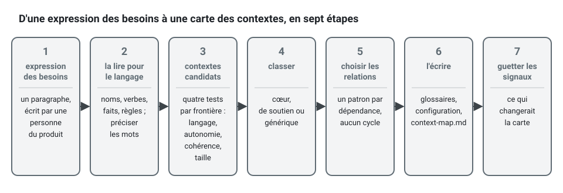

[English](context-map-worked-example.md) · **Français**
<!-- translation-of: context-map-worked-example.md sha256:3c8ca8e606172633 -->

# Un exemple pas à pas : la carte des contextes de l'application de prise de rendez-vous

**Résumé.** Cette page part d'une simple expression des besoins et arrive à une carte des
contextes, étape par étape : lire l'expression des besoins pour en tirer les noms, les verbes et
les faits, proposer des contextes candidats, éprouver chaque frontière (langage, autonomie,
cohérence, taille), classer, choisir un patron de relation pour chaque dépendance, et écrire le
résultat là où le kit l'attend. Le résultat : cinq contextes dans le code (`appointments`,
`availability`, `calendars`, `notifications`, `analytics`) et une capacité achetée (l'identité)
qui n'obtient aucun contexte.



## 1. L'expression des besoins

Telle qu'une personne du produit l'écrirait :

> Les praticiens (des kinésithérapeutes, pour commencer) publient les heures où ils travaillent
> et les jours où ils sont absents. Les clients voient les horaires libres d'un praticien et en
> réservent un. Un praticien ne doit jamais avoir deux clients en même temps. Un client peut
> déplacer un rendez-vous vers un autre horaire libre, ou l'annuler ; l'annulation est gratuite
> jusqu'à 24 heures avant, ensuite elle compte comme une annulation tardive. Les clients
> reçoivent une confirmation quand ils réservent et un rappel la veille, par e-mail ou par SMS
> selon leur préférence. Le responsable du cabinet veut voir le taux de remplissage de chaque
> praticien et combien de clients ne se présentent pas. Tout le monde se connecte ; les
> praticiens et les responsables par l'authentification unique de l'entreprise.

## 2. La lire pour en tirer le langage

| Nature | Mots trouvés |
|---|---|
| Noms | praticien, client, heures de travail, jour d'absence, horaire libre, rendez-vous, confirmation, rappel, responsable du cabinet, taux de remplissage, absence au rendez-vous |
| Verbes | publier ses heures, réserver, déplacer, annuler, rappeler, se connecter |
| Faits | rendez-vous réservé, rendez-vous déplacé, rendez-vous annulé, heures modifiées, absence ajoutée, rappel envoyé |
| Règles | jamais deux clients à la fois ; annulation gratuite jusqu'à 24 heures avant |

Deux mots demandent à être précisés avec l'expert du domaine avant toute chose. « Horaire
libre » devient **créneau** (slot). « Déplacer » devient **reprogrammer** (reschedule), et
l'expert confirme qu'un rendez-vous reprogrammé est le même rendez-vous, pas une annulation
suivie d'une réservation.

## 3. Les contextes candidats

Un premier découpage par sujet : calendriers, disponibilités, rendez-vous, notifications,
statistiques, identité. Chacun passe ensuite les quatre tests de
[Contexte délimité](bounded-context.fr.md).

| Candidat | Langage | Autonomie | Cohérence | Verdict |
|---|---|---|---|---|
| calendars | heures de travail, absences ; aucune notion de client | change quand les contrats des praticiens changent | un calendrier est cohérent à lui seul | un contexte |
| appointments | rendez-vous, créneau au sens de « l'intervalle réservé », motif d'annulation | les règles de réservation sont le produit | l'absence de double réservation doit tenir à chaque instant | un contexte, et le centre |
| availability | créneau au sens de « un intervalle encore proposé » | la façon de proposer les créneaux peut changer sans toucher à la réservation | dérivé de deux autres contextes : toujours un peu en retard, et c'est acceptable | un contexte, consultatif |
| notifications | rappel, canal, destinataire | la politique de rappel est décidée par le support, change souvent | un rappel en retard est tolérable | un contexte |
| analytics | taux de remplissage, taux d'absence | les rapports changent avec les questions de la direction | des heures de retard ne gênent pas | un contexte |
| identity | utilisateur, justificatif, session | un problème résolu | pas le nôtre | acheté : aucun contexte |

### La frontière débattue : availability ou appointments ?

Le mot « créneau » a deux sens, ce que le test du langage lit comme deux contextes. La question
plus difficile est de savoir où vit « jamais deux clients à la fois ».


- Si `availability` en était la garde, la réservation dépendrait de données calculées à partir
  d'événements, qui arrivent en retard. Deux clients qui regardent le même créneau ouvert
  seraient tous deux acceptés.
- Le test de cohérence tranche : une règle qui doit tenir à chaque instant vit dans la frontière
  d'un seul agrégat, donc dans `appointments`, appuyée par une contrainte de la base de données
  ([Agrégats](aggregates.fr.md)).
- `availability` ne fait donc que conseiller. Un client qui choisit un créneau pris il y a une
  seconde reçoit l'erreur du domaine `SlotAlreadyTaken`, et le produit décide comment le lui
  dire avec égards ([Cohérence à terme](eventual-consistency.fr.md)).

Availability pourrait-il n'être que des requêtes à l'intérieur d'`appointments` ? Oui, et pour
une première version c'est un choix défendable. Il est gardé à part ici parce qu'il a besoin des
données des calendriers autant que de celles des rendez-vous, que son vocabulaire diffère, et
que ses règles (marges entre rendez-vous, horizon de proposition des créneaux) changent pour
d'autres raisons que les règles de réservation. Le doute va dans les « Tensions connues » de la
carte.

### Appointments a-t-il besoin de calendars au moment de réserver ?

Une réservation hors des heures de travail doit être refusée. `appointments` pourrait appeler
`calendars` de façon synchrone, mais la réservation échouerait alors chaque fois que calendars
est indisponible. À la place, `appointments` garde une projection locale des heures de travail
et des absences, alimentée par `calendars.calendar.working-hours-changed` et
`calendars.calendar.time-off-added`. Il décide seul, sur des données qui peuvent avoir un
instant de retard, ce que le métier accepte : un praticien qui ajoute une absence après qu'une
réservation a été faite règle de toute façon le conflit à la main.

## 4. Classer

| Contexte | Classification | Raison |
|---|---|---|
| `appointments` | cœur | les règles pour lesquelles clients et praticiens choisissent le produit |
| `availability` | de soutien | un calcul sur les faits d'autres contextes |
| `calendars` | de soutien | spécifique et simple |
| `notifications` | de soutien | la politique est la nôtre, l'envoi est acheté |
| `analytics` | de soutien | découle des événements des rendez-vous |
| identity | générique | un fournisseur OIDC ; la plateforme traduit ses jetons en `Actor` |

Voir [Domaine et sous-domaines](domain-and-subdomains.fr.md) pour les critères.

## 5. Choisir les relations

| Aval | Amont | Patron | Raisonnement |
|---|---|---|---|
| `appointments` | `calendars` | published-language | même produit ; calendars publie des événements faits pour les consommateurs |
| `availability` | `calendars` | published-language | idem |
| `availability` | `appointments` | published-language | idem |
| `notifications` | `appointments` | published-language | notifications traduit « réservé » en « planifier un rappel » dans son propre gestionnaire |
| `analytics` | `appointments` | conformist | analytics n'a aucun modèle à protéger : il stocke les faits tels que publiés |
| `notifications` | fournisseur d'e-mails et de SMS (externe) | couche anticorruption | le vocabulaire du fournisseur reste dans `infrastructure/anti-corruption/` |
| chaque contexte | fournisseur d'identité (externe) | service hôte ouvert, de son côté | OpenID Connect ; la traduction en `Actor` se fait une fois, dans la plateforme |

Aucun cycle : `calendars` ne dépend de personne, `appointments` de `calendars`, et les trois
autres ne font que consommer. `notifications` et `analytics` n'ont aucune relation entre eux :
des chemins séparés, exprimés en ne déclarant rien.


Les flèches vont de l'amont vers l'aval, comme dans la carte générée. Les deux systèmes externes
sont dessinés ici pour le lecteur ; le diagramme généré, un bloc Mermaid entre les marqueurs de
`docs/context-map.md`, ne montre que les contextes de la configuration.

## 6. L'écrire là où le kit l'attend

Les glossaires d'abord. Chaque commande `generate context` emporte ses premiers termes :

```bash
npx ddd-ts-kit generate context calendars --classification supporting \
  --purpose "Practitioners state when they work and when they are off. Other contexts learn it from published events." \
  --term "Calendar=The working hours and time off of one practitioner" \
  --term "Working hours=The weekly intervals during which a practitioner takes appointments" \
  --term "Time off=A period during which a practitioner takes no appointment"

npx ddd-ts-kit generate context appointments --classification core \
  --upstream calendars:published-language \
  --purpose "Clients book, reschedule and cancel appointments with practitioners. A practitioner is never booked twice for the same time." \
  --term "Appointment=A commitment of a practitioner to see a client during a slot" \
  --term "Slot=The interval, start and end, an appointment occupies"

npx ddd-ts-kit generate context availability --classification supporting \
  --upstream calendars:published-language --upstream appointments:published-language \
  --purpose "Answers which slots a practitioner can still offer. It advises and never decides a booking." \
  --term "Slot=An interval a practitioner can still offer to a client"

npx ddd-ts-kit generate context notifications --classification supporting \
  --upstream appointments:published-language \
  --purpose "Sends confirmations and reminders about appointments. It chooses the channel the client prefers." \
  --term "Reminder=A message announcing a coming appointment to its client"

npx ddd-ts-kit generate context analytics --classification supporting \
  --upstream appointments:conformist \
  --purpose "Measures occupancy and no-shows per practitioner. It records the facts of appointments as published." \
  --term "Occupancy=The share of a practitioner's working hours covered by appointments"
```

L'extrait de `ddd-ts-kit.config.json` qui en résulte :

```json
{
  "contexts": {
    "calendars": { "classification": "supporting", "upstreams": [] },
    "appointments": {
      "classification": "core",
      "upstreams": [{ "context": "calendars", "relationship": "published-language" }]
    },
    "availability": {
      "classification": "supporting",
      "upstreams": [
        { "context": "calendars", "relationship": "published-language" },
        { "context": "appointments", "relationship": "published-language" }
      ]
    },
    "notifications": {
      "classification": "supporting",
      "upstreams": [{ "context": "appointments", "relationship": "published-language" }]
    },
    "analytics": {
      "classification": "supporting",
      "upstreams": [{ "context": "appointments", "relationship": "conformist" }]
    }
  }
}
```

Puis :

```bash
npx ddd-ts-kit docs       # écrit docs/context-map.md : le diagramme et le tableau
npx ddd-ts-kit check --rule tree/context-doc --rule context/no-cycle --rule context/declared-relationship
```

Et à la main, hors des marqueurs générés de `docs/context-map.md` : le guide de lecture (on
réserve, puis availability et notifications réagissent), pourquoi « pas de double réservation »
est dans `appointments`, pourquoi analytics est conformiste, et la tension connue au sujet
d'availability. Le fichier généré laisse un `TODO(domain)` sous chacun de ces titres ; remplis
pour cette carte, ils se lisent ainsi :

```md
<!-- ddd-ts-kit:context-map -->
(generated: the diagram and the table of the contexts)
<!-- /ddd-ts-kit:context-map -->

## Reading guide

A client books in `appointments`, which holds the slot and announces it. `availability` stops
offering the slot, `notifications` confirms and plans the reminder, `analytics` counts it.
`calendars` only publishes working hours and time off.

## Why these boundaries

"Never two clients at once" must hold at every instant, so it lives in the `Appointment`
aggregate, backed by a unique constraint. `availability` is derived from events and advises.

## Relationship notes

`analytics` is conformist: it stores the events of `appointments` as published and has no
model to protect. Its cost: a breaking change of those events breaks its reports.

## Known tensions

`availability` may be queries of `appointments` in disguise. If its rules stay trivial for a
year, merge it.
```

## 7. Ce qui changerait la carte

| Signal | Mouvement probable |
|---|---|
| les règles d'availability restent triviales pendant un an | le fusionner dans `appointments` sous forme de requêtes |
| la suggestion de créneaux devient l'argument de vente | reclasser `availability` en cœur |
| la réservation doit encaisser un acompte | un nouveau contexte `payments`, générique, derrière une couche anticorruption |
| `appointments` demande sans cesse plus de champs aux calendriers | la projection est trop mince, ou la frontière est fausse |
| analytics casse à chaque changement d'événement | conformiste ne convient plus : versionner strictement les événements ou ajouter un traducteur |

## Limites et quand ne pas l'utiliser

- C'est **une** carte défendable, pas la carte. Une autre équipe pourrait garder availability
  dans appointments, ou découper notifications par canal. Ce qui compte, c'est que chaque
  frontière ait une raison énoncée et un doute énoncé.
- L'exercice a été fait par écrit, à partir d'un seul paragraphe. Un vrai projet devrait
  confronter les candidats aux experts du domaine, par exemple dans une séance d'*event
  storming* ([Méthodologie](../guides/methodology.fr.md)).
- Ne copiez pas le nombre de contextes. Pour une première version avec un seul développeur,
  `appointments` et `calendars` seuls, avec availability sous forme de requêtes et
  notifications sous forme de gestionnaire d'événements, seraient un début raisonnable.
- L'application d'exemple du dépôt (`examples/scheduling`) a fait un autre découpage du même
  domaine, ce qui illustre le propos : un seul contexte cœur, `scheduling`, réunit calendriers,
  disponibilités et rendez-vous ; `identity` est un contexte de soutien à part entière, parce que
  les cabinets et les délégations entre praticiens et assistants sont des règles du produit, pas
  une connexion achetée, et `scheduling` en est le client (client-fournisseur) ; `notification`
  consomme les événements de `scheduling` et d'`identity`, et `analytics` se conforme à ceux de
  `scheduling`. Sa carte est dans
  [`examples/scheduling/docs/context-map.fr.md`](../../examples/scheduling/docs/context-map.fr.md).

## Sources

- Eric Evans, *Domain-Driven Design*, Addison-Wesley, 2003, chapitre 14.
- Vaughn Vernon, *Implementing Domain-Driven Design*, Addison-Wesley, 2013, chapitres 2 et 3.
- Vlad Khononov, *Learning Domain-Driven Design*, O'Reilly, 2021, chapitres 3 et 4.
- Alberto Brandolini, *Introducing EventStorming*, Leanpub (lire un domaine comme des commandes,
  des événements et des politiques).

## Voir aussi

- [Carte des contextes](context-map.fr.md)
- [Contexte délimité](bounded-context.fr.md)
- [Domaine et sous-domaines](domain-and-subdomains.fr.md)
- [Langage omniprésent](ubiquitous-language.fr.md)
- [Agrégats](aggregates.fr.md)
- [Cohérence à terme](eventual-consistency.fr.md)
- [Méthodologie](../guides/methodology.fr.md)
- [Travail en parallèle](../guides/parallel-work.fr.md)
- [Référence de la configuration](../CONFIG.fr.md)
- [Index des concepts](README.fr.md)
