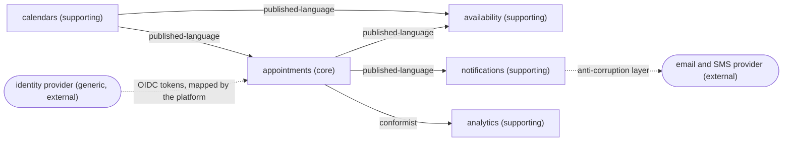

# A worked example: the context map of the scheduling application

**Summary.** This page walks from a plain statement of needs to a context map, step by step:
read the statement for nouns, verbs and facts, propose candidate contexts, test each boundary
(language, autonomy, consistency, size), classify, choose a relationship pattern for every
dependency, and write the result where the kit expects it. The outcome is five contexts in the
code (`appointments`, `availability`, `calendars`, `notifications`, `analytics`) and one bought
capability (identity) that gets no context at all.

## 1. The statement of needs

As a product person would write it:

> Practitioners (physiotherapists, for a start) publish the hours they work and the days they
> are off. Clients see the free times of a practitioner and book one. A practitioner must never
> have two clients at the same time. A client can move an appointment to another free time, or
> cancel it; cancelling is free until 24 hours before, after that it counts as a late
> cancellation. Clients get a confirmation when they book and a reminder the day before, by
> email or SMS as they prefer. The practice manager wants to see how full each practitioner is
> and how many clients do not show up. Everyone signs in; practitioners and managers through
> the company's single sign-on.

## 2. Read it for the language

| Kind | Words found |
|---|---|
| Nouns | practitioner, client, working hours, day off, free time, appointment, confirmation, reminder, practice manager, occupancy, no-show |
| Verbs | publish hours, book, move, cancel, remind, sign in |
| Facts | appointment booked, appointment moved, appointment cancelled, hours changed, time off added, reminder sent |
| Rules | never two clients at once; free cancellation until 24 hours before |

Two words need sharpening with the domain expert before anything else. "Free time" becomes
**slot**. "Move" becomes **reschedule**, and the expert confirms that a rescheduled appointment
is the same appointment, not a cancellation followed by a booking.

## 3. Candidate contexts

A first cut by subject: calendars, availability, appointments, notifications, analytics,
identity. Each is then put through the four tests of
[Bounded context](bounded-context.md).

| Candidate | Language | Autonomy | Consistency | Verdict |
|---|---|---|---|---|
| calendars | working hours, time off; no notion of client | changes when practitioners' contracts change | a calendar is consistent on its own | a context |
| appointments | appointment, slot as "the booked interval", cancellation reason | the booking rules are the product | no double booking must hold at every instant | a context, and the centre |
| availability | slot as "an interval still on offer" | the way slots are proposed can change without touching booking | derived from two other contexts: always slightly late, and that is acceptable | a context, advisory |
| notifications | reminder, channel, recipient | reminder policy is decided by support, changes often | a late reminder is tolerable | a context |
| analytics | occupancy, no-show rate | reports change with management's questions | hours late is fine | a context |
| identity | user, credential, session | a solved problem | not ours | bought: no context |

### The debated boundary: availability or appointments?

The word "slot" means two things, which the language test reads as two contexts. The harder
question is where "never two clients at once" lives.

- If `availability` guarded it, booking would depend on data computed from events, which lag.
  Two clients looking at the same open slot would both be allowed.
- The consistency test settles it: a rule that must hold at every instant lives in one
  aggregate boundary, hence in `appointments`, backed by a database constraint
  ([Aggregates](aggregates.md)).
- `availability` therefore only advises. A client who picks a slot taken a second ago gets the
  domain error `SlotAlreadyTaken`, and the product decides how to say it kindly
  ([Eventual consistency](eventual-consistency.md)).

Could availability simply be queries inside `appointments`? It could, and for a first release
that is a defensible choice. It is kept separate here because it needs calendars' data as much
as appointments', its vocabulary differs, and its rules (buffers between appointments, how far
ahead slots are offered) change for other reasons than booking rules. The doubt goes into the
"Known tensions" of the map.

### Does appointments need calendars at booking time?

Booking outside working hours should be refused. `appointments` could call `calendars`
synchronously, but then booking fails whenever calendars is unavailable. Instead `appointments`
keeps a local projection of working hours and time off, fed by
`calendars.calendar.working-hours-changed` and `calendars.calendar.time-off-added`. It decides
alone, on data that may be a moment old, which the business accepts: a practitioner who adds
time off after a booking was made handles the conflict by hand anyway.

## 4. Classify

| Context | Classification | Reason |
|---|---|---|
| `appointments` | core | the rules clients and practitioners choose the product for |
| `availability` | supporting | a computation over other contexts' facts |
| `calendars` | supporting | specific and simple |
| `notifications` | supporting | the policy is ours, the sending is bought |
| `analytics` | supporting | follows from the events of appointments |
| identity | generic | an OIDC provider; the platform maps its tokens to an `Actor` |

See [Domain and subdomains](domain-and-subdomains.md) for the criteria.

## 5. Choose the relationships

| Downstream | Upstream | Pattern | Reasoning |
|---|---|---|---|
| `appointments` | `calendars` | published-language | same product; calendars publishes events made for consumers |
| `availability` | `calendars` | published-language | same |
| `availability` | `appointments` | published-language | same |
| `notifications` | `appointments` | published-language | notifications translates "booked" into "schedule a reminder" in its own handler |
| `analytics` | `appointments` | conformist | analytics has no model to protect: it stores the facts as published |
| `notifications` | email and SMS provider (external) | anticorruption layer | the provider's vocabulary stays in `infrastructure/anti-corruption/` |
| every context | identity provider (external) | open host service on its side | OpenID Connect; the mapping to `Actor` happens once, in the platform |

No cycle: `calendars` depends on nobody, `appointments` on `calendars`, and the three others
only consume. `notifications` and `analytics` have no relationship with each other: separate
ways, expressed by declaring nothing.



Arrows run from upstream to downstream, as in the generated map. The two external systems are
drawn here for the reader; the generated diagram shows contexts of the config only.

## 6. Write it where the kit expects it

Glossaries first. Each `generate context` command takes the first terms with it:

```bash
npx ddd-ts-kit generate context calendars --classification supporting \
  --purpose "Practitioners state when they work and when they are off. Other contexts learn it from published events." \
  --term "Calendar=The working hours and time off of one practitioner" \
  --term "Working hours=The weekly intervals during which a practitioner takes appointments" \
  --term "Time off=A period during which a practitioner takes no appointment"

npx ddd-ts-kit generate context appointments --classification core \
  --upstream calendars:published-language \
  --purpose "Clients book, reschedule and cancel appointments with practitioners. A practitioner is never booked twice for the same time." \
  --term "Appointment=A commitment of a practitioner to see a client during a slot" \
  --term "Slot=The interval, start and end, an appointment occupies"

npx ddd-ts-kit generate context availability --classification supporting \
  --upstream calendars:published-language --upstream appointments:published-language \
  --purpose "Answers which slots a practitioner can still offer. It advises and never decides a booking." \
  --term "Slot=An interval a practitioner can still offer to a client"

npx ddd-ts-kit generate context notifications --classification supporting \
  --upstream appointments:published-language \
  --purpose "Sends confirmations and reminders about appointments. It chooses the channel the client prefers." \
  --term "Reminder=A message announcing a coming appointment to its client"

npx ddd-ts-kit generate context analytics --classification supporting \
  --upstream appointments:conformist \
  --purpose "Measures occupancy and no-shows per practitioner. It records the facts of appointments as published." \
  --term "Occupancy=The share of a practitioner's working hours covered by appointments"
```

The resulting excerpt of `ddd-ts-kit.config.json`:

```json
{
  "contexts": {
    "calendars": { "classification": "supporting", "upstreams": [] },
    "appointments": {
      "classification": "core",
      "upstreams": [{ "context": "calendars", "relationship": "published-language" }]
    },
    "availability": {
      "classification": "supporting",
      "upstreams": [
        { "context": "calendars", "relationship": "published-language" },
        { "context": "appointments", "relationship": "published-language" }
      ]
    },
    "notifications": {
      "classification": "supporting",
      "upstreams": [{ "context": "appointments", "relationship": "published-language" }]
    },
    "analytics": {
      "classification": "supporting",
      "upstreams": [{ "context": "appointments", "relationship": "conformist" }]
    }
  }
}
```

Then:

```bash
npx ddd-ts-kit docs       # writes docs/context-map.md: the diagram and the table
npx ddd-ts-kit check --rule tree/context-doc --rule context/no-cycle --rule context/declared-relationship
```

And by hand, outside the generated markers of `docs/context-map.md`: the reading guide (book,
then availability and notifications react), why "no double booking" is in `appointments`, why
analytics is conformist, and the known tension about availability.

## 7. What would change the map

| Signal | Likely move |
|---|---|
| availability's rules stay trivial for a year | merge it into `appointments` as queries |
| slot suggestion becomes the selling point | reclassify `availability` as core |
| booking needs to charge a deposit | a new `payments` context, generic, behind an anticorruption layer |
| `appointments` keeps asking calendars for more fields | the projection is too thin, or the boundary is wrong |
| analytics breaks at each event change | conformist no longer fits: version the events strictly or add a translator |

## Limits and when not to use it

- This is **one** defensible map, not the map. Another team could keep availability inside
  appointments, or split notifications by channel. What matters is that each boundary has a
  stated reason and a stated doubt.
- The exercise was done in writing, from one paragraph. A real project should confront the
  candidates with domain experts, for example in an event storming session
  ([Methodology](../guides/methodology.md)).
- Do not copy the number of contexts. For a first version with one developer, `appointments`
  and `calendars` alone, with availability as queries and notifications as an event handler,
  would be a reasonable start.

## Sources

- Eric Evans, *Domain-Driven Design*, Addison-Wesley, 2003, chapter 14.
- Vaughn Vernon, *Implementing Domain-Driven Design*, Addison-Wesley, 2013, chapters 2 and 3.
- Vlad Khononov, *Learning Domain-Driven Design*, O'Reilly, 2021, chapters 3 and 4.
- Alberto Brandolini, *Introducing EventStorming*, Leanpub (reading a domain as commands,
  events and policies).

## See also

- [Context map](context-map.md)
- [Bounded context](bounded-context.md)
- [Domain and subdomains](domain-and-subdomains.md)
- [Ubiquitous language](ubiquitous-language.md)
- [Aggregates](aggregates.md)
- [Eventual consistency](eventual-consistency.md)
- [Methodology](../guides/methodology.md)
- [Parallel work](../guides/parallel-work.md)
- [Configuration reference](../CONFIG.md)
- [Concepts index](README.md)
