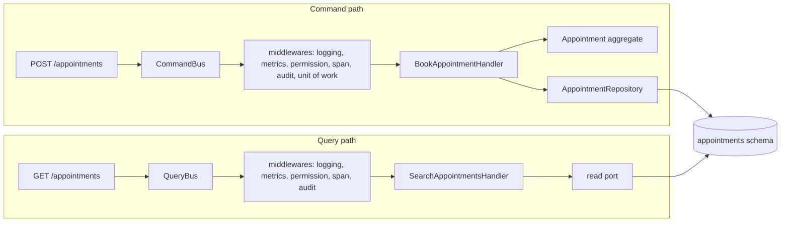

# CQRS as used here

**Summary.** Command Query Responsibility Segregation separates the code that changes state from
the code that answers questions. This kit applies the light form: every use case is either a
command or a query, each with one handler, reached through a command bus or a query bus. A
command goes through the aggregate and returns at most an identifier; a query never changes
state and may read a projection through a port without loading aggregates. Aggregates keep their
state in tables unless one is chosen to be event-sourced, and there is no second database by
default. This page says what that buys, what it does not, and
when the split is not worth having.

## From a method rule to an architecture rule

Bertrand Meyer's command-query separation is a rule about methods: a method either changes state
or returns a value, not both. Greg Young and Udi Dahan lifted it to the level of the model:
use one model to write and another to read, because the two have different shapes and different
loads. Fowler's summary and warning is the usual reference: the split helps in a minority of
complex domains and adds risk elsewhere.

The kit takes the part that costs little and pays in every project:

| Element | Rule in this kit |
|---|---|
| a use case | one command or one query, in its own folder, with one handler |
| a command | changes state through one aggregate; returns nothing or an identifier |
| a query | changes nothing; returns a view shaped for the caller |
| the way in | `CommandBus` and `QueryBus`, never a handler class |
| what is common to all use cases | a bus middleware, not code repeated in handlers |

The normative text is [ARCHITECTURE.md](../ARCHITECTURE.md) section 4 ("Use cases", "Buses");
the shape of a handler is `application/handler-shape`, and a query that saves, deletes or
publishes is reported by `application/command-query-separation`.

## The two paths, on the scheduling application

**Command.** `BookAppointment` carries the actor and the requested slot. The handler loads what
it needs, calls one intention method (`Appointment.book(...)`), saves through the repository
port and does nothing else: the save hands the recorded events over, and the unit of work
dispatches them once the handler has returned, before the commit. It answers the identifier of
the new appointment and nothing else: the client that wants to display the appointment sends
`GetAppointment`. Returning the whole aggregate would tie the response to the write model.

**Query.** `SearchAppointments` needs twenty rows of five columns, filtered by what the actor may
see and paginated. Loading twenty aggregates with their invariants to throw most of the state
away is waste. The handler asks a read port, whose adapter queries the tables directly and
returns the shape the port declares. The access scope computed by the authorizer goes into that
query, so nothing is filtered in memory after loading (see
[Authentication and authorization](authentication-and-authorization.md)).

Both paths read the same tables. The read side is a different code path, not a different
database.

## Why buses

A route could call a handler directly. The buses exist for three reasons:

1. **One place for what every use case needs.** The generated platform
   (`src/platform/buses/`) puts logging, metrics, the permission check, the span of the use
   case, the audit entry and, for commands, the unit of work on the buses as middlewares, in
   that order, outermost first. A handler contains none of it, so none of it can be forgotten
   in a new handler.
2. **One way in for every caller.** A route, an integration event handler and a scheduled job
   all send a command. The use case is authorized, audited and run in a transaction the same
   way whoever started it.
3. **A seam.** The buses are ports of the kernel with in-process implementations. Another
   transport is an adapter chosen in the composition root; the callers do not change.

The price is one level of indirection: "go to definition" on `execute` lands on the bus, not on
the handler. The handler lives next to its command, in the same folder, which is how it is
found.

## What it buys

- **Use cases are visible.** The list of commands and queries of a context is its functional
  surface: `ddd-ts-kit describe <context>` prints it, and a permission is declared on each (`authz/declared`).
- **Reads stop bending the model.** An aggregate is sized for its invariants (see
  [Aggregates](aggregates.md)), not for the screens that display it. A new column in a list is a
  change of a read adapter.
- **Each side is tested the way it deserves**: behaviour for commands, the returned shape for
  queries.
- **Commands are easy to make idempotent and to audit**: they are named data, sent through one
  place.
- **The door to a separate read store stays open.** A read port can later be served by a
  projection fed by events, as `availability` is, without touching the callers.

## What it does not buy, and what the kit does not do

- **Event sourcing is a choice per aggregate, not part of CQRS.** Aggregates are stored as
  state by default, and their domain events are recorded to be dispatched at the end of the unit
  of work, not to rebuild them. CQRS and event sourcing are independent patterns that are often
  presented together: one aggregate whose history is the business can be event-sourced while
  the others keep their rows ([Event sourcing, per aggregate](event-sourcing.md)).
- **No separate read database, and no generated projection.** A projection is a table of the
  consuming context. The runtime packages carry the read side: `Criteria` (filters, sort and
  page of a list, checked against a definition), hydration, the `ReadModelStore` port with a
  SQL table store, the `@Projection` and `@On` declarations of a projector and a rebuild
  (kernel README, "Criteria", "Hydration" and "Projections"). The CLI generates none of it
  yet: `generate query --search` writes a read port with an in-memory adapter and a fake, and
  the projector and its store are written by hand. The status of each part is in the
  [read side proposal](../proposals/read-side.md).
- **No performance by itself.** Two code paths over one database scale like one database.
- **No asynchronous commands by default.** The in-process buses are awaited. A command answered
  "accepted" and processed later is a design the project builds on events.

## When a projection is the right read model

`availability` answers `FindOpenSlots`. The answer combines the working hours and time off held
by `calendars` with the appointments held by `appointments`. Asking both contexts at each search
would couple three contexts at run time. Instead `availability` keeps its own table of open
slots, updated when `calendars.calendar.working-hours-changed`,
`appointments.appointment.booked` or `appointments.appointment.cancelled` arrive. The search is
one local query. The cost is that the answer can be a moment late: a slot shown as open may have
been taken a second ago, and `appointments` is what refuses the double booking (see
[Eventual consistency](eventual-consistency.md)).

## Limits and when not to use it

- **A CRUD context with no rules** (a list of rooms, a settings screen) gains little from a
  command, a handler, a bus and a read port per operation. The generator makes the files cheap
  to create, not cheap to read. A `generic` or thin `supporting` context can keep a trivial
  model; whether to drop the split for it is a recorded decision, not a habit.
- **"A command returns at most an identifier" has friction.** A client that needs the created
  resource makes a second call. That is deliberate; when the round trip matters, the route can
  send the query after the command and answer its result.
- **Read-your-own-writes is not automatic** once a read comes from a projection fed by events.
  Either read that screen from the write tables, or design the UI for the delay.
- **Middleware order matters and is invisible from a handler.** Read
  `src/platform/buses/create-command-bus.ts` and `create-query-bus.ts` to know what wraps a use
  case.
- **A query handler that needs a rule of the domain** (a price, an eligibility) should call the
  domain for it, not copy it into SQL. Bypassing aggregates is for shape, not for logic.

## Sources

- Bertrand Meyer, Object-Oriented Software Construction, 2nd edition, Prentice Hall, 1997
  (command-query separation).
- Greg Young, "CQRS Documents", 2010, https://cqrs.files.wordpress.com/2010/11/cqrs_documents.pdf
- Martin Fowler, "CQRS", 2011, https://martinfowler.com/bliki/CQRS.html
- Martin Fowler, "Event Sourcing", 2005, https://martinfowler.com/eaaDev/EventSourcing.html
- Vaughn Vernon, Implementing Domain-Driven Design, Addison-Wesley, 2013, chapter 4
  ("Architecture", the CQRS section).
- Vlad Khononov, Learning Domain-Driven Design, O'Reilly, 2021, chapter 8 (CQRS).

## See also

- [Layers and the dependency rule](layers-and-dependency-rule.md)
- [Ports and composition](ports-and-composition.md)
- [Aggregates](aggregates.md)
- [Eventual consistency](eventual-consistency.md)
- [Domain and integration events](domain-and-integration-events.md)
- [Authentication and authorization](authentication-and-authorization.md)
- [Read side proposal](../proposals/read-side.md)
- [Architecture reference](../ARCHITECTURE.md)
