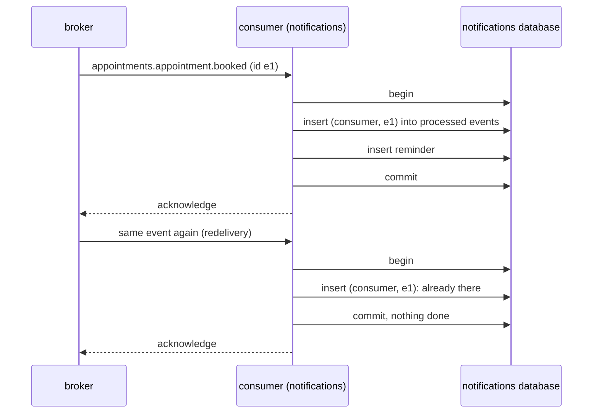

# Delivery guarantees and idempotent consumers

**Summary.** Integration events in this kit are delivered at least once: every event reaches
every consumer, possibly more than once, in no guaranteed order. Exactly-once delivery is not on
offer, here or elsewhere, because a sender cannot tell a lost message from a lost
acknowledgement. What can be built is exactly-once effect: a consumer that records, in the same
transaction as its own state change, that it has processed an event, and skips it the second
time. This page explains the guarantee, the processed-event store, why it lives in the database,
what ordering costs and where failed events go.

## Three delivery guarantees

| Guarantee | Meaning | Price |
|---|---|---|
| at most once | send and forget; a failure loses the message | none; events are lost |
| at least once | resend until acknowledged; a failure duplicates the message | consumers must tolerate duplicates |
| exactly once | each message delivered a single time | not achievable between independent systems |

Why the third does not exist: the relay publishes `appointments.appointment.booked` and the
connection drops before the acknowledgement arrives. Did the broker take it? The relay cannot
know. If it resends, the event may be delivered twice; if it does not, the event may be lost.
The same holds between the broker and the consumer: the handler commits, the acknowledgement is
lost, the broker redelivers. Products that advertise exactly-once semantics achieve it inside
their own boundary (for example a Kafka transaction covering Kafka topics and offsets), not
across a broker and an application database (Kleppmann, chapter 11).

Duplicates are therefore normal operation, not an incident. In the kit they come from: a relay
retry after a lost acknowledgement, a relay restarted between publishing and marking, a broker
redelivery after a consumer crash, an operator replaying dead letters.

## Idempotent consumers

A consumer is idempotent when handling the same event twice leaves the same state as handling it
once. Some operations are naturally so ("mark the appointment as cancelled"). Most are not:
`notifications` handling `appointments.appointment.booked` twice would schedule two reminders.

The general mechanism is a **processed-event store**: a table keyed by consumer name and event
id.

The decisive detail is that **the mark and the state change commit together**:

- if the handler fails, the mark is rolled back with the rest and the redelivery is processed;
- if the handler succeeds, the mark is durable and the redelivery is skipped;
- the acknowledgement to the broker comes after the commit, never before.

The kit does this for a declared integration event handler without code in the handler: the
mark and the work run in one unit of work, and the command the handler sends joins that
transaction. The rule is `events/consumer-idempotent`: every consumer has a stable, unique
consumer name and deduplicates through a processed-event store.

### The consumer name is an identity

The name (`notifications.remind-on-appointment-booked`) keys the processed-event table and,
behind a broker, names the queue, the consumer group or the durable subscription. It is written
as a literal and survives the renaming of a class. Renaming it creates a new consumer that has
processed nothing: on a provider that retains history, it replays that history.

### Why the store is not in Redis

A mark in one system and a state change in another are a dual write again. A crash between the
two either loses the event (mark kept, change rolled back) or processes it twice (change
committed, mark missing). The Redis package says it explicitly and ships no processed-event
store; the stores are those of the ORM packages, in the unit of work of the consumer.

One case to mind, from the events README: a consumer registered with a processed-event store but
without a unit of work takes its mark before the handler runs. With a transactional store, a
failing handler then leaves the mark committed and the redelivery is skipped: the event is lost
for that consumer. Use the unit of work, or a store that can release its mark.

### When the handler calls the outside

The transaction covers the database, not an email provider. If `notifications` sends an SMS
inside the handler and the commit then fails, the redelivery sends it again. Options, in order
of preference: make the outside call idempotent with a key derived from the event id, when the
provider supports one; record the intent in the transaction and let a separate, repeatable step
send it; accept the rare duplicate when it is harmless, and say so.

## Ordering

By default **ordering is not guaranteed, not even for the events of one aggregate**: a failed
record is retried while its successors go out, several relays or consumer instances interleave,
and a redelivery comes back after the messages that followed.

So `appointments.appointment.cancelled` can reach `availability` before the `rescheduled` that
preceded it. Three ways to cope, cheapest first:

1. **Make order irrelevant.** Carry a version or a sequence of the aggregate in the payload; the
   consumer keeps the highest it has applied and ignores anything older. This works on every
   provider and is what the provider READMEs recommend.
2. **Make handlers commutative** where the business allows: "set the slot state to what this
   event says, if newer" instead of "toggle".
3. **Ask for order per key.** The relay can hold back a record while an earlier record of the
   same key is unpublished, and a log such as Kafka keeps the order of a partition.

Per-key ordering has stated caveats (events README): it needs a single relay; one event that
cannot be published blocks every later event of its key until it goes out or is dead; a restart
forgets which record blocks which key, so strict order across restarts is not provided; the
broker and the consumer must keep the order too (one partition or one queue with a single active
consumer per key, and no out-of-order retry). Among the kit's providers, the Kafka README
describes itself as the one to choose when the order of an aggregate's events matters; RabbitMQ
and NATS state "no ordering".

Order across aggregates or across contexts is never available. A flow that needs it is a process
with explicit steps: see [Sagas and process managers](sagas-and-process-managers.md).

## When a handler keeps failing

A handler throws; the provider retries a bounded number of times with a delay; then the event is
moved aside as a **dead letter** (a dead queue, a dead-letter topic or stream, depending on the
provider). A message that cannot even be parsed as an envelope is poison and goes there
directly. Rules that follow:

- let the handler throw: swallowing the error acknowledges the event and loses it;
- a dead letter is an alert, not a log line: the destination must be empty in normal operation;
- replay after fixing the cause; replaying a poison message only kills it again;
- only codes travel with a dead letter, never error messages, which may quote payload data.

Two more facts shared by the providers of the kit:

- **A redelivery runs every handler of the consumer for that type again**, those that succeeded
  included. Each handler deduplicates on its own consumer name.
- **The retry delay is constant** in the four broker providers: no exponential backoff on the
  consuming side.

## Limits and when not to use it

- **The processed-event table grows.** The kit's READMEs do not describe a purge for it; plan
  one by age, longer than the longest possible redelivery and replay horizon. (Not provided by
  the kit as far as its READMEs say.)
- **Deduplication is per consumer and per event id.** Two different events describing the same
  fact (a producer bug, a re-emission with a new id) are not caught: that needs a business key
  and a unique constraint.
- **Idempotency does not give order**, and order does not give idempotency. They are separate
  designs.
- **A unit of work per event holds a transaction for the duration of the handler.** Slow
  handlers hold connections; with Prisma, interactive transactions are time-bounded by default.
- **It needs a transactional store on the consumer side.** A consumer without a database uses
  the in-memory store that can release its mark, which protects one process only.
- When not to bother: a consumer whose effect is naturally idempotent and cheap (overwrite a
  cache entry). The rule still asks for a consumer name and a store; lowering it is a recorded
  deviation.

## Sources

- Martin Kleppmann, Designing Data-Intensive Applications, O'Reilly, 2017, chapter 11 (message
  delivery, idempotence, exactly-once) and chapter 8 (unreliable networks).
- Chris Richardson, "Idempotent consumer",
  https://microservices.io/patterns/communication-style/idempotent-consumer.html
- Gregor Hohpe and Bobby Woolf, Enterprise Integration Patterns, Addison-Wesley, 2003
  (Idempotent Receiver, Dead Letter Channel, Resequencer).
- Pat Helland, "Idempotence Is Not a Medical Condition", ACM Queue, 2012.
- Apache Kafka documentation, "Message Delivery Semantics",
  https://kafka.apache.org/documentation/#semantics
- READMEs of [`@ddd-ts-kit/events`](../../packages/events/README.md),
  [`@ddd-ts-kit/redis`](../../packages/redis/README.md) and the broker packages.

## See also

- [Transactional outbox](transactional-outbox.md)
- [Domain and integration events](domain-and-integration-events.md)
- [Eventual consistency](eventual-consistency.md)
- [Event versioning](event-versioning.md)
- [Scheduled jobs](scheduled-jobs.md)
- [Message brokers](../tools/message-brokers.md)
- [Cache and coordination](../tools/cache-and-coordination.md)
- [Architecture reference](../ARCHITECTURE.md)
