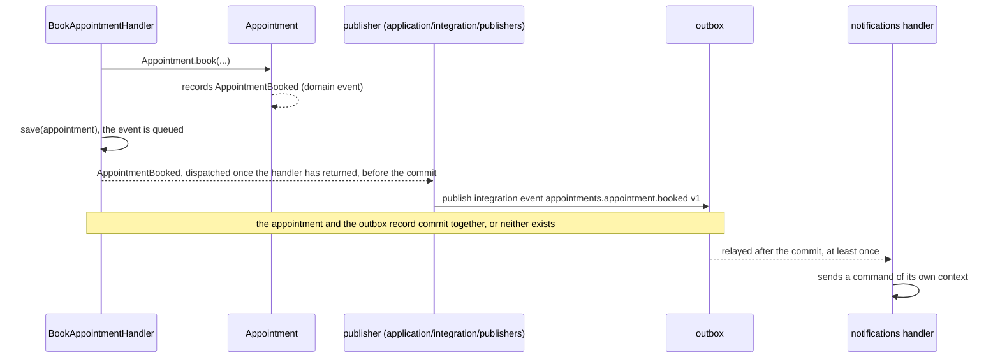
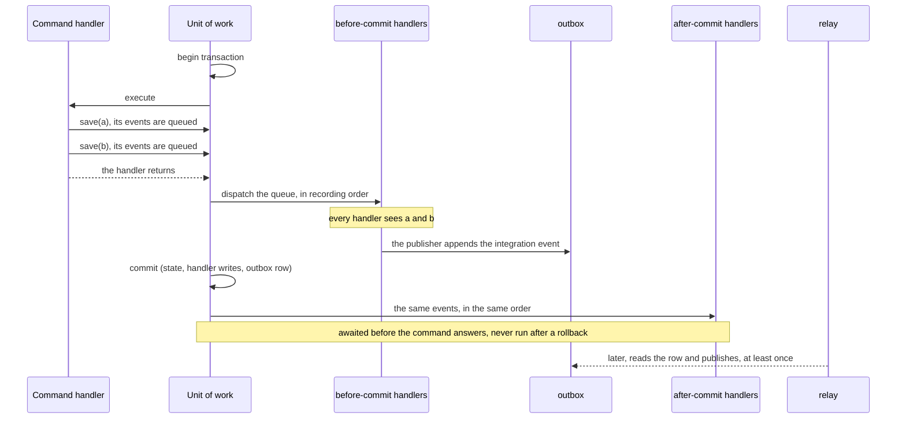

**English** · [Français](domain-and-integration-events.fr.md)

# Domain events and integration events

**Summary.** An event states that something happened, in the past tense. This kit distinguishes
two kinds that are easy to confuse. A domain event is a fact inside one bounded context,
recorded by an aggregate and handled in the same context. An integration event is a contract
between contexts, declared once in the producer's published language with a version and a
schema, delivered at least once. A publisher of the application layer translates the first into
the second. Keeping them apart is what lets a model change without breaking its consumers.

## Two kinds, side by side

| | Domain event | Integration event |
|---|---|---|
| Audience | the context that raised it | other contexts, possibly other services |
| Declared in | `domain/events/`, a class | `published-language/`, with `defineIntegrationEvent({ type, version, payload })` |
| Shape | whatever the model finds convenient; may hold value objects | plain JSON in a versioned envelope, validated by a schema |
| Stability | changes freely with the model | a contract: additive inside a version, otherwise a new version |
| Raised by | the aggregate, when its state changes | a publisher reacting to a domain event |
| Delivery | in process, at the end of the unit of work of the command: before its commit by default, after it for a handler declared `after-commit` | at least once, through the outbox when there is a database, never for a command that rolled back |
| Handled by | `application/event-handlers/` | `application/integration/handlers/` of the consuming context |
| Consumers must be | ordinary handlers | idempotent, registered under a stable consumer name |
| Documented in | the code | the generated event catalog and AsyncAPI document |

Both follow the name format `<context>.<aggregate>.<fact>` (`events/name-format`), which is why
the same string, `appointments.appointment.booked`, can name the domain event and the
integration event made from it. They are still two declarations with two lifecycles.

## The path of one fact



1. **The aggregate records.** `Appointment.book(...)` checks the invariants and records the
   domain event. An aggregate never publishes anything itself and knows no bus.
2. **The save hands the events over, the unit of work dispatches them.** `save` only queues
   the recorded events. Once the command handler has returned, they are dispatched to the
   handlers of the same context, inside the transaction of the command, before its commit. The
   command handler writes `await this.appointments.save(appointment)` and nothing else: no
   `pullEvents()`, no dispatcher (`domain-events/dispatched-on-save`,
   [ARCHITECTURE.md](../ARCHITECTURE.md) section 4, "Domain events").
3. **A publisher translates.** One of those handlers is the publisher: it builds the
   integration event from the domain event and hands it to the `IntegrationEventPublisher`
   port. With a database that port is the outbox, so the event is stored in the transaction of
   the command (`events/outbox-required`, see [Transactional outbox](transactional-outbox.md)).
   The relay publishes it after the commit, never for a command that rolled back.
4. **The consumer reacts.** In `notifications`, an integration event handler translates the
   event into a command of its own context and sends it on the command bus. It contains no
   business logic and imports only the upstream's published language.

The publisher is the anti-leak valve: the domain event can gain a field, be split or be renamed,
and the integration event stays what it was until the team decides to version it.

## When a domain event is handled

**An effect of a domain event exists only if the state change that recorded it is committed.**
A `before-commit` handler commits with it, an `after-commit` handler runs only after it, an
integration event is published only after it.

One command, two saves:



Inside a unit of work a save only queues the events its aggregates recorded, in recording
order across all the saves. When the command handler has returned, still inside the
transaction, the queue is dispatched. A handler may save an aggregate: its events join the
queue behind those waiting, under the same order rule, without recursion. A handler may append
to the outbox. Then the transaction commits, and the handlers of the `after-commit` phase run.

| | Guarantees | When it fails | Delivery |
|---|---|---|---|
| `before-commit` handler (default) | runs after every save of the command, in its transaction; what it writes commits or rolls back with the state change | the command fails and everything rolls back | in the transaction: exactly with the commit |
| `after-commit` handler | runs once the transaction has committed, never when it rolled back, in dispatch order, awaited before the command answers | the command still succeeds; the failure is logged and reported, the other handlers still run | at most once |
| integration event | appended to the outbox by a `before-commit` publisher, published by the relay after the commit, never for a rolled back command | the relay retries; consumers are idempotent | at least once |

### The two phases

`before-commit` is the default. `after-commit` is declared on the handler:

```ts
// contexts/appointments/application/event-handlers/appointment-booked.event-handler.ts
@DomainEventHandler(AppointmentBooked, { name: AppointmentBooked.eventName, phase: 'after-commit' })
export class AppointmentBookedEventHandler implements DomainEventHandler<AppointmentBooked> {
  constructor(private readonly board: AvailabilityBoard) {}

  async handle(event: AppointmentBooked): Promise<void> {
    await this.board.refresh(event.aggregateId);
  }
}
```

In the explicit style the phase is given at registration:
`dispatcher.on(AppointmentBooked.eventName, callback, { phase: 'after-commit' })`.
The generator writes either: `npx ddd-ts-kit generate event-handler appointments Appointment
Booked --phase after-commit`.

**What is at most once.** The `after-commit` phase, and only it. A crash between the commit and
the run loses the effect, and a failing handler is not retried. Its failure cannot fail the
command: it is logged (`Logger.error`, "A domain event handler failed after the commit", with
`domainEvent`, `errorType`, `errorCode`) and handed to the `ErrorReporter` under the operation
`after-commit <event name>`. Anything that must be reliable goes through the outbox as an
integration event.

**An `after-commit` handler never saves.** Handing an aggregate to a repository there (`save`,
`saveAll`, `remove(aggregate)`) is refused before the write with `SaveAfterCommitError`: the
unit of work is over, so nothing would dispatch the events of that aggregate nor roll the write
back. Such a handler sends a command through the `CommandBus`, which opens a unit of work of
its own. `unitOfWorkStage()` of the kernel answers `'outside'`, `'open'`, `'before-commit'` or
`'after-commit'`.

### Why a before-commit handler has transactional effects only

The commit itself can fail after the `before-commit` handlers ran: a deferred constraint, a
serialization failure, a lost connection. Everything they wrote in the transaction disappears
with it, the outbox row included. An effect outside the database would stay. The guarantee is
therefore safe only because a `before-commit` handler can have transactional effects alone,
which is what `domain-events/transactional-before-commit` holds. Such a handler may depend on:

- repository ports and the domain layer of its context;
- kernel ports other than `Cache`, `CachePurger`, `Lock`, `RateLimiter`, `JobScheduler` and `EventBus`
  (`CacheInvalidation` is one: the purge it asks for commits with the work, see
  [HTTP caching](http-caching.md));
- ports of `application/ports/` whose adapters are all under `infrastructure/persistence/`.

A gateway, an external port or an adapter of `infrastructure/external/` asks for a choice:

| The effect | Goes |
|---|---|
| may be lost (a cache to refresh, a best-effort notice) | in a handler with `phase: 'after-commit'` |
| must not be lost | behind an integration event: outbox, at least once |

An `after-commit` handler does not depend on `IntegrationEventPublisher`: the transaction that
would hold the outbox row is over.

### What a failure leaves behind

| What fails | Result |
|---|---|
| a save | it pulls nothing: its events stay on the aggregate and reach no handler; the unit of work rolls back, the events of the earlier saves are dropped |
| the command handler, after a save | the queued events are dropped: no handler of either phase runs |
| a `before-commit` handler | the command fails with what it threw; rollback; the events still waiting are dropped; no `after-commit` handler runs |
| the commit | rollback; no `after-commit` handler runs, no outbox row exists |
| an `after-commit` handler | nothing is undone: the state is committed and the command succeeds |

Events pulled by a save of a unit of work that rolled back are dropped and never put back on
the aggregate instance. A retry runs the command again on reloaded aggregates, which record
their events again; they are dispatched once. An aggregate instance of a failed command is not
reused.

### Where the queue lives

The queue belongs to a scope opened by `withinUnitOfWork(work, transaction)` of the kernel, in
an `AsyncLocalStorage`. Every `UnitOfWork.run` of the kit is built on it (`InMemoryUnitOfWork`,
drizzle, knex, prisma, typeorm), so a `run` called directly by a consumer or a script has the
timing of a command. `unitOfWorkMiddleware` calls it too: a command is covered even with a
project's own `UnitOfWork` that does not.

- A nested `run`, or a command sent from inside a unit of work by a handler, joins the scope in
  progress: one dispatch, at the end of the outermost, and the `after-commit` phase after the
  outermost commit.
- Two concurrent commands never share a scope.
- A project that writes its own `UnitOfWork` builds `run` on it, and runs `unitOfWorkContract`
  of `@ddd-ts-kit/testing/contracts`, which fails an adapter that forgot:

```ts
import { AsyncLocalStorage } from 'node:async_hooks';
import { withinUnitOfWork, type UnitOfWork } from '@ddd-ts-kit/kernel';

export class LedgerUnitOfWork implements UnitOfWork {
  private readonly current = new AsyncLocalStorage<LedgerTransaction>();

  constructor(private readonly ledger: Ledger) {} // the project's own driver

  run<T>(work: () => Promise<T>): Promise<T> {
    return withinUnitOfWork(work, (scoped) => {
      if (this.current.getStore() !== undefined) {
        return scoped();
      }

      return this.ledger.transaction((transaction) => this.current.run(transaction, scoped));
    });
  }
}
```

`transaction` begins, calls what it is given, commits when it resolved and rolls back when it
rejected. `withinUnitOfWork` does the rest.

The contract is run by the four ORM packages on PGlite, in process. The knex, prisma and
typeorm packages also run it on a real PostgreSQL when `DDD_TS_KIT_TEST_DATABASE_URL` is set,
where it also proves that the rows of a `before-commit` handler are invisible from another
connection and visible to the `after-commit` handlers. The failing commit is a deferred
constraint.

### Outside any unit of work

In a domain test, with a repository used alone, in a script, there is nothing to wait for: the
save dispatches before it resolves, `before-commit` handlers then `after-commit` ones. Nothing
is atomic then: a handler that fails rejects the save without undoing it.

### Changed

Before, the events of an aggregate were dispatched right after each save, inside the
transaction. What to check when upgrading:

| If the project has | Do |
|---|---|
| a handler that relied on running between two saves of one command | it now runs after both: read the state it needs from what is saved, or split the command |
| a handler with an effect outside the database (a gateway, a cache, a remote call) | declare it `phase: 'after-commit'`, or move the work behind an integration event when it must not be lost; `domain-events/transactional-before-commit` reports it |
| its own `UnitOfWork` | build `run` on `withinUnitOfWork` and run `unitOfWorkContract` |
| its own `DomainEventDispatcher` | `dispatch(events, phase?)` and `on(name, handler, { phase }?)`: honour the phase, and never reject in the `after-commit` phase |
| a domain event handler that sends a command | sent before the commit, the command joins the unit of work in progress: its events are dispatched with the others, not before it returns. Sent after the commit, it opens a unit of work of its own |
| a call to `apartFromDomainEventFlow` | removed from `@ddd-ts-kit/kernel`, without replacement: see the row above |
| a spec built on `createTestBuses()` | `commandBus` runs commands in its unit of work: handlers are heard once the command handler has returned |
| assertions or dashboards on span trees | `domain-event` spans are no longer under `repository X.save`: see the README of [`@ddd-ts-kit/tracing`](../../packages/tracing/README.md) |

## Why not publish the domain event directly

It is tempting to hand `AppointmentBooked` to every interested context. Three things go wrong:

- **The model becomes a public API.** Renaming a value object of `appointments` breaks
  `analytics`. The upstream can no longer refactor.
- **Internal facts leak.** `appointments` may record fine-grained events useful to itself
  (a slot was held, a hold expired). Consumers do not need them and should not build on them.
- **The delivery contract differs.** A domain event is handled in process, at the end of the
  unit of work of the command. An integration event may cross a broker, arrive twice, arrive late. Mixing
  the two hides which guarantees a handler can count on.

Not every domain event becomes an integration event. Publish what another context has a reason
to react to, when one asks for it.

## Designing the payload

The payload is what consumers need in order to act without calling back, and nothing internal
(the `integration-event` skill gives the same rule).

```ts
// contexts/appointments/published-language/appointment-booked.v1.integration-event.ts
export const appointmentBookedV1 = defineIntegrationEvent({
  type: 'appointments.appointment.booked',
  version: 1,
  description: 'A client booked an appointment with a practitioner.',
  payload: zodSchema(
    z.object({
      appointmentId: z.string().describe('Identifier of the appointment.'),
      practitionerId: z.string(),
      clientId: z.string(),
      startsAt: z.string().datetime().describe('Start of the slot, ISO 8601, UTC.'),
      endsAt: z.string().datetime(),
    }),
  ),
});
```

| Question | Guidance |
|---|---|
| Identifiers or data? | Identifiers plus the facts that define the event (the slot). `notifications` can schedule a reminder from `startsAt` without asking `appointments` |
| The whole aggregate? | No. A dump of the aggregate couples consumers to the model and grows with it |
| Personal data? | Only when a consumer needs it. A broker keeps messages; the envelope carries no actor by default for the same reason (events README) |
| A fact or an instruction? | A fact. `appointments.appointment.booked`, not "send-reminder": the producer does not know what consumers do |
| Order-sensitive consumers? | Carry a version or a sequence of the aggregate in the payload: ordering is not guaranteed by default (see [Delivery and idempotency](delivery-and-idempotency.md)) |
| Field descriptions | Written in the schema: they flow into the catalog and the AsyncAPI document |

There is a real trade-off between thin events (identifiers only, consumers call back) and fat
events (enough state to act). Thin events keep the contract small but turn every consumer into a
synchronous client of the producer. The kit's rule leans towards "enough to act", because
calling back defeats the autonomy the event was meant to give.

## What the kit provides

- `defineIntegrationEvent` gives the payload type, validates what is published and what is
  consumed, and feeds the generated catalog and AsyncAPI document
  (`events/defined-in-published-language`).
- The envelope is standard: id, type, version, time of occurrence, payload, trace context and
  correlation id.
- The provider is behind two kernel ports, a publisher and a subscriber; the in-memory bus is
  the default, and brokers are adapters held to one contract suite
  (see [Message brokers](../tools/message-brokers.md)).
- Generators write the declaration, the publisher, the handler, their specs and their
  registration.

## Limits and when not to use it

- **Two declarations for one fact is duplication on purpose.** In a context with one consumer
  and a stable model it feels heavy. It is still the boundary that lets the two evolve apart.
- **Events are the wrong tool for a question.** A context that cannot decide without an answer
  now needs a gateway port, not a request disguised as an event and a reply event.
- **Events are the wrong tool inside one aggregate's transaction.** Two things that must change
  together belong to one aggregate; an event makes them eventually consistent
  (see [Eventual consistency](eventual-consistency.md)).
- **A domain event handler runs inside the transaction of the command by default.** If it
  fails, the command fails and the state change is rolled back. A local effect that must not
  block the command is an `after-commit` handler, and may be lost; a reaction that must not be
  lost goes through the outbox as an integration event.
- **The kit does not store the domain events of a state-persisted aggregate.** They are
  dispatched with the save and gone. An aggregate chosen to be event-sourced keeps its events as
  its stream: see [Event sourcing, per aggregate](event-sourcing.md).
- **Event-driven designs are harder to follow.** No single place shows the whole flow. The
  generated catalog, the context map and a sequence diagram per cross-context flow in
  `docs/integration/README.md` are how the kit compensates.

## Sources

- Eric Evans, Domain-Driven Design Reference, 2015 (Domain Events),
  https://www.domainlanguage.com/ddd/reference/
- Vaughn Vernon, Implementing Domain-Driven Design, Addison-Wesley, 2013, chapter 8 ("Domain
  Events") and chapter 13 ("Integrating Bounded Contexts").
- Vlad Khononov, Learning Domain-Driven Design, O'Reilly, 2021, chapter 15 ("Event-Driven
  Architecture": event notification, event-carried state transfer, domain events).
- Martin Fowler, "What do you mean by Event-Driven?", 2017,
  https://martinfowler.com/articles/201701-event-driven.html
- Gregor Hohpe and Bobby Woolf, Enterprise Integration Patterns, Addison-Wesley, 2003 (Event
  Message, Published Language via Canonical Data Model).
- README of [`@ddd-ts-kit/events`](../../packages/events/README.md).

## See also

- [Domain building blocks](domain-building-blocks.md)
- [Transactional outbox](transactional-outbox.md)
- [Delivery and idempotency](delivery-and-idempotency.md)
- [Event versioning](event-versioning.md)
- [Eventual consistency](eventual-consistency.md)
- [Context map](context-map.md)
- [Message brokers](../tools/message-brokers.md)
- [Architecture reference](../ARCHITECTURE.md)
