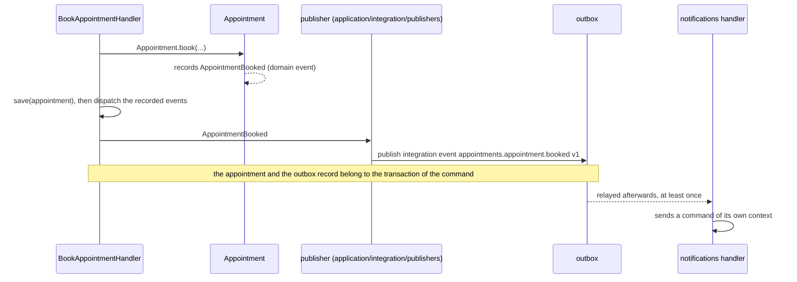

# Domain events and integration events

**Summary.** An event states that something happened, in the past tense. This kit distinguishes
two kinds that are easy to confuse. A domain event is a fact inside one bounded context,
recorded by an aggregate and handled in the same context. An integration event is a contract
between contexts, declared once in the producer's published language with a version and a
schema, delivered at least once. A publisher of the application layer translates the first into
the second. Keeping them apart is what lets a model change without breaking its consumers.

## Two kinds, side by side

| | Domain event | Integration event |
|---|---|---|
| Audience | the context that raised it | other contexts, possibly other services |
| Declared in | `domain/events/`, a class | `published-language/`, with `defineIntegrationEvent({ type, version, payload })` |
| Shape | whatever the model finds convenient; may hold value objects | plain JSON in a versioned envelope, validated by a schema |
| Stability | changes freely with the model | a contract: additive inside a version, otherwise a new version |
| Raised by | the aggregate, when its state changes | a publisher reacting to a domain event |
| Delivery | in process, after the unit of work commits | at least once, through the outbox when there is a database |
| Handled by | `application/event-handlers/` | `application/integration/handlers/` of the consuming context |
| Consumers must be | ordinary handlers | idempotent, registered under a stable consumer name |
| Documented in | the code | the generated event catalog and AsyncAPI document |

Both follow the name format `<context>.<aggregate>.<fact>` (`events/name-format`), which is why
the same string, `appointments.appointment.booked`, can name the domain event and the
integration event made from it. They are still two declarations with two lifecycles.

## The path of one fact



1. **The aggregate records.** `Appointment.book(...)` checks the invariants and records the
   domain event. An aggregate never publishes anything itself and knows no bus.
2. **The application dispatches.** The recorded events are pulled by the application layer and
   dispatched to the handlers of the same context
   ([ARCHITECTURE.md](../ARCHITECTURE.md) section 4, "Domain events").
3. **A publisher translates.** One of those handlers is the publisher: it builds the
   integration event from the domain event and hands it to the `IntegrationEventPublisher`
   port. With a database that port is the outbox, so the event is stored in the transaction of
   the command (`events/outbox-required`, see [Transactional outbox](transactional-outbox.md)).
4. **The consumer reacts.** In `notifications`, an integration event handler translates the
   event into a command of its own context and sends it on the command bus. It contains no
   business logic and imports only the upstream's published language.

A note on timing. The architecture reference says both that domain events are dispatched "after
the unit of work commits" and that an integration event is stored "in the transaction of the
command". The second is the property that matters and the one the outbox rule enforces: the
outbox record must commit or roll back with the state change. Read the generated platform
module of your project to see where exactly the dispatch sits relative to the commit; a domain
event handler doing anything else than writing to the outbox must tolerate that the state
change is already committed, or not yet visible to others.

The publisher is the anti-leak valve: the domain event can gain a field, be split or be renamed,
and the integration event stays what it was until the team decides to version it.

## Why not publish the domain event directly

It is tempting to hand `AppointmentBooked` to every interested context. Three things go wrong:

- **The model becomes a public API.** Renaming a value object of `appointments` breaks
  `analytics`. The upstream can no longer refactor.
- **Internal facts leak.** `appointments` may record fine-grained events useful to itself
  (a slot was held, a hold expired). Consumers do not need them and should not build on them.
- **The delivery contract differs.** A domain event is handled in process after a commit. An
  integration event may cross a broker, arrive twice, arrive late. Mixing the two hides which
  guarantees a handler can count on.

Not every domain event becomes an integration event. Publish what another context has a reason
to react to, when one asks for it.

## Designing the payload

The payload is what consumers need in order to act without calling back, and nothing internal
(the `integration-event` skill gives the same rule).

```ts
// contexts/appointments/published-language/appointment-booked.event.ts
export const appointmentBooked = defineIntegrationEvent({
  type: 'appointments.appointment.booked',
  version: 1,
  description: 'A client booked an appointment with a practitioner.',
  payload: zodSchema(
    z.object({
      appointmentId: z.string().describe('Identifier of the appointment.'),
      practitionerId: z.string(),
      clientId: z.string(),
      startsAt: z.string().datetime().describe('Start of the slot, ISO 8601, UTC.'),
      endsAt: z.string().datetime(),
    }),
  ),
});
```

| Question | Guidance |
|---|---|
| Identifiers or data? | Identifiers plus the facts that define the event (the slot). `notifications` can schedule a reminder from `startsAt` without asking `appointments` |
| The whole aggregate? | No. A dump of the aggregate couples consumers to the model and grows with it |
| Personal data? | Only when a consumer needs it. A broker keeps messages; the envelope carries no actor by default for the same reason (events README) |
| A fact or an instruction? | A fact. `appointments.appointment.booked`, not "send-reminder": the producer does not know what consumers do |
| Order-sensitive consumers? | Carry a version or a sequence of the aggregate in the payload: ordering is not guaranteed by default (see [Delivery and idempotency](delivery-and-idempotency.md)) |
| Field descriptions | Written in the schema: they flow into the catalog and the AsyncAPI document |

There is a real trade-off between thin events (identifiers only, consumers call back) and fat
events (enough state to act). Thin events keep the contract small but turn every consumer into a
synchronous client of the producer. The kit's rule leans towards "enough to act", because
calling back defeats the autonomy the event was meant to give.

## What the kit provides

- `defineIntegrationEvent` gives the payload type, validates what is published and what is
  consumed, and feeds the generated catalog and AsyncAPI document
  (`events/defined-in-published-language`).
- The envelope is standard: id, type, version, time of occurrence, payload, trace context and
  correlation id.
- The provider is behind two kernel ports, a publisher and a subscriber; the in-memory bus is
  the default, and brokers are adapters held to one contract suite
  (see [Message brokers](../tools/message-brokers.md)).
- Generators write the declaration, the publisher, the handler, their specs and their
  registration.

## Limits and when not to use it

- **Two declarations for one fact is duplication on purpose.** In a context with one consumer
  and a stable model it feels heavy. It is still the boundary that lets the two evolve apart.
- **Events are the wrong tool for a question.** A context that cannot decide without an answer
  now needs a gateway port, not a request disguised as an event and a reply event.
- **Events are the wrong tool inside one aggregate's transaction.** Two things that must change
  together belong to one aggregate; an event makes them eventually consistent
  (see [Eventual consistency](eventual-consistency.md)).
- **A domain event handler runs after the commit.** If it fails, the state change stays. Work
  that must not be lost goes through the outbox as an integration event, or is made part of the
  command.
- **The kit does not store domain events.** This is not event sourcing: see
  [CQRS as used here](cqrs.md).
- **Event-driven designs are harder to follow.** No single place shows the whole flow. The
  generated catalog, the context map and a sequence diagram per cross-context flow in
  `docs/integration/README.md` are how the kit compensates.

## Sources

- Eric Evans, Domain-Driven Design Reference, 2015 (Domain Events),
  https://www.domainlanguage.com/ddd/reference/
- Vaughn Vernon, Implementing Domain-Driven Design, Addison-Wesley, 2013, chapter 8 ("Domain
  Events") and chapter 13 ("Integrating Bounded Contexts").
- Vlad Khononov, Learning Domain-Driven Design, O'Reilly, 2021, chapter 15 ("Event-Driven
  Architecture": event notification, event-carried state transfer, domain events).
- Martin Fowler, "What do you mean by Event-Driven?", 2017,
  https://martinfowler.com/articles/201701-event-driven.html
- Gregor Hohpe and Bobby Woolf, Enterprise Integration Patterns, Addison-Wesley, 2003 (Event
  Message, Published Language via Canonical Data Model).
- README of [`@ddd-ts-kit/events`](../../packages/events/README.md).

## See also

- [Domain building blocks](domain-building-blocks.md)
- [Transactional outbox](transactional-outbox.md)
- [Delivery and idempotency](delivery-and-idempotency.md)
- [Event versioning](event-versioning.md)
- [Eventual consistency](eventual-consistency.md)
- [Context map](context-map.md)
- [Message brokers](../tools/message-brokers.md)
- [Architecture reference](../ARCHITECTURE.md)
