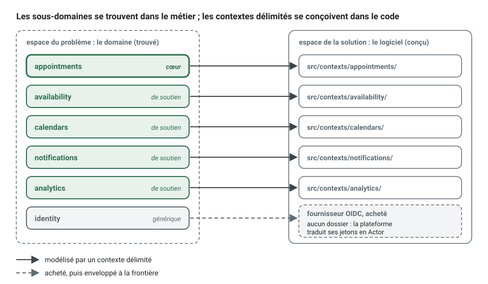

[English](domain-and-subdomains.md) · **Français**
<!-- translation-of: domain-and-subdomains.md sha256:b70842443a4d1dc1 -->

# Domaine et sous-domaines

**Résumé.** Le domaine est le champ d'activité que sert le logiciel ; un sous-domaine est une
partie de cette activité sur laquelle on peut raisonner à part. Les sous-domaines sont de trois
sortes : cœur (là où le métier gagne), de soutien (nécessaire et spécifique, mais pas un facteur
de différenciation) et générique (résolu partout de la même façon). Les classer est une décision
métier qui dit à une équipe où mettre son meilleur effort de conception, et où rester simple ou
acheter. Dans ce kit, la classification s'écrit par contexte délimité, dans
`ddd-ts-kit.config.json` et dans le `CONTEXT.md` du contexte, et elle change le degré de
modélisation que mérite un contexte, pas les règles qui s'y appliquent.

## Domaine, sous-domaine, modèle

- Le **domaine** est l'espace du problème : pour l'exemple qui sert de fil conducteur, mettre des
  clients en face de praticiens à un moment qui convient aux deux.
- Un **sous-domaine** en est une tranche cohérente : prendre des réservations, décrire quand un
  praticien travaille, envoyer des rappels, mesurer l'occupation, savoir qui est connecté.
- Un **modèle** est la solution : les concepts et les règles que le code tient pour un
  sous-domaine. Un modèle vit à l'intérieur d'un [contexte délimité](bounded-context.fr.md).

Les sous-domaines se trouvent, ils ne se conçoivent pas : ils existent dans le métier, qu'un
logiciel existe ou non. Les contextes délimités se conçoivent. La cible habituelle est un
contexte par sous-domaine, et l'on garde les deux termes distincts parce que la cible est parfois
manquée (un système hérité qui couvre trois sous-domaines, ou un sous-domaine partagé entre deux
équipes).



## Les trois sortes

| Sorte | Ce que c'est | Effort de conception | Approvisionnement habituel |
|---|---|---|---|
| core (cœur) | ce qui distingue le métier de ses concurrents ; complexe et changeant | le modèle le plus riche, le plus de tests, l'attention des plus expérimentés | construit en interne, jamais sous-traité |
| supporting (de soutien) | nécessaire et propre à ce métier, mais personne ne choisit le produit pour lui | un modèle simple, des cas d'usage sans détour | construit en interne, à moindre coût |
| generic (générique) | un problème que toute entreprise a, avec des solutions connues | aucun au-delà de l'intégration | acheté, ou un produit libre, enveloppé derrière un port |

Pour l'application de prise de rendez-vous :

| Sous-domaine | Sorte | Pourquoi |
|---|---|---|
| appointments | core | les règles de réservation, de déplacement et d'annulation sont le produit : pas de double réservation, délais d'annulation, ce que signifie une absence non excusée |
| availability | supporting | les créneaux libres se déduisent des calendriers et des rendez-vous réservés ; utile, mais un calcul sur les faits des autres |
| calendars | supporting | les horaires de travail et les absences sont spécifiques, et simples |
| notifications | supporting | quel rappel part et quand, cela nous appartient ; envoyer un e-mail ou un SMS est le produit de quelqu'un d'autre |
| analytics | supporting | les statistiques d'occupation et d'absences non excusées découlent des événements d'appointments |
| identity | generic | la connexion, les mots de passe et les jetons s'achètent : un fournisseur OIDC |

## Comment classer

Quatre questions, posées au métier et non au code :

1. **Différenciation.** Un client ou un praticien choisirait-il un concurrent si cette partie
   était simplement moyenne ? Si oui, c'est un candidat au cœur.
2. **Complexité.** Les règles sont-elles difficiles à énoncer, avec des exceptions dont les
   experts débattent ? Un sous-domaine cœur est presque toujours complexe. Un sous-domaine qui
   différencie mais reste trivial ne restera pas longtemps un facteur de différenciation, parce
   qu'il est facile à copier (Khononov, chapitre 1).
3. **Volatilité.** Les règles changent-elles souvent, parce que le métier continue d'y apprendre ?
   Les sous-domaines cœur changent le plus ; les génériques ne changent presque pas.
4. **Acheter ou construire.** Existe-t-il un produit qui le fait assez bien ? Si l'acheter ne
   coûte rien en différenciation, le sous-domaine est générique. Si rien ne convient parce que le
   besoin est spécifique mais banal, il est de soutien.


La classification n'est pas définitive. Un sous-domaine de soutien devient cœur quand le métier
commence à se battre sur ce terrain (availability le deviendrait si la suggestion de créneaux
devenait l'argument de vente), et un sous-domaine cœur devient générique quand le marché le
banalise. Revoyez la classification quand la stratégie change, et consignez le changement comme
une décision.

## Ce que change la classification

Elle change l'investissement, pas les règles de l'architecture.

| | core | supporting | generic |
|---|---|---|---|
| Modèle | des agrégats riches, des objets-valeurs pour chaque concept, des invariants explicites | quelques agrégats, souvent proches des données | aucun qui vous soit propre : un port et un adaptateur |
| Glossaire | travaillé avec les experts du domaine, tenu précis | court | le vocabulaire du fournisseur, traduit à la frontière |
| Tests | chaque règle au niveau du domaine, chaque chemin d'échec | les règles qui existent | le contrat de l'adaptateur |
| Personnes | les plus expérimentées de l'équipe | n'importe qui, un bon endroit pour commencer | des compétences d'intégration |
| Revue | revue de conception de chaque changement | conformité aux règles | notes de mise à jour et de sécurité |

Un modèle mince dans un contexte de soutien est un choix légitime, pas un défaut : voir
[Modèle anémique](anemic-model.fr.md) pour savoir où passe la limite.

### Un sous-domaine générique dans le code : un port et un adaptateur

Envoyer un SMS est un sous-domaine générique : `notifications` décide quel rappel part et quand,
un fournisseur le livre. Au lieu d'appeler le SDK du fournisseur depuis un gestionnaire, ce qui
laisse son vocabulaire (`messages.create`, `sid`, `from`) fuir dans le modèle et lie chaque test à
lui :

```ts
// contexts/notifications/application/commands/send-reminder/send-reminder.handler.ts
await vendorClient.messages.create({ to: reminder.phone, body: text, from: '+33100000000' }); // les mots du fournisseur
```

déclarez ce dont le contexte a besoin, avec ses propres mots, et traduisez à la frontière :

<!-- checked sample -->
```ts
// contexts/notifications/application/ports/sms-sender.port.ts
// Ce dont notifications a besoin, avec ses mots : le fournisseur est un détail caché derrière.
export abstract class SmsSender {
  /** Échoue quand le fournisseur n'a pas accepté le message. */
  abstract send(phoneNumber: string, text: string): Promise<void>;
}

// Le client du fournisseur, tel que son SDK le type : acheté, jamais modélisé.
interface VendorSmsClient {
  readonly messages: {
    create(input: { to: string; body: string; from: string }): Promise<{ sid: string; status: string }>;
  };
}

// contexts/notifications/infrastructure/external/vendor-sms-sender.adapter.ts
// Le seul fichier qui connaît le fournisseur : le remplacer ne touche rien d'autre.
export class VendorSmsSender implements SmsSender {
  constructor(
    private readonly client: VendorSmsClient,
    private readonly senderNumber: string,
  ) {}

  async send(phoneNumber: string, text: string): Promise<void> {
    const message = await this.client.messages.create({ to: phoneNumber, body: text, from: this.senderNumber });

    if (message.status === 'failed') {
      throw new Error(`The SMS provider refused message ${message.sid}.`);
    }
  }
}
```

Le gestionnaire dépend de `SmsSender` ; les tests y lient un *fake* ; la plateforme y lie
`VendorSmsSender` ([Ports et composition](ports-and-composition.fr.md)). Changer de fournisseur
est alors un nouvel adaptateur, pas un changement du modèle.

## Dans ce kit

Chaque contexte est classé, et la valeur est obligatoire :

```json
{
  "contexts": {
    "appointments": { "classification": "core", "upstreams": [{ "context": "calendars", "relationship": "published-language" }] },
    "calendars": { "classification": "supporting", "upstreams": [] }
  }
}
```

- Les valeurs acceptées sont `core`, `supporting` et `generic`
  ([CONFIG.md](../CONFIG.fr.md), clé `contexts.<name>.classification`).
- `CONTEXT.md` a une section `## Classification` qui énonce la sorte et une phrase qui la
  justifie. `tree/context-doc` signale une section manquante et une classification qui contredit
  la configuration ([ARCHITECTURE.md](../ARCHITECTURE.fr.md), section 3).
- La carte des contextes générée donne à chaque nœud le style de sa classification, si bien que
  le cœur se voit d'un coup d'œil ([Carte des contextes](context-map.fr.md)).
- Un sous-domaine générique acheté n'a souvent **aucun contexte** dans `src/contexts`. Identity,
  dans l'exemple qui sert de fil conducteur, est un fournisseur OIDC ; la plateforme convertit ses
  jetons en `Actor` à la frontière, et aucun dossier ne modélise les utilisateurs. Un contexte
  générique n'existe dans l'arborescence que quand le projet garde pour lui un état ou une
  traduction qui lui sont propres.

```bash
npx ddd-ts-kit generate context appointments --classification core \
  --purpose "Clients book, reschedule and cancel appointments with practitioners. It guarantees that a practitioner is never booked twice for the same time." \
  --term "Appointment=A commitment of a practitioner to see a client during a slot"
```

## Limites et cas où s'en passer

- **Les règles sont les mêmes pour chaque sorte.** Le *checker* n'assouplit ni les règles de
  couches, ni celles de nommage, ni celles des tests pour un contexte de soutien. La
  classification guide les personnes ; elle ne configure pas les analyseurs. Si un contexte de
  soutien a vraiment besoin d'un régime plus léger, c'est une dérogation consignée
  (`governance/recorded-deviation`), pas une conséquence de sa sorte.
- **La classification est un jugement.** Deux personnes peuvent être en désaccord, et l'outil ne
  peut pas arbitrer : il vérifie seulement qu'une valeur est présente et cohérente entre la
  configuration et `CONTEXT.md`.
- **Ne classez pas selon la difficulté technique.** Une intégration difficile avec un prestataire
  de paiement reste générique. Ce qui compte, c'est la différenciation métier.
- **Ne créez pas de contextes pour remplir les trois sortes.** Un petit produit peut avoir un
  contexte cœur et rien d'autre qui mérite une frontière. Le *skill* `bounded-contexts` le dit :
  deux contextes bien nommés valent mieux que cinq devinés.
- **Un produit sans sous-domaine cœur** (pure saisie de données, une interface d'administration
  sans règle propre) gagne peu au DDD tactique. Le vocabulaire stratégique aide quand même à
  décider quoi acheter.

## Sources

- Eric Evans, *Domain-Driven Design: Tackling Complexity in the Heart of Software*,
  Addison-Wesley, 2003, partie IV, chapitre 15 « Distillation » (domaine cœur, sous-domaines
  génériques).
- Vlad Khononov, *Learning Domain-Driven Design*, O'Reilly, 2021, chapitre 1 « Analyzing Business
  Domains » (les trois sortes, la complexité et la volatilité comme critères).
- Vaughn Vernon, *Implementing Domain-Driven Design*, Addison-Wesley, 2013, chapitre 2 « Domains,
  Subdomains, and Bounded Contexts ».
- Vaughn Vernon, *Domain-Driven Design Distilled*, Addison-Wesley, 2016, chapitre 3.

## Voir aussi

- [Contexte délimité](bounded-context.fr.md)
- [Langage omniprésent](ubiquitous-language.fr.md)
- [Carte des contextes](context-map.fr.md)
- [Un exemple détaillé : la carte des contextes de l'application de prise de rendez-vous](context-map-worked-example.fr.md)
- [Modèle anémique](anemic-model.fr.md)
- [Référence de la configuration](../CONFIG.fr.md)
- [Index des concepts](README.fr.md)
