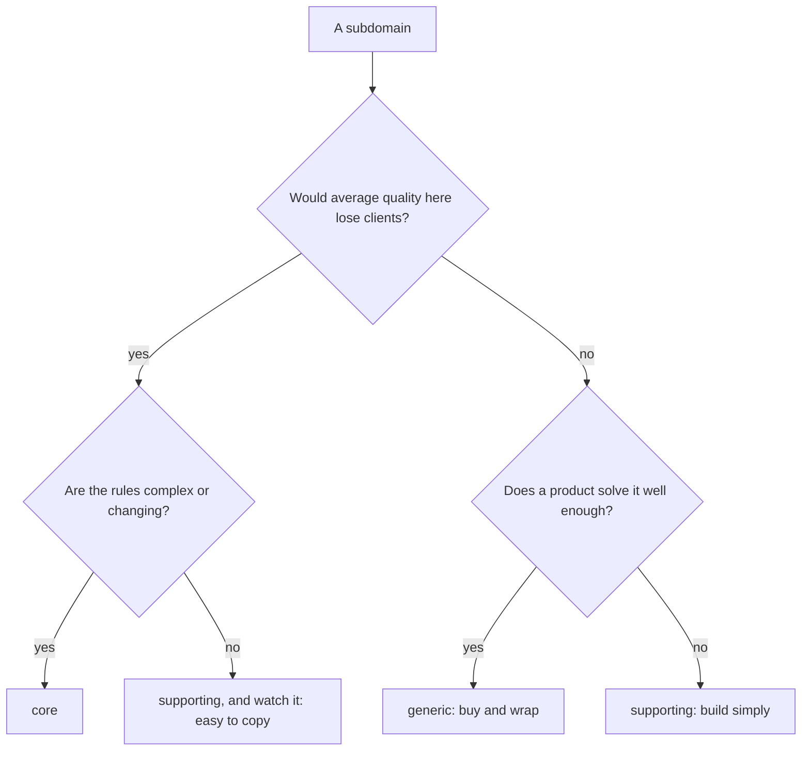

**English** · [Français](domain-and-subdomains.fr.md)

# Domain and subdomains

**Summary.** The domain is the area of activity the software serves; a subdomain is one part of
that activity that can be reasoned about on its own. Subdomains come in three kinds: core (where
the business wins), supporting (needed and specific, but not a differentiator) and generic
(solved the same way everywhere). Classifying them is a business decision that tells a team
where to spend its best design effort and where to keep things plain or buy. In this kit the
classification is written per bounded context, in `ddd-ts-kit.config.json` and in the
`CONTEXT.md` of the context, and it changes how much modelling a context deserves, not which
rules apply to it.

## Domain, subdomain, model

- The **domain** is the problem space: for the running example, getting clients in front of
  practitioners at a time that suits both.
- A **subdomain** is a coherent slice of it: taking bookings, describing when a practitioner
  works, reminding people, measuring occupancy, knowing who is signed in.
- A **model** is the solution: the concepts and rules the code holds for one subdomain. A model
  lives inside a [bounded context](bounded-context.md).

Subdomains are found, not designed: they exist in the business whether or not software exists.
Bounded contexts are designed. The usual target is one context per subdomain, and the two terms
are kept apart because the target is sometimes missed (a legacy system covering three
subdomains, or one subdomain split between two teams).

## The three kinds

| Kind | What it is | Design effort | Typical sourcing |
|---|---|---|---|
| core | what makes the business different from its competitors; complex and changing | the richest model, the most tests, the most senior attention | built in house, never outsourced |
| supporting | necessary and specific to this business, but nobody chooses the product for it | a simple model, plain use cases | built in house, cheaply |
| generic | a problem every company has, with known solutions | none beyond integration | bought, or an open-source product, wrapped behind a port |

For the scheduling application:

| Subdomain | Kind | Why |
|---|---|---|
| appointments | core | the booking, rescheduling and cancellation rules are the product: no double booking, cancellation windows, what a no-show means |
| availability | supporting | open slots are derived from calendars and booked appointments; valuable, but a computation over other people's facts |
| calendars | supporting | working hours and time off are specific, and simple |
| notifications | supporting | which reminder goes out when is ours; sending an email or an SMS is somebody else's product |
| analytics | supporting | occupancy and no-show statistics follow from the events of appointments |
| identity | generic | sign-in, passwords and tokens are bought: an OIDC provider |

## How to classify

Four questions, asked of the business and not of the code:

1. **Differentiation.** Would a client or a practitioner choose a competitor if this part were
   merely average? If yes, it is a candidate for core.
2. **Complexity.** Are the rules hard to state, with exceptions that experts argue about? A
   core subdomain is nearly always complex. A subdomain that differentiates but is trivial
   will not stay a differentiator for long, because it is easy to copy (Khononov, chapter 1).
3. **Volatility.** Do the rules change often, because the business keeps learning there? Core
   subdomains change the most; generic ones barely change.
4. **Buy or build.** Does a product exist that does this well enough? If buying it would cost
   nothing in differentiation, the subdomain is generic. If nothing fits because the need is
   specific but dull, it is supporting.



Classification is not permanent. A supporting subdomain becomes core when the business starts
competing on it (availability would, if slot suggestion became the selling point), and a core
one becomes generic when the market commoditises it. Revisit the classification when the
strategy changes, and record the change as a decision.

## What classification changes

It changes the investment, not the architecture rules.

| | core | supporting | generic |
|---|---|---|---|
| Model | rich aggregates, value objects for every concept, explicit invariants | a few aggregates, often close to the data | none of your own: a port and an adapter |
| Glossary | worked on with domain experts, kept sharp | short | the vendor's vocabulary, translated at the edge |
| Tests | every rule at the domain level, every failure path | the rules that exist | the adapter's contract |
| People | the most experienced on the team | anyone, a good place to start | integration skills |
| Review | design review of each change | conformance to the rules | upgrade and security notes |

A thin model in a supporting context is a legitimate choice, not a defect: see
[Anemic model](anemic-model.md) for where the line is.

## In this kit

Every context is classified, and the value is required:

```json
{
  "contexts": {
    "appointments": { "classification": "core", "upstreams": [{ "context": "calendars", "relationship": "published-language" }] },
    "calendars": { "classification": "supporting", "upstreams": [] }
  }
}
```

- The accepted values are `core`, `supporting` and `generic`
  ([CONFIG.md](../CONFIG.md), key `contexts.<name>.classification`).
- `CONTEXT.md` has a `## Classification` section that states the kind and one sentence of why.
  `tree/context-doc` reports a missing section and a classification that contradicts the
  config ([ARCHITECTURE.md](../ARCHITECTURE.md), section 3).
- The generated context map styles each node by its classification, so the core is visible at a
  glance ([Context map](context-map.md)).
- A generic subdomain that is bought often has **no context at all** in `src/contexts`. Identity
  in the running example is an OIDC provider; the platform maps its tokens to an `Actor` at the
  boundary, and no folder models users. A generic context exists in the tree only when the
  project keeps some state or translation of its own for it.

```bash
npx ddd-ts-kit generate context appointments --classification core \
  --purpose "Clients book, reschedule and cancel appointments with practitioners. It guarantees that a practitioner is never booked twice for the same time." \
  --term "Appointment=A commitment of a practitioner to see a client during a slot"
```

## Limits and when not to use it

- **The rules are the same for every kind.** The checker does not relax layering, naming or
  test rules for a supporting context. Classification guides people; it does not configure the
  analyzers. If a supporting context truly needs a lighter regime, that is a recorded deviation
  (`governance/recorded-deviation`), not a consequence of its kind.
- **Classification is a judgement.** Two people can disagree, and the tool cannot arbitrate: it
  only checks that a value is present and consistent between the config and `CONTEXT.md`.
- **Do not classify by technical difficulty.** A hard integration with a payment provider is
  still generic. What counts is business differentiation.
- **Do not create contexts to fill the three kinds.** A small product may have one core context
  and nothing else worth a boundary. The bootstrap skill says it: one well-named context beats
  four guessed ones.
- **A product with no core subdomain** (pure data entry, a back-office with no rule of its own)
  gains little from tactical DDD. The strategic vocabulary still helps to decide what to buy.

## Sources

- Eric Evans, *Domain-Driven Design: Tackling Complexity in the Heart of Software*,
  Addison-Wesley, 2003, part IV, chapter 15 "Distillation" (core domain, generic subdomains).
- Vlad Khononov, *Learning Domain-Driven Design*, O'Reilly, 2021, chapter 1 "Analyzing Business
  Domains" (the three kinds, complexity and volatility as criteria).
- Vaughn Vernon, *Implementing Domain-Driven Design*, Addison-Wesley, 2013, chapter 2 "Domains,
  Subdomains, and Bounded Contexts".
- Vaughn Vernon, *Domain-Driven Design Distilled*, Addison-Wesley, 2016, chapter 3.

## See also

- [Bounded context](bounded-context.md)
- [Ubiquitous language](ubiquitous-language.md)
- [Context map](context-map.md)
- [A worked example: the context map of the scheduling application](context-map-worked-example.md)
- [Anemic model](anemic-model.md)
- [Configuration reference](../CONFIG.md)
- [Concepts index](README.md)
