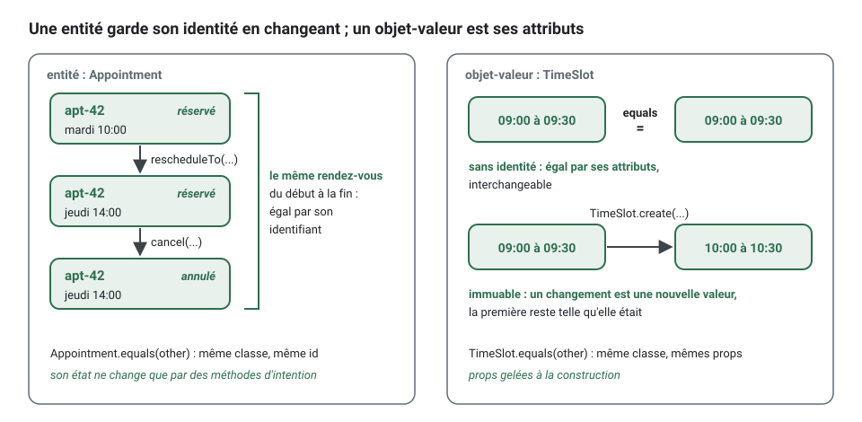
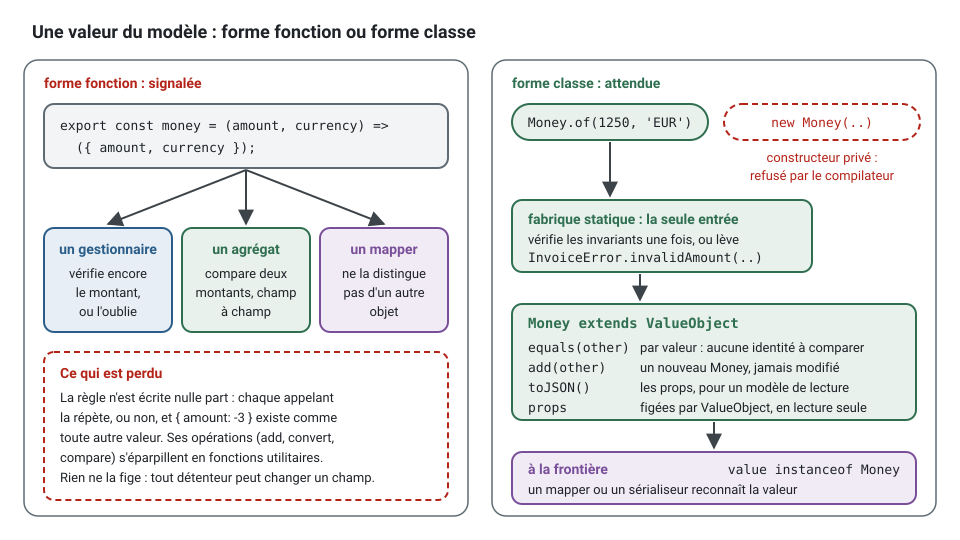
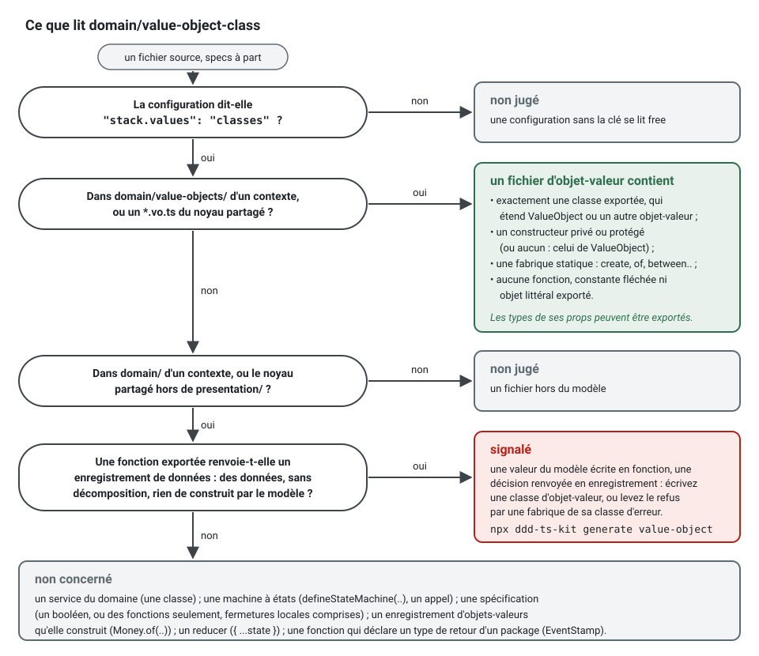
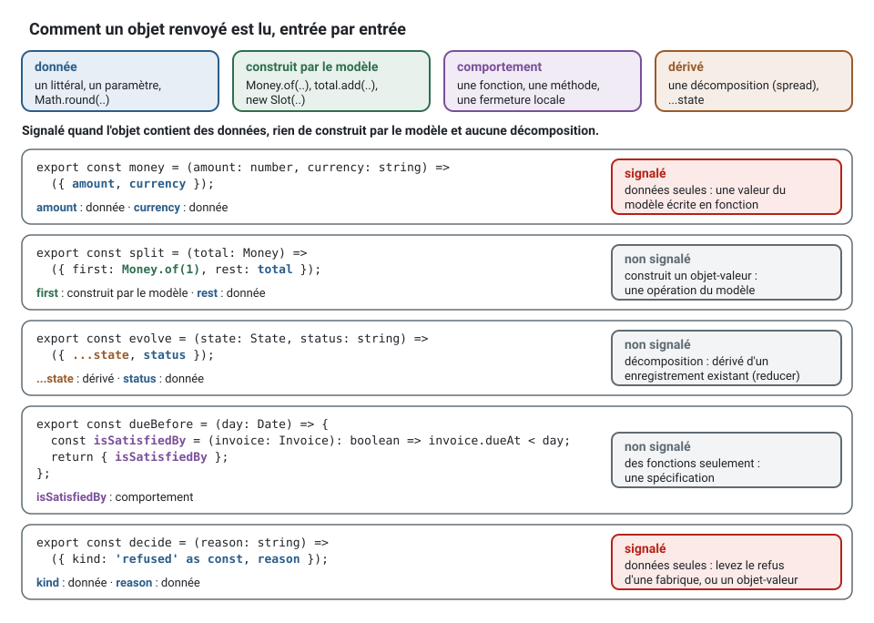

[English](entities-and-value-objects.md) · **Français**
<!-- translation-of: entities-and-value-objects.md sha256:bacc9c4406b3d8ba -->

# Entités et objets-valeurs

**Résumé.** Le modèle du domaine est fait de deux sortes d'objets. Une entité a une identité qui
persiste pendant que ses attributs changent : un rendez-vous reste le même rendez-vous quand il
est déplacé. Un objet-valeur n'a pas d'identité : il est entièrement défini par ses attributs, il
est immuable, et deux objets-valeurs aux mêmes attributs sont interchangeables, comme un créneau
horaire ou un motif d'annulation. La plupart des concepts devraient être des objets-valeurs ; les
entités sont les quelques choses dont le métier suit la continuité. Dans ce kit, les deux ont un
constructeur privé et des fabriques, les entités ne changent que par des méthodes nommées d'après
une intention métier, et les objets-valeurs ne changent jamais. Un objet-valeur est toujours une
classe qui étend `ValueObject`, jamais une fonction qui construit un objet simple
(`domain/value-object-class`).

## Les distinguer

Demandez à l'expert du domaine : « si tous les attributs étaient identiques, s'agirait-il encore
de deux choses différentes ? »

| | Entité | Objet-valeur |
|---|---|---|
| Identité | en a une, stable dans le temps | aucune |
| Égalité | par identifiant | par attributs (`equals`) |
| Mutabilité | change d'état par des méthodes d'intention | immuable ; une opération renvoie une nouvelle instance |
| Cycle de vie | créée, modifiée, parfois terminée ; stockée et chargée | créé au besoin, abandonné librement |
| Exemple | `Appointment`, `Calendar`, une absence `TimeOff` dans un calendrier | `TimeSlot`, `CancellationReason`, `WorkingHours`, une adresse e-mail |

Deux rendez-vous pour le même client, le même praticien et le même créneau resteraient deux
rendez-vous (et un bogue que l'invariant doit empêcher) : entité. Deux `TimeSlot` de 09:00 à 09:30
le même jour sont le même créneau : objet-valeur.



Le même concept peut être une entité dans un contexte et une valeur dans un autre. Un praticien
est une entité là où l'on gère les profils ; dans `appointments`, ce n'est qu'un
`practitionerId`.

## Objets-valeurs

Un objet-valeur rassemble un concept qui serait sinon éparpillé en types primitifs, avec les
règles qui le rendent valide et les opérations qui lui appartiennent.

<!-- checked sample -->
```ts
import { DomainRefusal, ValueObject } from '@ddd-ts-kit/kernel';

// contexts/appointments/domain/errors/codes.ts
export const AppointmentsCodes = {
  InvalidTimeSlot: 'INVALID_TIME_SLOT',
} as const;

// contexts/appointments/domain/errors/invalid-time-slot.error.ts
export class InvalidTimeSlot extends DomainRefusal {
  readonly code = AppointmentsCodes.InvalidTimeSlot;

  static forBounds(startsAt: Date, endsAt: Date) {
    return InvalidTimeSlot.refusal(
      `A slot ends after it starts: ${startsAt.toISOString()} to ${endsAt.toISOString()} does not.`,
      { startsAt, endsAt },
    );
  }
}

// contexts/appointments/domain/value-objects/time-slot.vo.ts
export type TimeSlotProps = {
  readonly startsAt: Date;
  readonly endsAt: Date;
};

export class TimeSlot extends ValueObject<TimeSlotProps> {
  private constructor(props: TimeSlotProps) {
    super(props);
  }

  static create(startsAt: Date, endsAt: Date): TimeSlot {
    if (endsAt.getTime() <= startsAt.getTime()) {
      throw InvalidTimeSlot.forBounds(startsAt, endsAt);
    }

    return new TimeSlot({ startsAt, endsAt });
  }

  overlaps(other: TimeSlot): boolean {
    return this.startsAt < other.endsAt && other.startsAt < this.endsAt;
  }

  startsWithin(durationMs: number, now: Date): boolean {
    return this.startsAt.getTime() - now.getTime() < durationMs;
  }

  get startsAt(): Date {
    return this.props.startsAt;
  }

  get endsAt(): Date {
    return this.props.endsAt;
  }
}
```

Ce que cette forme apporte :

- **Valide par construction.** Le constructeur est privé et `create` vérifie les règles, si bien
  qu'un `TimeSlot` qui existe est valide. Le code qui reçoit un `TimeSlot` ne le revalide jamais.
- **Immuable.** Les propriétés sont en lecture seule et aucune méthode n'affecte l'objet
  (`domain/value-object-immutability`). On peut le partager et le faire circuler sans copie
  défensive.
- **Le comportement à côté des données.** `overlaps` est écrit une fois, sur le type qu'il
  concerne, au lieu d'être répété partout où deux paires de dates se rencontrent.
- **Aucune horloge cachée.** `startsWithin` reçoit `now` ; le domaine ne lit jamais l'heure du
  système (`purity/no-system-clock`).
- **L'égalité offerte.** `ValueObject` gèle les propriétés à la construction et les compare dans
  `equals`, les dates par leur instant et les tableaux élément par élément : deux créneaux
  construits à partir des mêmes instants sont égaux, `===` n'est pas la question.
- **Les propriétés sont un `type`, pas une `interface`.** `ValueObject<Props>` exige
  `Record<string, unknown>` : un alias de type objet le satisfait, une interface non, parce que
  TypeScript donne une signature d'index implicite au premier seulement.

Dans une *spec*, la valeur s'emploie comme le métier en parle :

<!-- checked sample -->
```ts
import { ValueObject } from '@ddd-ts-kit/kernel';
import { describe, expect, it } from 'vitest';

// Le TimeSlot ci-dessus, réduit à ce qu'utilise cette spec.
type TimeSlotProps = { readonly startsAt: Date; readonly endsAt: Date };

class TimeSlot extends ValueObject<TimeSlotProps> {
  private constructor(props: TimeSlotProps) {
    super(props);
  }

  static create(startsAt: Date, endsAt: Date): TimeSlot {
    return new TimeSlot({ startsAt, endsAt });
  }

  overlaps(other: TimeSlot): boolean {
    return this.props.startsAt < other.props.endsAt && other.props.startsAt < this.props.endsAt;
  }
}

const at = (time: string): Date => new Date(`2026-03-03T${time}:00.000Z`);

describe('TimeSlot', () => {
  it('is equal to another slot with the same start and end', () => {
    expect(TimeSlot.create(at('09:00'), at('09:30')).equals(TimeSlot.create(at('09:00'), at('09:30')))).toBe(true);
  });

  it('overlaps a slot that starts before it ends', () => {
    expect(TimeSlot.create(at('09:00'), at('09:30')).overlaps(TimeSlot.create(at('09:15'), at('09:45')))).toBe(true);
  });

  it('does not overlap the slot that starts when it ends', () => {
    expect(TimeSlot.create(at('09:00'), at('09:30')).overlaps(TimeSlot.create(at('09:30'), at('10:00')))).toBe(false);
  });
});
```

### Pourquoi un objet-valeur est une classe

Une valeur peut s'écrire de deux façons en TypeScript : une fonction qui construit un objet
simple, ou une classe. Le kit écrit, et vérifie, la classe (`domain/value-object-class`).



La forme fonction paraît plus légère :

```ts
// domain/value-objects/money.vo.ts : signalé
export type Money = { readonly amount: number; readonly currency: string };

export const money = (amount: number, currency: string): Money => ({ amount, currency });
```

et coûte davantage à chaque endroit qui l'utilise :

```ts
// trois appelants, trois copies des règles, ou aucune
if (!Number.isInteger(price.amount)) { /* ... */ }                    // un gestionnaire valide encore
const same = a.amount === b.amount && a.currency === b.currency;    // un agrégat compare à la main
const total = { amount: a.amount + b.amount, currency: a.currency }; // une fonction utilitaire additionne, sans vérifier
```

La forme classe rassemble tout cela en un seul endroit :

```ts
// domain/value-objects/money.vo.ts : npx ddd-ts-kit generate value-object billing Money
import { ValueObject } from '@ddd-ts-kit/kernel';
import { CurrencyMismatch } from '@/contexts/billing/domain/errors/currency-mismatch.error';
import { InvalidAmount } from '@/contexts/billing/domain/errors/invalid-amount.error';

export type MoneyProps = {
  readonly amount: number;
  readonly currency: string;
};

export class Money extends ValueObject<MoneyProps> {
  private constructor(props: MoneyProps) {
    super(props);
  }

  static of(amount: number, currency: string): Money {
    if (!Number.isInteger(amount)) {
      throw InvalidAmount.withAmount(amount);
    }

    return new Money({ amount, currency });
  }

  static zero(currency: string): Money {
    return Money.of(0, currency);
  }

  add(other: Money): Money {
    if (other.currency !== this.currency) {
      throw CurrencyMismatch.withCurrencies(this.currency, other.currency);
    }

    return Money.of(this.amount + other.amount, this.currency);
  }

  get amount(): number {
    return this.props.amount;
  }

  get currency(): string {
    return this.props.currency;
  }
}
```

```ts
// les trois mêmes appelants
const price = Money.of(1250, 'EUR');      // valide, ou refusé avec INVALID_AMOUNT
const same = a.equals(b);                 // par valeur
const total = a.add(b);                   // un nouveau Money, vérifié à nouveau par `of`
```

Ce que donne la classe, et que la fonction ne peut pas donner :

| | Fonction qui renvoie `{ amount, currency }` | Classe qui étend `ValueObject` |
|---|---|---|
| **L'égalité sans identité** | chaque appelant compare champ par champ, ou compare des références par erreur | `equals` compare les props : deux valeurs égales sont interchangeables |
| **Les invariants vérifiés une fois** | tout objet de la bonne forme passe, `{ amount: 0.5 }` compris ; chaque appelant revérifie ou oublie | le constructeur est privé, la fabrique statique est la seule entrée : un `Money` qui existe est valide |
| **Le comportement à côté des données** | `add`, `convert`, `isZero` deviennent des fonctions utilitaires dans d'autres fichiers, trouvées en cherchant | des méthodes du type qu'elles concernent, trouvées par la complétion |
| **Les refus depuis les fabriques statiques** | une entrée invalide passe inaperçue | `Money.of` lève un refus nommé d'après ce qu'il refuse, `InvalidAmount.withAmount(..)`, que le *mapping* HTTP, le journal d'audit et les tests connaissent par son code ; ou le renvoie dans un `Result` sous `"stack.valueObjects": "result"` |
| **L'immuabilité** | un type `readonly` n'est qu'une promesse du compilateur : tout détenteur peut encore le décomposer et le modifier | les props sont figées par `ValueObject`, une opération renvoie une nouvelle instance (`domain/value-object-immutability`) |
| **Reconnue à la frontière** | un *mapper* ne peut pas distinguer un `Money` de n'importe quel objet aux deux mêmes champs | `value instanceof Money` dans un *mapper* ou un sérialiseur ; `toJSON()` donne les props à un modèle de lecture ou à un journal |

### Ce que vérifie `domain/value-object-class`

La règle tient un projet dont la configuration dit `"stack.values": "classes"`, ce qu'écrit
`init`. Une configuration sans la clé a été écrite avant que la règle n'existe : elle se lit
`free` et rien n'est signalé ; [CONFIG.md](../CONFIG.fr.md#stack) donne les étapes pour la faire
évoluer.



- **Un fichier d'objet-valeur** (`domain/value-objects/*.vo.ts` d'un contexte, un `*.vo.ts` du
  noyau partagé hors de `presentation/`) exporte exactement une classe qui étend `ValueObject`,
  directement ou par un autre objet-valeur du projet ; son constructeur est privé ou protégé
  (une classe qui n'en déclare aucun hérite de celui, protégé, de `ValueObject`) ; une classe
  concrète a une fabrique statique ; et le fichier n'exporte aucune fonction, aucune constante
  fléchée et aucun objet littéral, en ligne, par une liste d'export ou par défaut. Les types et
  les interfaces de ses props peuvent être exportés à côté.
- **Dans les autres fichiers de `domain/` et du noyau partagé** (hors de `presentation/`), une
  fonction exportée qui renvoie un **enregistrement de données** est une valeur écrite comme une
  fonction, et elle est signalée avec la commande qui écrit la classe.

Qu'un objet renvoyé soit un enregistrement de données se lit entrée par entrée, sans les types :



| Entrée | Se lit comme | Exemples |
|---|---|---|
| un littéral, un paramètre, une opération sur eux, un appel du langage | donnée | `amount`, `'EUR'`, `cents * 100`, `Math.round(cents)`, `new Date(at)` |
| tout autre appel ou `new`, ou un nom lié à l'un d'eux dans le module | construit par le modèle | `Money.of(1)`, `total.add(tax)`, `new Slot(..)` |
| une fonction, une méthode, ou un nom lié à l'une d'elles dans le module | comportement | `isSatisfiedBy: (x) => ..`, `describe() {}`, `{ isSatisfiedBy }` |
| `...state` | dérivé | `{ ...state, status }` |

L'objet est un enregistrement de données quand il contient des données, rien de construit par le
modèle et aucune décomposition (spread). Une fonction qui déclare un type de retour d'un
*package* (`): EventStamp` du noyau) n'est pas jugée : la forme appartient à la bibliothèque, et
le projet ne peut pas en faire une classe.

Ce qui reste une fonction, parce que ce n'est pas une valeur :

```ts
// domain/state-machines/invoice.state-machine.ts : une déclaration, le résultat d'un appel
export const invoiceLifecycle = defineStateMachine({ states: ['draft', 'issued'], /* ... */ });

// domain/services/invoice-total.service.ts : prend et renvoie des objets-valeurs
export function invoiceTotal(lines: readonly Money[], currency: string): Money {
  return lines.reduce((sum, line) => sum.add(line), Money.zero(currency));
}

// une spécification : renvoie un booléen, ou seulement des fonctions, littérales ou fermetures locales
export const isOverdue = (invoice: Invoice, now: Date): boolean => invoice.dueAt < now;
export const dueBefore = (day: Date) => {
  const isSatisfiedBy = (invoice: Invoice): boolean => invoice.dueAt < day;

  return { isSatisfiedBy };
};

// une opération du modèle : un enregistrement d'objets-valeurs qu'elle construit
export const split = (total: Money) => ({ first: Money.of(1), rest: total.subtract(Money.of(1)) });

// un reducer : dérive un enregistrement qui existe, par une décomposition
export const evolve = (state: InvoiceState, status: string): InvoiceState => ({ ...state, status });
```

Ce qui est signalé, par décision, avec ce qu'il faut écrire à la place :

```ts
// une décision renvoyée en enregistrement : le domaine refuse en levant un refus nommé d'après elle,
// `throw InvoiceRefused.becauseOf(reason)`, ou nomme la décision comme un objet-valeur,
// `Decision.refused(reason)`, dont la classe dit quelles décisions existent
export const decide = (reason: string) => ({ kind: 'refused' as const, reason });

// des données avec des fermetures : une valeur qui a un comportement, donc une classe avec des méthodes
export const money = (cents: number) => ({ cents, doubled: (): number => cents * 2 });

// un enregistrement qui ne fait que rassembler ses paramètres, objets-valeurs compris : une paire
// qui a un sens est une valeur du glossaire, `Period.between(start, end)`
export const period = (start: Instant, end: Instant) => ({ start, end });
```

Tout type exporté de `domain/` n'est pas non plus une valeur. Un **objet de paramètres**, qui ne
fait que regrouper les arguments d'une méthode ou d'une fabrique et n'est ni gardé, ni comparé,
ni utilisé dans un calcul, reste un type : `CalendarDesk` (le cabinet, le praticien et le fuseau
horaire donnés à `Calendar.create`, puis décomposés dans l'état) et `FreedSlot` (le créneau, le
calendrier et les créneaux encore retenus, donnés à `Waitlist.offer`) dans l'exemple. Une valeur
ne contient aucun agrégat : `FreedSlot` porte un `Calendar`, une entité dotée d'une identité,
qu'aucune égalité par valeur ne peut comparer. Une valeur du glossaire avec laquelle le modèle
calcule est un objet-valeur : `MeasuredOutcome` et `OccupancyFigures` du contexte analytics, que
la mesure d'occupation lit et renvoie. Chacun vérifie ses règles une fois, dans sa fabrique :
`MeasuredOutcome.of` refuse une fin avant le début, `OccupancyFigures.of` un chiffre inférieur à
zéro et moins de rendez-vous qui occupent leur temps que de rendez-vous honorés et manqués,
chacun avec un refus qui lui est propre, `OutcomePeriodInverted` et `FiguresInconsistent` :

```ts
static of(state: OutcomeState, startsAt: Date, endsAt: Date): MeasuredOutcome {
  if (endsAt.getTime() < startsAt.getTime()) {
    throw OutcomePeriodInverted.forPeriod(startsAt.toISOString(), endsAt.toISOString());
  }

  return new MeasuredOutcome({ state, startsAt: new Date(startsAt), endsAt: new Date(endsAt) });
}
```

### L'obsession des types primitifs

La référence d'architecture en fait un défaut : un e-mail, un montant, une période sont des types
([ARCHITECTURE.md](../ARCHITECTURE.fr.md), section 4). Le symptôme est une signature telle que
`book(practitionerId: string, clientId: string, start: Date, end: Date)` : deux chaînes que l'on
peut intervertir sans s'en apercevoir, deux dates dont rien ne garantit l'ordre. Les candidats à
un objet-valeur :

- tout ce qui a un **format ou un intervalle de valeurs** (e-mail, numéro de téléphone, durée,
  pourcentage) ;
- tout ce qui est **deux valeurs qui voyagent ensemble** (début et fin, montant et devise) ;
- tout ce qui a un **ensemble fermé de valeurs** (un statut, un canal) ;
- les **identifiants d'autres agrégats**, quand les confondre coûterait cher.

Au lieu de :

```ts
book(practitionerId: string, clientId: string, startsAt: Date, endsAt: Date): void; // fin avant le début ? identifiants intervertis ?
```

écrivez :

```ts
book(practitionerId: string, clientId: string, slot: TimeSlot): void; // un TimeSlot qui existe est valide
```

Les *templates* du générateur le rappellent eux-mêmes : l'état se déclare « with value objects,
not primitives » (avec des objets-valeurs, pas des types primitifs).

## Entités

Une entité est définie par un fil de continuité. Sa classe protège ce fil :

<!-- checked sample -->
```ts
import { DomainRefusal, Entity, ValueObject } from '@ddd-ts-kit/kernel';

// contexts/calendars/domain/errors/codes.ts
export const CalendarsCodes = {
  TimeOffCanOnlyShrink: 'TIME_OFF_CAN_ONLY_SHRINK',
} as const;

// contexts/calendars/domain/errors/time-off-can-only-shrink.error.ts
export class TimeOffCanOnlyShrink extends DomainRefusal {
  readonly code = CalendarsCodes.TimeOffCanOnlyShrink;

  static forTimeOff(timeOffId: string) {
    return TimeOffCanOnlyShrink.refusal(`Time off ${timeOffId} can only be shortened.`, { timeOffId });
  }
}

// contexts/calendars/domain/value-objects/period.vo.ts, réduit à ce qu'utilise l'entité
type PeriodProps = { readonly from: Date; readonly to: Date };

export class Period extends ValueObject<PeriodProps> {
  private constructor(props: PeriodProps) {
    super(props);
  }

  static create(from: Date, to: Date): Period {
    return new Period({ from, to });
  }

  overlaps(other: Period): boolean {
    return this.props.from < other.props.to && other.props.from < this.props.to;
  }

  contains(other: Period): boolean {
    return this.props.from <= other.props.from && other.props.to <= this.props.to;
  }
}

// contexts/calendars/domain/entities/time-off.entity.ts
export interface TimeOffState {
  readonly period: Period;
  readonly reason: string;
}

export class TimeOff extends Entity<string> {
  private constructor(
    id: string,
    private state: TimeOffState,
  ) {
    super(id);
  }

  static create(id: string, state: TimeOffState): TimeOff {
    return new TimeOff(id, state);
  }

  static rehydrate(id: string, state: TimeOffState): TimeOff {
    return new TimeOff(id, state);
  }

  shortenTo(period: Period): void {
    if (!this.state.period.contains(period)) {
      throw TimeOffCanOnlyShrink.forTimeOff(this.id);
    }

    this.state = { ...this.state, period };
  }

  covers(period: Period): boolean {
    return this.state.period.overlaps(period);
  }

  toState(): TimeOffState {
    return { ...this.state };
  }
}
```

- **Constructeur privé, deux fabriques.** `create` est la naissance et vérifie les invariants que
  l'entité garde à elle seule ; `rehydrate` est le chargement depuis le stockage et ne vérifie
  rien, parce que l'état stocké était valide quand il a été enregistré.
- **Aucun *setter*, aucune propriété publique modifiable** (`domain/aggregate-encapsulation`).
  L'état est remplacé par une méthode dont le métier reconnaîtrait le nom : `shortenTo`, pas
  `setPeriod`.
- **L'identité est donnée, pas générée à l'intérieur.** L'identifiant vient du port
  `IdGenerator` en passant par la couche application (`purity/no-ambient-randomness`), ce qui
  garde les tests déterministes.
- **La méthode d'intention garde sa règle.** `shortenTo` refuse une période qui n'est pas incluse
  dans la période actuelle : on ne peut pas allonger l'entité par une méthode nommée
  « raccourcir ».
- **L'état est fait d'objets-valeurs.** L'entité porte l'identité et le cycle de vie ; les valeurs
  portent la validité.
- **Égale par identité.** `Entity.equals` compare la classe et l'identifiant, jamais l'état : un
  `TimeOff` chargé avant et après `shortenTo` est la même absence.

Une entité est soit la racine d'un [agrégat](aggregates.fr.md) (`Appointment`, `Calendar`), soit
elle vit à l'intérieur de l'un d'eux (`TimeOff` dans `Calendar`). Une entité interne n'est
atteinte et modifiée qu'à travers sa racine, n'a pas de *repository* à elle, et son identité n'a
besoin d'être unique qu'à l'intérieur de l'agrégat.


```bash
npx ddd-ts-kit generate value-object appointments TimeSlot
npx ddd-ts-kit generate entity calendars TimeOff
```

Chaque commande écrit le fichier et sa *spec*, avec des marqueurs `TODO(domain)` là où une
décision métier est attendue.

## Choisir : préférer les valeurs

Modélisez un concept comme un objet-valeur, sauf si le métier a besoin de le suivre dans le
temps. Les valeurs coûtent moins cher à tous points de vue : pas d'identité à gérer, pas de cycle
de vie, pas de concurrence, triviales à tester. Une erreur fréquente consiste à donner une
identité à quelque chose parce qu'il a une ligne en base de données. Le stockage est l'affaire du
*mapper* ; un objet-valeur peut être stocké dans des colonnes de la table de son propriétaire, ou
dans une table à lui avec une clé technique que le domaine ne voit jamais.

| Question | Si oui |
|---|---|
| Le métier parle-t-il de « celui-là » dans le temps, même après qu'il a changé ? | entité |
| Pourrait-on le remplacer par un égal sans que personne s'en aperçoive ? | objet-valeur |
| A-t-il un cycle de vie avec des états ? | entité |
| Est-ce une mesure, une description, une quantité, un intervalle ? | objet-valeur |

## Limites et cas où s'en passer

- **Toute chaîne ne mérite pas un type.** Une note en texte libre, sans règle ni opération, ne
  gagne rien à être enveloppée dans une classe. Enveloppez ce qui a des règles de validité, un
  comportement, ou un vrai risque de confusion.
- **Lever une erreur, ou `Result`.** L'objet-valeur généré lève une erreur depuis `create`, comme
  le fait une méthode d'agrégat : `throw InvalidEmail.forAddress(raw)`, et l'appelant prend la
  valeur sans `unwrap`. Un projet qui préfère traiter les échecs attendus comme des valeurs
  déclare `"stack.valueObjects": "result"` : `create` renvoie `err(InvalidEmail.forAddress(raw))`
  et l'appelant le déballe ; une configuration sans la clé se lit de cette façon, et
  `ddd-ts-kit value-objects` fait passer un tel projet aux fabriques qui lèvent une erreur
  ([CONFIG.md](../CONFIG.fr.md#stack)). Dans les deux cas, le refus est une classe nommée
  d'après ce qu'il refuse, `InvalidEmail`, construite par l'une de ses fabriques : pas une
  classe d'erreur par objet-valeur.
- **L'immuabilité est vérifiée syntaxiquement.** `domain/value-object-immutability` voit les
  propriétés en lecture seule et les écritures dans `this` ; il ne voit pas un objet modifiable
  tenu dans un champ en lecture seule (une `Date` peut encore être modifiée par ses méthodes, on
  peut ajouter des éléments à un tableau). Tenez des valeurs elles-mêmes immuables, ou copiez-les
  à l'entrée et à la sortie.
- **Les règles d'encapsulation relèvent du *plugin* ESLint**, qui lit l'arbre syntaxique ; le
  *checker* de la CLI, qui travaille au niveau du texte, n'a pas d'équivalent pour
  `domain/aggregate-encapsulation` et `domain/value-object-immutability` (README de la CLI).
  `domain/value-object-class` est lue par les deux.
- **La forme fonction est détectée par ce qu'elle renvoie, sans les types.** La revue suit ce
  que la règle ne suit pas : un objet d'abord construit dans une variable, puis renvoyé
  (`const value = { .. }; return value;`) ; un objet renvoyé à travers une condition
  (`cond ? { .. } : { .. }`), dans un tableau ou comme argument d'un appel ; un nom lu par sa
  première déclaration dans le module, si bien qu'un paramètre nommé comme une fonction du module
  se lit comme cette fonction ; un appel lu par le nom dont il part, si bien que `name.trim()` sur
  un paramètre se lit comme construit par le modèle ; et un type de retour d'un *package* lu par
  son seul nom déclaré.
- **Une règle assouplie est une dérogation enregistrée.** La règle vaut `error` par défaut ; la
  passer à `warn` ou `off` sous `rules` s'enregistre sous `deviations` avec son ADR
  (`governance/recorded-deviation`). Un projet qui n'est pas prêt garde `"stack.values": "free"`.
- **Un contexte CRUD mince** peut avoir des entités avec peu de règles. C'est acceptable là où le
  sous-domaine est simple ; voir [Modèle anémique](anemic-model.fr.md).

## Sources

- Eric Evans, *Domain-Driven Design*, Addison-Wesley, 2003, chapitre 5 « A Model Expressed in
  Software » (entités, objets-valeurs, services).
- Vaughn Vernon, *Implementing Domain-Driven Design*, Addison-Wesley, 2013, chapitre 5
  « Entities » et chapitre 6 « Value Objects ».
- Vlad Khononov, *Learning Domain-Driven Design*, O'Reilly, 2021, chapitre 6 « Tackling Complex
  Business Logic ».
- Martin Fowler, *Patterns of Enterprise Application Architecture*, Addison-Wesley, 2002,
  « Value Object » ; et « ValueObject », martinfowler.com/bliki/ValueObject.html.

## Voir aussi

- [Agrégats](aggregates.fr.md)
- [Événements du domaine, services du domaine, repositories et fabriques](domain-building-blocks.fr.md)
- [Invariants, permissions et validation](invariants-permissions-validation.fr.md)
- [Modèle anémique](anemic-model.fr.md)
- [Langage omniprésent](ubiquitous-language.fr.md)
- [Code propre](clean-code.fr.md)
- [Référence d'architecture](../ARCHITECTURE.fr.md)
- [Index des concepts](README.fr.md)
