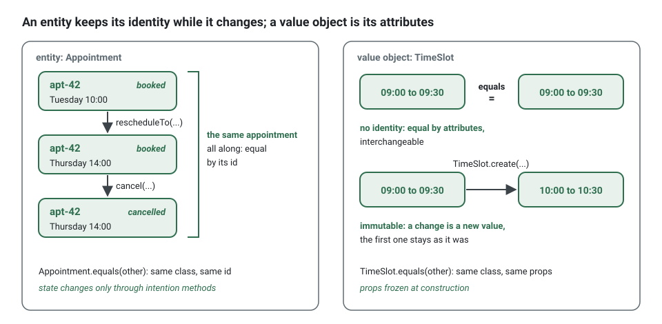
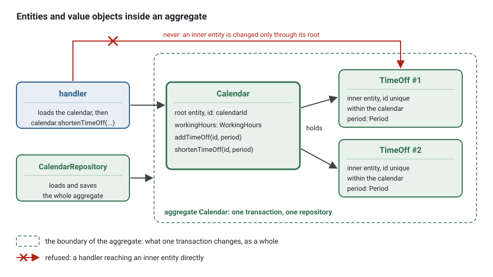

**English** · [Français](entities-and-value-objects.fr.md)

# Entities and value objects

**Summary.** The domain model is made of two kinds of objects. An entity has an identity that
persists while its attributes change: an appointment stays the same appointment when it is
rescheduled. A value object has no identity: it is defined entirely by its attributes, it is
immutable, and two of them with the same attributes are interchangeable, like a time slot or a
cancellation reason. Most concepts should be value objects; entities are the few things whose
continuity the business tracks. In this kit both have a private constructor and factories,
entities change only through methods named after a business intention, and value objects never
change at all. A value object is always a class extending `ValueObject`, never a function that
builds a plain object (`domain/value-object-class`).

## Telling them apart

Ask the domain expert: "if every attribute were the same, would these still be two different
things?"

| | Entity | Value object |
|---|---|---|
| Identity | has one, stable over time | none |
| Equality | by identifier | by attributes (`equals`) |
| Mutability | changes state through intention methods | immutable; an operation returns a new instance |
| Lifecycle | created, changed, sometimes ended; stored and loaded | created when needed, discarded freely |
| Example | `Appointment`, `Calendar`, a `TimeOff` entry inside a calendar | `TimeSlot`, `CancellationReason`, `WorkingHours`, an email address |

Two appointments for the same client, practitioner and slot would still be two appointments
(and a bug the invariant must prevent): entity. Two `TimeSlot`s from 09:00 to 09:30 on the same
day are the same slot: value object.



The same concept can be an entity in one context and a value in another. A practitioner is an
entity where profiles are managed; in `appointments` it is only a `practitionerId`.

## Value objects

A value object gathers a concept that would otherwise be scattered as primitives, together with
the rules that make it valid and the operations that belong to it.

<!-- checked sample -->
```ts
import { DomainRefusal, ValueObject } from '@ddd-ts-kit/kernel';

// contexts/appointments/appointments.codes.ts
export const AppointmentsCodes = {
  InvalidTimeSlot: 'INVALID_TIME_SLOT',
} as const;

// contexts/appointments/domain/errors/invalid-time-slot.error.ts
export class InvalidTimeSlot extends DomainRefusal {
  readonly code = AppointmentsCodes.InvalidTimeSlot;

  static forBounds(startsAt: Date, endsAt: Date) {
    return InvalidTimeSlot.refusal(
      `A slot ends after it starts: ${startsAt.toISOString()} to ${endsAt.toISOString()} does not.`,
      { startsAt, endsAt },
    );
  }
}

// contexts/appointments/domain/value-objects/time-slot.vo.ts
export type TimeSlotProps = {
  readonly startsAt: Date;
  readonly endsAt: Date;
};

export class TimeSlot extends ValueObject<TimeSlotProps> {
  private constructor(props: TimeSlotProps) {
    super(props);
  }

  static create(startsAt: Date, endsAt: Date): TimeSlot {
    if (endsAt.getTime() <= startsAt.getTime()) {
      throw InvalidTimeSlot.forBounds(startsAt, endsAt);
    }

    return new TimeSlot({ startsAt, endsAt });
  }

  overlaps(other: TimeSlot): boolean {
    return this.startsAt < other.endsAt && other.startsAt < this.endsAt;
  }

  startsWithin(durationMs: number, now: Date): boolean {
    return this.startsAt.getTime() - now.getTime() < durationMs;
  }

  get startsAt(): Date {
    return this.props.startsAt;
  }

  get endsAt(): Date {
    return this.props.endsAt;
  }
}
```

What the shape gives:

- **Valid by construction.** The constructor is private and `create` checks the rules, so a
  `TimeSlot` that exists is a valid one. Code that receives a `TimeSlot` never re-validates.
- **Immutable.** Properties are readonly and no method assigns to the object
  (`domain/value-object-immutability`). It can be shared and passed around without defensive
  copies.
- **Behaviour next to data.** `overlaps` is written once, on the type it concerns, instead of
  being repeated wherever two pairs of dates meet.
- **No hidden clock.** `startsWithin` receives `now`; the domain never reads the system time
  (`purity/no-system-clock`).
- **Equality for free.** `ValueObject` freezes the props at construction and compares them in
  `equals`, dates by their instant and arrays item by item: two slots built from the same
  instants are equal, `===` is not the question.
- **Props are a `type`, not an `interface`.** `ValueObject<Props>` requires
  `Record<string, unknown>`: an object type alias satisfies it, an interface does not, because
  TypeScript gives an implicit index signature to the first only.

In a spec, the value is used as the business speaks of it:

<!-- checked sample -->
```ts
import { ValueObject } from '@ddd-ts-kit/kernel';
import { describe, expect, it } from 'vitest';

// The TimeSlot above, reduced to what this spec uses.
type TimeSlotProps = { readonly startsAt: Date; readonly endsAt: Date };

class TimeSlot extends ValueObject<TimeSlotProps> {
  private constructor(props: TimeSlotProps) {
    super(props);
  }

  static create(startsAt: Date, endsAt: Date): TimeSlot {
    return new TimeSlot({ startsAt, endsAt });
  }

  overlaps(other: TimeSlot): boolean {
    return this.props.startsAt < other.props.endsAt && other.props.startsAt < this.props.endsAt;
  }
}

const at = (time: string): Date => new Date(`2026-03-03T${time}:00.000Z`);

describe('TimeSlot', () => {
  it('is equal to another slot with the same start and end', () => {
    expect(TimeSlot.create(at('09:00'), at('09:30')).equals(TimeSlot.create(at('09:00'), at('09:30')))).toBe(true);
  });

  it('overlaps a slot that starts before it ends', () => {
    expect(TimeSlot.create(at('09:00'), at('09:30')).overlaps(TimeSlot.create(at('09:15'), at('09:45')))).toBe(true);
  });

  it('does not overlap the slot that starts when it ends', () => {
    expect(TimeSlot.create(at('09:00'), at('09:30')).overlaps(TimeSlot.create(at('09:30'), at('10:00')))).toBe(false);
  });
});
```

### Why a value object is a class

A value can be written two ways in TypeScript: a function that builds a plain object, or a class.
The kit writes, and checks, the class (`domain/value-object-class`).


The function form looks lighter:

```ts
// domain/value-objects/money.vo.ts: reported
export type Money = { readonly amount: number; readonly currency: string };

export const money = (amount: number, currency: string): Money => ({ amount, currency });
```

and costs more at every place that uses it:

```ts
// three callers, three copies of the rules, or none
if (!Number.isInteger(price.amount)) { /* ... */ }                    // a handler validates again
const same = a.amount === b.amount && a.currency === b.currency;    // an aggregate compares by hand
const total = { amount: a.amount + b.amount, currency: a.currency }; // a helper adds, unchecked
```

The class form gathers all of that in one place:

```ts
// domain/value-objects/money.vo.ts: npx ddd-ts-kit generate value-object billing Money
import { ValueObject } from '@ddd-ts-kit/kernel';
import { CurrencyMismatch } from '@/contexts/billing/domain/errors/currency-mismatch.error';
import { InvalidAmount } from '@/contexts/billing/domain/errors/invalid-amount.error';

export type MoneyProps = {
  readonly amount: number;
  readonly currency: string;
};

export class Money extends ValueObject<MoneyProps> {
  private constructor(props: MoneyProps) {
    super(props);
  }

  static of(amount: number, currency: string): Money {
    if (!Number.isInteger(amount)) {
      throw InvalidAmount.withAmount(amount);
    }

    return new Money({ amount, currency });
  }

  static zero(currency: string): Money {
    return Money.of(0, currency);
  }

  add(other: Money): Money {
    if (other.currency !== this.currency) {
      throw CurrencyMismatch.withCurrencies(this.currency, other.currency);
    }

    return Money.of(this.amount + other.amount, this.currency);
  }

  get amount(): number {
    return this.props.amount;
  }

  get currency(): string {
    return this.props.currency;
  }
}
```

```ts
// the same three callers
const price = Money.of(1250, 'EUR');      // valid, or refused with INVALID_AMOUNT
const same = a.equals(b);                 // by value
const total = a.add(b);                   // a new Money, checked again by `of`
```

What the class gives, and the function cannot:

| | Function answering `{ amount, currency }` | Class extending `ValueObject` |
|---|---|---|
| **Equality without identity** | every caller compares field by field, or compares references by mistake | `equals` compares the props: two equal values are interchangeable |
| **Invariants checked once** | any object of the right shape passes, `{ amount: 0.5 }` included; each caller re-checks or forgets | the constructor is private, the static factory is the only way in: a `Money` that exists is valid |
| **Behaviour next to the data** | `add`, `convert`, `isZero` become helpers in other files, found by searching | methods of the type they concern, found by completion |
| **Refusals from static factories** | an invalid input goes through unnoticed | `Money.of` throws a refusal named after what it refuses, `InvalidAmount.withAmount(..)`, which the HTTP mapping, the audit trail and the tests know by its code; or returns it in a `Result` under `"stack.valueObjects": "result"` |
| **Immutability** | a `readonly` type is a promise of the compiler only: any holder can still spread and change it | the props are frozen by `ValueObject`, an operation returns a new instance (`domain/value-object-immutability`) |
| **Recognised at the boundary** | a mapper cannot tell a `Money` from any object with two such fields | `value instanceof Money` in a mapper or a serializer; `toJSON()` gives the props to a read model or a log |

### What `domain/value-object-class` checks

The rule holds a project whose config says `"stack.values": "classes"`, which `init` writes. A
config without the key was written before the rule existed: it reads as `free` and nothing is
reported; [CONFIG.md](../CONFIG.md#stack) gives the steps to move.


- **A value object file** (`domain/value-objects/*.vo.ts` of a context, a `*.vo.ts` of the shared
  kernel outside `presentation/`) exports exactly one class extending `ValueObject`, directly or
  through another value object of the project; its constructor is private or protected (a class
  that declares none inherits the protected one of `ValueObject`); a concrete class has a static
  factory; and the file exports no function, no arrow constant and no object literal, inline, by
  an export list or by default. The types and interfaces of its props may be exported next to it.
- **In the other files of `domain/` and of the shared kernel** (outside `presentation/`), an
  exported function that answers a **record of data** is a value written as a function, and is
  reported with the command that writes the class.

Whether an answered object is a record of data is read entry by entry, without the types:


| Entry | Reads as | Examples |
|---|---|---|
| a literal, a parameter, an operation on them, a call of the language | data | `amount`, `'EUR'`, `cents * 100`, `Math.round(cents)`, `new Date(at)` |
| any other call or `new`, or a name bound to one in the module | built by the model | `Money.of(1)`, `total.add(tax)`, `new Slot(..)` |
| a function, a method, or a name bound to one in the module | behaviour | `isSatisfiedBy: (x) => ..`, `describe() {}`, `{ isSatisfiedBy }` |
| `...state` | derived | `{ ...state, status }` |

The object is a record of data when it holds data, nothing built by the model and no spread. A
function that declares a return type of a package (`): EventStamp` of the kernel) is not
judged: the shape belongs to the library, and the project cannot make it a class.

What stays a function, because it is not a value:

```ts
// domain/state-machines/invoice.state-machine.ts: a declaration, the result of a call
export const invoiceLifecycle = defineStateMachine({ states: ['draft', 'issued'], /* ... */ });

// domain/services/invoice-total.service.ts: takes and returns value objects
export function invoiceTotal(lines: readonly Money[], currency: string): Money {
  return lines.reduce((sum, line) => sum.add(line), Money.zero(currency));
}

// a specification: answers a boolean, or functions only, literal or local closures
export const isOverdue = (invoice: Invoice, now: Date): boolean => invoice.dueAt < now;
export const dueBefore = (day: Date) => {
  const isSatisfiedBy = (invoice: Invoice): boolean => invoice.dueAt < day;

  return { isSatisfiedBy };
};

// an operation of the model: a record of value objects it builds
export const split = (total: Money) => ({ first: Money.of(1), rest: total.subtract(Money.of(1)) });

// a reducer: derives a record that exists, with a spread
export const evolve = (state: InvoiceState, status: string): InvoiceState => ({ ...state, status });
```

What is reported, by decision, with what to write instead:

```ts
// a decision answered as a record: the domain refuses by throwing a refusal named after it,
// `throw InvoiceRefused.becauseOf(reason)`, or names the decision as a value object,
// `Decision.refused(reason)`, whose class says which decisions exist
export const decide = (reason: string) => ({ kind: 'refused' as const, reason });

// data with closures: a value with behaviour, which is a class with methods
export const money = (cents: number) => ({ cents, doubled: (): number => cents * 2 });

// a record that only gathers its parameters, value objects included: a pair that means
// something is a value of the glossary, `Period.between(start, end)`
export const period = (start: Instant, end: Instant) => ({ start, end });
```

Not every exported type of `domain/` is a value either. A **parameter object**, which only
groups the arguments of one method or factory and is neither kept, compared nor computed with,
stays a type: `CalendarDesk` (the practice, the practitioner and the time zone given to
`Calendar.create`, then spread into the state) and `FreedSlot` (the slot, the calendar and the
slots still held, given to `Waitlist.offer`) in the example. A value holds no aggregate:
`FreedSlot` carries a `Calendar`, an entity with an identity, which no equality by value can
compare. A value of the glossary that the model computes with is a value object:
`MeasuredOutcome` and `OccupancyFigures` of the analytics context, which the occupancy measure
reads and answers. Each checks its rules once, in its factory: `MeasuredOutcome.of` refuses an
end before the start, `OccupancyFigures.of` a figure below zero and fewer appointments held than
completed and missed ones, each with a refusal of its own, `OutcomePeriodInverted` and
`FiguresInconsistent`:

```ts
static of(state: OutcomeState, startsAt: Date, endsAt: Date): MeasuredOutcome {
  if (endsAt.getTime() < startsAt.getTime()) {
    throw OutcomePeriodInverted.forPeriod(startsAt.toISOString(), endsAt.toISOString());
  }

  return new MeasuredOutcome({ state, startsAt: new Date(startsAt), endsAt: new Date(endsAt) });
}
```

### Primitive obsession

The architecture reference calls it a defect: an email, an amount, a period are types
([ARCHITECTURE.md](../ARCHITECTURE.md), section 4). The symptom is a signature such as
`book(practitionerId: string, clientId: string, start: Date, end: Date)`: two strings that can
be swapped unnoticed, two dates whose order nothing guarantees. Candidates for a value object:

- anything with a **format or a range** (email, phone number, duration, percentage);
- anything that is **two values that travel together** (start and end, amount and currency);
- anything with a **closed set of values** (a status, a channel);
- **identifiers of other aggregates**, when confusing them would be costly.

Instead of:

```ts
book(practitionerId: string, clientId: string, startsAt: Date, endsAt: Date): void; // end before start? swapped ids?
```

write:

```ts
book(practitionerId: string, clientId: string, slot: TimeSlot): void; // a TimeSlot that exists is valid
```

The generator's own templates remind it: state is declared "with value objects, not
primitives".

## Entities

An entity is defined by a thread of continuity. Its class protects that thread:

<!-- checked sample -->
```ts
import { DomainRefusal, Entity, ValueObject } from '@ddd-ts-kit/kernel';

// contexts/calendars/calendars.codes.ts
export const CalendarsCodes = {
  TimeOffCanOnlyShrink: 'TIME_OFF_CAN_ONLY_SHRINK',
} as const;

// contexts/calendars/domain/errors/time-off-can-only-shrink.error.ts
export class TimeOffCanOnlyShrink extends DomainRefusal {
  readonly code = CalendarsCodes.TimeOffCanOnlyShrink;

  static forTimeOff(timeOffId: string) {
    return TimeOffCanOnlyShrink.refusal(`Time off ${timeOffId} can only be shortened.`, { timeOffId });
  }
}

// contexts/calendars/domain/value-objects/period.vo.ts, reduced to what the entity uses
type PeriodProps = { readonly from: Date; readonly to: Date };

export class Period extends ValueObject<PeriodProps> {
  private constructor(props: PeriodProps) {
    super(props);
  }

  static create(from: Date, to: Date): Period {
    return new Period({ from, to });
  }

  overlaps(other: Period): boolean {
    return this.props.from < other.props.to && other.props.from < this.props.to;
  }

  contains(other: Period): boolean {
    return this.props.from <= other.props.from && other.props.to <= this.props.to;
  }
}

// contexts/calendars/domain/entities/time-off.entity.ts
export interface TimeOffState {
  readonly period: Period;
  readonly reason: string;
}

export class TimeOff extends Entity<string> {
  private constructor(
    id: string,
    private state: TimeOffState,
  ) {
    super(id);
  }

  static create(id: string, state: TimeOffState): TimeOff {
    return new TimeOff(id, state);
  }

  static rehydrate(id: string, state: TimeOffState): TimeOff {
    return new TimeOff(id, state);
  }

  shortenTo(period: Period): void {
    if (!this.state.period.contains(period)) {
      throw TimeOffCanOnlyShrink.forTimeOff(this.id);
    }

    this.state = { ...this.state, period };
  }

  covers(period: Period): boolean {
    return this.state.period.overlaps(period);
  }

  toState(): TimeOffState {
    return { ...this.state };
  }
}
```

- **Private constructor, two factories.** `create` is birth and checks the invariants the
  entity guards on its own; `rehydrate` is loading from storage and checks nothing, because the
  stored state was valid when it was saved.
- **No setter, no public mutable property** (`domain/aggregate-encapsulation`). State is
  replaced by a method whose name the business would recognise: `shortenTo`, not `setPeriod`.
- **Identity is given, not generated inside.** The identifier comes from the `IdGenerator` port
  through the application layer (`purity/no-ambient-randomness`), which keeps tests
  deterministic.
- **The intention method guards its rule.** `shortenTo` refuses a period that is not inside the
  current one: the entity cannot be lengthened through a method named "shorten".
- **State is made of value objects.** The entity carries identity and lifecycle; the values
  carry validity.
- **Equal by identity.** `Entity.equals` compares the class and the id, never the state: a
  `TimeOff` loaded before and after `shortenTo` is the same time off.

An entity is either the root of an [aggregate](aggregates.md) (`Appointment`, `Calendar`) or
lives inside one (`TimeOff` inside `Calendar`). An inner entity is reached and changed only
through its root, has no repository of its own, and its identity only needs to be unique
within the aggregate.



```bash
npx ddd-ts-kit generate value-object appointments TimeSlot
npx ddd-ts-kit generate entity calendars TimeOff
```

Each command writes the file and its spec, with `TODO(domain)` markers where a business
decision is expected.

## Choosing: prefer values

Model a concept as a value object unless the business needs to track it over time. Values are
cheaper in every way: no identity to manage, no lifecycle, no concurrency, trivially testable.
A frequent mistake is to give an identity to something because it has a database row. Storage
is the mapper's concern; a value object can be stored in columns of its owner's table, or in a
table of its own with a technical key the domain never sees.

| Question | If yes |
|---|---|
| Does the business refer to "that one" over time, even after it changed? | entity |
| Could it be replaced by an equal one without anyone noticing? | value object |
| Does it have a lifecycle with states? | entity |
| Is it a measure, a description, a quantity, a range? | value object |

## Limits and when not to use it

- **Not every string deserves a type.** A free-text note with no rule and no operation gains
  nothing from a wrapper class. Wrap what has validity rules, behaviour, or a real risk of
  confusion.
- **Throw, or `Result`.** The generated value object throws from `create`, as an aggregate
  method does: `throw InvalidEmail.forAddress(raw)`, and the caller takes the value with no
  `unwrap`. A project that prefers expected failures as values says `"stack.valueObjects":
  "result"`: `create` returns `err(InvalidEmail.forAddress(raw))` and the caller unwraps it; a
  config without the key is read that way, and `ddd-ts-kit value-objects` moves such a project to
  throwing factories ([CONFIG.md](../CONFIG.md#stack)). Either way the refusal is a class named
  after what it refuses, `InvalidEmail`, built by one of its factories: not an error class per
  value object.
- **Immutability is checked syntactically.** `domain/value-object-immutability` sees readonly
  properties and writes to `this`; it does not see a mutable object held in a readonly field
  (a `Date` can still be mutated through its methods, an array can be pushed to). Hold values
  that are themselves immutable, or copy on the way in and out.
- **Encapsulation rules belong to the ESLint plugin**, which reads the syntax tree; the
  text-level CLI checker has no equivalent for `domain/aggregate-encapsulation` and
  `domain/value-object-immutability` (CLI README). `domain/value-object-class` is read by both.
- **The function form is detected by what it answers, without the types.** The review follows
  what the rule does not: an object built in a variable first, then returned
  (`const value = { .. }; return value;`); an object answered through a condition
  (`cond ? { .. } : { .. }`), inside an array or as the argument of a call; a name read by its
  first declaration in the module, so a parameter named like a function of the module reads as
  that function; a call read by the name it starts from, so `name.trim()` on a parameter reads as
  built by the model; and a return type of a package read by its declared name only.
- **A relaxed rule is a recorded deviation.** The rule defaults to `error`; setting it to `warn`
  or `off` under `rules` is recorded under `deviations` with its ADR
  (`governance/recorded-deviation`). A project not ready for it keeps `"stack.values": "free"`.
- **A thin CRUD context** may have entities with few rules. That is acceptable where the
  subdomain is simple; see [Anemic model](anemic-model.md).

## Sources

- Eric Evans, *Domain-Driven Design*, Addison-Wesley, 2003, chapter 5 "A Model Expressed in
  Software" (entities, value objects, services).
- Vaughn Vernon, *Implementing Domain-Driven Design*, Addison-Wesley, 2013, chapter 5
  "Entities" and chapter 6 "Value Objects".
- Vlad Khononov, *Learning Domain-Driven Design*, O'Reilly, 2021, chapter 6 "Tackling Complex
  Business Logic".
- Martin Fowler, *Patterns of Enterprise Application Architecture*, Addison-Wesley, 2002,
  "Value Object"; and "ValueObject", martinfowler.com/bliki/ValueObject.html.

## See also

- [Aggregates](aggregates.md)
- [Domain events, domain services, repositories and factories](domain-building-blocks.md)
- [Invariants, permissions and validation](invariants-permissions-validation.md)
- [Anemic model](anemic-model.md)
- [Ubiquitous language](ubiquitous-language.md)
- [Clean code](clean-code.md)
- [Architecture reference](../ARCHITECTURE.md)
- [Concepts index](README.md)
