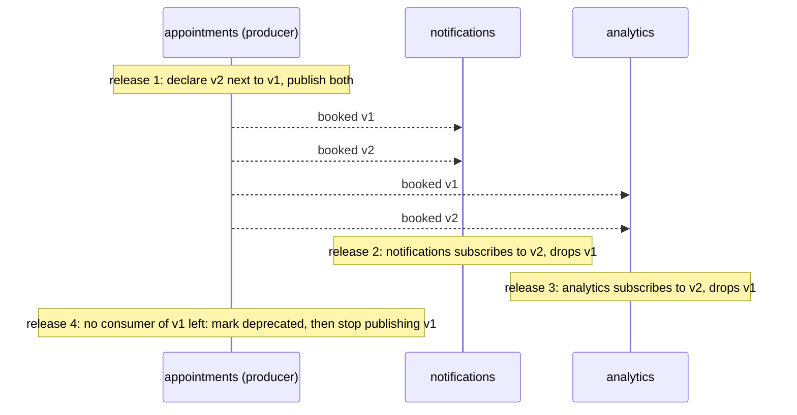

**English** · [Français](event-versioning.fr.md)

# Versioning an integration event

**Summary.** An integration event is a contract: once another context consumes it, the producer
can no longer change it freely. The kit's policy is short. Inside a version, only additive and
optional changes are allowed. Anything else (a removal, a rename, a change of type or of
meaning) is a new version, declared next to the old one and published alongside it until every
consumer has moved; the old one is then marked deprecated and retired. Consumers ignore fields
they do not know. This page explains why, what counts as breaking, and how the generated catalog
and AsyncAPI document make the contract reviewable.

## Why events are harder to change than an API

A synchronous API has a request in flight for milliseconds. An event lives much longer:

- it waits in an outbox, a queue or a log, sometimes for days in a dead-letter destination;
- a log-based provider retains history, and a consumer created later reads old events;
- producer and consumers are deployed at different times, in the monolith too once consumers
  hold events that were published by the previous release.

So at any moment, events written by an old producer are read by a new consumer and the reverse.
Both directions must work: old data with new code (backward compatibility) and new data with old
code (forward compatibility) (Kleppmann, chapter 4).

## The rule

| Change to `appointments.appointment.booked` | Inside the version? |
|---|---|
| add an optional field (`locationId`) | yes |
| add a description, an example | yes |
| add a required field | no: old producers' events, still in flight, lack it |
| remove or rename a field (`startsAt` to `start`) | no |
| change a type (`startsAt` from string to number) | no |
| change a unit or a meaning (`startsAt` from UTC to local time) | no, and the most dangerous: the schema does not change, nothing fails, data is wrong |
| narrow accepted values (an enum loses a member) | no |
| widen an enum the consumers switch over exhaustively | treat as breaking unless consumers are known to tolerate unknown values |
| rename the event type | it is a different event |

The normative statement is in [ARCHITECTURE.md](../ARCHITECTURE.md) section 4 ("Integration
events"): versioned envelope, additive changes only inside a version.

**The consumer's half of the contract**: ignore unknown fields, and do not fail on a field that
is absent when the schema says it is optional (the tolerant reader). A consumer that validates
strictly and rejects unknown properties turns every additive change of the producer into a
breaking one.

## A breaking change, step by step

The product decides that an appointment can span several consecutive slots. `startsAt` and
`endsAt` become a list.

1. **Declare version 2** in the producer's `published-language/`, as a second declaration with
   the same `type` and `version: 2`. One declaration per event and version.
2. **Publish both.** The publisher builds the two events from the same domain event. During the
   migration every booking produces a v1 and a v2.
3. **Move consumers one at a time.** A consumer subscribes with the declaration of the version
   it understands; an event of another version of the same type is skipped by that
   subscription. A consumer moving to v2 subscribes to v2 and stops handling v1. It must not
   handle both for the same fact, or it processes each booking twice: the two events have
   different ids, so the processed-event store does not catch it.
4. **Deprecate v1** (`deprecated: true` on its declaration) so the catalog shows it, and
   announce the retirement date where the team tracks such things.
5. **Stop publishing v1** once the catalog shows no consumer, then remove its declaration once
   no v1 event remains in any queue, log retention or dead-letter destination that could be
   replayed.

What v1 can still express during step 2 is a real question when the new model is richer: a
multi-slot appointment has no faithful v1 form. Options: publish v1 with the first slot and
accept the loss for old consumers, or do not publish v1 for the cases it cannot express, and say
which in the event's description.

## Making the contract visible

Each declaration feeds two generated documents
(`events/defined-in-published-language`):

- **the event catalog** (Markdown): per producer, each event, its versions, its payload fields
  flattened, its consumers;
- **the AsyncAPI document**: one channel per event type, one message per version, the envelope
  as payload.

Both are committed, regenerated by the project's events script, and checked for drift in CI. A
change of an event therefore shows up as a diff of generated files in the pull request, which is
where a reviewer sees that a "small refactoring" altered a contract. Field descriptions written
in the schema flow into both.

The versioning policy itself (how long an old version stays published, how retirement is
announced) is written by the team in `docs/integration/README.md`; the `document` skill lists it
among the sections of that file.

## What the kit checks and what it does not

| Checked | By |
|---|---|
| an event is declared once per version, in a published language, with a payload schema | `events/defined-in-published-language` |
| the name format | `events/name-format` |
| what is published and consumed matches the schema | the declaration validates on both sides; publishing an invalid event throws, an invalid consumed payload goes to retry and dead letter |
| generated documents are current | the documentation drift gate of the pipeline |

Not checked, as far as the READMEs state: **compatibility between two revisions of the same
version**. Nothing compares the schema of v1 in this commit with v1 in the previous commit and
refuses a removed field. The safeguard is the diff of the generated catalog in review. A schema
registry with compatibility modes, as exists in the Kafka ecosystem, is not part of the kit.

## Practices that reduce the need for versions

- Publish less. A field nobody asked for is a field that cannot be removed.
- Prefer identifiers and facts to structures copied from the aggregate.
- Put units and time zones in names or descriptions (`startsAt`, ISO 8601, UTC).
- Model closed vocabularies deliberately, and tell consumers whether new values may appear.
- Add optional fields rather than repurposing existing ones.

## Limits and when not to use it

- **Publishing two versions costs**: twice the events, a publisher with two mappings, and a
  migration that depends on other teams' schedules. For a breaking change with a single
  consumer owned by the same team, in one deployable, releasing producer and consumer together
  is tempting; it only works if no v1 event is in flight or retained, which the outbox and dead
  letters make hard to guarantee. The two-version path is the safe default.
- **Additive-only accumulates.** After years, a version carries deprecated optional fields. A
  new version is also the occasion to clean up.
- **Semantic changes are invisible to schemas.** No tool here detects that a field kept its name
  and changed its meaning. Treat a change of meaning as a new field or a new version.
- **Upcasting is for stored events, not for integration events.** The events an event-sourced
  aggregate keeps in its stream are upcast when read (`upcasters` of `defineStoredEvent`, held by
  `event-sourcing/upcaster-required` against `stored-events.lock.json`): see
  [Event sourcing, per aggregate](event-sourcing.md). Integration events are not: a consumer that
  must read retained history handles the versions that history contains.
- **Versioning the event does not version the process.** When the sequence of events changes
  (a new step between booking and confirmation), consumers that assumed the old sequence break
  without any schema change. That is a contract change to discuss with the downstream teams (see
  [Team workflow](../guides/team-workflow.md)).

## Sources

- Martin Kleppmann, Designing Data-Intensive Applications, O'Reilly, 2017, chapter 4 ("Encoding
  and Evolution").
- Greg Young, Versioning in an Event Sourced System, Leanpub, 2017 (written for event sourcing;
  the compatibility reasoning applies).
- Martin Fowler, "TolerantReader", 2011, https://martinfowler.com/bliki/TolerantReader.html
- Gregor Hohpe and Bobby Woolf, Enterprise Integration Patterns, Addison-Wesley, 2003 (Format
  Indicator, Message Translator).
- Sam Newman, Building Microservices, 2nd edition, O'Reilly, 2021, chapter 5 (handling change
  between services: expand and contract, coexisting versions).
- AsyncAPI specification 3.0.0, https://www.asyncapi.com/docs/reference/specification/v3.0.0
- README of [`@ddd-ts-kit/events`](../../packages/events/README.md).

## See also

- [Domain and integration events](domain-and-integration-events.md)
- [Delivery and idempotency](delivery-and-idempotency.md)
- [Transactional outbox](transactional-outbox.md)
- [Context map](context-map.md)
- [Team workflow](../guides/team-workflow.md)
- [Message brokers](../tools/message-brokers.md)
- [Architecture reference](../ARCHITECTURE.md)
