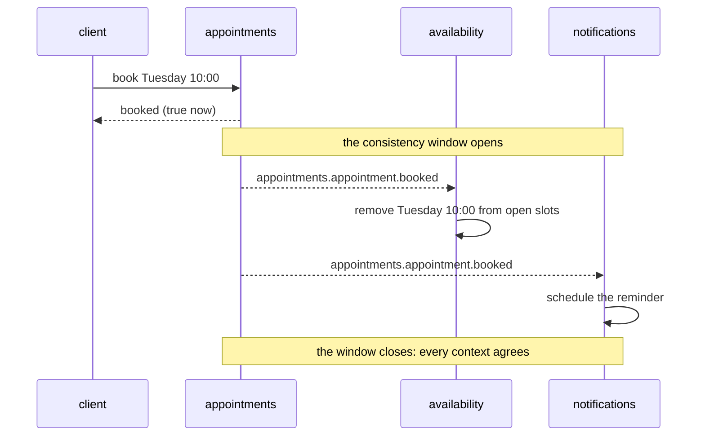

# Eventual consistency, explained to a product person

**Summary.** In an application cut into bounded contexts, a change is immediately true in the
context that made it and becomes true in the others a moment later, when they have processed the
event that announces it. During that moment two screens can disagree. This is eventual
consistency. It is not a defect to hide but a property to design: decide what must be true at
once, how long "a moment" may last, what the user sees meanwhile and what happens when the
second step fails. This page is written for product managers and designers as much as for
developers, and uses the scheduling application throughout.

## The idea in one picture

A client books a slot. `appointments` records the appointment at once. `availability` (the list
of open slots), `notifications` (the reminder) and `analytics` (occupancy figures) learn about
it through an event.

An everyday comparison: a bank transfer. Your balance drops immediately; the recipient sees the
money later. Nobody calls that a bug, because the delay is known and the statement says
"pending".

## What it looks like in the product

| Situation | What the user may see | Why |
|---|---|---|
| Two clients look at the same open slot | both see Tuesday 10:00 as open; the second to confirm is refused | the list of open slots is advisory and a moment late; the booking itself is checked at once |
| A client books, then opens the list of open slots | for a second, the slot they just took is still listed | `availability` has not processed the event yet |
| A practitioner adds time off | a slot inside the time off stays bookable for a moment in the list | `availability` learns of time off through an event from `calendars` |
| A client books | the confirmation message arrives a few seconds later | `notifications` reacts to the event |
| A manager opens the occupancy dashboard | today's last booking is missing | `analytics` is fed by events, sometimes in batches |
| The email provider is down | the booking succeeds; the confirmation arrives when the provider is back | the two steps are independent on purpose |

The last row is the benefit. If booking and sending the confirmation were one indivisible
operation, an outage of the email provider would stop all bookings.

## What stays immediately consistent

Not everything is eventual. Inside one aggregate, rules hold at every instant, in one
transaction:

- **No double booking.** Two clients confirming the same slot at the same millisecond: exactly
  one succeeds, the other gets "this slot has just been taken". The rule is guarded where the
  appointment is written, by the aggregate and a database constraint, never by the list of open
  slots.
- **A cancelled appointment cannot be rescheduled.**
- **A cancellation is accepted or refused against the cancellation window, at once.**

The design question is therefore: *which rules must never be seen broken, even for a second?*
Those belong to one aggregate in one context. Everything else can follow.

## Questions to settle for each cross-context flow

1. **How long may the window be?** "A few seconds" for the reminder; "under a second" for the
   list of open slots; "a few minutes" for analytics. This becomes a monitored number: the age
   of the oldest unprocessed event.
2. **What does the user see during the window?** See the wording patterns below.
3. **What if the second step fails for good?** The reminder cannot be scheduled because the
   client has no phone number. Is that an alert to support, a message to the client, nothing?
4. **Does a later step ever undo an earlier one?** If payment were required and failed after the
   booking, the booking would have to be cancelled: a compensation, visible to the user. See
   [Sagas and process managers](sagas-and-process-managers.md).
5. **Can the same thing happen twice?** Events can be delivered twice; the design must make the
   second one harmless (one reminder, not two). See
   [Delivery and idempotency](delivery-and-idempotency.md).
6. **Does order matter?** A reschedule and a cancellation arriving in the wrong order must not
   reopen a slot. Events are not ordered by default.

## Interface patterns that make the window acceptable

| Pattern | Example |
|---|---|
| Say what is true now, promise the rest | "Your appointment is booked. A confirmation is on its way." |
| Show the state from the source after a write | after booking, display the appointment returned by `appointments`, not a refreshed list from `availability` |
| Apply the user's own change locally | remove the slot the client just booked from the list on screen without waiting for the server's list |
| Word refusals as normal events | "This slot has just been taken. Here are the nearest ones." rather than an error page |
| Date derived data | "Occupancy as of 14:05" on the analytics dashboard |
| Name pending states | "Reminder scheduled" versus "Reminder sent" |
| Never promise from an advisory read | the list says "available", the button says "Request this slot", the answer confirms |

What not to do: disable the delay by making every screen read every context synchronously. The
application then fails whenever any part does, and the contexts are no longer independent.

## For developers: where the window comes from

- The event is stored in the outbox with the state change, and a relay publishes it afterwards:
  the relay interval, or its wake-up signal, sets the floor of the window
  ([Transactional outbox](transactional-outbox.md)).
- The consumer processes it in its own transaction, after possible retries: a failing consumer
  stretches the window, up to a dead letter that needs an operator.
- A projection such as the open slots of `availability` is a read model fed that way
  ([CQRS as used here](cqrs.md)).
- The eventual-consistency window of each cross-context flow is written in
  `docs/integration/README.md`, next to its sequence diagram, and a context that relies on a
  projection says so in its `CONTEXT.md` (the `document` and `extract-service` skills ask for
  both).

To measure the window: the age of the oldest pending outbox record on the producing side, the
depth or lag of each consumer on the broker, and the dead-letter destinations, which must be
empty.

## Limits and when not to use it

- **Do not use it for an invariant.** If the business cannot tolerate seeing the rule broken
  even briefly (double booking, overselling a limited seat, a balance going negative), the rule
  belongs to one aggregate and one transaction. A lock or a "check then act" across contexts is
  not a substitute.
- **Do not use it to answer the request that caused it.** A user who must see the result of
  step two in the response of step one is describing one use case, or needs a synchronous call
  with a stated behaviour when the other side is down.
- **"Eventually" has no upper bound by itself.** Without monitoring and alerts on the window, a
  stopped consumer is noticed by users.
- **It moves complexity to the edges.** Wording, pending states, compensations and support
  procedures are real work that an immediately consistent design does not need. In a small
  application with one context there is nothing to make eventual.
- **Reading your own write from a projection can confuse users** unless the interface handles
  it (see the patterns above).

## Sources

- Werner Vogels, "Eventually Consistent", Communications of the ACM, 2009,
  https://www.allthingsdistributed.com/2008/12/eventually_consistent.html
- Pat Helland, "Life beyond Distributed Transactions: an Apostate's Opinion", CIDR 2007.
- Vaughn Vernon, "Effective Aggregate Design", part 2, 2011 (eventual consistency between
  aggregates; "whose job is it?"), https://www.dddcommunity.org/library/vernon_2011/
- Vaughn Vernon, Implementing Domain-Driven Design, Addison-Wesley, 2013, chapter 10.
- Martin Kleppmann, Designing Data-Intensive Applications, O'Reilly, 2017, chapters 5 and 9.
- Sam Newman, Building Microservices, 2nd edition, O'Reilly, 2021, chapter 6 (workflow).

## See also

- [Aggregates](aggregates.md)
- [Invariants, permissions and validation](invariants-permissions-validation.md)
- [Domain and integration events](domain-and-integration-events.md)
- [Transactional outbox](transactional-outbox.md)
- [Delivery and idempotency](delivery-and-idempotency.md)
- [Sagas and process managers](sagas-and-process-managers.md)
- [CQRS as used here](cqrs.md)
