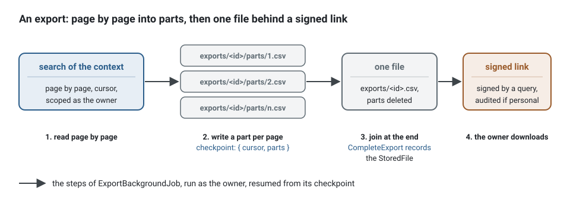

**English** · [Français](file-import-export.fr.md)

# File import and export

**Status: a design, not built.** This page says how the kit intends to process a large file in
the background, on the pieces it already has: the [job queue](background-jobs.md), the
[file storage](file-storage.md) and the [process managers](sagas-and-process-managers.md). No
generator, port or package of this version implements it; what would be added is named under
"What would be added".

**Summary.** Importing a spreadsheet of ten thousand rows, or exporting the agenda of a year, is
work a use case hands to a worker. The file never goes through the database and never sits
whole in memory: an import reads the stored file as a stream and turns it into commands, one
batch of rows per unit of work, with its progress and a checkpoint after each batch; an export
reads a search page by page and writes the file in parts to the storage. Each run is one
background job, retried, observable and resumable; a very large file is split into chunks run
by several jobs and followed by a process manager.

## Import


1. **Receiving.** The file arrives as any other: a `FileUpload` the bus stages and scans before
   the transaction, or a direct upload confirmed from its `PendingUpload` for a large one.
   `FileScanner` is where a policy on the format lives (a CSV of at most 50 MB, a single sheet).
2. **Starting.** The handler of `StartImport` records an `Import` aggregate with the
   `StoredFile`, its owner and its status, and enqueues `ImportRowsBackgroundJob` with the
   identifier of the import as its whole payload. Both commit together, so an import exists
   with its job or not at all; the client gets the identifier and follows it.
3. **Reading.** The job opens `FileStorage.get(key)` and hands the stream to a row reader that
   yields one row at a time. It never loads the file: memory stays at one batch.
4. **Writing.** Rows are validated against the input of the use case they feed, then sent as
   one command per batch of, say, 200 rows: the bus runs a command in one unit of work, so a
   batch commits or rolls back whole and a crash repeats at most one batch. Each row is
   idempotent by a key derived from the import and the row (`<importId>:<row>`), kept by the
   use case (a unique constraint, or the processed-key store), so that a repeated batch changes
   nothing. The handler of that command records the counts of the batch on the `Import` in the
   same unit of work, keyed by the batch, so that a repeated batch replaces its counts instead
   of adding them twice.
5. **Resuming.** After each batch the job saves `{ row }` as its checkpoint (the counts are
   already committed with the batch, so they cannot drift from what was imported) and reports
   `{ done: row }` (and `total` once a first pass counted the rows, or the bytes
   read against the size when it did not). A retry, an expired lease or a stop of the worker
   resumes from the checkpoint: the stream is opened again and skips to the row, or, once the
   port offers it, reads from a byte offset.
6. **Rejecting.** A row that fails validation or a business rule is not an error of the job: it
   is counted and written to the rejection report with its row number, its column and the code
   of the refusal. The report is a file of its own: written in parts during the run
   (`imports/<id>/rejected/<batch>.csv`, each `put` once per batch, so a repeated batch
   overwrites its own part) and joined at the end into one file offered through a signed link.
7. **Ending.** The job sends `CompleteImport`: the `Import` aggregate, which already holds the
   counts, records the key of the joined report and ends, and its integration event tells
   whoever waits (a notification to the person who uploaded). A job that dies after its last
   attempt leaves the import `running` with its checkpoint: an operator revives the job
   (`retryDead`), nothing is lost.

### The job, on the pieces that exist

Everything below compiles against the kit today except the row reader, which is declared
here because it is the first piece of [What would be added](#what-would-be-added). The
payload is the identifier of the import, the checkpoint the last row committed.

<!-- checked sample -->
```ts
import {
  AuthorizedCommand,
  FileStorage,
  type Actor,
  type BackgroundJob,
  type BackgroundJobExecution,
  type CommandBus,
} from '@ddd-ts-kit/kernel';
import { Background } from '@ddd-ts-kit/kernel/declarations';
import type { Readable } from 'node:stream';

// Not in the kit yet: a streaming reader that yields one row at a time from a row number.
interface Row {
  readonly number: number;
  readonly cells: Readonly<Record<string, string>>;
}
declare function readRows(stream: Readable, options: { readonly from: number }): AsyncIterable<Row>;

// The use cases of the context the import feeds (generated as any command). The handler of
// ImportPatientRows imports the valid rows idempotently by <importId>:<row>, records the counts
// of the batch on the Import, and writes the rejected rows to imports/<id>/rejected/<batch>.csv.
declare class ImportPatientRows extends AuthorizedCommand {
  constructor(actor: Actor, importId: string, rows: readonly Row[]);
}
declare class CompleteImport extends AuthorizedCommand {
  constructor(actor: Actor, importId: string);
}

/** What the job reads of the Import aggregate: the key of its stored file. */
export abstract class ImportFiles {
  abstract keyOf(importId: string): Promise<string>;
}

export interface ImportRowsPayload {
  readonly importId: string;
}

interface ImportRowsCheckpoint {
  readonly row: number;
}

const BATCH_SIZE = 200;

@Background({ timeout: '30m', lease: '1m' })
export class ImportRowsBackgroundJob implements BackgroundJob<ImportRowsPayload> {
  static readonly jobName = 'patients.import-rows';

  constructor(
    private readonly storage: FileStorage,
    private readonly imports: ImportFiles,
    private readonly commands: CommandBus,
  ) {}

  async run({ importId }: ImportRowsPayload, execution: BackgroundJobExecution): Promise<void> {
    const content = await this.storage.get(await this.imports.keyOf(importId));

    if (content === undefined) {
      throw new Error(`The file of import ${importId} is gone.`);
    }

    let batch: Row[] = [];

    for await (const row of readRows(content.stream, { from: rowOf(execution.checkpoint) + 1 })) {
      batch.push(row);

      if (batch.length === BATCH_SIZE) {
        await this.importBatch(importId, batch, execution);
        batch = [];
      }
    }

    if (batch.length > 0) {
      await this.importBatch(importId, batch, execution);
    }

    await this.commands.execute(new CompleteImport(execution.actor, importId));
  }

  /** One command, one unit of work: the batch commits whole, then the checkpoint moves past it. */
  private async importBatch(importId: string, batch: readonly Row[], execution: BackgroundJobExecution): Promise<void> {
    execution.signal.throwIfAborted();
    await this.commands.execute(new ImportPatientRows(execution.actor, importId, batch));

    const checkpoint: ImportRowsCheckpoint = { row: batch[batch.length - 1]?.number ?? 0 };

    await execution.saveCheckpoint(checkpoint);
    await execution.reportProgress({ done: checkpoint.row });
  }
}

function rowOf(checkpoint: unknown): number {
  return typeof checkpoint === 'object' && checkpoint !== null && 'row' in checkpoint && typeof checkpoint.row === 'number'
    ? checkpoint.row
    : 0;
}
```

The commands are sent as `execution.actor`, the person who uploaded the file, so each batch is
authorized and audited as theirs. A crash between the commit of a batch and its checkpoint
repeats that batch on the next attempt, which is why `ImportPatientRows` keeps each row
idempotent by `<importId>:<row>`:


## Export



1. `RequestExport` records an `Export` with its criteria and its owner, and enqueues
   `ExportBackgroundJob`. The criteria are those of a search of the context, scoped by the
   access of the owner when the job runs, since it runs as that actor.
2. The job reads the search page by page with a cursor, never an offset, and writes each page as
   a part, `exports/<id>/parts/<n>.csv`: an object store cannot append, and a part written twice
   is the same part. The checkpoint is the cursor and the number of parts.
3. At the end the parts are joined into the file (a multipart upload of the object store, or a
   copy into one key), the parts are deleted, and `CompleteExport` records the `StoredFile`. The
   owner downloads it through a signed link that a query signs, audited when the data is
   personal.
4. Exports are kept for a while and purged by a scheduled job (`purgeFinished` of the queue for
   the jobs, a lifecycle rule or a listing of `exports/` for the files).

## Very large files

One job per file holds one worker for the whole file. Beyond what one attempt can do inside its
timeout, the import splits: a first job counts the rows and enqueues one job per chunk of rows
(`{ importId, from, to }`), and a process manager keyed by the import counts the chunks done
from their events and completes the import when all are. The chunks run concurrently, up to the
concurrency of the queue of the context, and each resumes from its own checkpoint. Order between
rows is then lost: a file whose rows depend on each other (a row that refers to an earlier one)
stays one job.

## What travels with the job

The job runs as the actor that started the import or asked for the export, in its tenant and
its correlation, so every command it sends is authorized as that person and audited under one
correlation with the request that started it. Keys come from `FileKeys`, under the tenant of
the work; the report and the export are files of that tenant. The job is enqueued with the
import as its `subject` and the file as its idempotency key (scoped by the tenant by the queue):
the query that shows the progress of an import checks the subject, as the clearance of the
example does, and a second upload of the same file within one tenant answers the import already
running. The actor is the one of the upload, captured then: a right revoked during a long import
still applies to its last batches.

## What would be added

| Piece | Where | Why |
|---|---|---|
| A row reader and a row writer (CSV first, XLSX behind an optional peer) | a new package, or a subpath of an existing one | streaming parse and write, encoding detection, quoting, a maximum row size |
| `FileStorage.get(key, { from })` | the port and its connectors | resume an import at a byte offset instead of skipping rows |
| A join of parts (`compose(keys, into)`) | the port, as a multipart upload on S3 and a concatenation on the local directory | build an export or a report from its parts |
| `generate import <context> <Name> --command <UseCase>` | the CLI | the aggregate, the job, the report and their specs, as `generate background-job` does for one command |
| A contract suite for imports | `@ddd-ts-kit/testing` | a crash between two batches repeats one batch and changes nothing |

## Limits

- **At least once, per batch.** A batch is repeated when its worker dies after the commit and
  before the checkpoint: the commands of an import are idempotent, or the import is not safe.
- **No transaction around the whole file.** An import is a sequence of committed batches: a
  file half imported is a normal, visible state (`running`, `{ done: 4200 }`). A use case that
  needs all or nothing validates the whole file first, in a dry run that sends nothing, then
  imports.
- **One worker per job.** Concurrency comes from chunks, at the price of the order.
- **Formats are a policy.** A format the row reader does not know is refused at the scan, not
  half read.

## See also

- [Background jobs](background-jobs.md)
- [File storage](file-storage.md)
- [Sagas and process managers](sagas-and-process-managers.md)
- [Delivery and idempotency](delivery-and-idempotency.md)
- [Actor and execution scope](actor-and-execution-scope.md)
