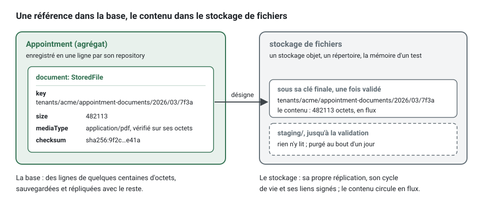
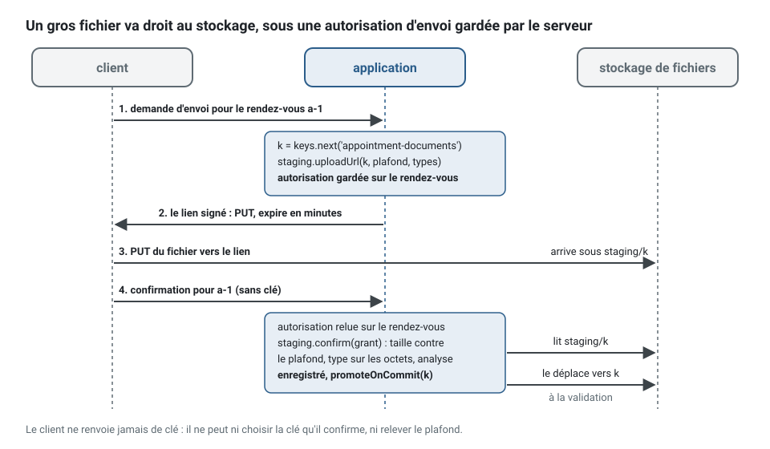

[English](file-storage.md) · **Français**
<!-- translation-of: file-storage.md sha256:e6e1eb0862c51c32 -->

# Stockage de fichiers

**Résumé.** Un fichier (un scan, une photo, un contrat signé, un export) est gardé dans un
stockage de fichiers, jamais dans la base de données : un stockage objet dans un déploiement, un
répertoire pendant le développement, la mémoire du processus dans les tests. L'agrégat ne garde
qu'une référence, un `StoredFile` (clé, taille, type de média, empreinte). Une écriture dans le
stockage ne peut pas rejoindre une transaction, alors le kit fixe un ordre qui garde les deux
cohérents : le fichier est mis en attente là où rien ne le lit, avant que la transaction s'ouvre ;
la référence est enregistrée dans la transaction, et le fichier est déplacé vers sa clé en
dernière étape de cette transaction, puis ramené si elle est annulée (rollback). Une ligne
validée (commit) ne pointe jamais vers un fichier en attente, alors un *job* planifié purge tout
fichier en attente depuis plus d'un jour. Les clés sont générées sur le serveur, les liens sont
signés et courts, et le contenu est vérifié sur ses octets pendant qu'il circule en flux.



## Pourquoi jamais dans la base de données

Une colonne d'octets paraît simple : une transaction, une sauvegarde, un seul endroit. Elle
coûte plus qu'elle ne rapporte.

| Dans la base de données | Dans un stockage de fichiers |
|---|---|
| le fichier entier passe par la mémoire de l'application et de la base à chaque lecture | le contenu circule en flux, une partie à la fois |
| chaque sauvegarde, réplique, extraction et restauration emporte tous les fichiers | les lignes restent petites ; le stockage a sa propre réplication et son propre cycle de vie |
| un téléchargement passe par l'application, ses *threads* et son pool de connexions | un lien signé envoie le client vers le stockage, ou vers une route qui diffuse en flux |
| quelques grosses lignes ralentissent les parcours de la table dont elles partagent les pages | la table ne contient que des références |
| effacer un fichier, c'est réécrire des lignes et passer un *vacuum* | une clé est supprimée, une règle de cycle de vie fait expirer un préfixe |

`persistence/no-file-content` signale une colonne binaire (`bytea`, `blob`, `varbinary`,
`.binary()` de knex, un champ `Bytes` de Prisma) ou une colonne en base64 dans un schéma ou une
migration. Une petite valeur binaire qui n'est pas un fichier, une empreinte ou une clé, est une
dérogation enregistrée avec sa raison.

<!-- checked sample -->
```ts
import type { Knex } from 'knex';

// Au lieu de : le contenu dans une colonne, lu et écrit en entier
export async function withContent(knex: Knex): Promise<void> {
  await knex.schema.createTable('appointment_documents', (table) => {
    table.string('id').primary();
    table.binary('content'); // signalé par persistence/no-file-content
  });
}

// Écrire : les quatre champs du StoredFile, quelques centaines d'octets par ligne
export async function withReference(knex: Knex): Promise<void> {
  await knex.schema.createTable('appointment_documents', (table) => {
    table.string('id').primary();
    table.string('file_key').notNullable();
    table.bigInteger('file_size').notNullable();
    table.string('file_media_type').notNullable();
    table.string('file_checksum').notNullable();
  });
}
```

## Les ports

| Port | Ce que c'est |
|---|---|
| `FileStorage` | le stockage : `put` (un flux entrant, mesuré et haché, refusé au-delà de `maxBytes`), `get` (un flux sortant), `stat`, `delete`, `copy`, `move`, `list(prefix)`, `signedDownloadUrl`, `signedUploadUrl` |
| `StoredFile` | ce que garde un agrégat : `key`, `size`, `mediaType`, `checksum` ; jamais le fournisseur, le *bucket* ni une URL |
| `FileKeys` | nomme les fichiers sur le serveur : `tenants/<tenant>/<area>/<year>/<month>/<id>` |
| `FileScanner` | le contrôle qu'un fichier passe avant d'être accepté : un antivirus, un analyseur, une politique sur les archives |
| `FileStaging` | l'ordre d'une écriture : mettre en attente et analyser, promouvoir avec la validation, supprimer après elle, purger |
| `FileUpload` | le fichier que porte une commande : reçu du client, mis en attente par le bus avant la transaction |

Le domaine et les cas d'usage nomment ces ports et rien d'autre (`files/port-not-connector`) :
la plateforme lie le connecteur de chaque environnement (`stack.storage` dans
[CONFIG.md](../CONFIG.fr.md)). Les connecteurs et leur comparaison sont dans
[tools/file-storage.md](../tools/file-storage.fr.md).

Dans la plateforme, les fichiers sont une seule capacité : le stockage de l'environnement, les
ports liés aux implémentations du noyau, et la purge horaire. Sur le conteneur du kit, `init`
l'écrit comme ci-dessous, dans `src/platform/files/` (`files.module.ts` et `bind-files.ts`, ici
réunis en un seul bloc) ; câblé à la main, `create-files.ts` construit les mêmes objets :

<!-- checked sample -->
```ts
import { defineContextModule, type ContextModule } from '@ddd-ts-kit/di';
import {
  AcceptEveryFileScanner,
  Clock,
  ErrorReporter,
  ExecutionScope,
  FileKeys,
  FileScanner,
  FileStaging,
  FileStorage,
  IdGenerator,
  PurgeStagedFiles,
  TenantFileKeys,
} from '@ddd-ts-kit/kernel';

export function filesModule(storage: FileStorage): ContextModule {
  return defineContextModule({
    name: 'files',
    register(builder) {
      // le connecteur que main.ts a ouvert pour cet environnement : S3, un répertoire, la mémoire
      builder.bind(FileStorage).toValue(storage);
      // à remplacer par un antivirus avant d'accepter des fichiers de personnes inconnues
      builder.bind(FileScanner).toValue(new AcceptEveryFileScanner());
      builder
        .bind(FileKeys)
        .toFactory((resolve) => new TenantFileKeys(resolve(IdGenerator), resolve(Clock), resolve(ExecutionScope)));
      builder
        .bind(FileStaging)
        .toFactory((resolve) => new FileStaging(resolve(FileStorage), resolve(FileScanner), resolve(ErrorReporter)));
      // toutes les heures, les fichiers en attente depuis plus d'un jour sont supprimés
      builder.job('files.purge-staged', { every: '1h' }).handledBy(PurgeStagedFiles, [FileStaging, Clock]);
    },
  });
}
```

## Recevoir un fichier

Un contrôleur déclare le fichier qu'il reçoit, et la déclaration est le contrat : le champ, le
poids maximal et les types de média admis. Le document OpenAPI les énonce
(`multipart/form-data`, `x-max-bytes`, `x-media-types`) avec les refus 413, 415 et 422.

<!-- checked sample -->
```ts
import { definePermissions } from '@ddd-ts-kit/auth';
import {
  acceptedSchema,
  Authenticated,
  Controller,
  RouteGroup,
  type Accepted,
  type HttpRequest,
  type IncomingFile,
} from '@ddd-ts-kit/http';
import { AuthorizedCommand, FileUpload, type Actor, type CommandBus, type ReceivedFile } from '@ddd-ts-kit/kernel';
import { Requires } from '@ddd-ts-kit/kernel/declarations';
import { zodSchema } from '@ddd-ts-kit/validation/zod';
import { z } from 'zod';

const permissions = definePermissions('scheduling', {
  'appointment.attach-document': { description: 'Attach a document to an appointment' },
});

// application : la commande porte le fichier, enveloppé dans un FileUpload de sa zone
@Requires(permissions['appointment.attach-document'])
export class AttachDocumentCommand extends AuthorizedCommand<string> {
  readonly document: FileUpload;

  constructor(
    actor: Actor,
    readonly appointmentId: string,
    file: ReceivedFile,
  ) {
    super(actor);
    this.document = new FileUpload(file, 'appointment-documents');
  }
}

// présentation : la route déclare le fichier qu'elle accepte, et cette déclaration est le contrat
@RouteGroup({ prefix: '/appointments', tags: ['scheduling'], guards: [Authenticated] })
export class AppointmentRoutes {}

const params = zodSchema(z.object({ appointmentId: z.string() }));

@Controller({
  group: AppointmentRoutes,
  method: 'POST',
  path: '/:appointmentId/document',
  summary: 'Attach a document',
  params,
  upload: { field: 'document', maxBytes: 10_485_760, mediaTypes: ['application/pdf', 'image/png', 'image/jpeg'] },
  response: { status: 201, description: 'Attached.', body: acceptedSchema },
  errors: ['APPOINTMENT_NOT_FOUND', 'FILE_REJECTED'],
})
export class AttachDocumentController {
  constructor(private readonly commands: CommandBus) {}

  async handle({ params, actor, upload }: HttpRequest<{ params: { appointmentId: string }; upload: IncomingFile }>): Promise<Accepted> {
    await this.commands.execute(new AttachDocumentCommand(actor, params.appointmentId, upload));

    return { id: params.appointmentId };
  }
}
```

Le fichier atteint `handle` pendant qu'il circule encore, et `handle` le remet à la commande, qui
l'enveloppe dans un `FileUpload` de sa zone
(`new FileUpload(file, 'appointment-documents')`). Le `fileUploadsMiddleware` du bus de
commandes l'y met en attente, après le contrôle de la permission et avant l'unité de travail :
un acteur refusé ne stocke rien, et aucune transaction, aucune connexion du pool, n'attend
pendant qu'un client envoie dix mégaoctets sur une liaison lente. Le gestionnaire (handler) lit
`command.document.file`, un `StoredFile` déjà mis en attente et analysé. En chemin, le fichier
est compté et refusé avec `FILE_TOO_LARGE` au-delà de sa limite ; ses premiers octets doivent
prouver le type de média que le client a déclaré, et ce type doit être accepté, sinon il est
refusé avec `UNSUPPORTED_MEDIA_TYPE`, avant qu'un seul octet n'atteigne le stockage. Un PDF
commence par `%PDF-` ; un document Word ou Excel est une archive zip ; un texte est en UTF-8
sans caractère de contrôle ; le SVG et les formats binaires que le kit ne reconnaît pas ne
passent jamais, puisqu'un nom ou un type déclaré ne prouve rien.

Le gestionnaire ne voit donc jamais d'octets. Il enregistre la référence et demande la
promotion :

<!-- checked sample -->
```ts
import { AuthorizedCommand, DomainRefusal, type Clock, type FileStaging, type FileUpload, type StoredFile } from '@ddd-ts-kit/kernel';
import { CommandHandler } from '@ddd-ts-kit/kernel/declarations';

declare class AttachDocumentCommand extends AuthorizedCommand<string> {
  readonly appointmentId: string;
  readonly document: FileUpload;
}

declare class Appointment {
  /** Garde la référence du nouveau document ; répond celui qu'il remplace, s'il y en a un. */
  attachDocument(file: StoredFile, name: string, now: Date): StoredFile | undefined;
}

declare abstract class AppointmentRepository {
  abstract findById(id: string): Promise<Appointment | undefined>;
  abstract save(appointment: Appointment): Promise<void>;
}

const SchedulingCodes = { UnknownAppointment: 'APPOINTMENT_NOT_FOUND' } as const;

class UnknownAppointment extends DomainRefusal {
  readonly code = SchedulingCodes.UnknownAppointment;

  static forAppointment(appointmentId: string) {
    return UnknownAppointment.refusal(`Appointment ${appointmentId} does not exist.`, { appointmentId });
  }
}

@CommandHandler(AttachDocumentCommand)
export class AttachDocumentHandler implements CommandHandler<AttachDocumentCommand> {
  constructor(
    private readonly appointments: AppointmentRepository,
    private readonly staging: FileStaging,
    private readonly clock: Clock,
  ) {}

  async execute(command: AttachDocumentCommand): Promise<string> {
    const appointment = await this.appointments.findById(command.appointmentId);

    if (appointment === undefined) {
      throw UnknownAppointment.forAppointment(command.appointmentId);
    }

    // déjà mis en attente et analysé par le bus : une clé, une taille, un type vérifié, une empreinte
    const { file, fileName } = command.document;
    const replaced = appointment.attachDocument(file, fileName, this.clock.now());

    await this.appointments.save(appointment);
    // le fichier passe de staging/ à sa clé en dernière étape de cette transaction
    await this.staging.promoteOnCommit(file.key);

    if (replaced !== undefined) {
      // l'ancien fichier part une fois la validation certaine ; un arrêt brutal ici ne laisse qu'un orphelin
      await this.staging.deleteAfterCommit(replaced.key);
    }

    return file.key;
  }
}
```

L'application d'exemple porte ce cas d'usage de bout en bout, avec une *spec* qui valide et
annule contre une vraie base de données et un vrai répertoire :
[`attach-appointment-document`](../../examples/scheduling/src/contexts/scheduling/application/commands/attach-appointment-document/attach-appointment-document.handler.ts)
et
[`document-lands-with-its-file.spec.ts`](../../examples/scheduling/src/contexts/scheduling/test/integration/document-lands-with-its-file.spec.ts).

Pour un gros fichier, le client l'envoie directement au stockage. Une première commande génère
la clé et signe un lien d'envoi pour elle (`FileStaging.uploadUrl(key, { expiresInSeconds,
mediaType, accepted, maxBytes })`) ; elle remet le `link` au client et enregistre l'autorisation
d'envoi `pending` (clé, plafond de taille, types de média) sur l'agrégat qui attend le fichier.
Le client envoie le fichier au lien. Une seconde commande, qui nomme l'agrégat et jamais une
clé, relit l'autorisation sur lui et confirme (`FileStaging.confirm(pending)`) : ce qui est
arrivé est mesuré contre le plafond de l'autorisation, vérifié sur ses octets et analysé, puis
enregistré et promu comme tout fichier mis en attente. Un client ne peut ni choisir la clé qu'il
confirme, ni relever le plafond. Les liens des stockages local et en mémoire refusent eux-mêmes
un envoi plus gros ; un lien présigné d'un stockage objet ne peut pas plafonner la taille, alors
c'est la confirmation qui la tient.



Les deux commandes, réduites à ce qu'elles font des fichiers :

<!-- checked sample -->
```ts
import { DomainRefusal, type FileKeys, type FileStaging, type PendingUpload, type SignedUpload, type StoredFile } from '@ddd-ts-kit/kernel';

declare class NoUploadAwaited extends DomainRefusal {
  readonly code: 'NO_UPLOAD_AWAITED';
  static onConfirmation(): NoUploadAwaited;
}

declare class Appointment {
  /** Enregistre l'autorisation : la clé, le plafond et les types de média que le serveur a accepté de signer. */
  awaitDocument(pending: PendingUpload): void;
  /** L'autorisation enregistrée par la première commande ; `undefined` quand aucun envoi n'est attendu. */
  readonly awaitedDocument: PendingUpload | undefined;
  attachDocument(file: StoredFile, now: Date): void;
}

const TEN_MINUTES = 600;
const TWO_HUNDRED_MEGABYTES = 200_000_000;

// 1. La première commande : une clé générée ici, un lien pour le client, l'autorisation pour l'agrégat.
export async function offerUpload(keys: FileKeys, staging: FileStaging, appointment: Appointment): Promise<SignedUpload> {
  const { link, pending } = await staging.uploadUrl(keys.next('appointment-documents'), {
    expiresInSeconds: TEN_MINUTES,
    mediaType: 'application/pdf',
    accepted: ['application/pdf'],
    maxBytes: TWO_HUNDRED_MEGABYTES,
  });

  appointment.awaitDocument(pending); // enregistrée avec le rendez-vous, jamais envoyée au client

  return link; // url, méthode PUT, en-têtes à envoyer tels quels, expiresAt
}

// 2. La seconde commande nomme le rendez-vous, jamais une clé : l'autorisation vient du serveur.
export async function confirmUpload(staging: FileStaging, appointment: Appointment, now: Date): Promise<StoredFile> {
  const pending = appointment.awaitedDocument;

  if (pending === undefined) {
    throw NoUploadAwaited.onConfirmation();
  }

  const file = await staging.confirm(pending); // mesuré contre le plafond, vérifié sur ses octets, analysé

  appointment.attachDocument(file, now);
  await staging.promoteOnCommit(file.key);

  return file;
}
```

## Garder le stockage et la base cohérents


L'agrégat tient la clé finale dès le départ, et le fichier l'atteint à l'intérieur de la
transaction qui l'enregistre : une promotion qui échoue (le stockage est injoignable) fait
échouer la commande, donc aucune ligne pointant vers un fichier absent n'est validée, et une
validation qui échoue après la promotion ramène le fichier dans `staging/`. Une ligne validée ne
pointe donc jamais dans `staging/`, et tout fichier en attente est un orphelin : une commande
refusée, une annulation, un envoi jamais confirmé. La purge les supprime selon leur âge sans
rien demander à la base. Aucune clé générée par `FileKeys` ou acceptée par `FileStaging` ne
commence par `staging/`.

`afterCommit`, qui s'exécute au plus une fois après la validation, est réservé à ce qui peut se
perdre : supprimer le fichier qu'un agrégat ne référence plus
(`FileStaging.deleteAfterCommit`). Un arrêt brutal à cet endroit laisse un fichier non
référencé : de l'espace de stockage dépensé, jamais une donnée perdue.

## Servir un fichier

Un téléchargement passe par un lien signé : `signedDownloadUrl(key, { expiresInSeconds,
fileName })` répond une URL qui donne accès à ce fichier, en pièce jointe, jusqu'à son
expiration (une heure au plus ; cinq minutes suffisent pour un clic). Un stockage objet répond
ses propres liens. Le répertoire local et le connecteur en mémoire sont servis par l'application
elle-même, `signedFileRoutes` de `@ddd-ts-kit/http` sous `/files`, publiques puisque le jeton
est l'autorisation, avec `nosniff` et `no-store`.

<!-- checked sample -->
```ts
import type { FileStorage, StoredFile } from '@ddd-ts-kit/kernel';

/** Cinq minutes : assez pour un clic, assez peu pour qu'un lien copié dans un courriel n'ouvre bientôt plus rien. */
const LINK_SECONDS = 300;

export interface DocumentLink {
  readonly url: string;
  readonly expiresAt: Date;
  readonly name: string;
}

// dans le gestionnaire de la requête, une fois le rendez-vous chargé et la permission accordée
export async function linkToDocument(files: FileStorage, file: StoredFile, name: string): Promise<DocumentLink> {
  const link = await files.signedDownloadUrl(file.key, { expiresInSeconds: LINK_SECONDS, fileName: name });

  return { url: link.url, expiresAt: link.expiresAt, name };
}
```

Le cas d'usage qui signe le lien est une requête avec sa permission, comme n'importe quelle
autre. Quand les fichiers contiennent des données personnelles, sa permission est déclarée
sensible (`sensitivePermissions` de `auditDecisions` dans `@ddd-ts-kit/audit`) : chaque accès
est alors consigné dans le journal d'audit, par qui, sur quelle ressource, sous quelle
corrélation, sans le contenu ni le lien.

## Sécurité

- **Aucun chemin venant de l'utilisateur.** La clé vient de `FileKeys`, jamais d'un nom de
  fichier : une requête HTTP ne peut ni choisir où elle écrit, ni remonter hors d'un répertoire
  (`../`), ni deviner une autre clé. Les connecteurs refusent toute clé qui n'est pas faite de
  segments de lettres, de chiffres, de `.`, de `-` et de `_`, aucun ne commençant par un point.
  Un envoi direct est confirmé à partir de l'autorisation gardée par le serveur, jamais d'une
  clé que le client renvoie.
- **Un préfixe par *tenant*.** Dans un projet multitenant, la clé commence par
  `tenants/<tenant>/`, de sorte qu'une politique de *bucket*, un export ou un effacement
  désigne un *tenant* par son préfixe. L'identifiant du *tenant* est le segment lui-même : le
  noyau n'accepte que des lettres, des chiffres, `-` et `_` (voir
  [Multitenance](multitenancy.fr.md)), donc deux *tenants* ne partagent jamais un préfixe.
- **Des liens courts.** Un lien signé est un jeton au porteur : il fuit avec la page, le journal
  ou le courriel qui le contient. Le kit refuse un lien qui vit plus d'une heure.
- **Vérifié sur les octets, analysé avant d'être accepté.** `FileScanner` s'exécute sur le
  fichier en attente ; un fichier refusé est supprimé et jamais visible.
- **Le nom du fichier est une donnée.** Il est réaffiché aux personnes, échappé dans
  `Content-Disposition`, et ne sert jamais à décider quoi que ce soit.

La première et la dernière règle, côte à côte :

<!-- checked sample -->
```ts
import type { FileKeys, ReceivedFile } from '@ddd-ts-kit/kernel';

declare const keys: FileKeys;
declare const received: ReceivedFile;

// Au lieu de : une clé construite à partir de ce que le client a envoyé ("../../config.json", deux "scan.pdf" qui s'écrasent)
const unsafe = `documents/${received.fileName}`;

// Écrire : une clé générée sur le serveur, sous le tenant, impossible à deviner
const key = keys.next('appointment-documents'); // tenants/acme/appointment-documents/2026/03/<id>
```

## Import et export en arrière-plan

Importer un tableur de dix mille lignes, valider chaque ligne, écrire un rapport d'erreurs et
reprendre après un arrêt brutal est un travail pour la [file de *jobs*](background-jobs.fr.md) :
un *job* en arrière-plan par fichier, relancé, observable, avec sa progression et son point de
reprise conservés. Le kit ne livre pas encore ce traitement ;
[Import et export de fichiers](file-import-export.fr.md) en est la conception, sur les pièces
qui existent : le fichier arrive par un envoi et il est mis en attente et analysé comme tout
autre, un lecteur du flux produit des lignes sans garder le fichier, le rapport d'erreurs est
lui-même un fichier écrit avec `put` et proposé par un lien signé, un export est écrit par
parties avec `put`. Tant qu'il n'est pas construit, une commande qui valide un petit fichier sur
place, ou un *job* en arrière-plan écrit à la main sur ces ports, est la voie honnête.

## Limites

- Une écriture dans un stockage ne fait jamais partie d'une transaction : l'ordre ci-dessus est
  la seule garantie. Un arrêt brutal après la promotion et avant la validation laisse sous sa
  clé finale un fichier qu'aucune ligne ne référence : de l'espace dépensé, jamais une donnée
  perdue. Une validation dont la base ne rapporte pas l'issue (la connexion tombe pendant
  `COMMIT`) est prise pour une annulation : le fichier retourne dans `staging/`, où il reste un
  jour avant la purge.
- La promotion s'exécute dans la transaction : un renommage sur le répertoire local, une copie
  côté serveur puis une suppression sur S3, ce qui, pour un gros objet, retient la transaction
  quelques secondes.
- Le fichier est mis en attente avant que le gestionnaire s'exécute : une commande refusée par
  son gestionnaire (un rendez-vous inconnu, une règle de l'agrégat) a tout de même reçu le
  fichier, qui attend la purge dans `staging/`. Le temps que prend un client pour envoyer est
  borné par les délais d'expiration du serveur HTTP, pas par la base de données.
- Le répertoire local sert une seule machine : plusieurs instances d'une application ont besoin
  d'un stockage objet.
- `copy` et `move` sur S3 passent par `CopyObject`, 5 Gio par objet.
- Le connecteur S3 ne garde pas l'empreinte dans le *bucket* : `put` la répond, l'agrégat la
  garde.
- Les types de média sont reconnus à partir d'une courte liste de signatures (PDF, PNG, JPEG,
  GIF, WebP, zip et les formats bureautiques, gzip) et à partir du texte : un autre format
  binaire a besoin de son propre contrôle.

## Voir aussi

- [Import et export de fichiers](file-import-export.fr.md) : la conception du traitement en
  arrière-plan.
- [Connecteurs du stockage de fichiers](../tools/file-storage.fr.md) : mémoire, local,
  compatible S3, et comment en écrire un pour Google Cloud Storage ou Azure.
- [Journal d'audit](audit-trail.fr.md) : consigner l'accès aux fichiers qui contiennent des
  données personnelles.
- [*Jobs* planifiés](scheduled-jobs.fr.md) : la purge des fichiers en attente.
- [Outbox transactionnelle](transactional-outbox.fr.md) : le même problème de double écriture,
  pour les événements.
