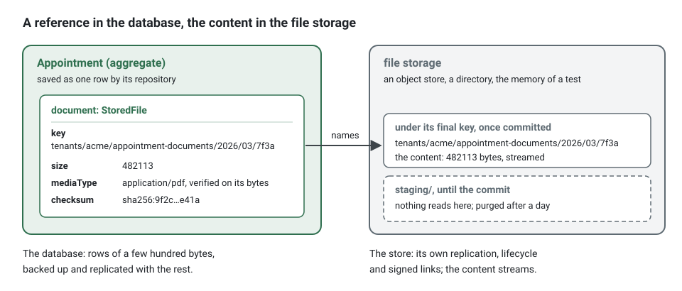
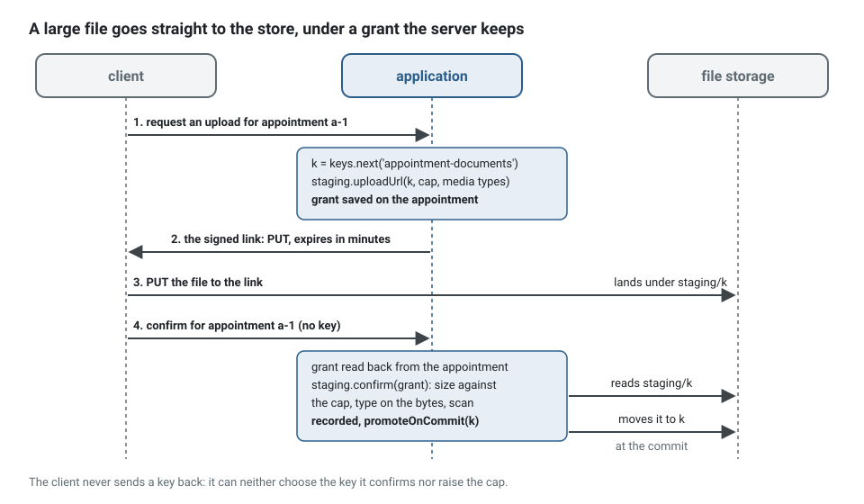

**English** · [Français](file-storage.fr.md)

# File storage

**Summary.** A file (a scan, a photo, a signed contract, an export) is kept in a file storage,
never in the database: an object store in a deployment, a directory while developing, the
memory of the process in the tests. The aggregate keeps only a reference, a `StoredFile` (key,
size, media type, checksum). A write to the storage cannot join a transaction, so the kit fixes
an order that keeps both consistent: the file is staged where nothing reads it, before the
transaction opens; the reference is recorded in the transaction, and the file is moved to its
key as the last step of that transaction, back if it rolls back. A committed row never points to
a staged file, so a scheduled job purges every staged file older than a day. Keys are generated
on the server, links are signed and short, and the content is checked on its bytes as it
streams.



## Why never in the database

A column of bytes looks simple: one transaction, one backup, one place. It costs more than it
saves.

| In the database | In a file storage |
|---|---|
| the whole file goes through the memory of the application and of the database at each read | the content streams, a part at a time |
| every backup, replica, dump and restore carries every file | the rows stay small; the store has its own replication and lifecycle |
| a download goes through the application, its threads and its connection pool | a signed link sends the client to the store, or to a route that streams |
| a few large rows slow the scans of the table they share pages with | the table holds references only |
| erasing a file means rewriting rows and vacuuming | a key is deleted, a lifecycle rule expires a prefix |

`persistence/no-file-content` reports a binary column (`bytea`, `blob`, `varbinary`, knex
`.binary()`, a Prisma `Bytes` field) or a base64 column in a schema or a migration. A small
binary value that is not a file, a hash or a key, is a deviation recorded with its reason.

<!-- checked sample -->
```ts
import type { Knex } from 'knex';

// Instead of: the content in a column, read and written whole
export async function withContent(knex: Knex): Promise<void> {
  await knex.schema.createTable('appointment_documents', (table) => {
    table.string('id').primary();
    table.binary('content'); // reported by persistence/no-file-content
  });
}

// Write: the four fields of the StoredFile, a few hundred bytes per row
export async function withReference(knex: Knex): Promise<void> {
  await knex.schema.createTable('appointment_documents', (table) => {
    table.string('id').primary();
    table.string('file_key').notNullable();
    table.bigInteger('file_size').notNullable();
    table.string('file_media_type').notNullable();
    table.string('file_checksum').notNullable();
  });
}
```

## The ports

| Port | What it is |
|---|---|
| `FileStorage` | the store: `put` (a stream in, measured and hashed, refused beyond `maxBytes`), `get` (a stream out), `stat`, `delete`, `copy`, `move`, `list(prefix)`, `signedDownloadUrl`, `signedUploadUrl` |
| `StoredFile` | what an aggregate keeps: `key`, `size`, `mediaType`, `checksum`; never the provider, the bucket or a URL |
| `FileKeys` | names files on the server: `tenants/<tenant>/<area>/<year>/<month>/<id>` |
| `FileScanner` | the check a file passes before it is accepted: an antivirus, a parser, a policy on archives |
| `FileStaging` | the order of a write: stage and scan, promote with the commit, delete after it, purge |
| `FileUpload` | the file a command carries: received from the client, staged by the bus before the transaction |

The domain and the use cases name these ports and nothing else (`files/port-not-connector`):
the platform binds the connector of each environment (`stack.storage` in
[CONFIG.md](../CONFIG.md)). The connectors and how they compare are in
[tools/file-storage.md](../tools/file-storage.md).

In the platform, the files are one capability: the storage of the environment, the ports bound
to the implementations of the kernel, and the hourly purge. On the container of the kit, `init`
writes it as below, in `src/platform/files/` (`files.module.ts` and `bind-files.ts`, here in
one piece); wired by hand, `create-files.ts` builds the same objects:

<!-- checked sample -->
```ts
import { defineContextModule, type ContextModule } from '@ddd-ts-kit/di';
import {
  AcceptEveryFileScanner,
  Clock,
  ErrorReporter,
  ExecutionScope,
  FileKeys,
  FileScanner,
  FileStaging,
  FileStorage,
  IdGenerator,
  PurgeStagedFiles,
  TenantFileKeys,
} from '@ddd-ts-kit/kernel';

export function filesModule(storage: FileStorage): ContextModule {
  return defineContextModule({
    name: 'files',
    register(builder) {
      // the connector main.ts opened for this environment: S3, a directory, the memory
      builder.bind(FileStorage).toValue(storage);
      // replace it with an antivirus before accepting files from people you do not know
      builder.bind(FileScanner).toValue(new AcceptEveryFileScanner());
      builder
        .bind(FileKeys)
        .toFactory((resolve) => new TenantFileKeys(resolve(IdGenerator), resolve(Clock), resolve(ExecutionScope)));
      builder
        .bind(FileStaging)
        .toFactory((resolve) => new FileStaging(resolve(FileStorage), resolve(FileScanner), resolve(ErrorReporter)));
      // every hour, the staged files older than a day are removed
      builder.job('files.purge-staged', { every: '1h' }).handledBy(PurgeStagedFiles, [FileStaging, Clock]);
    },
  });
}
```

## Receiving a file

A controller declares the file it receives, and the declaration is the contract: the field, the
most it may weigh and the media types it may be. The OpenAPI document states them
(`multipart/form-data`, `x-max-bytes`, `x-media-types`) with the 413, 415 and 422 refusals.

<!-- checked sample -->
```ts
import { definePermissions } from '@ddd-ts-kit/auth';
import {
  acceptedSchema,
  Authenticated,
  Controller,
  RouteGroup,
  type Accepted,
  type HttpRequest,
  type IncomingFile,
} from '@ddd-ts-kit/http';
import { AuthorizedCommand, FileUpload, type Actor, type CommandBus, type ReceivedFile } from '@ddd-ts-kit/kernel';
import { Requires } from '@ddd-ts-kit/kernel/declarations';
import { zodSchema } from '@ddd-ts-kit/validation/zod';
import { z } from 'zod';

const permissions = definePermissions('scheduling', {
  'appointment.attach-document': { description: 'Attach a document to an appointment' },
});

// application: the command carries the file, wrapped in a FileUpload of its area
@Requires(permissions['appointment.attach-document'])
export class AttachDocumentCommand extends AuthorizedCommand<string> {
  readonly document: FileUpload;

  constructor(
    actor: Actor,
    readonly appointmentId: string,
    file: ReceivedFile,
  ) {
    super(actor);
    this.document = new FileUpload(file, 'appointment-documents');
  }
}

// presentation: the route declares the file it accepts, and that declaration is the contract
@RouteGroup({ prefix: '/appointments', tags: ['scheduling'], guards: [Authenticated] })
export class AppointmentRoutes {}

const params = zodSchema(z.object({ appointmentId: z.string() }));

@Controller({
  group: AppointmentRoutes,
  method: 'POST',
  path: '/:appointmentId/document',
  summary: 'Attach a document',
  params,
  upload: { field: 'document', maxBytes: 10_485_760, mediaTypes: ['application/pdf', 'image/png', 'image/jpeg'] },
  response: { status: 201, description: 'Attached.', body: acceptedSchema },
  errors: ['APPOINTMENT_NOT_FOUND', 'FILE_REJECTED'],
})
export class AttachDocumentController {
  constructor(private readonly commands: CommandBus) {}

  async handle({ params, actor, upload }: HttpRequest<{ params: { appointmentId: string }; upload: IncomingFile }>): Promise<Accepted> {
    await this.commands.execute(new AttachDocumentCommand(actor, params.appointmentId, upload));

    return { id: params.appointmentId };
  }
}
```

The file reaches `handle` while it still streams, and `handle` hands it to the command, which
wraps it in a `FileUpload` of its area (`new FileUpload(file, 'appointment-documents')`). The
`fileUploadsMiddleware` of the command bus stages it there, after the permission check and
before the unit of work: a refused actor stores nothing, and no transaction, no pooled
connection, waits while a client uploads ten megabytes over a slow link. The handler reads
`command.document.file`, a `StoredFile` already staged and scanned. On its way the file is
counted and refused with
`FILE_TOO_LARGE` beyond its limit; its first bytes must prove the media type the client
declared, and that type must be accepted, or it is refused with `UNSUPPORTED_MEDIA_TYPE`, before
a byte reaches the storage. A PDF starts with `%PDF-`; a Word or Excel document is a zip
archive; text is UTF-8 without control characters; SVG and the binary formats the kit does not
recognise never pass, since a name or a declared type proves nothing.

The handler therefore never sees bytes. It records the reference and asks for the promotion:

<!-- checked sample -->
```ts
import { AuthorizedCommand, ConceptError, type Clock, type FileStaging, type FileUpload, type StoredFile } from '@ddd-ts-kit/kernel';
import { CommandHandler } from '@ddd-ts-kit/kernel/declarations';

declare class AttachDocumentCommand extends AuthorizedCommand<string> {
  readonly appointmentId: string;
  readonly document: FileUpload;
}

declare class Appointment {
  /** Keeps the reference of the new document; answers the one it replaces, if any. */
  attachDocument(file: StoredFile, name: string, now: Date): StoredFile | undefined;
}

declare abstract class AppointmentRepository {
  abstract findById(id: string): Promise<Appointment | undefined>;
  abstract save(appointment: Appointment): Promise<void>;
}

class AppointmentError extends ConceptError {
  static notFound(appointmentId: string) {
    return AppointmentError.refusal('APPOINTMENT_NOT_FOUND', `Appointment ${appointmentId} does not exist.`, { appointmentId });
  }
}

@CommandHandler(AttachDocumentCommand)
export class AttachDocumentHandler implements CommandHandler<AttachDocumentCommand> {
  constructor(
    private readonly appointments: AppointmentRepository,
    private readonly staging: FileStaging,
    private readonly clock: Clock,
  ) {}

  async execute(command: AttachDocumentCommand): Promise<string> {
    const appointment = await this.appointments.findById(command.appointmentId);

    if (appointment === undefined) {
      throw AppointmentError.notFound(command.appointmentId);
    }

    // staged and scanned by the bus already: a key, a size, a verified type, a checksum
    const { file, fileName } = command.document;
    const replaced = appointment.attachDocument(file, fileName, this.clock.now());

    await this.appointments.save(appointment);
    // the file moves from staging/ to its key as the last step of this transaction
    await this.staging.promoteOnCommit(file.key);

    if (replaced !== undefined) {
      // the old file goes once the commit is certain; a crash here only leaves an orphan
      await this.staging.deleteAfterCommit(replaced.key);
    }

    return file.key;
  }
}
```

The example application holds this use case end to end, with a spec that commits and rolls back
against a real database and a real directory:
[`attach-appointment-document`](../../examples/scheduling/src/contexts/scheduling/application/commands/attach-appointment-document/attach-appointment-document.handler.ts)
and
[`document-lands-with-its-file.spec.ts`](../../examples/scheduling/src/contexts/scheduling/test/integration/document-lands-with-its-file.spec.ts).

For a large file, the client sends it straight to the store. A first command generates the key
and signs an upload link for it (`FileStaging.uploadUrl(key, { expiresInSeconds, mediaType,
accepted, maxBytes })`); it hands the `link` to the client and records the `pending` grant (key,
size cap, media types) on the aggregate that awaits the file. The client sends the file to the
link. A second command, which names the aggregate and never a key, reads the grant back from it
and confirms (`FileStaging.confirm(pending)`): what arrived is measured against the cap of the
grant, checked on its bytes and scanned, then recorded and promoted like any staged file. A
client can neither choose the key it confirms nor raise the cap. The links of the local and
memory storages refuse a larger upload themselves; a presigned link of an object store cannot
cap the size, so the confirmation is what holds it.



The two commands, reduced to what they do with the files:

<!-- checked sample -->
```ts
import { ConceptError, type FileKeys, type FileStaging, type PendingUpload, type SignedUpload, type StoredFile } from '@ddd-ts-kit/kernel';

declare class AppointmentError extends ConceptError {
  static noUploadAwaited(): AppointmentError;
}

declare class Appointment {
  /** Records the grant: the key, the cap and the media types the server accepted to sign. */
  awaitDocument(pending: PendingUpload): void;
  /** The grant recorded by the first command; `undefined` when no upload is awaited. */
  readonly awaitedDocument: PendingUpload | undefined;
  attachDocument(file: StoredFile, now: Date): void;
}

const TEN_MINUTES = 600;
const TWO_HUNDRED_MEGABYTES = 200_000_000;

// 1. The first command: a key generated here, a link for the client, the grant for the aggregate.
export async function offerUpload(keys: FileKeys, staging: FileStaging, appointment: Appointment): Promise<SignedUpload> {
  const { link, pending } = await staging.uploadUrl(keys.next('appointment-documents'), {
    expiresInSeconds: TEN_MINUTES,
    mediaType: 'application/pdf',
    accepted: ['application/pdf'],
    maxBytes: TWO_HUNDRED_MEGABYTES,
  });

  appointment.awaitDocument(pending); // saved with the appointment, never sent to the client

  return link; // url, method PUT, headers to send as they are, expiresAt
}

// 2. The second command names the appointment, never a key: the grant comes from the server.
export async function confirmUpload(staging: FileStaging, appointment: Appointment, now: Date): Promise<StoredFile> {
  const pending = appointment.awaitedDocument;

  if (pending === undefined) {
    throw AppointmentError.noUploadAwaited();
  }

  const file = await staging.confirm(pending); // measured against the cap, checked on its bytes, scanned

  appointment.attachDocument(file, now);
  await staging.promoteOnCommit(file.key);

  return file;
}
```

## Keeping the store and the database consistent


The aggregate holds the final key from the start, and the file reaches it inside the
transaction that records it: a promotion that fails (the storage is away) fails the command, so
no row commits that points to a missing file, and a commit that fails after the promotion moves
the file back to `staging/`. A committed row therefore never points into `staging/`, and every
staged file is an orphan: a refused command, a rollback, an upload never confirmed. The purge
removes them by age without asking the database anything. No key generated by `FileKeys` or
accepted by `FileStaging` starts with `staging/`.

`afterCommit`, which runs at most once after the commit, is kept for what may be lost: deleting
the file an aggregate no longer references (`FileStaging.deleteAfterCommit`). A crash there
leaves an unreferenced file, storage spent and never data lost.

## Serving a file

A download goes through a signed link: `signedDownloadUrl(key, { expiresInSeconds, fileName })`
answers a URL that grants this file, as an attachment, until it expires (at most an hour; five
minutes is enough for a click). An object store answers its own links. The local directory and
the memory connector are answered by the application itself, `signedFileRoutes` of
`@ddd-ts-kit/http` under `/files`, public since the token is the grant, with `nosniff` and
`no-store`.

<!-- checked sample -->
```ts
import type { FileStorage, StoredFile } from '@ddd-ts-kit/kernel';

/** Five minutes: long enough for a click, short enough that a link copied into a mail soon grants nothing. */
const LINK_SECONDS = 300;

export interface DocumentLink {
  readonly url: string;
  readonly expiresAt: Date;
  readonly name: string;
}

// in the handler of the query, once the appointment is loaded and the permission granted
export async function linkToDocument(files: FileStorage, file: StoredFile, name: string): Promise<DocumentLink> {
  const link = await files.signedDownloadUrl(file.key, { expiresInSeconds: LINK_SECONDS, fileName: name });

  return { url: link.url, expiresAt: link.expiresAt, name };
}
```

The use case that signs the link is a query with its permission like any other. When the files
hold personal data, its permission is declared sensitive (`sensitivePermissions` of
`auditDecisions` in `@ddd-ts-kit/audit`): every access is then recorded in the audit trail, by
whom, on which resource, under which correlation, without the content or the link.

## Security

- **No path from the user.** The key comes from `FileKeys`, never from a file name: a request
  cannot choose where it writes, climb out of a directory (`../`) or guess another key. The
  connectors refuse any key that is not segments of letters, digits, `.`, `-` and `_`, none
  starting with a dot. A direct upload is confirmed from the grant the server kept, never from
  a key the client sends back.
- **One prefix per tenant.** In a multi-tenant project the key starts with
  `tenants/<tenant>/`, so a bucket policy, an export or an erasure addresses a tenant by prefix.
  The tenant id is the segment itself: the kernel accepts no other than letters, digits, `-`
  and `_` (see [Multitenancy](multitenancy.md)), so two tenants never share a prefix.
- **Short links.** A signed link is a bearer token: it leaks with the page, the log or the mail
  that holds it. The kit refuses one that lives more than an hour.
- **Checked on the bytes, scanned before acceptance.** `FileScanner` runs on the staged file; a
  refused file is removed and never visible.
- **The file name is data.** It is shown back to people, escaped in `Content-Disposition`, and
  never used to decide anything.

The first and the last rule, side by side:

<!-- checked sample -->
```ts
import type { FileKeys, ReceivedFile } from '@ddd-ts-kit/kernel';

declare const keys: FileKeys;
declare const received: ReceivedFile;

// Instead of: a key built from what the client sent ("../../config.json", two "scan.pdf" that overwrite each other)
const unsafe = `documents/${received.fileName}`;

// Write: a key generated on the server, under the tenant, never guessable
const key = keys.next('appointment-documents'); // tenants/acme/appointment-documents/2026/03/<id>
```

## Import and export in the background

Importing a spreadsheet of ten thousand rows, validating each row, writing an error report and
resuming after a crash is work for the [job queue](background-jobs.md): one background job per
file, retried, observable, with its progress and its checkpoint kept. The kit does not ship this
processing yet; [File import and export](file-import-export.md) is its design, on the pieces
that exist: the file arrives through an upload and is staged and scanned like any other, a
reader of the stream yields rows without holding the file, the error report is itself a file
written with `put` and offered through a signed link, an export is written in parts with `put`.
Until it is built, a command that validates a small file inline, or a background job written by
hand on these ports, is the honest way.

## Limits

- A write to a storage is never part of a transaction: the order above is the only guarantee.
  A crash after the promotion and before the commit leaves a file under its final key that no
  row references: storage spent, never data lost. A commit whose outcome the database does not
  report (the connection drops during `COMMIT`) is taken for a rollback: the file goes back to
  `staging/`, where it stays a day before the purge.
- The promotion runs inside the transaction: a rename on the local directory, a server-side
  copy then a delete on S3, which for a large object holds the transaction a few seconds.
- The file is staged before the handler runs: a command refused by its handler (an unknown
  appointment, a rule of the aggregate) still received the file, which waits in `staging/` for
  the purge. The time a client takes to upload is bounded by the timeouts of the HTTP server,
  not by the database.
- The local directory serves one machine: several instances of an application need an object
  store.
- `copy` and `move` on S3 go through `CopyObject`, 5 GiB per object.
- The S3 connector does not keep the checksum in the bucket: `put` answers it, the aggregate
  keeps it.
- Media types are recognised from a short list of signatures (PDF, PNG, JPEG, GIF, WebP, zip
  and the office formats, gzip) and from text: another binary format needs a check of its own.

## See also

- [File import and export](file-import-export.md): the design of the processing in the background.
- [Connectors of the file storage](../tools/file-storage.md): memory, local, S3 compatible, and
  how to write one for Google Cloud Storage or Azure.
- [Audit trail](audit-trail.md): recording the access to files that hold personal data.
- [Scheduled jobs](scheduled-jobs.md): the purge of staged files.
- [Transactional outbox](transactional-outbox.md): the same dual write problem, for events.
