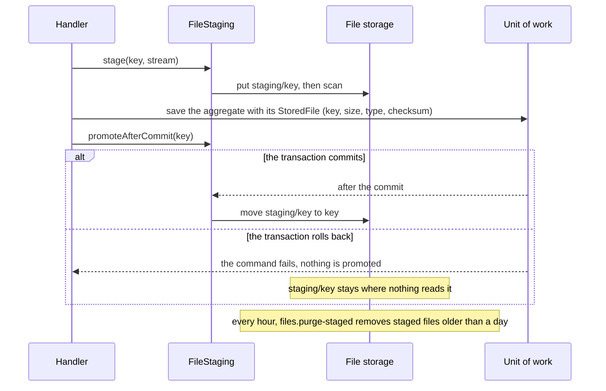

# File storage

**Summary.** A file (a scan, a photo, a signed contract, an export) is kept in a file storage,
never in the database: an object store in a deployment, a directory while developing, the
memory of the process in the tests. The aggregate keeps only a reference, a `StoredFile` (key,
size, media type, checksum). A write to the storage cannot join a transaction, so the kit fixes
an order that keeps both consistent: the file is staged where nothing reads it, the reference
is recorded in the transaction, and the file is promoted once the transaction has committed; a
scheduled job purges what a rolled-back command left. Keys are generated on the server, links
are signed and short, and the content is checked on its bytes as it streams.

## Why never in the database

A column of bytes looks simple: one transaction, one backup, one place. It costs more than it
saves.

| In the database | In a file storage |
|---|---|
| the whole file goes through the memory of the application and of the database at each read | the content streams, a part at a time |
| every backup, replica, dump and restore carries every file | the rows stay small; the store has its own replication and lifecycle |
| a download goes through the application, its threads and its connection pool | a signed link sends the client to the store, or to a route that streams |
| a few large rows slow the scans of the table they share pages with | the table holds references only |
| erasing a file means rewriting rows and vacuuming | a key is deleted, a lifecycle rule expires a prefix |

`persistence/no-file-content` reports a binary column (`bytea`, `blob`, `varbinary`, knex
`.binary()`, a Prisma `Bytes` field) or a base64 column in a schema or a migration. A small
binary value that is not a file, a hash or a key, is a deviation recorded with its reason.

## The ports

| Port | What it is |
|---|---|
| `FileStorage` | the store: `put` (a stream in, measured and hashed, refused beyond `maxBytes`), `get` (a stream out), `stat`, `delete`, `copy`, `move`, `list(prefix)`, `signedDownloadUrl`, `signedUploadUrl` |
| `StoredFile` | what an aggregate keeps: `key`, `size`, `mediaType`, `checksum`; never the provider, the bucket or a URL |
| `FileKeys` | names files on the server: `tenants/<tenant>/<area>/<year>/<month>/<id>` |
| `FileScanner` | the check a file passes before it is accepted: an antivirus, a parser, a policy on archives |
| `FileStaging` | the order of a write: stage, scan, promote after the commit, purge |

The domain and the use cases name these ports and nothing else (`files/port-not-connector`):
the platform binds the connector of each environment (`stack.storage` in
[CONFIG.md](../CONFIG.md)). The connectors and how they compare are in
[tools/file-storage.md](../tools/file-storage.md).

## Receiving a file

A controller declares the file it receives, and the declaration is the contract: the field, the
most it may weigh and the media types it may be. The OpenAPI document states them
(`multipart/form-data`, `x-max-bytes`, `x-media-types`) with the 413, 415 and 422 refusals.

```ts
@Controller({
  group: AppointmentRoutes,
  method: 'POST',
  path: '/:appointmentId/document',
  summary: 'Attach a document',
  params,
  upload: { field: 'document', maxBytes: 10_000_000, mediaTypes: ['application/pdf', 'image/png', 'image/jpeg'] },
  response: { status: 201, description: 'Attached.', body: attached },
})
export class AttachDocumentController {
  constructor(private readonly commands: CommandBus) {}

  async handle({ params, actor, upload }: HttpRequest<{ params: Params; upload: IncomingFile }>) {
    return { key: await this.commands.execute(new AttachDocumentCommand(actor, params.appointmentId, upload)) };
  }
}
```

The file reaches `handle` while it still streams. On its way it is counted and refused with
`FILE_TOO_LARGE` beyond its limit; its first bytes must prove the media type the client
declared, and that type must be accepted, or it is refused with `UNSUPPORTED_MEDIA_TYPE`, before
a byte reaches the storage. A PDF starts with `%PDF-`; a Word or Excel document is a zip
archive; text is UTF-8 without control characters; SVG and the binary formats the kit does not
recognise never pass, since a name or a declared type proves nothing.

For a large file, the client sends it straight to the store: a first command signs an upload
link for a staged key (`FileStaging.uploadUrl`), the client sends the file to it, and a second
command confirms (`FileStaging.confirm`), which reads what arrived, measures it, checks its
media type and scans it before the reference is recorded. A signed upload link cannot cap the
size of what is sent: the confirmation does.

## Keeping the store and the database consistent



The aggregate holds the final key from the start; the file becomes visible under it only after
the commit. A crash between the commit and the move leaves a reference whose file is still
staged: the promotion is reported as a failure, and a repair moves it (`FileStaging.promote`
is idempotent). The purge only removes staged files, which no row may reference for long.

## Serving a file

A download goes through a signed link: `signedDownloadUrl(key, { expiresInSeconds, fileName })`
answers a URL that grants this file, as an attachment, until it expires (at most an hour; five
minutes is enough for a click). An object store answers its own links. The local directory and
the memory connector are answered by the application itself, `signedFileRoutes` of
`@ddd-ts-kit/http` under `/files`, public since the token is the grant, with `nosniff` and
`no-store`.

The use case that signs the link is a query with its permission like any other. When the files
hold personal data, its permission is declared sensitive (`sensitivePermissions` of
`auditDecisions` in `@ddd-ts-kit/audit`): every access is then recorded in the audit trail, by
whom, on which resource, under which correlation, without the content or the link.

## Security

- **No path from the user.** The key comes from `FileKeys`, never from a file name: a request
  cannot choose where it writes, climb out of a directory (`../`) or guess another key. The
  connectors refuse any key that is not segments of letters, digits, `.`, `-` and `_`, none
  starting with a dot.
- **One prefix per tenant.** In a multi-tenant project the key starts with
  `tenants/<tenant>/`, so a bucket policy, an export or an erasure addresses a tenant by prefix.
- **Short links.** A signed link is a bearer token: it leaks with the page, the log or the mail
  that holds it. The kit refuses one that lives more than an hour.
- **Checked on the bytes, scanned before acceptance.** `FileScanner` runs on the staged file; a
  refused file is removed and never visible.
- **The file name is data.** It is shown back to people, escaped in `Content-Disposition`, and
  never used to decide anything.

## Import and export in the background: the next step

Importing a spreadsheet of ten thousand rows, validating each row, writing an error report and
resuming after a crash is work for a job queue: one job per file, retried, observable, with its
progress kept. The kit has no job queue yet (its scheduler runs work by time, not by demand), so
it does not ship this processing. The pieces are ready for it: the file arrives through an
upload and is staged and scanned like any other; a reader of the stream yields rows without
holding the file; the error report is itself a file written with `put` and offered through a
signed link; an export is a stream written with `put`. Until the queue exists, a command that
validates a small file inline, or a scheduled job that processes the staged imports, is the
honest way.

## Limits

- A write to a storage is never part of a transaction: the order above is the only guarantee,
  and a crash between the commit and the promotion needs the repair it reports.
- The local directory serves one machine: several instances of an application need an object
  store.
- `copy` and `move` on S3 go through `CopyObject`, 5 GiB per object.
- The S3 connector does not keep the checksum in the bucket: `put` answers it, the aggregate
  keeps it.
- Media types are recognised from a short list of signatures (PDF, PNG, JPEG, GIF, WebP, zip
  and the office formats, gzip) and from text: another binary format needs a check of its own.

## See also

- [Connectors of the file storage](../tools/file-storage.md): memory, local, S3 compatible, and
  how to write one for Google Cloud Storage or Azure.
- [Audit trail](audit-trail.md): recording the access to files that hold personal data.
- [Scheduled jobs](scheduled-jobs.md): the purge of staged files.
- [Transactional outbox](transactional-outbox.md): the same dual write problem, for events.
