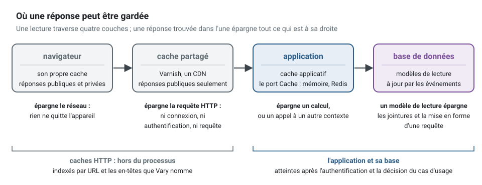
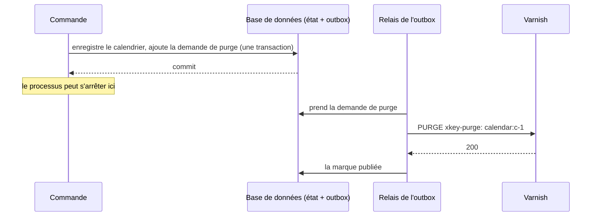
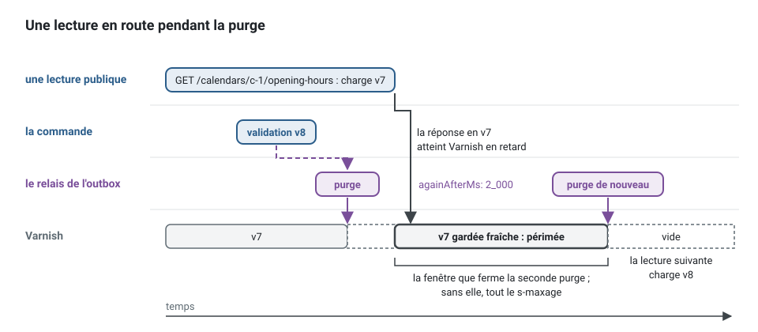

[English](http-caching.md) · **Français**
<!-- translation-of: http-caching.md sha256:ca8f99ca9d991af0 -->

# Cache HTTP

**Résumé.** Une lecture que de nombreux appelants demandent de la même façon peut recevoir sa
réponse sans atteindre l'application : par le navigateur de l'appelant, ou par un cache partagé
placé devant l'API (Varnish, un CDN). La réponse elle-même dit qui peut la garder et combien de
temps, dans `Cache-Control` ; le kit fait déclarer cela une fois par la route, refuse une
déclaration qui ferait fuiter la réponse d'un appelant vers un autre, et répond `no-store` pour
toute route authentifiée qui ne déclare rien. Cette page dit quoi mettre en cache à quelle couche,
et la seule chose à ne jamais mettre en cache : une décision d'autorisation prise pour un acteur.

## Trois couches, trois questions

| Couche | Garde | Vit | Invalidée par | Dans l'exemple fil rouge |
|---|---|---|---|---|
| Cache HTTP | des réponses entières, indexées par URL (et par ce que nomme `Vary`) | le navigateur, Varnish, un CDN : hors du processus | l'expiration (`max-age`), la revalidation (`ETag`), une purge | les heures d'ouverture d'un calendrier, lues par tous les patients du cabinet |
| Cache applicatif (port `Cache`) | des valeurs que l'application a calculées ou récupérées | le processus, ou un serveur du protocole Redis | l'expiration, une suppression par clé | les heures de travail qu'une *gateway* a lues dans un autre contexte |
| Modèle de lecture | des lignes mises en forme pour une requête, tenues à jour par des événements | la base de données | les événements des agrégats qu'il suit | l'agenda d'un cabinet, recherché par jour |



Elles répondent à des questions différentes. Un modèle de lecture répond à « quel est l'état, mis
en forme pour cette question ? » et il est correct par construction, à terme. Un cache applicatif
répond à « ai-je calculé cela récemment ? » à l'intérieur du processus
([cache et coordination](../tools/cache-and-coordination.fr.md)). Un cache HTTP répond à
« quelqu'un a-t-il déjà demandé cette URL exacte ? », et c'est le seul qui épargne la requête HTTP
elle-même : pas de connexion à l'application, pas d'authentification, pas de requête.

Choisissez dans cet ordre : une requête lente se corrige d'abord par un index ou un modèle de
lecture ; un calcul coûteux à l'intérieur d'un cas d'usage par le cache applicatif ; et seule une
réponse identique pour de nombreux appelants, lue bien plus souvent qu'elle ne change, mérite un
cache HTTP devant elle.

## Qui peut garder quoi

`Cache-Control` nomme les caches qui peuvent garder une réponse :

- `public` : tous les caches sur le chemin, caches partagés compris. Un cache partagé indexe une
  réponse par son URL et la remet à l'appelant suivant qui demande la même URL.
- `private` : le navigateur de l'appelant seulement. Utile pour une lecture authentifiée que la
  même personne redemande (l'agenda du jour), accompagnée d'un `ETag`, pour que redemander coûte
  un `304` au lieu d'un corps.
- `no-store` : personne. Le comportement par défaut du kit pour toute route qui connaît son
  appelant.

Les directives de fraîcheur disent pour combien de temps : `max-age` pour tous les caches,
`s-maxage` pour les caches partagés, `stale-while-revalidate` et `stale-if-error` pour la durée
pendant laquelle une réponse périmée peut encore être servie, le temps que le cache redemande ou
tant que le serveur échoue.

Ce que le kit répond pour les trois sortes de lecture de l'exemple fil rouge, les directives
toujours dans cet ordre :

```http
# GET /calendars/c-1/opening-hours : la même pour tout le monde (portée public)
Cache-Control: public, max-age=60, s-maxage=3600, stale-while-revalidate=30, stale-if-error=86400

# GET /calendars/c-1/days/2026-03-02 : ce que cet appelant peut voir (portée private)
Cache-Control: private, max-age=0, must-revalidate

# une route qui connaît son appelant et ne déclare aucune politique ; tout refus d'une route qui en a une
Cache-Control: no-store
```

## Ne jamais mettre en cache une décision d'autorisation d'un acteur à l'autre

Ce qu'un appelant peut voir est décidé par le cas d'usage, pour cet appelant : sa permission, son
périmètre d'accès, son *tenant* ([authentification et autorisation](authentication-and-authorization.fr.md)).
Une réponse passée par cette décision est la réponse **pour cet acteur**. Gardée par un cache
partagé sous sa seule URL, elle est servie à l'acteur suivant sans que la décision soit reprise :
le patient d'un cabinet lit l'agenda d'un autre, une délégation révoquée lit encore ce qu'elle
lisait la veille.


D'où la règle que tient le kit : **une réponse `public` d'une route qui connaît son appelant nomme
dans `vary` ce qui dit qui appelle, ou son *tenant***. Déclarée sans aucun `vary`, la route est
refusée à sa déclaration (`defineRoute`, ou `controllerRoutes` pour un contrôleur) ; montée avec un
`vary` qui ne nomme ni `Authorization`, ni `Cookie`, ni un en-tête d'où le *tenant* est lu
(`vary: ['Accept-Language']` seul), elle est refusée au montage des routes, là où les options de
l'application sont connues. Avec `vary: ['Authorization']`, un cache partagé garde une réponse par
justificatif d'identité (credential), ce qui en vaut rarement la peine ; `private` est la réponse
habituelle. Une route ouverte à tous (`Public`, `security: false`) montre la même chose à tout le
monde et peut être `public` telle quelle, sauf si sa réponse réserve des champs à certains
appelants (`withFieldAccess` avec une exigence `read`,
[champs réservés à certains appelants](representations-and-forms.fr.md#champs-réservés-à-certains-appelants)) :
le *pipeline* sait encore qui appelle et écarte ces champs selon l'appelant, si bien qu'une telle
réponse est refusée au montage à moins que son `vary` ne nomme `Authorization` ou `Cookie`.

<!-- checked sample -->
```ts
import { Authenticated, CacheScope, RouteGroup } from '@ddd-ts-kit/http';

// au lieu de : une réponse publique derrière Authenticated, sans vary. Chaque lecture du groupe est
// refusée avec une DeclarationError quand ses routes sont construites, et la règle ESLint
// presentation/shared-cache-varies la signale dans l'éditeur.
@RouteGroup({
  prefix: '/agenda',
  guards: [Authenticated],
  cache: { scope: CacheScope.public, maxAge: '1m', sMaxAge: '5m' },
})
export class SharedAgendaRoutes {}

// écrivez : gardée par le navigateur de l'appelant seulement, et revalidée par son ETag
@RouteGroup({
  prefix: '/agenda',
  guards: [Authenticated],
  cache: { scope: CacheScope.private, maxAge: '0s', mustRevalidate: true, etag: 'representation' },
})
export class AgendaRoutes {}
```

**`Vary` ne tient que là où le cache le respecte.** Varnish et Fastly gardent une copie par valeur
des en-têtes sur lesquels une réponse varie. Cloudflare ignore `Vary` (hors images) et Bunny
indexe sur un ensemble fixe qui lui est propre : derrière eux, `vary: ['Authorization']` remet la
réponse d'un acteur au suivant. Le kit connaît le cache par l'en-tête d'étiquettes que nomme
l'application (`cacheTags.header`), et refuse au montage une réponse publique qui varie derrière un
cache qui ignore `Vary`, à moins que l'application ne dise qu'elle a fait indexer le cache sur ces
en-têtes (`cacheTags.honoursVary`). Une réponse choisie par `Accept` entre JSON, XML et CSV varie
sur `Accept` : derrière un tel cache, elle remettrait le XML d'un appelant au suivant qui demande
du JSON, et elle est refusée de la même façon.

**Le *tenant* est aussi une dimension.** Une requête HTTP dont le *tenant* est lu dans un en-tête
(`tenantFromHeader`) montre les données de ce *tenant* sous la même URL que celles d'un autre :
toute réponse qu'un cache peut garder varie sur cet en-tête, ajouté par le *pipeline* à partir du
résolveur (`TenantResolver.headers`). Un *tenant* lu dans l'hôte ou dans le chemin ne demande rien :
il fait partie de ce sur quoi tout cache indexe.

Deux fuites plus subtiles que la déclaration ne peut pas voir, et qu'un relecteur doit voir :

- **Une route publique dont la réponse dépend d'autre chose que de son URL** : une langue lue dans
  `Accept-Language`, un en-tête que le code du projet lit lui-même. Nommez-le dans `vary`. Les
  en-têtes que lit le résolveur de *tenant* sont ajoutés pour vous, et l'hôte fait partie de toute
  clé de cache.
- **Une réponse partagée qui embarque le résultat d'une permission** : une liste publique qui
  écarte ce que « l'appelant anonyme » ne peut pas voir convient, puisque tout appelant de cette
  liste est anonyme ; une liste dont le contenu change avec le jeton n'est pas publique.

## La revalidation plutôt qu'une nouvelle réponse

Un cache qui détient une réponse périmée, ou un navigateur qui détient une réponse privée, n'a pas
à la récupérer de nouveau : il demande si sa version est toujours la version courante. La réponse
nomme sa version dans `ETag` (ou l'instant de sa dernière modification dans `Last-Modified`),
l'appelant la renvoie dans `If-None-Match` (ou `If-Modified-Since`), et le serveur répond
`304 Not Modified` sans corps quand rien n'a changé.

```http
GET /calendars/c-1/opening-hours

HTTP/1.1 200 OK
Cache-Control: public, max-age=60, s-maxage=3600, stale-while-revalidate=30, stale-if-error=86400
ETag: W/"7"

{ "calendarId": "c-1", "version": 7, "ranges": [ ... ] }

GET /calendars/c-1/opening-hours
If-None-Match: W/"7"

HTTP/1.1 304 Not Modified
ETag: W/"7"
```

Deux façons de nommer une version, deux coûts :

| Étiquette | Faite à partir de | Coûte au serveur | Convient à |
|---|---|---|---|
| forte, d'après la représentation | une empreinte des octets de la réponse | la lecture entière, puis l'empreinte : seul le transfert est épargné | toute lecture, sans rien savoir du modèle |
| faible, d'après une version | la version de l'agrégat ou du modèle de lecture que montre la réponse | la lecture, qu'un gestionnaire qui vérifie d'abord la version pourrait sauter | la lecture d'un élément dont la version est dans le corps |

## La même version pour une écriture : If-Match

Une version donnée avec une lecture peut revenir avec une écriture : `If-Match: W/"7"` dit « ne le
modifie que s'il est toujours à la version 7 ». Le cas d'usage compare cette version à celle de
l'agrégat qu'il a chargé et refuse avec `412 Precondition Failed` quand quelqu'un d'autre l'a
modifié entre-temps. C'est la concurrence optimiste étendue jusqu'à la personne : la version
qu'elle a vue à l'écran, il y a quelques minutes, et pas seulement celle que le gestionnaire a
chargée une milliseconde avant d'enregistrer, que la colonne `version` de l'agrégat protège déjà.
La décision reste dans le cas d'usage, qui connaît l'agrégat ; la bordure ne fait que lire
l'en-tête et transmettre la version.

```http
PUT /calendars/c-1/opening-hours
If-Match: W/"7"

HTTP/1.1 412 Precondition Failed
Content-Type: application/problem+json
Cache-Control: no-store

{ "type": "urn:problem:precondition-failed", "title": "Precondition Failed", "status": 412,
  "code": "PRECONDITION_FAILED", "detail": "c-1 is at version 8, and the change was made on version 7.", ... }
```

Le contrôleur déclare `ifMatch` et passe `request.context.expectedVersion` à sa commande ; le
gestionnaire la compare à la version qu'il a chargée :

<!-- checked sample -->
```ts
// scheduling/application/commands/set-opening-hours/set-opening-hours.handler.ts
import { definePermissions } from '@ddd-ts-kit/auth';
import {
  AggregateRoot,
  AuthorizedCommand,
  Clock,
  ConceptError,
  expectVersion,
  type Actor,
} from '@ddd-ts-kit/kernel';
import { CommandHandler, Requires } from '@ddd-ts-kit/kernel/declarations';

// l'agrégat, son port de repository et son erreur, venus du domaine
declare class Calendar extends AggregateRoot {
  setOpeningHours(ranges: readonly string[], at: Date): void;
}
declare abstract class CalendarRepository {
  findById(id: string): Promise<Calendar | undefined>;
  save(calendar: Calendar): Promise<void>;
}
declare class CalendarError extends ConceptError {
  static unknown(calendarId: string): CalendarError;
}

const permissions = definePermissions('scheduling', { 'calendar.set-opening-hours': { description: 'Set opening hours' } });

@Requires(permissions['calendar.set-opening-hours'], {
  resource: (command: SetOpeningHoursCommand) => ({ type: 'calendar', id: command.calendarId }),
})
export class SetOpeningHoursCommand extends AuthorizedCommand<string> {
  constructor(
    actor: Actor,
    readonly calendarId: string,
    readonly ranges: readonly string[],
    /** La version que le client a lue, venue de If-Match ; undefined quand il n'en a envoyé aucune. */
    readonly expectedVersion?: number,
  ) {
    super(actor);
  }
}

@CommandHandler(SetOpeningHoursCommand)
export class SetOpeningHoursHandler implements CommandHandler<SetOpeningHoursCommand> {
  constructor(
    private readonly calendars: CalendarRepository,
    private readonly clock: Clock,
  ) {}

  async execute(command: SetOpeningHoursCommand): Promise<string> {
    const calendar = await this.calendars.findById(command.calendarId);

    if (calendar === undefined) {
      throw CalendarError.unknown(command.calendarId);
    }

    // PreconditionFailedError, répondue 412, quand quelqu'un a modifié le calendrier depuis cette lecture
    expectVersion(calendar, command.expectedVersion);
    calendar.setOpeningHours(command.ranges, this.clock.now());
    await this.calendars.save(calendar);

    return calendar.id;
  }
}
```

## L'invalidation : purger après la validation, jamais avant

Une réponse gardée une heure est fausse jusqu'à une heure après le changement qu'elle montre, à
moins que ce changement ne la purge. Le kit purge par **étiquette** (tag) : une réponse nomme les
ressources qu'elle montre (`calendar:c-1`), le cache partagé la range sous ces étiquettes, et la
commande qui modifie le calendrier demande que cette étiquette soit purgée.

Le moment compte plus que la manière :

- **Avant la validation**, c'est faux deux fois : une annulation (rollback) laisse le cache vidé
  pour rien et, pire, un lecteur qui arrive entre la purge et la validation remplit de nouveau le
  cache avec l'ancien état, qui y reste alors pendant tout le `s-maxage`.
- **Après la validation, dans le processus** (un gestionnaire `after-commit`), c'est juste, jusqu'à
  ce que le processus s'arrête entre la validation et la purge : le changement est enregistré, le
  cache n'en entend jamais parler.
- **Après la validation, par l'outbox**, c'est ce que fait le kit. Le cas d'usage demande
  `CacheInvalidation` depuis un gestionnaire `before-commit` de l'événement du domaine ; la demande
  est une ligne de l'outbox, écrite dans la transaction de la commande. Une annulation la supprime ;
  une validation la garde jusqu'au relais, dans ce processus ou dans le suivant, qui la remet au
  `CachePurger`, en réessayant tant que le cache ne répond pas.

Dans le code, la purge tient en une ligne dans un gestionnaire de l'événement du domaine qui a
changé ce que montrent les réponses :

<!-- checked sample -->
```ts
// scheduling/application/event-handlers/calendar-opening-hours-set.event-handler.ts
import { CacheInvalidation, CachePurger, cacheTag, NamedDomainEvent } from '@ddd-ts-kit/kernel';
import { DomainEventHandler } from '@ddd-ts-kit/kernel/declarations';

export class CalendarOpeningHoursSet extends NamedDomainEvent('scheduling.calendar.opening-hours-set') {
  constructor(
    readonly aggregateId: string,
    readonly occurredAt: Date,
  ) {
    super();
  }
}

// au lieu de : une purge envoyée après la validation, depuis le processus : perdue s'il s'arrête entre les deux
@DomainEventHandler(CalendarOpeningHoursSet, { phase: 'after-commit' })
export class PurgeOpeningHoursAtOnce implements DomainEventHandler<CalendarOpeningHoursSet> {
  constructor(private readonly purger: CachePurger) {}

  async handle(event: CalendarOpeningHoursSet): Promise<void> {
    await this.purger.purge([cacheTag('calendar', event.aggregateId)]);
  }
}

// écrivez : before-commit (la phase par défaut), la demande est une ligne de l'outbox, dans la
// transaction de la commande : une annulation ne purge rien, une validation purge même après un arrêt brutal
@DomainEventHandler(CalendarOpeningHoursSet)
export class CalendarOpeningHoursSetEventHandler implements DomainEventHandler<CalendarOpeningHoursSet> {
  constructor(private readonly cacheInvalidation: CacheInvalidation) {}

  async handle(event: CalendarOpeningHoursSet): Promise<void> {
    await this.cacheInvalidation.invalidate([cacheTag('calendar', event.aggregateId)]);
  }
}
```

La racine de composition donne au relais un *publisher* qui remet les demandes de purge au cache
et tous les autres événements au *broker* :

<!-- checked sample -->
```ts
// plateforme : le publisher du relais de l'outbox
import { VarnishCachePurger } from '@ddd-ts-kit/http/purgers';
import { PurgingPublisher, RepeatedCachePurger, type IntegrationEventPublisher } from '@ddd-ts-kit/kernel';

declare const broker: IntegrationEventPublisher;
declare const config: { readonly varnishUrl: string; readonly varnishPurgeKey: string };

export const publisher = new PurgingPublisher(
  // purgé de nouveau deux secondes plus tard : voir « Une lecture en route quand la purge s'exécute » plus bas
  new RepeatedCachePurger(new VarnishCachePurger({ url: config.varnishUrl, key: config.varnishPurgeKey }), {
    againAfterMs: 2_000,
  }),
  broker,
);
```

Un modèle de lecture mis à jour par une projection dans la même transaction est purgé par la même
demande ; un modèle de lecture mis à jour plus tard, par un consommateur, demande sa propre purge
dans la transaction de son consommateur, afin que la purge ne passe jamais avant la ligne qu'elle
ferait relire.



Une application multitenant range les étiquettes sous le *tenant* (`acme/calendar:c-1`) des deux
côtés, les réponses (`cacheTags.perTenant`) et les purges (`perTenant` de l'invalidation), si bien
qu'une purge n'atteint jamais les réponses d'un autre *tenant*. Les deux côtés refusent ce qui ne
se rencontrerait jamais : une route publique étiquetée que n'importe qui peut appeler est refusée
au montage quand rien ne résout le *tenant* d'un appel anonyme (`resolveTenant`), une réponse
étiquetée à une requête HTTP qui ne nomme aucun *tenant* est envoyée `no-store`, et une
invalidation demandée par un travail qui ne nomme aucun *tenant* (un *job*, un acteur système)
lève `NoCurrentTenantError`. Un projet généré multitenant derrière Varnish lit le *tenant* d'un
appel public dans `x-tenant-id` (`tenantFromHeader()` dans sa frontière HTTP).

### Une lecture en route quand la purge s'exécute

L'outbox ferme la fenêtre entre la validation et la purge ; il en reste une, dans l'autre sens.
Une lecture publique qui a chargé l'état précédent juste avant la validation peut atteindre le
cache **après** la purge du relais : elle est alors gardée comme fraîche, pendant tout son
`s-maxage`. Le relais est rapide (réveillé aussitôt que la commande est validée), si bien que la
fenêtre dure le temps d'une lecture, mais une heure de `s-maxage` en fait une heure de réponse
périmée. Trois façons de la fermer, de la moins coûteuse à la plus coûteuse :



- **Purger deux fois** : `RepeatedCachePurger` purge, puis purge de nouveau les mêmes étiquettes un
  peu plus tard (`againAfterMs`, plus long que la lecture la plus lente). La seconde purge supprime
  ce qui est arrivé entre-temps ; elle est faite au mieux, perdue si le processus s'arrête avant
  elle, ce que la première n'est pas. L'exemple fil rouge fait cela, à deux secondes d'intervalle.
- **Un `s-maxage` court** sur une route qui doit converger vite, avec `stale-while-revalidate` pour
  garder bas le coût des échecs de cache : la fenêtre ne peut pas durer plus longtemps que la
  fraîcheur.
- **Une purge douce avec une courte période de grâce** (`soft: true` de `VarnishCachePurger`,
  `Fastly-Soft-Purge`) : la réponse purgée est servie périmée pendant que le cache récupère la
  nouvelle, si bien que purger souvent coûte peu ; à elle seule, elle ne supprime pas une réponse
  qui arrive après la purge.

## Comment le kit le déclare

La politique fait partie de la déclaration de la route, si bien que le serveur et le contrat
OpenAPI disent la même chose : sur un contrôleur, sur son groupe de routes (chaque lecture du
groupe, `GET` et `HEAD` : une écriture d'un groupe mis en cache garde le comportement par défaut
d'une écriture), ou dans la *spec* d'une route fonction. Les champs et les refus sont listés dans
le [README de `@ddd-ts-kit/http`](../../packages/http/README.fr.md#cache-http).

Les validateurs (`etag`, `lastModified`) appartiennent à la même politique, et `ifMatch` à la
déclaration d'une écriture.

<!-- checked sample -->
```ts
import { CacheScope, Public, RouteGroup } from '@ddd-ts-kit/http';

@RouteGroup({
  prefix: '/practices',
  guards: [Public],
  cache: { scope: CacheScope.public, maxAge: '1m', sMaxAge: '5m', staleWhileRevalidate: '30s' },
})
export class PracticeDirectoryRoutes {}
```

La lecture de l'exemple fil rouge réunit toutes les pièces de cette page sur un seul contrôleur :
une réponse publique, gardée une heure par le cache partagé, revalidée par la version qu'elle
montre, et rangée sous l'étiquette de son calendrier pour que la commande qui modifie les heures la
purge.

<!-- checked sample -->
```ts
// scheduling/presentation/http/calendars/get-opening-hours/get-opening-hours.controller.ts
import { z } from 'zod';
import { CacheScope, Controller, Public, type HttpRequest } from '@ddd-ts-kit/http';
import { Query, type QueryBus } from '@ddd-ts-kit/kernel';
import type { Infer } from '@ddd-ts-kit/validation';
import { zodSchema } from '@ddd-ts-kit/validation/zod';

const params = zodSchema(z.object({ calendarId: z.string() }));
const answer = zodSchema(
  z.object({
    calendarId: z.string(),
    version: z.number(),
    ranges: z.array(z.object({ weekday: z.string(), start: z.string(), end: z.string() })),
  }),
  { io: 'output' },
);

// la requête du cas d'usage, déclarée @Public() dans la couche application
declare class GetOpeningHoursQuery extends Query<Infer<typeof answer>> {
  constructor(calendarId: string);
}

@Controller({
  tags: ['scheduling'],
  guards: [Public],
  method: 'GET',
  path: '/calendars/:calendarId/opening-hours',
  summary: 'Get opening hours',
  params,
  response: { status: 200, description: 'The weekly hours of the calendar.', body: answer },
  cache: {
    scope: CacheScope.public, // la même pour tout le monde : Public, aucun vary nécessaire
    maxAge: '1m', // le navigateur redemande au bout d'une minute
    sMaxAge: '1h', // Varnish la garde une heure, sauf si une purge arrive avant
    staleWhileRevalidate: '30s',
    staleIfError: '1d', // servie périmée pendant un jour si l'API échoue
    etag: { version: 'version' }, // W/"7" à partir du champ version du corps
    tags: [{ resource: 'calendar', param: 'calendarId' }], // rangée sous calendar:c-1
  },
})
export class GetOpeningHoursController {
  constructor(private readonly queries: QueryBus) {}

  async handle(request: HttpRequest<{ params: Infer<typeof params> }>): Promise<Infer<typeof answer>> {
    return this.queries.execute(new GetOpeningHoursQuery(request.params.calendarId));
  }
}
```

## Limites

- **Une purge arrive après le relais** : entre la validation et la purge, un cache partagé sert la
  réponse précédente, aussi longtemps que met le relais (son intervalle, ou aussitôt quand il est
  réveillé). Une lecture qui doit montrer l'écriture qu'elle suit n'est pas servie par un cache
  partagé.
- **Un `ETag` fort épargne le transfert, pas le travail** : le gestionnaire s'exécute, puis la
  réponse est passée à l'empreinte. Un `ETag` faible tiré d'une version permet à un gestionnaire
  qui vérifie d'abord la version de sauter la lecture ; le kit ne le fait pas pour vous.
- **`vary: ['Authorization']` garde une réponse par justificatif d'identité** : autant d'entrées que
  d'appelants, chacune purgée seulement par ses étiquettes. C'est correct et en vaut rarement la
  peine.
- **Le cache placé devant décide de ce qu'il respecte** : le VCL qu'écrit la CLI transmet toute
  requête HTTP portant `Authorization` ou un cookie, quoi que dise la politique, et ne garde rien
  qu'une réponse n'autorise pas nommément (`max-age` ou `s-maxage`) ; un CDN peut ignorer
  `stale-if-error`, et Cloudflare et Bunny ignorent `Vary`.
- **Un `ETag` faible nomme une version, pas une représentation** : deux acteurs qui voient des
  champs différents de la même version reçoivent la même étiquette. Sur une route dont la réponse
  dépend de l'acteur, un navigateur partagé par les deux pourrait répondre `304` avec la copie du
  précédent : utilisez `etag: 'representation'` à cet endroit.
- **`If-Match` est lu avant les gardes d'un contrôleur** : un en-tête mal formé reçoit `412`, ou un
  en-tête requis absent `428`, avant que les gardes ne répondent `401` ou `403`. Il nomme une seule
  version : une liste d'étiquettes est refusée en `412`. Une écriture qui ne déclare pas `ifMatch`
  ignore l'en-tête.
- **Les refus sont `no-store`** : tout document *problem* répondu par une route qui a une politique
  ou connaît son appelant dit `Cache-Control: no-store` ; le contrat documente l'en-tête sur les
  réponses de succès seulement. L'en-tête d'étiquettes (`xkey`, `surrogate-key`) est documenté
  comme l'extension `x-cache-tags`.

## Voir aussi

- [Résilience](resilience.fr.md) : un cache comme outil de stabilité, et ses modes de défaillance
- [Caches HTTP](../tools/http-caches.fr.md) : Varnish, Souin, nginx et les CDN comparés, avec
  leurs limites
- [Cache et coordination](../tools/cache-and-coordination.fr.md) : le cache applicatif sur Redis,
  Valkey ou Dragonfly
- [Outbox transactionnelle](transactional-outbox.fr.md) : la ligne qui fait survivre la purge à un
  arrêt brutal
- [La couche présentation](presentation-layer.fr.md) : contrôleurs, groupes de routes et gardes
- [CQRS](cqrs.fr.md) : les modèles de lecture
