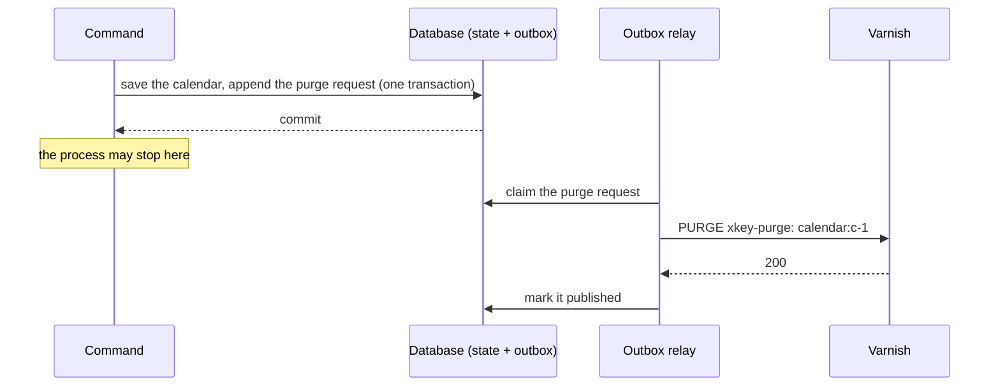

# HTTP caching

**Summary.** A read that many callers ask the same way can be answered without reaching the
application: by the browser of the caller, or by a shared cache in front of the API (Varnish, a
CDN). The answer itself says who may keep it and for how long, in `Cache-Control`; the kit has a
route declare that once, refuses a declaration that would leak the answer of one caller to
another, and answers `no-store` for every authenticated route that declares nothing. This page
says what to cache at which layer, and the one thing never to cache: a decision of
authorization made for one actor.

## Three layers, three questions

| Layer | Keeps | Lives | Invalidated by | In the running example |
|---|---|---|---|---|
| HTTP cache | whole answers, keyed by URL (and what `Vary` names) | the browser, Varnish, a CDN: outside the process | expiry (`max-age`), revalidation (`ETag`), a purge | the opening hours of a calendar, read by every patient of the practice |
| Application cache (`Cache` port) | values the application computed or fetched | the process, or a Redis protocol server | expiry, a deletion by key | the working hours a gateway read from another context |
| Read model | rows shaped for a query, kept up to date by events | the database | the events of the aggregates it follows | the agenda of a practice, searched by day |

They answer different questions. A read model answers "what is the state, shaped for this
question?" and is correct by construction, eventually. An application cache answers "have I
computed this recently?" inside the process
([cache and coordination](../tools/cache-and-coordination.md)). An HTTP cache answers "has
anybody already asked this exact URL?", and it is the only one that saves the request itself:
no connection to the application, no authentication, no query.

Choose in that order: a slow query is fixed by an index or a read model first; an expensive
computation inside a use case by the application cache; and only an answer that is the same for
many callers, read far more often than it changes, is worth an HTTP cache in front of it.

## What may be kept by whom

`Cache-Control` names the caches that may keep an answer:

- `public`: every cache on the way, shared ones included. A shared cache keys an answer by its
  URL and hands it to the next caller who asks the same URL.
- `private`: the browser of the caller only. Useful for an authenticated read the same person
  asks again (the agenda of the day), together with an `ETag` so that asking again costs a
  `304` instead of a body.
- `no-store`: nobody. The default of the kit for every route that knows its caller.

The freshness directives say for how long: `max-age` for every cache, `s-maxage` for shared
caches, `stale-while-revalidate` and `stale-if-error` for how long a stale answer may still be
served while the cache asks again or while the server fails.

## Never cache a decision of authorization across actors

What a caller may see is decided by the use case, for that caller: its permission, its access
scope, its tenant ([authentication and authorization](authentication-and-authorization.md)). An
answer that went through that decision is the answer **for that actor**. Kept by a shared cache
under its URL alone, it is served to the next actor without the decision being made again: the
patient of one practice reads the agenda of another, a revoked delegation still reads what it
read yesterday.

Hence the rule the kit holds when a route is declared: **a `public` answer of a route that
knows its caller names in `vary` the request headers it depends on**, or it is refused. With
`vary: ['Authorization']` a shared cache keeps one answer per credential, which is rarely worth
it; `private` is the usual answer. A route open to anybody (`Public`, `security: false`) shows
the same thing to everybody and may be `public` as it is.

Two subtler leaks the declaration cannot see, and a reviewer must:

- **A public route whose answer depends on something else than its URL**: a language read from
  `Accept-Language`, a tenant read from a header or the host. Name it in `vary`.
- **A shared answer that embeds the result of a permission**: a public list that leaves out
  what "the anonymous caller" may not see is fine, since every caller of it is anonymous; a
  list whose content changes with the token is not public.

## Revalidation instead of a new answer

A cache that holds a stale answer, or a browser holding a private one, does not have to fetch
it again: it asks whether its version is still the current one. The answer names its version
in `ETag` (or the instant it last changed in `Last-Modified`), the caller sends it back in
`If-None-Match` (or `If-Modified-Since`), and the server answers `304 Not Modified` without a
body when nothing changed.

Two ways to name a version, two costs:

| Tag | Made from | Costs the server | Fits |
|---|---|---|---|
| strong, from the representation | a hash of the bytes answered | the whole read, then the hash: only the transfer is saved | any read, without knowing anything of the model |
| weak, from a version | the version of the aggregate or of the read model the answer shows | the read, which could be skipped by a handler that checks the version first | a read of one element whose version is in the body |

## The same version for a write: If-Match

A version given out with a read can come back with a write: `If-Match: W/"7"` says "change it
only if it is still version 7". The use case compares that version with the one of the
aggregate it loaded and refuses with `412 Precondition Failed` when somebody else changed it in
between. This is optimistic concurrency stretched to the person: the version they saw on the
screen, minutes ago, and not only the one the handler loaded a millisecond before saving, which
the `version` column of the aggregate already protects. The decision stays in the use case,
which knows the aggregate; the edge only reads the header and hands the version over.

## Invalidation: purge after the commit, never before

An answer kept for an hour is wrong for up to an hour after the change it shows, unless the
change purges it. The kit purges by **tag**: an answer names the resources it shows
(`calendar:c-1`), the shared cache files it under them, and the command that changes the
calendar asks for that tag to be purged.

When matters more than how:

- **Before the commit** is wrong twice: a rollback leaves the cache emptied for nothing, and
  worse, a reader arriving between the purge and the commit refills the cache with the old
  state, which then stays for the whole `s-maxage`.
- **After the commit, in the process** (an `after-commit` handler) is right until the process
  stops between the commit and the purge: the change is saved, the cache never hears of it.
- **After the commit, through the outbox** is what the kit does. The use case asks
  `CacheInvalidation` from a `before-commit` handler of the domain event; the request is a row of
  the outbox, written in the transaction of the command. A rollback removes it; a commit keeps
  it until the relay, in this process or the next one, hands it to the `CachePurger`, retrying
  while the cache does not answer.

A read model updated by a projection in the same transaction is purged by the same request; a
read model updated later, by a consumer, asks for its own purge in the transaction of its
consumer, so that the purge never comes before the row it would refetch.



A multi-tenant application files the tags under the tenant (`acme/calendar:c-1`) on both sides,
the answers (`cacheTags.perTenant`) and the purges (`perTenant` of the invalidation), so a purge
never reaches the answers of another tenant; a public answer then needs its tenant resolved from
the host or the path, or it carries no tenant and its purges never meet it.

## How the kit declares it

The policy is part of the declaration of the route, so the server and the OpenAPI contract say
the same thing: on a controller, on its route group (every read of the group), or in the spec
of a function route. The fields and the refusals are listed in the
[`@ddd-ts-kit/http` README](../../packages/http/README.md#http-caching).

Validators (`etag`, `lastModified`) belong to the same policy, and `ifMatch` to the declaration
of a write.

```ts
@RouteGroup({
  prefix: '/practices',
  guards: [Public],
  cache: { scope: CacheScope.public, maxAge: '1m', sMaxAge: '5m', staleWhileRevalidate: '30s' },
})
export class PracticeDirectoryRoutes {}
```

## See also

- [Resilience](resilience.md): a cache as a stability tool, and its failure modes
- [HTTP caches](../tools/http-caches.md): Varnish, Souin, nginx and the CDNs compared, with their limits
- [Cache and coordination](../tools/cache-and-coordination.md): the application cache on Redis, Valkey or Dragonfly
- [Transactional outbox](transactional-outbox.md): the row that makes the purge survive a crash
- [The presentation layer](presentation-layer.md): controllers, route groups and guards
- [CQRS](cqrs.md): read models
