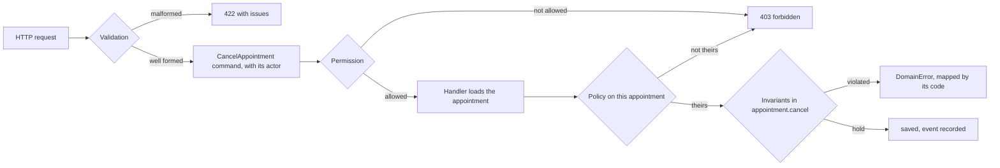

**English** · [Français](invariants-permissions-validation.fr.md)

# Invariants, permissions and validation

**Summary.** Three kinds of "this request is refused" exist in a business application, and
they are different things. Validation asks whether the input is well formed. A permission asks
whether this actor may do this, on this element. An invariant asks whether the action is valid
at all, whoever asks. This kit gives each one its own layer, its own mechanism and its own
kind of error: validation at the boundary behind the `Schema` port, permissions in the
application layer behind the `Authorizer` port, invariants in the domain as `DomainError`s.
Mixing them is the usual way business rules end up in controllers and access rules end up in
entities.

## Three questions

| | Validation | Permission | Invariant |
|---|---|---|---|
| Question | is the input well formed? | may this actor do this, on this? | is this a valid thing to do at all? |
| Depends on | the request alone | the actor, the action, sometimes the element | the state of the model |
| Knows the actor | no | yes | never |
| Knows the stored state | no | sometimes (a policy) | yes |
| Lives in | `presentation/` | `application/authorization/` | `domain/` |
| Mechanism | a schema of the project's validation library, behind the `Schema` port | a permission declared on the use case, decided by the `Authorizer` port; a policy for a rule on one element | a check inside an aggregate, value object or domain service |
| Checked | before a command exists | before the handler runs (and by the handler, for a policy) | when the aggregate method runs |
| Refusal | validation issues, a 422 | not authenticated or forbidden, a 401 or 403 | a `DomainError` with a stable code, mapped once to a status |
| Example | `startsAt` is an ISO date-time | only the client who booked, or the practitioner, may cancel | a cancelled appointment cannot be rescheduled |

A simple discriminator: **would the rule still hold if an administrator with every right sent
a perfectly formed request?** If yes, it is an invariant. If the answer depends on who asks, it
is a permission. If the request could not even be understood, it is validation.

## The same feature, seen three ways

Cancelling an appointment.



**1. Validation, at the boundary.** The route declares the shape of the input. It knows nothing
about appointments beyond their identifier format.

```ts
// presentation/http: the request schema of the route (zod shown)
const cancelAppointmentBody = zodSchema(
  z.object({
    reason: z.enum(['client-request', 'practitioner-unavailable', 'other']),
    note: z.string().max(500).optional(),
  }),
);
```

**2. Permission, in the application.** The use case declares what it requires; a bus middleware
asks the authorizer before the handler runs. Nothing is reachable by default
(`authz/declared`).

```ts
// application/commands/cancel-appointment/cancel-appointment.command.ts
@Requires(permissions['appointment.cancel'])
export class CancelAppointment extends AuthorizedCommand<void> {
  /* actor, appointmentId, reason */
}
```

"Only the client who booked it, or its practitioner" depends on the loaded appointment. That is
a policy in `application/authorization/*.policy.ts`: a named, unit-tested rule that the handler
evaluates through the same port once the aggregate is loaded.

**3. Invariants, in the domain.** The aggregate refuses what is never valid.

```ts
cancel(reason: CancellationReason, at: Date): void {
  this.assertNotCancelled();              // AppointmentAlreadyCancelled
  this.assertCancellationStillFree(at);   // CancellationWindowPassed
  /* change state, record the event */
}
```

The aggregate method takes no actor. It cannot be tricked by a missing check elsewhere, and its
tests need no user.

## Where each lives, and why

**Validation stays outside** because the shape of a request is a transport matter. The same use
case may be reached by HTTP, by a consumed event or by a scheduled job, each with its own input
format. The domain never imports a validation library (`layer/domain-purity`).

Value objects blur the line in a useful way: `TimeSlot.create` refuses an end before its start.
That is not input validation, it is the definition of a slot, and it holds for every caller.
The boundary schema checks that two date-times were sent; the value object checks that they
form a slot. A little overlap between the two is normal and harmless.

**Permissions stay in the application** because who may do what is the context's policy about
its use cases, not a property of its model. Roles, attributes or relationships can change
without touching an aggregate, and the authorization model can be swapped behind the port
([Authentication and authorization](authentication-and-authorization.md)). The rule ids:
`authz/declared`, `authz/in-application`, `authz/actor-explicit`.

**Invariants stay in the domain** because they are the model. They must hold on every path:
HTTP, event, job, test, a future import script. The only place every path goes through is the
aggregate method.

One exception is stated by the reference: a context whose model is access itself (managing
members and roles is its business) may hold roles as its own state. Then a role is domain data,
not the acting user's rights.

## Typical mistakes

| Mistake | What goes wrong | Where it belongs |
|---|---|---|
| `if (appointment.status === 'cancelled') return 409` in a route | the rule is skipped by every other entry point | an invariant in `appointment.reschedule` |
| a schema that refuses a `startsAt` in the past | a business rule ("no booking in the past") hidden in presentation, and dependent on a clock | an invariant, with `now` passed in |
| `if (user.role === 'admin')` in a handler or a route | rights scattered, invisible to audit | a permission required by the use case |
| `appointment.cancel(reason, actor)` checking `actor.id === this.clientId` | access knowledge in the model; every test needs an actor | a policy in `application/authorization/` |
| an `isAdmin` flag on a domain entity deciding access | access leaking into the model | roles or relations in the authorizer |
| a `DomainError` for "missing field" | a malformed request reaches the domain | validation at the boundary |
| a 403 for "appointment already cancelled" | the client is told it lacks a right it has | a domain error mapped to a conflict |
| loading a list, then filtering by rights in memory | leaks counts, breaks paging, slow | an access scope from the authorizer, handed to the read port |
| trusting the schema and skipping the invariant | the next entry point has no schema | keep both: each answers its own question |

Rules that look ambiguous usually separate cleanly with the discriminator above:

| Rule | Kind | Reasoning |
|---|---|---|
| free cancellation ends 24 hours before the start | invariant | true for anyone |
| a practitioner may cancel inside the 24 hours, a client may not | policy | depends on who asks; the aggregate then offers two intentions, or the handler chooses the method the actor is allowed to call |
| not after the appointment has started | invariant | it holds whoever asks |
| a tenant sees only its own appointments | neither: tenant scoping, applied by infrastructure from the execution scope | [Actor and execution scope](actor-and-execution-scope.md) |

## Errors, three shapes

- **Validation** produces a list of issues with paths (`items.0.sku`), answered as a problem
  document with status 422 by the HTTP pipeline.
- **Authentication and authorization** refusals are produced by the platform and the
  authorization middleware, answered 401 or 403.
- **Invariants** raise `DomainError`s with a stable `code` (`SLOT_TAKEN`,
  `CANCELLATION_WINDOW_PASSED`). Presentation maps codes to transport statuses in one place,
  and each route declares the codes it can answer, which flow into the OpenAPI contract
  (`errors/known-code` holds that each declared code exists). A `DomainError` is an answer, not
  an incident: it is not sent to the error tracker.

### How a refusal is written

One error class per concept of the language, one static factory per refusal:

```ts
// domain/errors/appointment.error.ts
import { ConceptError } from '@ddd-ts-kit/kernel';

export class AppointmentError extends ConceptError {
  static slotTaken(calendarId: string, startsAt: Date) {
    return AppointmentError.refusal(
      'SLOT_TAKEN',
      `The slot starting at ${startsAt.toISOString()} on calendar ${calendarId} is already held.`,
      { calendarId, startsAt },
    ).exposing('startsAt');
  }
}

// where the rule is kept
throw AppointmentError.slotTaken(calendar.id, slot.startsAt);
```

- **The name is the business's, twice.** The factory is what the developer who refuses reads,
  the code what the client, the mapper, the audit trail and the tests read. They say the same
  words: `slotTaken` and `SLOT_TAKEN` (`errors/factory-name`). A code names one refusal of a
  context (`errors/code-unique`).
- **The concept is what was asked for**, not the class that detects the problem: a calendar
  that finds a slot held refuses with `AppointmentError.slotTaken`, because the caller asked
  for an appointment. The refusals of a value object are factories of the concept it
  describes: `PersonError.invalidEmail(raw)`, thrown by `Email.create` (or returned in its
  `Result` under `"stack.valueObjects": "result"`).
- **The facts are data, and private.** What the message was built from is kept on the error as
  `facts`, so that a handler or a test reads a date and not a sentence. A fact reaches the
  client, under `facts` in the problem document, only when the factory names it with
  `.exposing(..)`; nothing that identifies a person ever is. The message is answered as
  `detail`: write nothing in it that the caller did not send.
- **Nothing downstream knows the class.** `isRefusal(error, 'SLOT_TAKEN')`,
  `AppointmentError.is(error, 'SLOT_TAKEN')`, `thenError('SLOT_TAKEN', { calendarId })`,
  `expectProblem(response, { status: 409, code: 'SLOT_TAKEN' })`: the code is the key.
- **A class that grows names a second concept.** Past some twenty factories (a file holds 350
  lines), split along a term of the glossary, never along a technical line.

A project written with one class per error (`new SlotTakenError(..)`) keeps working, and
`ddd-ts-kit error-factories` moves it: [CONFIG.md](../CONFIG.md), `stack.refusals`.

## Limits and when not to use it

- **The split is a discipline the tools only partly hold.** `authz/in-application` matches
  names and shapes: the CLI README states that an ownership test written as
  `appointment.clientId === actor.id` goes unseen by the text-level checker. Review still
  matters.
- **A use case with no rule of any kind** (a public health check, a reference list) needs none
  of the three beyond declaring itself public. Do not add ceremony for symmetry.
- **Set-wide invariants are not fully expressible in an aggregate.** "No double booking" needs
  a database constraint as well ([Aggregates](aggregates.md)).
- **Client-side validation is a fourth thing**, for user comfort only. It never replaces the
  boundary schema.
- **Some rules are both.** "A client may book at most three appointments a week" is an
  invariant over a set, expensive to guard strictly; decide with the business whether it must
  be exact (constraint or counter in the same transaction) or may be approximate (checked on a
  projection).

## Sources

- Eric Evans, *Domain-Driven Design*, Addison-Wesley, 2003, chapter 6 (invariants and
  aggregates) and chapter 9 (specifications, making implicit rules explicit).
- Vaughn Vernon, *Implementing Domain-Driven Design*, Addison-Wesley, 2013, chapter 5
  (validation of entities) and chapter 10.
- Robert C. Martin, *Clean Architecture*, Prentice Hall, 2017, chapter 22 (boundaries and what
  crosses them).
- RFC 9457, "Problem Details for HTTP APIs", rfc-editor.org/rfc/rfc9457.
- Repository: [ARCHITECTURE.md](../ARCHITECTURE.md), section 4, "Authentication and
  authorization" and "Validation"; `plugin/skills/access-control/SKILL.md`.

## See also

- [Aggregates](aggregates.md)
- [Entities and value objects](entities-and-value-objects.md)
- [Authentication and authorization](authentication-and-authorization.md)
- [Actor and execution scope](actor-and-execution-scope.md)
- [Layers and the dependency rule](layers-and-dependency-rule.md)
- [Anemic model](anemic-model.md)
- [Validation libraries](../tools/validation.md)
- [Architecture reference](../ARCHITECTURE.md)
- [Concepts index](README.md)
