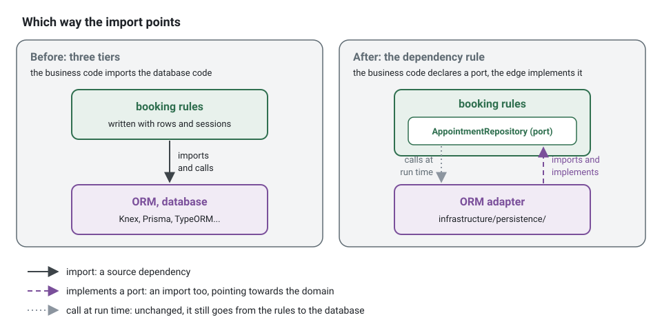

**English** · [Français](layers-and-dependency-rule.fr.md)

# Layers and the dependency rule

**Summary.** A bounded context of this kit is cut into four layers: presentation, application,
domain and infrastructure. One rule governs them: source code dependencies point towards the
domain, and the domain depends on nothing but itself and the kernel. Hexagonal architecture,
onion architecture and clean architecture are three names for that same rule, with different
drawings and vocabulary. This page explains the rule, what the three names share and where they
differ, how the kit maps them to folders, and which analyzer holds which part.

## The problem the rule solves

In a classic three-tier application the business code calls the database code, so the business
code imports the ORM, and every business rule is written in terms of rows and sessions. Two
things follow. The rule "a client cannot book a slot that is already taken" cannot be tested
without a database, and replacing or upgrading the ORM means editing business rules.

The dependency rule reverses the direction of that one arrow. The business code declares what it
needs as an abstraction (a port), and the database code implements it. The call still goes from
the business code to the database at run time; the import goes the other way.



In code, the difference is one import. Instead of a domain that reaches for the database:

```ts
// domain/aggregates/appointment.aggregate.ts
import type { Knex } from 'knex'; // layer/domain-purity: an ORM inside the domain

export class Appointment {
  static async book(db: Knex, calendarId: string, startsAt: Date) {
    const taken = await db('appointments').where({ calendar_id: calendarId, starts_at: startsAt }).first();
    // the rule is now written in terms of rows, and cannot be tested without a database
  }
}
```

write a domain that states what it needs, and an application that uses it without knowing who
answers. The four files are shown as one module here; the comments name the file each part
lives in:

<!-- checked sample -->
```ts
import { definePermissions } from '@ddd-ts-kit/auth';
import { NamedDomainEvent, 
  AggregateRoot,
  AuthorizedCommand,
  ConceptError,
  Repository,
  type Actor,
  type Clock,
  type DomainEvent,
  type IdGenerator,
} from '@ddd-ts-kit/kernel';
import { CommandHandler, Requires } from '@ddd-ts-kit/kernel/declarations';

// domain/: imports nothing but the kernel
export class AppointmentBooked extends NamedDomainEvent('appointments.appointment.booked') {
  constructor(
    readonly aggregateId: string,
    readonly occurredAt: Date,
  ) {
    super();
  }
}

export class AppointmentError extends ConceptError {
  static slotTaken(calendarId: string, startsAt: Date) {
    return AppointmentError.refusal('SLOT_TAKEN', `The slot at ${startsAt.toISOString()} is already taken.`, {
      calendarId,
      startsAt,
    });
  }
}

export class Appointment extends AggregateRoot {
  private constructor(
    id: string,
    readonly calendarId: string,
    readonly startsAt: Date,
  ) {
    super(id);
  }

  static book(id: string, calendarId: string, startsAt: Date, now: Date): Appointment {
    const appointment = new Appointment(id, calendarId, startsAt);
    appointment.record(new AppointmentBooked(id, now));

    return appointment;
  }
}

// domain/repositories/appointment.repository.ts: the port, an abstract class the domain owns
export abstract class AppointmentRepository extends Repository<Appointment> {
  abstract isTaken(calendarId: string, startsAt: Date): Promise<boolean>;
}

// application/: the use case knows the port, never the adapter behind it
const appointmentsPermissions = definePermissions('appointments', {
  'appointment.book': { description: 'Book an appointment' },
});

@Requires(appointmentsPermissions['appointment.book'])
export class BookAppointment extends AuthorizedCommand<string> {
  constructor(
    actor: Actor,
    readonly calendarId: string,
    readonly startsAt: Date,
  ) {
    super(actor);
  }
}

@CommandHandler(BookAppointment)
export class BookAppointmentHandler implements CommandHandler<BookAppointment> {
  constructor(
    private readonly appointments: AppointmentRepository,
    private readonly ids: IdGenerator,
    private readonly clock: Clock,
  ) {}

  async execute({ calendarId, startsAt }: BookAppointment): Promise<string> {
    if (await this.appointments.isTaken(calendarId, startsAt)) {
      throw AppointmentError.slotTaken(calendarId, startsAt);
    }

    const appointment = Appointment.book(this.ids.next(), calendarId, startsAt, this.clock.now());
    await this.appointments.save(appointment);

    return appointment.id;
  }
}

// infrastructure/persistence/: the adapter imports the port and implements it
export class InMemoryAppointmentRepository implements AppointmentRepository {
  private readonly rows = new Map<string, Appointment>();

  async findById(id: string): Promise<Appointment | undefined> {
    return this.rows.get(id);
  }

  async save(appointment: Appointment): Promise<void> {
    this.rows.set(appointment.id, appointment);
  }

  async isTaken(calendarId: string, startsAt: Date): Promise<boolean> {
    return [...this.rows.values()].some(
      (held) => held.calendarId === calendarId && held.startsAt.getTime() === startsAt.getTime(),
    );
  }
}
```

The rule "a slot cannot be booked twice" now reads without any library, and a spec runs it
against the in-memory adapter in milliseconds. The ORM adapter of production (Knex, Drizzle,
Prisma or TypeORM) is one more class that implements the same port; nothing above it changes.

## The four layers, on the scheduling application


| Layer | Holds | Example in `appointments` | May import |
|---|---|---|---|
| domain | the model: aggregates, entities, value objects, domain events, domain errors, repository ports, domain services | `Appointment`, `TimeSlot`, `SlotAlreadyTaken`, the `AppointmentRepository` port | its own domain, the shared kernel, the kernel package |
| application | use cases: one command or query and its handler, ports to the outside, permissions and policies, reactions to events, jobs | `BookAppointment` and its handler, a port to read working hours | domain, application, published languages, the kernel |
| infrastructure | adapters: repository implementations, clients of outside systems, anti-corruption translators | the ORM adapter of `AppointmentRepository`, its mapper | the ports it implements, drivers and libraries |
| presentation | the way in: HTTP routes and their DTOs, CLI | `POST /appointments` mapped to `BookAppointment` | application, domain types for mapping |

The exact import lists are the rules `layer/domain-purity`, `layer/application-inward`,
`layer/presentation-no-infrastructure` and `layer/infrastructure-no-presentation` in
[ARCHITECTURE.md](../ARCHITECTURE.md) section 3. The folder for each role is the canonical tree
of section 2.

A request to book an appointment crosses the layers like this:


The handler knows the port `AppointmentRepository`, an abstract class of the domain. It never
names the adapter. Which adapter stands behind the port is decided in the composition root (see
[Ports and composition](ports-and-composition.md)).

## Three names, one rule

| | Hexagonal (ports and adapters) | Onion | Clean architecture |
|---|---|---|---|
| Author, year | Alistair Cockburn, 2005 | Jeffrey Palermo, 2008 | Robert C. Martin, 2012 (article), 2017 (book) |
| Central idea | the application talks to the outside only through ports; adapters plug technology into them | concentric rings; coupling goes towards the centre, the domain model | concentric rings; the dependency rule: source dependencies point inwards only |
| Inside | "the application", not subdivided | domain model, domain services, application services | entities, use cases |
| Outside | adapters, split in driving (primary) and driven (secondary) | infrastructure, user interface, tests | interface adapters, then frameworks and drivers |
| What it names well | the port, the adapter, the symmetry between the UI side and the database side | that the domain model is the centre and infrastructure an outer ring | the use case as a first-class element, and the rule itself |
| What it leaves open | how the inside is organised | how the outside is entered | how many rings: the book says four is only an example |

What they share: the business code is at the centre and owns the abstractions it needs; technology
is at the edge and implements them; the direction of imports is from the edge to the centre; the
centre is testable without the edge.

Where they differ is emphasis, not substance. Hexagonal draws two sides (who drives the
application, whom the application drives) and says nothing about the inside. Onion and clean
architecture draw rings and split the inside into a model and use cases. Clean architecture adds
a ring of "interface adapters" (controllers, presenters, gateways) between use cases and
frameworks, where hexagonal has just adapters.

### How the kit maps them

| In this kit | Hexagonal | Onion | Clean architecture |
|---|---|---|---|
| `domain/` | inside the hexagon | domain model and domain services | entities |
| `application/` | inside the hexagon | application services | use cases |
| `domain/repositories/`, `application/ports/` | driven ports | interfaces of the inner rings | output boundaries, gateways interfaces |
| `CommandBus`, `QueryBus`, commands and queries | driving ports | application services API | input boundaries |
| `presentation/` | driving adapters | user interface | controllers (interface adapters) |
| `infrastructure/` | driven adapters | infrastructure | gateways implementations, frameworks and drivers |
| `<context>.declarations.ts` (or `<context>.module.ts` in the explicit style), `platform/compose-application.ts`, `main.ts` | configurator | dependency resolution | main component |

The kit keeps two sides of the edge apart (`presentation/` and `infrastructure/`) and forbids
them to import each other. That is the hexagonal symmetry made checkable: a route cannot reach a
repository adapter directly, it goes through a use case.

## Why the domain may import almost nothing

`layer/domain-purity` is the strictest rule of the kit: no framework, no ORM, no validation
library, no I/O. The `purity/*` rules extend it to time, randomness and the environment, which
reach the inner layers through the `Clock` and `IdGenerator` ports. The reason is practical:

- the model can be tested in milliseconds without any double (see
  [Testing strategy](testing-strategy.md));
- a rule of the business is readable without knowing a library;
- an upgrade of a library never touches a business rule.

The application layer is allowed a little more (published languages of declared upstreams, the
permission types), and still no driver and no framework.

## Who checks

Three analyzers share the rule ids, each exact at a different level. The table "Who checks what"
of [ARCHITECTURE.md](../ARCHITECTURE.md) section 3 is the reference; in short:

| Analyzer | What it sees of the layers |
|---|---|
| `ddd-ts-kit check` | import specifiers as text, classified by path; fast enough to run at every file write |
| the ESLint plugin | the syntax tree of one file; authoritative for code rules when the two disagree |
| dependency-cruiser | the resolved import graph: a type reaching a layer through a barrel or a re-export |

`npx ddd-ts-kit explain layer/domain-purity` prints the rule, its reason and a good and a bad
example. Tool comparison: [Static analysis and pipeline](../tools/static-analysis-and-pipeline.md).

## Limits and when not to use it

- **It costs indirection.** A port, an adapter, a mapper and a fake for every outside
  dependency. The generator writes them, but they remain files to read. For a script, a
  prototype thrown away next month or a CRUD screen with no rule, a transaction script
  (Fowler, PoEAA) is shorter and honest.
- **Layers do not make a model.** Four folders around an anemic model give the cost without the
  benefit: see [Anemic model](anemic-model.md).
- **Mapping is real work.** Rows never leave `infrastructure/persistence/` and aggregates never
  leave through a route, so each boundary has a mapping to write and keep current.
- **The checker has blind spots**, listed in the CLI README under "Limits": the text-level
  checker does not resolve barrels and re-exports, and nothing constrains what the shared
  kernel, the platform and `main.ts` import. dependency-cruiser covers the first; the second is
  review.
- **Layers are per context.** They say nothing about how contexts depend on each other: that is
  the context map and the `context/*` rules (see [Context map](context-map.md) and
  [Modular monolith](modular-monolith.md)).

## Sources

- Alistair Cockburn, "Hexagonal architecture", 2005, https://alistair.cockburn.us/hexagonal-architecture/
- Jeffrey Palermo, "The Onion Architecture: part 1", 2008,
  https://jeffreypalermo.com/2008/07/the-onion-architecture-part-1/
- Robert C. Martin, "The Clean Architecture", 2012,
  https://blog.cleancoder.com/uncle-bob/2012/08/13/the-clean-architecture.html
- Robert C. Martin, Clean Architecture, Prentice Hall, 2017, chapter 22 ("The Clean
  Architecture") and chapter 11 (the dependency inversion principle).
- Martin Fowler, Patterns of Enterprise Application Architecture, Addison-Wesley, 2002
  (Transaction Script, Domain Model, Service Layer).
- Eric Evans, Domain-Driven Design, Addison-Wesley, 2003, chapter 4 ("Isolating the Domain").

## See also

- [Ports and composition](ports-and-composition.md)
- [CQRS as used here](cqrs.md)
- [Modular monolith](modular-monolith.md)
- [Anemic model](anemic-model.md)
- [Testing strategy](testing-strategy.md)
- [Static analysis and pipeline](../tools/static-analysis-and-pipeline.md)
- [Architecture reference](../ARCHITECTURE.md)
