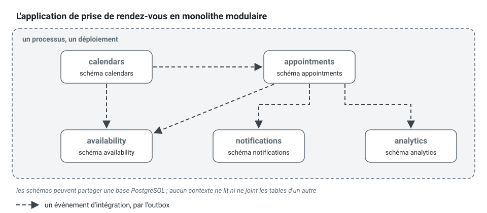

[English](modular-monolith.md) · **Français**
<!-- translation-of: modular-monolith.md sha256:8252d2b993bbe7bb -->

# Monolithe modulaire

**Résumé.** Un monolithe modulaire est une application déployable unique dont l'intérieur est
découpé en modules aux frontières imposées. Dans ce kit, le module est le contexte délimité : il
possède ses données, expose un langage publié, ne partage aucune transaction avec un autre
contexte et peut démarrer seul. C'est le déploiement par défaut d'un projet construit avec le
kit. Il apporte l'essentiel des bénéfices de conception que l'on prête aux microservices
(responsabilités claires, parties remplaçables, raisonnement indépendant) sans le coût
d'exploitation d'un système distribué, et il garde l'extraction peu coûteuse pour le jour où une
raison mesurée apparaît.

## Trois formes comparées


| | Monolithe en couches | Monolithe modulaire | Microservices |
|---|---|---|---|
| Unité de structure | une couche technique à travers toute l'application | le contexte délimité, organisé en couches à l'intérieur | le contexte délimité, un processus chacun |
| Déploiement | un | un | un par service |
| Données | un schéma, joint librement | un schéma par contexte, ni jointure ni clé étrangère entre contextes | une base de données par service |
| Un appel entre parties | un appel de méthode, n'importe où | langage publié, événements d'intégration, un port *gateway* | le réseau : événements, HTTP ou RPC |
| Transactions | couvrent n'importe quoi | un agrégat d'un contexte | locales ; tout ce qui est plus large est une saga |
| Ce qui impose la frontière | rien | l'analyse statique et les tests | le réseau |
| Panne d'une partie | emporte en général tout | emporte en général tout | peut être isolée, si on l'a conçu pour |
| Mise à l'échelle et publication indépendantes | non | non | oui |
| Coût d'exploitation | faible | faible | élevé |

Le monolithe en couches échoue lentement : rien ne sépare les fonctionnalités, chaque table finit
lue de partout, et aucune partie ne peut changer sans relire le tout. Les microservices résolvent
cela par une frontière de processus, qui apporte aussi les pannes partielles, la latence réseau,
les données distribuées et un *pipeline* par service. Le monolithe modulaire prend la frontière et
laisse le réseau de côté.

## Ce qui fait un vrai module

Un dossier nommé d'après une capacité métier n'est pas un module. Dans ce kit, un contexte est un
module parce que quatre propriétés tiennent, chacune vérifiée :

| Propriété | Dans l'application de prise de rendez-vous | Tenue par |
|---|---|---|
| Il possède ses données | `appointments` a son schéma de base de données ; `analytics` ne lit jamais ces tables, il tient ses propres chiffres, alimentés par des événements | `context/extractable`, les conventions de persistance d'[ARCHITECTURE.md](../ARCHITECTURE.fr.md) section 4 |
| Il expose un contrat et cache le reste | `notifications` n'importe que `appointments/published-language/` | `context/published-language-only`, `context/published-language-is-a-contract` |
| Ses dépendances sont déclarées et sans cycle | `availability` nomme `calendars` et `appointments` comme amonts dans la configuration | `context/declared-relationship`, `context/no-cycle` |
| Il ne partage aucune transaction | réserver un rendez-vous et planifier son rappel sont deux transactions reliées par un événement | l'unité de travail par commande, `events/outbox-required`, `events/consumer-idempotent` |



Les schémas peuvent vivre dans une seule base PostgreSQL. Ce qui compte, c'est qu'aucun contexte
ne lise ni ne joigne les tables d'un autre : un contexte lit les données d'un autre par un contrat
publié ou par sa propre projection alimentée par des événements d'intégration.

Au lieu d'une requête qui va chercher dans les tables d'un autre contexte :

```sql
-- contexts/analytics/infrastructure/... : refusé, analytics lit le schéma d'appointments
SELECT practitioner_id, count(*) FROM appointments.appointment WHERE status = 'no-show' GROUP BY practitioner_id;
```

`analytics` tient sa propre table, `analytics.visit`, écrite par son gestionnaire de
`appointments.appointment.marked-no-show` et lue par ses propres requêtes. Les deux schémas
peuvent alors s'éloigner, vers deux bases de données ou deux services, sans une ligne de SQL à
réécrire.

## Comment les contextes collaborent dans un seul processus

- **Pour réagir à quelque chose qui s'est passé ailleurs** : un événement d'intégration. Même dans
  un seul processus, il passe par l'outbox transactionnelle et un consommateur idempotent, si
  bien que la sémantique ne change pas le jour où un *broker* s'intercale (voir [Outbox
  transactionnelle](transactional-outbox.fr.md)).
- **Pour tenir des données d'un autre contexte dont on a souvent besoin** : une projection locale
  mise à jour par ces événements, cohérente à terme.
- **Pour obtenir une réponse tout de suite** : un port de l'appelant lié comme *gateway*
  (`npx ddd-ts-kit generate gateway <context> <upstream> <Name>`). Son adaptateur appelle
  aujourd'hui, dans le processus, le contrat de lecture publié de l'amont, et pourrait être un
  client HTTP demain. Les délais d'expiration et le comportement en cas d'échec font partie du
  port dès le premier jour.
- **Pour modifier deux contextes dans une transaction** : impossible. Soit les deux ne forment
  qu'un contexte, soit l'exigence est un processus en étapes (voir [Sagas et gestionnaires de
  processus](sagas-and-process-managers.fr.md)).

Les trois pièces d'une *gateway*, dans la forme où les écrit `generate gateway` : le contrat de
lecture que publie l'amont, le port de l'appelant avec ses propres mots, et l'adaptateur en
processus qui traduit l'un dans l'autre.

<!-- checked sample -->
```ts
import { Gateway } from '@ddd-ts-kit/kernel/declarations';

// contexts/calendars/published-language/working-hours.contract.ts (l'amont)
// Des types sérialisables seulement, modifiés par ajout : c'est un contrat.
export interface WorkingInterval {
  readonly from: string;
  readonly to: string;
}

export abstract class WorkingHoursContract {
  /** Les intervalles où un praticien travaille un jour donné (`YYYY-MM-DD`), ou undefined pour un praticien inconnu. */
  abstract workingHours(practitionerId: string, day: string): Promise<readonly WorkingInterval[] | undefined>;
}

// contexts/appointments/application/ports/working-hours-gateway.port.ts (l'appelant, avec ses mots)
export abstract class WorkingHoursGateway {
  abstract worksDuring(practitionerId: string, startsAt: Date, endsAt: Date): Promise<boolean>;
}

// contexts/appointments/infrastructure/external/in-process-working-hours.gateway.ts
// Quand calendars tourne comme service à part, cette classe devient un client HTTP avec un délai d'expiration :
// le port et chaque gestionnaire qui l'utilise restent tels quels.
@Gateway(WorkingHoursGateway)
export class InProcessWorkingHoursGateway implements WorkingHoursGateway {
  constructor(readonly upstream: WorkingHoursContract) {}

  async worksDuring(practitionerId: string, startsAt: Date, endsAt: Date): Promise<boolean> {
    const intervals = await this.upstream.workingHours(practitionerId, startsAt.toISOString().slice(0, 10));

    return (intervals ?? []).some(
      (interval) => Date.parse(interval.from) <= startsAt.getTime() && endsAt.getTime() <= Date.parse(interval.to),
    );
  }
}
```

La liste de décision est dans le *skill* `extract-service` ; le choix du patron de relation est
dans [Carte des contextes](context-map.fr.md).

## Extractible par construction

Le kit traite un contexte comme une unité déployable en attente : le déplacer dans son propre
service doit être un changement de racine de composition et d'adaptateurs, jamais du code de
`domain/` ou d'`application/`. Deux mécanismes maintiennent cela vrai tant que l'application est
encore un seul processus :

- la règle `context/extractable` (un contexte se câble avec le noyau du kit et la plateforme
  seulement, ne lit aucune table d'un autre contexte, ne partage avec lui ni transaction ni état
  modifiable) ;
- un test d'architecture généré (`test/architecture/extractable.spec.ts`) qui démarre chaque
  contexte seul sur le noyau du kit et la plateforme.
  Une dépendance cachée vers un autre contexte fait échouer ce démarrage.

Un contexte peut aussi recevoir son propre point d'entrée : `npx ddd-ts-kit generate service
<context>` écrit `src/apps/<context>/main.ts`, qui compose ce contexte, le noyau du kit et la
plateforme, et pose `contexts.<name>.deployable` dans la configuration
([CONFIG.md](../CONFIG.fr.md)). Le même code tourne alors dans le monolithe et comme service, et
le contexte quitte le monolithe en même temps : `hostedContexts`, dans la racine de composition
que `src/main.ts` et le *worker* composent, l'omet, de sorte que ses consommateurs, ses processus,
ses *jobs* et ses routes tournent dans le service seul (deux processus qui souscrivent le même
consommateur durable, pilotent le même magasin de processus et planifient les mêmes *jobs*
feraient le travail deux fois). `everyContext` reste la liste complète, la valeur par défaut des
outils, des contrats générés et des tests de bout en bout, qui voient tout le système dans un seul
processus. `test/architecture/hosting.spec.ts` compose les deux racines et échoue quand un module,
un consommateur ou un *job* d'un service est enregistré dans l'application entière, ou quand un
consommateur l'est deux fois. Les *jobs* de la plateforme (`audit.archive`,
`privacy.purge-expired`, `events.purge-published`, `jobs.purge-finished`) restent à l'application entière, et les processus d'un même déploiement
partagent le `DEPLOYMENT_NAME` qui préfixe les clés de leur verrou, de leur cache et de leur
magasin de *jobs*.

Cette discipline a un prix à l'intérieur du monolithe : un appel en processus qui aurait pu être
une jointure devient un événement et une projection. Ce prix est celui de l'option que l'on
achète. L'exercer ou non, et quand, est une décision à part, avec des signaux mesurables : voir
[Quand extraire un microservice](../guides/when-to-extract-microservices.fr.md).

## Ce qui reste partagé

- **Le noyau du kit** (kernel) : des briques et des interfaces standard, sans signification
  métier.
- **La plateforme** (`src/platform/`) : configuration, connexion à la base de données,
  authentification, fournisseur d'événements, traçage, serveur HTTP. Des capacités techniques,
  pas un contexte.
- **Le noyau partagé** (`src/shared-kernel/`), facultatif : des objets-valeurs utilisés par au
  moins deux contextes. C'est le seul endroit où des contextes partagent du code porteur de sens,
  on le garde donc petit ; un fichier utilisé par un seul contexte appartient à ce contexte.
- **Le processus** : la mémoire, le CPU, la boucle d'événements, la version publiée.

## Limites et cas où s'en passer

- **Un processus, un destin.** Une fuite de mémoire dans `analytics` redémarre `appointments`.
  Une boucle d'événements bloquée retarde chaque contexte. L'isolation des pannes est une raison
  d'extraire, pas quelque chose que les modules apportent.
- **Une version publiée, une cadence.** Tous les contextes sont livrés ensemble. Avec plusieurs
  équipes, cela exige un *pipeline* assez rapide pour que personne n'attende personne.
- **Les frontières sont tenues par des outils, et les outils ont des angles morts.** Les limites
  du *checker* sont listées dans le README de la CLI : un nom de schéma dans du SQL brut, une
  transaction entre contextes et un objet modifiable exporté peuvent passer inaperçus. Le test de
  démarrage par contexte et la revue en couvrent une partie.
- **Des frontières de modules mal tracées restent mal tracées.** Un monolithe modulaire rend le
  déplacement d'une frontière moins cher qu'entre services (un dépôt, une refactorisation), pas
  gratuit : il faut déplacer des données d'un schéma à l'autre.
- **C'est trop pour une petite application à un seul modèle.** Un seul contexte est un monolithe
  modulaire parfaitement valable. N'inventez pas de contextes pour remplir l'arborescence ; le
  *skill* `bounded-contexts` dit la même chose (préférer peu de contextes).
- **Ce n'est pas suffisant** quand une partie doit être mise à l'échelle, publiée ou tomber en
  panne indépendamment, ou doit être isolée pour des raisons de conformité. C'est à cela que sert
  le guide d'extraction.

## Sources

- Martin Fowler, « MonolithFirst », 2015, https://martinfowler.com/bliki/MonolithFirst.html
- Martin Fowler, « MicroservicePremium », 2015, https://martinfowler.com/bliki/MicroservicePremium.html
- Sam Newman, Monolith to Microservices, O'Reilly, 2019, chapitre 1 (le monolithe modulaire).
- Sam Newman, Building Microservices, 2e édition, O'Reilly, 2021, chapitres 1 et 3.
- Simon Brown, « Modular monoliths » (conférence, 2015 et suivantes), https://www.youtube.com/watch?v=5OjqD-ow8GE
  (non revérifié aujourd'hui).
- Chris Richardson, Microservices Patterns, Manning, 2018, chapitre 1 ; microservices.io,
  « Database per service », https://microservices.io/patterns/data/database-per-service.html
- Vlad Khononov, Learning Domain-Driven Design, O'Reilly, 2021, chapitre 14 (microservices).

## Voir aussi

- [Contexte délimité](bounded-context.fr.md)
- [Carte des contextes](context-map.fr.md)
- [Couches et règle de dépendance](layers-and-dependency-rule.fr.md)
- [Événements du domaine et d'intégration](domain-and-integration-events.fr.md)
- [Outbox transactionnelle](transactional-outbox.fr.md)
- [Sagas et gestionnaires de processus](sagas-and-process-managers.fr.md)
- [Quand extraire un microservice](../guides/when-to-extract-microservices.fr.md)
- [Référence d'architecture](../ARCHITECTURE.fr.md)
