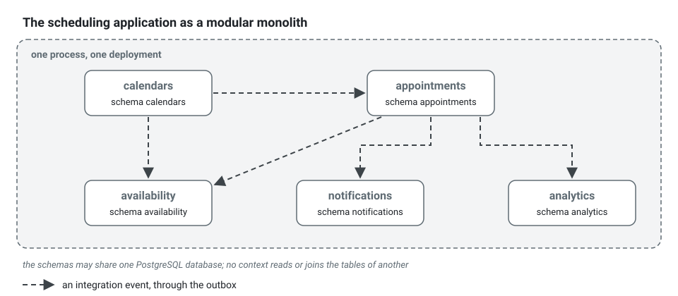

**English** · [Français](modular-monolith.fr.md)

# Modular monolith

**Summary.** A modular monolith is one deployable application whose inside is cut into modules
with enforced boundaries. In this kit the module is the bounded context: it owns its data,
exposes a published language, shares no transaction with another context and can be booted
alone. This is the default deployment of a project built with the kit. It gives most of the
design benefits attributed to microservices (clear ownership, replaceable parts, independent
reasoning) without the operational cost of a distributed system, and it keeps extraction cheap
for the day a measured reason appears.

## Three shapes compared


| | Layered monolith | Modular monolith | Microservices |
|---|---|---|---|
| Unit of structure | technical layer across the whole application | bounded context, layered inside | bounded context, one process each |
| Deployment | one | one | one per service |
| Data | one schema, joined freely | one schema per context, no cross-context join or foreign key | one database per service |
| A call between parts | a method call anywhere | published language, integration events, a gateway port | network: events, HTTP or RPC |
| Transactions | span anything | one aggregate of one context | local; anything wider is a saga |
| What enforces the boundary | nothing | static analysis and tests | the network |
| Failure of one part | usually takes all down | usually takes all down | can be isolated, if designed for |
| Independent scaling and release | no | no | yes |
| Operational cost | low | low | high |

The layered monolith fails slowly: with nothing between features, every table ends up read from
everywhere, and no part can be changed without reading the whole. Microservices solve that with
a process boundary, which also brings partial failure, network latency, distributed data and one
pipeline per service. The modular monolith takes the boundary and leaves the network out.

## What makes a module real

A folder named after a business capability is not a module. In this kit a context is a module
because four things hold, each checked:

| Property | In the scheduling application | Held by |
|---|---|---|
| It owns its data | `appointments` has its database schema; `analytics` never reads those tables, it keeps its own figures fed by events | `context/extractable`, the persistence conventions of [ARCHITECTURE.md](../ARCHITECTURE.md) section 4 |
| It exposes a contract and hides the rest | `notifications` imports only `appointments/published-language/` | `context/published-language-only`, `context/published-language-is-a-contract` |
| Its dependencies are declared and acyclic | `availability` names `calendars` and `appointments` as upstreams in the config | `context/declared-relationship`, `context/no-cycle` |
| It shares no transaction | booking an appointment and scheduling its reminder are two transactions joined by an event | the unit of work per command, `events/outbox-required`, `events/consumer-idempotent` |



The schemas can live in one PostgreSQL database. What matters is that no context reads or joins
another's tables: a context reads another's data through a published contract or through its own
projection fed by integration events.

Instead of a query that reaches into the tables of another context:

```sql
-- contexts/analytics/infrastructure/...: refused, analytics reads the schema of appointments
SELECT practitioner_id, count(*) FROM appointments.appointment WHERE status = 'no-show' GROUP BY practitioner_id;
```

`analytics` keeps its own table, `analytics.visit`, written by its handler of
`appointments.appointment.marked-no-show` and read by its own queries. The two schemas can then
move apart, to two databases or two services, without a line of SQL to rewrite.

## How contexts collaborate inside one process

- **To react to something that happened elsewhere**: an integration event. Even in one process
  it goes through the transactional outbox and an idempotent consumer, so the semantics do not
  change the day a broker sits in between (see [Transactional outbox](transactional-outbox.md)).
- **To hold data of another context that is needed often**: a local projection updated by those
  events, eventually consistent.
- **To get an answer now**: a port of the caller bound as a gateway
  (`npx ddd-ts-kit generate gateway <context> <upstream> <Name>`). Its adapter calls the
  published read contract of the upstream in process today and could be an HTTP client
  tomorrow. Timeouts and failure behaviour are part of the port from the first day.
- **To change two contexts in one transaction**: not available. Either the two are one context,
  or the requirement is a process in steps (see
  [Sagas and process managers](sagas-and-process-managers.md)).

The three pieces of a gateway, in the shape `generate gateway` writes them: the read contract
the upstream publishes, the port of the caller in its own words, and the in-process adapter
that translates one into the other.

<!-- checked sample -->
```ts
import { Gateway } from '@ddd-ts-kit/kernel/declarations';

// contexts/calendars/published-language/working-hours.contract.ts (the upstream)
// Serializable types only, changed additively: it is a contract.
export interface WorkingInterval {
  readonly from: string;
  readonly to: string;
}

export abstract class WorkingHoursContract {
  /** The intervals a practitioner works on a day (`YYYY-MM-DD`), or undefined for an unknown practitioner. */
  abstract workingHours(practitionerId: string, day: string): Promise<readonly WorkingInterval[] | undefined>;
}

// contexts/appointments/application/ports/working-hours-gateway.port.ts (the caller, in its words)
export abstract class WorkingHoursGateway {
  abstract worksDuring(practitionerId: string, startsAt: Date, endsAt: Date): Promise<boolean>;
}

// contexts/appointments/infrastructure/external/in-process-working-hours.gateway.ts
// When calendars runs as its own service, this class becomes an HTTP client with a timeout:
// the port and every handler that uses it stay as they are.
@Gateway(WorkingHoursGateway)
export class InProcessWorkingHoursGateway implements WorkingHoursGateway {
  constructor(readonly upstream: WorkingHoursContract) {}

  async worksDuring(practitionerId: string, startsAt: Date, endsAt: Date): Promise<boolean> {
    const intervals = await this.upstream.workingHours(practitionerId, startsAt.toISOString().slice(0, 10));

    return (intervals ?? []).some(
      (interval) => Date.parse(interval.from) <= startsAt.getTime() && endsAt.getTime() <= Date.parse(interval.to),
    );
  }
}
```

The decision list is in the `extract-service` skill; the choice of relationship pattern is in
[Context map](context-map.md).

## Extractable by construction

The kit treats a context as a deployable unit in waiting: moving one to its own service must be
a change of composition root and adapters, never of `domain/` or `application/` code. Two
mechanisms keep that true while the application is still one process:

- the rule `context/extractable` (a context wires with the kernel and the platform only, reads
  no table of another context, shares no transaction and no mutable state with one);
- a generated architecture test (`test/architecture/extractable.spec.ts`) that boots every
  context alone on the kernel and the platform.
  A hidden dependency on another context makes that boot fail.

A context can also be given its own entry point: `npx ddd-ts-kit generate service <context>`
writes `src/apps/<context>/main.ts`, which composes that context, the kernel and the platform,
and sets `contexts.<name>.deployable` in the config ([CONFIG.md](../CONFIG.md)). The same
code then runs in the monolith and as a service, and the context leaves the monolith when it
does: `hostedContexts` of the composition root, which `src/main.ts` and the worker compose, omits
it, so its consumers, its processes, its jobs and its routes run in the service only (two
processes subscribing the same durable consumer, driving the same process store and scheduling the
same jobs would do the work twice). `everyContext` stays the full list, the default of the tools,
the generated contracts and the end-to-end tests, which see the whole system in one process.
`test/architecture/hosting.spec.ts` composes both roots and fails when a module, a consumer or a
job of a service is registered in the whole application, or when a consumer is registered twice.
The jobs of the platform (`audit.verify`, `audit.archive`, `privacy.purge-expired`, `events.purge-published`,
`jobs.purge-finished`) stay with the whole application, and the processes of one deployment share the `DEPLOYMENT_NAME` that namespaces their
lock, cache and job store keys.

The discipline has a price inside the monolith: an in-process call that could have been a join
becomes an event and a projection. That price is the option being paid for. Whether and when to
exercise it is a separate decision, with measurable signals: see
[When to extract microservices](../guides/when-to-extract-microservices.md).

## What stays shared

- **The kernel**: building blocks and standard interfaces, no business meaning.
- **The platform** (`src/platform/`): configuration, database connection, authentication, the
  event provider, tracing, the HTTP server. Technical capabilities, not a context.
- **The shared kernel** (`src/shared-kernel/`), optional: value objects used by at least two
  contexts. It is the one place where contexts share code with meaning, so it is kept small; a
  file used by one context belongs to that context.
- **The process**: memory, CPU, the event loop, the release.

## Limits and when not to use it

- **One process, one fate.** A memory leak in `analytics` restarts `appointments`. A blocked
  event loop delays every context. Isolation of failure is a reason to extract, not something
  modules give.
- **One release, one cadence.** Every context ships together. With several teams this needs a
  pipeline fast enough that nobody waits on anybody.
- **Boundaries are held by tools, and tools have blind spots.** The checker's limits are listed
  in the CLI README: a schema name in raw SQL, a cross-context transaction and a mutable
  exported object can go unseen. The per-context boot test and review cover part of it.
- **Module boundaries drawn wrong are still wrong.** A modular monolith makes moving a boundary
  cheaper than between services (one repository, one refactoring), not free: data must be moved
  between schemas.
- **It is too much for a small application with one model.** One context is a perfectly good
  modular monolith. Do not invent contexts to fill the tree; the `bounded-contexts` skill says
  the same (prefer few contexts).
- **It is not enough** when a part must scale, be released or fail independently, or must be
  isolated for compliance. That is what the extraction guide is for.

## Sources

- Martin Fowler, "MonolithFirst", 2015, https://martinfowler.com/bliki/MonolithFirst.html
- Martin Fowler, "MicroservicePremium", 2015, https://martinfowler.com/bliki/MicroservicePremium.html
- Sam Newman, Monolith to Microservices, O'Reilly, 2019, chapter 1 (the modular monolith).
- Sam Newman, Building Microservices, 2nd edition, O'Reilly, 2021, chapters 1 and 3.
- Simon Brown, "Modular monoliths" (talk, 2015 and later), https://www.youtube.com/watch?v=5OjqD-ow8GE
  (not re-verified today).
- Chris Richardson, Microservices Patterns, Manning, 2018, chapter 1; microservices.io,
  "Database per service", https://microservices.io/patterns/data/database-per-service.html
- Vlad Khononov, Learning Domain-Driven Design, O'Reilly, 2021, chapter 14 (microservices).

## See also

- [Bounded context](bounded-context.md)
- [Context map](context-map.md)
- [Layers and the dependency rule](layers-and-dependency-rule.md)
- [Domain and integration events](domain-and-integration-events.md)
- [Transactional outbox](transactional-outbox.md)
- [Sagas and process managers](sagas-and-process-managers.md)
- [When to extract microservices](../guides/when-to-extract-microservices.md)
- [Architecture reference](../ARCHITECTURE.md)
