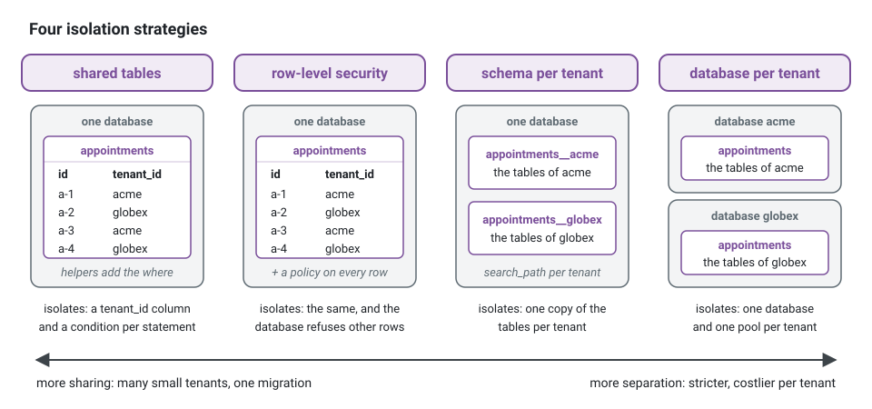

**English** · [Français](multitenancy.fr.md)

# Multitenancy

**Summary.** A multi-tenant application serves several customers (tenants) from one deployment,
and no tenant may ever read or change what belongs to another. The kit treats the tenant like
the correlation id: it is resolved once at the boundary, carried by the execution context of
every unit of work (a request, a consumed event, a job run), and read by infrastructure only.
Isolation is then enforced where data lives, by one of several strategies chosen per project,
and proven by a contract that runs against each adapter. Use cases never filter by tenant by
hand: forgetting a condition is a leak, so the condition is not theirs to write.

## What a tenant is, and what it is not

A tenant is the customer whose data it is: a clinic, a company, a school. It is not a role
(what someone may do), nor an attribute of an element that a permission compares (the
department of a document). The test: if two tenants were two separate installations, would this
datum be in one of them only? Then it is tenant data.

Some data belongs to no tenant: the catalogue of the platform, the tenants themselves, the
plans. It lives in tables without a tenant column, and the work that reads it names no tenant.

## The tenant in the execution scope

| Origin | Where the tenant comes from |
|---|---|
| HTTP request | the resolver of the edge (subdomain, header, path segment or token claim), checked against the memberships of the actor; the actor's own tenant by default |
| Consumed integration event | the `tenantId` of the envelope, stamped by the publisher from the work that published it |
| Scheduled job | none for a `global` job; each tenant of the `TenantDirectory` in turn for a `per-tenant` one |
| Platform staff | none of their own: they reach tenants through an explicit, audited elevation |


A tenant id has one grammar, `isTenantId`: letters, digits, `_` and `-`, at most 63 characters
(a slug or a UUID). Every entry refuses any other: the edge answers 404 to a request that names
one, a broker treats an envelope that carries one as poison, `executionContext`,
`InMemoryTenantDirectory` and the settings of row-level security throw `InvalidTenantIdError`,
and `acrossTenants` refuses an elevation that names one (`InvalidTenantElevationError`). Nothing
a tenant id holds can then be read as a wildcard (`*`), a list (`a,b`) or a part of a key
(`a:b`).

`tenantScopeOf(scope)` answers the one tenant a write names and refuses work that names none
(`NoCurrentTenantError`): a statement cannot run unscoped by omission. `tenantReachOf(scope)` is
the read side: the tenant of the work, or the tenants of an elevation. With the test double of
the scope, what each answers:

<!-- checked sample -->
```ts
import {
  executionContext,
  FixedExecutionScope,
  NoCurrentTenantError,
  systemActor,
  tenantKey,
  tenantReachOf,
  tenantScopeOf,
} from '@ddd-ts-kit/kernel';

const inAcme = new FixedExecutionScope(
  executionContext({ correlationId: 'req-42', actor: systemActor('demo'), origin: 'cli', tenantId: 'acme' }),
);

console.log(tenantScopeOf(inAcme)); // { tenantId: 'acme' }: the one tenant a write names
console.log(tenantReachOf(inAcme)); // { kind: 'tenant', tenantId: 'acme' }: what a read may see
console.log(tenantKey(inAcme, 'reminders', 'a:b')); // 'tenant:acme:reminders:a%3Ab'

const inNoTenant = new FixedExecutionScope(
  executionContext({ correlationId: 'req-43', actor: systemActor('demo'), origin: 'cli' }),
);

try {
  tenantScopeOf(inNoTenant);
} catch (error) {
  console.log(error instanceof NoCurrentTenantError); // true: no tenant, no statement
}
```

## Isolation: four strategies

The tenant reaches the storage through the execution scope; the strategy decides what stops a
statement from crossing to another tenant.



| Strategy | What isolates | Choose it when | It costs |
|---|---|---|---|
| Shared tables | a `tenant_id` column, and a condition the kit adds to every statement | many small tenants, one schema to migrate, reports across tenants | one forgotten condition is a leak: the helpers and a rule of the checker are what prevent it |
| Shared tables under row-level security | the same, and a PostgreSQL policy that refuses another tenant's row even to a statement without its condition | the shared-table case, with a second line of defence | a non-superuser role, every statement inside a transaction |
| Schema per tenant | one copy of the tables of a context per tenant (`<schema>__<tenant>`) | tenants that want their data apart, export or delete a tenant at once, a few hundred tenants | migrations run once per tenant; thousands of schemas strain the catalogue |
| Database per tenant | one database per tenant, one bounded pool each | strict separation (contracts, regions), large tenants, per-tenant backup and restore | connections (`maxTenants * pool.max` per instance), one migration run per tenant |

What each adapter ships, proven by `tenantIsolationContract` (`@ddd-ts-kit/testing/contracts`)
on PostgreSQL:

| Strategy | Knex | Drizzle | Prisma | TypeORM |
|---|---|---|---|---|
| Shared tables | `tenantTable`, `ownTenantTable`, `whereTenant`, `derivedTable`; read models with `tenant`; `addTenantColumn` to migrate | `tenantCondition`, `ownTenantCondition`; read models with `tenant` | `tenantWhere` and `ownTenantWhere` spread into the where, `tenantScopeOf` into the data; read models with `tenant`; the outbox with `tenant: true` | `tenantWhere` and `ownTenantWhere`; read models with `tenant`; `outboxEntity({ tenant: true })` |
| Row-level security | `enableTenantIsolation`, `tenantSession` | `tenantPolicies`, `forceRowLevelSecurity`, `tenantSession` | not shipped | not shipped |
| Schema per tenant | `tenantSchemaTable`, `migrateTenantSchema`, `tenantSearchPath` | not shipped: a drizzle table is bound to its schema where it is declared | not shipped | not shipped |
| Database per tenant | `TenantDatabases`, `createTenantRoutedUnitOfWork`, `migrateEveryTenant` | not shipped | not shipped | not shipped |

`init --tenancy shared-table` generates the first strategy on the four ORMs: every repository
through the helpers, the outbox keeping the tenant, and the rule `tenancy/scoped-statement` of the
checker reporting a statement that reaches a table straight from the executor, the client or the
manager, a row reached by its key alone, a read model store built without its tenant. The three others
are wired by hand from the packages for now; `init` refuses them and says what to add.

A repository on shared tables, a simplified version of what the generator writes on Knex (the
audit columns and the `Clock` they need are left out): every statement goes through
a helper that reads the tenant from the scope, reads through `tenantTable`, writes through
`ownTenantTable`, and an insert names its tenant with `tenantRow`:

<!-- checked sample -->
```ts
// contexts/appointments/infrastructure/persistence/knex-appointment.repository.ts
import { AggregateRoot, tenantScopeOf, type ExecutionScope } from '@ddd-ts-kit/kernel';
import {
  insertIgnoringConflict,
  optimisticUpdate,
  ownTenantTable,
  tenantRow,
  tenantTable,
  type KnexContext,
  type TenantRow,
} from '@ddd-ts-kit/knex';

interface AppointmentColumns {
  readonly id: string;
  readonly practitioner_id: string;
  readonly status: 'booked' | 'cancelled';
}
type VersionedAppointment = AppointmentColumns & { readonly version: number };
type AppointmentRow = VersionedAppointment & TenantRow;

// The aggregate and its mapper, in domain/ and infrastructure/persistence/:
declare class Appointment extends AggregateRoot<string> {
  private constructor();
}
declare const AppointmentMapper: {
  toDomain(row: AppointmentRow): Appointment;
  toRow(appointment: Appointment): AppointmentColumns;
};

const TABLE = { schema: 'appointments', table: 'appointments' };

export class KnexAppointmentRepository {
  constructor(
    private readonly database: KnexContext,
    private readonly scope: ExecutionScope,
  ) {}

  async findById(id: string): Promise<Appointment | undefined> {
    // Instead of: this.database.executor()<AppointmentRow, AppointmentRow[]>('appointments').where({ id }),
    // which reads the rows of every tenant (tenancy/scoped-statement). Write:
    const row = await tenantTable<AppointmentRow>(this.database, this.scope, TABLE).where({ id }).first();

    return row === undefined ? undefined : AppointmentMapper.toDomain(row);
  }

  async save(appointment: Appointment): Promise<void> {
    await optimisticUpdate(appointment, async ({ expected, next }) => {
      const state = { ...AppointmentMapper.toRow(appointment), version: next };

      return expected === 0 ? this.insert(state) : this.update(state, expected);
    });
  }

  private async insert(state: VersionedAppointment): Promise<number> {
    const row = { ...state, ...tenantRow(tenantScopeOf(this.scope)) }; // { tenant_id: 'acme' }
    const table = ownTenantTable<AppointmentRow>(this.database, this.scope, TABLE);
    const inserted = await insertIgnoringConflict(this.database.executor(), table, { row, conflict: 'id' });

    return inserted ? 1 : 0;
  }

  private async update(state: VersionedAppointment, expected: number): Promise<number> {
    // The one tenant of the work, even under an elevation: reads may widen, writes never.
    return ownTenantTable<AppointmentRow>(this.database, this.scope, TABLE)
      .where({ id: state.id, version: expected })
      .update(state);
  }
}
```

A project of one customer that becomes multi-tenant keeps its data: on Knex, a migration calls
`addTenantColumn(knex, { schema, table, tenantOfExistingRows })` for each table of tenant data
(the rows already there go to the customer it served, then the column is required and indexed)
and `addOutboxTenantColumn(knex, { schema, tenantOfUnpublished })` for the outbox (the events not
published yet go to that customer too, so that their consumers run in its tenant). A table that already has the column is left alone, so
the migration also runs on a database built from the current schema. The example application
went this way (its ADR-0003): one network of practices is one tenant. On Drizzle, Prisma and
TypeORM, the column joins the table declaration (`tenantColumn()`, the `tenantId` field of the
model), the migration tooling of the ORM writes the migration (`drizzle-kit generate`,
`prisma migrate dev`, `typeorm migration:generate`), and a statement of that migration gives the
rows already there the tenant they served before the column is made required and indexed.

The outbox keeps the tenant of each event on Knex (`tenant: true`), Drizzle (`tenantOutboxTable`),
Prisma (`tenant: true`, on a model with the `tenantId` field the shipped fragment leaves commented
out) and TypeORM (`outboxEntity({ tenant: true })`), so that its consumers run in that tenant.

The event store of an event-sourced aggregate keeps the tenant of each stream the same way. Given
the execution scope, it records the tenant at the first append in the nullable `tenant_id` of the
events and refuses a read or an append of a stream of another tenant (`EventStreamTenantError`),
elevation reading only; the projections it feeds apply each event in the tenant of its stream. On
Knex, `addEventStoreTenantColumn(knex, { schema, tenantOfExistingStreams })` migrates an existing
store; on Drizzle, Prisma and TypeORM the column joins the shipped tables and the tooling of the
ORM writes the migration. See [event sourcing](event-sourcing.md#under-shared-table-tenancy).

Three rules hold whatever the strategy:

- **Reads may widen, writes never.** An elevation widens what a read reaches; an update or a
  delete always names the one tenant of the work (`ownTenantTable`, `ownTenantCondition`), so a
  staff session reading across tenants cannot write across them. Under row-level security the
  database holds it too: one policy per command, the select reading the reach, the insert, the
  update and the delete only the tenant (`ddd_ts_kit.tenant_id`), and the reach of an elevation
  kept in settings of its own that work which is not elevated leaves empty.
- **No tenant, no data.** Work that names no tenant is refused before any SQL
  (`NoCurrentTenantError`) on shared tables and schemas, and reaches no database at all on
  database per tenant. Under row-level security, a statement without the tenant settings sees
  nothing.
- **Keys are unique across tenants.** Identifiers are generated (UUIDs), so that a key never
  names two rows; the isolation contract checks that another tenant saving under an existing id
  changes nothing.

## Propagation: every hop keeps the tenant

- **Integration events.** `scopedPublisher` stamps the tenant of the work on every event published
  without one; the outbox keeps it (`tenant_id`, see the persistence packages); the brokers
  carry it in the envelope and in a header (`x-tenant-id`, `tenant-id` for Redis Streams);
  `executionContextOfEvent` opens the consumer's scope in that tenant. A consumer therefore
  reads and writes the tenant of the fact it handles, and nothing else.
- **Scheduled jobs.** A job states `tenancy: 'global'` (the default) or `'per-tenant'`. A
  per-tenant job runs once per tenant, one after the other, each run in that tenant's scope; one
  tenant failing does not stop the others.
- **Caches, rate limits and locks.** A key of a shared store is confined to the tenant:
  `tenantCacheKey(scope, ...)`, `tenantKey(scope, ...)`, each segment percent-encoded so that
  two lists of segments never give one key. A key built without it is shared by every tenant,
  which is right for platform data only.
- **Logs, traces, error reports and the audit trail.** `logFieldsOf` writes `tenantId` on every
  line; the audit trail keeps one hash chain per tenant (`tenant:<id>`), so that a tenant's
  history can be handed over and verified alone. Its search is confined to the tenant of the work
  by `TenantAuditReader`, which `init --tenancy shared-table` wires into the read side of the
  trail: an actor that names no tenant reads nothing, and platform staff read another tenant's
  trail only inside `acrossTenants`. A refusal at the edge of a caller without a credential is not
  recorded, so that no unauthenticated request opens a chain.

## Resolution at the edge

The HTTP pipeline names the tenant of a request with a resolver of `@ddd-ts-kit/http`: the
subdomain (`acme.app.example.com`), a header (`x-tenant-id`), a path segment
(`/tenants/:tenantId/...`) or the claim of the token, or the first of several. Whatever names
it, the pipeline checks it against the memberships of the caller before anything runs, and
answers 403 to a caller that does not belong to it: the tenant a client asks for is a request,
never an authority. An authenticated caller is held to its tenants on public routes too; an
anonymous caller keeps the tenant it addressed there. The guard `TenantMember` keeps a group of routes for the members of the tenant
of the request.

Which to choose: the claim alone when a user belongs to one tenant; a subdomain when tenants
have their own address (and their own cookies); a path segment or a header when one user works in
several tenants and picks one per request, the token then listing every membership (a tenant
claim holding a list, or the `organization` claim of Keycloak, gives the actor its `tenants`).

A tenant the deployment does not serve, one its directory of tenants (the tenants its jobs run
for) does not list, is best not found at all: `servedTenantOf(resolver, served)` answers 404
whoever names it, so that a credential issued for a tenant the deployment knows nothing of never
writes data no job and no operator would see. The example application serves the networks of
`NETWORKS` this way.

## Platform staff: elevation, never implicit

Support and operations sometimes need to read across tenants. The kit refuses to infer it from a
role: a role that silently widened every query would turn one stolen session into a breach of
every tenant. Instead:

1. A use case or a guard decides the permission to elevate, like any permission.
2. The platform calls `acrossTenants({ scope, trail, clock, ids }, { reason, tenants }, work)`:
   a stable reason code and the tenants reached (`all` or a list) are required.
3. The elevation is written to the audit trail (action `tenancy:elevate`) **before** the work
   runs; a trail that cannot record it refuses it.
4. Inside, reads see the tenants named; writes still name one tenant.

<!-- checked sample -->
```ts
// platform/support/appointments-for-a-ticket.ts
import { acrossTenants, type AuditTrail, type Clock, type ExecutionScope, type IdGenerator } from '@ddd-ts-kit/kernel';

// Resolved from the container by the platform:
declare const scope: ExecutionScope;
declare const trail: AuditTrail;
declare const clock: Clock;
declare const ids: IdGenerator;
// A read through tenantTable, which follows the reach of the scope:
declare function searchAppointments(practitionerId: string): Promise<readonly { readonly id: string }[]>;

export async function appointmentsForATicket(practitionerId: string, tenants: readonly string[]) {
  // The permission to elevate was decided before this call, like any permission.
  return acrossTenants(
    { scope, trail, clock, ids },
    { reason: 'SUPPORT_TICKET', tenants }, // a stable code, and the tenants reached ('all' or a list)
    () => searchAppointments(practitionerId), // recorded as tenancy:elevate before it runs
  );
}
```

## The one write across tenants: the purge of what outlived its retention

Every write of the kit stays in the tenant of the work, and an elevation never widens one: an
erasure runs once per tenant of `TENANTS`, in an execution context of that tenant. There is one
exception, chosen and bounded: `purgeExpired(now)` of the erasure adapters, which the nightly job
`privacy.purge-expired` of the platform runs (concept page
[Personal data](personal-data.md#retention-every-night)).

- **Why.** The retention is a policy of the table, the same for every tenant, and storage
  limitation is owed for every one of them. A purge confined to a list of tenants would keep, in a
  tenant left out of that list, data that had to disappear: the failure would be silent and the
  breach real.
- **When.** Only when the work names no tenant: the job of the platform, or `npm run privacy:purge`,
  both outside any request. In the context of a tenant, the same adapter confines its purge to that
  tenant, as every other write.
- **What it can do.** Erase, as the declaration says, the rows whose date column is older than the
  retention: delete them or pseudonymise their personal columns. It reads nothing back, moves
  nothing from one tenant to another, and its criterion is the date of the row alone, never who it
  is about nor which tenant holds it.
- **What it leaves.** With the audit trail on, one entry per context and per run
  (`personal-data:purge`, the number of rows, no person), in the chain of the platform.

A purge that a project wants confined runs per tenant instead, in contexts of those tenants
(`eachTenant`), and takes on the duty of the list.

## Limits and when not to use it

- **One tenant per unit of work.** A request that must write to two tenants is two units of
  work, on purpose: one transaction never spans tenants. On database per tenant, work of another
  tenant run inside an open unit of work is refused (`CrossTenantUnitOfWorkError`); on shared
  tables and schemas it would join the first tenant's transaction, so open a unit of work per
  tenant (an elevation reads only, and needs none).
- **The tenant is infrastructure's.** A business rule that depends on the tenant (a plan, a
  setting) receives it as data in the command, like the actor; it does not read the scope.
- **A single-customer product does not need any of this.** The strategies cost a column, a
  policy, a schema or a database per tenant, and the discipline of proving isolation.

## Sources

- Microsoft, "Tenancy models for SaaS applications" (Azure SQL Database documentation): shared
  tables, schema and database per tenant, and their trade-offs.
- PostgreSQL documentation, "Row Security Policies" (section 5.9 of the manual).
- AWS SaaS Lens, "Tenant isolation" (Well-Architected Framework).

## See also

- [Actor and execution scope](actor-and-execution-scope.md)
- [Authentication and authorization](authentication-and-authorization.md)
- [Audit trail](audit-trail.md)
- [Scheduled jobs](scheduled-jobs.md)
- [Persistence](../tools/persistence.md)
