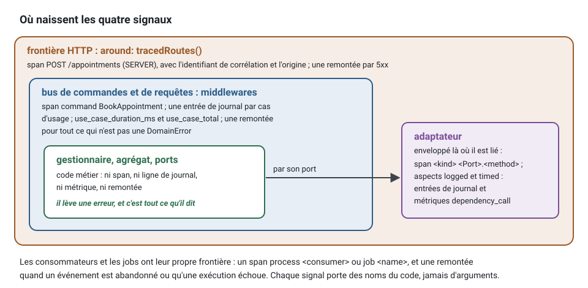

[English](observability.md) · **Français**
<!-- translation-of: observability.md sha256:48600057c05004ba -->

# Observabilité

**Résumé.** Quatre signaux disent ce que fait un système en marche : les traces (où est passé le
temps d'une unité de travail), les journaux (ce qui s'est passé, ligne par ligne), les métriques
(combien de fois et combien de temps, en agrégé) et les remontées d'erreurs (les échecs
inattendus qu'une personne doit regarder). Chacun a son propre *backend*, sa durée de
conservation et ses lecteurs. Ce qui en fait un seul outil plutôt que quatre est un identifiant
commun : l'identifiant de corrélation du contexte d'exécution et l'identifiant de trace
désignent la même unité de travail dans chaque signal, d'un processus à l'autre et à travers les
événements échangés entre contextes. Dans ce kit, les quatre sont posés depuis l'extérieur du
code métier, et les quatre suivent une même règle de confidentialité : des noms tirés du code,
des durées et des codes ; jamais d'arguments, de résultats ni de messages d'erreur.

## Quatre signaux, quatre questions

| Signal | Répond à | Forme | Port du noyau | Conservé |
|---|---|---|---|---|
| traces | où cette requête HTTP a-t-elle passé son temps, et qu'a-t-elle appelé ? | un arbre de *spans* par unité de travail | aucun : ajouté à la racine de composition | quelques jours |
| journaux | que s'est-il passé, dans l'ordre, sur cette instance ? | des lignes JSON avec des champs | `Logger` | de quelques jours à quelques semaines |
| métriques | combien, à quelle vitesse, combien en échec, maintenant et dans le temps ? | des compteurs, des histogrammes, des jauges avec des étiquettes | `Metrics` | de quelques semaines à quelques mois |
| remontées d'erreurs | quels échecs inattendus demandent une personne ? | un problème regroupé par sorte d'échec | `ErrorReporter` | jusqu'à sa résolution |

Ils sont complémentaires. Une métrique dit que le taux d'erreur des annulations a doublé ; une
trace montre que le temps part dans la *gateway* du calendrier ; une ligne de journal dit quelle
instance et quelle tentative ; une remontée d'erreur contient la pile d'appels. Aucun ne remplace
un autre, et aucun n'est le [journal d'audit](audit-trail.fr.md), qui répond à des personnes qui
ne font pas confiance à l'application.

Les quatre sont produits aux bords du code métier, jamais à l'intérieur : la frontière HTTP, les
*middlewares* des bus, et les enveloppes que la plateforme pose autour des adaptateurs quand elle
les lie. Un gestionnaire (handler), un agrégat ou un port de *repository* n'écrit ni *span*, ni
ligne de journal, ni métrique, ni remontée.



## L'identifiant qui les relie

Chaque unité de travail s'exécute dans une portée d'exécution qui porte un identifiant de
corrélation ([L'acteur et la portée d'exécution](actor-and-execution-scope.fr.md)). Le traçage
donne à chaque unité de travail un identifiant de trace, et l'en-tête W3C `traceparent` le porte
d'un processus au suivant, y compris dans l'enveloppe d'un événement d'intégration. Le kit nomme
chacun dans l'autre : le *span* racine d'une unité de travail porte l'identifiant de corrélation
et l'origine, et chaque ligne de journal porte l'identifiant de corrélation, l'identifiant de
trace et l'identifiant de *span*.


En pratique : un client signale que la confirmation n'est jamais arrivée et cite la référence de
support affichée à l'écran. Cette référence est l'identifiant ci-dessus. Elle retrouve la requête
HTTP dans les journaux, la trace qui contient les deux contextes, l'événement passé en file de
rejet (dead letter) s'il y en a un, et la remontée d'erreur qui nomme l'adaptateur en échec.

## Le traçage, sans toucher au code

La règle : `@ddd-ts-kit/tracing` et `@opentelemetry/*` ne sont importés que par le répertoire de
la plateforme, `main.ts` et `apps/` (`tracing/platform-only`). Les *spans* sont ajoutés là où les
objets sont câblés. Chaque liaison déclare ce qu'elle est (un *repository*, une *gateway* vers un
autre contexte, un adaptateur d'un système extérieur), et la plateforme remet une seule
instrumentation au module du noyau, `kernelModule({ instrumentation: traceApplication() })` :
elle pose un *span* autour de chaque cas d'usage, de chaque appel d'une telle liaison, de la
distribution des événements du domaine, de chaque publication, de chaque consommateur et de
chaque *job*. Deux pièces de plus la complètent : `around: tracedRoutes()` sur la frontière HTTP,
et `tracedPublisher(bus)` autour de ce avec quoi le relais de l'outbox livre, pour qu'une
publication poursuive la trace enregistrée avec son événement. La classe du *repository* n'en
sait rien. Un port du noyau lié de nouveau par un module ultérieur n'est pas enveloppé.

Les trois points d'accroche, dans la racine de composition :

<!-- checked sample -->
```ts
import { kernelModule, type ContextModule } from '@ddd-ts-kit/di';
import { createApplication } from '@ddd-ts-kit/di/tsyringe';
import type { Route } from '@ddd-ts-kit/http';
import { mountExpress } from '@ddd-ts-kit/http/express';
import { ExecutionScope, type IntegrationEventPublisher } from '@ddd-ts-kit/kernel';
import { traceApplication, tracedPublisher, tracedRoutes } from '@ddd-ts-kit/tracing';
import express from 'express';

declare const appointmentsModule: ContextModule;
declare const routes: readonly Route[];
declare const broker: IntegrationEventPublisher;

// 1. cas d'usage, liaisons, événements du domaine, consommateurs et jobs : une seule valeur pour le module du noyau
const app = createApplication({
  modules: [kernelModule({ instrumentation: traceApplication() }), appointmentsModule],
});

// 2. la frontière HTTP : un span SERVER par requête HTTP, nommé d'après le gabarit de la route
const server = express();
mountExpress(server, routes, { executionScope: app.resolve(ExecutionScope), around: tracedRoutes() });

// 3. ce avec quoi le relais de l'outbox publie : chaque publication poursuit la trace enregistrée avec son événement
export const relayPublisher = tracedPublisher(broker);
```

Le SDK lui-même démarre dans un module à part, importé avant tout le reste (`initTracing` de
`@ddd-ts-kit/tracing/node`) : voir la première conséquence ci-dessous.

Les noms de *spans* sont stables et de faible cardinalité : `command BookAppointment`,
`repository AppointmentRepository.save` (`<kind> <Port>.<method>`),
`process notifications.remind-on-appointment-booked` pour un consommateur. Sous le *span* d'une
commande viennent d'abord les enregistrements, puis `unit-of-work before-commit` avec les
événements du domaine et leurs gestionnaires, puis, quand un événement a un gestionnaire de
cette phase, `unit-of-work after-commit` : la trace montre que les gestionnaires se sont exécutés
après chaque enregistrement, et de quel côté de la validation (commit).


Cet arbre, avec les noms de son propre exemple, est vérifié *span* par *span* par les *specs* de
[`@ddd-ts-kit/tracing`](../../packages/tracing/README.fr.md#à-quoi-ressemble-une-trace).

Trois conséquences méritent d'être comprises :

- **Le SDK doit démarrer en premier.** L'auto-instrumentation modifie le module HTTP et les
  pilotes de base de données au moment où ils sont chargés. Dans un module ES, les imports
  statiques sont évalués avant la première instruction, donc l'initialisation vit dans son
  propre module, importé en premier ou préchargé.
- **Un *span* par appel d'entrée-sortie, aucun pour le travail en mémoire.** Les méthodes
  synchrones ne sont pas tracées. Une boucle qui appelle un *repository* mille fois produirait
  mille *spans*, alors le kit plafonne les *spans* d'une unité de travail par nom et au total,
  et compte sur le *span* racine ce qu'il a écarté.
- **Une mesure métier n'est pas un attribut de *span*.** « Rendez-vous réservés par clinique »
  est une métrique ou un événement du domaine, pas quelque chose qu'un gestionnaire écrit sur un
  *span*.

## Journaux

Le noyau définit le port `Logger` et ses champs connus (identifiants de corrélation et de
causalité, contexte, identifiant de l'acteur, identifiant du *tenant*, type et code d'erreur,
durée). Le domaine et les cas d'usage ne journalisent pas : un *middleware* de bus écrit une
entrée par cas d'usage, un aspect une par appel d'un adaptateur, et l'infrastructure ou la
plateforme journalisent par le port quand elles ont quelque chose à dire.

Une bonne ligne a un message constant et des champs variables : `appointment reminder sent` avec
les identifiants dans des champs, jamais une phrase construite par concaténation. Les messages
constants se comptent et se recherchent ; les champs se filtrent.

<!-- checked sample -->
```ts
import type { Logger } from '@ddd-ts-kit/kernel';

declare const logger: Logger;
declare const appointmentId: string;
declare const channel: 'sms' | 'email';

// Au lieu de : une phrase par rendez-vous, qu'aucune requête ne peut compter
logger.info(`Reminder of appointment ${appointmentId} sent by ${channel}`);

// Écrire : un message constant, les parties variables dans des champs
logger.info('appointment reminder sent', { context: 'notifications', appointmentId, channel });
```

L'identifiant de corrélation, l'acteur, le *tenant* et les identifiants de trace ne sont pas
écrits par l'appelant : le *logger* les ajoute à chaque ligne à partir de la portée d'exécution
et du *span* actif (`traceLogFields(scope)` du *package* de traçage, donné à l'adaptateur comme
ses `fields`).

Trois adaptateurs implémentent le port : un *logger* JSON sans dépendance, un sur pino et un sur
winston. Ils sont comparés dans [Outils d'observabilité](../tools/observability.fr.md).

## Métriques

Trois instruments : un compteur (combien), un histogramme (une distribution, typiquement des
durées) et une jauge (un niveau, comme la profondeur de l'outbox ou l'état d'un circuit). Deux
sources produisent un histogramme de durée (`<name>_duration_ms`) et un compteur total
(`<name>_total`) :

- le *middleware* du bus (`metricsMiddleware`) chronomètre chaque commande et chaque requête
  sous `use_case_*`, étiquetées par `message` et `kind` ;
- l'aspect `timed` chronomètre chaque appel d'adaptateur sous `dependency_call_*`, étiqueté par
  `class`, `method`, `kind` et `context`.

Les deux ajoutent `outcome` (`success` ou `failure`) ; le compteur porte aussi `error_code` lors
d'un échec qui en a un.

Des jauges donnent une profondeur : le relais de l'outbox pose `outbox_pending`, `outbox_failed`
et `outbox_dead` depuis `store.stats()` après chaque passage, et le *worker* des *jobs*
d'arrière-plan pose `jobs_waiting`, `jobs_running` et `jobs_dead` pour chaque file, étiquetées
`queue`, au plus une fois par relevé. Un projet généré lie le port à `openTelemetryMetrics()` du
paquet de traçage, et les séries sortent par OTLP avec les traces quand
`OTEL_EXPORTER_OTLP_ENDPOINT` est définie.

La règle qui compte le plus pour les métriques est la cardinalité : **la valeur d'une étiquette
vient d'un petit ensemble fermé, jamais d'un identifiant**. Une étiquette qui porte un
identifiant de rendez-vous crée une série temporelle par rendez-vous et fait tomber le *backend*
de métriques. Les identifiants appartiennent aux journaux et aux traces.

<!-- checked sample -->
```ts
import type { Metrics } from '@ddd-ts-kit/kernel';

declare const metrics: Metrics;
declare const appointmentId: string;

const sent = metrics.counter('reminders_sent_total');

// Au lieu de : une série temporelle par rendez-vous, créée pour toujours
sent.increment({ appointmentId });

// Écrire : des étiquettes tirées d'un petit ensemble fermé ; le rendez-vous va dans la ligne de journal
sent.increment({ context: 'notifications', channel: 'sms', outcome: 'success' });
```

Les alertes utiles portent sur des symptômes et des absences : le taux d'erreur de
`BookAppointment`, l'âge du plus ancien enregistrement en attente dans l'outbox, une file de
rejet qui n'est pas vide, « aucune exécution réussie de `notifications.send-reminders` depuis
deux intervalles ». Cette dernière sorte attrape toutes les façons dont un *job* cesse de
tourner, ce qu'une alerte sur les échecs ne fait pas.

## Remontée des erreurs

Un outil de suivi des erreurs reçoit ce que personne n'a prévu. Le kit trace la limite avec un
seul type : une `DomainError` est un refus métier, une réponse et non un incident, et elle n'est
pas remontée. `SlotAlreadyTaken`, c'est le système qui fonctionne ; un déréférencement de null
dans un *mapper*, non.

Les remontées sont faites par ce qui entoure les cas d'usage, jamais par les gestionnaires, les
agrégats ou les *repositories*, qui se contentent de lever une erreur :

<!-- checked sample -->
```ts
import type { ErrorReporter } from '@ddd-ts-kit/kernel';

declare const reporter: ErrorReporter;
declare const sms: { send(phone: string, text: string): Promise<void> };

// Au lieu de : un gestionnaire qui remonte, puis relance l'erreur ; le bus la remonte encore, deux problèmes pour un seul échec
export async function remindReporting(phone: string): Promise<void> {
  try {
    await sms.send(phone, 'Your appointment is tomorrow.');
  } catch (error) {
    reporter.report(error, { origin: 'command', operation: 'SendReminder', severity: 'error' });
    throw error;
  }
}

// Écrire : laisser lever ; le middleware du bus la remonte une fois, avec les identifiants de corrélation et de trace
export async function remind(phone: string): Promise<void> {
  await sms.send(phone, 'Your appointment is tomorrow.');
}
```

| Point de capture | Remonte |
|---|---|
| bus de commandes et de requêtes | un cas d'usage qui échoue avec autre chose qu'une `DomainError` |
| HTTP | chaque requête HTTP qui reçoit une réponse 5xx |
| *jobs* planifiés | une exécution qui a échoué avec autre chose qu'une `DomainError` |
| événements d'intégration | un événement que son fournisseur abandonne, jamais une livraison qui est retentée |
| le processus | les exceptions non attrapées et les rejets non gérés |

Deux règles gardent l'outil de suivi lisible. **Un échec, une remontée** : le premier point de
capture qui voit une erreur la remonte et les frontières qu'elle traverse ensuite la
reconnaissent, de sorte qu'une commande qui échoue dans une requête HTTP est un seul problème,
nommé d'après la commande. **Les nouvelles tentatives ne sont pas des incidents** : les premiers
échecs d'un consommateur sont attendus ; l'événement est remonté une fois, quand il est
abandonné.

Chaque remontée porte l'identifiant de corrélation et l'identifiant de trace, de sorte qu'un
problème dans l'outil de suivi ouvre la trace dans le *backend* de traçage.

## Ce que chaque signal peut porter

| | Peut porter | Ne porte jamais |
|---|---|---|
| *span* | classe, méthode, contexte, sorte, classe d'erreur, code d'erreur du domaine ; sur la racine : identifiant de corrélation, origine | arguments, résultats, messages d'erreur, URL avec des valeurs de requête, quoi que ce soit sur l'acteur |
| métrique | des noms tirés du code, l'issue, le code d'erreur | des identifiants, quels qu'ils soient |
| ligne de journal | ce qui précède, plus l'identifiant de l'acteur, l'identifiant du *tenant*, les identifiants de corrélation et de trace | des secrets d'authentification (masqués par les trois *loggers* du kit, `stdout`, pino et winston, quelle que soit la casse de la clé), des contenus de messages ; les messages d'erreur sont gardés par défaut et peuvent être nettoyés |
| remontée d'erreur | l'erreur avec son type, son code et sa pile, son message où les valeurs que cite une requête SQL en échec sont masquées, l'origine, l'opération, les identifiants de corrélation et de trace, l'identifiant de l'acteur | courriel, nom, adresse, corps des requêtes HTTP, variables locales, les valeurs que cite une requête SQL en échec ; le *tenant* seulement sur demande |

L'asymétrie est voulue. Rien de personnel ne devient un attribut de *span*, parce que les traces
sont exportées largement et échantillonnées par des outils que personne n'audite ; les
identifiants de l'acteur et du *tenant* restent dans les champs des journaux, dont la durée de
conservation appartient au projet. Les messages des erreurs inattendues sont le premier endroit
où fuient les données personnelles (un pilote cite la ligne qu'il a refusée), c'est pourquoi les
*spans* les écartent toujours et que les adaptateurs du *logger* et de l'outil de suivi des
erreurs proposent de les écarter. L'outil de suivi des erreurs garde le message par défaut, car
c'est pour lui qu'on lit une *issue*, et y masque les valeurs que cite une requête SQL en échec
(les paramètres de Drizzle, la clé d'une contrainte violée, la ligne qu'un contrôle a refusée,
une valeur que le serveur n'a pas su lire, les arguments d'un appel que Prisma a refusé) tandis
que la requête reste ; `SENTRY_SCRUB_MESSAGES=true` (`scrubMessages: true` d'`initSentry`)
écarte le message de chaque erreur qui n'est pas une `DomainError`, pour un outil de suivi
hébergé par un tiers.

## Limites, et quand ne pas l'utiliser

- **La corrélation ne vaut que ce que valent les frontières.** Une frontière écrite à la main
  qui n'ouvre aucune portée d'exécution, ou un transport qui perd le `traceparent` de
  l'enveloppe, coupe le fil. Une unité de travail qui ne démarre aucun *span* sous sa racine
  n'est pas nommée avec son identifiant de corrélation.
- **L'échantillonnage perd des traces.** Avec un taux d'échantillonnage inférieur à un, la trace
  de la requête HTTP en échec peut ne pas exister. Les journaux et les remontées d'erreurs ne
  sont pas échantillonnés par le kit ; la référence de support les retrouve toujours.
- **L'enveloppement ne voit que les méthodes asynchrones.** Une méthode qui se contente de
  renvoyer une promesse est tracée à partir de son deuxième appel ; un constructeur de requêtes
  chaînable ne doit pas être enveloppé. Les deux sont énoncés dans le
  [README du traçage](../../packages/tracing/README.fr.md).
- **Le noyau ne livre aucun *backend* de métriques.** Le défaut ne fait rien, et le projet
  généré laisse un `TODO(platform)` pour l'adaptateur de votre système de métriques.
- **La journalisation asynchrone peut perdre les dernières lignes** d'un processus tué sans
  gestionnaire de signal. L'adaptateur pino documente ce compromis et garde des écritures
  synchrones par défaut.
- **La règle de confidentialité est une convention des aspects et des adaptateurs du kit.** Un
  message que vous écrivez vous-même, ou un champ que vous ajoutez, est à vous de garder propre.
  Le masquage compare les noms de `CREDENTIAL_KEYS` quelle que soit leur casse, au premier niveau
  d'une ligne et un niveau en dessous, jamais plus profond ni dans une liste.
- **L'observabilité ne remplace ni les tests ni le journal d'audit**, et elle a un coût : les
  *spans*, les lignes et les séries sont stockés et facturés. Commencez par les signaux des
  *middlewares* et ajoutez du détail là où un incident a montré qu'il manquait.

## Sources

- Documentation d'OpenTelemetry (opentelemetry.io) : signaux, propagation du contexte,
  conventions sémantiques, échantillonnage.
- W3C Trace Context (Recommandation) : l'en-tête `traceparent`.
- Betsy Beyer et al. (dir.), Site Reliability Engineering, O'Reilly, 2016, chapitre 6
  « Monitoring Distributed Systems » : symptômes contre causes, les quatre signaux d'or.
- Benjamin H. Sigelman et al., « Dapper, a Large-Scale Distributed Systems Tracing
  Infrastructure », Google Technical Report, 2010.
- Gregor Hohpe et Bobby Woolf, Enterprise Integration Patterns, Addison-Wesley, 2003 :
  Correlation Identifier.
- Documentation de Prometheus, « Metric and label naming » : l'avertissement sur la cardinalité
  des étiquettes.
- README des *packages* : [tracing](../../packages/tracing/README.fr.md),
  [kernel](../../packages/kernel/README.fr.md) (Logger, Metrics, ErrorReporter),
  [aspects](../../packages/aspects/README.fr.md), [pino](../../packages/pino/README.fr.md),
  [sentry](../../packages/sentry/README.fr.md).

## Voir aussi

- [L'acteur et la portée d'exécution](actor-and-execution-scope.fr.md)
- [Résilience](resilience.fr.md)
- [Journal d'audit](audit-trail.fr.md)
- [Livraison et idempotence](delivery-and-idempotency.fr.md)
- [Outils d'observabilité](../tools/observability.fr.md)
- [Référence de l'architecture](../ARCHITECTURE.fr.md) : « Traçage », « Remontée des erreurs »,
  « Comportement transverse », règle `aspects/outside-in`
