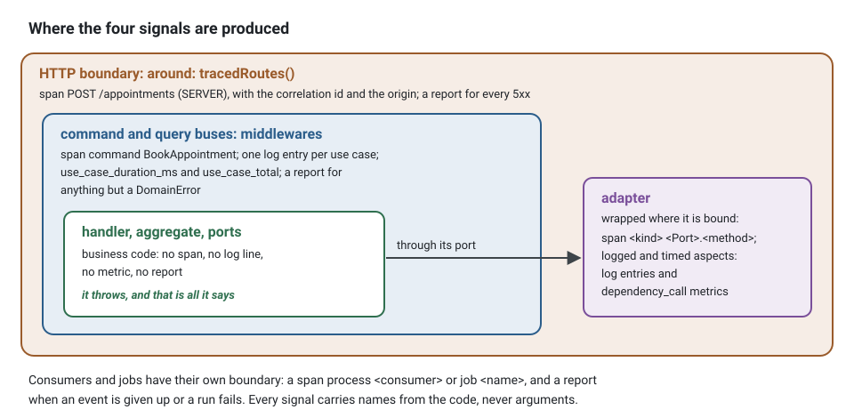

**English** · [Français](observability.fr.md)

# Observability

**Summary.** Four signals tell what a running system does: traces (where the time of one unit
of work went), logs (what happened, line by line), metrics (how often and how long, in
aggregate) and error reports (unexpected failures somebody must look at). Each has its own
backend, retention and readers. What makes them one tool instead of four is a shared
identifier: the correlation id of the execution context and the trace id name the same unit of
work in every signal, across processes and across the events between contexts. In this kit all
four are attached from outside the business code, and all four follow one privacy rule: names
from the code, durations and codes; never arguments, results or error messages.

## Four signals, four questions

| Signal | Answers | Shape | Kernel port | Kept for |
|---|---|---|---|---|
| traces | where did this request spend its time, and what did it call? | a tree of spans per unit of work | none: added at the composition root | days |
| logs | what happened, in order, on this instance? | JSON lines with fields | `Logger` | days to weeks |
| metrics | how many, how fast, how many failing, right now and over time? | counters, histograms, gauges with labels | `Metrics` | weeks to months |
| error reports | which unexpected failures need a person? | one grouped issue per kind of failure | `ErrorReporter` | until resolved |

They are complementary. A metric tells that the error rate of cancellations doubled; a trace
shows that the time goes to the calendar gateway; a log line tells which instance and which
attempt; an error report holds the stack. None of them replaces another, and none of them is
the [audit trail](audit-trail.md), which answers to people who do not trust the application.

All four are produced at the edges of the business code, never inside it: the HTTP boundary,
the middlewares of the buses, and the wrappers the platform puts around the adapters when it
binds them. A handler, an aggregate or a repository port writes no span, no log line, no metric
and no report.



## The identifier that ties them

Every unit of work runs in an execution scope holding a correlation id
([The actor and the execution scope](actor-and-execution-scope.md)). Tracing gives each unit of
work a trace id, and the W3C `traceparent` header carries it from one process to the next,
including inside the envelope of an integration event. The kit names each in the other: the
root span of a unit of work carries the correlation id and the origin, and every log line
carries the correlation id, the trace id and the span id.


In practice: a client reports that the confirmation never arrived and quotes the support
reference shown on screen. That reference is the id above. It finds the request in the logs,
the trace with both contexts in it, the dead-lettered event if there is one, and the error
report that names the failing adapter.

## Tracing, without touching the code

The rule: `@ddd-ts-kit/tracing` and `@opentelemetry/*` are imported only by the platform
directory, `main.ts` and `apps/` (`tracing/platform-only`). Spans are added where objects are
wired. Each binding declares what it is (a repository, a gateway to another context, an adapter
of an outside system), and the platform hands one instrumentation to the kernel module,
`kernelModule({ instrumentation: traceApplication() })`: it puts a span around every use case,
every call of such a binding, the dispatch of domain events, each publication, each consumer and
each job. Two more pieces complete it: `around: tracedRoutes()` on the HTTP boundary, and
`tracedPublisher(bus)` around what the outbox relay delivers with, so that a publication
continues the trace stored with its event. The repository class knows nothing about it. A kernel port
rebound by a later module is not wrapped.

The three hooks, in the composition root:

<!-- checked sample -->
```ts
import { kernelModule, type ContextModule } from '@ddd-ts-kit/di';
import { createApplication } from '@ddd-ts-kit/di/tsyringe';
import type { Route } from '@ddd-ts-kit/http';
import { mountExpress } from '@ddd-ts-kit/http/express';
import { ExecutionScope, type IntegrationEventPublisher } from '@ddd-ts-kit/kernel';
import { traceApplication, tracedPublisher, tracedRoutes } from '@ddd-ts-kit/tracing';
import express from 'express';

declare const appointmentsModule: ContextModule;
declare const routes: readonly Route[];
declare const broker: IntegrationEventPublisher;

// 1. use cases, bindings, domain events, consumers and jobs: one value for the kernel module
const app = createApplication({
  modules: [kernelModule({ instrumentation: traceApplication() }), appointmentsModule],
});

// 2. the HTTP boundary: one SERVER span per request, named after the route template
const server = express();
mountExpress(server, routes, { executionScope: app.resolve(ExecutionScope), around: tracedRoutes() });

// 3. what the outbox relay publishes with: each publication continues the trace stored with its event
export const relayPublisher = tracedPublisher(broker);
```

The SDK itself starts in a module of its own, imported before everything else
(`initTracing` of `@ddd-ts-kit/tracing/node`): see the first consequence below.

Span names are stable and low in cardinality: `command BookAppointment`,
`repository AppointmentRepository.save` (`<kind> <Port>.<method>`),
`process notifications.remind-on-appointment-booked` for a consumer. Under the span of a command
the saves come first, then `unit-of-work before-commit` with the domain events and their
handlers, then, when an event has a handler of that phase, `unit-of-work after-commit`: the
trace shows that the handlers ran after every save, and on which side of the commit.


This tree, with the names of its own example, is asserted span for span by the specs of
[`@ddd-ts-kit/tracing`](../../packages/tracing/README.md#what-a-trace-looks-like).

Three consequences are worth understanding:

- **The SDK must start first.** Auto-instrumentation patches the HTTP module and the database
  drivers when they are loaded. In an ES module static imports are evaluated before the first
  statement, so the initialisation lives in its own module, imported first or preloaded.
- **One span per I/O call, none for in-memory work.** Synchronous methods are not traced. A
  loop that calls a repository a thousand times would produce a thousand spans, so the kit caps
  the spans of one unit of work per name and in total, and counts what it dropped on the root
  span.
- **A business measure is not a span attribute.** "Appointments booked per clinic" is a metric
  or a domain event, not something a handler writes on a span.

## Logs

The kernel defines the `Logger` port and its well-known fields (correlation and causation ids,
context, actor id, tenant id, error type and code, duration). The domain and the use cases do
not log: a bus middleware writes one entry per use case, an aspect one per call of an adapter,
and infrastructure or the platform log through the port when they have something to say.

A good line has a constant message and variable fields: `appointment reminder sent` with the
identifiers in fields, never a sentence built by concatenation. Constant messages can be
counted and searched; fields can be filtered.

<!-- checked sample -->
```ts
import type { Logger } from '@ddd-ts-kit/kernel';

declare const logger: Logger;
declare const appointmentId: string;
declare const channel: 'sms' | 'email';

// Instead of: a sentence per appointment, which no query can count
logger.info(`Reminder of appointment ${appointmentId} sent by ${channel}`);

// Write: one constant message, the variable parts in fields
logger.info('appointment reminder sent', { context: 'notifications', appointmentId, channel });
```

The correlation id, the actor, the tenant and the trace ids are not written by the caller: the
logger adds them to every line from the execution scope and the active span
(`traceLogFields(scope)` of the tracing package, given to the adapter as its `fields`).

Three adapters implement the port: a dependency-free JSON logger, one on pino and one on
winston. They are compared in [Observability tools](../tools/observability.md).

## Metrics

Three instruments: a counter (how many), a histogram (a distribution, typically durations) and
a gauge (a level, such as the depth of the outbox or the state of a circuit). Two sources
produce a duration histogram (`<name>_duration_ms`) and a total counter (`<name>_total`):

- the bus middleware (`metricsMiddleware`) times every command and query as `use_case_*`,
  labelled by `message` and `kind`;
- the `timed` aspect times every adapter call as `dependency_call_*`, labelled by `class`,
  `method`, `kind` and `context`.

Both add `outcome` (`success` or `failure`); the counter also carries `error_code` on a failure
that has one.

Gauges give a depth: the outbox relay sets `outbox_pending`, `outbox_failed` and
`outbox_dead` from `store.stats()` after each tick, and the worker of the background jobs sets
`jobs_waiting`, `jobs_running` and `jobs_dead` for each queue, labelled `queue`, at most once per
poll. A generated project binds the port to `openTelemetryMetrics()` of the tracing package, and
the series leave by OTLP with the spans when `OTEL_EXPORTER_OTLP_ENDPOINT` is set.

The rule that matters most for metrics is cardinality: **a label value comes from a small
closed set, never an identifier**. A label holding an appointment id creates one time series
per appointment and takes the metrics backend down. Identifiers belong to logs and traces.

<!-- checked sample -->
```ts
import type { Metrics } from '@ddd-ts-kit/kernel';

declare const metrics: Metrics;
declare const appointmentId: string;

const sent = metrics.counter('reminders_sent_total');

// Instead of: one time series per appointment, created forever
sent.increment({ appointmentId });

// Write: labels from a small closed set; the appointment goes to the log line
sent.increment({ context: 'notifications', channel: 'sms', outcome: 'success' });
```

Useful alerts are about symptoms and absences: the error ratio of `BookAppointment`, the age of
the oldest pending outbox record, a dead-letter queue that is not empty, "no successful run of
`notifications.send-reminders` for two intervals". The last kind catches every way a job stops
running, which an alert on failures does not.

## Error reporting

An error tracker receives what nobody planned. The kit draws the line with one type: a
`DomainError` is a business refusal, an answer and not an incident, and is not reported.
`SlotAlreadyTaken` is the system working; a null dereference in a mapper is not.

Reports are made by what stands around the use cases, never by handlers, aggregates or
repositories, which simply throw:

<!-- checked sample -->
```ts
import type { ErrorReporter } from '@ddd-ts-kit/kernel';

declare const reporter: ErrorReporter;
declare const sms: { send(phone: string, text: string): Promise<void> };

// Instead of: a handler that reports, then rethrows; the bus reports it again, two issues for one failure
export async function remindReporting(phone: string): Promise<void> {
  try {
    await sms.send(phone, 'Your appointment is tomorrow.');
  } catch (error) {
    reporter.report(error, { origin: 'command', operation: 'SendReminder', severity: 'error' });
    throw error;
  }
}

// Write: let it throw; the bus middleware reports it once, with the correlation and trace ids
export async function remind(phone: string): Promise<void> {
  await sms.send(phone, 'Your appointment is tomorrow.');
}
```

| Capture point | Reports |
|---|---|
| command and query buses | a use case failing with anything but a `DomainError` |
| HTTP | every request answered 5xx |
| scheduled jobs | a run that failed with anything but a `DomainError` |
| integration events | an event its provider gives up on, never a delivery that is retried |
| the process | uncaught exceptions and unhandled rejections |

Two rules keep the tracker readable. **One failure, one report**: the first capture point that
sees an error reports it and the boundaries it crosses afterwards recognise it, so a command
failing inside a request is one issue named after the command. **Retries are not incidents**:
the first failures of a consumer are expected; the event is reported once, when it is given up.

Each report carries the correlation id and the trace id, so an issue in the tracker opens the
trace in the tracing backend.

## What each signal may carry

| | May carry | Never carries |
|---|---|---|
| span | class, method, context, kind, error class, domain error code; on the root: correlation id, origin | arguments, results, error messages, URLs with query values, anything about the actor |
| metric | names from the code, outcome, error code | identifiers of any kind |
| log line | the above, plus actor id, tenant id, correlation and trace ids | credentials (redacted by the adapters), payloads; error messages are kept by default and can be scrubbed |
| error report | the error with its stack, origin, operation, correlation and trace ids, actor id | email, name, address, request bodies, local variables; the tenant only on request |

The asymmetry is deliberate. Nothing personal becomes a span attribute, because traces are
exported widely and sampled by tools nobody audits; the actor and tenant ids stay in log
fields, where retention is the project's own. Messages of unexpected errors are the first place
where personal data leaks (a driver quotes the row it refused), which is why spans drop them
always and the logger and error tracker adapters offer to drop them.

## Limits and when not to use it

- **The correlation is only as good as the boundaries.** A boundary written by hand that opens
  no execution scope, or a transport that drops the envelope's `traceparent`, cuts the thread.
  A unit of work that starts no span under its root is not named with its correlation id.
- **Sampling loses traces.** With a sampling ratio below one, the trace of the failing request
  may not exist. Logs and error reports are not sampled by the kit; the support reference
  still finds them.
- **Wrapping sees asynchronous methods only.** A method that merely returns a promise is traced
  from its second call; a chainable query builder must not be wrapped. Both are stated in the
  [tracing README](../../packages/tracing/README.md).
- **The kernel ships no metrics backend.** The default is a no-op and the generated project
  leaves a `TODO(platform)` for the adapter of your metrics system.
- **Asynchronous logging can lose the last lines** of a process killed without a handler. The
  pino adapter documents the trade-off and keeps synchronous writes by default.
- **The privacy rule is a convention of the kit's own aspects and adapters.** A message you
  write yourself, or a field you add, is yours to keep clean. Redaction matches key names
  exactly and one level deep.
- **Observability does not replace tests or the audit trail**, and it costs: spans, lines and
  series are stored and billed. Start with the middleware-level signals and add detail where an
  incident showed it was missing.

## Sources

- OpenTelemetry documentation (opentelemetry.io): signals, context propagation, semantic
  conventions, sampling.
- W3C Trace Context (Recommendation): the `traceparent` header.
- Betsy Beyer et al. (eds.), Site Reliability Engineering, O'Reilly, 2016, chapter 6
  "Monitoring Distributed Systems": symptoms versus causes, the four golden signals.
- Benjamin H. Sigelman et al., "Dapper, a Large-Scale Distributed Systems Tracing
  Infrastructure", Google Technical Report, 2010.
- Gregor Hohpe and Bobby Woolf, Enterprise Integration Patterns, Addison-Wesley, 2003:
  Correlation Identifier.
- Prometheus documentation, "Metric and label naming": the warning on label cardinality.
- Package READMEs: [tracing](../../packages/tracing/README.md),
  [kernel](../../packages/kernel/README.md) (Logger, Metrics, ErrorReporter),
  [aspects](../../packages/aspects/README.md), [pino](../../packages/pino/README.md),
  [sentry](../../packages/sentry/README.md).

## See also

- [The actor and the execution scope](actor-and-execution-scope.md)
- [Resilience](resilience.md)
- [Audit trail](audit-trail.md)
- [Delivery and idempotency](delivery-and-idempotency.md)
- [Observability tools](../tools/observability.md)
- [Architecture reference](../ARCHITECTURE.md): "Tracing", "Error reporting", "Cross-cutting
  behaviour", rule `aspects/outside-in`
