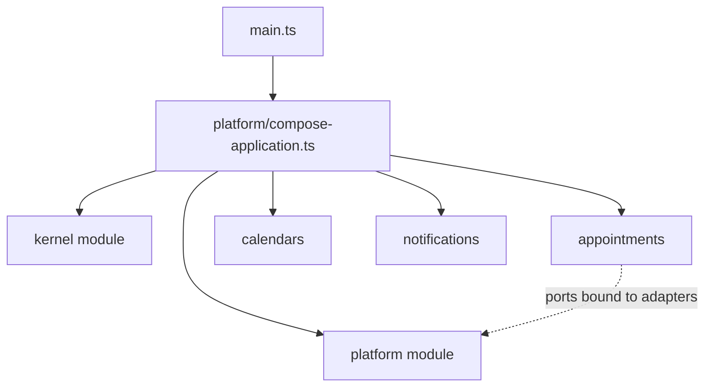

# Ports and composition

**Summary.** A port is what the inner layers need from the outside, stated in their own words.
In this kit a port is an abstract class with abstract members only, and that class is also the
injection token: one name carries the type at compile time and the identity at run time.
Adapters implement ports and never extend them. Objects are assembled in one place, the
composition root, either from what classes declare about themselves with decorators (the
declared style) or from bindings written by hand in a module file (the explicit style). In
the declared style a class states what it depends on once, in its constructor signature,
and the kit reads it from the source. This page explains the choices, what each style costs
and where the limits are.

## A port, in the scheduling application

`appointments` must know the working hours of a practitioner to accept a booking, and must store
appointments. Neither need says anything about HTTP or SQL:

```ts
// contexts/appointments/domain/repositories/appointment.repository.ts
import { Repository } from '@ddd-ts-kit/kernel';

export abstract class AppointmentRepository extends Repository<Appointment> {
  abstract findOverlapping(practitionerId: string, slot: TimeSlot): Promise<readonly Appointment[]>;
}
```

```ts
// contexts/appointments/application/ports/working-hours.port.ts
export abstract class WorkingHoursReader {
  abstract covers(practitionerId: string, slot: TimeSlot): Promise<boolean>;
}
```

A port is named for what the application needs, not for the technology behind it. A repository
port lives in `domain/repositories/`, any other port in `application/ports/`, one per file
([ARCHITECTURE.md](../ARCHITECTURE.md) section 4, "Ports" and "Ports and adapters").

## Why an abstract class, and not an interface

A TypeScript interface is erased by the compiler: nothing of it exists at run time. A container
that must answer "give me the `AppointmentRepository`" needs a run-time value to key on, so
projects built on interfaces add one by hand: a string, a symbol or a constant, kept in a token
file and kept in step with the interface by discipline.

An abstract class is both things at once:

| Need | An interface plus a token | An abstract class |
|---|---|---|
| a type for the constructor parameter | the interface | the class |
| a run-time identity to bind and resolve | a constant, in a second place | the class itself |
| a typed `resolve` | a generic on the token, declared by hand | follows from the class |
| a constructor parameter that names what is injected | not possible: the type is erased, a token must be repeated next to it | the type of the parameter is the token |
| renaming | two names to rename | one |

So the handler below names its dependencies once, as the ports that type its constructor
parameters, and nowhere else:

```ts
@CommandHandler(BookAppointment)
export class BookAppointmentHandler implements CommandHandler<BookAppointment> {
  constructor(
    private readonly appointments: AppointmentRepository,
    private readonly workingHours: WorkingHoursReader,
    private readonly clock: Clock,
  ) {}

  async execute(command: BookAppointment): Promise<string> { /* ... */ }
}
```

There is no parameter decorator, no `reflect-metadata` for the kit's own decorators and no
`emitDecoratorMetadata`: the signature is read from the source by `ddd-ts-kit docs`, which
writes what it read in the generated file of the context. The next section says why.

## How the constructor reaches the composition root

A container needs, at run time, the list of tokens a constructor takes. Three mechanisms can
give it, and they were measured on the compilers and runners a project of the kit meets
(TypeScript 6.0.3 and the native TypeScript 7.0.2, tsx 4, Vitest 5 with and without the
decorator plugin of `@ddd-ts-kit/testing`, swc 1.16 as Jest runs it; a decorated class whose
constructor takes two ports, read with `Reflect.getMetadata('design:paramtypes', ..)`):

| Compiler or runner | Legacy decorators with `emitDecoratorMetadata` | Standard (TC39) decorators |
|---|---|---|
| `tsc` 6, `tsc` 7 (the build) | the two classes | no metadata |
| `tsx` (the `dev` script, esbuild) | no metadata | no metadata |
| Vitest 5, own transform | the two classes | does not parse the file |
| Vitest 5 with the kit's plugin | the two classes | no metadata |
| swc (Jest) with `decoratorMetadata` | the two classes | no metadata |
| any of them, the port imported with `import type` | `Object`, `Object` (or `Function`): the type is erased | no metadata |

| | A list in the decorator | Compiler metadata | A generated list |
|---|---|---|---|
| What the developer writes | the constructor, then the same ports again in `@CommandHandler(M, [..])` | the constructor | the constructor |
| Works with standard decorators | yes | no: the proposal emits no parameter types | yes |
| Works under `tsx`, esbuild | yes | no | yes |
| Survives `import type` and `verbatimModuleSyntax` | no: the list needs the value (`ports/value-import`) | no: recorded as `Object` | yes: the generated file imports the value |
| Can disagree with the constructor | the compiler refuses a mismatch, the repetition remains | no | no: derived; a stale file is refused by a gate and at startup |
| Needs a generation step | no | no | yes: `ddd-ts-kit docs`, every `generate`, every start of `dev` |

Compiler metadata is the only mechanism that needs neither a repetition nor a generated file,
and it holds in three cells out of ten: it would make an application start in its build and
its tests and fail under `npm run dev`, or work for a project on class-validator and not for
one on zod. The kit therefore reads the signatures itself, statically, and writes them down:

```ts
// contexts/appointments/appointments.declarations.ts, generated: never edited
import { injected } from '@ddd-ts-kit/kernel/declarations';
import { BookAppointmentHandler } from '@/contexts/appointments/application/commands/book-appointment/book-appointment.handler';
import { WorkingHoursReader } from '@/contexts/appointments/application/ports/working-hours.port';
import { AppointmentRepository } from '@/contexts/appointments/domain/repositories/appointment.repository';
import { Clock } from '@ddd-ts-kit/kernel';

export * from '@/contexts/appointments/application/commands/book-appointment/book-appointment.command';
export * from '@/contexts/appointments/application/commands/book-appointment/book-appointment.handler';

injected(BookAppointmentHandler, [AppointmentRepository, WorkingHoursReader, Clock]);
```

`injected` is typed like the list of a decorator was: the compiler refuses a list that does not
match the constructor, so a generated file is type-checked with the rest. Four things keep it
from going stale silently:

- **A gate.** `ddd-ts-kit check` (`declarations/barrel-current`) and `ddd-ts-kit docs --check`
  compare the file with what the sources say and name the class whose constructor changed;
  `verify` and both pipelines run them.
- **Development.** `npm run dev` loads `ddd-ts-kit/dist/refresh-declarations.js` before the
  application on every start and every reload of the watcher: add a port to a constructor,
  save, and the process that restarts is given it.
- **Startup.** A class that takes parameters and has no list, or a list of another length,
  stops `createApplication` with a `WiringError` (`MISSING_DEPENDENCIES`, `DEPENDENCY_ARITY`)
  that names the class and the command to run. Nothing is ever injected as `undefined`.
- **A rule.** `declarations/constructor-injection` refuses a parameter that names no single
  class: a union, an interface, a primitive, an optional or defaulted parameter.

What a signature may say, and what it may not:

| Parameter | |
|---|---|
| typed by a port, a kernel port (`Clock`, `CommandBus`, `Logger`...), another declared class | its token |
| `private readonly`, `protected`, `public` parameter properties, a parameter decorator of another library | looked through |
| typed by a generic class, `Cache<Session>` | the raw class `Cache` is the token: type arguments say nothing of what is bound |
| a primitive, a value, a settings object | not a token: type the parameter by an abstract class with readonly members and bind it to the value in the platform module |
| an interface, a type alias, a union, an intersection | refused, with the same answer: an abstract class |
| optional (`?`), a default value, a rest parameter, destructured | refused: the container always gives every parameter a value |
| no constructor, and no base class | zero dependencies, nothing is generated for the class |
| a constructor inherited from a class of the project | read in the base class, through its imports |
| a constructor inherited from a class of a package | refused: write the constructor in the class |

There is deliberately no `@Inject(Token)` on a parameter. Parameter decorators do not exist
in standard decorators, so such an escape would work in one decorator mode only; a property
decorator would move a dependency off the constructor, which is the one place the kit reads.
The escape for a parameter whose type is not a token is the one the kit already had for
values: an abstract class, bound in the platform. A list written in the decorator,
`@CommandHandler(BookAppointment, [AppointmentRepository, WorkingHoursReader, Clock])`, is
the form 0.1 projects wrote. It is still read, it is checked by the compiler against the
constructor and it wins over the signature; a project keeps it with
`"stack.dependencies": "listed"` (what a config without the key means) and leaves it with
`"signature"`, where ESLint removes every list that repeats its constructor.

### The port rule

A port has abstract members only: no body, no constructor parameter, no private or protected
member. An adapter `implements` its port and never `extends` it. The reason is that TypeScript
types are structural: as long as the port carries no behaviour, a fake, an in-memory class or a
plain object literal fits it without ceremony, and nothing of the port can leak into an adapter
by inheritance. A value that is not a port (settings, a database handle) is carried the same
way, by an abstract class with readonly members bound to a plain object.

The rules are `ports/abstract-class`, `ports/implements-never-extends`,
`ports/no-token-constant`, `ports/no-concrete-dependency` (a constructor parameter is typed by
a port, never by an adapter or a fake) and `ports/value-import` (a port named in a dependency
list or given to `bind` is imported as a value: the class is the token; a port that only types
a constructor parameter may be imported with `import type`).
The kernel also refuses a port with a body or an adapter extending its port when the file loads.

### The identity limit

A class is its own identity. If one process loads two copies of the package that defines a port
(a duplicated install, a bundle next to `node_modules`), it holds two classes, hence two tokens,
and what is bound under one is not found under the other. The kernel README states the limit and
the answer: a port that may be loaded from two copies declares a static key, which then is its
identity in every copy; the injectable ports of the kernel carry one. A port of an application
compiled once into one program never needs it.

## Adapters

```ts
// contexts/appointments/infrastructure/external/in-process-working-hours.gateway.ts
@Gateway(WorkingHoursReader)
export class InProcessWorkingHoursReader implements WorkingHoursReader {
  /* reads through the published language of calendars */
}
```

An adapter says which port it implements and which role it plays (`@Repository`, `@Gateway`,
`@Adapter`). The role is what lets cross-cutting behaviour be attached from outside: tracing
wraps every binding that has a kind, a retry policy targets gateways and external adapters (see
[Resilience](resilience.md) and [Observability](observability.md)). Each port has a fake in
`test/fakes/`, held to the same contract suite as the real adapter
([Testing strategy](testing-strategy.md)).

## The composition root

Something has to know every layer in order to connect them. The kit confines that knowledge:
adapters are instantiated or bound, and declared classes assembled, only in a context's module
file (explicit style), in `main.ts` and in the platform directory
(`composition/only-in-module`). `main.ts` imports tracing first, loads the configuration, opens
the storage and calls `composeApplication` of `src/platform/compose-application.ts`, which lists
the modules: the kernel module (default buses, clock, id generator, in-memory defaults), the
platform module (storage, the event provider, the policy around outbound adapters), the
authorization and audit modules, and one module per context, built from its declarations. The
container checks the whole graph before anything is instantiated: duplicate bindings, unbound
dependencies and cycles are errors at startup, with the port and the module named (the list of
checks is in the README of `@ddd-ts-kit/di`).



## Two ways to tell the root what exists

| | Declared style | Explicit style |
|---|---|---|
| Where a binding is written | on the class, as a decorator of the kernel's declarations entry | in `<context>.module.ts`, one statement per binding |
| Registration file per context | none by hand: a generated barrel, or discovery | the module file |
| What a class is given | what its constructor takes, read from the source into the generated file | the list of `.toClass(Adapter, [Ports])` and `.handledBy(Handler, [Ports])`: explicit stays explicit |
| Adding a use case | add the files; the barrel is regenerated | add the files and a statement |
| Adding a dependency | add the constructor parameter | add the parameter, and the port to the list of the statement |
| Reading the wiring of a context | spread over the classes; `ddd-ts-kit describe <context>` gathers it | one file |
| Values, factories, conditional bindings | not expressible by a decorator: written in a module | native |
| Containers | only `@ddd-ts-kit/di` (on tsyringe) turns declarations into bindings | tsyringe, NestJS providers or manual wiring |
| Domain | carries no decorator in either style | same |

The declared style is the default with tsyringe; the explicit style remains available and the
two mix in one application and even in one module. Declarations are metadata: a decorator
instantiates nothing and imports no container, which is why the application layer may carry
them. The domain declares nothing (`declarations/role-declared`).

### Barrel or discovery

A declared context reaches the root in one of two ways (`stack.assembly` in
[CONFIG.md](../CONFIG.md)):

| | Generated barrel | Discovery |
|---|---|---|
| Mechanism | one generated file re-exporting every role file | a scan of the context's folders at startup |
| Where the constructor lists are | in the barrel, after the exports | in a generated `<context>.dependencies.ts`, which the scan loads with the role files; never compiler metadata |
| Static analysis | bundlers, knip and dependency-cruiser follow it | the loaded files are imported by nothing: the analyzers must be told they are entries |
| Startup | nothing to read | reads directories and imports sequentially |
| Bundled or serverless | fits | a bundler cannot follow it |
| A file written by hand | must be in the barrel: `declarations/barrel-current` reports a stale one | picked up by itself; its constructor still has to be in the dependencies file, which the same rule holds |
| Under Vitest | nothing to configure | `@ddd-ts-kit/di` must be inlined (`server.deps.inline`), which the generated config does |

### What a decorator cannot express

- a value or a factory (a configuration object, a client built from settings);
- an adapter implementing two ports (one declaration per class: bind it explicitly, once per
  port);
- a binding that depends on configuration;
- inheritance: a declaration is not inherited by a subclass;
- what a class is given when its constructor takes something that is not one class: see the
  table above.

For these, an explicit module includes the declared classes and adds the statements.

### The two decorator modes

TypeScript has two decorator implementations, and one program uses one. A project bound to the
legacy mode by class-validator, NestJS or TypeORM entities sets `experimentalDecorators`; any
other project uses standard decorators without a flag. The kit's decorators serve both with the
same source line. One practical consequence is documented in the testing package: Vitest lowers
legacy decorators itself, and needs a plugin of the kit for standard ones.

## Limits and when not to use it

- **Declared wiring is implicit.** Nobody reads one file to see how a context is assembled. The
  generated barrel, `ddd-ts-kit describe` and the startup checks compensate; a team that wants the
  wiring in one reviewed file chooses the explicit style.
- **Constructor injection needs a generated file.** What a constructor takes reaches the
  container through a file `ddd-ts-kit docs` writes. It is committed, regenerated by `dev` and
  compared by a gate, but a class edited outside those paths (a script that never runs `docs`,
  a file loaded by nothing the generator reads) is refused at startup rather than injected.
  Nest and manual wiring are not concerned: Nest injects by its own metadata and providers,
  manual wiring calls `new Handler(a, b)`.
- **A test assembles a context from its generated file**, as the composition root does:
  `contextModule('ordering', orderingDeclarations)`, or one class taken from it,
  `contextModule('ordering', { PlaceOrderHandler: orderingDeclarations.PlaceOrderHandler })`.
  A class imported from its own file and handed to `contextModule` alone has no list.
- **Ports cost files.** A port, an adapter and a fake for a dependency that will only ever have
  one implementation is overhead. The kit accepts it for anything that leaves the process,
  because the fake is what keeps handler tests fast; do not add ports between classes of the
  same layer.
- **Factories hide their dependencies.** A cycle or a missing port going through a factory is
  reported when it is resolved, not at startup.
- **Decorators need care with other libraries**: a class decorator of another library that
  replaces the class must be written below the declaration (di README, "Limits").

## Sources

- Alistair Cockburn, "Hexagonal architecture", 2005, https://alistair.cockburn.us/hexagonal-architecture/
- Mark Seemann, "Composition Root", 2011, https://blog.ploeh.dk/2011/07/28/CompositionRoot/
- Martin Fowler, "Inversion of Control Containers and the Dependency Injection pattern", 2004,
  https://martinfowler.com/articles/injection.html
- Robert C. Martin, Clean Architecture, Prentice Hall, 2017, chapter 11 (dependency inversion)
  and chapter 26 ("The Main Component").
- TypeScript handbook, "Decorators" (legacy) and the TypeScript 5.0 release notes (standard
  decorators), https://www.typescriptlang.org/docs/handbook/decorators.html
- READMEs of [`@ddd-ts-kit/kernel`](../../packages/kernel/README.md) and
  [`@ddd-ts-kit/di`](../../packages/di/README.md).

## See also

- [Layers and the dependency rule](layers-and-dependency-rule.md)
- [CQRS as used here](cqrs.md)
- [Testing strategy](testing-strategy.md)
- [Resilience](resilience.md)
- [Dependency injection: tool comparison](../tools/dependency-injection.md)
- [Architecture reference](../ARCHITECTURE.md)
- [Configuration](../CONFIG.md)
