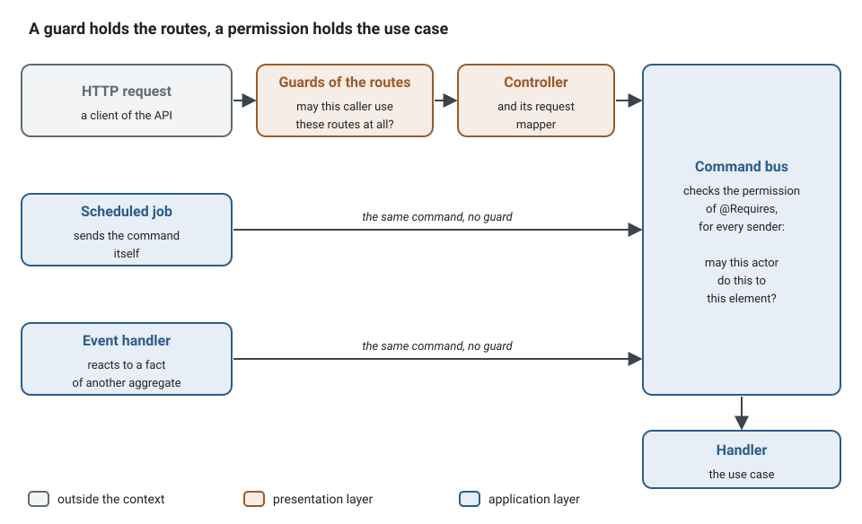

**English** · [Français](presentation-layer.fr.md)

# The presentation layer: controllers, route groups, guards

**Summary.** A route is one class with one method, `handle`, whose decorator is the single
statement of the route: method, path, schemas, response, error codes. A route group gives a set
of routes a prefix, a tag and guards. A guard is a control at the edge; a permission stays on
the use case. A request mapper and a serializer are the two optional places that translate.
The rules are in the [architecture reference](../ARCHITECTURE.md) (`presentation/*`,
`authz/declared`), the API in [`@ddd-ts-kit/http`](../../packages/http/README.md).

## One class per route

```ts
// presentation/http/appointments.routes.ts
import { Authenticated, RouteGroup } from '@ddd-ts-kit/http';

@RouteGroup({ prefix: '/appointments', tags: ['scheduling'], guards: [Authenticated], errors: ['FORBIDDEN'] })
export class AppointmentsRoutes {}
```

```ts
// presentation/http/appointments/book-appointment/book-appointment.controller.ts
import { acceptedSchema, Controller, type Accepted, type HttpRequest } from '@ddd-ts-kit/http';
import type { CommandBus } from '@ddd-ts-kit/kernel';
import { classSchema } from '@ddd-ts-kit/validation/class-validator';
import { BookAppointmentBody } from '@/contexts/scheduling/presentation/http/appointments/book-appointment/book-appointment.body';
import type { BookAppointmentMapper } from '@/contexts/scheduling/presentation/http/appointments/book-appointment/book-appointment.mapper';
import { AppointmentsRoutes } from '@/contexts/scheduling/presentation/http/appointments.routes';

const body = classSchema(BookAppointmentBody);

@Controller({
  group: AppointmentsRoutes,
  method: 'POST',
  path: '/',
  summary: 'Book appointment',
  body,
  response: { status: 201, description: 'Done; the body carries the identifier.', body: acceptedSchema },
  errors: [
    'UNKNOWN_CALENDAR',
    'UNKNOWN_APPOINTMENT_TYPE',
    'OUTSIDE_AVAILABILITY',
    'OFF_GRID',
    'BOOKING_TOO_LATE',
    'BOOKING_TOO_FAR',
    'SLOT_TAKEN',
    'PATIENT_LIMIT_REACHED',
  ],
})
export class BookAppointmentController {
  constructor(
    private readonly commands: CommandBus,
    private readonly mapper: BookAppointmentMapper,
  ) {}

  async handle(request: HttpRequest<{ body: BookAppointmentBody }>): Promise<Accepted> {
    const id = await this.commands.execute(this.mapper.map(request));

    return { id };
  }
}
```

```ts
// presentation/http/appointments/book-appointment/book-appointment.mapper.ts
import { RequestMapper, type HttpRequest } from '@ddd-ts-kit/http';
import { BookAppointmentCommand } from '@/contexts/scheduling/application/commands/book-appointment/book-appointment.command';
import type { BookAppointmentBody } from '@/contexts/scheduling/presentation/http/appointments/book-appointment/book-appointment.body';

/** The one place that turns the request to book and its actor into the command. */
@RequestMapper()
export class BookAppointmentMapper
  implements RequestMapper<HttpRequest<{ body: BookAppointmentBody }>, BookAppointmentCommand>
{
  map({ actor, body }: HttpRequest<{ body: BookAppointmentBody }>): BookAppointmentCommand {
    const { calendarId, appointmentTypeId, startsAt, patientId } = body;
    // Without a patient named, the caller books for themselves.
    const wish = { patientId: patientId ?? actor.id, appointmentTypeId, startsAt: new Date(startsAt) };

    return new BookAppointmentCommand(actor, calendarId, wish);
  }
}
```

These three files come from the example application
([`examples/scheduling`](../../examples/scheduling)). `acceptedSchema` and its type `Accepted`
(`{ id: string }`) are the answer of a write that hands back an identifier, shipped by
`@ddd-ts-kit/http` so that no context declares it again.

The decorator declares, the pipeline validates with the same schemas, and the OpenAPI contract
is generated from them: nothing repeats the route. The constructor states the dependencies, as
for every declared class; the generated file of the context registers
`injected(BookAppointmentController, [CommandBus, BookAppointmentMapper])` from the signature,
and the composition root mounts every declared controller with
`controllerRoutes(resolve(DeclaredEdges).of('controller'), { resolve })`. A controller knows no
framework: it becomes a `Route`, which Express, Fastify, Hono and NestJS mount as they mount any
route, so validation, problem documents, the error mapper and the span of the request are the
ones of a function route.

### The same shape, in one module

The example reads its schemas from `class-validator` classes. Any validation library gives the
same `Schema<T>` value; here is a whole route with `zod`, the group, the controller and the
command it sends in one module so that it reads at once (a project keeps one file per role):

<!-- checked sample -->
```ts
import { z } from 'zod';
import { acceptedSchema, Authenticated, Controller, RouteGroup, type Accepted, type HttpRequest } from '@ddd-ts-kit/http';
import { AuthorizedCommand, type Actor, type CommandBus } from '@ddd-ts-kit/kernel';
import type { Infer } from '@ddd-ts-kit/validation';
import { zodSchema } from '@ddd-ts-kit/validation/zod';

// application/commands/cancel-appointment/cancel-appointment.command.ts (declared here for the sample)
declare class CancelAppointmentCommand extends AuthorizedCommand<string> {
  constructor(actor: Actor, appointmentId: string, reason: string);
}

// presentation/http/appointments.routes.ts
@RouteGroup({ prefix: '/appointments', tags: ['scheduling'], guards: [Authenticated], errors: ['FORBIDDEN'] })
export class AppointmentsRoutes {}

// presentation/http/appointments/cancel-appointment/cancel-appointment.controller.ts
const params = zodSchema(z.object({ appointmentId: z.string().min(1) }));
const body = zodSchema(z.object({ reason: z.string().min(1) }));

@Controller({
  group: AppointmentsRoutes,
  method: 'POST',
  path: '/:appointmentId/cancellation',
  summary: 'Cancel appointment',
  params,
  body,
  response: { status: 201, description: 'Done; the body carries the identifier.', body: acceptedSchema },
  errors: ['APPOINTMENT_NOT_FOUND', 'APPOINTMENT_ENDED'],
})
export class CancelAppointmentController {
  constructor(private readonly commands: CommandBus) {}

  // The parts read are typed from the schemas: Infer<typeof params> is { appointmentId: string }.
  async handle(request: HttpRequest<{ params: Infer<typeof params>; body: Infer<typeof body> }>): Promise<Accepted> {
    const { actor, params: { appointmentId }, body: { reason } } = request;
    const id = await this.commands.execute(new CancelAppointmentCommand(actor, appointmentId, reason));

    return { id };
  }
}
```

The route answers `POST /appointments/:appointmentId/cancellation`: the prefix of the group, then
the path of the controller. Its contract lists `UNAUTHORIZED` (from `Authenticated`),
`FORBIDDEN` (from the group) and the two codes of the controller.

## What happens to a request


1. **The HTTP adapter** of the framework (Express, Fastify, Hono or NestJS) hands the raw
   request to the pipeline of `@ddd-ts-kit/http`, which resolves the caller. The guards that
   decide on the caller alone (`Authenticated`, `HasRole`, `HasScope`, the anonymous caller of
   `TenantMember`) refuse it here, with 401 or 403, before anything of the request is read: a
   caller refused on who it is never learns what the route expects, and its upload is never
   received.
2. **Every declared part goes through its schema** (`params`, `query`, `headers`, `body`); all
   the issues are reported together, as one `VALIDATION_FAILED` problem (422).
3. **The execution context** of the request is built: its actor, its session, its tenant, its
   correlation id. A tenant the request names and an authenticated caller does not belong to is
   refused here (403), and reported as a guard refusal. Everything that follows runs inside it.
4. **The guards run in order**: those of the parent group, of the group, then of the controller.
   The first that throws answers 401 or 403, and the controller is never called. A guard that
   reads the path runs here, on validated parameters.
5. **The controller**: `handle` receives the validated parts and the actor. It decides nothing
   and passes the request on.
6. **The request mapper** turns the request and its actor into the command or the query.
7. **The bus** checks the permission the message declares with `@Requires` (403 when it is
   refused).
8. **The handler** runs: the use case, which may refuse with a domain error.
9. **The serializer**, when the controller has one, turns the result, back through the
   controller, into the body.
10. **The response** carries the status the declaration states, and that body.

A refusal at any step (a validation issue, a guard, a permission, a domain error of the use case)
is turned into a problem document (RFC 9457) by the error mapper, with its error code; the
contract of the route lists the codes it may answer.

## How the compiler holds `handle` to the declaration

A decorator cannot change the type of the class it decorates, but it can refuse a class.
`@Controller(spec)` is typed as a function that accepts only a class whose `handle` takes what
the schemas of `spec` produce and returns the body `spec.response` declares:

- `handle` reads `HttpRequest<{ body: BookAppointmentBody }>`: the declaration must have a
  `body` schema whose output is assignable to it. A controller that reads a part its
  declaration does not validate, or reads it as another type, does not compile.
- `handle` returns the output type of `response.body`, or nothing when the response has no
  body.
- The request is contravariant: `handle` names only the parts it reads, and may take no
  parameter at all.

Instead of a controller that reads a body its declaration does not validate:

```ts
// Refused on the decorator: `handle` reads a body, and the declaration has no `body` schema.
@Controller({
  group: AppointmentsRoutes,
  method: 'POST',
  path: '/:appointmentId/confirmation',
  summary: 'Confirm appointment',
  response: { status: 201, body: acceptedSchema },
})
export class ConfirmAppointmentController {
  handle({ body }: HttpRequest<{ body: { appointmentId: string } }>): Accepted {
    return { id: body.appointmentId };
  }
}
```

write the part it reads in the declaration, and read it with the type its schema produces:

<!-- checked sample -->
```ts
import { z } from 'zod';
import { acceptedSchema, Authenticated, Controller, type Accepted, type HttpRequest } from '@ddd-ts-kit/http';
import { AuthorizedCommand, type Actor, type CommandBus } from '@ddd-ts-kit/kernel';
import type { Infer } from '@ddd-ts-kit/validation';
import { zodSchema } from '@ddd-ts-kit/validation/zod';

// application/commands/confirm-appointment/confirm-appointment.command.ts (declared here for the sample)
declare class ConfirmAppointmentCommand extends AuthorizedCommand<string> {
  constructor(actor: Actor, appointmentId: string);
}

const params = zodSchema(z.object({ appointmentId: z.string() }));

@Controller({
  method: 'POST',
  path: '/appointments/:appointmentId/confirmation',
  summary: 'Confirm appointment',
  guards: [Authenticated],
  params,
  response: { status: 201, body: acceptedSchema },
})
export class ConfirmAppointmentController {
  constructor(private readonly commands: CommandBus) {}

  async handle({ actor, params: { appointmentId } }: HttpRequest<{ params: Infer<typeof params> }>): Promise<Accepted> {
    const id = await this.commands.execute(new ConfirmAppointmentCommand(actor, appointmentId));

    return { id };
  }
}
```

The error is reported on the decorator, in both decorator modes (standard and
`experimentalDecorators`) and with every validation library, since a schema is a `Schema<T>`
value whatever built it: `zodSchema(..)`, `classSchema(Class)`, `standardSchema(..)`,
`customSchema(..)`. `packages/http/test/fixtures/controllers/controller-mistakes.ts` holds six
mistakes that must not compile, built by TypeScript 6 and 7 in each mode.

The options that were compared:

| Option | What it costs | Verdict |
|---|---|---|
| a typed contract object shared by the decorator and `implements HttpController<typeof contract>` | a second statement next to the class, and `implements` compares a method parameter bivariantly: a wrong body type is accepted | rejected |
| a base class or a factory, `extends controller(contract)` | the same second statement, inheritance for a type check, and a method that overrides one is not given its parameter types | rejected |
| inference of the contract from `handle` | the schemas would be derived from types, which do not exist at run time | impossible |
| the decorator constrains the class | one statement; the parameter of `handle` is annotated by hand, with the classes or `Infer<typeof schema>` | chosen |

No option gives `handle` its parameter types without an annotation: TypeScript infers the
parameters of a method from nothing but the method.

## Route groups and guards

A group is an empty class carrying `@RouteGroup({ prefix, tags, guards, errors, parent })`. A
child group inherits the prefix, the tags, the guards and the error codes of its parent and adds
its own. A controller names its group and may add guards. A controller with no group and no
guard is refused, when its class is defined and by `authz/declared`: no route is open by
omission. `guards: [Public]` says a route is open, and `Public` stands alone.

<!-- checked sample -->
```ts
import { HasRole, RouteGroup, TenantMember } from '@ddd-ts-kit/http';

// Every route of a practice: the caller belongs to the tenant the path names.
@RouteGroup({ prefix: '/practices/:practiceId', tags: ['scheduling'], guards: [TenantMember], errors: ['FORBIDDEN'] })
export class PracticesRoutes {}

// Inherits the prefix, the tag, TenantMember and FORBIDDEN, then adds its own: a controller of
// this group with the path '/' answers /practices/:practiceId/agenda, behind both guards in order.
@RouteGroup({ parent: PracticesRoutes, prefix: '/agenda', guards: [HasRole('practitioner', 'assistant')] })
export class PracticeAgendaRoutes {}
```

A guard is `{ documents?, check(request) }`: it returns to let the request through and throws
`UnauthorizedError` or `ForbiddenError` to refuse it. What it documents (the error codes, a
security scheme of its own) joins the contract of every route behind it, so the 401 and 403
responses are said once. The kit ships `Authenticated`, `Public`, `HasRole(...roles)`,
`HasScope(...scopes)` and `TenantMember`, which read the `Actor`, the `Session` and the tenant of
the request. A guard that needs nothing is a plain value; a guard of the project that needs a
dependency is a declared class, built by the composition root from its constructor:

<!-- checked sample -->
```ts
// presentation/http/guards/api-key.guard.ts
import { Guard, UnauthorizedError, type GuardRequest } from '@ddd-ts-kit/http';

// application/ports/api-keys.port.ts (declared here for the sample): a port, never a repository.
export abstract class ApiKeys {
  abstract isActive(key: string): Promise<boolean>;
}

@Guard()
export class ApiKeyGuard implements Guard {
  readonly documents = { errors: ['UNAUTHORIZED'], security: ['apiKey'] };

  constructor(private readonly keys: ApiKeys) {}

  async check({ headers }: GuardRequest): Promise<void> {
    const key = headers['x-api-key'];

    if (typeof key !== 'string' || !(await this.keys.isActive(key))) {
      throw new UnauthorizedError('An active API key is required');
    }
  }
}
```

A guard decides in `check`, once the request is validated, so it reads typed parameters. A
guard that decides on the caller alone also declares `admit(admission: GuardAdmission)`, which
receives the route, the raw headers, the actor and the session, and runs before the request is
read: the guards of the kit that need nothing else (`Authenticated`, `HasRole`, `HasScope`) do,
and `TenantMember` refuses the anonymous caller there. The admissions run in the order of the
guards, then the checks, and `guards: 'skip'` leaves both out. A route written with
by hand, as a `Route` object, may declare `admit` itself.

A refusal of a guard never reaches a use case, so the authorization hook of the bus does not see
it: `onGuardRefusal` of the pipeline is told of each one. `auditGuardRefusals` of
`@ddd-ts-kit/audit` writes the refusals of an identified caller to the
[audit trail](audit-trail.md); a caller that presented no credential is no one to hold to
account, so its refusals belong to the access log and to rate limiting.

**The split.** A guard answers "may this caller use these routes at all", from the caller and
the request. A permission answers "may this actor do this to this element", and it is declared
on the command or the query with `@Requires`, decided by the bus. A job, an event handler or
another transport that sends the same command never passes a guard and is still held to the
permission. So a guard never replaces a permission, and never loads an aggregate
(`presentation/guard-at-the-edge`).



Instead of a guard that loads the appointment to decide whether the caller may cancel it:

```ts
// presentation/http/guards/own-appointment.guard.ts
import { ForbiddenError, Guard, type GuardRequest } from '@ddd-ts-kit/http';
// Refused by presentation/guard-at-the-edge: a guard imports nothing from domain/, and no repository.
import { AppointmentRepository } from '@/contexts/scheduling/domain/repositories/appointment.repository';

// Besides, the job that cancels unconfirmed appointments would never pass through this guard.
@Guard()
export class OwnAppointmentGuard implements Guard {
  constructor(private readonly appointments: AppointmentRepository) {}

  async check({ actor, params }: GuardRequest): Promise<void> {
    const appointment = await this.appointments.get(String(params['appointmentId']));

    if (appointment.patientId !== actor.id) {
      throw new ForbiddenError('Not your appointment');
    }
  }
}
```

write the right on the command, where every sender meets it, and let a policy of the
application decide it from the element the command points at:

<!-- checked sample -->
```ts
import { definePermissions } from '@ddd-ts-kit/auth';
import { AuthorizedCommand, type Actor } from '@ddd-ts-kit/kernel';
import { Requires } from '@ddd-ts-kit/kernel/declarations';

// scheduling.permissions.ts
export const schedulingPermissions = definePermissions('scheduling', {
  'appointment.cancel': { description: 'Patient cancels until notice' },
});

// application/commands/cancel-appointment/cancel-appointment.command.ts
@Requires(schedulingPermissions['appointment.cancel'], {
  resource: (command: CancelAppointmentCommand) => ({ type: 'appointment', id: command.appointmentId }),
})
export class CancelAppointmentCommand extends AuthorizedCommand<string> {
  constructor(
    actor: Actor,
    readonly appointmentId: string,
    readonly reason: string,
  ) {
    super(actor);
  }
}
```

`HasScope('invoices:read')` keeps routes for a session granted every scope named: the JWT and
Keycloak authenticators fill `Session.scopes` from the `scope` (or `scp`) claim, and a project
declares its vocabulary by augmenting `SessionScopes`, so a misspelt scope does not compile:

```ts
declare module '@ddd-ts-kit/kernel' {
  interface SessionScopes {
    readonly 'invoices:read': true;
    readonly 'invoices:write': true;
  }
}
```

A scope bounds what a client application may do on behalf of the user, never what the user may
do: the permission still decides. See
[Choosing access control](../guides/choosing-access-control.md).

## Mapper and serializer

Both are optional and both are declared classes, so a controller is given them by its
constructor. `RequestMapper<Request, Message>` has one method, `map`: the one place that turns
the request and its actor into the command or the query. `Serializer<Result, Body>` has one
method, `serialize`: the one place that turns a result into what a client reads. Neither
signature names HTTP beyond the type of the request, so another transport or another format
writes its own next to them and the use case does not move. A controller that only forwards
has neither (`presentation/controller-delegates` holds what a controller may be given: the bus
of its method, `CommandBus` for a write and `QueryBus` for a read, a mapper and a serializer).

The mapper of booking is shown above. A serializer turns the result of a query into the body:
instants become ISO 8601 text, and what the client must not read is left out.

<!-- checked sample -->
```ts
// presentation/http/appointments/get-appointment/get-appointment.serializer.ts
import { Serializer } from '@ddd-ts-kit/http';

// The result of the query (application) and the body of the route (presentation), declared here for the sample.
interface AppointmentView {
  readonly id: string;
  readonly startsAt: Date;
  readonly status: string;
  readonly internalNote: string;
}

interface AppointmentAnswer {
  readonly id: string;
  readonly startsAt: string;
  readonly status: string;
}

@Serializer()
export class GetAppointmentSerializer implements Serializer<AppointmentView, AppointmentAnswer> {
  serialize({ id, startsAt, status }: AppointmentView): AppointmentAnswer {
    // The internal note of the practice stays out of the answer.
    return { id, startsAt: startsAt.toISOString(), status };
  }
}
```

A serializer decides the fields of a body, never who sees them: a field reserved to some
callers is marked on the response schema (`withFieldAccess`), and the media types a route
answers in are `produces` of its declaration, both explained in
[representations, field access and forms](representations-and-forms.md).

## When to keep a function route

`defineRoute` stays supported and both forms run in one project. Keep a function when the
route answers several success statuses, sets response headers of its own (`Location`), answers
bytes or text, or is built from data at run time: a controller has one response and answers its
body. Caching headers are not a reason: a controller declares its cache policy, its validators
and its cache tags (`cache`), and the pipeline answers them ([HTTP caching](http-caching.md)).

A function route states its `security` itself (there is no group to inherit it from), and its
handler reads the actor from the execution context. Here, a `PUT` that answers 201 with a
`Location` when it creates the calendar and 200 when the calendar was already there:

<!-- checked sample -->
```ts
import { z } from 'zod';
import { defineRoute } from '@ddd-ts-kit/http';
import { AuthorizedCommand, type Actor, type CommandBus } from '@ddd-ts-kit/kernel';
import { zodSchema } from '@ddd-ts-kit/validation/zod';

// Declared here for the sample: the command answers whether it created the calendar.
declare class EnsureCalendarCommand extends AuthorizedCommand<boolean> {
  constructor(actor: Actor, calendarId: string);
}
declare const commands: CommandBus;

const params = zodSchema(z.object({ calendarId: z.string().min(1) }));
const calendar = zodSchema(z.object({ id: z.string() }), { io: 'output' });

export const putCalendar = defineRoute(
  {
    method: 'PUT',
    path: '/calendars/:calendarId',
    operationId: 'putCalendar',
    summary: 'Create a calendar, or keep the one there',
    request: { params },
    responses: {
      201: { description: 'Created.', body: calendar },
      200: { description: 'Already there.', body: calendar },
    },
    security: ['bearer'],
  },
  async ({ params: { calendarId }, context }) => {
    const created = await commands.execute(new EnsureCalendarCommand(context.execution.actor, calendarId));
    const body = { id: calendarId };

    return created ? { status: 201, body, headers: { Location: `/calendars/${calendarId}` } } : { status: 200, body };
  },
);
```
